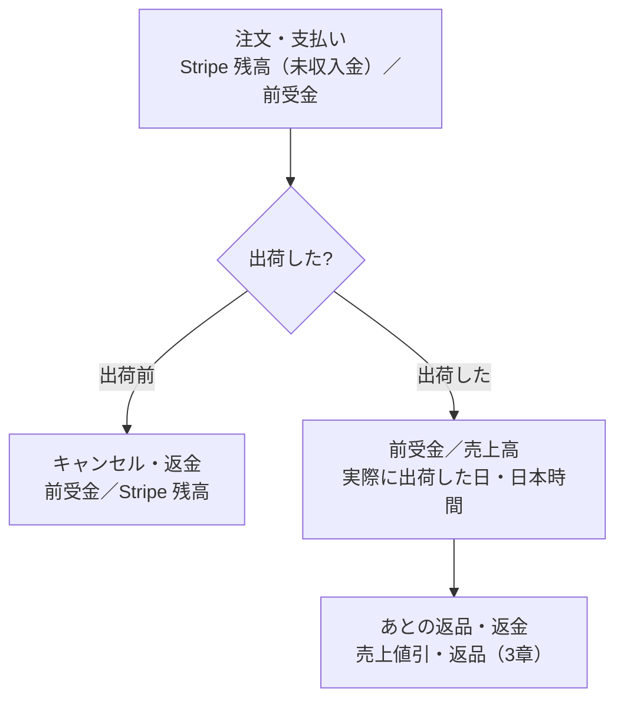
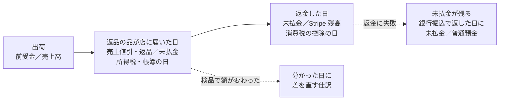

# 売上の計上の方針

> 決めた日: 2026-10-22（案）。改訂: 2026-10-23（第三者のレビュー 1 回目〜4 回目の指摘と、5 回目の確かめの軽い 5 点を反映）
> 状態: AI による 4 回の第三者レビューを通った案（4 回目は条件付きで妥当、12 点を反映）。5 回目の確かめでも反映できているとされ、軽い 5 点を反映した。ユーザーが承認した（2026-10-23）。資格を持つ税理士の確認は受けていない（9章の一覧を開店前に税理士へ持っていき、答えで変わった所だけ直す）
> 対象: 管理画面の会計（ACCOUNTING）と KPI。ネット注文の売上・前受金・在庫と原価・返金・返品・Stripe の手数料と入金
> 前提: 個人事業（青色申告）で始め、後で法人にする（ユーザー、2026-10-22）。受注生産が中心で、代金は注文の時に全額受け取る。送料は価格に含む。一部は在庫品
> ユーザーが決めたこと（2026-10-22）: 帳簿の売上は出荷した日。先に受け取った代金は前受金。現金主義の特例は使わない。管理画面は「受注高」を別に見せる
> 調べた元: 所得税法・法人税法・消費税法・電子帳簿保存法・国税通則法と各施行令・施行規則（e-Gov 法令検索）、国税庁の基本通達・タックスアンサー・質疑応答、裁判所の判例、国税不服審判所の裁決、企業会計基準委員会（ASBJ）の収益認識の基準と適用指針、中小企業の会計に関する基本要領・指針、Stripe と Shopify の公式の説明
> レビュー: [第三者レビュー（1 回目）](./revenue-recognition-policy-review.md)、[再レビュー（2 回目）](./revenue-recognition-policy-review-2.md)、[最終確認（3 回目）](./revenue-recognition-policy-review-3.md)、[独立レビュー（4 回目）](./revenue-recognition-policy-review-4.md)、[改訂の確かめ（5 回目）](./revenue-recognition-policy-review-5.md)（出典ごとの確認結果と URL はそこにある）
> 注意: これは法令と公表された資料から組み立てた方針で、税理士の確認を受けたものではない。4 回の第三者レビューと 5 回目の確かめはどれも AI によるもので、資格を持つ税理士ではない。申告と決算に使う前に、資格を持つ税理士に確かめる（9章）

---

## 概要

帳簿の売上は「出荷した日」に立てる。注文の時に受け取った代金は、出荷するまで「前受金」（お客様への借り）として持つ。管理の画面では、Shopify と同じく注文の日の数字を「受注高」として見せ、帳簿の「売上高」と言葉を分ける。

この核は第三者レビューでも妥当とされた。1 回目のレビューの指摘（13 点）を受けて、年末の在庫と原価、返品の仕訳と日、消費税、法人にした後、年末の締めと帳簿の保存を足した。2 回目のレビューで、法人にした時の売上の分け方、出荷前の返金と前受金、返金の失敗、返品の根拠の番号を直した。3 回目のレビューは「妥当、必ず直す点は残りなし」で、文の正確さを上げる 4 点を反映した。4 回目のレビュー（独立）は「条件付きで妥当」。締めた年の誤りの直し方と返品の日の 2 点が税法とのずれ、電子帳簿保存法・自分で使う品や人にあげる品などの 3 点が抜け、残りの 7 点は正確さを上げる直しで、合わせて 12 点を反映した。最高裁平成5年11月25日判決も根拠に足した（1-2）。5 回目の確かめは「反映できている」で、言葉の軽い直し 5 点を反映した。

表の「A／B」は、左側 A（借方）と右側 B（貸方）の仕訳。

| 場面 | 帳簿（会計） | 管理の画面（KPI） |
| --- | --- | --- |
| 注文して支払った | 「Stripe 残高（未収入金）／前受金」（注文の総額）。売上にしない | 受注高に入れる（注文の日） |
| 出荷した | 「前受金／売上高」（出荷した品の額。実際に出荷した日、日本時間） | 変わらない |
| 出荷前にキャンセルして返金 | 「前受金／Stripe 残高」（返金した日）。売上に関わらない | 返金した日にマイナス |
| 出荷前の一部の返金・お詫びの値引き | 「前受金／Stripe 残高」（返金した日） | 返金した日にマイナス |
| 出荷後の返品（品物が戻る） | 返品の品が店に届いた日に「売上値引・返品／未払金」（検品で額が変われば、分かった日に差を直す）。返金した日に「未払金／Stripe 残高」 | 返金した日にマイナス |
| 出荷後の、品物が戻らない返金・値引き（返送不要・お詫び） | 「売上値引・返品／Stripe 残高」（返金した日） | 返金した日にマイナス |
| 返金の失敗 | 未払金を残す。別の方法（銀行振込など）で返した日に消す | 変わらない |
| 交換（同じ品の色・サイズ） | 売上は変えない。在庫だけ入れ替える | 変わらない |
| チャージバック | 未出荷は「前受金／Stripe 残高」。出荷済みは原因で分け、税理士に確かめるまで科目を決めない（4-3）。申し立ての手数料は「支払手数料／Stripe 残高」 | 処理した日にマイナス |
| Stripe の手数料 | 「支払手数料／Stripe 残高」（取引の日）。消費税の区分は Stripe の月の適格請求書どおり | 出さない |
| Stripe からの入金 | 「Stripe 入金途上／Stripe 残高」→「普通預金／Stripe 入金途上」 | 出さない |
| 年末 | 前受金の残高＝出荷しておらず取り消してもいない品の、前受金の残りの合計を照合。材料・仕掛品・製品・前渡金を数えて原価を翌年へ送る | — |
| 締めた後 | 出来事（返品・返金など）は、起きた日の年の仕訳。締めた年の誤りは、その年の申告を直す（修正申告・更正の請求）。締めた年の帳簿は書き換えない（7-2） | — |
| 店主が自分で使う・人にあげる | 使った日・渡した日に、通常の販売価額で売上に入れる（所得税。消費税は店主と生計を一にする家族が使う分だけ。2-4） | 「自家消費」「宣伝用」の印を付けて一覧にする |

いちばん大きな理由は、所得税・法人税・消費税のどれも、商品の売上を「引渡しの日」とし、その例に「出荷した日」を挙げていること。注文した日と入金した日は例に入っていない。受注生産は注文から出荷まで数週間〜2か月あくので、注文の日に売上を立てると、税の計算と食い違う。

### 章の案内

| 章 | 内容 |
| --- | --- |
| 1 | 売上の日（実際に出荷した日、日本時間）。売買として扱う理由 |
| 2 | 前受金。勘定の名前。年末の在庫と原価。自分で使う品・人にあげる品（2-4） |
| 3 | キャンセル・返品・返金。返金の失敗。交換。返品の条件の表示 |
| 4 | Stripe の手数料（消費税の区分）・入金・チャージバック |
| 5 | 管理の画面（受注高）と帳簿の売上高の照合 |
| 6 | 消費税。免税と課税の判定、免税から課税に変わる年、簡易課税の区分と届け出 |
| 7 | 年末の締め。締めた年を動かさない作り（出来事と誤りの分け方）。帳簿の保存（電子帳簿保存法）。青色申告の手続き |
| 8 | 法人にする時。法人にした後の返品。前受金の移し方 |
| 9 | 税理士に確かめること（優先順） |
| 10 | システムに入れる直し |
| 11 | 改訂の記録 |

### 用語

| 用語 | 意味 |
| --- | --- |
| 前受金 | 商品を渡す前に受け取ったお金。お客様への借り（負債） |
| 未払金 | 返すと決まったが、まだ返していないお金 |
| 売上値引・返品 | いったん立てた売上を、返品・返金で減らす科目 |
| Stripe 残高（未収入金） | Stripe から受け取る権利のお金。今の名前は「クレジット売掛金」 |
| 棚卸資産（在庫） | 材料、縫製中の品（仕掛品）、できあがって送っていない品（製品）、仕入れた品（商品） |
| 基準期間 | 消費税の免税か課税かを決める、2年前の課税売上高 |
| 簡易課税 | 仕入れの消費税を、業種ごとの決まった率（みなし仕入率）で計算する方式 |

---

## 1. 帳簿の売上は「出荷した日」

### 1-1 決めたこと

- 売上の日は、実際に運送会社に渡した日（日本時間）。管理画面の発送の記録は、この日を入れる。後から登録する時は実際の日を入れ、直した跡を残す。登録した日が実際の出荷の日と違うと（12月31日に出して1月2日に登録など）、売上の年が変わるため。日を人の手で動かせる処理は、最高裁平成5年11月25日判決も認めていない（1-2）。
- 年末の前後（12月25日〜1月10日ごろ）の発送は、運送会社の受付の記録と照らす。
- 部分発送では、その発送に入れた品の分だけ売上にする。
- 額は、出荷した品の明細の額（割引は品ごとに割り振る。今の返金の割り振りと同じ考え方）。送料は無料で価格に含むので、分けない。
- 出荷前に、その品に当てた返金・値引き（3-3）がある時は、出荷の時の売上は、その品の明細の額からそれを引いた額（＝その品の前受金の残り）。引かないと前受金がマイナスになり、売上が多く出る。
- 一度決めたら毎年同じ日を使う（継続）。法人にした後も同じ「出荷した日」を選ぶ。
- 受注生産は、請負ではなく売買（棚卸資産の販売）として扱う（1-4）。
- 今は国内にだけ送る。海外に送る時は、この方針を見直す（会計基準の適用指針98項は国内の販売の話。消費税は輸出の免税になる。消費税法7条）。

### 1-2 根拠

「（未確認）」は、第三者レビューが原文を読めなかった規定（調査メモの引用のまま。4 回目のレビューでも読めなかった）。9章 #13 の表にある。

| 税・基準 | 規定 | 中身 |
| --- | --- | --- |
| 所得税（個人） | 所得税法36条1項、所得税基本通達36-8(1)・36-8の2 | 棚卸資産の販売は「その引渡しがあった日」。引渡しの日の例は「出荷した日、船積みをした日、相手方に着荷した日、相手方が検収した日…」のうち、合理的で継続して使う日 |
| 法人税 | 法人税法22条の2第1項、法人税基本通達2-1-2 | 引渡しの日の属する事業年度。例は所得税と同じく出荷した日・着荷した日・検収した日など。選んだ日を継続 |
| 消費税 | 消費税法基本通達9-1-1・9-1-2 | 棚卸資産の譲渡は「引渡しのあった日」。例は出荷した日・検収した日・使用収益ができることとなった日・検針で数量を確認した日。着荷した日は例に載っていない（「例えば」の例示なので、着荷が禁止という意味ではない） |
| 会計基準（法人） | 収益認識に関する会計基準の適用指針98項（未確認） | 国内の販売で、出荷から届くまでが通常の期間なら、出荷時に売上を立ててよい（注文時は対象外。海外への販売も対象外） |
| 中小企業の会計 | 中小会計要領 各論1（未確認）、中小会計指針74項（未確認） | 売上は商品を引き渡した時。実務は「出荷した時に計上する方法が多い」 |
| 判例（法人税） | 最高裁平成5年11月25日第一小法廷判決（平成4年(行ツ)45、民集47巻9号5278頁）。[裁判所のページ](https://www.courts.go.jp/hanrei/55872/detail2/index.html)、[判決の PDF](https://www.courts.go.jp/assets/hanrei/hanrei-pdf-55872.pdf) | 「取引の経済的実態からみて合理的なものとみられる収益計上の基準の中から、当該法人が特定の基準を選択し、継続してその基準によって収益を計上している場合には、法人税法上も右会計処理を正当なものとして是認すべきである」。輸出の売上を船積み（出荷）の時に立てる処理は認めた。銀行に手形を買い取ってもらう日に立てる処理は「その収益計上時期を人為的に操作する余地を生じさせる点において、一般に公正妥当と認められる会計処理の基準に適合するものとはいえない」として認めなかった。まだ確定しない権利を売上にする処理も、確定した権利を現金の回収を待って売上にする処理も認めない |
| 裁決（法人税） | 昭和61年12月8日裁決（裁決事例集No.32-170頁）。[国税不服審判所](https://www.kfs.go.jp/service/MP/03/0201010000.html) | 「引渡しの時期を比較的自由に決定できるし意性が入り込む余地があるものであるから、公正妥当な会計処理の基準として相当とはいえない」。船積日基準が相当とされた |

「出荷した日」を選ぶ理由:

- 3つの税のどれもが例に挙げる。消費税の例には「着荷した日」が載っていない（禁止ではないが、3つの税で例に載る日がそろうのは「出荷した日」）。
- 管理画面の発送の記録がそのまま使える（実際の出荷の日を入れる。1-1）。配達の日は追跡がオフの間は分からない。
- 個人の時と法人の時で同じ日を選べる（継続）。
- 最高裁平成5年11月25日判決は、経済の実態から見て合理的な基準を選んで続けているなら正しいとし、日を人の手で動かせる処理を認めない。出荷の日は品を送り出した事実で決まり、実際の日を入れて直した跡を残す運用（1-1）は、この考え方に合う。

判例・裁決を探した範囲（4 回目のレビュー）:

- 通信販売の返品の日、受注生産の品の売上の日を直接扱った公表裁決・判例は、探した範囲では見つからなかった。方針と反対の結論の事例も見つからなかった。
- 注意として読む事例: 出荷の後に、売り手の大事な義務（取り付け・お直しなど）が残る売り方を始めると、出荷の日が合わなくなる（昭和61年12月16日裁決、裁決事例集No.32-181頁、法人税。[国税不服審判所](https://www.kfs.go.jp/service/MP/03/0201030000.html)）。将来「受注生産品はキャンセル不可・返金なし」にしても、品を渡す義務は残るので、売上の日は引渡しのまま（所得税基本通達36-8(1)）。

### 1-3 選ばなかった案

| 案 | 選ばなかった理由 |
| --- | --- |
| 注文した日（Shopify の売上レポートと同じ） | 3つの税の「引渡しの日」の例に無い。法人税法22条の2第2項の「近接する日」は「一般に公正妥当と認められる会計処理の基準に従つて」が条件で、会計基準（適用指針98項）が認める幅は「出荷から届くまで」。作ってもいない品の注文の日は、その幅に入らない。数週間〜2か月あとに出荷する注文の日が「近接」に入るかは、どの資料にも書かれていない。Shopify の売上レポートは注文の日で数えるが、税の売上だとは説明していない |
| 入金した日（現金主義の特例） | 所得税法67条の特例は、青色申告の承認を受けた「小規模事業者として政令で定める要件に該当するもの」で、前々年の事業所得などが300万円以下（所得税法施行令195条1号「その年の前々年分の不動産所得の金額及び事業所得の金額…の合計額が三百万円以下であること」）なら、届け出をして使えるが、使うと55万円・65万円の青色申告特別控除が受けられない（タックスアンサー No.2072）。法人では使えないので、法人にした時に数え方が変わる |
| 配達された日 | 消費税の例に載っていない。追跡がオフの間は配達の日が分からない |

### 1-4 売買として扱う理由と、請負と見られた時

- 扱い: このお店の受注生産は、決まった型と大きさの服を注文を受けてから作るもので、お客様ごとの設計はしない。だから請負ではなく売買（棚卸資産の販売）として扱う（レビューの見立て。9章 #5 で税理士に確かめる）。
- 請負と見られると、所得税は「目的物の全部を完成して相手方に引き渡した日」（所得税基本通達36-8(4)）、法人税は原則「引渡し等の日」（法人税基本通達2-1-21の7）。引渡しの日の例を挙げる所得税基本通達36-8の3・法人税基本通達2-1-21の8は建設工事などに限る通達で、出荷した日は例に無い。売買より、出荷の日の根拠が弱くなる。
- 作った進み具合に応じて売上を立てる処理は、法人税では「認める」書き方で、原則は引渡しの日。出荷前ならいつでも全額返金でキャンセルできる運用だと、作った部分の対価を受け取る強制力のある権利（法人税基本通達2-1-21の4(3)ロ）には当たりにくい（調査メモの解釈。確定は税理士）。
- 消費税法基本通達13-2-5 には、令和8年の改正で、顧客から特注品の製造を受注し、他の者に製造を委託して引き渡す事業を、特注品の製造を請け負うものとして原則第三種とする趣旨のなお書きが入った（簡易課税の区分の話で、売上の日の話ではない）。言葉の上では「請負」とぶつかるので、「決まった型と大きさの服は特注品ではない」と見る整理を、税理士に見せる材料として置く（9章 #5）。
- 引渡しの日と出荷の日: 民法484条1項では、別段の意思表示が無ければ、特定物でない品（受注生産品・量産の在庫品）を渡す場所は買い手の住所（届いた時）。出荷の日は、通達と判例（1-2）が認める「合理的な日」として選んでいる。だから、毎年同じ日を使う継続が要る。

---

## 2. 先に受け取った代金は「前受金」

### 2-1 決めたこと

- 支払いを受けた時: 借方「Stripe 残高（未収入金）」、貸方「前受金」（注文の総額）。
- 出荷した時: 借方「前受金」、貸方「売上高」（出荷した品の額）。
- 年をまたいで出荷していない分は、前受金のまま翌年へ繰り越す。
- 勘定の名前: 今の「クレジット売掛金」を「Stripe 残高（未収入金）」に改める（システムの表示名だけ変えてもよい）。売上より前に Stripe から受け取る権利なので、売上の代金の貸しである「売掛金」ではない。税の計算は変わらない。税理士が貸借対照表を読む時の誤解を避けるための名前の直し。売掛金と未収入金の使い分けを定めた規定は見つからなかったので、中身に合う名前にする。

### 2-2 根拠

| 税・基準 | 規定 | 中身 |
| --- | --- | --- |
| 消費税 | 消費税法基本通達9-1-27、タックスアンサー No.6165 | 前受金を受け取っても、実際に引き渡した時が売上の時期 |
| 所得税・法人税 | 所得税基本通達36-8、法人税法22条の2 | 売上は引渡しの日なので、受け取った時は売上ではない（前受金だけを書いた通達は無い） |
| 裁決（所得税） | 昭和61年3月13日裁決（裁決事例集No.31-19頁）、平成29年7月26日裁決。[国税不服審判所](https://www.kfs.go.jp/service/MP/02/0302030000.html) | 昭和61年3月13日裁決: 歩合の前払金は「事業所得に係る収入金額とすることはできない」。平成29年7月26日裁決: 前もって受け取る矯正の治療費は、中心となる治療（装置の装着）の時の収入。前もって受け取ったお金は、中心の義務（ここでは品を渡すこと）を果たした時の収入、という向き |
| 青色申告の記帳 | 所得税法148条、所得税法施行規則57条1項 | 正規の簿記で、資産・負債の動きも記録する。前受金は負債。57条1項: 「資産、負債及び資本に影響を及ぼす一切の取引…を正規の簿記の原則に従い、整然と、かつ、明りように記録し、その記録に基づき、貸借対照表及び損益計算書を作成しなければならない」（4 回目のレビューが原文で確認） |
| 会計基準 | 収益認識に関する会計基準78項（未確認）、中小会計指針74項の予約販売（未確認） | 渡す前に受け取った代金は契約負債（前受金）。渡していない分は負債に残して次期へ繰り延べる |

### 2-3 年末の在庫と原価

売上を出荷の日まで送るなら、その売上に対応する原価も、出荷の日まで経費にしない。送らないと、売上だけ翌年に回って経費は今年に残り、所得が小さく出て、税務調査で直される。前受金とセットで扱う。

| 年末に残るもの | 帳簿での置き場 |
| --- | --- |
| 買って持っている材料（生地・副資材） | 棚卸資産（材料） |
| 縫製中の品 | 棚卸資産（仕掛品） |
| できあがって送っていない品 | 棚卸資産（製品） |
| 仕入れた・作り置きの在庫品 | 棚卸資産（商品） |
| 工場に前払いした加工代 | 前渡金（システムの勘定名は「前払金」） |

- 年末に上の5つを数え、原価は翌年の売上（出荷）と合わせて経費にする。
- 評価の方法は、所得税法47条・同施行令99条。区分ごと（製品・仕掛品・材料など）に選ぶ（施行令100条1項）。届け出をしなければ最終仕入原価法（施行令102条）。別の方法を使う届け出の期限は、事業を始めた年の確定申告の期限まで（施行令100条2項）。期限の後に変えるには、変えたい年の3月15日までに承認の申請が要る（施行令101条）。法人の条文は確かめていない（9章の表）。
- 受注生産の品は1着ごとに原価が違うので、個別法を選ぶ方が合う場合がある。選ぶなら期限内の届け出が要る（9章 #1）。
- 年末の前受金の残高と、在庫の一覧を照らす。作り始めた注文の品は、材料・仕掛品・製品・前渡金のどれかにあるはず（まだ作り始めていない注文には在庫が無いので、一対一には合わない）。
- 返品で戻った品を在庫に戻す時の原価の扱いも、在庫の数え方と合わせて決める（9章 #2）。

### 2-4 自分で使う品・人にあげる品

服のブランドでは、店主が自分の商品を着る、知人に贈る、撮影用・紹介用に渡す、ということが起きやすい。0円の注文や在庫の持ち出しは売上に出ないので、漏れやすい。

| 税 | 規定 | 中身 |
| --- | --- | --- |
| 所得税（自分で使う） | 所得税法39条、所得税基本通達39-1・39-2 | 棚卸資産を家事に使うと、「その消費した時におけるこれらの資産の価額に相当する金額は…総収入金額に算入する」。価額は「その者の通常他に販売する価額」（39-1）。取得価額（仕入れた品は仕入れ値、作った品は作った原価）以上で、かつ売値のおおむね70%以上で記帳していれば認められる（39-2「取得価額以上の金額をもって…著しく低額（おおむね70%未満）でない限り」） |
| 所得税（人にあげる） | 所得税法40条1項1号 | 贈与も同じ扱い |
| 消費税 | 消費税法4条5項1号、28条3項1号 | 個人の家事消費は、資産の譲渡とみなす（課税事業者になった後）。家事消費は、店主と生計を一にする家族が使う分（消費税法基本通達5-3-1）。家族以外の人にあげた品は、対価が無いので消費税の売上にならない |

- 店主が商品を自分で使った時は、使った日に、売値（通常の販売価額）で売上に入れる。課税事業者になった後は消費税もかかる（店主と生計を一にする家族が使う分を含む）。
- 人にあげた品も、所得税では同じく売上に入れる（所得税法40条1項1号）。消費税では、家族以外の人にあげた品は売上とみなされない（5-3-1）。ただし、宣伝のために撮影用・紹介用に渡す品を「贈与」とするか「広告宣伝費」とするかは、渡す相手と目的で分かれるので、税理士に確かめる（9章 #8）。
- 管理画面では、0円の注文や在庫の持ち出しに「自家消費」「宣伝用」の印を付け、年末に一覧にする（7-1、10章）。

---

## 3. キャンセル・返品・返金

### 3-1 決めたこと

| 場面 | 帳簿 | 日 |
| --- | --- | --- |
| 出荷前のキャンセル・返金・値引き | 借方「前受金」、貸方「Stripe 残高」。売上に関わらない | 返金した日 |
| 一部だけ出荷した注文の返金 | 返金をどの品に当てるかを先に決める（3-3）。出荷した品なら下の返品・値引き、まだの品なら上の行 | 同上 |
| 出荷後の返品（品物が戻る）の受け取り | 借方「売上値引・返品」、貸方「未払金」（規約どおりに返す予定の額。返品の手数料などを引いた額） | 返品の品が店に届いた日（運送会社の配達の記録で確かめる。継続して使う）。所得税基本通達51-18 ただし書きの「その商品を受け取った日」 |
| 検品で額が変わった・返品を断った | 差の額を直す仕訳（断ったなら上の仕訳の逆） | 検品で分かった日 |
| 出荷後の返品の返金 | 借方「未払金」、貸方「Stripe 残高」 | 返金した日 |
| 出荷後の、品物が戻らない返金・値引き（返送不要・お詫び） | 借方「売上値引・返品」、貸方「Stripe 残高」 | 返金した日 |
| 返金の失敗（出荷前も出荷後も） | 返金の仕訳を立てた後に失敗: 借方「Stripe 残高」、貸方「未払金」。返金の仕訳を立てる前に失敗: 出荷前は借方「前受金」、貸方「未払金」、出荷後は借方「売上値引・返品」、貸方「未払金」。どちらも未払金を残し、別の方法で返した日に消す（3-3） | 失敗が分かった日。消すのは返した日 |
| 年をまたいだ返品 | 前の年の売上は直さず、返品があった年で減らす | 返品の品が店に届いた日の年（消費税は返金した日の年。3-2） |

- 受け取った日にはまだ返金していないので、Stripe の残高は減っていない。そのため受け取りの日は「未払金」を通し、返金した日に Stripe 残高を減らす。Stripe の残高の帳簿と実際を合わせるため。
- 返金の額は、返品の手数料などを引いた額。売上値引・返品にするのは返金する額だけ。
- 返品の見込みで売上を先に減らすこと（返金負債）はしない。
- このお店の返品は、品物を受け取ってから返金する（グループ E-3）。所得税基本通達51-18 のただし書きの「その商品を受け取った日」を継続して使い、返品の品が店に届いた日を「受け取った日」とする。検品を終えた日ではない。検品で額が変われば、分かった日に差を直す仕訳を立てる。
- 検品の日を「受け取った日」にしたいなら、それは通達に書かれていない日なので、使う前に税理士の了解を取る（9章 #3）。
- ここでいう「届いた日」は、返品の品が店に届いた日。お客様に注文の品が届いた日（返品の期限の判定に使う日）とは別。

### 3-2 根拠

| 税・基準 | 規定 | 中身 |
| --- | --- | --- |
| 所得税 | 所得税法施行令141条1号、所得税基本通達51-18。[国税庁の原文](https://www.nta.go.jp/law/tsutatsu/kihon/shotoku/09/03.htm) | 返品で減る収入は、51-18「その商品の返戻につき、その発送をした旨の通知を受けた日（その商品の返戻について承諾を必要とする場合には、その承諾をした日）の属する年分の総売上高から控除する。ただし、その者が継続して同一の経理を行うときは、その商品を受け取った日の属する年分の総売上高から控除して差し支えない」。この店は返品の申請を審査するので、本文どおりなら「承諾した日」。ただし書きの「その商品を受け取った日」（返品の品が店に届いた日）を選ぶ。通達に「検品して額を決めた日」は書かれていない |
| 法人税 | 法人税基本通達2-2-16、法人税法22条の2第5項 | 前の年に売った物の返品は、返品があった事業年度の損失（2-2-16「当該事業年度において契約の解除又は取消し、返品等の事実が生じた場合でも、これらの事実に基づいて生じた損失の額は、当該事業年度の損金の額に算入する」）。日は「返品等の事実が生じた」日で、検品の日と同じとは限らない。法人にした後も、返品の品が店に届いた日にそろえる案（9章 #3）。返品の見込みで売上を減らさない |
| 消費税（返品の日） | 消費税法38条1項・2項、タックスアンサー No.6359 | 38条1項「当該売上げに係る対価の返還等をした日の属する課税期間の課税標準額に対する消費税額から…控除する」。お金を返した日（代金の債権を減らした場合は、減らした日）。前払いの売上では売掛金の減額は起きないので、お金を返した日になる。品物が店に届いた日ではない。38条は課税事業者だけに当てはまる。2項「対価の返還等をした金額の明細を記録した帳簿を保存しない場合には…適用しない」ので、明細の帳簿を保存する |
| 消費税（直接引く経理） | タックスアンサー No.6359、消費税法基本通達10-1-15・14-1-8 | 売上から返品の額を直接引く経理を継続して行っているなら、それも認められる。10-1-15 は同じ課税期間に売って返品を受けた分、14-1-8 は前の課税期間（課税事業者だった期間）に売った品の返品も含めて、返還等をした課税期間の売上から引く。どちらも引き方の通達で、日を動かすものではない（日は38条1項のまま）。帳簿の保存は必要（14-1-8 (注)） |
| 消費税（出荷前のキャンセル） | 消費税法基本通達9-1-27 | まだ譲渡していないので、38条の返還等に当たらない（直接の規定は無く、通達からの読み） |
| 返品の見込み | 法人税法22条の2第5項、中小会計指針の改正の公表（2023-05-17。日本税理士会連合会・日本公認会計士協会・日本商工会議所・企業会計基準委員会） | 中小の会社は収益認識会計基準を使わず、実現主義でよい。法人税は返品の見込みで売上を減らさない。個人事業は、所得税法に法人税法22条4項のような「会計基準に従う」規定が見当たらない（会計基準が当たらないと明記した資料は見つからなかった）。だから返金負債は立てない |

消費税の日のずれ:

- 消費税の返品の日は、お金を返した日（消費税法38条1項「対価の返還等をした日」）。所得税の返品の日（返品の品が店に届いた日）と違う年になりうる。例: 12月28日に品物が店に届き、1月5日に返金した返品は、所得税は今年、消費税は来年。
- 消費税法基本通達14-1-8・10-1-15 は、返品の額を売上から直接引く経理を認める通達で、日を動かすものではない。
- だから、年末をまたぐ返品は、所得税と消費税で別の年に入る前提で、消費税の計算用に「返金した日」の一覧を別に持つ。
- 課税事業者になる前は関係しない。なった後に、消費税は返金した日で別に数える仕組みでよいかを、税理士に確かめる（9章 #3）。
- Stripe の返金が失敗し、後で銀行振込で返した場合、消費税の控除の日は振込の日になる（38条の「返還等をした日」）。
- 年末には、受け取り済みで返金前の返品（未払金）の一覧を照合する（7-1）。

### 3-3 決め事の細かい所（案）

レビューが「決める」としていて規則を示していない点は、次を案とする。税理士に確かめる（9章 #10）。

| 場面 | 決め方（案） |
| --- | --- |
| 一部だけ出荷した注文の返金 | 品を指定できる返金（返品・一部のキャンセル）は、指定した品に当てる。品を指定しない値引きは、出荷した品とまだの品の額の比で分ける。まだの品に当てた分は「前受金／Stripe 残高」。その品を後で出荷する時の売上は、その品の前受金の残り（1-1） |
| 返金の失敗 | Stripe の返金が失敗すると、お金は Stripe 残高に戻る。出荷前も出荷後も、失敗の時は「Stripe 残高／未払金」とし、未払金を残す。取り消した注文の分は、品を渡す借り（前受金）ではなく、お金を返す借りなので、前受金に残さない（残すと7-1の照合が合わなくなる）。返金の仕訳を立てる前に失敗した時は、出荷前は取り消した注文の前受金を「前受金／未払金」で、出荷後の品物が戻らない返金・値引きは「売上値引・返品／未払金」で、未払金に立てる。日は失敗が分かった日（年末をまたぐ時は、その日の年に入れる）。銀行振込などで返した日に「未払金／普通預金」で消す |
| お客様の返送料を店が持つ時 | 店のまちがいで返す返送料は、売上の値引きより店の費用（荷造運賃）に近い。費用として扱う案。金額が小さいので、一度決めて継続する |
| 交換（同じ値段の別の色・サイズ） | お金が動かないので売上は変えない。在庫だけ入れ替える。今のシステムは交換の品を0円の明細で足す作りで、これと合う |
| 交換の手数料・送料を受け取る時 | その分は売上。出荷基準に合わせ、交換の品を出荷した日の売上にする（受け取った時は前受金）。受け取った日にする考えもあるので、決めて継続する |
| 値段の違う品への交換 | 差額を受け取るなら、交換の手数料・送料と同じく、受け取った時は前受金、交換の品を出荷した日に売上。返すなら返金 |
| 将来キャンセル料を取る時 | 今は出荷前なら全額返すので関係しない。損害の埋め合わせの性格なら消費税はかからず、事務の手数料なら課税（消費税法基本通達5-5-2。区分せずに一括で受け取る時は全体を不課税として扱う、というなお書きもある） |

### 3-4 返品の条件の表示（特定商取引法15条の3）

- 通信販売は、返品の特約（このお店は「届いてから7日以内、理由によって受け付ける」）を広告（商品ページ）と最終確認の画面に出していなければ、届いてから8日間は返品できる。送り返す費用はお客様の負担。
- 売上の日には影響しない。返品の前提（7日以内、理由で受ける）が法的に効くかに関わる。商品ページと注文の最終確認の画面に返品の条件が出ているかを確かめる（10章）。

---

## 4. Stripe の手数料・入金・チャージバック

### 4-1 決めたこと

- 売上は手数料を引く前の総額で立てる（中小会計要領 各論1(4) の総額主義、消費税法28条1項）。
- 手数料は「支払手数料」で、取引の日の費用にする。出荷まで待たない（所得税法37条1項・法人税法22条3項2号の「債務の確定した費用」。金額が小さく、前払費用にする必要は薄い）。
- 返金しても元の手数料は戻らない（Stripe の説明）ので、そのまま費用に残す。
- 入金は、今の作りのとおり「Stripe 入金途上」を通して「普通預金」へ。入金の日は売上の日と関係ない（タックスアンサー No.6165）。

### 4-2 手数料の消費税の区分

- 区分は、Stripe が毎月出す適格請求書（インボイス）に書かれた区分どおりに記帳する。請求書は毎月10日までにダッシュボードに出る。Stripe Japan は適格請求書発行事業者。
- Stripe は支払い方法ごとに課税かを示している。Visa と Mastercard は 2026-04-01 から課税、為替の手数料は 2025-10-31 から課税、チャージバックの手数料も課税（Stripe の説明。事業者文書で、税務の根拠ではない）。
- 2026-04-01 以後は、Stripe の表に並ぶ支払い方法（JCB・Amex・コンビニ・銀行振込なども）はすべて課税。Link・Apple Pay・Google Pay は元の支払い手段しだい。開店はこの日より後なので、実際には「全部課税」に近い。区分は請求書どおり。
- 国税庁の質疑応答「クレジット手数料」（非課税）は、加盟店がカードの代金の債権を信販会社に渡す形の話。Stripe の手数料が当てはまるかは契約の形で決まる。食い違いではない。非課税と分かれうるのは、主に 2026-03-31 以前の Visa・Mastercard の話。
- 消費税が免税の間、簡易課税・2割特例・3割特例を使う間は、この区分は納める額に影響しない。本則（簡易課税などを使わない計算）の課税事業者になった時だけ効く。

### 4-3 チャージバック

お客様がカード会社に支払いの取り消しを申し立てると、Stripe は代金と手数料を残高から引く。勝てば戻る。

| 場面 | 帳簿（案） | 日 |
| --- | --- | --- |
| 出荷済みの注文 | 原因で分ける（下）。税理士に確かめるまで、既定の科目は置かない | 処理した日 |
| 未出荷の注文 | 「前受金／Stripe 残高」 | 処理した日 |
| 申し立ての手数料 | 「支払手数料／Stripe 残高」（課税） | 処理した日 |
| 勝って戻った時 | 上の逆の仕訳 | 戻った日 |

出荷済みの注文のチャージバックは、原因で分ける。チャージバックは店が自分から返金するものではないので、返品・返金と同じ「売上値引・返品」を既定にしない。

- 品が届かない・品が違うなどの争いで負けた: 売上値引・返品（返品・値引きに近い）。
- 不正利用: 売買の無効・取消し、または貸倒れの候補。候補になる規定:
  - 消費税法基本通達14-1-11「課税資産の譲渡等を行った後に、当該課税資産の譲渡等が無効であった場合又は取消しをされた場合には、当該課税資産の譲渡等はなかったものとする」（[国税庁の原文](https://www.nta.go.jp/law/tsutatsu/kihon/shohi/14/01/02.htm)）
  - 所得税法施行令141条3号「無効な行為により生じた経済的成果がその行為の無効であることに基因して失われ、又は…取り消すことのできる行為が取り消されたこと」
  - 消費税法39条1項（貸倒れ）
- どちらも、所得税・法人税では、起きた年の損失・売上の減りになる。消費税で返還等・取消し・貸倒れのどれになるかは、税理士に確かめるまで決めない（9章 #11）。

一部だけ出荷した注文は、3-3 と同じ当て方で、出荷済みの分と未出荷の分に分ける。

---

## 5. 管理の画面（KPI）は「受注高」

### 5-1 決めたこと

- 管理画面の KPI の「売上」は、名前を「受注高」に変え、注文の日（支払いを受けた注文）で数える。Shopify の売上レポートと同じ考え方（注文の日にプラス、取消・返金は処理した日にマイナス）。
- マイナスの日は、取消も返品も「返金した日」にそろえる（Shopify の「処理した日」と同じ）。
- 発送済みの注文も受注高に入れる（今は外れている。台帳の S-2）。
- 帳簿の「売上高」（出荷した日）は会計の画面で見る。KPI と会計で数字が違うのは、日の基準が違うため。
- 受注高と帳簿の売上高の差は、次で照合する。ある期間の「受注高 − 売上高」は、おおよそ「前受金の期末の残高 − 期首の残高」に、返品の日のずれ（受注高は返金した日、帳簿は返品の品が店に届いた日）と交換を足し引きしたものになる。照合の表はこの内訳で作る（形は9章 #12）。

### 5-2 根拠

- 社内の画面で注文の日の数字を「受注高」として見ることを禁じる規定は、所得税法・法人税法・消費税法・会計基準・中小会計要領・中小会計指針に見つからない。
- 中小会計要領 総論9(5)（単一性の原則、未確認）は、目的によって形の違う数字を作ってよいが、元は信頼できる会計記録で、事実をゆがめないとする。受注高は注文の記録から作り、売上高とは名前を分けて混同しないようにする。
- Shopify は売上レポート（注文の日）と、お金の動きの報告を分け、後者は「会計上の売上ではない」と書く。

---

## 6. 消費税（免税・課税・簡易課税）

### 6-1 免税の間も、出荷の日の売上を数える

「免税なら消費税の項は関係しない」は言い過ぎ。免税か課税かの判定そのものが、出荷した日の売上から返品を引いた額で決まる。

- 免税か課税かは、2年前（基準期間）の課税売上高で決まる（消費税法9条。1000万円以下は免税）。この売上は「出荷した日」の売上から返品を引いた額。だから免税の間も、出荷の日の売上を正しく数える。
- 個人は、開業した年とその次の年は、基準期間が無いので原則免税。ただし前の年の1月〜6月の売上と給与が両方1000万円を超えると課税（消費税法9条の2。給与で判定してよいので、人を雇っていなければ多くは免税のまま）。
- インボイスの登録をすると、免税の期間でも課税事業者になる。お客様が消費者だけなら、登録しなくても困らない。会社のお客様が多いなら考える。
- 免税の間は、帳簿は税込で付ける（個別通達「消費税法等の施行に伴う所得税の取扱いについて」（平元直所3－8）5「消費税を納める義務が免除される個人事業者については、その行う取引について税抜経理方式で経理をしている場合であっても…税込経理方式を適用して所得税の課税所得金額を計算することに留意する」。[国税庁の原文](https://www.nta.go.jp/law/tsutatsu/kobetsu/shotoku/shinkoku/890329/01.htm)）。
- 登録した場合、課税事業者のお客様（会社名で買ったお客様）への返品・値引きが1万円以上なら、求めが無くても適格返還請求書の交付義務がある（消費税法57条の4第3項、同施行令70条の9第3項2号）。相手は条文上「他の事業者」で、免税事業者を除く（57条の4第1項の括弧書き。この条で同じ）。消費者への返金には交付義務が生じない（インボイスQ&A 問24-3 も同じ趣旨。原文は未確認）。
- 登録をしたら、交付した適格請求書・適格簡易請求書・適格返還請求書の写し（電子で出したならそのデータ）を保存する（消費税法57条の4第6項）。置き場と期間は 7-3。

### 6-2 免税から課税に変わる年

| 場面 | 扱い | 根拠 |
| --- | --- | --- |
| 免税の年に受け取った前受金を、課税の年に出荷 | 課税の売上 | 消費税法基本通達9-1-27 |
| 免税の年に売った品の返品 | 38条の控除なし | 消費税法基本通達14-1-6 |
| 課税に変わる時の在庫 | 仕入れの税額の調整がある（仕入れた材料から作った仕掛品・製品も含む）。在庫の明細の書類を保存しないと使えない。仕入れの税額を実際に計算する本則の時だけ意味があり、簡易課税・2割特例では効かない | 消費税法36条（1項・2項） |

### 6-3 簡易課税・2割特例・3割特例を使う場合

- 簡易課税の区分は、自分で作って消費者に売る形（製造小売）と、材料を自分で買って縫製を外に頼む形（製造問屋）が第三種（みなし仕入率70%）。できあがった服を、性質や形を変えずに仕入れて売るだけなら、小売の第二種（80%）（消費税法基本通達13-2-4〜13-2-6）。このお店は受注生産なので第三種になりやすい。13-2-5 には令和8年の改正で、特注品の製造を受注して他の者に製造を委託して引き渡す事業を原則第三種とするなお書きが入った（1-4）。作り置きの在庫品の区分も含めて、税理士に確かめる（9章 #7）。
- みなし仕入率は消費税法施行令57条1項で、第二種80%・第三種70%（4 回目のレビューが原文で確認）。
- 簡易課税を使うには、原則として、使いたい課税期間が始まる前日までに「消費税簡易課税制度選択届出書」を出す（消費税法37条1項。2割特例・3割特例の翌年は申告期限までに出せばよい特例がある（国税庁「令和８年度税制改正特集」））。基準期間の課税売上高が5000万円以下の年だけ使える。
- 受注生産の品（第三種になりやすい）と、仕入れて売るだけの品（第二種）が混ざるなら、売上を事業の区分ごとに分けて記録する（消費税法施行令57条）。分けないと、分けていない売上は低い方の率の事業（第二種と第三種なら第三種）として計算される（同条4項2号）。
- 工場が材料も用意して作った完成品を仕入れ、店のネームを付けて売るだけなら、「性質及び形状を変更しないで販売する」に当たり第二種になりうる（消費税法基本通達13-2-2 なお書き(1)「他の者から購入した商品に、商標、ネーム等を貼付け又は表示する行為」）。ただし受注してから工場に作らせる物は、13-2-5 なお書きで第三種になりうる。
- 2割特例は 2026-09-30 を含む課税期間まで（個人は2026年分まで）。個人は 2027年分・2028年分に3割特例がある。国税庁の案内では、インボイス発行事業者の登録を受けたことにより免税事業者から課税事業者となった個人事業者で、基準期間（適用を受ける年の2年前）の課税売上高が1,000万円以下の人が、令和９年分・令和10年分の確定申告で、納付税額を売上税額の３割とすることができる（4 回目のレビューが確認）。使えるかは税理士に確かめる（9章 #7）。
- 返品の消費税の日は 3-2。Stripe の手数料の区分は 4-2。

---

## 7. 年末の締めと帳簿の保存

### 7-1 年末の切り分けと照合

- 売上の年は、実際に出荷した日の年。管理画面に登録した日ではない（1-1）。
- Stripe の仕訳の日付も日本時間で切る。世界標準時の日付で切ると、日本時間の0時〜9時の取引の日がずれる（例: 世界標準時の10月21日16時は、日本時間の10月22日）。
- 前の年に作った注文の、翌年の出荷・返金・入金は、出来事の日の年に入れる。
- 年末に照合する物:
  - 前受金の残高＝出荷しておらず取り消してもいない品の、前受金の残り（1-1）の合計（注文の総額を足すのではない。一部だけ出荷した注文や、出荷前に一部を返金した注文は、残りだけを足す）
  - 在庫の一覧（2-3）
  - 返すと決まって返金前の返品・キャンセル（未払金）の一覧
  - 管理画面の発送の記録と、運送会社の受付の記録
  - 「自家消費」「宣伝用」の印を付けた持ち出しの一覧（2-4）

### 7-2 締めた年の帳簿は動かさない

- 締めた年の帳簿は、後から注文の状態が変わっても動かさない。
- 締めた後に起きた出来事（返品・返金・キャンセル・チャージバックなど）は、起きた日の年の仕訳で入れる（所得税法施行令141条1号、所得税基本通達51-18、法人税基本通達2-2-16、消費税法38条）。
- 締めた年の誤り（出荷の日の入れ違い、売上の漏れ・二重など）が見つかった時は、額の大小にかかわらず、その年の申告を直す。税が増えるなら修正申告（国税通則法19条）、減るなら更正の請求（同23条。申告期限から5年以内）。締めた年の帳簿は書き換えず、直しの仕訳と「どの年のどの申告を、なぜ直したか」の記録を残す。直し方は税理士に相談する（9章 #4）。
- 直しの仕訳をどの年の日付で入れるかは税理士に相談する（9章 #4）。ただし、どの日付でも、直しは翌年の所得（損益）に入れない。その年の申告を直したうえで翌年の売上・費用にも入れると、同じ額を二度数える。翌年の帳簿で直すなら、個人は元入金、法人は繰越利益剰余金（期首の残高）で受ける。
- 「小さい誤りは翌年の仕訳で吸収する」ことはしない。税法にそういう扱いは無い。所得税にも、前の年の誤りを今年の損益で直す決まりは無い。
- 根拠（国税通則法）: 19条1項「先の納税申告書の提出により納付すべきものとしてこれに記載した税額に不足額があるとき」（修正申告）。23条1項「法定申告期限から五年…以内に限り」（更正の請求）。
- 理由: 正規の簿記の帳簿と、税務調査で見せる帳簿が、後から変わるのは困る。今の作りは締めた後も毎回作り直すので、過去の売上が変わりうる（10章）。

### 7-3 帳簿の保存（電子帳簿保存法）

条文（電子帳簿保存法2条5号・4条・7条、同施行規則2条・4条、所得税法施行規則63条）は、4 回目のレビューが e-Gov 法令検索の原文で確かめた。国税庁の「電子帳簿保存法一問一答【電子取引関係】」は PDF に暗号がかかり読めていない。やり方は 9章 #6 で税理士に確かめる。

- Stripe の月の請求書・手数料の明細・入金の明細、お客様へ送った注文確認・領収のメールは、紙ではなく電子のまま保存する決まり（2024年1月から）。電子帳簿保存法7条「電子取引を行った場合には、財務省令で定めるところにより、当該電子取引の取引情報に係る電磁的記録を保存しなければならない」。
- 基準期間（2年前）の売上高が5000万円以下で、税務署の求めに応じてデータを出せるなら、検索の要件は要らない（同施行規則4条1項）。
- 改ざんしていないことを示す方法は、(1) 訂正・削除の記録が残るシステム、(2) 訂正・削除ができないシステム、(3) 訂正・削除の防止の事務処理の規程を定めて守る、のどれか（同4条1項。タイムスタンプでもよい）。システムで (1) か (2) を作るなら、規程はその補いとして置く。
- 自分で作ったシステムにデータを置くので、「システムの概要を記載した書類」を備え付ける（同施行規則4条1項、2条6項6号で準用する2条2項1号イ）。2条2項1号は「保存義務者が開発したプログラム以外のプログラムを使用する場合にはイ及びロに掲げる書類を除く」なので、自分で作ったシステムでは備え付けが要る。
- データはディスプレイと紙に、すぐに見やすく出せるようにする（同2条2項2号「整然とした形式及び明瞭な状態で、速やかに出力することができる」）。
- 帳簿（仕訳帳・総勘定元帳）を自分のシステムの中だけで持つなら、電子帳簿保存法4条1項と施行規則2条2項の要件（システムの概要・開発の時の書類・操作説明書・事務の手順の書類、見られる状態、提示の求めに応じること）を満たす。満たさないなら、帳簿は紙に出して保存する。65万円控除を電子帳簿で受けるなら、さらに「優良な電子帳簿」の要件と届け出（タックスアンサー No.2072（注1））。
- 保存の期間は、帳簿は7年、書類は原則7年（所得税法施行規則63条1項「起算日から七年間（第三号に掲げる書類のうち、現金預金取引等関係書類に該当する書類以外のものにあつては、五年間）」）。電子取引のデータも、紙なら保存すべき期間と同じ期間（施行規則4条1項）。
- 自分のシステムの注文・発送・返金の記録が、この「取引の記録」の元になる。消せない・直した跡が残る作りにする（10章）。

### 7-4 青色申告の手続き

- 青色申告の承認の申請は、その年の3月15日まで。1月16日以降に新しく始めた事業なら、開始から2か月以内（所得税法144条）。期限を過ぎると、その年は青色申告にならない。
- 55万円控除は、正規の簿記で記帳し、期限内の申告と貸借対照表の添付が条件。65万円控除は、それに加えて e-Tax で出すか、優良な電子帳簿で保存する（タックスアンサー No.2072）。前受金を持つので、貸借対照表を作る正規の簿記が前提になる。
- 現金主義の特例は使わない（使うと55万円・65万円の控除が受けられない）。

---

## 8. 法人にする時

### 8-1 売上の日と納税者

- 法人は個人とは別の納税者（国税庁の質疑応答: 法人成りは「事業が廃止され」）。法人の最初の事業年度から、同じ「出荷した日」を選んで継続する。
- 売上は、出荷した時の売り手（お客様との売買契約の当事者）のもの。個人が売り手として出荷した分は個人の売上、法人が売り手として出荷した分は法人の売上。8-3 の (b) で契約を法人に移した注文は、移した後の出荷から法人の売上。(a)・(c) では、法人ができた後も個人が出荷するので、その分は個人の売上。
- 個人の時の売上を法人の売上にできない根拠: 消費税法基本通達9-6-1 ただし書き「当該法人が個人事業を引継いで設立されたものである場合における当該個人事業者が行った資産の譲渡等…については、この限りでない」（4 回目のレビューが確認。[国税庁の原文](https://www.nta.go.jp/law/tsutatsu/kihon/shohi/09/06.htm)）。

### 8-2 個人の時に出荷した品が、法人にした後に返品された時

| 税 | 扱い | 根拠 |
| --- | --- | --- |
| 所得税 | 事業をやめた後に出た損失は、やめた年（またはその前の年）の必要経費にする。生じた日の翌日から2か月以内に更正の請求をする（確定申告を出した後の話。まだ出していない年なら、その申告に入れる） | 所得税法63条・152条。返品は、所得税法施行令141条1号（返品・値引きで収入が減ること）により所得税法51条2項の損失に当たるので、63条の「損失」に入る |
| 消費税 | 事業をやめた後の返品は、38条の控除が無い | 消費税法基本通達14-1-7 |

返品の受付期間（届いてから7日）が短いので件数は少ないはず。法人にした直後の返品はどちらで扱うかを、法人にする前に決めておく（9章 #9）。

### 8-3 未出荷の注文（前受金）の移し方

| 案 | 中身 |
| --- | --- |
| (a) | 個人で受けた注文は個人で出荷し終えてから、個人の事業をやめる |
| (b) | お客様の承諾を得て、売買契約を法人に移す（民法539条の2）。規約で前もって承諾をもらう形にするなら、弁護士にも確かめる |
| (c) | 個人が売り手のまま、作る・送る作業を法人に頼む |

どれも税と法律の扱いが違う。移し方の税務は資料が無いので、法人にする前に税理士に確かめる。法人にする時期を、未出荷の注文が少ない時に選ぶと、移す物が少ない。

### 8-4 そのほか

- 在庫・材料・作りかけの品を個人から法人へ移すと、個人の売上（譲渡）になる。値段は、販売用の品なら通常の販売価額（所得税基本通達39-1「その者の通常他に販売する価額」）を目安にする。そのおおむね70%に満たない値段で移すと「著しく低い価額」として、通常の販売価額と移した値段の差が個人の売上に足される（おおむね70%の額と移した値段の差としてもよい）。根拠: 所得税法40条1項2号「著しく低い価額の対価による譲渡 当該対価の額と当該譲渡の時におけるそのたな卸資産の価額との差額のうち実質的に贈与をしたと認められる金額」、所得税基本通達40-2「39－1に定める価額のおおむね70%に相当する金額に満たない対価により譲渡する場合」、40-3「…差額に相当する金額をいうのであるが、…おおむね70%に相当する金額からその対価の額を控除した金額として差し支えない」。法人の側の受け入れの値段と、個人が課税事業者の年なら消費税も、税理士に確かめる（9章 #9）。
- 法人は事業年度を自由に決められる。1月〜12月でないなら、会計のシステムの期間を直す（10章）。
- 新しい法人は、資本金が1000万円未満なら、基準期間がない事業年度（ふつうは第1期と第2期）は原則免税（消費税法12条の2。資本金1000万円以上の新設法人は免税にならない）。設立後6か月の売上と給与が両方1000万円を超えると課税（消費税法9条の2）。インボイスの登録をすると課税事業者になる。個人の時と別に、判断をやり直す。
- 最初の事業年度が7か月以下だと、2期目の「最初の6か月」の判定が変わる（消費税法9条の2第4項）。法人にする時に、最初の事業年度の長さを税理士と決める。
- Stripe のアカウントの事業者情報・入金先の口座（法人名義）、適格請求書発行事業者の登録の取り直しは、法人にする前に Stripe と税理士に確かめる。

---

## 9. 税理士に確かめること

優先順。上のものほど、期限や戻せなさの点で先に要る。

| 順 | 確かめること | なぜ先か |
| --- | --- | --- |
| 1 | 開業の届け・青色申告の承認の申請（所得税法144条）の期限と、65万円控除の条件（e-Tax か優良な電子帳簿）。現金主義の特例を使わない判断。棚卸資産の評価の方法の届け出の期限（施行令100条2項）と、区分ごと（製品・仕掛品・材料など）にどの方法を選ぶか（施行令100条1項）。受注生産の品に個別法を選ぶか（届け出を出さないと最終仕入原価法、施行令102条）。期限の後に変えるなら、その年の3月15日までの承認の申請（施行令101条） | 期限を過ぎると、その年は青色申告にならない／最終仕入原価法になる |
| 2 | 年末の在庫（材料・仕掛品・製品・前渡金）の数え方と、原価に入れる費用（施行令103条: 原材料費・労務費・経費。外注の加工代を含む）。返品で戻った品の原価の戻し方 | 売上を翌年に送るなら必ず対で要る。抜けると所得の計算が誤る |
| 3 | 返品の日: 所得税は「返品の品が店に届いた日」（所得税基本通達51-18 ただし書き「その商品を受け取った日」）で継続してよいか。検品の日を使いたいなら、その可否。消費税は返金した日（消費税法38条1項）で別に数える仕組みでよいか（年末をまたぐ返品で、所得税と消費税の年がずれる） | 年末をまたぐ返品で所得の年が変わる |
| 4 | 締めた年の誤りの直し方（修正申告・更正の請求）と、締めの運用。直しの仕訳を、締めた年の帳簿に訂正として足すか、翌年の期首の残高で直すか（どちらでも翌年の損益は通さない。7-2） | 修正申告・更正の請求の要否に直結する |
| 5 | 「出荷した日」を3つの税で継続して使ってよいか。受注生産を売買と見てよいか（請負と見られないか）。出荷前に全額返金する運用が「一定の期間にわたり充足」に当たらないと言えるか。消費税法基本通達13-2-5 のなお書き（特注品の製造の受注は請負）があるが、決まった型と大きさの服は特注品ではないと見てよいか | 方針の土台 |
| 6 | 電子帳簿保存法: 自分で作ったシステムの概要の書類、帳簿を電子だけで持つか紙に出すか、事務処理の規程、保存の期間（7-3）。Stripe の書類・送ったメールの保存の仕方 | 2024年1月から義務。帳簿の備え付けは青色申告の前提 |
| 7 | 消費税: 開業の年と次の年は免税か。インボイスの登録をするか。課税になった時、本則・簡易課税・2割特例・3割特例のどれか。簡易課税・インボイスの登録の届け出の期限（簡易課税は消費税法37条1項）。簡易課税の区分（第三種か第二種か。13-2-5 のなお書き、13-2-2 のなお書き(1)を含む）と、事業の区分ごとの売上の記録（施行令57条）。免税から課税に変わる年の前受金・返品・在庫の扱い（在庫の税額の調整は本則の時だけ効く） | 売上の数え方と帳簿（税込か税抜か）が決まる |
| 8 | 店主が自分で使う品・人にあげる品の扱い（2-4）。撮影用・紹介用に渡す品を「贈与」とするか「広告宣伝費」とするか | 漏れると売上の漏れになる |
| 9 | 法人にする時: 未出荷の注文の移し方（3案）、在庫の移し方と値段（所得税法40条1項2号、所得税基本通達39-1・40-2・40-3）、法人の事業年度（最初の事業年度の長さを含む）、法人の消費税、法人にした後の返品（所得税法63条・152条、消費税法基本通達14-1-7） | 法人成りの前に決めないと戻せない |
| 10 | 未出荷の注文への返金・値引きを前受金のマイナスにすること。一部だけ出荷した注文の返金の当て方。返送料を店が持つ分の科目。交換の手数料・送料を売上にする日。返品・交換の手数料とキャンセル料の消費税 | 仕訳の形が決まる |
| 11 | チャージバックの原因ごとの扱い（4-3: 売上値引・返品か、取消し・無効か、貸倒れか。消費税の返還等・取消し・貸倒れ）。Stripe の手数料を月の適格請求書どおりに区分してよいか | 課税事業者で本則の計算をする時だけ額に効く |
| 12 | 管理画面の「受注高」と帳簿の「売上高」の照合の表の形 | 税の額には効かない |
| 13 | 次の「資料で確かめきれていない点」 | 下の表 |

### 資料で確かめきれていない点

| 点 | 状態 |
| --- | --- |
| 所得税法施行規則57条 | 確認済み（4回目のレビュー）。1項「資産、負債及び資本に影響を及ぼす一切の取引…を正規の簿記の原則に従い、整然と、かつ、明りように記録し、その記録に基づき、貸借対照表及び損益計算書を作成しなければならない」。所得税法36条1項・47条・148条、施行令99条・100条2項・102条は2回目のレビューで原文と一致を確認 |
| 所得税法施行令101条 | 確認済み（4回目のレビュー）。2項「その新たな評価の方法を採用しようとする年の三月十五日まで」 |
| 所得税基本通達51-18 ただし書き | 確認済み（国税庁の原文）。「その商品を受け取った日」（検品を終えた日ではない） |
| 電子帳簿保存法の要件 | 確認済み（4回目のレビュー。法2条5号・4条・7条、施行規則2条・4条）。ただし国税庁の「電子帳簿保存法一問一答【電子取引関係】」は PDF に暗号がかかり読めていない |
| 3割特例の使える人の条件 | 確認済み（4回目のレビュー）。個人事業者・基準期間の課税売上高1000万円以下・登録で課税事業者になった人。令和9年分・10年分 |
| 簡易課税のみなし仕入率（70%・80%） | 確認済み（4回目のレビュー）。消費税法施行令57条1項: 第二種80%・第三種70% |
| 4回目・5回目のレビューが原文を引いた規定 | 国税通則法19条1項・23条1項、所得税法39条・40条1項、所得税基本通達39-1・39-2・40-2・40-3、所得税法施行令141条3号、消費税法57条の4第1項・第6項、消費税法施行令57条4項2号・70条の9第3項2号、消費税法基本通達5-3-1・9-6-1・10-1-15・13-2-2・14-1-8・14-1-11、民法484条1項。確認済み（39-2・40-3・57条の4第6項・施行令57条4項2号・民法484条は5回目のレビューが原文で確認。4回目のレビューは番号だけ示し、本文を引いていなかった） |
| 収益認識会計基準78項、適用指針98項、中小会計要領、中小会計指針74項 | 4回目のレビューでも原文（PDF）を読めていない。中小会計指針は、2025年9月の修正版で項番号が変わっていないかも未確認 |
| 収益認識会計基準の「結論の背景101項」 | 原文でも確かめられなかったので、この方針では使わない |
| 個人事業に会計基準が当たらないこと | 明記した一次資料は見つからなかった |
| Stripe の手数料の課税の区分と日付 | Stripe の説明（事業者文書）のみ。4回目のレビューも読んでいない。税務の根拠ではない |
| ASBJ ほか4団体の公表（2023-05-17）の原文 | 中小会計指針の改正の公表。原文は未確認で、二次資料（TKC など）で確かめた |
| インボイスQ&A 問24-3 | 4回目のレビューでも原文は未確認。返金の交付義務は、消費税法57条の4第1項の括弧書きで読める |
| 最高裁昭和53年2月24日判決（所得税の権利確定主義） | 平成25年3月25日裁決が参考判決として挙げていることだけ確かめた。判決の本文は未確認。この方針では使わない |
| 法人の在庫の評価の方法の条文 | 所得税法側（施行令100条2項・101条・102条）だけ確かめた。法人側は確かめていない |
| 個人が受けた前受金を法人に移す時の税務（個人側・法人側の経理） | 資料が見つからない |
| 通信販売の返品の日、受注生産の品の売上の日を直接扱った判例・公表裁決 | 探した範囲では見つからなかった。反対の結論の事例も見つからなかった |

---

## 10. システムに入れる直し（概要）

今の会計は、注文の日に「クレジット売掛金／売上高」を立て、発送した注文を売上から外している（台帳の S-2）。この方針に合わせるには、次を直す。直しの設計と計画は別に作る。

| 場所 | 直すこと |
| --- | --- |
| 売上の変換（`src/lib/sales/order-sales.ts`） | 注文の状態から作る形をやめ、支払い・発送・返金・返品の受け取りの出来事から仕訳を作る。部分発送は、数量・単価・割引・端数から発送ごとの額を割り振る（今の返金の割り振りの考え方を使う）。出荷の時の売上の額は、その品の明細の額から、出荷前にその品に当てた返金・値引きを引いた額（その品の前受金の残り） |
| 会計の窓口と画面（`src/app/api/admin/kpi/cost-profit/route.ts`、`src/components/CostProfitSection.tsx`） | 前受金の仕訳、出荷の日の売上。年をまたぐ出荷・返金・入金を、出来事の日の年で取得する（今は注文を作った年で絞る） |
| Stripe の仕訳（`src/lib/finance/stripe-journal.ts`） | 支払いの時は前受金、売上は発送の側で。二重に立てない（Stripe の記録がある注文と無い注文で、二重計上も売上の欠落も起きないキーを決める）。日付は日本時間で切る（今は日時の先頭10文字＝世界標準時の日付）。手数料の消費税の区分を月の請求書どおりに持てるようにする。チャージバックを仕訳にする（原因を記録する。出荷済みの注文の科目は、税理士に確かめるまで決めない。4-3） |
| 返品・返金の仕訳 | 2段にする（返品の品が店に届いた日に「売上値引・返品／未払金」、返金した日に「未払金／Stripe 残高」。今は Stripe の返金が成功した日の1段）。検品で額が変わった時は、分かった日に差を直す仕訳を立てる。出荷前の返金は前受金。返金の失敗では、出荷前も出荷後も未払金が残る形（取り消した注文の前受金を残さない）。一部だけ出荷した注文の返金の当て方。返品の受け取りの日は返品の受け取りの記録（`order_return_receipts`）から取る。この記録には、返品の品が店に届いた日（「届いた日」。売上値引・返品の日と所得税の日はこれ）と、検品を終えた日（「検品を終えた日」）を別々に持たせる。消費税の計算用に「返金した日」の一覧も持つ（3-2） |
| 発送の記録 | 実際に出荷した日を入力でき、直した跡が残る（今は登録した時刻をサーバーの now() で入れ、入力に日付が無い）。部分発送は発送ごとの日付を使う（`orders.shipped_at` は全部を送った時だけ）。返品の期限の判定に使う日（お客様に注文の品が届いた日・発送日）と、売上の日を混ぜない |
| 勘定の名前 | 「クレジット売掛金」（1130）を「Stripe 残高（未収入金）」に改める（表示名だけでもよい）。返品で「未払金」を使う |
| KPI（`src/app/api/admin/kpi/route.ts`） | 「受注高」に名前を変え、発送済みも含める。取消・返品のマイナスは返金した日 |
| 在庫と原価 | 年末に材料・仕掛品・製品・前渡金を数えて入れ、原価を翌年へ送る。棚卸資産の勘定（商品・製品・材料・仕掛品）と、商品・材料の期首・期末の棚卸高はあるが、製品・仕掛品の棚卸高の勘定と数える手順は見当たらない（`src/lib/finance/accounts.ts`）。前受金の残高と、出荷しておらず取り消してもいない品の前受金の残りの合計（7-1）との照合も要る |
| 決算・締め | 前受金の残高を繰り越す（今の繰越の作りで載る）。締めた年の仕訳と決算書を固定し、注文の状態が後から変わっても動かさない（今は残高だけ保存し、仕訳・決算書は毎回作り直す）。締めた後に起きた出来事（返品・返金など）は、起きた日の年の仕訳。締めた年の誤りは、その年の申告を直す（修正申告・更正の請求）ので、直しの仕訳と「どの年のどの申告を、なぜ直したか」の記録を残せる形にする。直しの仕訳は翌年の損益計算書に出さない（個人は元入金、法人は繰越利益剰余金で受ける）（7-2）。画面の説明（「以後は取引の変更が決算書へ反映されません」）と実装を合わせる |
| 会計の期間（`src/lib/finance/fiscal-year.ts`） | 法人の事業年度が1月〜12月でない場合に対応する（今は1月1日〜12月31日で固定） |
| 帳簿の保存 | 注文・発送・返金の記録を、消せない・直した跡が残る作りにする。Stripe の月の請求書・明細、送ったメールを電子のまま保存する置き場と、社内の規程を決める。自分で作ったシステムなので、「システムの概要を記載した書類」を備え付ける。記録をディスプレイと紙に、すぐに見やすく出せるようにする。仕訳帳・総勘定元帳を自分のシステムの中だけで持つなら、電子帳簿保存法の要件を満たすか、紙に出して保存する。保存の期間は7年（7-3）。インボイスの登録をしたら、適格請求書・適格返還請求書の写しも同じ置き場に保存する（6-1） |
| 自家消費・贈与・宣伝用 | 0円の注文や在庫の持ち出しに「自家消費」「宣伝用」の印を付けられるようにし、年末に一覧を出す（2-4、7-1） |
| 返品の条件の表示 | 商品ページと注文の最終確認の画面に、返品の特約が出ているかを確かめ、出ていなければ足す |

---

## 11. 改訂の記録

核（出荷基準・前受金・現金主義の特例を使わない・受注高）は、どの改訂でも変えていない。

### 11-1 1回目のレビュー（2026-10-22）

2026-10-23。第三者レビュー（[revenue-recognition-policy-review.md](./revenue-recognition-policy-review.md)）の指摘 13 点と節ごとの直しを反映した。

| レビュー | 直したこと | 章 |
| --- | --- | --- |
| #1 | 年末の在庫（材料・仕掛品・製品・商品・前渡金）と原価の節を足し、前受金とセットにした。評価の方法 | 2-3、7-1、10 |
| #2 | 返品を、検品して返金の額を決めた日（売上値引・返品／未払金）と返金した日（未払金／Stripe 残高）の2段にした。返金の失敗の扱いを足した | 3-1、3-3、10 |
| #3 | 品物が戻らない返金を、出荷前（前受金）と出荷後（売上値引・返品）に分けた。一部だけ出荷した注文の返金の当て方を案にした | 3-1、3-3 |
| #4 | 消費税の返品の日は「返金した日」（消費税法38条）と書き、年末のずれと税理士への確認を足した | 3-2、9 |
| #5 | 「免税なら消費税の項は関係しない」を差し替えた。免税から課税に変わる年（14-1-6・9-1-27・36条）と、簡易課税の区分（第三種）を足した | 6、9 |
| #6 | 法人にした後の返品（所得税法63条・152条、消費税法基本通達14-1-7）、前受金の移し方3案、在庫の移し方、法人の事業年度、法人の消費税を足した | 8、10 |
| #7 | 売上の日を実際に出荷した日にし、後から登録する時の直した跡、年末前後の運送会社の記録との照合、日本時間、締めた年を動かさない作りを足した | 1-1、7-1、7-2、10 |
| #8 | 交換（お金が動かない場合、手数料・送料、値段の違う品）、チャージバックを足した | 3-3、4-3 |
| #9 | Stripe の手数料の消費税を「食い違い」でなく、月の適格請求書どおりの区分に差し替えた | 4-2 |
| #10 | 「クレジット売掛金」を「Stripe 残高（未収入金）」に改めた | 2-1、10 |
| #11 | 電子帳簿保存法、65万円控除の条件、青色申告の申請の期限を足した | 7-3、7-4 |
| #12 | 「結論の背景101項」を消して差し替えた。消費税の「着荷の日」の書き方を直した。請負と見られた時と、売買として扱う理由を足した | 3-2、1-2、1-4 |
| #13 | KPI のマイナスの日を「返金した日」にそろえ、受注高と売上高の差の説明を直した | 5-1 |
| 節ごとの判定 | 概要の表を、レビューの直した版に差し替えた。「税理士に確かめること」を優先順に並べ直した | 概要、9 |
| 抜けている点 9・10 | 返品の特約の表示（特定商取引法15条の3）、将来のキャンセル料（消費税法基本通達5-5-2）を足した | 3-3、3-4 |
| 出典の確かめ | 原文を確かめていない規定に「（未確認）」を付け、一覧にした | 1-2、9 |

そのほか:

- 章を振り直した。旧6（法人）は8、旧7（税理士）は9、旧8（システム）は10。新しく6（消費税）、7（年末の締めと帳簿の保存）、11（改訂の記録）を足した。
- レビューが選び方を決めていない点は、案として置いた: 一部だけ出荷した注文の返金の当て方、返送料の科目、交換の手数料・送料を売上にする日、チャージバックの仕訳。いずれも9章 #6・#9 で税理士に確かめる。
- レビューに無いが、調査メモに出典がある返還インボイス（消費税法57条の4第3項）を6-1に足した。

### 11-2 2回目のレビュー（2026-10-23）

2026-10-23。再レビュー（[revenue-recognition-policy-review-2.md](./revenue-recognition-policy-review-2.md)）の「必ず直す点」4つと、「直すとよい点」11点のうち、一次資料で確かめたとされた物を反映した。確かめていない物は9章の「資料で確かめきれていない点」に入れた。

| レビュー | 直したこと | 章 |
| --- | --- | --- |
| 必-1 | 法人にした時の売上を「出荷した時の売り手（契約の当事者）」で分けると直し、8-3 の案 (a)・(c) と食い違わないようにした | 8-1 |
| 必-2 | 出荷前に当てた返金・値引きがある品の出荷の時の売上を「その品の前受金の残り」とした。前受金がマイナスにならない | 1-1、3-3、10 |
| 必-3 | 出荷前の返金の失敗も未払金にした（前受金に残さない）。7-1 の照合が合う。返金の仕訳を立てる前の失敗は、前受金から未払金に振り替える | 3-1、3-3、7-1、10 |
| 必-4 | 所得税基本通達63-1 を消し、所得税法施行令141条1号（返品は所得税法51条2項の損失）に替えた | 8-2 |
| 5 | 消費税法基本通達13-2-5 の令和8年のなお書き（特注品の製造の受注は請負）を、1-4・6-3・9章 #3・#4 に足した | 1-4、6-3、9 |
| 6 | 在庫の評価の方法の根拠を、施行令102条（届け出が無い時）・100条2項（届け出の期限）にした。個別法を選ぶかを足した。所得税法36条1項・47条・148条、施行令99条の「（未確認）」を外した | 1-2、2-2、2-3、9 |
| 7 | 2026-04-01 以後は Stripe の表の支払い方法がすべて課税、と足した。「非課税と分かれうる」は主に 2026-03-31 以前の Visa・Mastercard の話に直した | 4-2 |
| 8 | 値段の違う品への交換の差額も、受け取った時は前受金、交換の品を出荷した日に売上、にそろえた | 3-3 |
| 9 | 返金が失敗し、後で銀行振込で返した場合の、消費税の控除の日（振込の日）を足した | 3-2 |
| 10 | 前受金と在庫の照合を「作り始めた注文の品は」と限った | 2-3 |
| 11 | 新しい法人の消費税に条文番号（12条の2・9条の2）を足し、最初の事業年度が7か月以下の時の扱いを足した | 8-4、9 |
| 12 | 青色申告の申請の期限を、条文どおり（3月15日まで。1月16日以降に始めたら2か月以内）に書き直した | 7-4 |
| 13 | 返還インボイスの根拠に、消費税法57条の4第1項の括弧書きを足した | 6-1 |
| 14 | 一部だけ出荷した注文のチャージバックは、3-3 と同じ当て方で分けると足した | 4-3 |
| 15 | 消費税法36条の在庫の税額の調整は、在庫の明細の書類の保存が要り、本則の時だけ効く、と足した | 6-2、9 |

そのほか:

- 2回目のレビューで一次資料と一致が確かめられた規定（所得税法63条・152条・144条、消費税法12条の2・9条の2・36条・57条の4、消費税法基本通達5-5-2・13-2-4〜13-2-6・14-1-6〜14-1-8 など）は、書き方を変えていない。
- 4団体の公表（2023-05-17）は「中小会計指針の改正の公表」と名前を書いた。5-5-2 のなお書き（区分せずに一括で受け取る時）は3-3に足した。
- 確かめられていない物（施行規則57条、4団体の公表の原文、インボイスQ&A 問24-3、みなし仕入率、3割特例の条件、法人の在庫の評価の条文）は、9章の「資料で確かめきれていない点」に入れた。

### 11-3 3回目のレビュー（2026-10-23）

2026-10-23。最終確認（[revenue-recognition-policy-review-3.md](./revenue-recognition-policy-review-3.md)）は「妥当。必ず直す点は残りなし」。必-1〜必-4 は直ったと確かめられ、指示の外で足した「前受金／未払金」の振り替えも正しいとされた。「直すとよい点」4つを反映した。

| レビュー | 直したこと | 章 |
| --- | --- | --- |
| #1 | 「個人が出荷した分は個人の売上、法人が出荷した分は法人の売上」を、「売り手として出荷した分」に直した。(c) で法人が手で送る分を法人の売上と読ませない | 8-1 |
| #2 | 年末の前受金の照合の相手を、「出荷しておらず取り消してもいない品の、前受金の残りの合計」にした。注文の総額を足さない。概要の表の「年末」の行と、10章の在庫と原価の行も同じにした | 概要、7-1、10 |
| #3 | 返金の失敗の行に、返金の仕訳を立てる前に失敗した場合を足した。出荷前は「前受金／未払金」、出荷後は「売上値引・返品／未払金」。日は失敗が分かった日 | 3-1、3-3 |
| #4 | 在庫の評価の方法は区分ごと（製品・仕掛品・材料など）に選ぶこと（施行令100条1項）と、期限の後に変えるには、その年の3月15日までに承認の申請が要ること（施行令101条）を足した。新しい法人の「最初の2年」を「基準期間がない事業年度（ふつうは第1期と第2期）」に直した | 2-3、9、8-4 |

そのほか:

- 3回目のレビューで一次資料と一致が確かめられた規定（所得税法施行令141条1号・102条・100条2項、消費税法12条の2・9条の2・57条の4第1項）は、書き方を変えていない。
- ヘッダーの状態を「AI による 3 回の第三者レビューを通った案。資格を持つ税理士の確認は受けていない。ユーザーの承認待ち」にした。

### 11-4 4回目のレビュー（2026-10-23）

2026-10-23。独立レビュー（[revenue-recognition-policy-review-4.md](./revenue-recognition-policy-review-4.md)）は「条件付きで妥当」。税法とずれる所が 2 つ、抜けが 3 つ、正確さを上げる所が 7 つで、直すべき点は合わせて 12。ユーザーの承認を得て、12 点すべてを反映した。核の 4 つ（出荷基準・前受金・現金主義の特例を使わない・受注高）は変えていない。

| レビュー | 直したこと | 章 |
| --- | --- | --- |
| #1 | 締めた年の「誤り」の直し方を分けた。締めた後に起きた出来事（返品・返金・キャンセル・チャージバック）は、起きた日の年の仕訳。締めた年の誤りは、額の大小にかかわらず、その年の申告を直す（修正申告 国税通則法19条、更正の請求 同23条）。帳簿は書き換えず、直しの記録を残す。10章の「決算・締め」の行の「直しは翌年の日付の仕訳」も同じに直した | 概要、7-2、9、10 |
| #2 | 所得税の返品の日を「検品して返金の額を決めた日」から「返品の品が店に届いた日」（所得税基本通達51-18 ただし書き「その商品を受け取った日」。国税庁の原文で確認）に替えた。検品で額が変われば、分かった日に差を直す。返品の受け取りの記録に「届いた日」と「検品を終えた日」を別々に持たせる。11-1 の昔の行は、その時に決めたことの記録なのでそのまま残した | 概要、3-1、3-2、5-1、9、10 |
| #3 | 電子帳簿保存法を足した: 自分で作ったシステムの「システムの概要を記載した書類」、ディスプレイと紙に出せること、帳簿を電子だけで持つ時の要件（満たさないなら紙）、保存の期間7年。7-3 冒頭の「条文は未確認」を外した | 7-3、9、10 |
| #4 | 新しい節 2-4「自分で使う品・人にあげる品」（家事消費・贈与）を足した。宣伝用に渡す品の扱いは税理士への問いにした | 概要、2-4、7-1、9、10 |
| #5 | 消費税の返品の日は消費税法38条1項で「返金した日」と決まり、14-1-8・10-1-15 は日を動かさない引き方の通達、と書いた。9章の問いを「消費税は返金した日で別に数える仕組みでよいか」に替え、消費税の計算用に「返金した日」の一覧を持つとした | 3-2、9、10 |
| #6 | チャージバックを原因で分けた（品の争いは売上値引・返品に近い。不正利用は取消し・無効か貸倒れの候補）。税理士に確かめるまで既定の科目を置かない | 概要、4-3、9、10 |
| #7 | 簡易課税の届け出の期限（消費税法37条1項）、事業の区分ごとの売上の記録（施行令57条）、13-2-2 なお書き(1)、みなし仕入率の根拠（施行令57条1項）を足した。3割特例の条件を確認済みにした | 6-3、9 |
| #8 | 8-1 に消費税法基本通達9-6-1 ただし書きを足した。8-4 の「時価」を、通常の販売価額とおおむね70%の線（所得税法40条1項2号、所得税基本通達39-1・40-2・40-3）に替えた | 8-1、8-4、9 |
| #9 | 免税の間の税込経理の根拠（平元直所3－8 5）と、インボイスの登録後の写しの保存（消費税法57条の4第6項）を足した | 6-1、10 |
| #10 | 「資料で確かめきれていない点」の表を、確認の結果に合わせて新しくした（施行規則57条・電子帳簿保存法・3割特例の条件・みなし仕入率・施行令101条を確認済み） | 9 |
| #11 | 最高裁平成5年11月25日判決の行と、裁決（昭和61年12月8日・昭和61年3月13日・平成29年7月26日）を足した。民法484条と出荷の日の関係を足した | 1-1、1-2、1-4、2-2 |
| #12 | 現金主義の特例の条件（青色申告の承認、前々年の事業所得などが300万円以下、届け出）を書いた | 1-3 |

そのほか:

- 9章の「税理士に確かめること」を、4回目のレビューの「税理士に必ず確かめること（優先順）」の表に合わせ、同じ内容は 1 行にまとめた。番号を振り直したので、旧 → 新の対応を残す: 旧 #1 → #1、旧 #2 → #1（評価の方法の届け出）と #2（年末の在庫の数え方）、旧 #3 → #5、旧 #4 → #7、旧 #5 → #3、旧 #6 → #10、旧 #7 → #9、旧 #8 → #6、旧 #9 → #11、旧 #10 → #12、旧 #11 → #13。新しい行は #4（締めた年の誤り）と #8（自分で使う品・人にあげる品）。11-1〜11-3 の記録にある「9章 #N」は、その時の番号のまま。
- 3-2 の「消費税（直接引く経理）」の行から、「14-1-8 は課税期間をまたぐ返品も含む」の書き方を外し、「日を動かすものではない」とした。14-1-8 は、前の課税期間に売った品の返品も含め（括弧書きが除くのは免税の期間の売上だけ）、返還等をした課税期間の売上から引く経理を認める通達で、日は38条1項のまま。同じ課税期間に売って返品を受けた分の通達は 10-1-15。（5 回目の確かめで、理由づけを原文に合わせて直した）
- 所得税基本通達51-18 のただし書きの引用を、原文どおり「その商品を受け取った日」にした（前は「品物を受け取った日」）。
- 2-2 の「所得税法施行規則57条」の「（未確認）」を外した。
- 4回目のレビューは、1回目のレビューが勧めた「検品の日」と「翌年の日付の仕訳」を、一次資料と合わないとした。11-1 の #2・#7 の行は、その時の記録として残す。
- ヘッダーの状態を「AI による 4 回の第三者レビューを通った案（4 回目は条件付きで妥当、12 点を反映）。資格を持つ税理士の確認は受けていない。ユーザーの承認待ち」にした。

### 11-5 5回目の確かめ（2026-10-23）

2026-10-23。[revenue-recognition-policy-review-5.md](./revenue-recognition-policy-review-5.md) は、4回目の指摘 12 点が「反映できている」とし、軽い直し 5 点を挙げた。5 点とも反映した。核は変えていない。

| 確かめ | 直したこと | 章 |
| --- | --- | --- |
| #1 | 14-1-8 の理由づけを原文に合わせた。10-1-15 は同じ課税期間、14-1-8 は前の課税期間に売った品の返品も含む。どちらも日を動かさない | 3-2、11-4 |
| #2 | 締めた年の誤りの直しの仕訳は、どの日付でも翌年の損益に入れない（個人は元入金、法人は繰越利益剰余金で受ける）。二重に数えない | 7-2、9、10 |
| #3 | 2-4 で所得税と消費税を書き分けた。消費税で売上とみなすのは家族が使う分だけ（消費税法基本通達5-3-1）。「仕入れた値段」を「取得価額（作った品なら作った原価）」にした | 概要、2-4 |
| #4 | 8-4 の「差の一部」を、原則は差の全部（70% の額との差でもよい、所得税基本通達40-3）に直した | 8-4 |
| #5 | 昭和61年12月16日裁決の URL、民法484条1項の「特定物でない品は」、5回目に原文で確かめた規定を 9章の表と 1-2・1-4 に入れた | 1-2、1-4、9 |
