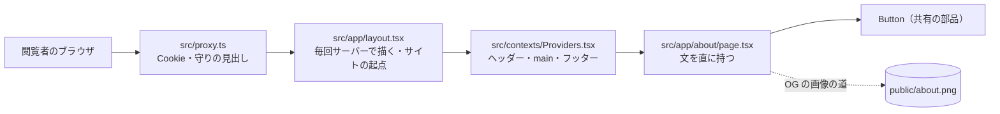
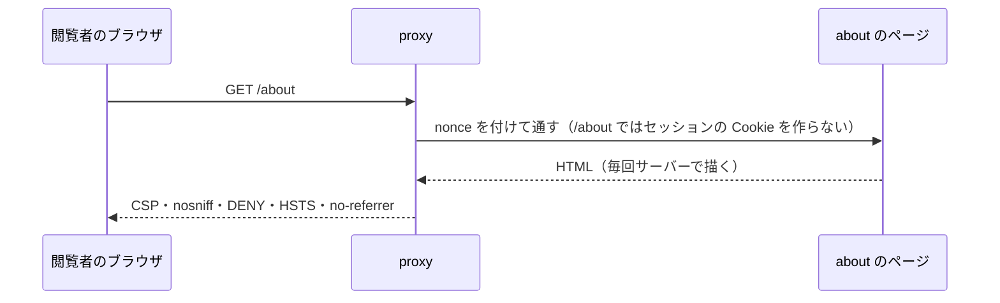
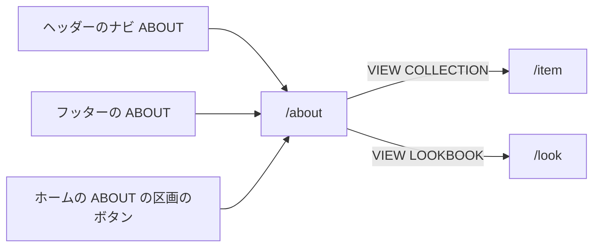

# ABOUT の構造設計

> 状態: 推定 | 確認日: 2026-10-28 | 対象: ABOUT（アバウトページ `/about`） | 基準コミット: `a03beaff`

## 概要

ABOUT の領域の構成・画面・画面遷移を、追跡できる項目（`### <ID> <題>` と属性の表）で書く。
中身は 2026-10-24 の作業ツリーのコードを読んで起こした今の動きで、ユーザーの確認を受けていないので全部「推定」にした。要件と食い違う所は決めずに今のコードの動きを書き、食い違いは `docs/05_Quality/reports/trace-matrix.md` の「食い違い」節（`TM-ABOUT-`）に載せた。

| 種類 | 数 | ID | 中身 |
| --- | --- | --- | --- |
| 構成 | 3 | `ARC-ABOUT-001`〜`003` | 文を持つだけのページの作り、共有の proxy の守り、題・説明・OG の作り |
| 画面 | 1 | `SCR-ABOUT-001` | `/about` の5つの区画の並び |
| 画面遷移 | 1 | `FLOW-ABOUT-001` | 入口（ヘッダー・フッター・ホーム）と出口（商品・LOOK） |
| 状態遷移・API・データ | 0 | — | ABOUT は状態・窓口・表を持たない（理由は「範囲と根拠」） |

- 結論: ABOUT は `src/app/about/page.tsx` の1ファイルで、文をコードに直に持ち、DB・外のサービス・API を呼ばない Server Component。ただし共有の layout の設定で毎回サーバーで描かれ、共有の proxy が守りの見出しを付ける（セッションの Cookie は決済の道だけで発行し、`/about` には付けない）
- 今の画面は h1・画像・アイコン・CONTACT への CTA を持たない。それを求める FR-ABOUT-005 の h1 の部分・FR-ABOUT-006・FR-ABOUT-007 は、満たす構造が無いので上位につながず、本文に「満たさない」と書いた。SEC-ABOUT-003 は 2026-10-28 に満たした（CSP と画像の最適化の許可は共有の `src/proxy.ts`・`next.config.ts` で決まり、DD-HOME-004・ADR-0108 が持つ）が、ABOUT の構造の単位はまだ上位につないでいない（SEC-ABOUT-007 は 2026-10-28 に本番ビルドで必須にして満たしたので、ARC-ABOUT-003 につないだ）

## 範囲と根拠

| 項目 | 内容 |
| --- | --- |
| 範囲 | `scripts/trace/scope.json` の ABOUT |
| 上位の文書 | [ABOUT の要件](../../02_Requirements/areas/about.md)（要件・`SEC-ABOUT-`・`DRV-ABOUT-`）、`docs/03_BasicDesign/decisions/ADR-0200`〜`ADR-0205` |
| 対象のコード | `src/app/about/page.tsx`（題・説明・OG を返す関数 `generateMetadata` と、ページの本体 `StoryPage`） |
| 関連文書 | `docs/03_BasicDesign/ui/screen-list.md`、`docs/03_BasicDesign/ui/screen-flow.md`（どちらも別の作業が書き換え中なので触らず、ABOUT の構造設計はこの文書に書く） |
| 調べた時点 | 2026-10-24 の作業ツリー（コードは読んだだけで、動かしての確かめはしていない） |

置かなかった種類と理由:

| 種類 | 置かなかった理由 |
| --- | --- |
| 状態遷移 `STATE-` | 利用者の操作で変わる状態が無い。`'use client'` も state の hook も無く、3つの原則の配列は固定の3件（`src/app/about/page.tsx` の `principles`） |
| API `API-` | Route Handler・Server Action・`fetch` を持たない（`src/app/about/` は `page.tsx` だけ） |
| データ `DATA-` | 表・置き場・関数を読まない（ADR-0204）。OG の画像 `public/about.png` はコードでなく、HOME と ITEM の E2E も使う共有の素材 |

範囲外の共有部品は ID を持たないので、項目の根拠と本文にファイルの道で書く。

| 共有部品 | 道 | ABOUT での使われ方 |
| --- | --- | --- |
| ボタンの部品 | `src/components/ui/Button/Button.tsx` | `href` を渡すと `next/link` のリンクを返す。締めの CTA 2つに使う |
| 全体の layout | `src/app/layout.tsx` | 毎回サーバーで描く設定（CSP の nonce のため）と、サイトの起点（`metadataBase`） |
| サイトの URL | `src/lib/redirect.ts` の `getSiteUrl` | 環境変数からサイトの起点を作る。無ければ手元の URL に落ちる |
| 包みの部品 | `src/contexts/Providers.tsx` | ヘッダー・`<main>`（左右の `px-4` と上下の余白）・フッター、カートとログインの文脈 |
| proxy | `src/proxy.ts` | 全部の道で守りの見出しを付ける。セッションの Cookie は `/cart`・`/checkout`・`/api/checkout` の道だけで発行する |
| 全体の CSS | `src/styles/globals.css` | `.about-main-text` などの本文の行の間と余白（HOME の ABOUT の区画と共有） |
| 入口のリンク | `src/components/Header.tsx`、`src/components/Footer.tsx`、`src/app/page.tsx` | `/about` への入口（HOME・AUTH などの領域） |

## 構成

実線の矢印は要求が通る順と、描く時の包み（外から内）。点線は metadata が指すだけの静的な素材で、ページは描く時に読まない。DB・Supabase・外の API への矢印は無い。

### ARC-ABOUT-001 ABOUT は文をコードに直に持ち、DB と外のサービスを読まないページ1つで作る

| 属性 | 値 |
| --- | --- |
| 上位 | SEC-ABOUT-006、FR-ABOUT-001、FR-ABOUT-002、FR-ABOUT-003、FR-ABOUT-004、ADR-0204 |
| 根拠 | ブランドの思想の文は滅多に変わらず、NEWS・LOOK のように管理画面で書き足す仕組みが要らないため（ADR-0204、推定）。読み出しが無ければ1回の要求の重さが描画だけで済み、DB や外のサービスが止まっても ABOUT を出せる（SEC-ABOUT-006）。読み取りの権限や入力の守りを考える所も生まれない |
| 状態 | 推定 |
| 確かめ方 | 結合テスト |
| 出どころ | 実装から推定（`src/app/about/page.tsx`）、`docs/03_BasicDesign/decisions/ADR-0204-about-copy-in-page-code.md` |

- 作り: `src/app/about/page.tsx` の1ファイル。読み込むのは Next の型と共有のボタンの部品だけ。`'use client'`・`'use server'`・`fetch`・Supabase の client を持たない
- 文: 4つの節の見出しと本文（COLLECTION の節は FR-ABOUT-004）、創業者の引用、締めの一文、3つの原則（固定の3件の配列 `principles`）を、どれもコードの中の字で持つ
- 描き方: データを読まないが、静的な生成ではない。共有の layout が毎回サーバーで描く設定を持つ（`src/app/layout.tsx`。CSP の nonce を要求ごとに変えるため）ので、`/about` も要求ごとにサーバーで描く。ABOUT の側では変えられない
- 包み: 共有の `Providers`（`src/contexts/Providers.tsx`）がヘッダー・`<main>`・フッターで包む。`/about` はホーム・詳細・ログインのどれでもないので、`<main>` に上下の余白と左右の `px-4` が付く。ページの外側の `px-1 sm:px-4 lg:px-8` はその内側に重なる
- 文脈: `/about` でもカートとログインの文脈（`CartProvider`・`LoginProvider`）が動き、開くとブラウザから `/api/cart`・`/api/wishlist`・`/api/auth/me` を自動で呼ぶ（`src/contexts/Providers.tsx`、`src/contexts/CartContext.tsx`、`src/contexts/LoginContext.tsx`。カートは `/privacy` でだけ止める）。ABOUT のページはどちらの文脈も使わない。この3つの API の持ち主は CART・AUTH
- 回数の制限: ページの要求の回数は制限しない（SEC-ABOUT-006 は本番のホスティングの守りに任せる。本番は未確認）

### ARC-ABOUT-002 共有の proxy が ABOUT の応答に守りの見出しとセッションの Cookie を付ける

| 属性 | 値 |
| --- | --- |
| 上位 | SEC-ABOUT-002、SEC-ABOUT-004、NFR-SEC-001（範囲外）、NFR-SEC-003（範囲外） |
| 根拠 | 守りの見出しをページごとに書くと付け忘れが出るため、全部の道に効く `src/proxy.ts` の1か所で付け、ABOUT は自分では重ねない（SEC-ABOUT-002。全体の NFR-SEC-001 の HSTS と NFR-SEC-003 の CSP を ABOUT に当てはめた形）。セッションの Cookie は、読み手が決済の流れだけなので、その道（`/cart`・`/checkout`・`/api/checkout`）の最初の応答だけで付け、`/about` には付けない（SEC-PRIVACY-015、`ADR-0355`、2026-10-28）。`/about` の応答は要求ごとに描くので、Next の既定で共有のキャッシュに残さない指定が付く見込み（SEC-ABOUT-004、推定・未実測） |
| 状態 | 推定 |
| 確かめ方 | 結合テスト |
| 出どころ | 実装から推定（`src/proxy.ts`、`src/app/layout.tsx`、`next.config.ts`） |

- 道: proxy の対象は全部の道（`src/proxy.ts` の `config.matcher`）。`/about` にも効く
- 見出し: nonce 付きの CSP、`Referrer-Policy: no-referrer`、`Permissions-Policy`、`X-Content-Type-Options: nosniff`、`X-Frame-Options: DENY`、`Strict-Transport-Security`、nonce を載せた `x-nonce`（`src/proxy.ts`）。`X-Powered-By` は Next の設定で出さない（`next.config.ts` の `poweredByHeader`）
- Cookie: セッションの Cookie の発行は `/cart`・`/checkout`・`/api/checkout` だけ（`src/proxy.ts` の `shouldIssueSessionCookie`。Cookie の扱いは PRIVACY の領域）。`/about` を開いても付かない。結合テスト `tests/integration/api/about-proxy.test.ts` が、`/about` に付かないことと、許可リストの道（`/cart`）に付くことを見る
- キャッシュ: 応答に `Cache-Control` を明示しない。要求ごとに描く頁に Next が付ける既定の値に頼る（SEC-ABOUT-004 は満たす見込みだが、確かめていない）
- CSP の広さ: 全部の頁に同じ1つの方針を付ける（`src/proxy.ts` の CSP を作る処理）。ABOUT が使わない外のオリジン（jsDelivr・placehold.co・readdy.ai・`*.supabase.co`）は 2026-10-28 に外した（SEC-ABOUT-003-AC-01、`ADR-0108`）。画像の最適化の許可（`remotePatterns`）も同じ日に、placehold.co・readdy.ai・`*.supabase.co` を外し、本番は自分の Supabase の host 1 つの署名つきの道だけにした（SEC-ABOUT-003-AC-02、`DD-HOME-004`）。`style-src` の `'unsafe-inline'` は、ABOUT が文字の大きさを `style` の属性で付けていることも理由の1つになっている
- `/about` の応答の見出しを試すテストは無い（同じ見出しの E2E は `/terms` だけを開く）

### ARC-ABOUT-003 題・説明・OG はページの関数が固定の値で返し、OG の画像は同じサイトの public/ から出す

| 属性 | 値 |
| --- | --- |
| 上位 | DRV-ABOUT-002、FR-ABOUT-005、FR-ABOUT-008、SEC-ABOUT-001、SEC-ABOUT-005、SEC-ABOUT-007、ADR-0205、ADR-0206 |
| 根拠 | 検索の結果と SNS の共有でブランドの題・説明・写真が出るようにするため（FR-ABOUT-005 の題と説明、DRV-ABOUT-002 の OG）。画像を外の生成のサービスから読むと停止や回数の制限で壊れるので、サイトの `public/` の画像を同じオリジンで出す（FR-ABOUT-008、SEC-ABOUT-001、ADR-0205）。絶対の URL の起点を要求の見出しから作らず設定のサイトの URL だけから作れば、見出しを偽って共有のカードを別のサイトに向けられない（SEC-ABOUT-005）。設定の漏れで手元の URL が公開の応答に出ないよう、本番のビルドでサイトの URL を必須にする（SEC-ABOUT-007、ADR-0206） |
| 状態 | 推定 |
| 確かめ方 | 結合テスト |
| 出どころ | 実装から推定（`src/app/about/page.tsx`、`src/app/layout.tsx`、`src/lib/redirect.ts`） |

| 値 | 中身 | 出どころ |
| --- | --- | --- |
| title | `ABOUT \| Le Fil des Heures`（layout の題を上書き） | `generateMetadata` の `title` |
| description | ブランドの哲学と「天然繊維100%・国内生産・受注生産・タイムレス・ユニセックス」 | `generateMetadata` の `description` |
| OG の title | title と同じ | `generateMetadata` の `openGraph.title` |
| OG の description | description より短いブランドの一文 | `generateMetadata` の `openGraph.description` |
| OG の画像 | `/about.png`（`public/about.png`） | `generateMetadata` の `openGraph.images` |

- 作り: ページのファイルの中の metadata の関数が、引数も読み出しも無く固定の値を返す（ADR-0204）
- 絶対の URL: OG の画像の道 `/about.png` は、共有の layout の `metadataBase`（`src/app/layout.tsx`）で絶対の URL になる。起点は `getSiteUrl`（`src/lib/redirect.ts`）が環境変数だけから作り、`Host`・`X-Forwarded-Host` を読まない
- 設定が無い時: 本番のビルド（`VERCEL_ENV=production`）は、`NEXT_PUBLIC_SITE_URL` と `NEXT_PUBLIC_SUPABASE_URL` が無ければ `next.config.ts` の先頭の確かめ `assertBuildEnv`（`src/lib/build-env-guard.ts`）が落とす（SEC-ABOUT-007、`ADR-0206`、`DD-ABOUT-002`）。`getSiteUrl` は変えない（無い時の既定の `http://localhost:3000` と `NEXT_PUBLIC_VERCEL_URL` の読み方は残る。本番は上の確かめで `NEXT_PUBLIC_SITE_URL` が必ず在るので、`getSiteUrl` はそれを最初に読む）。`NODE_ENV` でなく `VERCEL_ENV` で見るのは、E2E の本番ビルドも `NODE_ENV=production` になり、止めてはいけないため。同じ確かめが、`NEXT_PUBLIC_SUPABASE_URL` と `SUPABASE_URL` が別の origin を指す設定も、環境に依らず落とす（署名つきの画像の host と CSP・`remotePatterns` の許す host を 1 つに揃える。`ADR-0316`）。失敗の文に URL の値は載せない
- 本文の画像: 本文に画像は無い（SCR-ABOUT-001、ADR-0201）。CSP と画像の最適化の許可の広さは SEC-ABOUT-003 を見る
- 返さない物: canonical・`og:url`・`og:type`・twitter のカードは返さない（推定。NFR-SEO-003 は canonical も求める）
- h1: FR-ABOUT-005 のうち h1 の部分は、この構造でも SCR-ABOUT-001 でも満たさない（h1 が無い）
- 文のずれ: description は「天然繊維100%」、本文は「生地は天然繊維を中心に」（`StoryPage` の COLLECTION の節）

## 画面

### SCR-ABOUT-001 アバウトページ `/about`

| 属性 | 値 |
| --- | --- |
| 上位 | FR-ABOUT-001、FR-ABOUT-002、FR-ABOUT-003、FR-ABOUT-004、DRV-ABOUT-001、DRV-ABOUT-003、DRV-ABOUT-004、DRV-ABOUT-005、ADR-0200、ADR-0201、ADR-0202、ADR-0203 |
| 根拠 | ブランドが何を目指すか（思想）→ なぜつくるか（創業者の言葉）→ どう実現するか（3つの原則）→ 何を売るか（商品設計の考え方）の順に読ませ、最後に締めの一文から商品と LOOK へ渡すため（FR-ABOUT-001〜004、DRV-ABOUT-001）。思想はブランドを主語に、理由は創業者の一人称で分けて書く（ADR-0202）。画像とアイコンを置かず、罫線と余白で節を区切って静かな世界観を保つ（DRV-ABOUT-003、ADR-0201）。2026-08-13 に今の画面を正しい仕様とした（ADR-0200） |
| 状態 | 推定 |
| 確かめ方 | 結合テスト |
| 出どころ | 実装から推定（`src/app/about/page.tsx`）、`docs/03_BasicDesign/ui/screen-list.md` |

| 順 | 区画 | 見出し | 中身 | 出どころ |
| --- | --- | --- | --- | --- |
| 1 | ブランドの思想 | h2 `Brand Philosophy / ブランドの思想` | ブランドを主語にした3段落（ブランド名の意味「時の糸」、「時を超えて価値の続く服」） | `StoryPage` の Philosophy の区画 |
| 2 | 服をつくる理由 | h2 `WHY WE MAKE / なぜ、つくるのか` | 市場への問題提起の1段落、創業者の引用2つ、`— Founder, Le Fil des Heures` | `StoryPage` の WHY WE MAKE の区画 |
| 3 | 取り組み | h2 `OUR COMMITMENTS / 取り組み` | 3つの原則。番号 `01`〜`03`、英語のラベル、日本語の見出し（h3）、説明 | `StoryPage` の Our Commitments の区画 |
| 4 | 商品設計の考え方 | h2 `COLLECTION / 商品設計思想` | 1段落 | `StoryPage` の COLLECTION の区画 |
| 5 | 締め | 見出しなし | 一文「時を超えて価値の続く服を。」と CTA 2つ（FLOW-ABOUT-001） | `StoryPage` の締めの区画 |

- 区切り: どの区画も上に細い罫線（`border-black/10`）と、幅ごとに3段の余白を持つ。本文に画像・アイコンは無い（DRV-ABOUT-003）
- 区画1・2・4の並び: 1024px 以上は見出しと本文を 1:2 の2列、1024px 未満は見出しの下に本文を積む（DRV-ABOUT-004）
- 区画3の並び: 見出しを上に置き、原則の行を字下げする。番号は 640px 以上で左の列（64px、1024px 以上は 88px）に右寄せ、640px 未満は本文の上。どの原則も上に罫線を引き、最後の原則だけ下にも引く（DRV-ABOUT-005。最後の原則かどうかの分岐。このページの中の分岐はこの1つだけ）
- 引用: 創業者の言葉は表示用の書体と広い行の間で、説明の本文と分ける（ADR-0202）
- 文字の大きさ: 共有の大きさのトークンを `style` の属性で付ける。h2 は `--lk-size-2xl`、本文は `--lk-size-xs`（`StoryPage` の `style` の値）。`docs/03_BasicDesign/ui/design-guide.md` の大きさとは違う
- 見出しの階層: h1 は無く、最初の見出しが h2（2026-06-28 の作り直しで消えた）。FR-ABOUT-005 の h1 の部分は満たさない
- 満たさない要件: CONTACT への CTA（FR-ABOUT-006）、アイコンの読み上げ外しと画像の代わりの文（FR-ABOUT-007。対象のアイコン・画像が無い）
- 失敗と空: 読み出しが無いので、取り出しの失敗・空の表示は無い

## 画面遷移

### FLOW-ABOUT-001 ヘッダー・フッター・ホームから ABOUT に入り、締めの CTA で商品か LOOK へ進む

| 属性 | 値 |
| --- | --- |
| 上位 | FR-ABOUT-004、DRV-ABOUT-001、ADR-0203、FR-HOME-003（範囲外） |
| 根拠 | どの頁からでもブランドの説明に届くように、全部の頁に出るヘッダー・フッターと、ホームの ABOUT の区画に入口を置く（FR-HOME-003）。読み終えた人が共感したまま服を見る行動へ進めるよう、締めの一文の後に商品と LOOK の2つだけを置き、行き先を絞る（FR-ABOUT-004、DRV-ABOUT-001、ADR-0203） |
| 状態 | 推定 |
| 確かめ方 | 結合テスト |
| 出どころ | 実装から推定（`src/app/about/page.tsx`、`src/components/Header.tsx`、`src/components/Footer.tsx`、`src/app/page.tsx`）、`docs/03_BasicDesign/ui/screen-flow.md` |

矢印はリンクを押した時の移り先。ヘッダー・フッター・ホームの入口は範囲外の部品で、ABOUT の側では持たない。ヘッダー・フッターから出る他の頁への移りは図に入れていない。

- 入口: ヘッダーのナビ（`src/components/Header.tsx`）、フッター（`src/components/Footer.tsx`）、ホームのボタン（`src/app/page.tsx` の ABOUT の区画、FR-HOME-003）
- 出口: `VIEW COLLECTION`（主のボタン）→ `/item`、`VIEW LOOKBOOK`（2つ目のボタン）→ `/look`。どちらも共有のボタンの部品が返す `next/link` のリンクで、同じタブの中で移る
- 並び: 640px 未満は縦に並べて幅いっぱい、640px 以上は横に並べて最小の幅を持たせる（FR-ABOUT-004 の文は「tablet（768px）以上で横」）
- 置かない出口: CONTACT（`/contact`）と NEWS（`/news`）への CTA は無い（ADR-0203。FR-ABOUT-006 は満たさない。要件の側の食い違いは要件の文書を見る）
- 試験: `/about` への入口を押して移る試験は無い。入口のリンクが見えることだけを `e2e/FR-LOADING-002-header-menu-and-content-motion.spec.ts`（範囲外）が試す

## 未確認事項

- `/about` の応答に付く `Cache-Control` の実際の値（SEC-ABOUT-004 の見込みを本番ビルドで測っていない）
- 本番のサイトの URL の環境変数の設定と、本番で `/about.png` が取得できるか（本番は未デプロイ）
- 本番のホスティングでの、ページの要求の回数の守り（SEC-ABOUT-006）
- h1 を足すか、FR-ABOUT-005 の h1 の部分を外すか。CONTACT の CTA（FR-ABOUT-006）とアイコン・画像（FR-ABOUT-007・008）を残すか（要件の文書の未確認事項と同じ）
- CSP を頁ごとに分けるか全体を絞るか（SEC-ABOUT-003。共有の proxy の話）
- この文書の項目は全部「推定」。ユーザーの確認を受けたら「現行」にする
