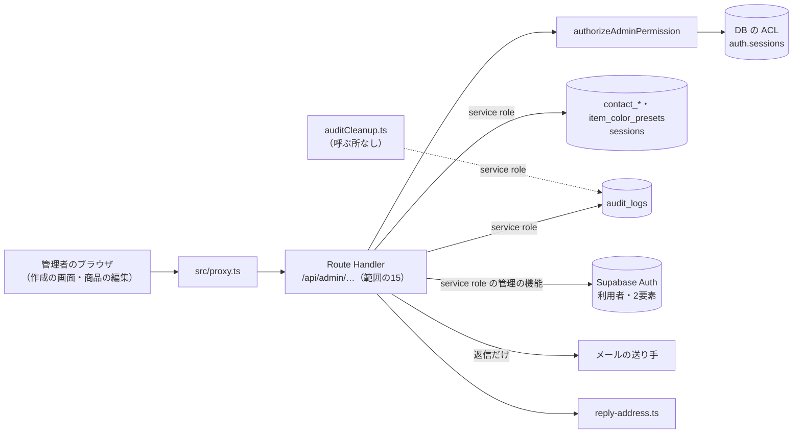
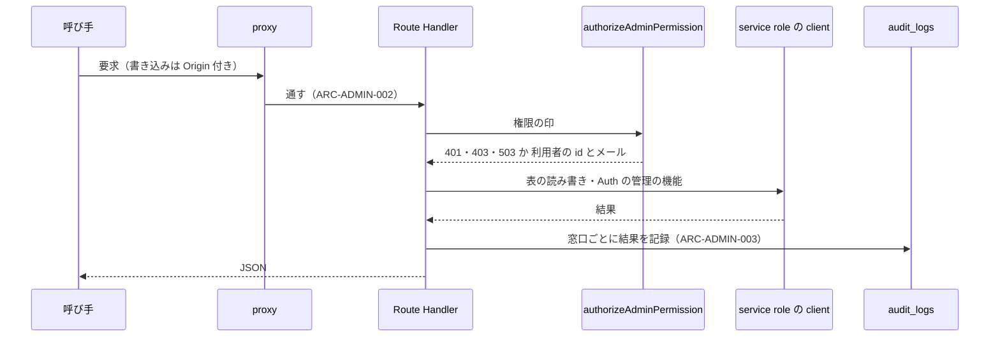
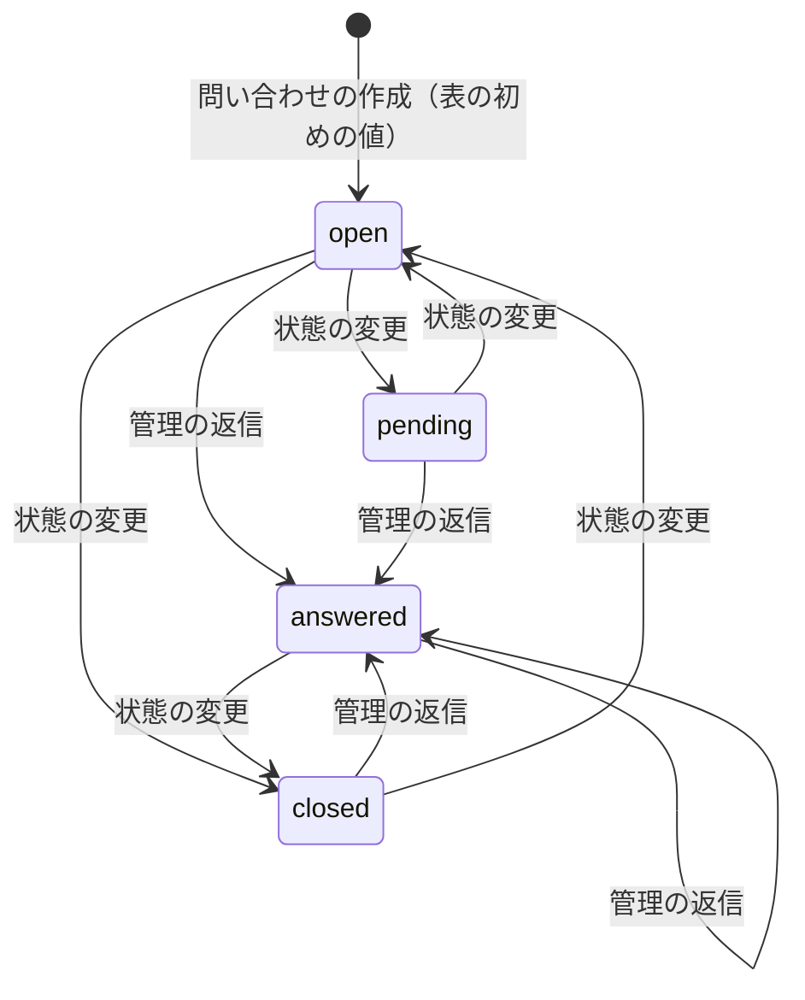
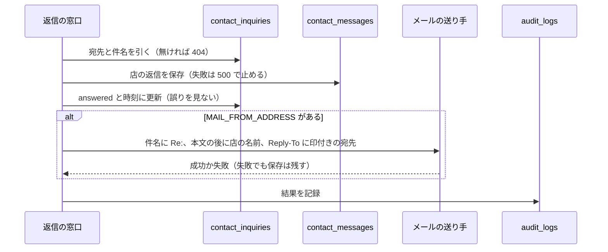

# ADMIN の構造設計

> 状態: 推定 | 確認日: 2026-10-24 | 対象: ADMIN（管理のそのほか。利用者の作成・セッションの強制失効・2要素のリセット・監査ログの読み出しと掃除・問い合わせの管理の窓口・商品の色見本） | 基準コミット: `4facf63b`

## 概要

ADMIN の領域の構成・画面・状態遷移・API・データを、追跡できる項目（`### <ID> <題>` と属性の表）で書く。
中身は 2026-10-24 の作業ツリーのコードを読んで起こした今の動きで、ユーザーの確認を受けていないので全部「推定」にした。要件と食い違う所は決めずに今のコードの動きを書き、食い違いは `docs/05_Quality/reports/trace-matrix.md` の「食い違い」節（`TM-ADMIN-NN`）に載せた。今のコードがセキュリティ要件を満たさない所は、その `SEC-ADMIN-NNN` の項目に1回だけ書き、ここでは `SEC-ADMIN-NNN を参照` と指すだけにした。

| 種類 | 数 | ID | 中身 |
| --- | --- | --- | --- |
| 構成 | 5 | `ARC-ADMIN-001`〜`005` | 認可と service role、Origin の照合、監査ログの書き方と読み方、返信の宛先の印、監査ログの掃除の部品 |
| 画面 | 1 | `SCR-ADMIN-001` | 利用者の作成 `/admin/create-user` |
| 状態遷移 | 1 | `STATE-ADMIN-001` | 問い合わせの状態 |
| API | 15 | `API-ADMIN-001`〜`015` | 利用者の作成・強制失効・監査ログ・2要素のリセット・問い合わせの9つ・色見本の3つ |
| データ | 6 | `DATA-ADMIN-001`〜`006` | 問い合わせの表、管理の表の RLS と付与、監査ログの表、session を消す関数、色見本の表、権限の印 |

- 結論: 範囲の窓口は全部、頭で共有の認可（JWT・session の生存・DB の ACL の権限・aal2）を通し、通った後にだけ service role の client で表と Auth の管理の機能を使う。表の側は、色見本のほかは anon・authenticated の直接の読み書きを方針で断る
- 画面は利用者の作成の1つだけ。問い合わせの管理画面（CONTACT のタブ）と監査ログを読む画面は無く、窓口だけがある（FREQ-25-REQ-01・FR-ADMIN-009・FREQ-508-AC-01 と食い違う。TM-ADMIN-01・02）。だから `SCR-` は作成の画面だけにし、画面遷移（`FLOW-`）は置かなかった
- 今のコードが満たさないセキュリティ要件（SEC-ADMIN-002・006〜010・012〜016・018・020〜023）は、満たす形の構造を持たないので上位につながない。本文では `SEC-ADMIN-NNN を参照` と指すだけにした。どれも受け入れ条件を持つので、下の段が欠けることはない
- 一部だけ満たす SEC-ADMIN-003 は、満たさない所が項目の中にあるので、どの項目の上位にもしていない

## 範囲と根拠

| 項目 | 内容 |
| --- | --- |
| 範囲 | `scripts/trace/scope.json` の ADMIN |
| 上位の文書 | [ADMIN の要件](../../02_Requirements/areas/admin.md)（要件・`SEC-ADMIN-`・`DRV-ADMIN-`）、`docs/03_BasicDesign/decisions/ADR-0450`〜`ADR-0459` |
| 範囲外の上位 | FREQ-316-REQ-01・03、FREQ-327-REQ-01（持ち主は AUTH）、FREQ-540-REQ-01（持ち主なし。割当の作業が書き換え中）、FREQ-24-REQ-01、FR-CONTACT-011〜013、FREQ-402-REQ-02、NFR-SEC-005（持ち主なし）。FREQ-316・327 は AUTH が定義し、FREQ-540 は誰も定義していない（`（範囲外）` で指すだけ） |
| 対象のコード | `src/app/api/admin/create-user/`、`src/app/api/admin/revoke-user-sessions/`、`src/app/api/admin/audit-logs/`、`src/app/api/admin/users/mfa/reset/`、`src/app/api/admin/contact/`（5 ファイル）、`src/app/api/admin/item-color-presets/`（2 ファイル）、`src/app/admin/create-user/page.tsx`、`src/lib/contact/reply-address.ts`、`src/lib/auditCleanup.ts`（14 ファイル） |
| 対象の DB | `supabase/migrations/20260901102912_remote_schema.sql`（表・RLS・付与・関数）、`supabase/migrations/20261023061453_audit_read_permission.sql`、`supabase/migrations/20261023175712_group_g0_permissions.sql`（権限の印と初めの割り当て） |
| 関連文書 | `docs/03_BasicDesign/api/api-spec.md`、`docs/03_BasicDesign/ui/screen-list.md`、`docs/03_BasicDesign/architecture/hybrid-rbac.md` |
| 調べた時点 | 2026-10-24 の作業ツリー（コードは読んだだけで、動かしての確かめはしていない。割当の作業が問い合わせの表の `order_id` を書き換える移行を作業中） |

範囲外の共有部品は ID を持たないので、項目の根拠と本文にファイルの道で書く。

| 共有部品 | 道 | ADMIN での使われ方 |
| --- | --- | --- |
| 管理の認可 | `src/lib/auth/admin-rbac.ts` の `authorizeAdminPermission` | 全部の窓口の頭で、token・session の生存・DB の ACL の権限・aal2 を確かめる |
| 固定の権限の一覧 | `src/lib/auth/role-permission-catalog.ts` | `admin.users.manage` を店長に固定する（権限の画面で外せない） |
| CSRF の Origin の検査と守りの見出し | `src/proxy.ts` | `/api` の書き込みの Origin・Referer の照合 |
| 監査 | `src/lib/audit.ts` の `logAudit` と伏せ字 | 窓口が結果を `audit_logs` に残す |
| メールの送り手 | `src/lib/mail.ts`（`src/lib/mail/adapters/`） | 管理の返信のメールを送る |
| 注文番号の形 | `src/lib/orders/order-number.ts` の `toOrderNumber` | 問い合わせの詳細で、注文の id を注文番号の形にする |
| Supabase の client | `src/lib/supabase/server.ts` の `createServiceRoleClient` | 全部の窓口の DB と Auth の管理の機能 |
| 画面の部品 | `src/components/ui/Button/Button.tsx`、`src/components/ui/TextField/TextField.tsx` | 利用者の作成の画面 |
| 管理の殻 | `src/app/admin/layout.tsx` | サイドナビの背景を `/admin` だけに出す |

呼ぶ所の一覧（どれも消さずに残す。消すかは `docs/05_Quality/reports/unused-code.md` でユーザーが決める）:

| 範囲の単位 | 呼ぶ所 |
| --- | --- |
| 利用者の作成の窓口 | 作成の画面（SCR-ADMIN-001）だけ。画面には入口のリンクが無い（TM-ADMIN-20） |
| 強制失効・2要素のリセット・監査ログの窓口 | 画面からは無い（HTTP では呼べる。TM-ADMIN-21） |
| 問い合わせの5つの窓口 | 範囲外の `src/components/ContactSection.tsx` だけで、この部品はどこからも読み込まれない（TM-ADMIN-01） |
| 色見本の窓口 | 範囲外の商品の編集 `src/app/admin/item/ItemForm.tsx` |
| 返信の宛先の部品 | 管理の返信（API-ADMIN-008）、範囲外の公開の問い合わせ `src/app/api/contact/route.ts` と受信 `src/app/api/contact/inbound/route.ts` |
| 監査ログの掃除の部品 | どこからも無い（ARC-ADMIN-005） |

## 構成

矢印は呼び出しの向き。ラベルは使う Supabase の client。窓口は利用者の JWT を認可の確かめにだけ使い、表の読み書きには持ち込まない（NEWS の管理の窓口と違う所。TM-ADMIN-22）。点線は呼ぶ所の無い部品。

### ARC-ADMIN-001 管理のそのほかの窓口は頭で共有の認可を通し、通った後にだけ service role で DB と Auth の管理の機能を使う

| 属性 | 値 |
| --- | --- |
| 上位 | SEC-ADMIN-001、FREQ-316-REQ-01（範囲外）、FREQ-316-REQ-02（範囲外）、FREQ-316-REQ-03（範囲外）、NFR-SEC-005（範囲外）、ADR-0450、ADR-0451 |
| 根拠 | 利用者の作成・2要素の削除・他人の session の削除は Auth の管理の機能か service role だけの DB の関数で、利用者の token では呼べないため、認可の後に service role を使う（ADR-0451）。その代わり認可は共有の秘密でなく利用者に結び、権限と2要素と session の生存を毎回確かめて、誰がしたかを監査に残せるようにする（SEC-ADMIN-001、ADR-0450、FREQ-316-REQ-01・02・03） |
| 状態 | 推定 |
| 確かめ方 | 結合テスト |
| 出どころ | 実装から推定（範囲の route.ts の頭の認可、`src/lib/auth/admin-rbac.ts`）、`docs/03_BasicDesign/architecture/hybrid-rbac.md` |

- 認可: 共有の部品が token を確かめ（無ければ 401）、session の生存と DB の ACL を並べて引き（生存を確かめられなければ 503、session が無ければ 401）、権限が無ければ 403、`aal` が `aal2` でなければ 403 と理由 `MFA required` を返す。窓口は応答をそのまま返す
- 権限の印: 作成・強制失効・2要素のリセットは `admin.users.manage`、監査ログは `admin.audit.read`、問い合わせの読みは `admin.contact.read`・書きは `admin.contact.manage`、色見本の読みは `admin.items.read`・書きは `admin.items.manage`（DATA-ADMIN-006）
- DB: 認可の後に `createServiceRoleClient()` を作る。RLS を通らないので、守りは窓口の認可1つになる
- 例外: どの窓口も外側の try/catch で 500 `Internal server error` を返す。作成・強制失効・色見本の保存は本文の JSON が壊れているとここに落ちて 500 になる（SEC-ADMIN-013 を参照）
- 画面のページ（`/admin/create-user`）にサーバーの守りは無く、誰でも開ける。守りは窓口だけ（`docs/03_BasicDesign/ui/screen-list.md`）

### ARC-ADMIN-002 書き込みの窓口は共有の proxy の Origin の照合で守り、窓口では CSRF の印と回数を見ない

| 属性 | 値 |
| --- | --- |
| 上位 | SEC-ADMIN-005、FREQ-327-REQ-01（範囲外）、FREQ-327-REQ-03（範囲外） |
| 根拠 | 管理者が別のサイトを開いた時に、そのサイトから利用者の作成・締め出し・2要素の削除・お客様へのメールを起こさせないよう、`/api` の書き込みを全部 Origin の照合にかける（SEC-ADMIN-005、FREQ-327-REQ-01）。照合を `src/proxy.ts` の1か所に置き、窓口ごとの書き忘れを無くす（FREQ-327-REQ-03） |
| 状態 | 推定 |
| 確かめ方 | 結合テスト |
| 出どころ | 実装から推定（`src/proxy.ts`） |

- 対象: 範囲の POST・PUT・PATCH・DELETE（作成・強制失効・2要素のリセット・問い合わせの状態の変更・返信・テンプレートの作成と更新と削除・色見本の保存と削除）
- 照合: Origin（無ければ Referer の origin）を許可のオリジンと比べ、合わない時とどちらも無い時に 403 `Forbidden origin`。許可のオリジンが設定されていない時は、要求の見出しから比べる元を作り、1度だけ警告を出す
- 窓口は CSRF の印（`requireCsrfOrDeny`）を見ない。作成の画面も素の `fetch` で印を付けずに送る
- 回数の制限は無い（SEC-ADMIN-006 を参照。TM-ADMIN-36）。範囲外の管理の窓口（LOOK・STOCKIST・注文・利用者の役割の変更など）は回数の制限を持つ

### ARC-ADMIN-003 監査ログは各窓口が共有の部品で書き、店長だけが窓口から安全な列で読む

| 属性 | 値 |
| --- | --- |
| 上位 | NFR-SEC-005（範囲外）、FREQ-508-REQ-01、DRV-ADMIN-005、DRV-ADMIN-007、ADR-0452、ADR-0453 |
| 根拠 | 誰がいつ何をしたかを後でたどれるよう、管理の操作の結果を `audit_logs` に残す（NFR-SEC-005）。監査ログには操作した人のメール・IP・ブラウザの情報が入るので、読むのは `admin.audit.read` を持つ店長だけにし（FREQ-508-REQ-01、ADR-0453）、読める人にも要らない列は返さない（DRV-ADMIN-005、ADR-0452）。人の session を切る操作は乗っ取りの準備にも使えるので、権限の無い試みも残す（DRV-ADMIN-007） |
| 状態 | 推定 |
| 確かめ方 | 結合テスト |
| 出どころ | 実装から推定（範囲の route.ts の `logAudit` の呼び出し、`src/lib/audit.ts`、`src/app/api/admin/audit-logs/route.ts`） |

| 窓口 | 書く結果 | 操作した人のメール | IP | ブラウザ |
| --- | --- | --- | --- | --- |
| 利用者の作成 | 形の誤り・重なり・誤り・成功 | 入れる | 入れない | 入れない |
| 強制失効 | 認可の失敗（操作した人は空）・形の誤り・誤り・成功 | 入れる | 認可の失敗と形の誤りだけ | 認可の失敗と形の誤りだけ |
| 2要素のリセット | 形の誤り・自分自身・対象なし・特権でない・誤り・成功 | 入れる | 入れる | 入れる |
| 問い合わせの状態の変更・返信・テンプレートの作成と更新と削除 | 成功（返信はメールの失敗も） | 入れない | 入れない | 入れる |
| 監査ログの読み出し・問い合わせの読み・色見本 | 書かない | — | — | — |

- IP は `x-forwarded-for` の左端から取る（SEC-ADMIN-009 を参照）
- 伏せ字: 共有の部品が `metadata` の鍵の名前（password・token・secret・card・number など）と、`detail` の JWT・長い文字列・`password=` の形を伏せる。理由の文・対象のメール・外のサービスの誤りの文は伏せない（SEC-ADMIN-008 を参照）
- 強制失効は認可に失敗するたびに1行書く（SEC-ADMIN-007 を参照）
- 色見本の作成・削除は書かず、問い合わせの記録にメールと IP を入れない。利用者の作成は IP を入れず、強制失効は誤り・成功に IP を入れない（SEC-ADMIN-022 を参照）
- 監査ログ・問い合わせの読み出しは記録しない（SEC-ADMIN-023 を参照）
- 読み出しは API-ADMIN-003。表の守りは DATA-ADMIN-002・003

### ARC-ADMIN-004 問い合わせの返信の宛先はスレッドごとの印で作り、受信の側で確かめる

| 属性 | 値 |
| --- | --- |
| 上位 | SEC-ADMIN-017、FREQ-25-REQ-01、FREQ-24-REQ-01（範囲外）、FR-CONTACT-011（範囲外）、FR-CONTACT-013（範囲外）、ADR-0455 |
| 根拠 | お客様がメールで返した答えを、そのまま元のスレッドに取り込むため（FREQ-24-REQ-01、FR-CONTACT-013）。宛先に問い合わせの id だけを入れると、id を知る第三者が他人のスレッドに書き込めるので、秘密の鍵の印を添えて推測できなくする（SEC-ADMIN-017、ADR-0455）。受信の設定が整う前でも返信のメールは送れるよう、設定が無ければ宛先を作らない |
| 状態 | 推定 |
| 確かめ方 | 結合テスト |
| 出どころ | 実装から推定（`src/lib/contact/reply-address.ts`）、`docs/superpowers/plans/legacy-contact-feature-remaining-tasks.md` |

- 作る: `buildReplyAddress` が `reply+{問い合わせの id}.{印}@{CONTACT_INBOUND_DOMAIN}` を返す。印は `CONTACT_REPLY_SECRET` を鍵にした id の HMAC-SHA256 を base64url にした先頭 16 字。ドメインか鍵が無ければ空を返し、呼ぶ側は Reply-To を付けずに送る
- 確かめる: `parseReplyAddress` が宛先から UUID の形の id と印を取り出し、印の長さを比べてから一定の時間の比較で確かめ、id と合否を返す。鍵が無い時と形が合わない時は空。id は小文字にそろえる
- 使う所: 管理の返信（API-ADMIN-008）、範囲外の公開の問い合わせの確認のメール（FR-CONTACT-011）と受信の取り込み（FR-CONTACT-013）
- 使い手のうち 2 つは範囲外（TM-ADMIN-25）。本番の `CONTACT_INBOUND_DOMAIN`・`CONTACT_REPLY_SECRET` は未設定（本番アプリは未デプロイ。開店の準備で入れる予定）

### ARC-ADMIN-005 監査ログの古い行を消す部品は、どこからも呼ばれずに残る（未使用（削除の判断待ち））

| 属性 | 値 |
| --- | --- |
| 上位 | DRV-ADMIN-003 |
| 根拠 | 未使用（削除の判断待ち）。監査ログが増え続けないよう、期間を過ぎた行を消す道を1つの関数に用意しておくため（DRV-ADMIN-003）。どの要求にも無く、呼ぶ所も無いので、使うか消すかが決まるまで単位として残し、写しを取らずに消す動きを見落とさないようにする |
| 状態 | 推定 |
| 確かめ方 | レビュー |
| 出どころ | 実装から推定（`src/lib/auditCleanup.ts`） |

- `cleanupAuditLogs` が、指定の日数（既定 365 日）より前に作られた `audit_logs` の行を service role で消し、消した数と応答を返す。DB の誤りはそのまま投げる
- 写しを残さずに消す。NFR-SEC-011（範囲外。保持と改ざんの防止）と旧設計の保存期間（`docs/04_DetailDesign/pages/16_admin.md`）と合わない（TM-ADMIN-06。SEC-ADMIN-010 を参照）
- src・scripts・定時の仕事のどこからも呼ばれない。試験 `tests/unit/lib/auditCleanup.test.ts` だけが呼ぶ

## 画面

### SCR-ADMIN-001 利用者の作成 `/admin/create-user`

| 属性 | 値 |
| --- | --- |
| 上位 | DRV-ADMIN-001、FREQ-402-REQ-02（範囲外） |
| 根拠 | 公開の会員登録を通さずに、店長がその場でアカウントを用意するための画面（DRV-ADMIN-001）。サイドナビの無いページなので、ナビの下地の背景を出さず内容を隠さない（FREQ-402-REQ-02） |
| 状態 | 推定 |
| 確かめ方 | 結合テスト |
| 出どころ | 実装から推定（`src/app/admin/create-user/page.tsx`、`src/app/admin/layout.tsx`）、`docs/03_BasicDesign/ui/screen-list.md` |

- 作り: 利用者の端末で動くページ（`'use client'`）。見出し「管理者: ユーザ作成」、欄は NAME・EMAIL（メールの型）・PASSWORD（伏せ字）、ボタン「作成」
- 送る前の確かめ: メールかパスワードが空なら「メールとパスワードを入力してください」、パスワードが 16 文字未満なら「パスワードは16文字以上にしてください」で止める。窓口は 8 文字から通すので、窓口を直に呼べば 8〜15 文字でも作れる（SEC-ADMIN-012 を参照）
- 送る: 素の `fetch` で `POST /api/admin/create-user`（API-ADMIN-001）に JSON を送る。送っている間はボタンを押せない
- 結果: 201 なら「ユーザ作成しました: 」とメールを出し、欄を空にして同じ画面に留まる。ほかは窓口の `error` の文（英語）か「作成に失敗しました」、通信の例外は「ネットワークエラーが発生しました」
- 入口: 管理画面の左のナビにも、どの画面にもリンクが無い。URL を直に打てば開く（画面遷移の項目を置かない理由）
- 守り: ページそのものはログイン・役割・2要素を見ず、誰でも開ける。作れるかは窓口の認可で決まる（ARC-ADMIN-001）
- 背景: 管理の殻は背景のパネルを `/admin` だけに出すので、この画面には出ない

## 状態遷移

### STATE-ADMIN-001 問い合わせの状態（open・pending・answered・closed）

| 属性 | 値 |
| --- | --- |
| 上位 | FR-ADMIN-009、FREQ-25-REQ-01、DRV-ADMIN-006 |
| 根拠 | 答えていない問い合わせと片付いた問い合わせを一覧で見分け、絞り込めるようにするため（FR-ADMIN-009 の状態の変更と絞り込み）。店が返信したら答えた状態にそろえ、状態の付け忘れを減らす（DRV-ADMIN-006） |
| 状態 | 推定 |
| 確かめ方 | 結合テスト |
| 出どころ | 実装から推定（`supabase/migrations/20260901102912_remote_schema.sql`、`src/app/api/admin/contact/[id]/route.ts`、`src/app/api/admin/contact/[id]/reply/route.ts`） |

- 図の矢印は主な物だけ。状態の変更（API-ADMIN-007）は4つのどの値からどの値へも移せ、同じ値への変更も受ける。移してよい組み合わせの決まりは無い（TM-ADMIN-23）
- 返信（API-ADMIN-008）は、どの状態からでも answered にし、最後のやり取りの時刻を直す。この更新の誤りは見ない
- 値の決まりは表の CHECK（4つ）と、状態の変更の窓口の入力の形（同じ4つ）の2か所にある
- 作る側（公開の問い合わせ、範囲外）は値を渡さず、表の初めの値 open になる（推定）
- 受信の取り込み（範囲外）でお客様が返した時に状態を戻すかは、このコードの範囲では確かめていない

## API

### API-ADMIN-001 `POST /api/admin/create-user` 利用者の作成

| 属性 | 値 |
| --- | --- |
| 上位 | DRV-ADMIN-001、SEC-ADMIN-001、ADR-0450、ADR-0451 |
| 根拠 | 店長がメールとパスワードでアカウントを用意する窓口（DRV-ADMIN-001）。アカウントを作れる窓口は乗っ取りの入口になるので、店長に固定した `admin.users.manage` と aal2 を求め（SEC-ADMIN-001、ADR-0450）、Auth の管理の機能は service role で呼ぶ（ADR-0451） |
| 状態 | 推定 |
| 確かめ方 | 結合テスト |
| 出どころ | 実装から推定（`src/app/api/admin/create-user/route.ts`）、`docs/03_BasicDesign/api/api-spec.md` |

| 項目 | 内容 |
| --- | --- |
| 認可 | `admin.users.manage`（店長だけ・固定）。CSRF は proxy の Origin の照合（ARC-ADMIN-002） |
| 入力 | JSON。`email`（メールの形）、`password`（8 文字以上）、`display_name`（任意。長さの上限なし） |
| 処理 | Auth の管理の機能で利用者を作り、表示名を利用者の付帯の情報に入れる。確認済みの印は渡さず、役割も付けない |
| 成功 | 201 `{id, email}`。監査は成功と作った id |
| 失敗 | 形の誤り 400 `Invalid request`、誤りの文に already か duplicate を含めば 409 `Email already registered`、ほかの誤り 500 `Failed to create user`、本文の JSON が壊れている・例外は 500 |
| 監査 | 形の誤り・重なり・誤り・成功（ARC-ADMIN-003）。重なりと誤りの `detail` は Supabase の誤りの文のまま |

- 今のコードが届かない SEC: SEC-ADMIN-006・008・012・013・022（内容は各項目を参照）。パスワードの長さの扱いの決めは TM-ADMIN-05
- `api-spec.md` は「確認済みの Auth の利用者を作る」と書くが、確認済みの印を渡さない（TM-ADMIN-09）

### API-ADMIN-002 `POST /api/admin/revoke-user-sessions` セッションの強制失効

| 属性 | 値 |
| --- | --- |
| 上位 | FREQ-316-REQ-03（範囲外）、DRV-ADMIN-007、SEC-ADMIN-001、ADR-0450、ADR-0454 |
| 根拠 | 乗っ取りや退職の時に、その利用者の操作をすぐ止めるため。自前の表だけを直しても出した token が期限まで通るので、Auth 側の session も消す（FREQ-316-REQ-03、ADR-0454）。人の session を切る操作は悪用もできるので、権限の無い試みも監査に残す（DRV-ADMIN-007） |
| 状態 | 推定 |
| 確かめ方 | 結合テスト |
| 出どころ | 実装から推定（`src/app/api/admin/revoke-user-sessions/route.ts`）、`docs/03_BasicDesign/api/api-spec.md` |

| 項目 | 内容 |
| --- | --- |
| 認可 | `admin.users.manage`。認可に失敗すると、操作した人を空にして結果 unauthorized を IP とブラウザの情報付きで書いてから、認可の応答を返す |
| 入力 | JSON `{user_id}`（1 字以上。UUID かは見ない） |
| 処理 | 自前の `sessions` の、その利用者の行に失効の時刻を入れる（誤りを見ない）。続けて DB の関数 `revoke_auth_sessions_for_user` で Auth 側の session を消す（DATA-ADMIN-004） |
| 成功 | 200 `{ok: true}`。監査は成功と消した Auth の session の数 |
| 失敗 | 形の誤り 400、Auth 側の誤り 500（監査 `auth_session_revocation_failed`）、DB の例外 500（監査に例外の文）、本文の JSON が壊れている・例外は 500 |

- 自分自身・存在しない利用者を断らない（SEC-ADMIN-015 を参照）。自前の表の更新の誤りを見ないので、片方だけ消えても 200（SEC-ADMIN-016 を参照）。UUID の形を見ない（SEC-ADMIN-013 を参照）。誤り・例外・成功の監査に IP とブラウザの情報を入れない（SEC-ADMIN-022 を参照）
- 画面から呼ぶ所は無い
- `api-spec.md` の関数の名前 `revoke_sessions_for_user` は、コードの `revoke_auth_sessions_for_user` と違う（TM-ADMIN-13）

### API-ADMIN-003 `GET /api/admin/audit-logs` 監査ログの読み出し

| 属性 | 値 |
| --- | --- |
| 上位 | FREQ-508-REQ-01、DRV-ADMIN-005、SEC-ADMIN-001、SEC-ADMIN-011、ADR-0452、ADR-0453 |
| 根拠 | 店長が誰がいつ何をしたかを確かめるための窓口。役割の名前でなく専用の権限 `admin.audit.read` で守り、付け外しを DB の ACL の1か所にする（FREQ-508-REQ-01、ADR-0453）。監査ログには個人情報が入りうるので、読める人にも安全な列だけを返す（SEC-ADMIN-011、DRV-ADMIN-005、ADR-0452） |
| 状態 | 推定 |
| 確かめ方 | 結合テスト |
| 出どころ | 実装から推定（`src/app/api/admin/audit-logs/route.ts`）、`docs/03_BasicDesign/api/api-spec.md` |

| 項目 | 内容 |
| --- | --- |
| 認可 | `admin.audit.read`（初めは店長だけ） |
| 入力 | なし |
| 成功 | 200 `{data}`。id・作った時刻・操作・操作した人の id・対象・対象の id・結果・詳しい文の8列だけを、作った時刻の新しい順に 100 件まで。ページ送りは無い |
| 失敗 | DB の誤り 500 `Failed to fetch audit logs`、例外 500 |
| 監査 | しない（SEC-ADMIN-023 を参照） |

- 操作した人のメール・IP・ブラウザの情報・付帯の情報は返さない。`api-spec.md` は操作した人のメールも返すと書く（TM-ADMIN-12）
- 画面から呼ぶ所は無い（FREQ-508-AC-01 の「一覧が表示される」画面は無い）

### API-ADMIN-004 `POST /api/admin/users/mfa/reset` 特権の利用者の2要素のリセット

| 属性 | 値 |
| --- | --- |
| 上位 | DRV-ADMIN-002、SEC-ADMIN-001、ADR-0457 |
| 根拠 | 店長・サポーターが認証のアプリを失くして管理画面に入れなくなった時に戻す道（DRV-ADMIN-002）。取り返しがつかないので、確認の語で取り違えを防ぎ、理由を監査に残し、乗っ取った人が自分の2要素を外して居座らないよう自分自身を断る（ADR-0457） |
| 状態 | 推定 |
| 確かめ方 | 結合テスト |
| 出どころ | 実装から推定（`src/app/api/admin/users/mfa/reset/route.ts`）、`docs/03_BasicDesign/api/api-spec.md` |

| 項目 | 内容 |
| --- | --- |
| 認可 | `admin.users.manage` |
| 入力 | JSON。`userId`（UUID）、`reason`（前後の空白を除き 10〜500 字）、`confirm`（`RESET_MFA` だけ）。本文の JSON が壊れていても形の誤りとして扱う |
| 処理 | 対象を Auth の管理の機能で引き、役割を Auth の利用者の付帯の情報（`app_metadata`）で決める。店長かサポーターなら、2要素の登録を全部引いて1つずつ消す |
| 成功 | 200 `{success, deletedFactorCount, message}`。監査は理由・対象の役割・対象のメール・消した数 |
| 失敗 | 形の誤り 400（`details` 付き）、自分自身 400、対象なし 404、特権でない 400、一覧の誤り 500、1つでも消せなければ 500、例外 500 |
| 監査 | 全部の結果（ARC-ADMIN-003）。理由と対象のメールは平文（SEC-ADMIN-008 を参照） |

- 今のコードが届かない SEC: SEC-ADMIN-008・014（内容は各項目を参照）。役割の決め方は TM-ADMIN-11
- `api-spec.md` は session も失効させると書く（TM-ADMIN-10）。画面から呼ぶ所は無い

### API-ADMIN-005 `GET /api/admin/contact` 問い合わせの一覧

| 属性 | 値 |
| --- | --- |
| 上位 | FR-ADMIN-009、FREQ-25-REQ-01、SEC-ADMIN-001、SEC-ADMIN-019、ADR-0458 |
| 根拠 | 問い合わせを状態・種別・検索語で探し、ページに分けて読むため（FR-ADMIN-009）。新しいやり取りのある問い合わせを上に出し、答えていない物を見落としにくくする。検索語は PostgREST の or の条件に文字で埋め込むので、区切りの字を消して長さを切ってから入れる（SEC-ADMIN-019、ADR-0458） |
| 状態 | 推定 |
| 確かめ方 | 結合テスト |
| 出どころ | 実装から推定（`src/app/api/admin/contact/route.ts`）、`docs/03_BasicDesign/api/api-spec.md` |

| 項目 | 内容 |
| --- | --- |
| 認可 | `admin.contact.read`（初めは店長とサポーター） |
| 入力 | クエリ。`page`（既定 1、1 以上）、`pageSize`（既定 20、1〜100 に丸める）、`status`（open・pending・answered・closed の外は絞らない）、`type`（product・order・other の外は絞らない）、`q`（`,`・`(`・`)`・`%`・`\` を空白にし、前後を除いて 100 字で切る。空なら絞らない） |
| 処理 | 名前・メール・件名のどれかの部分一致を1つの or の条件にし、最後のやり取りの時刻の新しい順に、ページの幅だけ取る |
| 成功 | 200 `{data, page, pageSize, totalPages, totalCount}`。行は id・作った時刻・直した時刻・最後のやり取りの時刻・名前・メール・種別・件名・状態・注文の id・会員の id。総ページは最低 1 |
| 失敗 | DB の誤り 500 `Failed to fetch inquiries`、例外 500 |
| 監査 | しない（SEC-ADMIN-023 を参照） |

- `_`・`*` は残る（推定。部分一致の字として効く）
- 呼ぶのは使われない `ContactSection.tsx` だけ（TM-ADMIN-01）

### API-ADMIN-006 `GET /api/admin/contact/[id]` 問い合わせの詳細とやり取り

| 属性 | 値 |
| --- | --- |
| 上位 | FR-ADMIN-009、FREQ-25-REQ-01、DRV-ADMIN-008、FR-CONTACT-012（範囲外）、SEC-ADMIN-001 |
| 根拠 | 1つの問い合わせの中身と、お客様と店のやり取りを上から読める順に出し、返信の前に経緯をつかめるようにするため（FR-ADMIN-009）。注文に結んだ問い合わせは注文番号で示し、注文の画面と突き合わせられるようにする（FR-CONTACT-012）。送った人の IP とブラウザの情報も返し、迷惑な送信を見分けられるようにする（DRV-ADMIN-008） |
| 状態 | 推定 |
| 確かめ方 | 結合テスト |
| 出どころ | 実装から推定（`src/app/api/admin/contact/[id]/route.ts`）、`docs/03_BasicDesign/api/api-spec.md` |

| 項目 | 内容 |
| --- | --- |
| 認可 | `admin.contact.read` |
| 入力 | 道の `id`（形を確かめない） |
| 成功 | 200 `{data}`。問い合わせの全部の項目（本文・会員の id・送った時の IP・ブラウザの情報を含む）と、注文に結んである時だけ注文番号、やり取り（送り手の役・書いた人・本文・経路・時刻）を古い順に |
| 失敗 | 問い合わせが無い・引けない 404 `Inquiry not found`（id の形が違う時も 404 と推定）、やり取りの誤り 500 `Failed to fetch messages`、例外 500 |
| 監査 | しない（SEC-ADMIN-023 を参照） |

- サポーターにも IP とブラウザの情報を返す（SEC-ADMIN-020 を参照）
- 割当の作業の移行が注文との結び付きを外す場合があり、その時は注文番号が出ない

### API-ADMIN-007 `PATCH /api/admin/contact/[id]` 問い合わせの状態の変更

| 属性 | 値 |
| --- | --- |
| 上位 | FR-ADMIN-009、FREQ-25-REQ-01、SEC-ADMIN-001 |
| 根拠 | 問い合わせが片付いたか、待っているかを店が示せるようにするため（FR-ADMIN-009 の状態の変更）。決まった4つの値の外は受けず、表の CHECK と同じ値に入口でそろえる（STATE-ADMIN-001） |
| 状態 | 推定 |
| 確かめ方 | 結合テスト |
| 出どころ | 実装から推定（`src/app/api/admin/contact/[id]/route.ts`）、`docs/03_BasicDesign/api/api-spec.md` |

| 項目 | 内容 |
| --- | --- |
| 認可 | `admin.contact.manage`（初めは店長とサポーター） |
| 入力 | 道の `id`、JSON `{status}`（open・pending・answered・closed）。本文の JSON が壊れていても形の誤りとして扱う |
| 処理 | 状態と直した時刻を書き換える。最後のやり取りの時刻は変えない |
| 成功 | 200 `{success: true}`。監査 `admin.contact.status_update` に新しい状態 |
| 失敗 | 形の誤り 400（`details` 付き）、DB の誤り 500 `Failed to update status`、例外 500 |

- 存在しない id でも 200 を返し、成功を記録する（SEC-ADMIN-021 を参照）。監査にメールと IP を入れない（SEC-ADMIN-022 を参照）

### API-ADMIN-008 `POST /api/admin/contact/[id]/reply` 管理の返信

| 属性 | 値 |
| --- | --- |
| 上位 | FREQ-25-REQ-01、FR-ADMIN-009、DRV-ADMIN-006、SEC-ADMIN-001、SEC-ADMIN-017、ADR-0455、ADR-0456 |
| 根拠 | 店の答えをスレッドに残し、お客様のメールへも届けるため（FREQ-25-REQ-01）。答えの記録を失わないよう保存を先にし、メールが送れなくても保存を取り消さない（DRV-ADMIN-006、ADR-0456）。お客様がメールで返せるよう、Reply-To にスレッドの印付きの宛先を入れる（SEC-ADMIN-017、ADR-0455） |
| 状態 | 推定 |
| 確かめ方 | 結合テスト |
| 出どころ | 実装から推定（`src/app/api/admin/contact/[id]/reply/route.ts`）、`docs/03_BasicDesign/api/api-spec.md` |

| 項目 | 内容 |
| --- | --- |
| 認可 | `admin.contact.manage` |
| 入力 | 道の `id`、JSON `{body}`（前後の空白を除き 1〜5000 字）。本文の JSON が壊れていても形の誤りとして扱う |
| 処理 | 上の図の順。返信は送り手の役を店、経路を web、書いた人を操作した人にして保存する。件名は元の件名が `Re:` で始まればそのまま、ほかは頭に `Re: ` を付ける。返信の宛先の設定が無ければ Reply-To を付けない（ARC-ADMIN-004） |
| 成功 | 201 `{success: true, mailSent}`。メールが失敗すれば `mailSent` は偽、監査は結果 error と `reply_saved_mail_failed`。ほかは結果 success と `reply_sent` |
| 失敗 | 形の誤り 400、問い合わせが無い 404、保存の誤り 500 `Failed to save reply`、例外 500 |

- 送り手の住所の設定が無い時は、メールを送らないのに `mailSent` が真で、監査も `reply_sent`（SEC-ADMIN-021 を参照）
- 件名の改行を消さずに送り手に渡す（SEC-ADMIN-018 を参照）。監査にメールと IP を入れない（SEC-ADMIN-022 を参照）

### API-ADMIN-009 `GET /api/admin/contact/templates` 返信のテンプレートの一覧

| 属性 | 値 |
| --- | --- |
| 上位 | FR-ADMIN-009、FREQ-25-REQ-01、SEC-ADMIN-001 |
| 根拠 | よく使う答えを選んで返信できるよう、テンプレートを決めた並びで渡すため（FREQ-25-REQ-01・FR-ADMIN-009 の「テンプレートを選んで返信」）。並び順を店が決め、同じ順なら作った順にして並びを毎回そろえる |
| 状態 | 推定 |
| 確かめ方 | 結合テスト |
| 出どころ | 実装から推定（`src/app/api/admin/contact/templates/route.ts`）、`docs/03_BasicDesign/api/api-spec.md` |

| 項目 | 内容 |
| --- | --- |
| 認可 | `admin.contact.read` |
| 成功 | 200 `{data}`。id・題・分類・本文・並び順・作った時刻・直した時刻を、並び順の小さい順、同じなら作った順に全部 |
| 失敗 | DB の誤り 500 `Failed to fetch templates`、例外 500 |
| 監査 | しない |

### API-ADMIN-010 `POST /api/admin/contact/templates` 返信のテンプレートの作成

| 属性 | 値 |
| --- | --- |
| 上位 | FR-ADMIN-009、FREQ-25-REQ-01、SEC-ADMIN-001 |
| 根拠 | 店がよく使う答えを自分でテンプレートに増やせるようにするため（FR-ADMIN-009 の作成）。題と本文の長さを入口で決め、表の CHECK と同じ分類だけを受ける |
| 状態 | 推定 |
| 確かめ方 | 結合テスト |
| 出どころ | 実装から推定（`src/app/api/admin/contact/templates/route.ts`）、`docs/03_BasicDesign/api/api-spec.md` |

| 項目 | 内容 |
| --- | --- |
| 認可 | `admin.contact.manage` |
| 入力 | JSON。`title`（前後を除き 1〜120 字）、`category`（product・order・other・general・無し）、`body`（前後を除き 1〜5000 字）、`sortOrder`（0〜9999 の整数、任意。無ければ 0）。本文の JSON が壊れていても形の誤りとして扱う |
| 成功 | 201 `{success: true, id}`。監査 `admin.contact.template.create` |
| 失敗 | 形の誤り 400（`details` 付き）、DB の誤り 500 `Failed to create template`、例外 500 |

- 監査にメールと IP を入れない（SEC-ADMIN-022 を参照）

### API-ADMIN-011 `PUT /api/admin/contact/templates/[id]` 返信のテンプレートの更新

| 属性 | 値 |
| --- | --- |
| 上位 | FR-ADMIN-009、FREQ-25-REQ-01、SEC-ADMIN-001 |
| 根拠 | 答えの言い方や中身が変わった時に、テンプレートを直せるようにするため（FR-ADMIN-009 の編集）。入力の形は作成と同じにし、決まりを1つにする |
| 状態 | 推定 |
| 確かめ方 | 結合テスト |
| 出どころ | 実装から推定（`src/app/api/admin/contact/templates/[id]/route.ts`）、`docs/03_BasicDesign/api/api-spec.md` |

| 項目 | 内容 |
| --- | --- |
| 認可 | `admin.contact.manage` |
| 入力 | 道の `id`、JSON は作成と同じ形。並び順が無ければ並び順は変えない。分類が無ければ無しにする |
| 成功 | 200 `{success: true}`。監査 `admin.contact.template.update` |
| 失敗 | 形の誤り 400（`details` 付き）、DB の誤り 500 `Failed to update template`、例外 500 |

- 存在しない id でも 200 を返し、成功を記録する（SEC-ADMIN-021 を参照）

### API-ADMIN-012 `DELETE /api/admin/contact/templates/[id]` 返信のテンプレートの削除

| 属性 | 値 |
| --- | --- |
| 上位 | FR-ADMIN-009、FREQ-25-REQ-01、SEC-ADMIN-001 |
| 根拠 | 使わなくなった答えを一覧から外し、選び間違いを減らすため（FR-ADMIN-009 の削除）。消した事は監査に残し、後から誰が消したかをたどれるようにする |
| 状態 | 推定 |
| 確かめ方 | 結合テスト |
| 出どころ | 実装から推定（`src/app/api/admin/contact/templates/[id]/route.ts`）、`docs/03_BasicDesign/api/api-spec.md` |

| 項目 | 内容 |
| --- | --- |
| 認可 | `admin.contact.manage` |
| 入力 | 道の `id` |
| 処理 | 行を消す（戻せない） |
| 成功 | 200 `{success: true}`。監査 `admin.contact.template.delete` |
| 失敗 | DB の誤り 500 `Failed to delete template`、例外 500 |

- 存在しない id でも 200 を返し、成功を記録する（SEC-ADMIN-021 を参照）

### API-ADMIN-013 `GET /api/admin/item-color-presets` 色見本の一覧

| 属性 | 値 |
| --- | --- |
| 上位 | DRV-ADMIN-004、SEC-ADMIN-001、ADR-0451 |
| 根拠 | 商品の編集で、前に使った色の名前と色の値を選び直せるようにするため（DRV-ADMIN-004）。商品を読める人だけに渡し、読み出しは認可の後に service role で行う（SEC-ADMIN-001、ADR-0451） |
| 状態 | 推定 |
| 確かめ方 | 結合テスト |
| 出どころ | 実装から推定（`src/app/api/admin/item-color-presets/route.ts`）、`docs/03_BasicDesign/api/api-spec.md` |

| 項目 | 内容 |
| --- | --- |
| 認可 | `admin.items.read`（初めは店長だけ） |
| 成功 | 200 `{data}`。全部の列を作った時刻の新しい順に全部 |
| 失敗 | DB の誤り 500 `Failed to fetch color presets`、例外 500 |
| 監査 | しない |

### API-ADMIN-014 `POST /api/admin/item-color-presets` 色見本の保存

| 属性 | 値 |
| --- | --- |
| 上位 | DRV-ADMIN-004、SEC-ADMIN-001、ADR-0459 |
| 根拠 | 商品の色の名前と色の値を毎回入れずに済み、商品どうしの色の表記がそろうよう、組を保存して使い回すため（DRV-ADMIN-004）。同じ組を何度保存しても1行にし、重なりを誤りにせず既にある行を返して、画面が誤りの扱いを持たずに済むようにする（ADR-0459） |
| 状態 | 推定 |
| 確かめ方 | 結合テスト |
| 出どころ | 実装から推定（`src/app/api/admin/item-color-presets/route.ts`）、`docs/03_BasicDesign/api/api-spec.md` |

| 項目 | 内容 |
| --- | --- |
| 認可 | `admin.items.manage`（初めは店長だけ） |
| 入力 | JSON。`name`（前後を除き 1〜40 字）、`hex`（`#` と 16 進の 6 桁） |
| 処理 | 同じ名前と色の値の行を引き、あればそれを返す。無ければ作る |
| 成功 | 既にあれば 200 `{data}`（id・名前・色の値・作った時刻）、作れば 201 `{data}`（全部の列） |
| 失敗 | 形の誤り 400（`details` 付き）、作る時の DB の誤り 500 `Failed to save color preset`、本文の JSON が壊れている・例外は 500 |
| 監査 | しない |

- 既にあるかを引く時の誤りを見ないので、引けなかった時は作りに進み、一意の制約に当たれば 500 になる（SEC-ADMIN-021 を参照）。監査が無い（SEC-ADMIN-022 を参照）。壊れた JSON が 500（SEC-ADMIN-013 を参照）

### API-ADMIN-015 `DELETE /api/admin/item-color-presets/[id]` 色見本の削除

| 属性 | 値 |
| --- | --- |
| 上位 | DRV-ADMIN-004、SEC-ADMIN-001 |
| 根拠 | 誤って保存した色や使わなくなった色を一覧から外し、選び間違いを減らすため（DRV-ADMIN-004）。消せるのは商品を管理できる人だけにする（SEC-ADMIN-001） |
| 状態 | 推定 |
| 確かめ方 | 結合テスト |
| 出どころ | 実装から推定（`src/app/api/admin/item-color-presets/[id]/route.ts`）、`docs/03_BasicDesign/api/api-spec.md` |

| 項目 | 内容 |
| --- | --- |
| 認可 | `admin.items.manage` |
| 入力 | 道の `id`（数の形を確かめない） |
| 成功 | 200 `{success: true}` |
| 失敗 | DB の誤り 500 `Failed to delete color preset`、例外 500 |
| 監査 | しない |

- 存在しない id でも 200（SEC-ADMIN-021 を参照）。監査が無い（SEC-ADMIN-022 を参照）

## データ

### DATA-ADMIN-001 問い合わせの表 `contact_inquiries`・`contact_messages`・`contact_reply_templates`

| 属性 | 値 |
| --- | --- |
| 上位 | FR-ADMIN-009、FREQ-25-REQ-01、FR-CONTACT-012（範囲外） |
| 根拠 | 問い合わせ1件を1つのスレッドにし、お客様と店のやり取りを web とメールの両方の経路で同じ所に積むため（FREQ-25-REQ-01）。状態・種別・分類は決まった値だけを表でも受け、窓口の確かめが崩れても外の値を入れない（FR-ADMIN-009）。注文を消しても問い合わせは残し、結び付きだけを外す（FR-CONTACT-012） |
| 状態 | 推定 |
| 確かめ方 | 結合テスト |
| 出どころ | 実装から推定（`supabase/migrations/20260901102912_remote_schema.sql`） |

| 表 | 主な列 | 決まり |
| --- | --- | --- |
| `contact_inquiries` | id（uuid）、名前・メール・種別・件名・本文（NOT NULL）、送った時の IP・ブラウザの情報、状態（初めは open）、会員の id、注文の id、作った・直した・最後のやり取りの時刻 | 種別は product・order・other、状態は open・pending・answered・closed（CHECK）。注文の id は注文を消すと空になる（ON DELETE SET NULL）。索引は作った時刻・メール・最後のやり取りの時刻・状態・会員の id |
| `contact_messages` | id、問い合わせの id、送り手の役、書いた人、本文、経路（初めは web）、受信の送り手の id、作った時刻 | 送り手の役は user・admin、経路は web・email。受信の送り手の id は一意（同じメールを2回取り込まないためと推定）。問い合わせを消すと一緒に消える（ON DELETE CASCADE） |
| `contact_reply_templates` | id、題、分類、本文、並び順（初めは 0）、作った・直した時刻 | 分類は product・order・other・general か無し |

- 長さの上限（返信 5000 字、題 120 字など）は窓口の入力の形だけにあり、表には無い。表には直接書けないので（DATA-ADMIN-002）、上限を飛ばせる道は service role だけ（推定。TM-ADMIN-24）
- 割当の作業の移行（作業中）が、片付ける注文に結んだ問い合わせの注文の id を空にする

### DATA-ADMIN-002 管理の表の RLS の方針と表の付与

| 属性 | 値 |
| --- | --- |
| 上位 | NFR-SEC-005（範囲外）、FREQ-508-REQ-01、ADR-0451 |
| 根拠 | 問い合わせの個人情報・監査ログ・自前の session の印は、ログインした人の JWT から直接読まれないよう、読み書きの道を認可を通った窓口の service role だけにするため（ADR-0451、NFR-SEC-005）。監査ログを読めるのは `admin.audit.read` を確かめる窓口だけになる（FREQ-508-REQ-01） |
| 状態 | 推定 |
| 確かめ方 | 結合テスト |
| 出どころ | 実装から推定（`supabase/migrations/20260901102912_remote_schema.sql`） |

| 表 | 方針 | 表の付与 |
| --- | --- | --- |
| `contact_inquiries`・`contact_messages`・`contact_reply_templates` | 全部の役に select・insert・update・delete を断る（条件 false）。service role は RLS を通らない | anon・authenticated にも全部の操作を付ける |
| `audit_logs` | anon・authenticated は全部断る。service_role は全部許す | 同上 |
| `sessions` | anon・authenticated は全部断る。service_role は全部許す | 同上 |

- 守りは方針の1段だけで、表の付与は絞っていない（SEC-ADMIN-003 を参照。上位にしない）。`audit_logs`・`sessions` の付与は AUTH の SEC-AUTH-011（範囲外）が決める
- 色見本の表は別の方針（DATA-ADMIN-005）

### DATA-ADMIN-003 監査ログの表 `audit_logs`

| 属性 | 値 |
| --- | --- |
| 上位 | NFR-SEC-005（範囲外）、FREQ-508-REQ-01、DRV-ADMIN-005 |
| 根拠 | 管理の操作を、誰が・何に・どうなったかの形で1つの表に残し、後でたどれるようにするため（NFR-SEC-005）。読み出しで返す列と返さない列（メール・IP・ブラウザの情報・付帯の情報）を分けられるよう、列を分けて持つ（DRV-ADMIN-005、FREQ-508-REQ-01） |
| 状態 | 推定 |
| 確かめ方 | 結合テスト |
| 出どころ | 実装から推定（`supabase/migrations/20260901102912_remote_schema.sql`、`src/lib/audit.ts`） |
| 旧所在 | `docs/04_DetailDesign/pages/16_admin.md` の「監査ログ設計（ADMIN-AUDIT）」（「ログスキーマ」「保存期間」） |

| 列 | 中身 |
| --- | --- |
| id・作った時刻 | uuid、初めは今 |
| 操作・結果 | 文字、NOT NULL（例 `admin_create_user`・`success`） |
| 操作した人の id・メール | 認可が返した値。強制失効の認可の失敗では空 |
| 対象・対象の id | 例 `users`・`sessions`・`contact`・`contact_reply_template` |
| 詳しい文・IP・ブラウザ・付帯の情報 | 文字と jsonb。書く前に共有の部品が鍵の名前と形で一部を伏せる（ARC-ADMIN-003） |

- 索引は操作と作った時刻
- 行の hash も、書き換えと消去を検知するトリガーも無い（SEC-ADMIN-010 を参照）。service role は行を消せ、掃除の部品もある（ARC-ADMIN-005）
- ほかの領域の窓口も同じ表に書く（例 NEWS の管理の窓口）

### DATA-ADMIN-004 Auth の session を消す関数 `revoke_auth_sessions_for_user` と自前の `sessions` の表

| 属性 | 値 |
| --- | --- |
| 上位 | SEC-ADMIN-004、FREQ-316-REQ-03（範囲外）、ADR-0454 |
| 根拠 | 強制失効で Auth 側の session を消すため（FREQ-316-REQ-03、ADR-0454）。他人の session を消せる関数を利用者の JWT で呼べると誰でも他人を締め出せるので、実行できるのを postgres と service_role だけに絞り、アプリの認可と監査を通る道だけに残す（SEC-ADMIN-004） |
| 状態 | 推定 |
| 確かめ方 | 結合テスト |
| 出どころ | 実装から推定（`supabase/migrations/20260901102912_remote_schema.sql`）、`tests/unit/migrations/091_auth_session_revocation.test.ts` |

- 関数: 利用者の id（uuid）を受け、`auth.sessions` のその利用者の行を全部消し、消した数を返す。SECURITY DEFINER、`search_path` は空。PUBLIC から実行を外し、postgres と service_role にだけ付ける
- 自前の `sessions`: 利用者ごとの refresh の印・失効の時刻・CSRF の印などを持つ。利用者を消すと一緒に消える。失効の時刻を読むのは範囲外の AUTH（`src/app/api/auth/refresh/route.ts`・`logout`・`password-reset/confirm`、`src/features/auth/services/session.ts`）
- 管理の窓口が session の生存を見るのは `auth.sessions` の側（共有の認可、`src/lib/auth/admin-rbac.ts`）。だから Auth 側を消すと、その人の token は次の要求から管理の窓口で断られる

### DATA-ADMIN-005 色見本の表 `item_color_presets` と RLS

| 属性 | 値 |
| --- | --- |
| 上位 | DRV-ADMIN-004、ADR-0459、ADR-0451 |
| 根拠 | 色の名前と色の値の組を1つだけ持ち、商品の編集で使い回すため（DRV-ADMIN-004、ADR-0459）。色の値の形と組の重なりは表でも守り、窓口の確かめが崩れても壊れた値や重なりを入れない |
| 状態 | 推定 |
| 確かめ方 | 結合テスト |
| 出どころ | 実装から推定（`supabase/migrations/20260901102912_remote_schema.sql`） |

| 項目 | 内容 |
| --- | --- |
| 列 | id（bigint の連番）、名前、色の値、作った時刻 |
| 決まり | 色の値は `#` と 16 進の 6 桁（CHECK）。名前と色の値の組は一意 |
| 方針 | service_role は全部。authenticated は `has_permission('admin.items.read')` で読み、`admin.items.manage` で入れる・直す・消す |
| 付与 | anon・authenticated に全部の操作 |

- anon にも表の付与がある（SEC-ADMIN-003 を参照）
- 名前の長さの上限（40 字）は窓口だけにある
- 方針は aal と session の生存を見ないので、`admin.items.manage` を持つ人が aal1 の JWT や失効の後の JWT で PostgREST から直接書ける（推定。SEC-ADMIN-002 を参照）。直接の書き込みは監査に残らない
- 窓口は service role で読み書きするので、この方針は窓口の道では効かない（ADR-0451）

### DATA-ADMIN-006 範囲の窓口の権限の印と初めの割り当て

| 属性 | 値 |
| --- | --- |
| 上位 | FREQ-508-REQ-01、FREQ-540-REQ-01（範囲外）、FR-ADMIN-009、ADR-0453 |
| 根拠 | 窓口が役割の名前でなく権限の印だけを見ればよく、付け外しを DB の ACL の1か所でできるようにするため（ADR-0453）。監査ログの閲覧は店長だけに付け（FREQ-508-REQ-01）、利用者の管理は店長に固定して後の作業で外れないようにする（FREQ-540-REQ-01）。問い合わせは発送の担当も答えるので、サポーターにも初めから付ける（FR-ADMIN-009） |
| 状態 | 推定 |
| 確かめ方 | 結合テスト |
| 出どころ | 実装から推定（`supabase/migrations/20261023061453_audit_read_permission.sql`、`supabase/migrations/20261023175712_group_g0_permissions.sql`、`src/lib/auth/role-permission-catalog.ts`） |
| 旧所在 | `docs/04_DetailDesign/pages/16_admin.md` の「RBAC 権限設計（ADMIN-RBAC）」の権限の表（「監査ログ閲覧」の行） |

| 権限 | DB の名前 | 求める窓口 | 店長 | サポーター |
| --- | --- | --- | --- | --- |
| `admin.users.manage` | 利用者の管理 | API-ADMIN-001・002・004 | あり（固定。外せない） | なし（付けられない） |
| `admin.audit.read` | 監査ログの閲覧 | API-ADMIN-003 | あり | なし |
| `admin.contact.read` | 問い合わせの閲覧 | API-ADMIN-005・006・009 | あり | あり |
| `admin.contact.manage` | 問い合わせの管理 | API-ADMIN-007・008・010〜012 | あり | あり |
| `admin.items.read` | 商品の閲覧 | API-ADMIN-013 | あり | なし |
| `admin.items.manage` | 商品の管理 | API-ADMIN-014・015 | あり | なし |

- 割り当ては DB の ACL（`user_roles`・`roles`・`role_permissions`・`permissions`）に持ち、共有の認可と `has_permission` が読む。固定の2つ（`admin.users.manage`・`admin.permissions.manage`）は、店長から外す変更とほかの役割へ付ける変更をトリガーが断る
- 店長は権限の画面（範囲外。権限の作業の物）で、固定でない権限をサポーターに付け外しできる
- `admin.audit.read` の名前は、監査ログの権限を足した移行（2026-10-23）が「監査ログの閲覧」で入れ、後の権限の作業の移行は既にある名前を変えない（`ON CONFLICT DO NOTHING`）。権限の画面は画面側の一覧の名前を出す（FREQ-508-AC-03 の食い違い。TM-ADMIN-03）

## 未確認事項

- 問い合わせの管理画面（CONTACT のタブ）と監査ログを読む画面を作るか。作るなら `SCR-`・`FLOW-` を足す。`src/components/ContactSection.tsx`（範囲外・どこからも読み込まれない）を使うか（ユーザーの判断。TM-ADMIN-01・02）
- 利用者の作成の画面に入口を付けるか、画面とページの守りをどうするか（TM-ADMIN-20）
- 本番の `MAIL_FROM_ADDRESS`・`CONTACT_INBOUND_DOMAIN`・`CONTACT_REPLY_SECRET` と、許可のオリジン（`APP_ALLOWED_ORIGINS` ほか）の設定（本番アプリは未デプロイ）
- 作った利用者が確認済みになるか（Supabase の既定の設定次第。本番の設定は確かめていない）
- 本番の中継（Vercel など）が `x-forwarded-for` をどう付けるか（監査ログの IP の確かさ）
- 受信の取り込み（範囲外）がお客様の返信で問い合わせの状態を変えるか（STATE-ADMIN-001）
- 範囲の窓口の結合テスト（`tests/integration/`）は強制失効と監査ログの2本だけで、ほかの構造設計の項目には結合テストが無い。詳細設計（`docs/04_DetailDesign/pages/16-2_admin_misc.md` の DD-ADMIN-001〜015）はあるが、単体テストの名前の ID と、コードの `@impl`・`@design` がまだ無い（`validate-trace` は `missing-child`・`missing-impl` を出し続ける）
- この文書の項目は全部「推定」。ユーザーの確認を受けたら「現行」にする
