# AUTH の構造設計

> 状態: 推定 | 確認日: 2026-10-24 | 対象: AUTH（ログイン `/login`・`/login/verify`、認証の画面 `/auth/*`、認証の窓口 `/api/auth/*`、サイト共通のヘッダーとドロワー） | 基準コミット: `4facf63b`（作業ツリーに別の作業の未コミットの差分あり）

## 概要

AUTH の領域の構成・画面・画面遷移・状態遷移・API・データを、追跡できる項目（`### <ID> <題>` と属性の表）で書く。
中身は 2026-10-24 の作業ツリーのコードを読んで起こした今の動きで、ユーザーの確認を受けていないので全部「推定」にした。要件と食い違う所は決めずに今のコードの動きを書き、食い違いは `docs/05_Quality/reports/trace-matrix.md` の「食い違い」節に載せる。

| 種類 | 数 | ID | 中身 |
| --- | --- | --- | --- |
| 構成 | 9 | `ARC-AUTH-001`〜`009` | 全体の作り、ログインの2段、管理者の TOTP、再設定の印、ボットの確かめと回数の制限、列挙の対策、パスワードの決まり、ヘッダーの印、セッションの一生 |
| 画面 | 10 | `SCR-AUTH-001`〜`010` | `/login` の枠とタブ、ログインと会員登録のフォーム、認証コード、再設定の2画面、`/auth/verified`、使われていない `/auth/callback`、ヘッダー、ドロワー |
| 画面遷移 | 4 | `FLOW-AUTH-001`〜`004` | メールとパスワードのログイン、Google のログイン、会員登録、パスワードの再設定 |
| 状態遷移 | 5 | `STATE-AUTH-001`〜`005` | ログインの保留、再設定の印、`/auth/verified` の画面、再設定のページ、ヘッダーの出し隠し |
| API | 18 | `API-AUTH-001`〜`018` | `/api/auth/*` の 18 本の窓口 |
| データ | 4 | `DATA-AUTH-001`〜`004` | `sessions` の表、`password_reset_tokens` の表、認証の DB の関数、認証の Cookie |

- 結論: 画面は利用者の端末で動く部品で、共有の `LoginContext` かページ自身が `/api/auth/*` を呼ぶ。窓口は Supabase Auth を呼び、結果のトークンを HttpOnly の Cookie に入れ、自前の `sessions` の表に控えを残す。ログインの2段目・再設定・会員登録の守り（保留の署名 Cookie・ボットの確かめ・回数の制限・列挙の対策・16 文字と漏洩の照合）は全部アプリの窓口の中にある
- 今のコードが満たさないセキュリティ要件（SEC-AUTH-005・006・007・009・010・011・012・013・015・017・022・023・029・031）は、満たす形の構造を持たないので上位につながず、本文に「満たさない」と書いた。一部だけ満たす物（SEC-AUTH-008・016・018・020・021・025・026・027・030）は、満たさない所がその項目の受け持つコードにある時は上位にせず、ほかの項目か共有部品にだけある時は上位にした（NEWS・SEARCH の構造設計と同じ決め方）。SEC-AUTH-025・027 は満たさない所を受け持つ項目が共有部品の説明になるので、どこの上位にもしなかった
- 共有部品（`src/features/auth/**`・`src/lib/cookie.ts`・`src/lib/auth/*`・`src/contexts/LoginContext.tsx`・`src/proxy.ts` など）は ID を持たないので、根拠と本文にファイルの道で書いた

## 範囲と根拠

| 項目 | 内容 |
| --- | --- |
| 範囲 | `scripts/trace/scope.json` の AUTH |
| 上位の文書 | [AUTH の要件](../../02_Requirements/areas/auth.md)（要件・`SEC-AUTH-`・`DRV-AUTH-`）、`docs/03_BasicDesign/decisions/ADR-0400`〜`ADR-0411` |
| 対象のコード | `src/app/login/`（3）、`src/app/auth/`（5）、`src/app/api/auth/`（18）、`src/components/Header.tsx`・`LoginModal.tsx`・`RegisterModal.tsx`・`AuthTabs.tsx`・`AuthResultScreen.tsx`、`src/hooks/useTurnstileWidget.ts`、`src/lib/format-countdown.ts` |
| 対象の DB | `supabase/migrations/20260901102912_remote_schema.sql`（`password_reset_tokens`・`sessions` の表）、同 （掃除の関数・方針・付与） |
| 関連文書 | `docs/04_DetailDesign/pages/14_login.md`（表だけで古い記述がある）、`docs/04_DetailDesign/sequence/auth-*.md`、`docs/03_BasicDesign/architecture/auth-structure.md`（過去の初稿）、`docs/03_BasicDesign/api/api-spec.md`・`route-inventory.md`（注文まわりの作り直しが書き換え中なので触らない）、`docs/03_BasicDesign/ui/screen-list.md`・`screen-flow.md`、`docs/superpowers/specs/2026-09-04-login-otp-dedicated-screen-design.md` |
| 範囲外の上位 | 全体の `NFR-SEC-*`、会員・カートの `FREQ-265`・`FREQ-428`・`FREQ-431`、共有の `FREQ-324`・`FREQ-360`・`FREQ-514` の要件、ITEM の `FREQ-38` は `（範囲外）` を付けて上位に書いた（全領域の持ち主の割り当てで AUTH の持ち物ではない） |
| 調べた時点 | 2026-10-24 の作業ツリー（コードは読んだだけで、動かしての確かめはしていない） |

範囲外の共有部品は ID を持たないので、項目の根拠と本文にファイルの道で書く。AUTH の作業でこれらの動きを変えない。

| 共有部品 | 道 | AUTH での使われ方 |
| --- | --- | --- |
| ログインの状態の文脈 | `src/contexts/LoginContext.tsx` | 画面から `/api/auth/me`・`login`・`register`・`otp/verify`・`oauth/start`・`logout` を呼ぶ |
| 保留・再設定の署名 Cookie | `src/features/auth/services/login-2fa-session.ts`・`password-reset-session.ts` | 2段目の保留と再設定の印の Cookie を HMAC で作り、読む |
| セッションの保存 | `src/features/auth/services/register.ts` の `persistSessionAndCookies`、`session.ts` の `persistNewSession`・`findSessionByRefreshHash` | トークンを Cookie と `sessions` の表に入れる |
| 入力の形 | `src/features/auth/schemas/*` | 窓口の本文を zod で確かめる。パスワードの 16 文字もここ |
| 回数の制限 | `src/features/auth/middleware/rateLimit.ts` の `enforceRateLimit` | 窓口が IP 単位・メール単位で数える。数え場所の失敗は 503（ADR-0009（範囲外）） |
| アカウントの照会 | `src/features/auth/services/auth-admin-user.ts` の `findAuthUserIdByEmail` | 会員登録・再設定でメールからアカウントを引く |
| Cookie の名前と属性 | `src/lib/cookie.ts` | 認証の Cookie の名前・HttpOnly・SameSite・Secure |
| 認証の確かめ | `src/lib/auth/authenticate.ts`・`request-token.ts` | `me`・`mfa/*`・`logout` が access token を確かめる |
| 管理の認可 | `src/lib/auth/admin-rbac.ts` | 管理の窓口が DB の ACL と aal2 で判定する（AUTH は aal2 を出す側） |
| Origin の確かめ | `src/proxy.ts` | `/api` の書き換えの要求を許可の一覧の Origin だけで通す（FREQ-327） |
| CSRF の印 | `src/lib/csrfMiddleware.ts`・`csrf.ts` | `logout` が二重送信の印を確かめる |
| 送り先の検証・住所 | `src/lib/redirect.ts` の `sanitizeRedirectPath`・`getRequestOrigin`、`src/lib/site-url-guard.ts` | ログインの後の送り先とメールのリンクの住所 |
| ボットの確かめ・漏洩の照合・メール | `src/lib/turnstile.ts`・`pwned-password.ts`・`mail.ts`・`src/lib/ops/site-url-alert.ts` | 窓口が呼ぶ |
| 監査 | `src/lib/audit.ts` の `logAudit` | 認証の出来事を `audit_logs` に残す |
| Supabase の client | `src/lib/supabase/server.ts` の `createPublicClient`・`createClient`・`createServiceRoleClient` | 匿名の確かめ・利用者の session・service role |
| ゲストの印・注文の紐付け | `src/features/cart/services/guest-shopping-token.ts`（H）、`src/lib/orders/link-guest-orders.ts`（注文まわりの作り直しが書き換え中） | ログインの保存の後にカート・お気に入り・ゲスト注文を会員へ合わせる |
| 部品 | `src/components/ui/*`（Drawer・Accordion・Button・StatusBadge・TextField・LiveMessage・SingleSelect など）、`src/lib/social.ts`、`src/lib/mask-email.ts` | 画面の部品 |
| E2E の道具 | `e2e/auth-2fa-test-utils.ts`・`turnstile-test-utils.ts`・`member-session-helpers.ts` | 会員・決済・配送・返品の E2E も頼るので、AUTH の作業で書き換えない |

## 構成

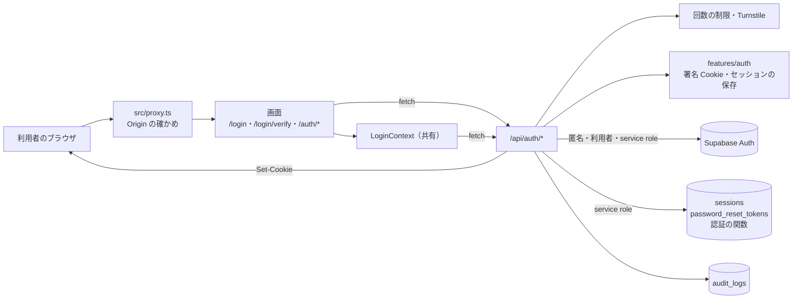

矢印は呼び出しの向き。ラベルは使う Supabase の client か、呼び方。画面のサーバーの描画で Cookie を読むのは `/login` と `/login/verify` の2つだけで、ほかの画面は端末で動いてから窓口を呼ぶ。ヘッダーとドロワーは全部のページに出る（`src/contexts/Providers.tsx` から描く）。

### ARC-AUTH-001 認証は端末の画面から自前の窓口を呼び、窓口が Supabase Auth を呼んでトークンを HttpOnly の Cookie に入れる

| 属性 | 値 |
| --- | --- |
| 上位 | FR-LOGIN-001、FR-LOGIN-002、FR-LOGIN-003、SEC-AUTH-024、SEC-AUTH-028、NFR-SEC-003（範囲外） |
| 根拠 | トークンを画面の JS に持たせると差し込まれたスクリプトに盗まれるので、Supabase Auth を窓口の中で呼び、結果を HttpOnly の Cookie に入れる（SEC-AUTH-024）。画面の出し分けは表示だけにし、役割は窓口が JWT の `app_metadata` から読む（SEC-AUTH-028）。入力の形は全部の窓口で zod で確かめる（NFR-SEC-003） |
| 状態 | 推定 |
| 確かめ方 | 結合テスト |
| 出どころ | 実装から推定（`src/app/api/auth/**`、`src/contexts/LoginContext.tsx`、`src/lib/cookie.ts`）、`docs/03_BasicDesign/architecture/auth-structure.md` |

- 入口: ログイン・会員登録は `/login`（SCR-AUTH-001）、認証コードは `/login/verify`（SCR-AUTH-004）、再設定は `/auth/password-reset`（SCR-AUTH-005・006）、ログインの後の振り分けと TOTP は `/auth/verified`（SCR-AUTH-007）
- 窓口: `/api/auth/*` の 18 本（API-AUTH-001〜018）。全部 Route Handler で、本文を共有の `features/auth/schemas` で確かめる
- client: パスワードと OTP の確かめは匿名の client（`createPublicClient`、Cookie の副作用なし）、TOTP は利用者の session の client（`createClient`）、表・関数・管理の操作は service role の client
- トークン: access token・refresh token・CSRF の印・`session_id` を Cookie に入れ、`sessions` の表に refresh token のハッシュを控える（DATA-AUTH-001・004）
- 役割: `admin`・`supporter`・`user` の3つ。`app_metadata.role` から読み、無ければ `user`
- 守りの位置: 2段目・ボットの確かめ・回数の制限・16 文字・漏洩の照合は全部アプリの窓口の中。公開の anon キーで Supabase Auth を直接呼ぶ道は塞がない（SEC-AUTH-005・015 は満たさない）

### ARC-AUTH-002 ログインはパスワードの確かめとメールの確認コードの2段で、間の保留を署名した短命の Cookie に持つ

| 属性 | 値 |
| --- | --- |
| 上位 | FR-LOGIN-001、FREQ-58-REQ-01、FREQ-334-REQ-01、FREQ-335-REQ-04、FREQ-336-REQ-01、SEC-AUTH-003、SEC-AUTH-004、ADR-0400 |
| 根拠 | メールを読めるだけの相手にパスワードの段を飛ばさせないため、1段目を通ったことを HMAC で署名した Cookie に残し、2段目はその Cookie が無ければ断る（FREQ-58-REQ-01、SEC-AUTH-003）。保留を React の状態でなく Cookie に置くと、`/login/verify` をサーバーで門にでき、再読み込みでも続きから入れる（ADR-0400）。Cookie の寿命は5分、再送で延ばしても最初から30分で切る（FREQ-335-REQ-04、FREQ-336-REQ-01、SEC-AUTH-004） |
| 状態 | 推定 |
| 確かめ方 | 結合テスト |
| 出どころ | 実装から推定（`src/app/api/auth/login/route.ts`、`otp/verify/route.ts`、`login/resend/route.ts`、`src/features/auth/services/login-2fa-session.ts`）、`docs/superpowers/specs/2026-09-04-login-otp-dedicated-screen-design.md` |

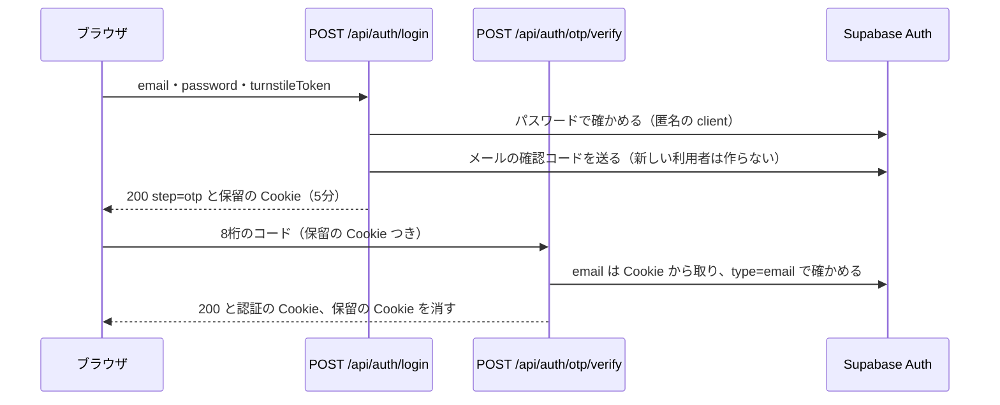

- 1段目で得た Supabase の session は捨て、Cookie に入れない。トークンを配るのは2段目を通った時だけ
- 宛先のメールはいつも保留の Cookie から取り、本文から受けない（FREQ-336-REQ-03）
- 保留の取り消し（API-AUTH-004）・再送（API-AUTH-003）・上限での破棄の動きは STATE-AUTH-001
- Google のログインはこの2段を通らない（FLOW-AUTH-002）。会員の Google ログインに2段目を求めるかは決めていない（SEC-AUTH-008 の会員の部分）

### ARC-AUTH-003 管理者とサポーターは TOTP を通って aal2 のトークンに替えてから管理画面に入る

| 属性 | 値 |
| --- | --- |
| 上位 | FR-LOGIN-007、SEC-AUTH-008、SEC-AUTH-028、DRV-AUTH-009、ADR-0409 |
| 根拠 | 管理画面は全会員の注文と個人情報を扱うので、パスワードとメールが盗まれても入られないよう、端末の認証アプリの確認を足す（FR-LOGIN-007）。管理の窓口は aal2 の JWT を求めるので、Google でログインした管理者も TOTP を通るまで入れない（SEC-AUTH-008 の管理の部分）。TOTP の窓口は自分のアカウントに要素を付けるかの判断だけに役割を使うので、DB の ACL を引かず JWT のクレームから読む（ADR-0409） |
| 状態 | 推定 |
| 確かめ方 | 結合テスト |
| 出どころ | 実装から推定（`src/app/auth/verified/page.tsx`、`src/app/api/auth/mfa/*/route.ts`、`src/lib/auth/admin-rbac.ts`） |

- 流れ: ログインの後に `/auth/verified`（SCR-AUTH-007）が `/api/auth/me` を見て、admin・supporter で aal2 でなければ `/api/auth/mfa/status` で要素の有無を引く。無ければ自動で登録（API-AUTH-017）してQRと秘密を出し、あれば確認（API-AUTH-018）へ進む
- 確認が通ると Supabase が aal2 のトークン対を返し、窓口が Cookie と `sessions` の表を差し替える（`persistNewSession`）。画面は `/admin` へ移る
- 一般の会員は TOTP の窓口で 403。`/auth/verified` からは `/account` へ送る
- 管理の窓口が aal2 を確かめるのは共有の `admin-rbac`。DB の側の RLS は aal2 を見ない（SEC-AUTH-010 は満たさない）
- TOTP の確認にアカウント単位の回数の制限と成否の監査が無い（SEC-AUTH-009 は満たさない。API-AUTH-018）
- 手元の Supabase は TOTP の登録と確認が無効（`supabase/config.toml`）で、この流れは手元で動かせない

### ARC-AUTH-004 パスワードの再設定は自前の使い捨ての印で行い、印の消費をパスワードを変える時まで遅らせる

| 属性 | 値 |
| --- | --- |
| 上位 | FR-LOGIN-003、FREQ-319-REQ-03、FREQ-319-REQ-05、FREQ-332-REQ-04、ADR-0403 |
| 根拠 | 企業のメールのリンクの検査はリンクを先に開くので、開いた時に印を消費すると利用者が永久に再設定できない。消費はパスワードを実際に変える時だけにする（FREQ-319-REQ-03、ADR-0403）。漏れた印でパスワードを変えさせないよう、印は 10 分・1回限りにする（FREQ-332-REQ-04）。最新の1本だけは保証しない（SEC-AUTH-018 は満たさない。前の印を使用済みにするのに失敗しても新しい印を出す。`request/route.ts`） |
| 状態 | 推定 |
| 確かめ方 | 結合テスト |
| 出どころ | 実装から推定（`src/app/api/auth/password-reset/*/route.ts`、`src/features/auth/services/password-reset-session.ts`） |

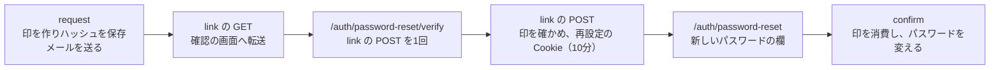

- 印は 32 バイトの乱数の 16 進。DB には SHA-256 のハッシュだけを置く（DATA-AUTH-002）
- Supabase Auth の再設定のメール（recovery）は使わない。パスワードの変更は service role の `updateUserById`
- 再設定の Cookie は署名した短命の Cookie（10 分、SameSite=Strict）で、利用者・宛先・印の行の id を持つ
- 変えた後は自前の `sessions` と Supabase の全部のセッションを切り、本人に通知のメールを送る（FREQ-319-REQ-05）。切るのに失敗しても成功で返し、監査に残さない（SEC-AUTH-020 の失敗の監査は満たさない。API-AUTH-012）
- 期限の切れた行の掃除は DB の関数があるが呼ぶ所が無い（SEC-AUTH-018 の掃除は満たさない。DATA-AUTH-002）

### ARC-AUTH-005 ボットの確かめと回数の制限を、状態を変える窓口の頭に置く

| 属性 | 値 |
| --- | --- |
| 上位 | SEC-AUTH-001、SEC-AUTH-002、FREQ-330-REQ-01、FREQ-330-REQ-02、FREQ-327-REQ-01、FREQ-327-REQ-03、FREQ-360-REQ-02（範囲外）、ADR-0411 |
| 根拠 | パスワードの総当たりとメールの送信の踏み台を止めるため、IP 単位とメール単位の2段で数え、メール単位は Turnstile の後に数えて他人の枠を潰させない（SEC-AUTH-001、FREQ-360-REQ-02（範囲外））。Turnstile のトークンは1回しか使えないので、送るたびに成否によらず引き直し、引き直しの手段を共通のフックに集める（FREQ-330-REQ-01・02、ADR-0411）。状態を変える `POST` の Origin の確かめは窓口に書かず、共有の proxy の1か所に任せる（FREQ-327-REQ-01・03） |
| 状態 | 推定 |
| 確かめ方 | 結合テスト |
| 出どころ | 実装から推定（`src/app/api/auth/**`、`src/hooks/useTurnstileWidget.ts`、`src/features/auth/middleware/rateLimit.ts`、`src/lib/turnstile.ts`） |

| 窓口 | Turnstile | IP 単位 | メール・宛先単位 |
| --- | --- | --- | --- |
| `POST /api/auth/login` | あり | 50 回／600 秒 | 5 回／600 秒（Turnstile の後） |
| `POST /api/auth/login/resend` | なし | 50 回／600 秒（login と同じ枠） | 5 回／600 秒（login と同じ枠、保留の宛先） |
| `POST /api/auth/otp/verify` | なし | 30 回／600 秒 | 5 回／600 秒（保留の宛先） |
| `POST /api/auth/register` | あり | 20 回／3600 秒 | なし |
| `POST /api/auth/password-reset/request` | あり | 10 回／3600 秒 | 5 回／3600 秒（Turnstile の後） |
| `POST /api/auth/password-reset/link` | なし | 20 回／600 秒 | なし |
| `POST /api/auth/password-reset/confirm` | なし | 10 回／3600 秒 | なし |
| `GET /api/auth/confirm` | なし | 50 回／600 秒 | なし |
| `GET /api/auth/oauth/start`・`callback` | なし | 50 回／600 秒 | なし |
| `POST /api/auth/refresh` | なし | 30 回／600 秒 | なし |
| `POST /api/auth/mfa/enroll-totp` | なし | 10 回／600 秒 | なし |
| `POST /api/auth/mfa/verify` | なし | 20 回／600 秒 | なし |

- Turnstile の描画は共通のフック `useTurnstileWidget` が明示の描画（`flexible`、300px より狭い時は縮める）で行い、ログイン・会員登録・再設定の3つのフォームが使う（FREQ-328-REQ-01・02）
- 本番で Turnstile の鍵が無い時は 403 で断る（`src/lib/turnstile.ts`）
- 確認コードの再送（`login/resend`）には Turnstile が無い。FREQ-330-REQ-03 は再送にも当てると書くので、上位にしていない
- 回数の制限の呼び出しが例外を投げた時は、記録だけして通す（窓口ごとの `try`）。数え場所の失敗の 503 は共有部品が返す
- IP は `x-forwarded-for` の先頭を信じる（SEC-AUTH-013 は満たさない）。Supabase Auth はアプリのサーバーの IP で数える
- 回数の制限の無い窓口: `login/cancel`・`logout`・`me`・`mfa/status`・`password-reset/session`
- 状態を変える `POST` は共有の proxy が Origin で確かめる。許可の一覧が無い時に要求の見出しから比べる元を作る所は proxy にある（SEC-AUTH-025 の一覧が無い時の扱いは満たさない）

### ARC-AUTH-006 会員登録とパスワードの再設定は、アカウントの有無で応答を変えない

| 属性 | 値 |
| --- | --- |
| 上位 | FREQ-319-REQ-02、FREQ-320-REQ-01、FREQ-320-REQ-03、FREQ-320-REQ-04、ADR-0404 |
| 根拠 | 任意のメールを投げて会員かどうかを調べさせないため、登録済みでも新規と同じ 202 を返し、登録済みであることは本人にだけメールで伝える（FREQ-320-REQ-03・04、ADR-0404）。再設定はアカウントが無ければ印もメールも作らず、有る時と同じ 200 を返す（FREQ-319-REQ-02）。照会が失敗した時は「無い」に丸めず 503・500 にする（FREQ-320-REQ-01） |
| 状態 | 推定 |
| 確かめ方 | 結合テスト |
| 出どころ | 実装から推定（`src/app/api/auth/register/route.ts`、`src/app/api/auth/password-reset/request/route.ts`） |

- アカウントの照会は共有の `findAuthUserIdByEmail`（DB の関数 `find_auth_user_id_by_email` を1回、DATA-AUTH-003）。見つかった・無い・引けなかったの3つを分ける
- 会員登録の登録済みの通知のメールは応答の外（`after`）で送り、時間の差を小さくする
- 再設定はアカウントが有る時だけ DB に書いてから返すので、応答の時間に差が出うる（SEC-AUTH-016 の時間は満たさない。推定）
- 確認のメールが要らない設定（Confirm email が OFF）だと、新規は 201 とトークン、登録済みは 202 になり、応答で判別できる。列挙の対策は Confirm email が ON の前提（手元は OFF、`supabase/config.toml`）

### ARC-AUTH-007 新しいパスワードは 16 文字以上で漏洩していない物だけを受け、メールのリンクは許可した住所で作る

| 属性 | 値 |
| --- | --- |
| 上位 | FREQ-323-REQ-01、FREQ-323-REQ-02、FREQ-323-REQ-03、SEC-AUTH-014、SEC-AUTH-019、ADR-0405、NFR-SEC-008（範囲外） |
| 根拠 | 短い・漏れたパスワードでリスト型攻撃の成功率を上げないため、16 文字以上で HIBP の k-匿名の照合に当たらない物だけを受け、文字の種類の決まりは課さない（FREQ-323-REQ-01・03、SEC-AUTH-014）。Supabase の漏洩の照合は上位のプランにしか無いのでアプリで照合し、照合先が落ちた時は止めずに監査に残す（FREQ-323-REQ-02、ADR-0405）。Host の偽りで店のメールのリンクを外へ向けさせない（SEC-AUTH-019） |
| 状態 | 推定 |
| 確かめ方 | 結合テスト |
| 出どころ | 実装から推定（`src/features/auth/schemas/common.ts`、`src/app/api/auth/register/route.ts`、`src/app/api/auth/password-reset/confirm/route.ts`、`src/app/api/auth/password-reset/request/route.ts`） |

- 当てる窓口: 会員登録（API-AUTH-005）と再設定の完了（API-AUTH-012）。ログインのパスワードには当てない
- 照合の順番: 会員登録は Turnstile と住所の見張りの後、再設定の完了は印の確かめの後（偽の印で外の API を叩かせない）で、どちらも印の消費・アカウントの作成の前
- 住所の見張り: 要求から作った住所が許可の一覧（`isEmailOriginAllowed`）に無い時、会員登録は 503、再設定の申請は同じ 200 を返して印もメールも作らず、運用へ知らせる
- Supabase Auth の側の最小の長さは手元で 6 文字で、直接の登録には 16 文字が効かない（SEC-AUTH-015 は満たさない）

### ARC-AUTH-008 ヘッダーの出し隠しを html の印と変数でほかの領域の固定の部品へ伝える

| 属性 | 値 |
| --- | --- |
| 上位 | DRV-AUTH-001、FREQ-38-REQ-01（範囲外） |
| 根拠 | 長いページで固定のヘッダーが画面の上を占めないように隠し（DRV-AUTH-001）、一覧の FILTER のバーなどの固定の部品がヘッダーの下にぴったり付いて動くよう、同じ状態を `html` に書いて CSS から読ませる。ITEM 一覧のフィルターはこの動きを前提にする（FREQ-38（範囲外）） |
| 状態 | 推定 |
| 確かめ方 | 結合テスト |
| 出どころ | 実装から推定（`src/components/Header.tsx`、`src/app/layout.tsx`、`src/styles/globals.css`） |

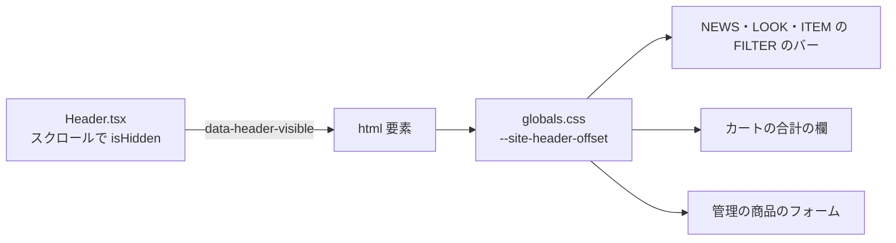

- 書く所: ヘッダーが `document.documentElement.dataset.headerVisible` に `true`・`false` を書く。初期値は共有の `app/layout.tsx`
- 読む所: `PublicNewsGrid`（NEWS）・`PublicLookGrid`（LOOK）・`PublicItemGrid`（ITEM）・`OrderSummary`（カート）・`ItemForm`（管理）。どれもほかの領域のコード
- 出し隠しの決まりは STATE-AUTH-005。印の名前と値を変えるとほかの領域の配置が崩れるので、変える時は NEWS（DRV-NEWS-002・003）などの影響を見る

### ARC-AUTH-009 ログインの状態は me で答え、refresh で延ばし、logout でサーバーのセッションごと切る

| 属性 | 値 |
| --- | --- |
| 上位 | DRV-AUTH-007、DRV-AUTH-008、FREQ-320-REQ-02、FREQ-316-REQ-04、FREQ-324-REQ-03（範囲外）、ADR-0406、ADR-0407、ADR-0408 |
| 根拠 | 画面の出し分けと認可の答えがずれないよう、`me` は認可と同じ根拠（失効の確かめ・aal2）で答え、確かめられない時は未ログインにせず 503 にする（DRV-AUTH-007、FREQ-324（範囲外）、ADR-0408）。access token は短命なので refresh の Cookie で替え、門番は Supabase のトークンの交換にする（DRV-AUTH-008、ADR-0406）。更新を呼ぶのは共有の `client-fetch` が 401 を受けた時だけで、回数の制限に当たらないよう待ち時間を置く（FREQ-316-REQ-04）。ログアウトは盗まれた refresh token を残さないようサーバーのセッションを切り、常に 200 で Cookie を消す（ADR-0407）。access の Cookie の寿命は refresh と同じ7日にし、期限の前に Cookie だけ消えて未ログインに見えるのを防ぐ（FREQ-320-REQ-02） |
| 状態 | 推定 |
| 確かめ方 | 結合テスト |
| 出どころ | 実装から推定（`src/app/api/auth/me/route.ts`、`refresh/route.ts`、`logout/route.ts`、`src/features/auth/services/session.ts`） |

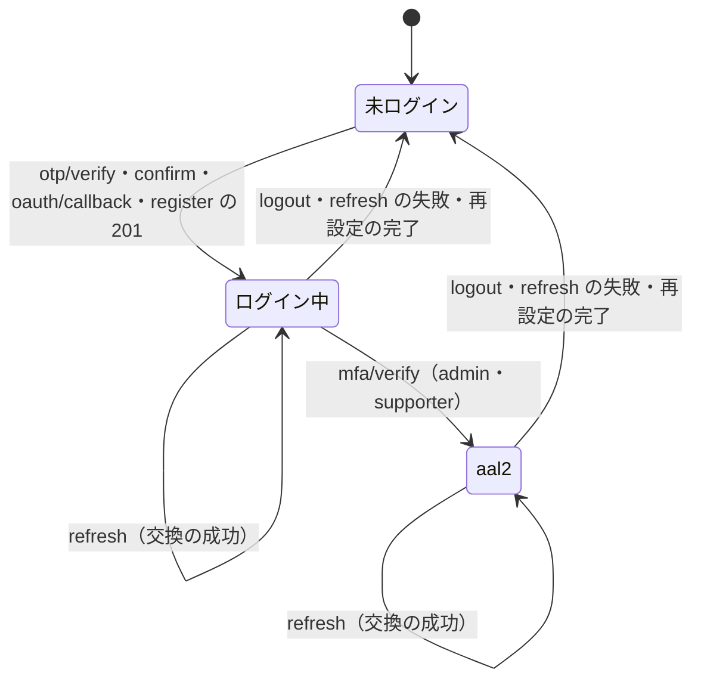

- 状態の名前は利用者から見た状態。サーバーの真の状態は Supabase のセッション（`auth.sessions`）で、自前の `sessions` の表は控え（DATA-AUTH-001）
- `me`（API-AUTH-013）・`refresh`（API-AUTH-014）・`logout`（API-AUTH-015）の中身は各 API の項目
- refresh を呼ぶのは共有の `client-fetch`（401 の時だけ、FREQ-316）
- ログアウトは共有の `LoginContext` が呼ぶ（会員ページ・ヘッダーの外）

## 画面

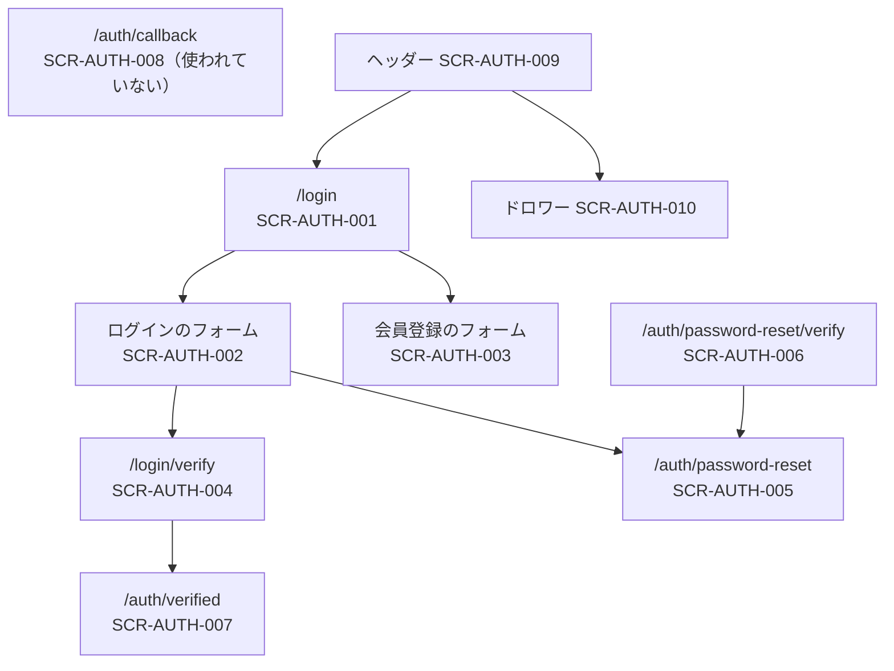

矢印は画面の中のリンク・移動。細かい条件は画面遷移（FLOW-AUTH-001〜004）に書く。ヘッダーとドロワーは全部のページに出る。

### SCR-AUTH-001 /login はログインと会員登録の2つのタブを持つ1つの認証の画面にする

| 属性 | 値 |
| --- | --- |
| 上位 | FR-LOGIN-005、FREQ-63-REQ-01、FREQ-90-REQ-01、FREQ-69-REQ-01、FREQ-71-REQ-01、FREQ-334-REQ-03、ADR-0410 |
| 根拠 | ログインと会員登録を別のページにすると導線が分かれるので、`/login` の1つの画面のタブで切り替え、`/register` は置かない（FREQ-63-REQ-01、ADR-0410）。タブは下線の形にし、カードの枠と切替のリンクを消す（FREQ-90-REQ-01）。認証コードの入力の途中で戻ってきた人にもう一度パスワードを打たせると2通目のコードが飛ぶので、保留が有効なら `/login/verify` へ送る（FREQ-334-REQ-03） |
| 状態 | 推定 |
| 確かめ方 | 結合テスト |
| 出どころ | 実装から推定（`src/app/login/page.tsx`、`src/components/AuthTabs.tsx`） |

- サーバーの描画: 題「LOGIN | Le Fil des Heures」・説明・OG の画像を返す（FR-LOGIN-005）。保留の Cookie が有効なら `/login/verify` へ送る
- `?tab=register` で会員登録のタブから始め、`?email=` が文字列なら会員登録の欄に入れる（注文の完了からの案内、FREQ-266（範囲外））
- タブ: `tablist` に「ログイン」「会員登録」。左右の矢印で切り替える。選んだタブは黒の太い下線、選ばないタブはグレーの文字と細い下線
- タブを切り替えると URL を `/login` に置き換える（`?tab=`・`?email=` が消える）。`/register` へは変えない
- 画面の高さ: main を画面の高さ以上にしてフォームを縦横の中央に置き、上下にヘッダーのずれの分の余白を取る（FREQ-69-REQ-01）。この main の指定は共有の `src/contexts/Providers.tsx` が `/login`・`/login/verify`・`/auth/password-reset` の3つに当てる。`sm` より狭い時だけ縦の余白と欄の高さを縮める（FREQ-71-REQ-01）
- 中身はログインのフォーム（SCR-AUTH-002）か会員登録のフォーム（SCR-AUTH-003）
- `/register` へ来た時の動きはアプリのページが無いことで決まる（404。FREQ-63-AC-01）

### SCR-AUTH-002 ログインのフォームはメール・パスワード・ボットの確かめと、再設定と Google の入口を持つ

| 属性 | 値 |
| --- | --- |
| 上位 | FR-LOGIN-001、FR-LOGIN-002、FREQ-65-REQ-01、FREQ-66-REQ-01、FREQ-67-REQ-01、FREQ-68-REQ-01、FREQ-89-REQ-01、FREQ-334-REQ-02、FREQ-328-REQ-01、ADR-0411 |
| 根拠 | 1段目の入力をここに集め、パスワードの確かめが通ったら認証コードの専用の画面へ置き換えて移る（FR-LOGIN-001、FREQ-334-REQ-02）。忘れた人の入口はパスワードの欄の直下に右寄せで置き、主のボタンを一番大きくして優先度を見せる（FREQ-66・67-REQ-01）。未入力の間は送れなくする（FREQ-65-REQ-01 のボタンの部分）。Turnstile は共通のフックで描き、送るたびに引き直す（FREQ-328-REQ-01、ADR-0411） |
| 状態 | 推定 |
| 確かめ方 | 結合テスト |
| 出どころ | 実装から推定（`src/components/LoginModal.tsx`） |

- 欄: EMAIL とパスワード。下線の形・先頭のアイコン・パスワードの表示切替（FREQ-89-REQ-01、共有の `TextField`）
- 「パスワードをお忘れの方はこちら」: `/auth/password-reset` へのリンク
- ログインのボタン: メールかパスワードが空、または送信中は押せない。押すと `LoginContext` の `login` が `POST /api/auth/login`（API-AUTH-001）を呼ぶ。成功したら `router.replace('/login/verify')`、失敗したら文を出す
- Google のボタン: 主のボタンと同じ高さ・文字（FREQ-68-REQ-01）。`/api/auth/oauth/start?provider=google&redirect_to=/auth/verified` へ移る（FR-LOGIN-002、FLOW-AUTH-002）
- 並び: フォーム → OR → Google
- 部品は `open`・`onClose` を受けるが、`/login` は常に開いた形で渡す。閉じる形はヘッダーの使われていないモーダルだけが使う

### SCR-AUTH-003 会員登録のフォームはメール・パスワード2回・ボットの確かめを受け、送った後は確認のメールの案内だけにする

| 属性 | 値 |
| --- | --- |
| 上位 | FREQ-91-REQ-01、FREQ-320-REQ-04、FREQ-330-REQ-01、ADR-0411 |
| 根拠 | 登録の3つの欄をログインのタブと同じ下線とアイコンにし、並びを フォーム→OR→Google にそろえる（FREQ-91-REQ-01）。登録済みかどうかを画面で判らせないため、送った後は誰にでも同じ確認のメールの案内を出す（FREQ-320-REQ-04）。Turnstile は送るたびに引き直す（FREQ-330-REQ-01、ADR-0411） |
| 状態 | 推定 |
| 確かめ方 | 結合テスト |
| 出どころ | 実装から推定（`src/components/RegisterModal.tsx`） |

- 欄: EMAIL・パスワード・パスワード（確認）。16 文字未満・2つの不一致・Turnstile の未完了は送らずに文を出す
- 欄の placeholder は「Password」「Confirm Password」で、16 文字の決まりは送った時の誤りの文にしか出ない。欄に示すことを求める FREQ-323-REQ-04 は上位にしていない
- 送信: `LoginContext` の `register` が `POST /api/auth/register`（API-AUTH-005）を `redirect_to=/auth/verified` で呼ぶ
- 成功: フォームを消し、「確認メールを送信しました…」と迷惑メールの案内を出し、ログインのタブへ戻る手段を置く。完了の文へフォーカスを移す（FREQ-377（範囲外）の読み上げ）
- 失敗: 窓口の文（漏洩・ボットの確かめ・一時的に受け付けられない）を出す
- 呼び手の `AuthTabs` はいつも `onSwitchToLogin` を渡すので、渡さない時の `/login` へのリンクの側は使われない

### SCR-AUTH-004 /login/verify は保留が有効な時だけ8桁の認証コードの入力・再送・やり直しを出す

| 属性 | 値 |
| --- | --- |
| 上位 | FREQ-334-REQ-01、FREQ-334-REQ-04、FREQ-334-REQ-05、FREQ-334-REQ-06、FR-LOGIN-006、FR-LOGIN-008、DRV-AUTH-006、ADR-0400 |
| 根拠 | 保留の判定をサーバーに置き、判定の前に入力の画面の HTML を送らない。保留が無い・偽り・期限切れは全部同じに `/login` へ送り、アカウントの有無を示さない（FREQ-334-REQ-01、ADR-0400）。宛先は伏せて出し、再送はパスワード無しで保留の宛先に送り、別の宛先でやり直す時は保留を捨てる（FREQ-334-REQ-04〜06）。再送の待ちは 60 秒（FR-LOGIN-006・008） |
| 状態 | 推定 |
| 確かめ方 | 結合テスト |
| 出どころ | 実装から推定（`src/app/login/verify/page.tsx`、`src/app/login/verify/VerifyOtpClient.tsx`、`src/lib/format-countdown.ts`） |

- サーバーの描画: 検索に載せない（`robots: noindex, nofollow`）。保留の Cookie が有効なら宛先を部品へ渡す
- 宛先: 共有の `mask-email` で伏せて出す
- 入力: 8つの欄。数字以外を捨て、打つと次へ、Backspace で戻り、矢印で移り、貼り付けを順に入れる（DRV-AUTH-006）。8桁でなければ送らない
- 送信: `LoginContext` の `verifyOtp` が `POST /api/auth/otp/verify`（API-AUTH-002）を呼ぶ。成功したら行き先を決める（FLOW-AUTH-001）
- 「コードは5分間有効です」と出す。5分は Supabase の設定（FREQ-60-REQ-01）と保留の Cookie の寿命で決まり、画面は数えない
- 再送: 60 秒の待ちを `formatResendCountdown` の文で出し、明けたら `POST /api/auth/login/resend`（API-AUTH-003）を呼ぶ。401 は `/login` へ、429 は `Retry-After`（秒か日付）を待ちに入れ、503 とそのほかは案内の文を出す。60 秒の待ちは画面だけで、窓口は数えない
- やり直し: 「別のアドレスでやり直す」で `POST /api/auth/login/cancel`（API-AUTH-004）を呼んでから `/login` へ置き換える

### SCR-AUTH-005 /auth/password-reset は申請・新しいパスワード・結果の3つの見せ方を持つ再設定のページにする

| 属性 | 値 |
| --- | --- |
| 上位 | FREQ-92-REQ-01、FREQ-319-REQ-04、FREQ-323-REQ-04、FREQ-328-REQ-02、FREQ-328-REQ-03、FREQ-328-REQ-04、FREQ-329-REQ-01、FREQ-329-REQ-02、FREQ-329-REQ-05、FREQ-331-REQ-01、FREQ-331-REQ-02、FREQ-331-REQ-03、FREQ-331-REQ-04、FREQ-331-REQ-05、FREQ-331-REQ-06、FREQ-331-REQ-07、FREQ-333-REQ-01、FREQ-333-REQ-02、FREQ-333-REQ-03、FREQ-333-REQ-04、ADR-0411 |
| 根拠 | 1つの道で、メールを送る前（申請）・リンクから来た後（新しいパスワード）・終わった後（結果）を出し分ける。どれかは再設定の Cookie の有無で決まり、画面は窓口に聞く（FREQ-332 の流れ）。無効・期限切れのリンクは理由を出す（FREQ-319-REQ-04）。送った後はフォームを畳んで結果だけを出し、宛先は出さない（FREQ-329-REQ-01・02）。打ち間違いを捕まえるため新しいパスワードを2回入れさせる（FREQ-333-REQ-01〜04）。結果の画面は図・題・詳細の階層で一目で読めるようにする（FREQ-331-REQ-01〜07） |
| 状態 | 推定 |
| 確かめ方 | 結合テスト |
| 出どころ | 実装から推定（`src/app/auth/password-reset/page.tsx`、`src/components/AuthResultScreen.tsx`、`src/hooks/useTurnstileWidget.ts`） |

- 見せ方の移り変わりは STATE-AUTH-004
- 申請: EMAIL の欄と Turnstile と送信のボタン。`POST /api/auth/password-reset/request`（API-AUTH-009）を呼び、送るたびに Turnstile を引き直す（FREQ-330）。Turnstile は `flexible` で描き、横のスクロールを起こさない（FREQ-328-REQ-02・03）
- 新しいパスワード: 「New Password (16+ characters)」「Confirm New Password (16+ characters)」の2つの欄（両方に表示切替）。メールの欄は出さない。2つが埋まるまで送れず、長さの後に一致を確かめ、確認の欄の値は送らない。`POST /api/auth/password-reset/confirm`（API-AUTH-012）を呼ぶ
- 結果: 共通の部品 `AuthResultScreen`（図・完了のバッジ・題の h1・詳細・注意書きのパネル・操作）。結果の時はページの見出し「パスワード再設定」を描かない（FREQ-331-REQ-02）。送った後は封筒の図と迷惑メールの確認・「再送で前のリンクは無効」の注意、変えた後は南京錠の図と「ログインへ」のボタン（FREQ-329-REQ-05）
- `?error=link_expired`・`link_invalid` で来たら理由の文を出し、URL から外す
- 見た目: カードの枠を消し、欄を下線とアイコンに、ボタンを直角にする（FREQ-92-REQ-01）。CTA の前の間隔は直前の要素の下端から測る（FREQ-328-REQ-04）
- 角丸のカードを求める FREQ-70-REQ-01 は FREQ-92 で置き換わったとして上位にしていない

### SCR-AUTH-006 /auth/password-reset/verify はメールのリンクの確かめを1回だけ自動で送り、新しいパスワードの欄へ直に進める

| 属性 | 値 |
| --- | --- |
| 上位 | FREQ-332-REQ-01、FREQ-332-REQ-02、FREQ-332-REQ-03、FREQ-319-REQ-03、ADR-0403 |
| 根拠 | リンクの検査が GET で開いても印が潰れないよう、メールのリンクは副作用の無いこの画面へ着き、画面が開いてから確かめの POST を送る（FREQ-319-REQ-03、ADR-0403）。利用者に確認のボタンを押させずに新しいパスワードの欄へ着かせる（FREQ-332-REQ-01・02）。通信の誤りの時だけ再試行の手段を出す（FREQ-332-REQ-03） |
| 状態 | 推定 |
| 確かめ方 | 結合テスト |
| 出どころ | 実装から推定（`src/app/auth/password-reset/verify/page.tsx`、`VerifyClient.tsx`） |

- サーバーの描画: `token` が無ければ `/auth/password-reset?error=link_invalid` へ送る。ここでは印を消費しない
- 端末: 開いた時に `POST /api/auth/password-reset/link`（API-AUTH-010）を1回だけ送る（二重の送信を止める印を持つ）
- 成功: `/auth/password-reset` へ置き換える（再設定の Cookie が付いたので新しいパスワードの見せ方になる）
- 窓口が断った: `/auth/password-reset?error=link_expired` へ置き換える
- 通信の誤り: 文と再試行のボタンを出す

### SCR-AUTH-007 /auth/verified はログインの後に役割で振り分け、管理者とサポーターに TOTP の登録と確認をさせる

| 属性 | 値 |
| --- | --- |
| 上位 | FR-LOGIN-007、FREQ-73-REQ-01、DRV-AUTH-009、FREQ-515-REQ-01、SEC-AUTH-008、SEC-AUTH-028 |
| 根拠 | 一般の会員を管理者用の確認に通さず、管理者とサポーターは TOTP の確認を必ず通す（FR-LOGIN-007、DRV-AUTH-009）。Google でログインした管理者もここを通るので aal2 になるまで管理画面に入れない（SEC-AUTH-008 の管理の部分）。振り分けは `/api/auth/me` の役割で行い、画面の判定は表示だけ（SEC-AUTH-028）。見た目はブランドの世界観に合わせる（FREQ-73-REQ-01）。認証要素が2つ以上ある時は、選択欄で選んだ要素で確かめる（FREQ-515-REQ-01） |
| 状態 | 推定 |
| 確かめ方 | 結合テスト |
| 出どころ | 実装から推定（`src/app/auth/verified/page.tsx`） |

- 見せ方の移り変わりは STATE-AUTH-003
- 見た目: Didot の見出し・糸のヘアライン・モノクロ・中央寄せ。未ログインには `/login` へのリンクを出す（FREQ-73-REQ-01）
- 一般の会員: 「確認完了。アカウントへ移動します…」を出し、0.8 秒後に `/account` へ置き換える。リンクも置く
- 管理者・サポーターで aal2 済み: `/admin` へ置き換える
- 管理者・サポーターで aal2 でない: 要素が無ければ自動で登録（API-AUTH-017）し、QR（data URI の画像）と秘密の文字を出す。要素が2つ以上なら選ぶ欄（共有の `SingleSelect`）を出す。6〜8桁のコードで確認（API-AUTH-018）し、通ったら `/admin` へ
- 確認の画面の読み上げは同じ `status` の中身だけを入れ替える（FREQ-377（範囲外））

### SCR-AUTH-008 未使用（削除の判断待ち）: /auth/callback は古い Google の戻りの画面で、今の流れからは使われていない

| 属性 | 値 |
| --- | --- |
| 上位 | FR-LOGIN-002 |
| 根拠 | 未使用（削除の判断待ち）。Google のログインの戻りを画面で受けて窓口へ渡すために作った画面（FR-LOGIN-002）。今の Google の流れは戻り先を窓口 `/api/auth/oauth/callback` に直に向けるので、ここへは来ない。コードの単位として残っているので、何をする画面かを書いておく |
| 状態 | 推定 |
| 確かめ方 | 結合テスト |
| 出どころ | 実装から推定（`src/app/auth/callback/page.tsx`、`src/app/api/auth/oauth/start/route.ts`） |

- `code` があれば `/api/auth/oauth/callback` へ移り、無ければ `/api/auth/me` を見てログイン済みなら `next` へ、失敗なら `/login` へのリンクを出す
- `next` は `/` で始まるかだけを見るので、`//` で始まる外の住所へ送れる（SEC-AUTH-026 の画面の部分は満たさない。open redirect が残る。`docs/05_Quality/reviews/security/security_review_overview.md` の X-02）
- 呼ぶ所が src・e2e・tests に無い。Supabase の Redirect URLs に `/auth/callback` があるかは未確認（`docs/04_DetailDesign/pages/14_login.md`）

### SCR-AUTH-009 ヘッダーは題・7つのページのナビ・役割で出す管理の入口・検索とお気に入りとカートとアカウントのアイコンを持つ

| 属性 | 値 |
| --- | --- |
| 上位 | DRV-AUTH-002、DRV-AUTH-004、DRV-AUTH-005、FREQ-194-REQ-01、FREQ-239-REQ-01、FREQ-309-REQ-01、FREQ-309-REQ-02、FREQ-309-REQ-03、FREQ-309-REQ-04、FREQ-309-REQ-05、SEC-AUTH-028 |
| 根拠 | どのページからも主なページと買い物の入口へ1回で移れるようにする（DRV-AUTH-002）。管理画面へ入れる役割の人にだけ入口を出すが、出すかどうかは表示だけで、入れるかはサーバーが決める（DRV-AUTH-004、SEC-AUTH-028）。管理画面では管理の板との重なり順を合わせるため地の板を分ける（DRV-AUTH-005）。カートの点数は共通のバッジで出す（FREQ-309-REQ-01〜05） |
| 状態 | 推定 |
| 確かめ方 | 結合テスト |
| 出どころ | 実装から推定（`src/components/Header.tsx`） |

- 題: 「Le Fil des Heures」を `/` へのリンクにする
- ナビ（大きい画面だけ）: NEWS・ITEM・LOOK・STOCKIST・ABOUT・CONTACT・UI の順。今のページ（下の階層を含む）の項目に下線を出し、ほかはホバーで出す。下線の幅は文字の幅（FREQ-194-REQ-01、共通のクラス `underline-animation-left2right`）
- 役割の入口: admin だけに LOADING（`/loading`、FREQ-76（範囲外））、admin と supporter に MANAGE（`/admin`）。役割は共有の `LoginContext` の値（`/api/auth/me` の答え）
- アイコン: 検索（`/search`）・お気に入り（`/wishlist`）・カート（`/cart`。点数があれば読み上げの名前に点数を入れ、右上の角に `StatusBadge` の count・2xs を重ね、99 を超えたら 99+、空なら出さない）・ログインしていれば `/account`、いなければ `/login`・ドロワーを開くボタン
- カートの点数は共有の `CartContext` の `useCart` から読む。カート・お気に入りの機能のコードは読まない
- 管理画面（`/admin` の下）: 白い地を別の要素に分けて低い重なり順に置き、ヘッダー自体も公開のページより低い重なり順にする
- `site-chrome` の印を付け、管理画面のフォントの一括指定から外す（FREQ-239-REQ-01）
- ログインのモーダルを持つが、開く所が無い（使われていない）
- 出し隠しは STATE-AUTH-005、ほかの領域へ伝える印は ARC-AUTH-008

### SCR-AUTH-010 ドロワーは NEWS・ITEM・LOOK の分類のアコーディオン・ほかのページ・SNS のアイコンを持つ

| 属性 | 値 |
| --- | --- |
| 上位 | DRV-AUTH-003、DRV-AUTH-004、FR-AUTH-001、FR-AUTH-002、FR-AUTH-003、FR-AUTH-004、FREQ-28-REQ-01、FREQ-29-REQ-01、FREQ-239-REQ-01 |
| 根拠 | 小さい画面でも一覧のページを開く前に分類を選んで直に移れるようにする（DRV-AUTH-003）。見た目はドロワーの直しの要件（サイトの題を出さない・SNS のアイコンを枠の中央に白黒で・アコーディオンの余白・閉じるボタンの位置・子のリンクの黒）に合わせる（FR-AUTH-001〜004、FREQ-28・29-REQ-01） |
| 状態 | 推定 |
| 確かめ方 | 結合テスト |
| 出どころ | 実装から推定（`src/components/Header.tsx`） |

- 開き方: ヘッダーのボタンで共有の `Drawer`（右から、`md`）を開く。上の行に閉じるボタンだけを置き、サイトの題は置かない（FR-AUTH-001）。閉じるボタンはハンバーガーと横の位置をそろえる（FREQ-28-REQ-01）
- 分類の節: NEWS（ニュースの分類）・ITEM（ALL・TOPS・BOTTOMS・OUTERWEAR・ACCESSORIES）・LOOK（シーズン）を共有の `Accordion` にする。子のリンクは各一覧の `category`・`season` の付いた URL（ALL は付けない）で、文字は黒（FREQ-29-REQ-01）。今のページの節は初めから開く。開いた節の子と次の親の間を空ける（FR-AUTH-004）
- 分類の値は NEWS の `src/lib/news-data.ts` と LOOK の `src/lib/look/public` から読む
- ほかのページ: STOCKIST・ABOUT・CONTACT・UI と、役割で MANAGE・LOADING（SCR-AUTH-009 と同じ決まり）
- SNS: 共有の `src/lib/social.ts` の見せるリンクを、枠の縦横の中央に、通常は純黒・ホバーは純白で描く（FR-AUTH-002・003）
- リンクを押すとドロワーを閉じる。`site-chrome` の印を付ける（FREQ-239-REQ-01）

## 画面遷移

### FLOW-AUTH-001 メールとパスワードのログインは /login から /login/verify を経て、役割で行き先を分ける

| 属性 | 値 |
| --- | --- |
| 上位 | FR-LOGIN-001、FREQ-334-REQ-02、FREQ-334-REQ-03、FREQ-334-REQ-06、DRV-AUTH-009 |
| 根拠 | パスワードの確かめが通ったら認証コードの専用の画面へ置き換えて移り、戻るで資格情報のフォームへ戻らないようにする（FREQ-334-REQ-02）。保留の間に `/login` へ来たら続きへ送り、やり直す時だけ保留を捨てて戻す（FREQ-334-REQ-03・06）。一般の会員を管理者用の確認に通さない（DRV-AUTH-009） |
| 状態 | 推定 |
| 確かめ方 | 結合テスト |
| 出どころ | 実装から推定（`src/components/LoginModal.tsx`、`src/app/login/page.tsx`、`src/app/login/verify/VerifyOtpClient.tsx`） |

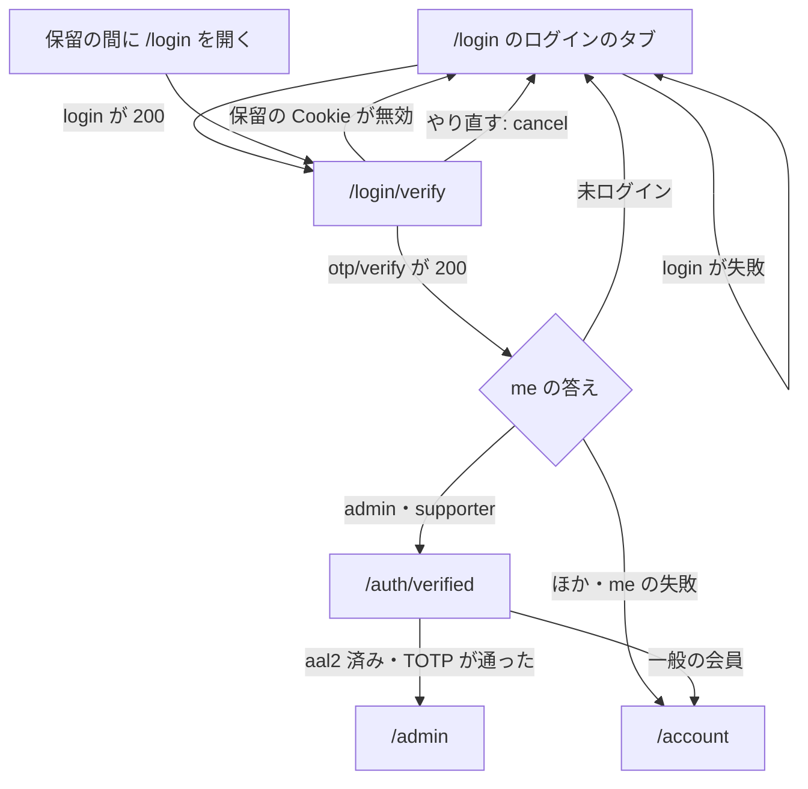

- 移る手段は全部 `router.replace` かサーバーの `redirect`（履歴に積まない）
- `?next=` のような送り先は受けない
- `/account`・`/admin` は範囲外の頁で、そこでの認可は各頁と共有の認証の部品が行う

### FLOW-AUTH-002 Google のログインは窓口で始めて窓口で受け、一般は /account、管理者は /auth/verified へ送る

| 属性 | 値 |
| --- | --- |
| 上位 | FR-LOGIN-002、DRV-AUTH-009、SEC-AUTH-026 |
| 根拠 | Google のアカウントでも入れるようにし（FR-LOGIN-002）、PKCE の交換を窓口のサーバーの中で済ませて、トークンを画面に渡さない。送り先は窓口で内部の道だけに絞る（SEC-AUTH-026 のサーバーの部分）。一般の会員は `/auth/verified` を通さず `/account` へ送る（DRV-AUTH-009） |
| 状態 | 推定 |
| 確かめ方 | 結合テスト |
| 出どころ | 実装から推定（`src/contexts/LoginContext.tsx`、`src/app/api/auth/oauth/start/route.ts`、`src/app/api/auth/oauth/callback/route.ts`） |

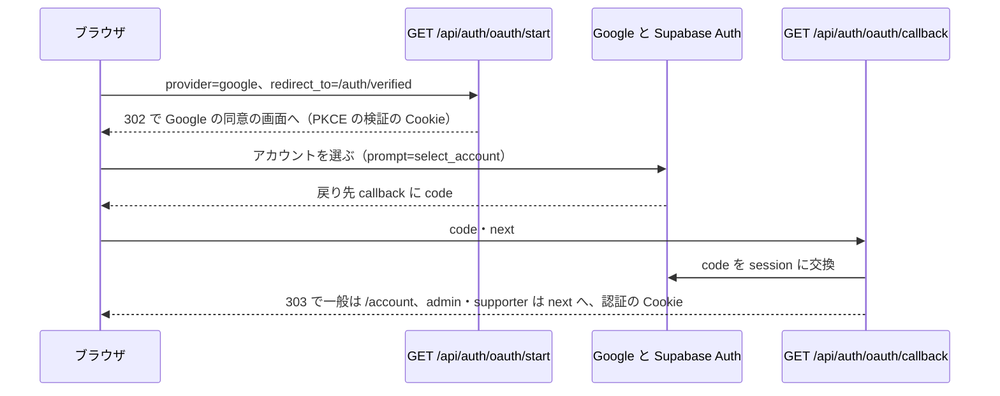

- `redirect_to`・`next` は窓口で `sanitizeRedirectPath` に通し、外の住所・`//`・`\` を既定の `/auth/verified` に替える
- 戻り先の既定のままなら一般は `/account`、admin・supporter は `/auth/verified`（SCR-AUTH-007 で TOTP）
- メールの確認コードの2段目を通らない。会員の Google ログインに2段目を求めるかは決めていない（SEC-AUTH-008 の会員の部分。FR-LOGIN-007 の「全員がパスワードとメール OTP」と食い違う）
- ゲスト注文の紐付けを呼ばない（メールの経路は呼ぶ）
- 失敗は画面へ戻さず、窓口の JSON（400・500・502）がそのまま出る

### FLOW-AUTH-003 会員登録は /login のタブで送り、確認のメールのリンクを開くとログインして /auth/verified から /account へ進む

| 属性 | 値 |
| --- | --- |
| 上位 | FREQ-63-REQ-01、FREQ-320-REQ-03、FREQ-320-REQ-04、FREQ-265-REQ-01（範囲外）、ADR-0410 |
| 根拠 | 登録の入口は `/login` のタブだけにする（FREQ-63-REQ-01、ADR-0410）。登録はメールの持ち主が確認のリンクを開いた時に終わらせ、登録済みの宛先には案内のメールだけを送る（FREQ-320-REQ-03・04）。確認でログインした時にゲストで買った注文を会員へ引き継ぐ（FREQ-265（範囲外）） |
| 状態 | 推定 |
| 確かめ方 | 結合テスト |
| 出どころ | 実装から推定（`src/components/RegisterModal.tsx`、`src/contexts/LoginContext.tsx`、`src/app/api/auth/register/route.ts`、`src/app/api/auth/confirm/route.ts`） |

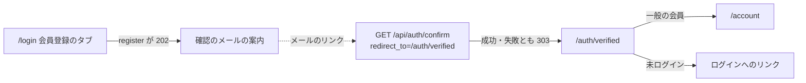

- 確認のリンクは Supabase Auth が `emailRedirectTo` に入れた `/api/auth/confirm?redirect_to=/auth/verified` で作る
- 確認が失敗しても理由を出さず、同じ送り先へ送る（`/auth/verified` が未ログインとして出す）
- 確認の入口は `signup` 以外（`email`・`magiclink`・`recovery`）の印でもログインさせる（SEC-AUTH-006 は満たさない）。開いた端末を登録した人の端末に結ばない（SEC-AUTH-007 は満たさない）
- 手元の Supabase は Confirm email が OFF なので、手元では登録の応答が 201 になり確認のメールを通らない

### FLOW-AUTH-004 パスワードの再設定はログインの画面から申請し、メールのリンクから確認の画面を経て新しいパスワードを決め、ログインへ戻る

| 属性 | 値 |
| --- | --- |
| 上位 | FR-LOGIN-003、FREQ-319-REQ-03、FREQ-319-REQ-04、FREQ-332-REQ-01、FREQ-332-REQ-02、FREQ-329-REQ-05、ADR-0403 |
| 根拠 | 忘れた人が店へ問い合わせずに戻れる道を作る（FR-LOGIN-003）。リンクの検査に印を潰させないため、リンクの先は副作用の無い確認の画面にし、印の消費はパスワードを変える時まで遅らせる（FREQ-319-REQ-03、ADR-0403）。確認の画面からは自動で新しいパスワードの欄へ進める（FREQ-332-REQ-01・02）。無効なリンクは理由を出し（FREQ-319-REQ-04）、終わったら「ログインへ」を主の操作にする（FREQ-329-REQ-05） |
| 状態 | 推定 |
| 確かめ方 | 結合テスト |
| 出どころ | 実装から推定（`src/app/auth/password-reset/**`、`src/app/api/auth/password-reset/*/route.ts`） |

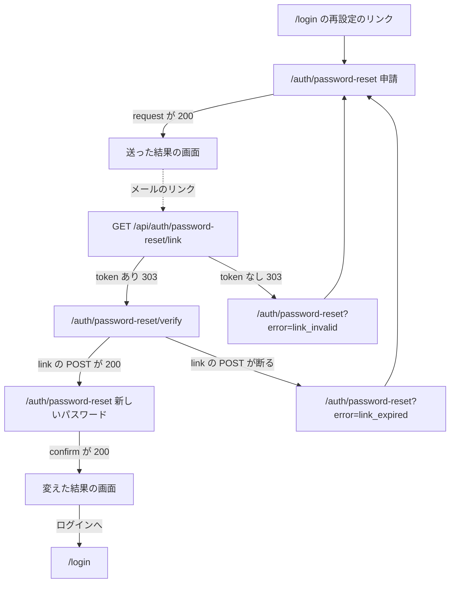

- 3つの画面の中身は SCR-AUTH-005・006、印の状態は STATE-AUTH-002
- 変えた後はこの端末の認証の Cookie も消すので、ログインし直しになる

## 状態遷移

### STATE-AUTH-001 ログインの保留は5分の Cookie で、再送で延ばしても最初から30分で切れ、確定・取り消し・上限で消える

| 属性 | 値 |
| --- | --- |
| 上位 | FREQ-335-REQ-02、FREQ-335-REQ-04、FREQ-336-REQ-01、FREQ-334-REQ-06、SEC-AUTH-002、SEC-AUTH-004、ADR-0400、ADR-0402 |
| 根拠 | 確認コードの有効期限（300 秒）より長く保留を残さない（FREQ-335-REQ-04）。再送で起点を延ばせると総当たりの窓が延びるので、最初の発行の時刻を引き継いで 30 分で切る（FREQ-336-REQ-01、SEC-AUTH-004）。コードの総当たりの上限に達したら試行の窓ごと閉じる（FREQ-335-REQ-02、SEC-AUTH-002、ADR-0402） |
| 状態 | 推定 |
| 確かめ方 | 結合テスト |
| 出どころ | 実装から推定（`src/features/auth/services/login-2fa-session.ts`、`src/app/api/auth/otp/verify/route.ts`、`login/resend/route.ts`、`login/cancel/route.ts`） |

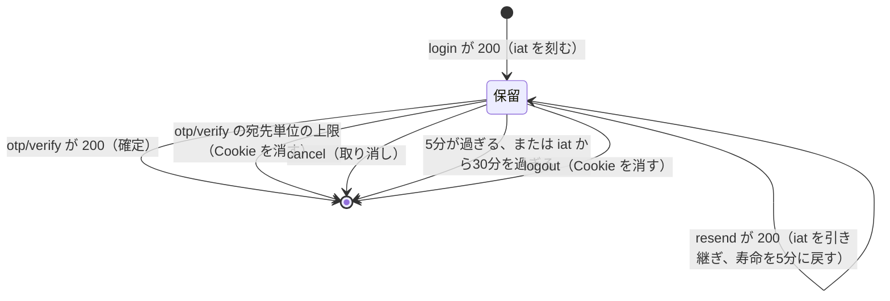

- 中身: 利用者の id・メール・用途（`purpose`）・発行の時刻（`iat`）・期限を HMAC で署名した印（DATA-AUTH-004）
- 確かめ: 署名・用途・期限・iat から 30 分の全部が合う時だけ有効。どれかが外れたら無いのと同じに扱う
- 確認コードの誤りでは保留を消さない（5回までは同じ保留で打ち直せる）
- 保留がある間の `/login` は `/login/verify` へ送る（SCR-AUTH-001）

### STATE-AUTH-002 再設定の印は作った時に未使用で、新しい印・期限・パスワードの変更で使えなくなる

| 属性 | 値 |
| --- | --- |
| 上位 | FREQ-319-REQ-03、FREQ-332-REQ-04、ADR-0403 |
| 根拠 | 10 分で切れ、パスワードを変えた時に1回だけ消費する（FREQ-332-REQ-04）。リンクを開いただけでは状態を変えない（FREQ-319-REQ-03、ADR-0403） |
| 状態 | 推定 |
| 確かめ方 | 結合テスト |
| 出どころ | 実装から推定（`src/app/api/auth/password-reset/request/route.ts`、`link/route.ts`、`confirm/route.ts`） |

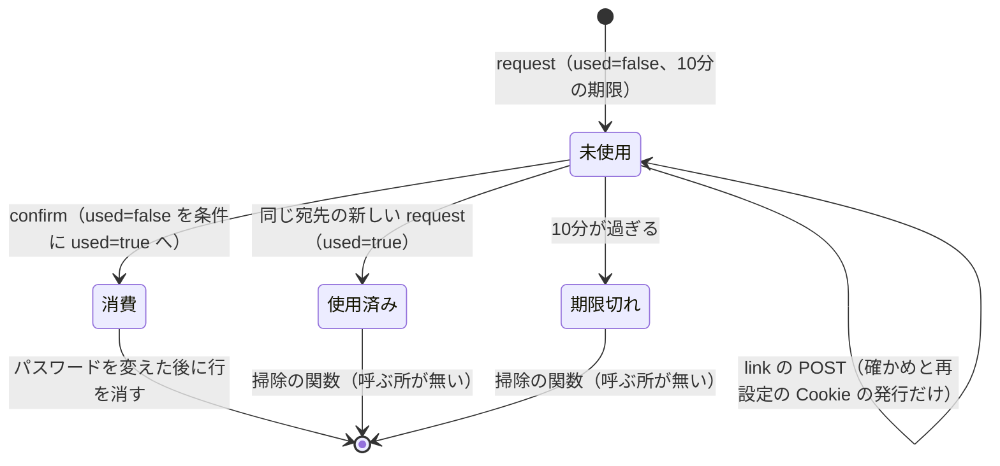

- link の POST は「未使用かつ期限の内」の行だけを有効とみなす。confirm は「未使用」だけを見て期限を見ない（入力の途中で 10 分を越えても再設定の Cookie の 10 分が境になる）
- 同じリンクから再設定の Cookie が何枚出ても、confirm で used=false を勝ち取れるのは1つだけ
- confirm で印を消費してからパスワードの更新が失敗すると、印は戻らず申請からやり直しになる（推定）
- 新しい印を出しても前の印を使用済みにできないことがあり、最新の1本だけは保証しない（SEC-AUTH-018 は満たさない）
- 行を消すのに失敗しても記録して続ける

### STATE-AUTH-003 /auth/verified の画面は読み込みから、未ログイン・一般の会員・TOTP の3つのどれかへ移る

| 属性 | 値 |
| --- | --- |
| 上位 | FR-LOGIN-007、DRV-AUTH-009、FREQ-73-REQ-01 |
| 根拠 | 役割と aal2 の済みで見せる物が変わるので、`/api/auth/me` の答えで1回だけ分け、TOTP の見せ方の中で要素の有無により登録と確認を出し分ける（FR-LOGIN-007、DRV-AUTH-009）。未ログインにはログインへの導線を出す（FREQ-73-REQ-01） |
| 状態 | 推定 |
| 確かめ方 | 結合テスト |
| 出どころ | 実装から推定（`src/app/auth/verified/page.tsx`） |

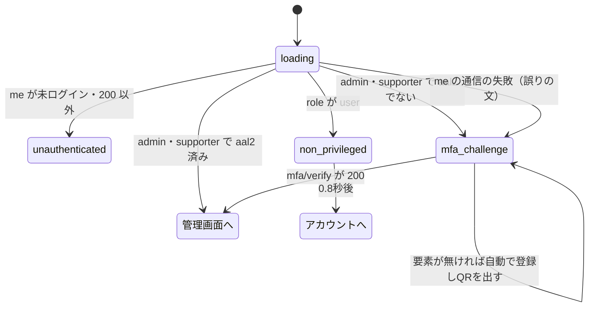

- `mfa_challenge` は1つの見せ方で、要素が有れば「2要素認証コードを入力してください」、無ければ登録の案内と QR・秘密を出す
- 自動の登録は1回だけ試す。409 は「登録済み」の文を出す
- me の通信の失敗で `mfa_challenge` に移るので、一般の会員にも TOTP の見せ方と誤りの文が出る（推定）

### STATE-AUTH-004 再設定のページは Cookie の確かめの後に申請か新しいパスワードを出し、送った後は結果へ移る

| 属性 | 値 |
| --- | --- |
| 上位 | FREQ-329-REQ-01、FREQ-329-REQ-03、FREQ-329-REQ-04、FREQ-329-REQ-05、FREQ-333-REQ-04 |
| 根拠 | 送った後はフォームを畳んで結果だけを出し（FREQ-329-REQ-01）、再送は 60 秒待たせ、上限なら `Retry-After` を待ちに入れる（FREQ-329-REQ-03・04）。変えた後も同じ結果の画面にする（FREQ-329-REQ-05）。新しいパスワードの見せ方ではメールの欄を出さない（FREQ-333-REQ-04） |
| 状態 | 推定 |
| 確かめ方 | 結合テスト |
| 出どころ | 実装から推定（`src/app/auth/password-reset/page.tsx`） |

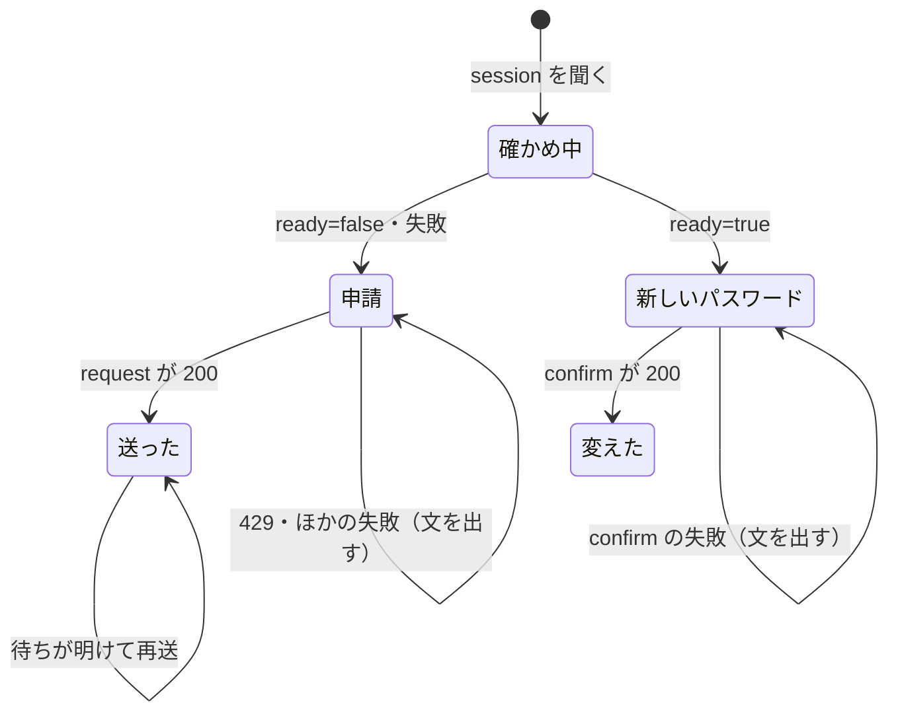

- 送った・変えたの結果は `AuthResultScreen` で出す（SCR-AUTH-005）
- 待ちの残りは `formatResendCountdown` の文で出す
- 再送も Turnstile を通す

### STATE-AUTH-005 ヘッダーはページの先頭でいつも出し、50px より下で下へ動くと隠し、上へ動くと出す

| 属性 | 値 |
| --- | --- |
| 上位 | DRV-AUTH-001 |
| 根拠 | 長いページを読む時に固定のヘッダーが画面の上を占めないようにし、戻りたい時に上へ動かせばすぐ出す（DRV-AUTH-001） |
| 状態 | 推定 |
| 確かめ方 | 結合テスト |
| 出どころ | 実装から推定（`src/components/Header.tsx`） |

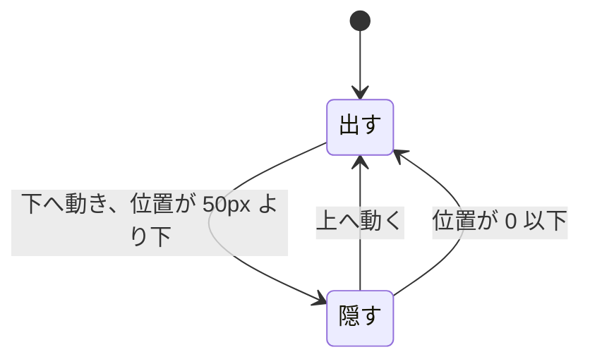

- 描いた直後に1回確かめ、以後はスクロールのたびに前の位置と比べる
- 隠す時は上へずらして隠す（300 ミリ秒）。管理画面の白い地の板も同じに動く
- 状態は `html` の印にも書く（ARC-AUTH-008）
- 管理画面でも同じに動く

## API

| ID | 方法と道 | 呼ぶ所 |
| --- | --- | --- |
| API-AUTH-001 | `POST /api/auth/login` | ログインのフォーム（`LoginContext`） |
| API-AUTH-002 | `POST /api/auth/otp/verify` | `/login/verify`（`LoginContext`） |
| API-AUTH-003 | `POST /api/auth/login/resend` | `/login/verify` |
| API-AUTH-004 | `POST /api/auth/login/cancel` | `/login/verify` |
| API-AUTH-005 | `POST /api/auth/register` | 会員登録のフォーム（`LoginContext`） |
| API-AUTH-006 | `GET /api/auth/confirm` | 確認のメールのリンク |
| API-AUTH-007 | `GET /api/auth/oauth/start` | ログインのフォーム（`LoginContext` がページを移す） |
| API-AUTH-008 | `GET /api/auth/oauth/callback` | Google と Supabase Auth からの戻り |
| API-AUTH-009 | `POST /api/auth/password-reset/request` | 再設定のページ |
| API-AUTH-010 | `GET`・`POST /api/auth/password-reset/link` | メールのリンク（GET）、確認の画面（POST） |
| API-AUTH-011 | `GET /api/auth/password-reset/session` | 再設定のページ |
| API-AUTH-012 | `POST /api/auth/password-reset/confirm` | 再設定のページ |
| API-AUTH-013 | `GET /api/auth/me` | `LoginContext`・`/login/verify`・`/auth/verified`・`/auth/callback` |
| API-AUTH-014 | `POST /api/auth/refresh` | 共有の `client-fetch`（401 の時） |
| API-AUTH-015 | `POST /api/auth/logout` | `LoginContext` |
| API-AUTH-016 | `GET /api/auth/mfa/status` | `/auth/verified` |
| API-AUTH-017 | `POST /api/auth/mfa/enroll-totp` | `/auth/verified` |
| API-AUTH-018 | `POST /api/auth/mfa/verify` | `/auth/verified` |

全部の窓口に共通: 状態を変える `POST` は共有の proxy の Origin の確かめを先に通る。`Cache-Control: no-store` を付けるのは一部だけ（`confirm`・`oauth/*`・`password-reset/link`・`session`・`me`・`login/resend`・`login/cancel`）で、`login`・`otp/verify`・`refresh`・`register` などの応答には付けない（SEC-AUTH-022 は満たさない）。

### API-AUTH-001 POST /api/auth/login はパスワードを確かめてメールの確認コードを送り、保留の Cookie を返す

| 属性 | 値 |
| --- | --- |
| 上位 | FR-LOGIN-001、FREQ-58-REQ-01、SEC-AUTH-001、SEC-AUTH-030、ADR-0400 |
| 根拠 | 2段のログインの1段目（FR-LOGIN-001、FREQ-58-REQ-01）。パスワードの総当たりを IP とメールの2段で止め、メール単位は Turnstile の後に数える（SEC-AUTH-001）。この段ではトークンを配らず、パスワードを通った印だけを署名した Cookie に残す（ADR-0400）。成否を監査に残す（SEC-AUTH-030） |
| 状態 | 推定 |
| 確かめ方 | 結合テスト |
| 出どころ | 実装から推定（`src/app/api/auth/login/route.ts`、`src/features/auth/schemas/login.ts`） |

| 項目 | 中身 |
| --- | --- |
| 入力 | JSON の `email`・`password`・`turnstileToken` |
| 順番 | IP の制限 → 形 → Turnstile → メールの制限 → パスワードの確かめ（匿名の client）→ 確認コードの送信（新しい利用者は作らない）→ 保留の Cookie |
| 200 | `{ step: 'otp', message }` と保留の Cookie（`sb-login-2fa-session`、5分） |
| 失敗 | 400（形）、401（メールかパスワードの誤り。どちらかは言わない）、403（Turnstile）、429（制限）、500（確認コードの送信の失敗・例外） |
| 監査 | `login` の failure・error・`password_verified` |

- パスワードの確かめで得た session は捨てる
- `no-store` を付けない（SEC-AUTH-022 は満たさない）。Supabase Auth を直接呼べばこの窓口を通らずにトークンを得られる（SEC-AUTH-005 は満たさない）

### API-AUTH-002 POST /api/auth/otp/verify は保留の宛先で確認コードを確かめ、通ったらログインを確定する

| 属性 | 値 |
| --- | --- |
| 上位 | FR-LOGIN-001、FREQ-58-REQ-01、FREQ-335-REQ-01、FREQ-335-REQ-02、FREQ-335-REQ-03、FREQ-336-REQ-03、SEC-AUTH-002、SEC-AUTH-003、SEC-AUTH-030、FREQ-428-REQ-01（範囲外）、ADR-0402 |
| 根拠 | 2段のログインの2段目（FR-LOGIN-001）。保留の Cookie が無ければ断り、宛先は Cookie からだけ取る（SEC-AUTH-003、FREQ-336-REQ-03）。総当たりを保留の宛先単位で止め、上限で保留を捨て、コードの種類を email に固定する（FREQ-335-REQ-01〜03、SEC-AUTH-002、ADR-0402）。確定の後にゲストのカート・お気に入りを会員へ合わせる（FREQ-428（範囲外）） |
| 状態 | 推定 |
| 確かめ方 | 結合テスト |
| 出どころ | 実装から推定（`src/app/api/auth/otp/verify/route.ts`） |

| 項目 | 中身 |
| --- | --- |
| 入力 | JSON の `code`（本文の `email` は読まない）と保留の Cookie |
| 順番 | IP の制限 → 形 → 保留の Cookie → 宛先単位の制限 → コードの確かめ（匿名の client、`type: 'email'` の1回）→ セッションの保存 → ゲスト注文の紐付け |
| 200 | `{ user, message }`。認証の Cookie（access・refresh・CSRF・`session_id`）を配り、保留の Cookie を消す |
| 失敗 | 400（形）、401（保留が無い・コードの誤りか期限切れ）、429（制限。宛先単位なら保留の Cookie も消す）、500（保存の失敗・例外） |
| 監査 | `auth.otp.verify` の failure・error・success |

- 応答の本文に Supabase の利用者の記録のまるごとを入れる（SEC-AUTH-022 は満たさない）
- ゲスト注文の紐付けは 注文まわりの作り直しで書き換え中の共有の関数（呼ぶ形は変えない）

### API-AUTH-003 POST /api/auth/login/resend は保留の宛先にだけ確認コードを送り直し、保留の寿命を戻す

| 属性 | 値 |
| --- | --- |
| 上位 | FREQ-334-REQ-05、FREQ-336-REQ-01、FREQ-336-REQ-02、SEC-AUTH-003、SEC-AUTH-004、ADR-0401 |
| 根拠 | パスワードを通ったことは保留の Cookie が示すので、再送にパスワードを求めず、宛先は Cookie から取って本文を見ない（FREQ-334-REQ-05、SEC-AUTH-003）。他人へのメールの踏み台にさせず、1つのアカウントへ送る総量を抑えるため、ログインと同じ枠で IP とメールの2段で数える（FREQ-336-REQ-02、ADR-0401）。発行の時刻を引き継いで 30 分の上限を延ばさない（FREQ-336-REQ-01、SEC-AUTH-004） |
| 状態 | 推定 |
| 確かめ方 | 結合テスト |
| 出どころ | 実装から推定（`src/app/api/auth/login/resend/route.ts`） |

| 項目 | 中身 |
| --- | --- |
| 入力 | 保留の Cookie だけ（本文は読まない） |
| 順番 | 保留の Cookie → IP の制限（login と同じ枠）→ 宛先の制限（login と同じ枠）→ 確認コードの送信 → 保留の Cookie の作り直し |
| 200 | `{ ok: true }`、`no-store`。iat を引き継いだ保留の Cookie（5分） |
| 失敗 | 401（保留が無い）、429（制限）、500（送信の失敗） |
| 監査 | `login` の error・`otp_resent` |

- 60 秒の再送の待ちは画面だけが持ち、この窓口は数えない（SCR-AUTH-004）

### API-AUTH-004 POST /api/auth/login/cancel は保留の Cookie を捨て、保留があった時だけ監査に残す

| 属性 | 値 |
| --- | --- |
| 上位 | FREQ-334-REQ-06、FREQ-336-REQ-04 |
| 根拠 | 別の宛先でやり直す時に前の保留を残さない（FREQ-334-REQ-06）。回数の制限の無い窓口なので、捨てる物が無い時に監査を書くと行を水増しできる。有効な保留があった時だけ残す（FREQ-336-REQ-04） |
| 状態 | 推定 |
| 確かめ方 | 結合テスト |
| 出どころ | 実装から推定（`src/app/api/auth/login/cancel/route.ts`） |

| 項目 | 中身 |
| --- | --- |
| 入力 | 保留の Cookie（無くてもよい） |
| 200 | いつも `{ ok: true }`、`no-store`。保留の Cookie を消す |
| 監査 | 保留が有効な時だけ `login` の `cancelled` |

- 踏まれても害はログインの中断だけなので、回数の制限を置かない。CSRF は共有の proxy の Origin の確かめに任せる

### API-AUTH-005 POST /api/auth/register は会員登録を受け、登録済みでも同じ 202 を返す

| 属性 | 値 |
| --- | --- |
| 上位 | FREQ-320-REQ-01、FREQ-320-REQ-03、FREQ-323-REQ-01、FREQ-323-REQ-02、FREQ-323-REQ-03、SEC-AUTH-014、SEC-AUTH-019、ADR-0404、ADR-0405 |
| 根拠 | 会員登録の入口。登録済みかどうかを応答の中身と時間で判らせず、本人にだけメールで知らせる（FREQ-320-REQ-03、ADR-0404）。照会の失敗を「無い」に丸めない（FREQ-320-REQ-01）。16 文字以上で漏洩していないパスワードだけを受ける（FREQ-323-REQ-01〜03、SEC-AUTH-014、ADR-0405）。メールのリンクは許可した住所でだけ作る（SEC-AUTH-019） |
| 状態 | 推定 |
| 確かめ方 | 結合テスト |
| 出どころ | 実装から推定（`src/app/api/auth/register/route.ts`、`src/features/auth/schemas/register.ts`） |

| 項目 | 中身 |
| --- | --- |
| 入力 | JSON の `email`・`password`・`display_name`（任意）・`turnstileToken`・`redirect_to`（任意。`sanitizeRedirectPath` で既定 `/auth/verified`） |
| 順番（公開） | IP の制限 → 形 → Turnstile → 住所の見張り → 漏洩の照合 → アカウントの照会 → 登録済みなら通知のメール（応答の外）→ 新規なら Supabase Auth の登録（確認のリンクは `/api/auth/confirm?redirect_to=…`） |
| 202 | `{ message: 'Confirmation email sent' }`（新規・登録済みとも） |
| 201 | 確認のメールが要らない設定の時だけ。`{ access_token, user }` と認証の Cookie |
| 失敗 | 400（形・漏洩）、403（Turnstile）、429（制限）、500（登録・保存の失敗）、503（照会の失敗・住所の見張り） |
| 監査 | `register` の failure・conflict・error・success・`created_needs_confirmation` |

- 管理の見出し（`x-admin-token`・Bearer）があると、Turnstile・漏洩の照合・列挙の対策を通らずに service role で作り、登録済みなら 409 を返す。鍵の比べ方は定数時間でない。src に呼ぶ所は無い（SEC-AUTH-017 は満たさない）
- 201 の応答の本文に access token を入れる（SEC-AUTH-022 は満たさない）
- 宛先単位の回数の制限が無い。IP ごとの 20 回／時と Turnstile だけで数える（SEC-AUTH-016 は満たさない）
- Supabase Auth の `/auth/v1/signup` を直接呼ぶ道は塞がない（SEC-AUTH-015 は満たさない）

### API-AUTH-006 GET /api/auth/confirm は確認のメールのリンクの印を確かめてログインさせ、送り先へ 303 で移す

| 属性 | 値 |
| --- | --- |
| 上位 | FREQ-265-REQ-01（範囲外）、FREQ-428-REQ-01（範囲外）、SEC-AUTH-026、SEC-AUTH-030 |
| 根拠 | 会員登録を確認のリンクで終わらせ、そのままログインさせる入口。確認でログインした時にゲストの注文とカート・お気に入りを会員へ引き継ぐ（FREQ-265・428（範囲外））。送り先は内部の道だけに絞る（SEC-AUTH-026 のサーバーの部分）。成否を監査に残す（SEC-AUTH-030） |
| 状態 | 推定 |
| 確かめ方 | 結合テスト |
| 出どころ | 実装から推定（`src/app/api/auth/confirm/route.ts`） |

| 項目 | 中身 |
| --- | --- |
| 入力 | 問い合わせの `token_hash`（無ければ `token`）・`type`（既定 `signup`）・`redirect_to`（既定 `/account`） |
| 順番 | IP の制限 → 印の確かめ（匿名の client）→ セッションの保存 → ゲスト注文の紐付け |
| 303 | 成功・失敗とも `redirect_to` へ。`no-store`・`no-referrer` |
| 失敗 | 印が無い・確かめの失敗・例外も同じ 303（理由は監査だけ）。429（制限） |
| 監査 | `auth.confirm` の failure（期限切れ・無効・使用済みの分類つき）・error・success |

- 受ける `type` は `signup`・`email`・`magiclink`・`recovery` の4つで、どれでもログインさせる（SEC-AUTH-006 は満たさない）
- 開いた端末を登録した人の端末に結ばない（SEC-AUTH-007 は満たさない）
- 上位に AUTH の要件が無い（会員登録の確認を求める FREQ-59・FR-LOGIN-004 は `/register` を前提にした古い行で、上位にしていない）

### API-AUTH-007 GET /api/auth/oauth/start は Google の同意の画面への URL を PKCE で作り、302 で移す

| 属性 | 値 |
| --- | --- |
| 上位 | FR-LOGIN-002、SEC-AUTH-026 |
| 根拠 | Google のアカウントでログインする入口（FR-LOGIN-002）。PKCE の検証の値を窓口が Cookie に持ち、戻りで交換する。戻りの後の送り先は内部の道だけに絞る（SEC-AUTH-026 のサーバーの部分）。毎回アカウントを選ばせ、共有の端末で前の人のアカウントに入らないようにする |
| 状態 | 推定 |
| 確かめ方 | 結合テスト |
| 出どころ | 実装から推定（`src/app/api/auth/oauth/start/route.ts`） |

| 項目 | 中身 |
| --- | --- |
| 入力 | 問い合わせの `provider`（`google` だけ）・`redirect_to`（既定 `/auth/verified`） |
| 順番 | IP の制限 → 形 → プロバイダ → 送り先の検証 → URL の生成（`prompt=select_account`、戻り先は `/api/auth/oauth/callback?next=…`） |
| 302 | Google の同意の画面へ。`no-store`・`no-referrer`。`@supabase/ssr` が作る PKCE の Cookie を付ける |
| 失敗 | 400（形・プロバイダ）、429（制限）、500（環境変数）、502（URL の生成の失敗） |
| 監査 | `auth.oauth.start` の success・failure・error |

- ライブラリの Cookie の属性はライブラリの既定のまま（SEC-AUTH-023 は満たさない。推定）

### API-AUTH-008 GET /api/auth/oauth/callback は Google からの code を session に替え、役割で送り先を決めて 303 で移す

| 属性 | 値 |
| --- | --- |
| 上位 | FR-LOGIN-002、DRV-AUTH-009、SEC-AUTH-026、SEC-AUTH-030、FREQ-428-REQ-01（範囲外） |
| 根拠 | Google のログインの戻りを受ける（FR-LOGIN-002）。一般の会員は既定の送り先なら `/account` へ送り、管理者とサポーターは TOTP の画面へ通す（DRV-AUTH-009）。送り先は内部の道だけに絞る（SEC-AUTH-026）。ゲストのカート・お気に入りを会員へ合わせる（FREQ-428（範囲外））。成否を監査に残す（SEC-AUTH-030） |
| 状態 | 推定 |
| 確かめ方 | 結合テスト |
| 出どころ | 実装から推定（`src/app/api/auth/oauth/callback/route.ts`） |

| 項目 | 中身 |
| --- | --- |
| 入力 | 問い合わせの `code`・`next` と PKCE の Cookie |
| 順番 | IP の制限 → 形 → 環境変数 → code の交換 → 応答の形の確かめ → 送り先の決定 → セッションの保存 |
| 303 | 一般で既定のままなら `/account`、ほかは `next`。`no-store`・`no-referrer`。認証の Cookie とライブラリの Cookie |
| 失敗 | 400（code が無い）、429（制限）、500（環境変数・例外）、502（交換・形の失敗）。保存の失敗は監査に残して 303 を返す |
| 監査 | `auth.oauth.callback` の failure・error・success |

- メールの確認コードの2段目を通らない（SEC-AUTH-008 の会員の部分は決めていない）。ゲスト注文の紐付けを呼ばない
- ライブラリの session の Cookie を HttpOnly にせず、写した後も消さない（SEC-AUTH-023 は満たさない。推定）。消すのはログアウトの時（API-AUTH-015）
- Cookie を読む小さな関数が `oauth/start` と二重にある

### API-AUTH-009 POST /api/auth/password-reset/request は再設定のメールを送り、アカウントの有無によらず 200 を返す

| 属性 | 値 |
| --- | --- |
| 上位 | FR-LOGIN-003、FREQ-319-REQ-01、FREQ-319-REQ-02、FREQ-332-REQ-04、SEC-AUTH-019 |
| 根拠 | 再設定の入口（FR-LOGIN-003）。アカウントの照会を DB の関数1回にし（FREQ-319-REQ-01）、アカウントが無い宛先には送らず同じ応答にして、店のドメインを第三者へのメールの踏み台にさせない（FREQ-319-REQ-02）。印は 10 分にし、メールに期限を書く（FREQ-332-REQ-04）。リンクは許可した住所でだけ作る（SEC-AUTH-019） |
| 状態 | 推定 |
| 確かめ方 | 結合テスト |
| 出どころ | 実装から推定（`src/app/api/auth/password-reset/request/route.ts`） |

| 項目 | 中身 |
| --- | --- |
| 入力 | JSON の `email`（小文字・空白を落とす）・`turnstileToken` |
| 順番 | IP の制限 → 形 → Turnstile → メールの制限 → 住所の見張り → アカウントの照会 → 有れば前の印を使用済みにし、新しい印を保存し、メールを応答の外で送る |
| 200 | `{ ok: true }`（有無・住所の見張りによらず） |
| 失敗 | 400（形）、403（Turnstile）、429（制限）、500（照会・保存の失敗・例外） |
| 監査 | `password_reset_request` の failure・error・success（`no_account`・`mail_queued` は監査だけに残す） |

- リンクは `/auth/password-reset/verify?token=…`。前の印を使用済みにするのに失敗しても記録して続ける（最新の1本だけは保証しない。SEC-AUTH-018 は満たさない）
- アカウントが有る時だけ DB に書いてから返す（SEC-AUTH-016 の時間は満たさない。推定）

### API-AUTH-010 GET・POST /api/auth/password-reset/link は GET で確認の画面へ転送し、POST で印を確かめて再設定の Cookie を出す

| 属性 | 値 |
| --- | --- |
| 上位 | FREQ-319-REQ-03、FREQ-319-REQ-04、FREQ-332-REQ-01、FREQ-332-REQ-04、SEC-AUTH-018、ADR-0403 |
| 根拠 | リンクの検査は GET も JS つきの POST も踏むので、どちらでも印を消費しない（FREQ-319-REQ-03、ADR-0403）。無効・期限切れは理由を返して画面に出させる（FREQ-319-REQ-04）。確かめが通ったら 10 分の再設定の Cookie を出し、画面を新しいパスワードの欄へ進める（FREQ-332-REQ-01・04、SEC-AUTH-018） |
| 状態 | 推定 |
| 確かめ方 | 結合テスト |
| 出どころ | 実装から推定（`src/app/api/auth/password-reset/link/route.ts`） |

| 項目 | 中身 |
| --- | --- |
| GET の入力 | 問い合わせの `token` |
| GET の 303 | 有れば `/auth/password-reset/verify?token=…`、無ければ `/auth/password-reset?error=link_invalid`。`no-store`・`no-referrer` |
| POST の入力 | JSON の `token` |
| POST の順番 | IP の制限 → 形 → ハッシュで未使用かつ期限の内の行を引く（service role）→ 行に利用者の id が無ければメールから引く → 再設定の Cookie |
| POST の 200 | `{ ok: true, redirectTo: '/auth/password-reset' }` と再設定の Cookie（`sb-password-reset-session`、10 分） |
| POST の失敗 | 400（`link_invalid`・`link_expired`）、429（制限）、500（利用者の照会の失敗。期限切れと言わない） |
| 監査 | `password_reset_link` の failure・error・success |

### API-AUTH-011 GET /api/auth/password-reset/session は再設定の Cookie が有効かと宛先を返す

| 属性 | 値 |
| --- | --- |
| 上位 | FREQ-332-REQ-02、FREQ-333-REQ-04 |
| 根拠 | 再設定のページが新しいパスワードの見せ方にするかを決めるため、Cookie を読めない画面の代わりに有効かどうかを答える（FREQ-332-REQ-02）。新しいパスワードの見せ方ではメールの欄を出さないので、宛先は窓口が返す（FREQ-333-REQ-04） |
| 状態 | 推定 |
| 確かめ方 | 結合テスト |
| 出どころ | 実装から推定（`src/app/api/auth/password-reset/session/route.ts`） |

| 項目 | 中身 |
| --- | --- |
| 入力 | 再設定の Cookie |
| 200 | 有効なら `{ ready: true, email }`、無効なら `{ ready: false, email: null }` と Cookie の消去。`no-store` |

- 回数の制限が無い

### API-AUTH-012 POST /api/auth/password-reset/confirm は印を1回だけ消費して新しいパスワードに変え、全部のセッションを切る

| 属性 | 値 |
| --- | --- |
| 上位 | FREQ-319-REQ-03、FREQ-319-REQ-05、FREQ-323-REQ-01、FREQ-323-REQ-02、FREQ-323-REQ-03、SEC-AUTH-014、SEC-AUTH-018、ADR-0403、ADR-0405 |
| 根拠 | 印の消費をパスワードを変える直前まで遅らせ、同じリンクから何枚 Cookie が出ても通るのは1つだけにする（FREQ-319-REQ-03、SEC-AUTH-018、ADR-0403）。更新の失敗を成功にせず、変えた後は乗っ取った人のセッションを残さないよう全部を切って本人に知らせる（FREQ-319-REQ-05）。16 文字以上で漏洩していない物だけを受ける（FREQ-323-REQ-01〜03、SEC-AUTH-014、ADR-0405） |
| 状態 | 推定 |
| 確かめ方 | 結合テスト |
| 出どころ | 実装から推定（`src/app/api/auth/password-reset/confirm/route.ts`） |

| 項目 | 中身 |
| --- | --- |
| 入力 | JSON の `new_password` と再設定の Cookie（確認の欄の値は受けない） |
| 順番 | IP の制限 → 再設定の Cookie → 形 → 印が未使用か → 漏洩の照合 → 未使用を条件に使用済みへ（勝ち取り）→ パスワードの更新（service role）→ 行の削除 → 全部のセッションの失効 → Cookie の消去 → 通知のメール（応答の外） |
| 200 | `{ ok: true }`。再設定・access・refresh・CSRF の Cookie を消す |
| 失敗 | 400（Cookie が無い・形・漏洩・印が無いか使用済み・勝ち取りに負けた）、429（制限）、500（照会・勝ち取り・更新の失敗・例外） |
| 監査 | `password_reset_confirm` の failure・error・success |

- 全部のセッションの失効は自前の `sessions` の `revoked_at` と DB の関数 `revoke_auth_sessions_for_user`。失敗は記録だけで監査に残さず成功で返す（SEC-AUTH-020 の失敗の監査は満たさない）
- 印を勝ち取った後にパスワードの更新が失敗すると、印は戻らない（推定）

### API-AUTH-013 GET /api/auth/me は認可と同じ根拠でログインの有無・役割・aal2 を返し、確かめられない時は 503 にする

| 属性 | 値 |
| --- | --- |
| 上位 | DRV-AUTH-007、SEC-AUTH-028、FREQ-324-REQ-03（範囲外）、ADR-0408 |
| 根拠 | 画面がログインの有無・役割・TOTP の済みを知って表示と行き先を決めるため（DRV-AUTH-007）。失効したセッションに「ログイン中」と答えると、画面は管理の入口を出すのに窓口は断る食い違いが起きるので、共有の認証の部品で失効まで確かめる。DB の一時の障害で全員をログアウトの見た目に落とさないよう、確かめられない時は 503 にする（FREQ-324（範囲外）、ADR-0408）。役割は JWT の `app_metadata` からだけ読む（SEC-AUTH-028） |
| 状態 | 推定 |
| 確かめ方 | 結合テスト |
| 出どころ | 実装から推定（`src/app/api/auth/me/route.ts`、`src/lib/auth/authenticate.ts`） |

| 項目 | 中身 |
| --- | --- |
| 入力 | access の Cookie か Bearer |
| 200 | ログイン中なら `{ authenticated: true, user: { id, email, role, mfaVerified } }`、未ログイン・失効・例外なら `{ authenticated: false }` |
| 503 | 失効を確かめられない時 `{ authenticated: false, reason: 'unavailable' }`、`Retry-After: 30` |
| 見出し | 全部の応答に `no-store`・`no-referrer` |

- `mfaVerified` は JWT の `aal` が `aal2` か（管理の認可と同じ根拠）
- 回数の制限が無い

### API-AUTH-014 POST /api/auth/refresh は refresh の Cookie を Supabase で新しいトークンに替え、使えない Cookie は消す

| 属性 | 値 |
| --- | --- |
| 上位 | DRV-AUTH-008、SEC-AUTH-030、ADR-0406 |
| 根拠 | access token の寿命が短いので、ログインしたままの利用者を切らずに新しいトークンへ替える（DRV-AUTH-008）。門番は Supabase のトークンの交換にし、自前の表は明示の失効の印がある時だけ断る。行が無いだけで断ると取りこぼしで正しい利用者を締め出す（ADR-0406）。交換に失敗した Cookie を残すと更新の失敗が続くので消す。成否を監査に残す（SEC-AUTH-030） |
| 状態 | 推定 |
| 確かめ方 | 結合テスト |
| 出どころ | 実装から推定（`src/app/api/auth/refresh/route.ts`、`src/features/auth/services/session.ts`） |

| 項目 | 中身 |
| --- | --- |
| 入力 | refresh の Cookie（`sb-refresh-token`） |
| 順番 | IP の制限 → Cookie → 自前の行を引く（無くても続ける）→ 失効の印なら断る → Supabase Auth のトークンの交換（service role の鍵）→ Cookie と行の差し替え |
| 200 | `{ access_token, user }` と新しい認証の Cookie。行の保存に失敗しても監査に残して配る |
| 失敗 | 401（Cookie が無い・失効の印・交換の失敗。後の2つは認証の Cookie を消す）、429（制限）、500（環境変数・例外） |
| 監査 | `refresh` の failure・error・success |

- 応答の本文に access token と Supabase の利用者の記録を入れる（SEC-AUTH-022 は満たさない）

### API-AUTH-015 POST /api/auth/logout はサーバーのセッションを切り、認証とゲストの Cookie を全部消して常に 200 を返す

| 属性 | 値 |
| --- | --- |
| 上位 | FREQ-320-REQ-02、FREQ-316-REQ-03、FREQ-514-REQ-01（範囲外）、FREQ-431-REQ-01（範囲外）、ADR-0407 |
| 根拠 | 共有の端末や盗まれた refresh token でログアウトの後もログインを続けさせないため、期限切れでも署名を確かめた JWT の `session_id` でその1本を切り、取れなければ利用者の全部を切る（FREQ-316-REQ-03、ADR-0407）。401 だと「まだ有効なセッション」を漏らすので常に 200 にし、CSRF の拒否でも Cookie は消す（FREQ-514（範囲外））。この端末のゲストのカート・お気に入りの印も消す（FREQ-431（範囲外）） |
| 状態 | 推定 |
| 確かめ方 | 結合テスト |
| 出どころ | 実装から推定（`src/app/api/auth/logout/route.ts`） |

| 項目 | 中身 |
| --- | --- |
| 入力 | refresh の Cookie と CSRF の印（見出しと Cookie の二重送信） |
| 順番 | refresh の Cookie が有れば: CSRF の確かめ → 通れば自前の行に `revoked_at` → `session_id` で `revoke_auth_session`、だめなら行の利用者で `revoke_auth_sessions_for_user` |
| 200 | いつも `{ ok: true }`。`session_id`・refresh・access・CSRF・保留・再設定・カート・お気に入りの Cookie と、`sb-…-auth-token` の形のライブラリの Cookie を消す |
| 失敗 | 500（例外だけ） |
| 監査 | `logout` の error・success（失効の道が取れない・失敗した時と、全部を切った時） |

- 共有の proxy の Origin の確かめに CSRF の印を重ねる。NEWS の ADR-0019（範囲外）の「窓口で印を重ねない」と方針が違う
- CSRF の確かめで断られた時は、サーバーのセッションを切らずに Cookie だけ消して 200 を返す（FREQ-514-REQ-01（範囲外）が認めた動き）
- refresh の Cookie が無い時も、サーバーのセッションを切らずに Cookie だけ消して 200 を返す（SEC-AUTH-021 は満たさない）
- 回数の制限が無い

### API-AUTH-016 GET /api/auth/mfa/status はログイン中の利用者の役割・AAL・確かめ済みの要素を返す

| 属性 | 値 |
| --- | --- |
| 上位 | FR-LOGIN-007、ADR-0409 |
| 根拠 | `/auth/verified` が TOTP を登録させるか確認させるかを決めるため、要素の有無を答える（FR-LOGIN-007）。役割は自分のアカウントの見せ方の判断にしか使わないので、DB の ACL を引かず JWT のクレームから読む（ADR-0409） |
| 状態 | 推定 |
| 確かめ方 | 結合テスト |
| 出どころ | 実装から推定（`src/app/api/auth/mfa/status/route.ts`） |

| 項目 | 中身 |
| --- | --- |
| 入力 | access の Cookie か Bearer |
| 200 | `{ data: { role, isPrivileged, currentLevel, nextLevel, hasVerifiedFactor, needsChallenge, factors } }`。要素は TOTP と電話の確かめ済みの物 |
| 失敗 | 共有の認証の部品の失敗の応答（401・503 など）、500（AAL・一覧の失敗・例外） |

- 画面が使うのは `hasVerifiedFactor` と `factors` だけで、ほかの欄は使われない
- 回数の制限が無い。`no-store` を付けない

### API-AUTH-017 POST /api/auth/mfa/enroll-totp は管理者とサポーターにだけ TOTP の要素を作り、QR と秘密を返す

| 属性 | 値 |
| --- | --- |
| 上位 | FR-LOGIN-007、ADR-0409 |
| 根拠 | 管理者とサポーターが TOTP を使えるよう、認証アプリに読ませる QR と秘密を作る（FR-LOGIN-007）。一般の会員には作らせない。役割は JWT のクレームから読む（ADR-0409） |
| 状態 | 推定 |
| 確かめ方 | 結合テスト |
| 出どころ | 実装から推定（`src/app/api/auth/mfa/enroll-totp/route.ts`） |

| 項目 | 中身 |
| --- | --- |
| 入力 | access の Cookie か Bearer。JSON の `forceReEnroll`（任意。画面は送らない） |
| 順番 | IP の制限 → 形 → 認証 → 役割 → 要素の一覧 → 確かめ済みが有れば 409（`forceReEnroll` なら 403 で、確かめ済みの要素は外さない）→ 未確認の要素を外す → 登録 |
| 200 | 要素の id・QR（data URI に整える）・秘密・URI |
| 失敗 | 400（形）、403（一般の会員・確かめ済みがあり作り直しを求めた・`insufficient_aal`）、409（登録済み・名前の衝突）、429（制限）、500（一覧・登録の失敗・例外） |

- 秘密は登録の応答にだけ入れる。`no-store` を付けない（SEC-AUTH-022 は満たさない）
- 初めての登録は aal1 のトークンだけで通る。パスワードを持つ人が持ち主より先に自分の認証アプリを登録できる（SEC-AUTH-031 は満たさない）
- 成否を監査に残さない（SEC-AUTH-030 の TOTP の登録は満たさない）

### API-AUTH-018 POST /api/auth/mfa/verify は TOTP のコードを確かめ、aal2 のトークンを Cookie に書き戻す

| 属性 | 値 |
| --- | --- |
| 上位 | FR-LOGIN-007、FREQ-316-REQ-02、SEC-AUTH-008、ADR-0409 |
| 根拠 | 管理画面に入る前の3段目（FR-LOGIN-007）。確認が通ると Supabase が aal2 のトークン対を返すので、Cookie に書き戻さないと管理の窓口の aal2 の判定を通れない（FREQ-316-REQ-02）。Google でログインした管理者もここで aal2 になる（SEC-AUTH-008 の管理の部分）。役割は JWT のクレームから読む（ADR-0409） |
| 状態 | 推定 |
| 確かめ方 | 結合テスト |
| 出どころ | 実装から推定（`src/app/api/auth/mfa/verify/route.ts`） |

| 項目 | 中身 |
| --- | --- |
| 入力 | access の Cookie か Bearer。JSON の `factorId`・`code`（6〜8桁の数字） |
| 順番 | IP の制限 → 形 → 認証 → 役割 → チャレンジの作成 → コードの確かめ（利用者の session の client）→ AAL の読み直し → Cookie と自前の行の差し替え |
| 200 | `{ data: { role, currentLevel, nextLevel, verified: true } }` と aal2 の認証の Cookie。行の保存に失敗しても監査に残して配る |
| 失敗 | 400（形・チャレンジ・コードの誤り）、403（一般の会員）、404（要素が無い）、429（制限）、500（例外） |
| 監査 | 行の保存の失敗だけ `mfa_verify` の error |

- 回数の制限は IP 単位だけで、利用者単位が無い。コードの成否を監査に残さない（SEC-AUTH-009 は満たさない）

## データ

### DATA-AUTH-001 sessions の表は refresh token のハッシュを控える監査用の表で、明示の失効の印だけを門に使う

| 属性 | 値 |
| --- | --- |
| 上位 | DRV-AUTH-008、SEC-AUTH-021、ADR-0406 |
| 根拠 | 本当のセッションは Supabase Auth が持つので、自前の表は監査と、ログアウト・管理の失効が Supabase へ届かなかった時の最後の砦にする（ADR-0406）。refresh token は生で置かずハッシュで控え、ログアウトで `revoked_at` を付ける（SEC-AUTH-021、DRV-AUTH-008） |
| 状態 | 推定 |
| 確かめ方 | 結合テスト |
| 出どころ | 実装から推定（`supabase/migrations/20260901102912_remote_schema.sql`、`src/features/auth/services/session.ts`、`register.ts`） |

| 列 | 中身 |
| --- | --- |
| `id`・`user_id` | 行の id と利用者 |
| `refresh_token_hash`・`previous_refresh_token_hash` | 今と前の refresh token の SHA-256 |
| `csrf_token_hash`・`csrf_prev_token_hash` | CSRF の印のハッシュ（二重送信の確かめ） |
| `revoked_at`・`quarantined` | 失効の時刻と隔離の印 |
| `current_jti`・`ip`・`user_agent`・`device_name`・`created_at`・`expires_at`・`last_seen_at` | 控え |

- 書く: ログインの確定（otp/verify・confirm・oauth/callback・register の 201）で行を作り、refresh と TOTP の確認で差し替え、ログアウトと再設定の完了で `revoked_at` を付ける。全部 service role
- 読む: refresh（行が無くても断らない）、logout、再設定の完了
- RLS は anon・authenticated を拒否し、service role だけを通す。ただし表の権限は anon・authenticated にも付いたまま（SEC-AUTH-011 は満たさない）

### DATA-AUTH-002 password_reset_tokens の表は再設定の印のハッシュ・宛先・期限・使用の印を持つ

| 属性 | 値 |
| --- | --- |
| 上位 | FREQ-319-REQ-03、FREQ-332-REQ-04、ADR-0403 |
| 根拠 | Supabase の再設定のメールを使わず自前の印にしたので、印の行を自前で持つ。消費をパスワードの変更まで遅らせるため、使用の印を別の列に持つ（FREQ-319-REQ-03、ADR-0403）。期限は 10 分（FREQ-332-REQ-04） |
| 状態 | 推定 |
| 確かめ方 | 結合テスト |
| 出どころ | 実装から推定（`supabase/migrations/20260901102912_remote_schema.sql`） |

| 列 | 中身 |
| --- | --- |
| `id` | 行の id（再設定の Cookie が持つ） |
| `user_id` | 利用者（`auth.users` を指し、消えると行も消える）。無ければ link の POST がメールから引く |
| `email` | 宛先 |
| `token_hash` | 印の SHA-256（一意） |
| `expires_at` | 期限 |
| `used` | 使用の印 |
| `created_at` | 作った時刻 |

- 状態の移り変わりは STATE-AUTH-002。読み書きは全部 service role
- 掃除の関数 `cleanup_password_reset_tokens` があるが呼ぶ所が無く、使用済み・期限切れの行が残る（SEC-AUTH-018 の掃除は満たさない）
- RLS は anon・authenticated を拒否するが、表の権限は付いたまま（SEC-AUTH-011 は満たさない）

### DATA-AUTH-003 認証の DB の関数はアカウントの照会とセッションの失効と回数の数えを受け持ち、service role が呼ぶ

| 属性 | 値 |
| --- | --- |
| 上位 | FREQ-319-REQ-01、FREQ-320-REQ-01 |
| 根拠 | メールからアカウントを引くのを先頭の 100 件の走査でなく関数1回にし、200 人目以降でも壊れないようにする（FREQ-319-REQ-01）。見つかった・無い・引けなかったを分ける（FREQ-320-REQ-01）。呼べるのを service role だけに絞る要件は SEC-AUTH-012 だが、満たさないので上位にしない |
| 状態 | 推定 |
| 確かめ方 | 結合テスト |
| 出どころ | 実装から推定（`supabase/migrations/20260901102912_remote_schema.sql`、`src/features/auth/services/auth-admin-user.ts`） |

| 関数 | 使う所 |
| --- | --- |
| `find_auth_user_id_by_email` | 会員登録・再設定の申請・link の POST |
| `revoke_auth_session` | ログアウト（`session_id` で1本） |
| `revoke_auth_sessions_for_user` | ログアウトの代わりの道・再設定の完了 |
| `is_auth_session_active` | 共有の認証の部品（`me`・`mfa/*`） |
| `increment_rate_limit_counter` | 共有の回数の制限 |
| `cleanup_password_reset_tokens` | 呼ぶ所が無い |

- 6つとも anon・authenticated から呼べる状態で、公開の鍵だけで会員の有無・他人のセッションの失効・回数の数えに届く（SEC-AUTH-012 は満たさない）
- `find_auth_user_id_by_email` は SSO・停止・論理削除の利用者を外して引く（外れた宛先は会員登録で重複として返り、登録済みと同じ 202 にそろえる）

### DATA-AUTH-004 認証の Cookie は用途ごとに名前・寿命・属性を分け、保留と再設定は署名した印にする

| 属性 | 値 |
| --- | --- |
| 上位 | SEC-AUTH-024、FREQ-320-REQ-02、FREQ-335-REQ-04、FREQ-332-REQ-04、FREQ-58-REQ-01、ADR-0400 |
| 根拠 | スクリプト・平文の通信・別のサイトからの送信で Cookie を盗ませず使わせないため、トークンは HttpOnly・本番で Secure・SameSite を付け、短命の保留と再設定は Strict にする（SEC-AUTH-024）。CSRF の印は画面が読むので HttpOnly にしない。access の寿命を refresh にそろえる（FREQ-320-REQ-02）。保留と再設定はパスワードを通った・リンクを確かめた事実を署名した印で持つ（FREQ-58-REQ-01、ADR-0400、FREQ-335-REQ-04、FREQ-332-REQ-04） |
| 状態 | 推定 |
| 確かめ方 | 結合テスト |
| 出どころ | 実装から推定（`src/lib/cookie.ts`、`src/features/auth/services/register.ts`、`login-2fa-session.ts`、`password-reset-session.ts`） |

| Cookie | 中身 | 寿命 | HttpOnly | SameSite |
| --- | --- | --- | --- | --- |
| `sb-access-token` | access token | 7日（refresh にそろえる） | あり | Lax |
| `sb-refresh-token` | refresh token | 7日 | あり | Lax |
| `sb-csrf-token` | CSRF の印 | refresh と同じ | なし | Lax |
| `session_id` | 端末の印 | 30日 | あり | Lax |
| `sb-login-2fa-session` | ログインの保留の署名した印（STATE-AUTH-001） | 5分（iat から 30 分まで） | あり | Strict |
| `sb-password-reset-session` | 再設定の署名した印（利用者・宛先・印の行） | 10分 | あり | Strict |
| `sb-…-auth-token` | Google のログインでライブラリが書く session | ライブラリの既定 | ライブラリの既定 | ライブラリの既定 |

- Secure は本番だけ付ける
- 署名の印は用途（`purpose`）が違えば断る。専用の鍵が無い時は `JWT_SECRET` を代わりに使う（SEC-AUTH-027 の鍵の代わりは満たさない）
- ライブラリの Cookie を HttpOnly にしない（SEC-AUTH-023 は満たさない。推定）
- ログアウトはこの表の全部とカート・お気に入りの Cookie を消す（API-AUTH-015）

## 未確認事項

- 本番の Supabase Auth の設定（Email OTP Expiration 300 秒・8 桁・Confirm email・TOTP の有効・最小の長さ・漏洩の照合・captcha・Redirect URLs に `/auth/callback` があるか）。手元の `supabase/config.toml` は OTP 3600 秒・Confirm email 無効・TOTP 無効・最小 6 文字で、構造設計に書いた本番の前提を確かめていない（SEC-AUTH-029）
- Google のログインの会員に2段目を求めるか（SEC-AUTH-008、FR-LOGIN-007 と食い違う）。決まったら FLOW-AUTH-002・API-AUTH-008 を直す
- Supabase Auth を直接呼ぶ道（SEC-AUTH-005・015）・確認のリンクの型（SEC-AUTH-006・007）の塞ぎ方。決まったら ARC-AUTH-001・API-AUTH-006 の上位を付け直す
- `/auth/callback`（SCR-AUTH-008）とヘッダーのログインのモーダル・`mfa/status` の使われない欄・`register` の管理の経路・`forceReEnroll` を残すか（`unused-code.md` の判断）
- ヘッダーとドロワーの動き（DRV-AUTH-001〜005）を要件として認めるか。認めれば SCR-AUTH-009・010・STATE-AUTH-005・ARC-AUTH-008 の上位が要件になる
- 本番の DB で、認証の6つの関数（DATA-AUTH-003）の `proacl` に anon・authenticated が残っているか（SEC-AUTH-012）。手元の DB は移行から作ったので残っている
- Vercel が `x-forwarded-for` を上書きするか（本番は未デプロイ）。回数の制限の強さが変わる（SEC-AUTH-013）
- 結合テストの名前に構造設計の ID を付けるのは次の段。`tests/integration/api/auth/csrf.test.ts` は共有の `csrfMiddleware` を試すので、どの ID を付けるか決まっていない
