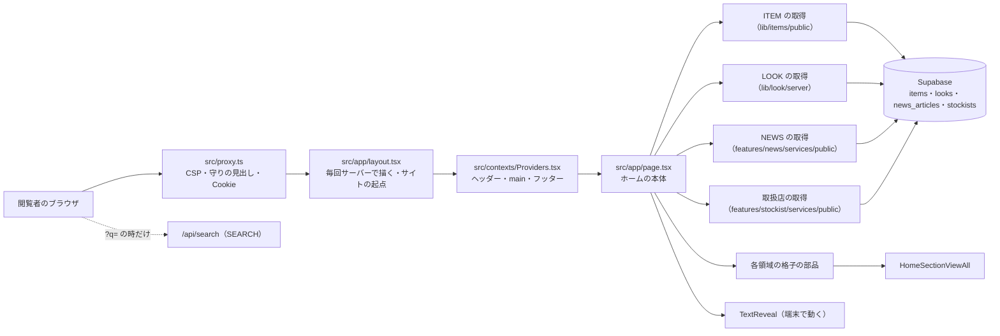
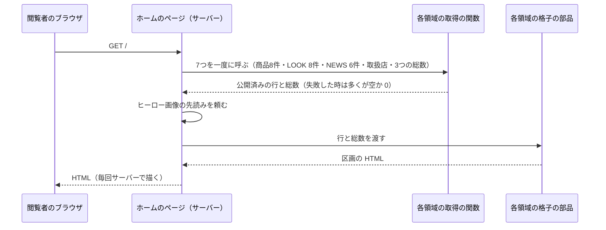
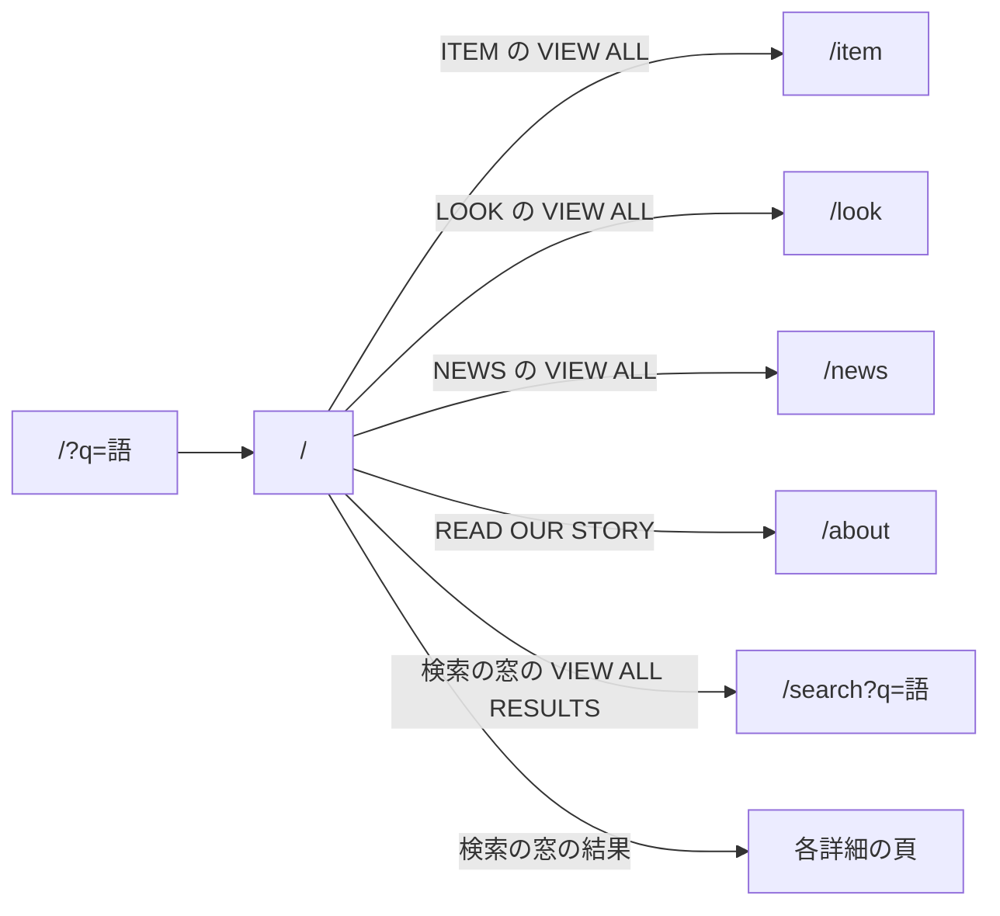
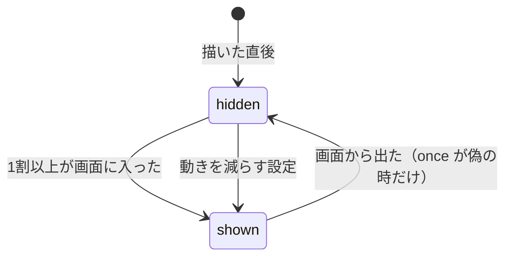

# HOME の構造設計

> 状態: 推定 | 確認日: 2026-10-26 | 対象: HOME（ホーム `/` のヒーロー・区画の並び・ABOUT の区画・VIEW ALL のボタン・ヒーローの動き） | 基準コミット: `a03beaff`

## 概要

HOME の領域の構成・画面・画面遷移・状態遷移を、追跡できる項目（`### <ID> <題>` と属性の表）で書く。
中身は 2026-10-24 の作業ツリーのコードを読んで起こした今の動きで、ユーザーの確認を受けていないので全部「推定」にした。要件と食い違う所は決めずに今のコードの動きを書き、食い違いは `docs/05_Quality/reports/trace-matrix.md` の「食い違い」節（TM-HOME-NN）に載せる。

| 種類 | 数 | ID | 中身 |
| --- | --- | --- | --- |
| 構成 | 4 | `ARC-HOME-001`〜`004` | サーバーで7つの取得を並べて待つ作り、公開の読みの道、共有の proxy の守り、題・説明・OG・先読み |
| 画面 | 4 | `SCR-HOME-001`〜`004` | 区画の並び、ヒーロー、ABOUT の区画、ITEM・LOOK の件数と VIEW ALL |
| 画面遷移 | 1 | `FLOW-HOME-001` | ホームから一覧・`/about`・検索へ移る |
| 状態遷移 | 1 | `STATE-HOME-001` | ブランド名の1文字ずつの出方（隠れている・見えている） |
| API・データ | 0 | — | HOME は窓口・表を持たない（理由は「範囲と根拠」） |

- 結論: ホームは `src/app/page.tsx` の Server Component 1つが、ITEM・LOOK・NEWS・取扱店の取得の関数（各領域の物）を一度に呼んで待ち、結果を各領域の格子の部品に渡して並べる。HOME が自分で持つ部品は、VIEW ALL のボタン（`HomeSectionViewAll`）と、ブランド名を1文字ずつ出す部品（`TextReveal`）だけ
- 今のコードが満たさない（一部だけ満たす物を含む）セキュリティ要件（`SEC-HOME-002`〜`007`・`009`・`013`〜`018`・`020`）は、満たす構造が無いか構造が HOME の外にあるので上位につながず、「範囲と根拠」の表に理由を書いた。満たさない中身は各 `SEC-HOME-` の項目に1度だけ書き、ここでは SEC の ID を指す
- 置き換わった要件（`FREQ-278-REQ-02`・`06` の threadDraw を1回）も、今の構造が満たさないので上位につながない

## 範囲と根拠

| 項目 | 内容 |
| --- | --- |
| 範囲 | `scripts/trace/scope.json` の HOME |
| 上位の文書 | [HOME の要件](../../02_Requirements/areas/home.md)（要件・`SEC-HOME-`・`DRV-HOME-`）、`docs/03_BasicDesign/decisions/ADR-0100`〜`ADR-0105` |
| 対象のコード | `src/app/page.tsx`（題・説明・OG を返す `generateMetadata` と、ページの本体 `Home`）、`src/features/home/components/HomeSectionViewAll.tsx`、`src/components/animations/TextReveal.tsx` |
| 関連文書 | `docs/04_DetailDesign/pages/01_home.md`、`docs/03_BasicDesign/ui/design-guide.md`（ホームの行が古い。別の作業と並行しているので触らない。TM-HOME-12）、[NEWS の構造設計](news.md)の `SCR-NEWS-006`（ホームの NEWS の区画）、[ABOUT の構造設計](about.md)の `FLOW-ABOUT-001`（ホームからの入口） |
| 調べた時点 | 2026-10-24 の作業ツリー（コードは読んだだけで、動かしての確かめはしていない） |

置かなかった種類と理由:

| 種類 | 置かなかった理由 |
| --- | --- |
| API `API-` | HOME は Route Handler・Server Action を持たない。ホームの検索の窓が呼ぶ `/api/search` は SEARCH の窓口、ヘッダーが呼ぶ `/api/auth/me` は AUTH の窓口 |
| データ `DATA-` | HOME の表・置き場は無い。読む `items`・`looks`・`news_articles`・`stockists` と画像の置き場は ITEM・LOOK・NEWS・STOCKIST の物。`public/mainphoto.png`・`public/about.png` はコードでない素材 |

つながなかったセキュリティ要件:

| ID | つながなかった理由 |
| --- | --- |
| SEC-HOME-002 | 今のコードが満たさない。公開の読みの client の種類は ARC-HOME-002 に今の動きを書いた |
| SEC-HOME-003・004・005・020 | 商品の表 `items` と原価の履歴の表の RLS・列・権限の話で、表は ITEM の物。HOME の構造に無い。`looks`・`look_items`・`stockists` の分は LOOK・STOCKIST の SEC が持つ |
| SEC-HOME-006 | 一部だけ満たす。在庫の側は ARC-HOME-002 が持つが、画像の署名の側は ITEM の `src/lib/storage/item-images.ts` の作りで HOME の構造に無い |
| SEC-HOME-007 | 商品の画像の署名の期限は ITEM の `src/lib/storage/item-images.ts` が決める。HOME の構造に無い |
| SEC-HOME-009・017 | 今のコードが満たさない。CSP と画像の最適化の許可は、共有の `src/proxy.ts`・`next.config.ts` が全部の頁に1つで持つ（ARC-HOME-003） |
| SEC-HOME-011・012・019 | 廃止。検索の窓の話で、SEARCH の SEC-SEARCH-006・010・021 が持つ |
| SEC-HOME-015 | 取得の失敗の記録と、端末の側の検索の窓の記録の話。記録の作りは各領域の取得の関数と SEARCH の `SearchHomePreview` にあり、HOME の構造に無い |
| SEC-HOME-013 | 商品の取る件数の部分は 2026-10-26 に満たした（8件。SCR-HOME-004）。署名つき URL を残す表（`signedUrlCache`）の件数の上限と、大量の表示への守り（中継の回数の制限）は満たさないまま残す |
| SEC-HOME-014 | 今のコードが満たさない。取得の流れは ARC-HOME-001 に今の動きを書いた |
| SEC-HOME-016 | `/api/auth/me` の応答の中身は AUTH の窓口の話。HOME の構造に無い |
| SEC-HOME-018 | 一部だけ満たす。住所を設定から作る前半は ARC-HOME-004 が持ち、設定が無い時の扱いの後半は SEC-HOME-018 に書いた |

範囲外の共有部品・他の領域の部品は ID を持たないので、項目の根拠と本文にファイルの道で書く。

| 部品 | 道 | HOME での使われ方 |
| --- | --- | --- |
| 全体の layout | `src/app/layout.tsx` の `dynamic = "force-dynamic"` と `metadata.metadataBase` | 毎回サーバーで描く設定（CSP の nonce のため）と、サイトの起点（`metadataBase`） |
| サイトの URL | `src/lib/redirect.ts` の `getSiteUrl` | 環境変数からサイトの起点を作る。無ければ手元の URL に落ちる |
| 包みの部品 | `src/contexts/Providers.tsx` | ヘッダー・`<main>`・フッター。`/` の時だけ `<main>` に上下の余白と左右の `px-4` を付けない |
| proxy | `src/proxy.ts` | 全部の道で CSP と守りの見出し、セッションの Cookie を付ける |
| 全体の CSS | `src/styles/globals.css` | ヒーローの書体と大きさ（`.hero-title`）、SCROLL の出方（`.hero-scroll-label`）、縦線の動き（`.hero-thread`・`heroThreadLoop`）、動きを減らす設定 |
| 見出しの部品 | `src/components/ui/SectionTitle/SectionTitle.tsx` | ABOUT の区画の h2。ITEM・LOOK・NEWS・取扱店の格子も中で使う |
| ボタンの部品 | `src/components/ui/Button/Button.tsx` | VIEW ALL と READ OUR STORY。`href` を渡すとリンクを返す |
| クラスの結合 | `src/lib/utils.ts` の `cn` | VIEW ALL の外側のクラスに、呼ぶ側の出し分けのクラスを足す |
| Supabase の client | `src/lib/supabase/server.ts` の `createClient`・`createPublicClient`・`createServiceRoleClient` | 取得の関数の中で使う。ページは直には使わない |
| ITEM の取得と格子 | `src/lib/items/public.ts`、`src/lib/items/availability.ts`、`src/features/items/components/PublicItemGrid.tsx` | 公開済みの商品8件と総数。描くのも8件まで |
| LOOK の取得と格子 | `src/lib/look/server.ts`、`src/features/look/components/PublicLookGrid.tsx` | 公開済みの LOOK 8件と総数 |
| NEWS の取得と格子 | `src/features/news/services/public.ts`、`src/features/news/components/PublicNewsGrid.tsx` | 公開済みの記事6件と総数（SCR-NEWS-006） |
| 取扱店の取得と格子 | `src/features/stockist/services/public.ts`、`src/features/stockist/components/PublicStockistGrid.tsx` | 公開済みの取扱店6件 |
| 検索の窓 | `src/features/search/components/SearchHomePreview.tsx` | `/?q=` の時だけ、端末から `/api/search` を呼んで3件を出す |

## 構成

実線の矢印は、要求が通る順と描く時の呼び出し（外から内）。点線は、ホームを描いた後に端末の検索の窓が呼ぶ窓口。DB への読みは、取得の関数の中で公開の client・閲覧者の session の client・service role の client を使い分ける（ARC-HOME-002）。

### ARC-HOME-001 ホームの頁はサーバーで7つの取得を一度に並べて待ち、結果を各領域の格子の部品に渡して描く

| 属性 | 値 |
| --- | --- |
| 上位 | FR-HOME-002、FREQ-147-REQ-01、FREQ-147-REQ-03、FREQ-148-REQ-01、FREQ-148-REQ-03、NFR-HOME-001、ADR-0100、FREQ-149-REQ-01（範囲外）、FREQ-149-REQ-02（範囲外） |
| 根拠 | 4つの領域の新しい物を1つの頁に並べるので、取り出しと見た目は各領域の関数と部品に任せ、ホームは並べ方だけを持つ（FR-HOME-002）。7つの取得は互いに待つ理由が無いので、一度に並べて待てば待ち時間は一番遅い1つで済む（NFR-HOME-001、推定）。サーバーは端末の幅を知らないので、取る件数は幅によらず決め、見せる数は画面の側で出し分ける（ADR-0100）。続きがあるかは取った件数では分からないので、総数を別に数える（FREQ-147-REQ-03・FREQ-148-REQ-03） |
| 状態 | 推定 |
| 確かめ方 | 結合テスト |
| 出どころ | 実装から推定（`src/app/page.tsx`）、`docs/03_BasicDesign/decisions/ADR-0100-home-fixed-fetch-css-breakpoints.md` |

- 取る件数: 頁の中の定数で、商品8件・LOOK 8件・NEWS 6件（`page.tsx`）。取扱店は取得の関数の中で6件（`src/features/stockist/services/public.ts`）。総数は商品・LOOK・NEWS の3つ（`page.tsx`）
- 渡し方: 商品・LOOK・NEWS の格子には `variant="home"` と行と総数を、取扱店の格子には `variant="home"` と行を渡す（`page.tsx`）。格子の部品は自分で取りに行かない
- 描き方: 共有の layout が毎回サーバーで描く設定を持つ（`src/app/layout.tsx`）ので、ホームも要求ごとに7つを取り直す。頁の結果のキャッシュは無い
- 失敗の時: 取得の関数の多くは、DB の誤りを記録して空の配列か 0 を返す（`getPublishedItems`・`getPublishedItemsCount`・`getPublishedLooks`・`getPublishedLooksCount`・`getPublishedNewsCount`・`getHomePublicStockists` の誤りの枝）。関数が例外を投げた時の扱いは SEC-HOME-014。NEWS の記事の取得（`getPublishedNews`）だけは、DB の失敗を `NewsFetchError` で投げる（SEC-NEWS-020、ADR-0024）が、頁が `.catch(() => [])` で握って NEWS の区画を空にし、ほかの区画を出す（2026-10-26。SEC-HOME-014 の NEWS の分）
- 分岐: ページの中に条件の分岐は無い。区画の出し分けは格子の部品の中にある
- 依存: 商品の取得は在庫の読み（`src/lib/items/availability.ts`）を通り、在庫の仕組みの改修の影響を受けうる（ホームのファイルは触られない。推定）

### ARC-HOME-002 公開の読みは各領域の取得の関数の中で公開済みに絞り、client の種類は領域ごとに違う

| 属性 | 値 |
| --- | --- |
| 上位 | SEC-HOME-001 |
| 根拠 | 発表前の物をホームで先に知られないため、どの取得も `status='published'` の行だけを返す（SEC-HOME-001）。RLS を通らない service role の在庫の読みでも、公開済みの絞りをアプリの側で持つ（SEC-HOME-006 の在庫の側。この項目の上位にはしない）。絞りを各領域の関数の中に置くので、ホームは絞りを書き忘れる場所を持たない（推定） |
| 状態 | 推定 |
| 確かめ方 | 結合テスト |
| 出どころ | 実装から推定（`src/lib/items/public.ts`、`src/lib/items/availability.ts`、`src/lib/look/server.ts`、`src/features/news/services/public.ts`、`src/features/stockist/services/public.ts`）、`docs/05_Quality/reviews/security/security_review_home.md` |

| 取得 | 行を読む client | 公開済みの絞り | service role の使い道 |
| --- | --- | --- | --- |
| 商品8件・商品の総数 | 閲覧者の session の client | `status='published'`（`src/lib/items/public.ts`） | 画像の署名と在庫の読み（`src/lib/items/availability.ts`、`items.status='published'` で再度絞る） |
| LOOK 8件・LOOK の総数 | 公開の client | `status='published'`（`src/lib/look/server.ts`） | LOOK の画像と、関連商品の画像の署名（`src/lib/look/server.ts` の `hydrateLooks`。LOOK が1件以上ある時だけ client を作る） |
| NEWS 6件・NEWS の総数 | 公開の client | `status='published'`（`src/features/news/services/public.ts`） | 無し（画像の列を選ばず署名しない。SEC-NEWS-005） |
| 取扱店6件 | 閲覧者の session の client | `status='published'`（`src/features/stockist/services/public.ts`） | 無し |

- 管理者の session でホームを開くと、商品と取扱店は管理者の権限の RLS で読まれ、アプリの `status='published'` の絞りだけが下書きを外す（推定。管理者の RLS の中身は確かめていない。SEC-HOME-002）
- 在庫は有無だけを渡し、実数は渡さない見込み（SEC-HOME-006 の在庫の側。実数を HTML に出さないかは格子の部品の話で、確かめていない）
- 画像の署名の道筋の確かめと、署名に失敗した時の扱い（SEC-HOME-006 の署名の側）は、ITEM の `src/lib/storage/item-images.ts` の作り（SEC-HOME-006）。LOOK のカードの関連商品の画像も、`hydrateLooks` がこの署名を通す
- `hydrateLooks` は service role の client を try の外で作るので、鍵が無いと LOOK の取得も例外を投げる（SEC-HOME-014）
- ホームで下書きが出ないことを試すテストは無い（SEC-HOME-001-AC-01・02 は E2E が未作成）

### ARC-HOME-003 共有の proxy が `/` の応答に CSP と守りの見出しを付け、ホームは生の HTML を描かない

| 属性 | 値 |
| --- | --- |
| 上位 | SEC-HOME-008、SEC-HOME-010、FREQ-280-REQ-01、FREQ-280-REQ-02、ADR-0104、NFR-SEC-001（範囲外）、NFR-SEC-003（範囲外） |
| 根拠 | 守りの見出しを頁ごとに書くと付け忘れが出るため、全部の道に効く `src/proxy.ts` の1か所で付け、ホームは自分では重ねない（SEC-HOME-010。全体の NFR-SEC-001 の HSTS と NFR-SEC-003 の CSP をホームに当てはめた形）。中身の文は React の逃がしで字として描き、CSP の nonce で差し込んだスクリプトを止める2段にする（SEC-HOME-008）。`TextReveal` と区画の字の大きさは style の属性で当てるので、属性だけを `'unsafe-inline'` で許し、style 要素・link 要素は締めたままにする（FREQ-280、ADR-0104） |
| 状態 | 推定 |
| 確かめ方 | 結合テスト |
| 出どころ | 実装から推定（`src/proxy.ts`、`src/app/layout.tsx`、`src/app/page.tsx`・`src/components/animations/TextReveal.tsx` の全体） |

- 道: proxy の対象は全部の道（`src/proxy.ts` の `config.matcher`）。`/` にも効く
- CSP: script は要求ごとの nonce で許す。`style-src` は `'self'`・`'unsafe-inline'`・CDN（`src/proxy.ts` の `buildCsp`）、`style-src-elem` は `'self'` と CDN だけで、開発のサーバーの時だけ `'unsafe-inline'` を足す。`frame-ancestors 'none'`
- 見出し: `Referrer-Policy: no-referrer`、`X-Content-Type-Options: nosniff`、`X-Frame-Options: DENY`、`Strict-Transport-Security`（`src/proxy.ts` の `proxy`）
- nonce と描き方: nonce が要求ごとに変わるので、共有の layout が静的な生成をやめて毎回サーバーで描く（`src/app/layout.tsx`）。ホームの頁の結果のキャッシュが無いのはこのため
- 生の HTML: `page.tsx`・`HomeSectionViewAll.tsx`・`TextReveal.tsx` に生の HTML を描く書き方は無い。中身の文（商品名・記事の題など）は各領域の格子の部品が描く（その部品の中は確かめていない）
- CSP の広さ: 全部の頁に同じ1つの方針で、外の場所の許可もそのまま共有する（SEC-HOME-009）
- 試験: `FR-HOME-018` の5つ目が `style-src-elem` と style 属性の効き目（FREQ-280-AC-01・02）を試す。守りの見出しを `/` で試す E2E は無い

### ARC-HOME-004 題・説明・OG はページの関数が固定の値で返し、ヒーロー画像は描く時に先読みを頼む

| 属性 | 値 |
| --- | --- |
| 上位 | FR-HOME-006、FR-HOME-007 |
| 根拠 | 検索の結果と共有の表示に、既定の文でなくブランドの名前と説明と写真を出すため（FR-HOME-006）。最初の画面で一番大きな物はヒーローの写真なので、HTML を返す前に先読みを頼み、画像にも優先の印を付けて最初の画面を早く出す（FR-HOME-007）。OG の画像の絶対の住所は、要求の見出しでなく設定のサイトの URL から作るので、見出しを偽って共有のカードを別のサイトに向けられない（SEC-HOME-018 の前半。この項目の上位にはしない） |
| 状態 | 推定 |
| 確かめ方 | 結合テスト |
| 出どころ | 実装から推定（`src/app/page.tsx`、`src/app/layout.tsx`、`src/lib/redirect.ts`） |

| 値 | 中身 | 出どころ |
| --- | --- | --- |
| title | `Le Fil des Heures`（layout の題と同じ字） | `page.tsx` の `generateMetadata` |
| description | 公式のオンラインストアと「時を紡ぐニュートラルモードな日常着」の文 | `page.tsx` の `generateMetadata` |
| OG の title・description | title・description と同じ | `page.tsx` の `generateMetadata` |
| OG の画像 | `/mainphoto.png`（`public/mainphoto.png`） | `page.tsx` の `generateMetadata` |
| 先読み | `/mainphoto.png` を画像として先読みする | `page.tsx` の `Home`（`ReactDOM.preload`） |

- 作り: ページのファイルの中の metadata の関数が、引数も読み出しも無く固定の値を返す
- 絶対の住所: OG の画像の道は、共有の layout の `metadataBase`（`src/app/layout.tsx`）で絶対の住所になる。起点は `getSiteUrl` が環境変数だけから作る（`src/lib/redirect.ts`）
- 設定が無い時: サイトの URL の環境変数が1つも無い時の扱いは SEC-HOME-018 の後半
- 先読みの重なり: ページの先読みと、画像の優先の印（`page.tsx`）の両方が先読みを出しうる。1つにまとまるかは Next.js しだい（`FR-HOME-007` の E2E は1つを期待する）
- 返さない物: canonical・`og:url`・`og:type`・twitter のカードは返さない（推定。NFR-SEO-003（範囲外）は canonical も求める）

## 画面

### SCR-HOME-001 ホーム `/` の区画の並び

| 属性 | 値 |
| --- | --- |
| 上位 | FR-HOME-002、FR-HOME-005、FR-HOME-009、DRV-HOME-006、FR-SEARCH-002（範囲外）、FR-STOCKIST-004（範囲外）、FR-LOOK-ALL-004（範囲外）、FREQ-275-REQ-01（範囲外） |
| 根拠 | 新しい物（商品・LOOK・知らせ）を先に見せ、ブランドの考えと取扱店を後に置く（DRV-HOME-006、推定）。下へ読むだけで4つの区画にひと通り触れられる（FR-HOME-002）。実物を見たい人のために取扱店を最後に6件まで置く（FR-HOME-005）。読み上げで見出しの段を辿れるよう、h1 はブランド名の1つだけにし、区画の見出しは共通の見出しの部品で h2 にそろえる（FR-HOME-009、FREQ-275） |
| 状態 | 推定 |
| 確かめ方 | 結合テスト |
| 出どころ | 実装から推定（`src/app/page.tsx`、`src/contexts/Providers.tsx`） |

| 順 | 区画 | 見出し | 部品 | 出どころ |
| --- | --- | --- | --- | --- |
| 1 | ヒーロー | h1 ブランド名 | HOME（SCR-HOME-002） | `Home` の最初の `section` |
| 2 | 検索の窓 | `/?q=` の時だけ h2 `Search Preview` | `SearchHomePreview`（SEARCH） | `Home` の `SearchHomePreview` の呼び出し |
| 3 | ITEM | h2 `ITEMS` | `PublicItemGrid`（ITEM、SCR-HOME-004） | `Home` の `PublicItemGrid` の呼び出し |
| 4 | LOOK | h2 `LOOK` | `PublicLookGrid`（LOOK、SCR-HOME-004） | `Home` の `PublicLookGrid` の呼び出し |
| 5 | NEWS | h2 `NEWS` | `PublicNewsGrid`（NEWS、SCR-NEWS-006） | `Home` の `PublicNewsGrid` の呼び出し |
| 6 | ABOUT | h2 `ABOUT` | HOME（SCR-HOME-003） | `Home` の `section#about` |
| 7 | 取扱店 | h2（取扱店の格子の中） | `PublicStockistGrid`（STOCKIST） | `Home` の `PublicStockistGrid` の呼び出し |

- 包み: `/` の時だけ、共有の `Providers` は `<main>` に上下の余白と左右の `px-4` を付けない（`src/contexts/Providers.tsx`）。ヒーローが画面の端まで広がるのはこのため
- 検索の窓: `?q=` が無い時は何も描かない。ある時は端末から `/api/search` を呼び、結果が来てから区画を出す（`SearchHomePreview.tsx`）。中身は SEARCH の話
- 取扱店: 取得の関数が6件までにする。モバイルで3件にする出し分けは取扱店の格子の部品の話（FR-STOCKIST-004）
- 見出しの段: h1 はヒーローの1つだけ。区画の見出しは h2、ABOUT の3本柱の題は h3。NEWS の格子は記事の題を h3 にする（`PublicNewsGrid.tsx`）
- 空の時: 公開の物が0件の区画も消えず、格子の部品が「公開中の…がありません」のような文を出す（ITEM の例: `PublicItemGrid.tsx`）

### SCR-HOME-002 ヒーローの区画

| 属性 | 値 |
| --- | --- |
| 上位 | FR-HOME-001、FR-HOME-007、FREQ-278-REQ-01、FREQ-278-REQ-03、FREQ-278-REQ-04、FREQ-278-REQ-05、FREQ-282-REQ-01、FREQ-282-REQ-02、FREQ-283-REQ-01、NFR-HOME-002、DRV-HOME-001、DRV-HOME-003、DRV-HOME-004、ADR-0101、ADR-0103 |
| 根拠 | 最初の画面いっぱいの写真と名前だけで、言葉より先に静かな世界観を伝える（FR-HOME-001、DRV-HOME-001、ADR-0101）。白い字が写真の上でも読めるよう、上下を暗くする重ねを敷く（NFR-HOME-002）。画面いっぱいなので、下に続きがあることを控えめな SCROLL の印で知らせ、見た目だけの印として読み上げから隠す（DRV-HOME-003、FREQ-283）。縦線は消える瞬間の無い伸びる動きを繰り返し、動きを減らす設定では止める（FREQ-282、ADR-0103）。ブランド名は1文字ずつ出すが、読み上げには名前として渡す（FREQ-278-REQ-01・04・05） |
| 状態 | 推定 |
| 確かめ方 | 結合テスト |
| 出どころ | 実装から推定（`src/app/page.tsx`、`src/styles/globals.css`、`src/components/animations/TextReveal.tsx`）、`docs/05_Quality/reviews/uiux/uiux_review_home.md` |

| 要素 | 中身 | 読み上げ | 出どころ |
| --- | --- | --- | --- |
| 区画 | 画面の見える高さいっぱい（svh）、上にヘッダーの分の余白、中央寄せ | — | `page.tsx` |
| 写真 | `/mainphoto.png` を不透明度 90% で敷く。優先の印あり。幅 1024px 未満は画面の3倍の幅の画像を選ばせる | 代替テキスト「ニュートラルな日常着をまとう Le Fil des Heures のメインビジュアル」（DRV-HOME-004） | `page.tsx` |
| 重ね | 上は黒 40%、中は透明、下は黒 60% の縦の階調 | 隠す | `page.tsx` |
| ブランド名 | `TextReveal` の h1、出始めは 100ms 後、1文字 30ms ずつ（STATE-HOME-001）。書体と大きさ（6xl）は共有の CSS のクラスで当てる。字は白 | 名前「Le Fil des Heures」の見出し1つ（1文字ずつの span は隠す） | `page.tsx`、`globals.css` |
| SCROLL の印 | 下の中央に、SCROLL の字（白 90%、4xs の大きさを style の属性で当てる）と細い縦線（白 90%）を縦に並べる。字は 600ms 後に 1.2 秒かけて出る | まとめて隠す | `page.tsx`、`globals.css` |
| 縦線の動き | 上端を起点に、長さ 8% から 100% へ 2.1 秒の約 78% で伸ばし、残りは伸びきったまま待って、また 8% から繰り返す。速さは ease-in-out | 隠す | `globals.css` |
| 動きを減らす設定 | ブランド名は最初から見え、移ろいも無い。SCROLL の字と縦線の動きを止める | — | `TextReveal.tsx`、`globals.css` |

- 置かない物: コンセプトの文、CTA のボタン、スライダー（DRV-HOME-001。付録 D の WF-HOME-003・AC-WF-HOME-001 とは逆）
- 置き換わった要件: 縦線を threadDraw で1回だけ引く形（FREQ-278-REQ-02・06）は、今の構造に無い。今は FREQ-282 の繰り返しの動き
- CSS の注記: `globals.css` の注記は「本番の CSP の style-src に `'unsafe-inline'` が無いのでクラスで当てる」と書くが、今の CSP は style の属性を許す（ARC-HOME-003）。SCROLL の字は style の属性で大きさを当てている
- 試験: `FR-HOME-018`〜`020` がブランド名の分かれ方・大きさ・名前・動きを減らす設定・縦線・色を試す。`FR-HOME-001` と `FR-HOME-006-007-011` は古い代替テキストを探して落ちる（既存の赤）

### SCR-HOME-003 ABOUT の区画

| 属性 | 値 |
| --- | --- |
| 上位 | FR-HOME-003、FR-HOME-008、NFR-HOME-002、DRV-HOME-002、ADR-0102 |
| 根拠 | 考えに共感して買う人に、天然繊維・受注生産・ユニセックスという他との違いを短く伝え、全文の `/about` へ進めるようにするため（DRV-HOME-002、FR-HOME-003）。独立した CONCEPT の区画を置かず、ABOUT にまとめてホームを短く保つ（ADR-0102）。画像は外の生成のサービスでなく手元の画像にし、止まっても崩れないようにする（FR-HOME-008）。本文はブランドの灰色（#474747）で、白地での読みやすさを保つ（NFR-HOME-002） |
| 状態 | 推定 |
| 確かめ方 | 結合テスト |
| 出どころ | 実装から推定（`src/app/page.tsx`、`src/styles/globals.css` の `.about-main-text` ほか）、`docs/05_Quality/reviews/uiux/uiux_review_home.md` |

| 順（768px 以上の左の列） | 中身 | 出どころ |
| --- | --- | --- |
| 1 | h2 `ABOUT`（共通の見出しの部品） | `page.tsx` |
| 2 | 考えの文2つ「長く着られる服だけをつくる。それが、唯一のこだわり。」「流行ではなく、タイムレスなシルエットと素材を。」 | `page.tsx` |
| 3 | 3本柱。英字の題（h3）・日本語・説明を、上下と間に細い罫線を引いて縦に並べる | `page.tsx` |
| 4 | READ OUR STORY のボタン（`/about`、FLOW-HOME-001） | `page.tsx` |

| 3本柱の英字の題 | 日本語 | 出どころ |
| --- | --- | --- |
| `TIMELSS & UNISEX`（綴りが TIMELESS と違う） | タイムレス＆ユニセックス | `page.tsx` |
| `NATURAL FIBERS` | 天然繊維100% | `page.tsx` |
| `MADE TO ORDER` | 国内受注生産 | `page.tsx` |

- 並び: 768px 以上は左に文（3）、右に画像（2）の2列。768px 未満は画像を上、文を下に積む（`page.tsx`）
- 画像: `/about.png` を縦横 3:4 の枠いっぱいに、next/image で最適化して出す。代替テキストは「About Le Fil des Heures」（`page.tsx`）
- 字の大きさ: 共有の大きさのトークンを style の属性で当てる（`page.tsx`。ARC-HOME-003 の `'unsafe-inline'` の理由の1つ）
- 置かない物: UI/UX レビューの H-8 が書く「検索の窓の直後の CONCEPT の抜粋」は今の頁に無い
- 試験: `FR-HOME-008` が画像の住所を試す。ABOUT のボタンから `/about` へ移る E2E は無い（FR-HOME-003-AC-01 が未作成）

### SCR-HOME-004 ITEM・LOOK の区画の件数と VIEW ALL のボタン

| 属性 | 値 |
| --- | --- |
| 上位 | FR-HOME-004、FREQ-147-REQ-01、FREQ-147-REQ-02、FREQ-147-REQ-03、FREQ-148-REQ-01、FREQ-148-REQ-02、FREQ-148-REQ-03、DRV-HOME-005、ADR-0100、ADR-0105、FREQ-146-REQ-01（範囲外） |
| 根拠 | ホームで見た続きを一覧で見たい人が、区画の下からそのまま一覧へ移れるようにする（FR-HOME-004）。入口は区画の下の中央の共通のボタン1つにまとめ、続きがある時だけ出して、全部見えているのに「全部を見る」を出さない（ADR-0105、FREQ-147-REQ-03・FREQ-148-REQ-03）。同じ "VIEW ALL" が3つ並ぶので、読み上げでは行き先ごとの名前を必ず付ける（DRV-HOME-005）。サーバーは幅を知らないので、見せる数と VIEW ALL の出し分けは CSS のクラスで決める（ADR-0100、FREQ-147-REQ-02・FREQ-148-REQ-02） |
| 状態 | 推定 |
| 確かめ方 | 結合テスト |
| 出どころ | 実装から推定（`src/features/home/components/HomeSectionViewAll.tsx`、`src/features/items/components/PublicItemGrid.tsx`、`src/features/look/components/PublicLookGrid.tsx`）、`docs/03_BasicDesign/decisions/ADR-0105-home-view-all-bottom-conditional.md` |

| 区画 | 取る | 描く | 見せる（2xl 未満・2xl 以上） | VIEW ALL を出す時（2xl 未満・2xl 以上） | 行き先・読み上げの名前 |
| --- | --- | --- | --- | --- | --- |
| ITEM | 8件 | 8件まで | 6件・8件 | 総数が6件より多い・8件より多い | `/item`・`VIEW ALL ITEMS` |
| LOOK | 8件 | 8件まで | 6件・8件 | 総数が6件より多い・8件より多い | `/look`・`VIEW ALL LOOKS` |
| NEWS | 6件 | 6件 | 全部の幅で6件 | 総数が6件より多い | SCR-NEWS-006 |

- VIEW ALL のボタン: 区画の下の中央に置く共通のボタン（secondary・四角・最小の高さ 52px・最大の幅 420px）。文字は3つとも `VIEW ALL`。行き先と読み上げの名前は呼ぶ側が必ず渡し、E2E が見つけるための目印（`home-section-view-all`）を付ける（`HomeSectionViewAll.tsx`）
- 出し分け: 呼ぶ側（格子の部品）が総数と幅ごとの表示数を比べて `flex`・`hidden` のクラスを作り、ボタンの外側に足す（`PublicItemGrid.tsx`、`PublicLookGrid.tsx`）。隠れた時も DOM には残る。総数を渡されない時は、出し分けのクラスを付けず常に出す
- 件数の食い違い: FREQ-147-REQ-02 は ITEM を lg・xl で切り替えて10件まで描くと書くが、今は8件まで描いて 2xl で切り替える（FREQ-276 の数。TM-HOME-01）。FREQ-148-REQ-02 も xl でなく 2xl で切り替える（TM-HOME-02）。取る ITEM は描く8件だけにした（2026-10-26。`HOME_ITEM_FETCH_COUNT` が8。SEC-HOME-013）ので、以前あった「取った9・10件目は描かない」（TM-HOME-03）は無くなった。続きの有無は総数の問い合わせで決める
- 置かない物: 見出しの右の VIEW ALL（FREQ-126（範囲外）の形）は今の構造に無い
- 試験: `FR-HOME-004`・`012`・`013` がボタンの有無・見た目・件数と出し分けを試す。ボタンの部品の単体テストは無い

## 画面遷移

### FLOW-HOME-001 ホームから各一覧・`/about`・検索の結果へ移る

| 属性 | 値 |
| --- | --- |
| 上位 | FR-HOME-003、FR-HOME-004、DRV-HOME-005、FR-SEARCH-002（範囲外） |
| 根拠 | ホームは要約なので、区画ごとに続きの頁への出口を1つずつ置き、読み終えた所からそのまま進めるようにする（FR-HOME-004 の一覧、FR-HOME-003 の `/about`）。検索の窓は結果を3件だけ見せ、全部は検索の頁で見せる（FR-SEARCH-002） |
| 状態 | 推定 |
| 確かめ方 | 結合テスト |
| 出どころ | 実装から推定（`src/app/page.tsx`、`src/features/home/components/HomeSectionViewAll.tsx`、`src/features/items/components/PublicItemGrid.tsx`、`src/features/search/components/SearchHomePreview.tsx`） |

矢印はリンクを押した時の移り先。どれも共有のボタンの部品か `next/link` のリンクで、同じタブの中で移る。カードから各詳細へ移る道と、ヘッダー・フッターからの移りは各領域の部品の話なので図に入れていない。

- VIEW ALL: 続きがある時だけ出る（SCR-HOME-004）。出ない時はその区画から一覧への出口が無い（FR-HOME-004 の「配置する」と合わない時がある）
- READ OUR STORY: 常に出る（`page.tsx`）。行き先の頁は ABOUT の `FLOW-ABOUT-001`
- 検索の窓: `/?q=` で開いた時だけ出る。結果の住所は `/api/search` が返す値を使う（SEARCH の話）
- 試験: `FR-HOME-004` がリンクの行き先を試す。`/about` へ移る E2E は無い

## 状態遷移

### STATE-HOME-001 ブランド名の1文字ずつの出方（隠れている・見えている）

| 属性 | 値 |
| --- | --- |
| 上位 | FREQ-278-REQ-01、FREQ-278-REQ-04、FREQ-278-REQ-05 |
| 根拠 | ブランド名を左から1文字ずつ出す動きを、画面に入った時に1回だけ見せるため（FREQ-278-REQ-01）。動きを減らす設定では待たずに最初から見せる（FREQ-278-REQ-05）。どの状態でも読み上げには元の名前を渡し、1文字ずつ綴られないようにする（FREQ-278-REQ-04）。画面に入ったかと動きの設定は端末でしか分からないので、この部品だけ端末で動かす |
| 状態 | 推定 |
| 確かめ方 | 結合テスト |
| 出どころ | 実装から推定（`src/components/animations/TextReveal.tsx`、`src/app/page.tsx`） |

状態は、端末で持つ2つの値（画面に入ったか・動きを減らす設定か）のどちらかが真なら「見えている」。矢印は値が変わった時の移り。サーバーで描いた HTML は「隠れている」の形（全部の文字が透明）で届く。

| 状態 | 1文字ずつの span | 出どころ |
| --- | --- | --- |
| 隠れている | 透明で、自分の高さの分だけ下にずらす | `TextReveal.tsx` |
| 見えている（動きあり） | 不透明・元の位置へ、0.4 秒かけて移る。始まりは `delay + 何文字目 × stagger`（ホームは 100ms と 30ms） | `TextReveal.tsx` |
| 見えている（動きを減らす設定） | 不透明・元の位置。移ろいは無い | `TextReveal.tsx` |

- 1回だけ: ホームは `once` を渡さず既定の真なので、画面に入った後は見張りをやめ、出た後も「見えている」のまま（`TextReveal.tsx`）。「画面から出たら隠す」道は `/loading` の見本だけが使う
- 設定の変化: 動きを減らす設定が途中で変わると、それに合わせて値を変える（`TextReveal.tsx`）
- 後始末: 部品が消える時に見張りと設定の購読をやめる（`TextReveal.tsx`）
- JS が動かない時: サーバーの HTML は「隠れている」の形なので、ブランド名が見えないまま残る（推定。確かめていない）
- 共用: `TextReveal` は `/loading` の見本（`src/app/loading/_components/AnimationShowcase.tsx`、範囲外）も使う

## 未確認事項

- 取得の関数が例外を投げる場合（client を作る時の環境変数の欠け・署名の失敗など）が実際にあるか。あれば頁全体が落ちる（ARC-HOME-001、SEC-HOME-014）
- 管理者の RLS で、下書きの商品・取扱店が見えるか（ARC-HOME-002、SEC-HOME-001-AC-02）
- 本番のサイトの URL の環境変数の設定と、本番の `/` の応答の見出しの実際の値（本番は未デプロイ）
- 先読みと画像の優先の印が、本番ビルドで先読みを1つにまとめるか（ARC-HOME-004）
- JS が動かない時にブランド名が見えないままになるか（STATE-HOME-001）
- ITEM・LOOK の件数を FREQ-276・277 の数に置き換えるか（要件の文書の未確認事項と同じ）。ITEM を取る件数は 2026-10-26 に8件にそろえた
- FREQ-278-REQ-02・06 を FREQ-282 で置き換えた物として「廃止」にするか（要件の文書の未確認事項と同じ）
- この文書の項目は全部「推定」。ユーザーの確認を受けたら「現行」にする
