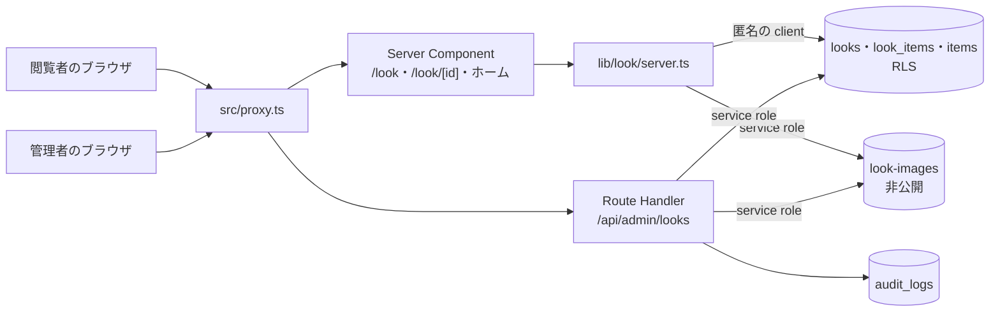
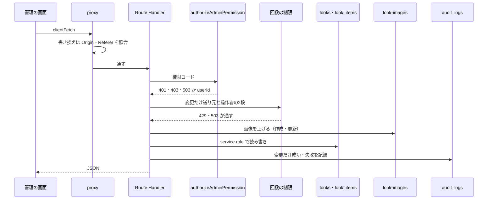
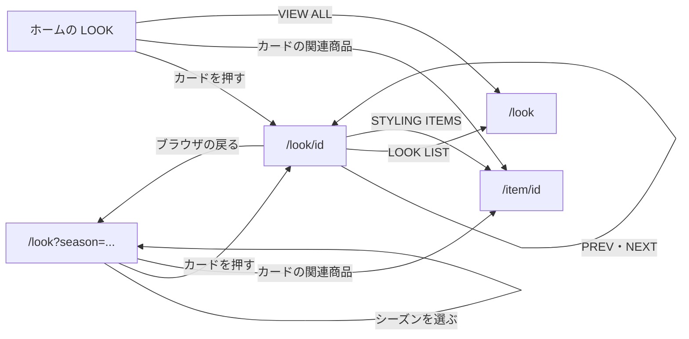
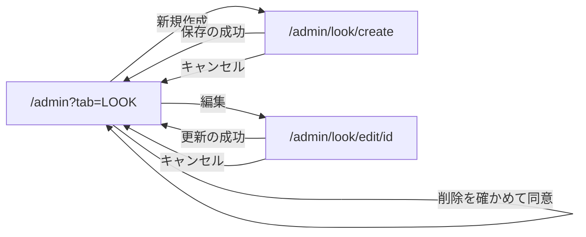
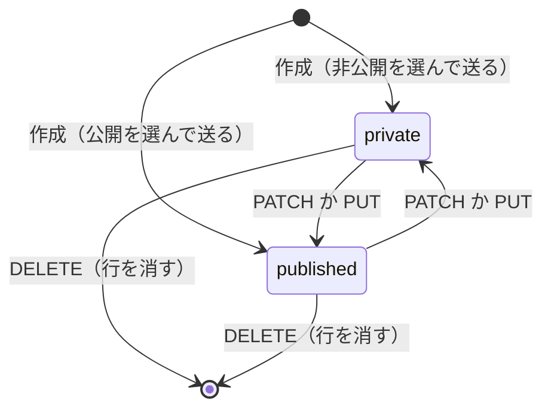
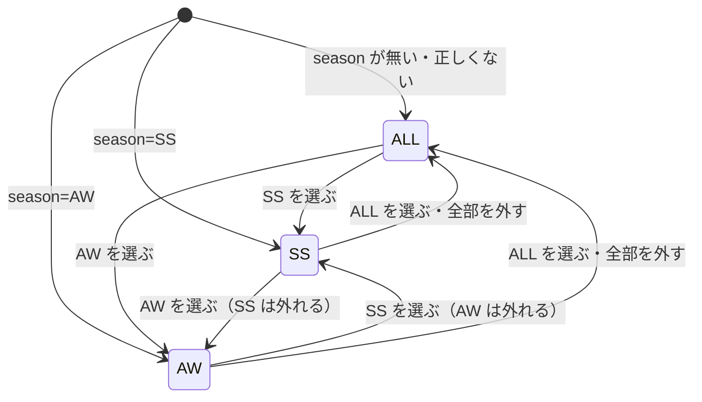

# LOOK の構造設計

> 状態: 推定 | 確認日: 2026-10-26 | 対象: LOOK（一覧 `/look`・詳細 `/look/[id]`・ホームの LOOK の区画の部品・管理の LOOK） | 基準コミット: `4facf63b`（作業ツリーに別の作業の未コミットの差分あり）

## 概要

LOOK の領域の構成・画面・画面遷移・状態遷移・API・データを、追跡できる項目（`### <ID> <題>` と属性の表）で書く。
中身は 2026-10-24 の作業ツリーのコードを読んで起こした今の動きで、ユーザーの確認を受けていないので全部「推定」にした。要件と食い違う所は決めずに今のコードの動きを書き、食い違いは `docs/05_Quality/reports/trace-matrix.md` の「食い違い」節に載せた。

| 種類 | 数 | ID | 中身 |
| --- | --- | --- | --- |
| 構成 | 3 | `ARC-LOOK-001`〜`003` | 公開の読み出し、管理の書き換え、画像の置き場と署名 |
| 画面 | 8 | `SCR-LOOK-001`〜`008` | 一覧、カード、ホームの LOOK の区画、詳細、詳細の画像のギャラリー、管理の LOOK タブ、作成、編集 |
| 画面遷移 | 2 | `FLOW-LOOK-001`〜`002` | 一覧・詳細・商品の行き来、管理の一覧と作成・編集の行き来 |
| 状態遷移 | 2 | `STATE-LOOK-001`〜`002` | LOOK の公開の状態、一覧のシーズンの選択 |
| API | 6 | `API-LOOK-001`〜`006` | 管理の6つの窓口（公開の LOOK の窓口は無い） |
| データ | 6 | `DATA-LOOK-001`〜`006` | LOOK の表、関連の表、RLS と付与、検索の関数（廃止。SEARCH の DATA-SEARCH-001 が持つ）、画像の置き場、権限 |

- 結論: 公開の側は Server Component から匿名の client で DB を読み、RLS とアプリの `status='published'` の2段で公開済みだけを出す。画像の署名だけを service role で行う。管理の側は利用者の端末で動く画面から Route Handler を通し、窓口で session・権限・2要素認証・回数を確かめた上で、DB と置き場を service role で書き換える（NEWS と違い、利用者の JWT で RLS に通さない）
- 公開の LOOK を返す API（`/api/looks` など）は無い。一覧・詳細・ホームは全部ページのサーバーの中で取り出す
- 今のコードが満たさないセキュリティ要件（SEC-LOOK-002〜010・012〜016・020〜023）は、満たす形の構造を持たないので上位につながず、本文に「満たさない」と書いた
- 一部だけ満たすセキュリティ要件は NEWS と同じ決まりで扱った。項目が受け持つコードの中に満たさない所がある時は上位にせず、満たさない所が共有部品などほかのコードにだけある時は上位にした（例: SEC-LOOK-011 の送り元の取り方は共有の `src/features/auth/middleware/rateLimit.ts` にあるので管理の変更の窓口の上位にする。SEC-LOOK-019 の画面の出し分けは LOOK の画面にあるので、画面の項目の上位にはせず窓口の項目の上位にする）
- 要件のうち、今のコードと合わないと要件の文書が書いた物（FR-LOOK-ALL-003・FR-LOOK-DETAIL-004・FREQ-139-REQ-01・FREQ-141-REQ-01・FREQ-178-REQ-01・FREQ-180-REQ-01・FREQ-279-REQ-03）と、作らないと決めた FR-LOOK-DETAIL-007 は上位にしていない。ADR-0150〜0158 も同じ決まりで、満たさない要件を上位にせず「結果」に書いた

## 範囲と根拠

| 項目 | 内容 |
| --- | --- |
| 範囲 | `scripts/trace/scope.json` の LOOK |
| 上位の文書 | [LOOK の要件](../../02_Requirements/areas/look.md)（要件・`SEC-LOOK-`・`DRV-LOOK-`）、`docs/03_BasicDesign/decisions/ADR-0150`〜`ADR-0158` |
| 対象のコード | `src/app/look/`、`src/app/api/admin/looks/`、`src/app/admin/look/create/page.tsx`・`edit/[id]/page.tsx`・`types.ts`、`src/components/LookSection.tsx`、`src/features/look/`、`src/lib/look/`、`src/lib/storage/look-images.ts` |
| 対象の DB | `supabase/migrations/20260901102912_remote_schema.sql`（表・RLS・付与・検索の関数）、`supabase/migrations/20261023175712_group_g0_permissions.sql`（権限と `has_permission`）、`supabase/seed.sql`（手元の置き場と見本の LOOK）、旧 `migrations/018_create_looks_and_look_images_bucket.sql`・`030_make_look_images_bucket_private.sql`（今の CI は当てない） |
| 関連文書 | `docs/03_BasicDesign/ui/screen-list.md`、`docs/03_BasicDesign/api/api-spec.md`、[脅威](../../05_Quality/security/threats/look.md)、[HOME の構造設計](home.md)（ホームの LOOK の件数と VIEW ALL は SCR-HOME-004） |
| 調べた時点 | 2026-10-24 の作業ツリー（コードは読んだだけで、動かしての確かめはしていない） |

範囲外の部品は ID を持たないので、項目の根拠と本文にファイルの道で書く。

| 部品 | 道 | LOOK での使われ方 |
| --- | --- | --- |
| 管理の認可 | `src/lib/auth/admin-rbac.ts` の `authorizeAdminPermission` | 管理の窓口ごとに token・session・DB の ACL・aal2 を確かめる |
| CSRF の Origin の検査と守りの見出し | `src/proxy.ts` | `/api` の書き換えの Origin・Referer の照合、全部の応答の見出し |
| 書き換えの送り方 | `src/lib/client-fetch.ts` の `clientFetch` | 管理の画面から窓口へ送る |
| 回数の制限 | `src/features/auth/middleware/rateLimit.ts` の `enforceRateLimit`、`src/features/auth/ratelimit` の `incrementCounterBy` | 管理の変更の回数と1時間の画像の量を数える |
| 監査 | `src/lib/audit.ts` の `logAudit` | 管理の変更の成功と失敗を `audit_logs` に残す |
| Supabase の client | `src/lib/supabase/server.ts` の `createPublicClient`・`createServiceRoleClient` | 公開の読み出し・画像の署名・管理の DB と置き場の操作 |
| 商品の画像の署名 | `src/lib/storage/item-images.ts` の `signItemImageUrl` | 関連商品の画像の署名 |
| 画像のカルーセル | `src/features/items/components/ItemImageCarousel.tsx`（ITEM） | 詳細の画像のギャラリーの送りのボタン・インジケータ・スクロールの計算 |
| VIEW ALL のボタン | `src/features/home/components/HomeSectionViewAll.tsx`（HOME） | ホームの LOOK の区画の一覧への入口 |
| 見え方の部品 | `src/components/ui/`（`Button`・`SectionTitle`・`Drawer`・`MultiSelect`・`List`・`BottomNavigation`・`Card`・`TagLabel`）、`src/components/animations/ScrollReveal.tsx` | 画面の部品 |
| 管理の画面の殻 | `src/app/admin/page.tsx` の `case 'LOOK'`（別の作業が書き換え中）、`src/app/admin/look/LookForm.tsx`（別の作業が触る） | LOOK タブの出し分けと作成の入口、作成・編集の入力のフォーム |
| 検索 | `src/features/search/services/search.service.ts`（SEARCH） | `search_looks` を呼び、結果の画像を `signLookImageUrl` で署名する |

## 構成

矢印は呼び出しの向き。ラベルは使う Supabase の client。公開の道（上）は利用者の session を使わず、DB は匿名の client で読む。管理の道（下）は窓口で利用者を確かめた後、DB も置き場も service role で操作し、RLS は効かない。検索（範囲外）も同じ置き場の画像に署名するが、図には入れていない。

### ARC-LOOK-001 公開の読み出しはページのサーバーの中で取り出しの関数を呼び、匿名の client で RLS と公開の絞りの2段にする

| 属性 | 値 |
| --- | --- |
| 上位 | FR-LOOK-ALL-001、FR-LOOK-DETAIL-001、FR-LOOK-DETAIL-002、SEC-LOOK-001、SEC-LOOK-009、SEC-LOOK-022、DRV-LOOK-001、DRV-LOOK-004、ADR-0151、ADR-0152、ADR-0159 |
| 根拠 | ページを作るサーバーの中で取り出せば、LOOK を入れた HTML をそのまま返せる。DB を匿名の client で読めば、取り出しの条件を書き損じても RLS が公開済みだけに絞り、片方が崩れても非公開の LOOK が出ない（SEC-LOOK-001、ADR-0151）。関連商品も公開中の物だけを付け、非公開の商品の名前と価格を出さない（DRV-LOOK-004）。並びは作った日時の新しい順で、一覧と詳細の前後を同じ並びで決める（DRV-LOOK-001、ADR-0152） |
| 状態 | 推定 |
| 確かめ方 | 結合テスト |
| 出どころ | 実装から推定（`src/lib/look/server.ts`、`src/app/look/page.tsx`、`src/app/look/[id]/page.tsx`） |

- 呼ぶ側: `/look`（`src/app/look/page.tsx`）、`/look/[id]`（`src/app/look/[id]/page.tsx`）、ホーム（`src/app/page.tsx`、範囲外）。どれも Server Component で、LOOK を client の部品 `PublicLookGrid`・`LookImageGallery` に渡す
- 取り出しの関数（`src/lib/look/server.ts`）: `getPublishedLookList`（`/look`。説明文なし・100 件まで・失敗は投げる）、`getPublishedLooks`（ホーム。同じ select・並びで件数は 1〜100 に丸め、失敗は空の配列）、`getPublishedLooksCount`（ホームの総数）、`getPublishedLookById`（詳細の頁とメタ情報の 1 件。説明文あり・失敗は投げる）、`getAdjacentPublishedLooks`（詳細の前後の 1 件ずつ。id と題だけ）。どれも `status='published'` を付け、一覧は `created_at` の降順で同じ時刻は `id` の降順（ADR-0159）
- 関連: `look_items` から商品の ID を集め、`items` を `status='published'` で絞って取り、取れた商品だけを LOOK に付ける。商品の画像は `signItemImageUrl`（範囲外）で署名する
- client: DB は `createPublicClient`（匿名の鍵・session なし）。service role は LOOK と商品の画像の署名だけに使う（ARC-LOOK-003）
- キャッシュ: `revalidate`・`dynamic`・`generateStaticParams` の指定は無い。`searchParams`・`params` を読むので要求ごとに描く（推定。SEC-LOOK-006 の方針の明示は満たさない）
- 失敗: LOOK・関連・商品のどれかの取り出しが失敗したら、名前と符号だけ記録して `LookFetchError` を投げる（部分的に返さない。2026-10-26。SEC-LOOK-022）。`/look` と詳細の頁は投げたまま `src/app/look/error.tsx`（SCR-LOOK-001）の誤りの画面に任せる。ホーム用の `getPublishedLooks` だけは握って空の配列にし、ホーム全体を落とさない。前後の取り出しの失敗は添え物なので記録だけにしてその側を無しにする。関連の取り出しの失敗で署名していない元の道筋を返す道は、投げる側ではなくなった（署名の共有の直しは SEC-LOOK-008 で別）
- 件数: 一覧は公開済みを新しい順に 100 件で切る（`PUBLIC_LOOK_LIST_LIMIT`。シーズンの絞り込みは今のまま画面の側で行う。ADR-0159）ので、署名も 100 件分までに収まる。詳細は現在の LOOK を 1 件で取り（頁とメタ情報は別の呼び出しのまま）、前後は並びの境目で 1 件ずつ取る。一覧は説明文を返さない。関連商品の価格・名前・画像はカードが出すので返す（SEC-LOOK-009）

### ARC-LOOK-002 管理の書き換えは画面から Route Handler を通し、窓口で利用者を確かめてから service role で DB と置き場を変える

| 属性 | 値 |
| --- | --- |
| 上位 | FR-ADMIN-005、FREQ-17-REQ-01、SEC-LOOK-011、SEC-LOOK-018、FREQ-316-REQ-02（範囲外）、FREQ-327-REQ-01（範囲外）、FREQ-327-REQ-03（範囲外）、ADR-0154、ADR-0158 |
| 根拠 | 管理の画面は利用者の端末で動く client の部品なので、守りを画面に置けない。窓口ごとに session・権限・aal2 を確かめ（FREQ-316-REQ-02。窓口の分は API-LOOK-001〜006 が SEC-LOOK-019 につなぐ）、変更には送り元と操作者の2段の回数の制限をかけて乱用を止める（SEC-LOOK-011、ADR-0154）。Origin の検査は共有の proxy の1か所に任せ、窓口ごとに重ねない（SEC-LOOK-018、FREQ-327-REQ-01・03）。変更は成功も失敗も LOOK 用の記録の関数で監査に残す（ADR-0158） |
| 状態 | 推定 |
| 確かめ方 | 結合テスト |
| 出どころ | 実装から推定（`src/app/api/admin/looks/route.ts`、`src/app/api/admin/looks/[id]/route.ts`、`src/features/look/services/admin-rate-limit.ts`、`src/features/look/services/admin-audit.ts`）、`docs/03_BasicDesign/api/api-spec.md` |

- 画面: `LookSection`（一覧）・作成と編集の頁（`LookForm` を描く。`LookForm` は範囲外）。どれも client の部品で、権限での出し分けはしない（SEC-LOOK-019 の画面の部分は満たさない）
- 窓口: `authorizeAdminPermission`（範囲外）が token・session・DB の ACL・aal2 を確かめる。読み出しは `admin.looks.read`、変更は `admin.looks.manage`
- 回数: 変更（作成・更新・状態の変更・削除）は権限の後に `enforceAdminLookMutationRateLimit` を通す。10分の窓で作成10回・更新15回・状態の変更30回・削除30回を、送り元の段と操作者の段で別々に数える。超えると 429、数え場所が使えないと 503（共有の `enforceRateLimit`）。読み出しには回数の制限が無い（SEC-LOOK-012 の読み出しの部分は満たさない）
- DB: `createServiceRoleClient` で読み書きする。RLS の管理の方針（DATA-LOOK-003）はこの道では効かず、窓口の確かめだけが線引きになる（NEWS の ADR-0005 と違う。`trace-matrix.md` の「食い違い」節を参照）
- 監査: `logAdminLookAudit` が `logAudit`（範囲外）を呼ぶ。resource は `look`、操作は `admin.look.create`・`admin.look.update`・`admin.look.status_update`・`admin.look.delete`、端末の名乗り（user agent）だけを残し IP は残さない（SEC-LOOK-020 は満たさないので上位にしない）。読み出しは監査しない
- CSRF: proxy の Origin の検査（許可のオリジンが無い時は要求の見出しから比べる元を作る。共有部品の弱さ）と、`clientFetch` の見出しに任せる。窓口は自分では確かめない
- 画面のページ（`/admin/look/create`・`/admin/look/edit/[id]`）にサーバーの守りは無く、殻は誰でも開け、取り出しと送信の時に窓口が断る（推定）

### ARC-LOOK-003 画像は非公開の置き場に service role で書き、出すたびに期限1時間の署名つき URL にする

| 属性 | 値 |
| --- | --- |
| 上位 | DRV-LOOK-005、FREQ-185-REQ-01（範囲外）、ADR-0150、ADR-0160 |
| 根拠 | 置き場を公開にすると非公開の LOOK の画像も URL を知る人に開かれ、LOOK の状態で決めた線引きが画像だけ崩れる。そこで置き場を非公開にし、DB には置き場の中の道筋だけを持ち、出すたびに期限1時間の署名つき URL に置き換える（DRV-LOOK-005、ADR-0150）。検索の結果のサムネイルも同じ関数で署名し、出すために置き場を公開に戻さない（FREQ-185-REQ-01） |
| 状態 | 推定 |
| 確かめ方 | 結合テスト |
| 出どころ | 実装から推定（`src/lib/storage/look-images.ts`、`src/app/api/admin/looks/route.ts`、`src/app/api/admin/looks/[id]/route.ts`） |

- 書く: 管理の作成・更新が service role の client で置き場 `look-images` に上げ、`looks.image_urls` に署名前の道筋 `looks/<YYYY-MM-DD>/<uuid>.<検出した種類の拡張子>` を入れる（DATA-LOOK-005）。上げる前に `prepareLookImage` が申告の種類と中身の先頭の印を照らし（SEC-LOOK-013）、保存名は `buildLookImagePath` が日付と乱数だけで作る
- 後始末: 順は「行を先に変える → 置き場を消す」（ADR-0160）。消す道筋は `listRemovableLookImagePaths` が1本ずつ `isOwnLookImagePath`（`looks/` の下の安全な文字だけ）で確かめ、`removeLookImages` が同じ service role の client で消す。失敗は記録（名前と符号だけ）と監査の `metadata` に残すだけ（SEC-LOOK-014）
- 配る: `signLookImageUrls` が配列の全部を `signLookImageUrl` で署名し、null を落とす。`extractLookImageObjectPath` は素の道筋（先頭の `/` を外すだけ）と、旧い public・sign・authenticated の URL の両方から置き場の中の道筋を取り出す。期限は 3600 秒
- 使う所: 公開の一覧・ホーム・詳細・詳細の `og:image`、管理の一覧と1件の GET、検索（`src/features/search/services/search.service.ts`、範囲外）
- 画像が無い LOOK は、カードとギャラリーが `/placeholder.png` を出す
- 道筋にできない値と署名の失敗では元の値を返し、記録しない（SEC-LOOK-008 は満たさない）
- 署名する前に道筋が `looks/` の下か、`..` を含まないか、URL のホストが自分の Supabase かを確かめない（SEC-LOOK-007 は満たさない）
- `og:image` に1時間で切れる署名つき URL を入れ、一覧のカードは画像の最適化に署名つき URL を渡す。最適化のキャッシュの長さは指定していない（SEC-LOOK-006 は満たさない）

## 画面

### SCR-LOOK-001 LOOK 一覧 `/look`

| 属性 | 値 |
| --- | --- |
| 上位 | FR-LOOK-ALL-001、FR-LOOK-ALL-005、FR-LOOK-ALL-006、FREQ-50-REQ-01、FREQ-51-REQ-01、FREQ-52-REQ-01、FREQ-55-REQ-01、FREQ-137-REQ-01、FREQ-140-REQ-01、FREQ-277-REQ-01、FREQ-277-REQ-02、FREQ-119-REQ-01（範囲外）、FREQ-274-REQ-01（範囲外）、FREQ-274-REQ-02（範囲外）、NFR-SEO-003（範囲外）、SEC-LOOK-001、SEC-LOOK-009、SEC-LOOK-017、SEC-LOOK-022、DRV-LOOK-003、DRV-LOOK-007、ADR-0152、ADR-0153、ADR-0159 |
| 根拠 | 公開した LOOK を新しい順に格子で並べ、春夏と秋冬で絞って見比べられるようにするため（FR-LOOK-ALL-001・006）。絞り込みの置き場・幅・余白を NEWS・ITEM の一覧にそろえ、一覧ごとに操作を覚え直させない（FREQ-51・52・119・274）。見出しを置かず、フィルターと LOOK の写真だけの静かな並びで見せる（FREQ-50）。スクロールしても絞り込みにすぐ届くよう、フィルターをヘッダーの真下に留める（DRV-LOOK-003）。何も出ない時に理由と戻る手段を出す（DRV-LOOK-007） |
| 状態 | 推定 |
| 確かめ方 | 結合テスト |
| 出どころ | 実装から推定（`src/app/look/page.tsx`、`src/features/look/components/PublicLookGrid.tsx`）、`docs/03_BasicDesign/ui/screen-list.md` |

- 作り: Server Component の `src/app/look/page.tsx` が URL の `season` を `resolveLookSeasonFilter` で ALL・SS・AW に直し、公開の LOOK を新しい順に 100 件まで（`getPublishedLookList`。説明文なし）取って `PublicLookGrid`（`variant="catalog"`）に渡す。絞るのは部品の側（STATE-LOOK-002、ADR-0153）
- 絞り込み: lg 以上は左のサイドバー（幅 233px、xl で 288px、ヘッダーの真下に sticky）の `MultiSelect`、lg 未満は FILTER のボタンと左の引き出し（`Drawer`）。lg 未満の FILTER のバーはヘッダーの真下に付いて動き、同じ高さの見えない置き物で先頭のカードとの重なりを防ぐ（DRV-LOOK-003）
- 格子: md 未満2列・md〜2xl 未満3列・2xl 以上4列（FREQ-277）。行の間隔は lg 未満で広く、lg 以上は縦横を同じにする（FREQ-137・140）。カードは SCR-LOOK-002
- 本文の列の左右の余白は sm 未満で 0（FREQ-141-REQ-01 の 13px と合わないので上位にしない。E2E FR-LOOK-ALL-028 が赤）
- 見出しの `h1` は置かない（FREQ-50）。title は「LOOK BOOK | Le Fil des Heures」、description は固定の文、OG の画像はサイトのメインの写真 `/mainphoto.png`（FR-LOOK-ALL-005）
- 空と0件: 公開の LOOK が無い時「公開中のLOOKがありません」、絞った結果が0件の時「該当シーズンのLOOKがありません」と ALL に戻す「すべて見る」のボタン（DRV-LOOK-007）。取り出しの失敗は「0件」にせず、誤りの画面（`src/app/look/error.tsx`。見出し「LOOK を読み込めませんでした」、案内の文、`retry` のボタン。`error.message`・`stack` は出さない）になる（SEC-LOOK-022。2026-10-26）
- 件数: ページングも無限スクロールも無く、取り出した 100 件までを一度に出す（FR-LOOK-ALL-003 は満たさないので上位にしない。ADR-0152、ADR-0159）
- 文字: テーマと関連商品の名前は React の自動のエスケープで出し、生の HTML を差し込まない（SEC-LOOK-017）

### SCR-LOOK-002 LOOK のカード

| 属性 | 値 |
| --- | --- |
| 上位 | FR-LOOK-ALL-002、FREQ-53-REQ-01、FREQ-54-REQ-01、FREQ-56-REQ-01、FREQ-127-REQ-01、FREQ-128-REQ-01、FREQ-129-REQ-01、FREQ-130-REQ-01、FREQ-131-REQ-01、FREQ-132-REQ-01、FREQ-133-REQ-01、FREQ-134-REQ-01、FREQ-135-REQ-01、FREQ-136-REQ-01、FREQ-138-REQ-01、FREQ-142-REQ-01、FREQ-143-REQ-01、FREQ-143-REQ-02、FREQ-143-REQ-04、FREQ-144-REQ-01、FREQ-144-REQ-02、FREQ-145-REQ-01、FREQ-150-REQ-01、FREQ-150-REQ-02、FREQ-151-REQ-01、FREQ-279-REQ-01、FREQ-279-REQ-02、FREQ-279-REQ-04、FREQ-279-REQ-05、FREQ-337-REQ-01、FREQ-338-REQ-01、FREQ-339-REQ-01、DRV-LOOK-004、DRV-LOOK-005、ADR-0155 |
| 根拠 | 一覧とホームで LOOK の時期・テーマ・写真・使った商品の見当をつけてから詳細や商品へ進めるようにするため（FR-LOOK-ALL-002）。PC は写真を大きく見せるため文字を写真に重ね、乗った時だけ関連商品に入れ替える（FREQ-128〜135）。lg 未満は乗る操作が無いので、写真の下の情報パネルに関連商品まで出す（FREQ-138）。カードの詳細へのリンクの中に商品へのリンクを入れ子にしないよう、重ねた関連商品はリンクの役を持つ行にする（FREQ-150、ADR-0155）。非公開の商品は出さない（DRV-LOOK-004） |
| 状態 | 推定 |
| 確かめ方 | 結合テスト |
| 出どころ | 実装から推定（`src/features/look/components/PublicLookGrid.tsx`、`src/features/look/components/PublicLookGrid.css`） |

- 置き場: `PublicLookGrid.tsx` の中の関数 `LookCard`。一覧（SCR-LOOK-001）とホーム（SCR-LOOK-003）が同じ物を使う
- 写真: 1枚目（無ければ `/placeholder.png`）を `next/image` で出す。2枚目があれば乗った時に重ねて替える。拡大はしない（FREQ-132）。写真は署名つき URL（DRV-LOOK-005）
- lg 以上: 写真の下部に黒の多段のグラデーションを敷き、白い文字でシーズン（「2026AW」の形）とテーマ（セリフ体・大文字）を重ねる。関連商品があれば乗った時に名前と価格の並びに入れ替える。2つの塊は同じ格子のセルに重ね、最後の行の文字の下でそろえる（FREQ-128〜135）
- lg 未満: カード全体をグレーの枠線で囲み（FREQ-142。E2E FR-LOOK-ALL-029 が赤、原因は未確認）、写真の下の情報パネルにシーズン（「2026 AW」の形、濃く・太く・字間を詰める）、テーマ、罫線、関連商品の名前と価格（ITEM のカードと同じ見た目）を出す（FREQ-138・143〜145）。モバイルは名前と価格を縦に積む（FREQ-56・337）
- 情報パネルのテーマの大きさと写真の下の余白は FREQ-139-REQ-01 の式と合わないので上位にしない（E2E FR-LOOK-ALL-026 が赤）
- リンク: 写真と lg 以上の重ねた文字を `/look/<id>` への1つのリンクで包む。lg 未満は情報パネルのシーズンとテーマも同じ行き先の2つ目のリンクになる（推定。ADR-0155。同じ行き先が2回出る点は`trace-matrix.md` の「食い違い」節を参照）。重ねた関連商品の行は `role="link"`・`tabIndex=0` で、押すか Enter で既定の動きを止めて `/item/<id>` へ移る。Space では移らない。情報パネルの関連商品はカードのリンクの外の普通のリンク（FREQ-150・151、ADR-0155）
- 下線: 関連商品に乗ると、lg 以上は白、lg 未満は黒の下線が左から右へ出る（FREQ-150-REQ-02・151）
- 出方: `ScrollReveal`（範囲外）が画面に入ったカードに `data-reveal` を立て、写真は白いカバーが退いて左から右へ、文字も左から右へ滑り込む（FREQ-279・338・339）。文字が下からせり上がる形（FREQ-279-REQ-03）は LOOK では FREQ-338 で置き換わったので上位にしない
- 関連商品が無いカードは、罫線と並びを出さず、乗った時の入れ替えもしない（DRV-LOOK-004）

### SCR-LOOK-003 ホームの LOOK の区画（一覧の部品の home の形）

| 属性 | 値 |
| --- | --- |
| 上位 | FR-LOOK-ALL-004、FREQ-277-REQ-03、FREQ-148-REQ-01（範囲外）、FREQ-148-REQ-02（範囲外）、FREQ-148-REQ-03（範囲外）、FREQ-146-REQ-01（範囲外）、FREQ-275-REQ-01（範囲外）、FREQ-275-REQ-03（範囲外）、FR-HOME-002（範囲外）、FR-HOME-004（範囲外）、DRV-LOOK-007 |
| 根拠 | ホームで LOOK を少しだけ見せて一覧へ誘い、トップを長くし過ぎないため（FR-LOOK-ALL-004）。どの幅でも並びが欠けない数だけ出し（FREQ-148・277-REQ-03）、行き先に新しい LOOK がある時だけ VIEW ALL を出す（FREQ-148-REQ-03）。見出しとボタンをほかの区画と同じ部品にそろえる（FREQ-146・275） |
| 状態 | 推定 |
| 確かめ方 | 結合テスト |
| 出どころ | 実装から推定（`src/features/look/components/PublicLookGrid.tsx`、`src/app/page.tsx`（範囲外））、[HOME の構造設計](home.md) の SCR-HOME-004 |

- 作り: ホーム（範囲外）が `getPublishedLooks(8)` と `getPublishedLooksCount` を取り、`PublicLookGrid`（`variant="home"`）に LOOK と総数を渡す。件数の決まりの持ち主は HOME（SCR-HOME-004）
- 中身: `section#look` の中に `SectionTitle`「LOOK」（下線付き）と、一覧と同じ格子・カード（SCR-LOOK-002）。8件まで描き、7件目と8件目は 2xl 以上だけで出す
- VIEW ALL: 区画の下の `HomeSectionViewAll`（範囲外、読み上げの名前は VIEW ALL LOOKS、行き先は `/look`）。総数が6件より多い時は 2xl 未満で、8件より多い時は 2xl 以上で出す。総数を渡さないと常に出る。総数の取り出しに失敗すると 0 になり VIEW ALL が消える
- 0件は「公開中のLOOKがありません」（DRV-LOOK-007）
- FR-LOOK-ALL-004 の文の「最大6件」「VIEW LOOKBOOK ボタン」は今の形（8件描いて幅で6件・8件、VIEW ALL）と合わない。FREQ-126-REQ-01（見出しの右に置き、件数の条件を外す）とも合わないので、FREQ-126 は上位にしない

### SCR-LOOK-004 LOOK 詳細 `/look/[id]`

| 属性 | 値 |
| --- | --- |
| 上位 | FR-LOOK-DETAIL-001、FR-LOOK-DETAIL-002、FR-LOOK-DETAIL-003、FR-LOOK-DETAIL-006、FREQ-176-REQ-01、FREQ-177-REQ-01、FREQ-181-REQ-01、FREQ-182-REQ-01、FREQ-183-REQ-01、FREQ-183-REQ-02、FREQ-183-REQ-03、FREQ-288-REQ-03、FREQ-343-REQ-01、FREQ-343-REQ-02、FREQ-343-REQ-03、FREQ-344-REQ-01、NFR-SEO-003（範囲外）、SEC-LOOK-001、SEC-LOOK-016、SEC-LOOK-017、SEC-LOOK-022、DRV-LOOK-004、DRV-LOOK-006、ADR-0152、ADR-0156、ADR-0159 |
| 根拠 | 1つの着こなしの狙いを写真と言葉で伝え、使った商品と前後の LOOK へその場で移れるようにするため（FR-LOOK-DETAIL-001〜003）。画像と情報の列を ITEM 詳細と同じ組み方にし、詳細の頁ごとに見方を覚え直させない（FREQ-288）。モバイルは前後と一覧への移動を画面の下に固定し、親指で届くようにする（FREQ-343）。非公開・無い LOOK は同じ URL で知らせを出し、有無も中身も出さない（SEC-LOOK-001、DRV-LOOK-006、ADR-0156） |
| 状態 | 推定 |
| 確かめ方 | 結合テスト |
| 出どころ | 実装から推定（`src/app/look/[id]/page.tsx`、`src/app/look/[id]/look-detail.css`）、`docs/03_BasicDesign/ui/screen-list.md` |

- 作り: Server Component。道の `id` を `parseLookId` で正の整数に確かめ、現在の LOOK を `getPublishedLookById` で 1 件取り、前後は `getAdjacentPublishedLooks` で 1 件ずつ取る（ADR-0159。一覧の 100 件に頼らない）。メタ情報も `getPublishedLookById` で 1 件を別に取る。1回の表示で同じ LOOK の画像を2回署名する（推定）
- 列: md 未満は1列、md 以上は ITEM 詳細と同じ2列（左に画像のギャラリー SCR-LOOK-005、右に情報）。PC の画像は高さ基準で右の列にかぶらない（FREQ-288-REQ-03。幅基準にする FREQ-180-REQ-01 は FREQ-288 で高さ基準に戻ったので上位にしない）
- 情報: シーズン（「2026 AW」）、テーマ（h1）、説明文（空の時も空白1文字の段落を出す）、STYLING ITEMS の `List`（showcase。名前・分類・価格・画像、`/item/<id>` へのリンク、見本は √φ 倍、外枠の線は区切り線と同じ。FREQ-176・177）。公開中の商品だけを出し、0件は「紐づけ商品はありません」（DRV-LOOK-004）
- 前後: md 以上は「PREV LOOK / LOOK LIST / NEXT LOOK」の3等分の格子（`aria-label="Look navigation"`）。アイコンは線幅1のインラインの SVG。前後が無い側は薄い非リンク（`aria-hidden`）。リンクの読み上げの名前は「Previous look: <テーマ>」「Look list」「Next look: <テーマ>」（FREQ-181〜183、FR-LOOK-DETAIL-006）
- モバイル: md 未満は3列を隠し、同じ3項目を `BottomNavigation`（範囲外）で画面の下に固定する。前後が無い側は `disabled`。固定のナビがフッターを覆わないよう、`look-detail.css` がフッターに下の余白を足す（FREQ-343）。横のスクロールは起こさない（FREQ-344）
- 「Back to Lookbook」のリンクは通常の表示に無い（FREQ-178 の前半）
- 無い時: 公開の LOOK に無い・非公開・形の合わない id は、見出し「Look not found」だけを状態 200 で返す（DRV-LOOK-006、ADR-0156）。形の合わない id は DB を呼ばない。`/look` への戻りのリンクは無い（FR-LOOK-DETAIL-004・FREQ-178-REQ-01 は満たさないので上位にしない。E2E FR-LOOK-DETAIL-004・010 が赤）。DB の取り出しの失敗は「Look not found」にせず、頁が投げて `src/app/look/error.tsx` の誤りの画面になる（SEC-LOOK-022。2026-10-26）。前後の取り出しだけが失敗した時は頁を開き、前後を無効の表示にする
- メタ: title は「<テーマ> | LOOK | Le Fil des Heures」、description は説明文（空ならテーマから作った文）、OG の画像は1枚目の署名つき URL（SEC-LOOK-006 は満たさない）。無い時は「Look not found | Le Fil des Heures」と固定の説明
- 道の `id` は `parseLookId`（`/^[1-9]\d{0,15}$/` かつ安全な整数）で確かめる。`1e3`・`1.5`・`0`・`01`・前後の空白・17 桁以上は null（SEC-LOOK-016。2026-10-26）

### SCR-LOOK-005 詳細の画像のギャラリー

| 属性 | 値 |
| --- | --- |
| 上位 | FR-LOOK-DETAIL-005、FREQ-179-REQ-01、FREQ-179-REQ-02、FREQ-179-REQ-03、FREQ-288-REQ-01、FREQ-288-REQ-02、FREQ-289-REQ-01、FREQ-344-REQ-01、DRV-LOOK-005、ADR-0157 |
| 根拠 | 1つの着こなしを複数の角度や寄りで見せるため（FR-LOOK-DETAIL-005）。ITEM 詳細のカルーセルの部品を使い回し、商品と LOOK の詳細で写真の見方をそろえる（FREQ-179・288・289、ADR-0157） |
| 状態 | 推定 |
| 確かめ方 | 結合テスト |
| 出どころ | 実装から推定（`src/features/look/components/LookImageGallery.tsx`） |

- 部品: `LookImageGallery`（client）。送りのボタン・線のインジケータ・スクロールの位置から添字を出す計算・添字へのスクロールを `ItemImageCarousel`（ITEM、範囲外）から読み込む
- モバイル（md 未満）: 端まで広げたスワイプのカルーセル。サムネイルは出さない（FREQ-179-REQ-01）。負の margin は main の余白と同じにし、頁の横幅を画面に収める（FREQ-344）
- タブレット（md〜lg 未満）: スワイプのカルーセルに前送り・次送りのボタン。ボタンは画像の枠の縦の中央、大きさは枠の幅の 4.5%（FREQ-179-REQ-02・288-REQ-02）
- PC（lg 以上）: 左にサムネイルの縦の列（2枚以上の時だけ。読み上げの名前は「<テーマ> の N枚目を表示」）、右にメインの画像。メインの枠は高さ `min(48rem, 100svh-7rem)` の 2:3（FREQ-179-REQ-03・289）
- どの幅も、画像が複数の時は画像の下に枚数分の線のインジケータ（FREQ-288-REQ-01）
- 画像が無い時は `/placeholder.png` の1枚。画像は署名つき URL を `unoptimized` で直接出す（DRV-LOOK-005）。署名に失敗した元の値もそのまま読み込む（SEC-LOOK-008 は満たさない）

### SCR-LOOK-006 管理画面の LOOK タブの一覧

| 属性 | 値 |
| --- | --- |
| 上位 | FR-ADMIN-005、FREQ-17-REQ-01、SEC-LOOK-019、DRV-LOOK-008、DRV-LOOK-011、DRV-LOOK-012、ADR-0161 |
| 根拠 | 店長が LOOK の一覧から公開の切り替え・編集・削除へ1か所で届くようにするため（FR-ADMIN-005）。作った LOOK を直さずに出し入れできるよう、状態だけを切り替えるボタンを置く（DRV-LOOK-008）。消した LOOK は戻せないので、押し間違いで消さないよう確かめを挟む（DRV-LOOK-011）。新しい LOOK を上に出す（DRV-LOOK-012） |
| 状態 | 推定 |
| 確かめ方 | 結合テスト |
| 出どころ | 実装から推定（`src/components/LookSection.tsx`）、`docs/03_BasicDesign/ui/screen-list.md` |

- 置き場: `/admin?tab=LOOK` の中で `LookSection` を描く（`src/app/admin/page.tsx` の `case 'LOOK'`、範囲外）。タブと「新規作成」は役が `admin` の時だけ出す。窓口は権限で守るので、画面は役・窓口は権限と軸が違う
- 取り出し: `GET /api/admin/looks`（API-LOOK-001）。読み込み中は「読み込み中...」
- 行: 1枚目の画像（無ければ `/placeholder.png`）、状態の `TagLabel`（公開中・非公開）、シーズン、テーマ、公開・非公開の切り替え、編集（`/admin/look/edit/<id>`）、削除のボタン。作った日時の新しい順（DRV-LOOK-012）。切り替え・編集・削除のボタンは、窓口の応答の `meta.canManage` が真の時だけ出す（読み込み中・失敗・`meta` なし・偽は出さない。SEC-LOOK-019-AC-05）
- 切り替え: 今の状態を反転して `PATCH`（API-LOOK-005）。失敗は `alert`「ステータスの更新に失敗しました」、成功で取り直す（DRV-LOOK-008）
- 削除: 「このLOOKを削除してもよろしいですか？」に同意した時だけ `DELETE`（API-LOOK-006）。失敗は `alert`「LOOKの削除に失敗しました」、成功で取り直す（DRV-LOOK-011）
- 0件も取り出しの失敗も「LOOKがありません」になる（SEC-LOOK-022 は満たさない）
- `admin.looks.read` だけの人にはカードの3つのボタンを出さない（2026-10-26。窓口は変更のたびに権限を確かめるので、画面の出し分けは案内）。「新規作成」は `src/app/admin/page.tsx` が役で出していて、権限の無い人にも出る（波 4。SEC-LOOK-019-AC-04）

### SCR-LOOK-007 LOOK の作成 `/admin/look/create`

| 属性 | 値 |
| --- | --- |
| 上位 | FR-ADMIN-005、DRV-LOOK-009、DRV-LOOK-013 |
| 根拠 | 店長が新しい LOOK と使った商品のつなぎを1回で登録できるようにするため（FR-ADMIN-005）。作成と編集で同じ入力のフォームを使い回し、欄の決まりを1つにする（DRV-LOOK-013）。入力の形は窓口で決めて断る（DRV-LOOK-009） |
| 状態 | 推定 |
| 確かめ方 | 結合テスト |
| 出どころ | 実装から推定（`src/app/admin/look/create/page.tsx`）、`docs/03_BasicDesign/ui/screen-list.md` |

- 作り: client のページが `LookForm`（範囲外）を `POST /api/admin/looks`（API-LOOK-002）で包むだけ
- 欄と送った後の動きは `LookForm` が決める。成功は「Lookを保存しました」の後に `/admin?tab=LOOK`、失敗はサーバーの `error` の文か「Lookの保存に失敗しました」、キャンセルは `/admin?tab=LOOK`（FLOW-LOOK-002）
- ページに認可の確かめは無く、権限の無い人にもフォームが出る。送った時に窓口が断る（推定）

### SCR-LOOK-008 LOOK の編集 `/admin/look/edit/[id]`

| 属性 | 値 |
| --- | --- |
| 上位 | FR-ADMIN-005、DRV-LOOK-010、DRV-LOOK-013 |
| 根拠 | 公開した LOOK の誤りを直せるようにするため（FR-ADMIN-005）。今の値と画像を入れて始め、直す欄だけを触ればよいようにする（DRV-LOOK-013）。画像を選び直さなければ元の画像のまま残し、文字だけの直しで画像を上げ直させない（DRV-LOOK-010） |
| 状態 | 推定 |
| 確かめ方 | 結合テスト |
| 出どころ | 実装から推定（`src/app/admin/look/edit/[id]/page.tsx`、`src/app/admin/look/types.ts`）、`docs/03_BasicDesign/ui/screen-list.md` |

- 作り: client のページが URL の id で `GET /api/admin/looks/<id>`（API-LOOK-003）を呼び、値を `LookForm`（範囲外）に詰めて `PUT`（API-LOOK-004）で包む
- 表示: 読み込み中は「読み込み中...」。id が無い時「LOOK IDの取得に失敗しました」（動的ルートでは起きない、推定）、取り出しの失敗はサーバーの `error` の文か「LOOKの取得に失敗しました」
- 初めの値: シーズンの年・シーズン・テーマ・説明・状態・紐づけた商品の ID、見本の画像（署名つき URL）
- ページに認可の確かめは無い（SCR-LOOK-007 と同じ）

## 画面遷移

### FLOW-LOOK-001 一覧・ホームから詳細へ移り、詳細から前後・一覧・商品へ移る

| 属性 | 値 |
| --- | --- |
| 上位 | FR-LOOK-ALL-002、FR-LOOK-DETAIL-002、FR-LOOK-DETAIL-003、FREQ-150-REQ-01、FREQ-151-REQ-01、FREQ-181-REQ-01、FREQ-343-REQ-01、DRV-LOOK-001、ADR-0155、ADR-0159 |
| 根拠 | カードから詳細へ、詳細から前後の LOOK と使った商品へ、一覧へ戻らずに続けて移れるようにするため（FR-LOOK-ALL-002、FR-LOOK-DETAIL-002・003）。前後は一覧と同じ作った日時の新しい順で決め、一覧で見た順に辿れるようにする（DRV-LOOK-001）。カードの中の商品へも直接移れるようにする（FREQ-150・151、ADR-0155） |
| 状態 | 推定 |
| 確かめ方 | 結合テスト |
| 出どころ | 実装から推定（`src/features/look/components/PublicLookGrid.tsx`、`src/app/look/[id]/page.tsx`）、`docs/03_BasicDesign/ui/screen-list.md` |

- シーズンを変えると `router.push(url, {scroll:false})` で履歴を1つ足して同じルートを描き直す（STATE-LOOK-002）
- カードのリンクは `/look/<id>` だけで、選んだシーズンを詳細へ引き継がない。詳細の LOOK LIST は `/look`（ALL）へ戻る。選んだシーズンへ戻れるのはブラウザの戻るだけ（推定。`trace-matrix.md` の「食い違い」節を参照）
- 前後は公開の LOOK 全体の並び（作った日時の新しい順・同じ時刻は `id` の大きい順）で決め、一覧で絞ったシーズンの中の前後ではない。一覧の 100 件の外の LOOK でも前後を持つ（`getAdjacentPublishedLooks`。ADR-0159）
- 端の LOOK では無い側を押せない（md 以上は薄い非リンク、md 未満は `disabled`）
- 例外: 無い LOOK の詳細（SCR-LOOK-004）には戻りのリンクが無く、ヘッダーなど共通の部品で移るしかない

### FLOW-LOOK-002 管理の一覧から作成・編集へ移り、保存かキャンセルで一覧へ戻る

| 属性 | 値 |
| --- | --- |
| 上位 | FR-ADMIN-005、DRV-LOOK-011、DRV-LOOK-013 |
| 根拠 | 作成と編集を別の頁にして同じフォームを使い回し（DRV-LOOK-013）、保存の後は一覧へ戻して次の LOOK の操作へ移りやすくするため。公開の切り替えと削除は一覧の上で終え、行き来を減らす（FR-ADMIN-005）。削除だけは戻せないので確かめを挟む（DRV-LOOK-011） |
| 状態 | 推定 |
| 確かめ方 | 結合テスト |
| 出どころ | 実装から推定（`src/components/LookSection.tsx`、`src/app/admin/look/create/page.tsx`、`src/app/admin/look/edit/[id]/page.tsx`。送った後の移り先は範囲外の `src/app/admin/look/LookForm.tsx`）、`docs/03_BasicDesign/ui/screen-list.md` |

- 保存・更新に失敗した時は同じ画面に文を出し、移らない。編集の頁で取り出しに失敗した時もその頁に文を出す
- 切り替えと削除は成功すると一覧を取り直し、失敗すると `alert` を出す
- 「新規作成」とタブは役が `admin` の時だけ出る（`src/app/admin/page.tsx`、範囲外）

## 状態遷移

### STATE-LOOK-001 LOOK の公開の状態（非公開と公開済み）

| 属性 | 値 |
| --- | --- |
| 上位 | FR-ADMIN-005、SEC-LOOK-001、DRV-LOOK-008、DRV-LOOK-011 |
| 根拠 | 外へ出すかどうかを1つの列の2つの値で決めれば、公開の道（RLS と取り出しの条件）が `published` の1つだけを見ればよくなるため（SEC-LOOK-001）。作った LOOK を直さずに出し入れでき（DRV-LOOK-008）、要らなくなった LOOK は行を消す（DRV-LOOK-011） |
| 状態 | 推定 |
| 確かめ方 | 結合テスト |
| 出どころ | 実装から推定（`supabase/migrations/20260901102912_remote_schema.sql`、`src/app/api/admin/looks/route.ts`、`src/app/api/admin/looks/[id]/route.ts`） |

- 値: `private`（非公開）と `published`（公開済み）。DB の CHECK・管理の入力の形が同じ2つ。DB の初めの値は `'private'` で CHECK に合う
- 窓口は `status` を必ず受け取り、省くと 400。行き来に条件は無く、PUT（全体の更新）と PATCH（状態だけ）のどちらでも変えられる。PATCH は前の状態を読まず、同じ状態への変更も成功として監査に残す
- 公開の日時の列は無く、予約公開も無い。並びは作った日時（DRV-LOOK-001）
- 削除はどちらの状態からも行を消し、関連の行は外部キーの `ON DELETE CASCADE` で消える。戻す手段は無い。置き場の画像は消さない（SEC-LOOK-014 は満たさない）
- 公開から非公開にしても、出した署名つき URL は期限（1時間）まで画像を開ける（SEC-LOOK-006 は満たさない）

### STATE-LOOK-002 一覧のシーズンの選択（ALL・SS・AW）

| 属性 | 値 |
| --- | --- |
| 上位 | FR-LOOK-ALL-006、FREQ-51-REQ-01、DRV-LOOK-002、ADR-0153 |
| 根拠 | 選択肢が ALL・SS・AW の3つで、SS と AW を両方選ぶと ALL と同じになるので、選べるのは1つにする（DRV-LOOK-002、ADR-0153）。絞った状態を共有・保存・戻るで同じに戻せるよう、URL の season に残す（FR-LOOK-ALL-006） |
| 状態 | 推定 |
| 確かめ方 | 結合テスト |
| 出どころ | 実装から推定（`src/lib/look/public.ts`、`src/features/look/components/PublicLookGrid.tsx`） |

- URL の値は前後の空白を除いて大文字にし、ALL・SS・AW 以外は ALL として扱う（`resolveLookSeasonFilter`）
- 部品は `MultiSelect` の値から、正しい値の最後の1つを残す（`normalizeLookSeasonSelection`）。全部を外すと ALL
- 選びが変わると URL に書き戻す（ALL なら season を消す）。URL が変わると選びも URL に合わせる。同じ選びのままなら何もしない
- 絞り込みは季節だけを見て年を見ない（2026 SS と 2027 SS が一緒に出る。DRV-LOOK-002）
- ホームの区画は選びを持たない

## API

公開の LOOK を返す窓口は無い。下の6つは全部 `/api/admin/looks` の下の Route Handler で、`src/app/api` の全部の `route.ts` を文字として数える試験（`tests/unit/docs/delivery-status-traceability.test.ts`・`order-status-traceability.test.ts`）の対象に入る。

### API-LOOK-001 `GET /api/admin/looks` 管理の LOOK の一覧

| 属性 | 値 |
| --- | --- |
| 上位 | FR-ADMIN-005、SEC-LOOK-019、DRV-LOOK-012、FREQ-316-REQ-02（範囲外）、ADR-0161 |
| 根拠 | 非公開の LOOK を含む一覧は管理の権限を持つ人だけに渡すため、`admin.looks.read` と aal2 を求める（SEC-LOOK-019、FREQ-316-REQ-02）。並びは公開側と同じ作った日時の新しい順にそろえる（DRV-LOOK-012） |
| 状態 | 推定 |
| 確かめ方 | 結合テスト |
| 出どころ | 実装から推定（`src/app/api/admin/looks/route.ts`）、`docs/03_BasicDesign/api/api-spec.md` |

| 項目 | 内容 |
| --- | --- |
| 認可 | `admin.looks.read`。失敗は 401・403・503。画面の出し分けのために `admin.looks.manage` も確かめ、403 だけは `canManage:false` として一覧を返す（暫定。ADR-0161） |
| 入力 | なし |
| 処理 | service role の client で `looks` と関連の `look_items(item_id)` を取る。非公開を含む全部、作った日時の新しい順。件数の上限とページ分けは無い |
| 成功 | 200 `{data, meta:{canManage}}`。`image_urls` は署名つき URL。`canManage` は `admin.looks.manage` の認可をもう一度行った結果（権限が無いための 403 だけ false） |
| 失敗 | DB の失敗は 500 `Failed to fetch looks`、`canManage` を決める確かめが 401・503 ならその応答、例外は 500 |
| 回数の制限・監査 | どちらも無い（SEC-LOOK-012 の読み出しの部分は満たさない） |

### API-LOOK-002 `POST /api/admin/looks` LOOK の作成

| 属性 | 値 |
| --- | --- |
| 上位 | FR-ADMIN-005、SEC-LOOK-011、SEC-LOOK-018、SEC-LOOK-019、DRV-LOOK-009、FREQ-316-REQ-02（範囲外）、ADR-0150、ADR-0154、ADR-0158 |
| 根拠 | LOOK を作る窓口は表と置き場の両方を変えるので、`admin.looks.manage` と aal2 を求め（SEC-LOOK-019）、送り元と操作者の2段の回数と画像の量に上限をかけ（SEC-LOOK-011、ADR-0154）、成功も失敗も監査に残す（ADR-0158）。表と置き場を壊れた値や大きすぎる画像で汚さないよう、入口で形を決めて断る（DRV-LOOK-009）。画像は置き場の中の道筋だけを表に入れる（ADR-0150） |
| 状態 | 推定 |
| 確かめ方 | 結合テスト |
| 出どころ | 実装から推定（`src/app/api/admin/looks/route.ts`）、`docs/03_BasicDesign/api/api-spec.md` |

| 項目 | 内容 |
| --- | --- |
| 認可 | `admin.looks.manage`。CSRF は proxy の Origin の検査 |
| 回数の制限 | 作成10回／10分を送り元と操作者で。超えると 429、数え場所が使えないと 503 |
| 入力 | multipart。`seasonYear`（2000〜2100 の整数）・`seasonType`（SS・AW）・`theme`（前後の空白を除いて1〜200字）・`themeDescription`（4000字まで、無ければ空）・`status`（private・published）・`linkedItemIds`（JSON の正の整数の配列、1つ以上）・`images`（1枚以上、JPEG・PNG・WebP・GIF。申告の種類と中身の先頭の印の両方が合うこと、1枚 5MB、1回6枚・合計 20MB） |
| 処理 | 画像の種類・大きさ・中身を確かめる（量の枠を使う前）→ 紐づける商品が `items` に全部あるかを数で確かめる（公開かは見ない）→ 操作者の1時間の作成の画像の量を数える（60MB）→ 置き場へ `looks/<YYYY-MM-DD>/<uuid>.<検出した種類の拡張子>`、検出した種類、`upsert:false`、`cacheControl:'3600'` で上げる → `looks` に入れる → `look_items` に入れる。途中の失敗では上げ終えた画像を置き場から消し、関連の保存に失敗したら作った LOOK の行も消して戻す |
| 成功 | 201 `{success:true, id}`。監査 `admin.look.create`（success） |
| 失敗 | 入力の誤り 400 `Invalid request`、画像なし 400、枚数・合計 400、種類 400 `Unsupported image type`、大きさ 400、商品の確かめの失敗 500、無い商品 400 `Some linked items do not exist`、1時間の量 429・503、置き場の失敗 500 `Failed to upload image`（置き場の誤りの文は入れない）、表の失敗 500、例外 500。回数と量の制限で断った時のほかは、どれも監査 `admin.look.create`（failure）。置き場の削除が失敗した時は監査の `metadata` に `image_cleanup`・`orphaned_count` を足す |

- 画像の種類は申告と中身の先頭の印の両方で確かめ、拡張子は検出した種類から作る（SEC-LOOK-013）
- 応答に置き場の誤りの文を入れず、記録は名前と符号だけ（SEC-LOOK-021）
- 途中で失敗した時は上げ終えた画像を消す（SEC-LOOK-014）
- 同じ商品 ID を2回送ると数が合わず `Some linked items do not exist` になる（SEC-LOOK-016 は満たさない）
- multipart でない要求は例外になり 500（推定）

### API-LOOK-003 `GET /api/admin/looks/[id]` 管理の LOOK の1件

| 属性 | 値 |
| --- | --- |
| 上位 | FR-ADMIN-005、SEC-LOOK-019、DRV-LOOK-013、FREQ-316-REQ-02（範囲外） |
| 根拠 | 編集の頁に非公開の LOOK の中身と紐づけた商品を渡すので、一覧と同じく `admin.looks.read` と aal2 を求める（SEC-LOOK-019）。編集の頁が今の値を入れて始められるよう、紐づけた商品の ID も返す（DRV-LOOK-013） |
| 状態 | 推定 |
| 確かめ方 | 結合テスト |
| 出どころ | 実装から推定（`src/app/api/admin/looks/[id]/route.ts`）、`docs/03_BasicDesign/api/api-spec.md` |

| 項目 | 内容 |
| --- | --- |
| 認可 | `admin.looks.read` |
| 入力 | 道の `id`（認可の後に `parseLookId` で確かめ、合わなければ 400 `Invalid look id`。DB は呼ばない） |
| 処理 | service role の client で `looks` の全部の列を `maybeSingle` で取り、`look_items` の商品の ID を取る |
| 成功 | 200 `{data}`。全部の列、`image_urls` は署名つき URL、`linkedItemIds` |
| 失敗 | 数でない id は 400 `Invalid look id`。行が無い時だけ 404 `Look not found`。DB の失敗は 500 `Failed to fetch look`。関連の失敗は 500 `Failed to fetch look items`、例外は 500 |
| 回数の制限・監査 | どちらも無い |

- 「無い」（404）と DB の失敗（500）を分け（SEC-LOOK-022）、id の形を確かめる（SEC-LOOK-016）

### API-LOOK-004 `PUT /api/admin/looks/[id]` LOOK の全体の更新

| 属性 | 値 |
| --- | --- |
| 上位 | FR-ADMIN-005、SEC-LOOK-011、SEC-LOOK-015、SEC-LOOK-018、SEC-LOOK-019、DRV-LOOK-009、DRV-LOOK-010、FREQ-316-REQ-02（範囲外）、ADR-0154、ADR-0158、ADR-0163 |
| 根拠 | LOOK の誤りを直す窓口で、作成と同じ入力の決まりと権限・回数の確かめを当て、決まりを1つにするため（DRV-LOOK-009、SEC-LOOK-011・019、ADR-0154）。直すたびに画像を上げ直させないよう画像は任意にし、付けた時だけ全部を差し替える（DRV-LOOK-010）。行・関連の更新は DB の関数 `admin_update_look` の1取引にし、途中の失敗で関連が消えたまま残らないようにする（SEC-LOOK-015、ADR-0163）。書き換えは監査に残す（ADR-0158） |
| 状態 | 推定 |
| 確かめ方 | 結合テスト |
| 出どころ | 実装から推定（`src/app/api/admin/looks/[id]/route.ts`）、`docs/03_BasicDesign/api/api-spec.md` |

| 項目 | 内容 |
| --- | --- |
| 認可 | `admin.looks.manage` |
| 回数の制限 | 更新15回／10分を送り元と操作者で |
| 入力 | 道の `id`（認可と回数の後に `parseLookId` で確かめ、合わなければ 400 `Invalid look id`）。multipart は作成と同じ形で、`images` は任意（付ければ枚数・合計・種類・大きさ・中身の印を確かめる） |
| 処理 | 画像の確かめ（量の枠を使う前）→ 今の LOOK の有無を `maybeSingle` で確かめる（無ければ 404。何も上げない）→ 紐づける商品の数を確かめる → 操作者の1時間の更新の画像の量を数える（作成と別に数える）→ 画像があれば上げて並びを全部差し替える（無ければ `_image_urls` に NULL を渡し、今の画像を関数が保つ）→ `admin_update_look` を rpc で1回呼ぶ（行の更新・関連の全削除・関連の追加を1取引で行い、更新前の `image_urls` を返す）→ 画像を差し替えたなら、戻りの古い道筋を置き場から消す。rpc が失敗したら、この要求で上げた新しい画像を消す（古い画像は消さない） |
| 成功 | 200 `{success:true}`。監査 `admin.look.update`（success） |
| 失敗 | 入力・画像の誤り 400、無い LOOK 404（関数の `P0002` も）、無い商品 400（先の照らしと、関数の外部キー違反 `23503`）、1時間の量 429・503、取り出しの DB の失敗 500 `Failed to fetch look`、置き場の失敗 500 `Failed to upload image`（置き場の誤りの文は入れない）、関数の関連の段の失敗（`LOOK_ITEMS_WRITE_FAILED`）500 `Failed to update linked items`、関数のその他の失敗 500 `Failed to update look`、例外 500。回数と量の制限で断った時のほかは監査 `admin.look.update`（failure）。置き場の削除が失敗した時は監査の `metadata` に `image_cleanup`・`orphaned_count` を足す |

- 行・関連の更新は `admin_update_look`（service role だけが EXECUTE。SECURITY INVOKER）の1取引で、途中の失敗は行の更新も戻す（SEC-LOOK-015 を満たす。この移行を当てた DB で、窓口と同じ日に当てた時だけ。DATA-LOOK-002、ADR-0163）。関数は行を `FOR UPDATE` で締めるので、同じ LOOK の同時の PUT は順に走り、画像の無い PUT は他の PUT が入れた画像を上書きしない
- 差し替え前の画像は、関数が返す更新前の `image_urls` から、行を変えた後に消す（SEC-LOOK-014）。種類と拡張子の決め方は作成と同じ（SEC-LOOK-013）
- 1時間の量を作成と別に数えるので、合わせると1時間に 120MB まで上げられる（SEC-LOOK-012 は満たさない）

### API-LOOK-005 `PATCH /api/admin/looks/[id]` 公開の状態だけの切り替え

| 属性 | 値 |
| --- | --- |
| 上位 | FR-ADMIN-005、SEC-LOOK-011、SEC-LOOK-018、SEC-LOOK-019、DRV-LOOK-008、FREQ-316-REQ-02（範囲外）、ADR-0154、ADR-0158 |
| 根拠 | 一覧のボタン1つで公開と非公開を切り替えられるよう、フォームを送らずに状態の列だけを変える窓口を分けるため（DRV-LOOK-008）。外へ出す線引きを変える操作なので、`admin.looks.manage` と aal2 を求め（SEC-LOOK-019）、回数を数え（SEC-LOOK-011、ADR-0154）、監査に残す（ADR-0158） |
| 状態 | 推定 |
| 確かめ方 | 結合テスト |
| 出どころ | 実装から推定（`src/app/api/admin/looks/[id]/route.ts`）、`docs/03_BasicDesign/api/api-spec.md` |

| 項目 | 内容 |
| --- | --- |
| 認可 | `admin.looks.manage` |
| 回数の制限 | 状態の変更30回／10分を送り元と操作者で |
| 入力 | 道の `id`（認可と回数の後に `parseLookId` で確かめ、合わなければ 400 `Invalid look id`）、JSON `{status}`（`private` か `published`） |
| 処理 | 有無を `maybeSingle` で確かめる（無ければ 404）→ `status` だけを更新 |
| 成功 | 200 `{success:true}`。監査 `admin.look.status_update`（success） |
| 失敗 | 値の誤り 400、JSON でない本文 400 `Invalid request`（監査 `Invalid JSON`）、無い LOOK 404、取り出しの DB の失敗 500 `Failed to fetch look`、更新の失敗 500、例外 500。監査 `admin.look.status_update`（failure） |

- 本文が JSON でない時は 400 にし、作成・更新の 400 とそろえた（SEC-LOOK-016）

### API-LOOK-006 `DELETE /api/admin/looks/[id]` LOOK の削除

| 属性 | 値 |
| --- | --- |
| 上位 | FR-ADMIN-005、SEC-LOOK-011、SEC-LOOK-018、SEC-LOOK-019、DRV-LOOK-011、FREQ-316-REQ-02（範囲外）、ADR-0154、ADR-0158 |
| 根拠 | 要らなくなった LOOK を表から除くため、行を消す（DRV-LOOK-011）。戻せない操作なので `admin.looks.manage` と aal2 を求め（SEC-LOOK-019）、回数を数え（SEC-LOOK-011、ADR-0154）、成功も失敗も監査に残して誰が消したかを追えるようにする（ADR-0158） |
| 状態 | 推定 |
| 確かめ方 | 結合テスト |
| 出どころ | 実装から推定（`src/app/api/admin/looks/[id]/route.ts`）、`docs/03_BasicDesign/api/api-spec.md` |

| 項目 | 内容 |
| --- | --- |
| 認可 | `admin.looks.manage` |
| 回数の制限 | 削除30回／10分を送り元と操作者で |
| 入力 | 道の `id`（認可と回数の後に `parseLookId` で確かめ、合わなければ 400 `Invalid look id`）、本文なし |
| 処理 | 有無と `image_urls` を `maybeSingle` で読む（無ければ 404）→ `looks` の行を消す。関連の行は外部キーで消える → 行の削除が成功した後に、`image_urls` のうち自分の道筋だけを置き場から消す |
| 成功 | 200 `{success:true}`。監査 `admin.look.delete`（success） |
| 失敗 | 無い LOOK 404、取り出しの DB の失敗 500 `Failed to fetch look`、削除の失敗 500（画像は消さない）、例外 500。監査 `admin.look.delete`（failure）。置き場の削除の失敗は 200 のままで、成功の監査の `metadata` に `image_cleanup`・`orphaned_count` を足す |

- 置き場の画像も消す（SEC-LOOK-014。`api-spec.md` の「画像を削除」と合った）

## データ

### DATA-LOOK-001 LOOK の表 `looks`

| 属性 | 値 |
| --- | --- |
| 上位 | FR-ADMIN-005、FR-LOOK-ALL-001、DRV-LOOK-001、DRV-LOOK-009、SEC-LOOK-023、ADR-0162 |
| 根拠 | 管理で登録した LOOK を公開と管理の両方から読むため、1つの表に持つ（FR-ADMIN-005）。公開の一覧を作った日時の新しい順に並べるので `created_at` に降順の索引を付ける（FR-LOOK-ALL-001、DRV-LOOK-001）。シーズンと状態は表の CHECK でも窓口と同じ値に限る（DRV-LOOK-009）。テーマ・説明文の長さと画像の道筋も、窓口を通らない書き込みを止めるため表の CHECK に持つ（SEC-LOOK-023、ADR-0162） |
| 状態 | 推定 |
| 確かめ方 | 結合テスト |
| 出どころ | 実装から推定（`supabase/migrations/20260901102912_remote_schema.sql`） |

| 列 | 型・制約 | 中身 |
| --- | --- | --- |
| `id` | bigint、identity、主キー | LOOK の番号 |
| `season_year` | integer、NOT NULL、CHECK 2000〜2100 | シーズンの年 |
| `season_type` | text、NOT NULL、CHECK（SS・AW） | シーズン |
| `theme` | text、NOT NULL、CHECK `looks_theme_length_check`（1〜200字、`NOT VALID`） | テーマ |
| `theme_description` | text、NOT NULL、DEFAULT `''`、CHECK `looks_theme_description_length_check`（4000字まで、`NOT VALID`） | 説明文 |
| `image_urls` | text の配列、NOT NULL、DEFAULT `'{}'`、CHECK `looks_image_urls_path_check`（`NOT VALID`） | 置き場の中の道筋（署名前）の並び。各要素は `looks/` の下の安全な道筋（空の配列は可。NULL の要素・改行を含む要素・`..`・`//`・先頭の `/`・URL は外れる） |
| `status` | text、NOT NULL、DEFAULT `'private'`、CHECK（private・published） | 公開の状態（STATE-LOOK-001） |
| `created_at`・`updated_at` | timestamptz、NOT NULL、DEFAULT now | 更新の前にトリガー `trg_looks_updated_at` が `updated_at` を今にする |

- 索引: `created_at` の降順、`status`
- テーマ（200字）・説明文（4000字）の長さの上限と `image_urls` の形は、2026-10-26 の移行 `sec_rls_predicates_and_constraints` で表の CHECK にも持たせた（SEC-LOOK-023 を満たす。ADR-0162）。長さは文字数（コードポイント）で数える。式は補助関数を作らずに直に書く。`image_urls` は改行でつないだ文字列を1本の正規表現で検査し、要素の数と行の数の一致で「改行を含む要素」を断る
- 3本とも `NOT VALID` で入れた。既存の行は検査しないが、`NOT VALID` でも新しい INSERT と既存の行の UPDATE（関係の無い列だけの更新も）は検査される。本番の旧い行（旧い公開 URL・長いテーマ）を点検して直してから、別の移行で `VALIDATE` する。この波では `VALIDATE` を書かない
- 公開日の列は無い

### DATA-LOOK-002 LOOK と商品の関連の表 `look_items`

| 属性 | 値 |
| --- | --- |
| 上位 | FR-ADMIN-005、FR-LOOK-DETAIL-002、SEC-LOOK-015、ADR-0163 |
| 根拠 | 1つの LOOK に使った商品を複数つなぎ、詳細の STYLING ITEMS とカードの関連商品に出すため（FR-LOOK-DETAIL-002）。管理で紐づけを入れ替えられるよう、つなぎだけを別の表に持つ（FR-ADMIN-005）。入れ替えは LOOK の行の更新と合わせて DB の関数 `admin_update_look` の1取引で行う（SEC-LOOK-015、ADR-0163） |
| 状態 | 推定 |
| 確かめ方 | 結合テスト |
| 出どころ | 実装から推定（`supabase/migrations/20260901102912_remote_schema.sql`） |

| 列 | 型・制約 | 中身 |
| --- | --- | --- |
| `look_id` | bigint、NOT NULL、`looks(id)` への外部キー（ON DELETE CASCADE） | LOOK |
| `item_id` | bigint、NOT NULL、`items(id)` への外部キー（ON DELETE CASCADE） | 商品 |
| `created_at` | timestamptz、NOT NULL、DEFAULT now | 入れた日時 |

- 主キーは `(look_id, item_id)` で、同じ商品を2回つなげない。並びの列は無く、取り出しの順は DB 任せ（推定）
- 商品の公開の状態は見ず、非公開の商品もつなげる。表示の側で公開中の商品に絞る（DRV-LOOK-004、ARC-LOOK-001）
- LOOK か商品を消すと関連の行も消える
- 関連の入れ替え（全削除と追加）は `admin_update_look(_look_id bigint, _season_year integer, _season_type text, _theme text, _theme_description text, _image_urls text[], _status text, _item_ids bigint[]) returns text[]` が LOOK の行の更新と1取引で行う（2026-10-26 の移行 `sec_rls_predicates_and_constraints`）。SECURITY INVOKER・`search_path = ''`・service_role だけが EXECUTE（PUBLIC・anon・authenticated は外す）。先頭で `SELECT ... FOR UPDATE` で行を締めて更新前の `image_urls` を読み、無ければ `P0002`（`LOOK_NOT_FOUND`）。`_image_urls` が NULL なら今の画像を保つ。`_item_ids` の重なりは1行にまとめ、NULL は空として扱う。関連の段の失敗は、外部キー違反（`23503`）はそのまま、それ以外は `LOOK_ITEMS_WRITE_FAILED`（`P0001`）に付け直して投げ、行の更新も戻る。戻りは更新前の `image_urls`（窓口が差し替えた古い画像を決める）。確かめ: `tests/integration/db/look_update_function.integration.test.ts`

### DATA-LOOK-003 `looks`・`look_items` の RLS の方針と表の付与

| 属性 | 値 |
| --- | --- |
| 上位 | SEC-LOOK-001、FREQ-540-REQ-01（範囲外）、ADR-0151 |
| 根拠 | アプリの取り出しの条件が崩れても非公開の LOOK を外へ出さないよう、DB の段でも anon と一般の会員には公開済みだけを見せるため（SEC-LOOK-001、ADR-0151）。管理の読み書きは DB の ACL の権限で許し、権限の守りを DB にも置く（FREQ-540-REQ-01） |
| 状態 | 推定 |
| 確かめ方 | 結合テスト |
| 出どころ | 実装から推定（`supabase/migrations/20260901102912_remote_schema.sql`、`supabase/migrations/20261023175712_group_g0_permissions.sql`） |

| 表 | 方針 | 役 | 操作 | 条件 |
| --- | --- | --- | --- | --- |
| `looks` | Anyone can view published looks | anon | SELECT | `status='published'` |
| `looks` | authenticated looks read | authenticated | SELECT | `status='published'` か `has_permission('admin.looks.read')` |
| `looks` | admin looks manage by permission insert・update・delete | authenticated | INSERT・UPDATE・DELETE | `has_permission('admin.looks.manage')` |
| `looks` | Service role has full access to looks | service_role | ALL | true |
| `look_items` | anon reads links of published looks to published items | anon | SELECT | 親の LOOK が `published` かつ紐づく商品が `published` |
| `look_items` | authenticated reads published links, admins read all | authenticated | SELECT | （親の LOOK が `published` かつ紐づく商品が `published`）か `has_permission('admin.looks.read')` |
| `look_items` | admin look_items manage by permission insert・update・delete | authenticated | INSERT・UPDATE・DELETE | `has_permission('admin.looks.manage')` |
| `look_items` | Service role has full access to look items | service_role | ALL | true |

- 使われ方: 公開の取り出し（ARC-LOOK-001）は anon の方針で読む。管理の窓口（ARC-LOOK-002）は service role で、管理の方針を通らない。authenticated 向けの管理の読みの方針は、PostgREST を直接叩く道だけに効く（推定。`trace-matrix.md` の「食い違い」節を参照）。書き込みの方針（`manage by permission insert・update・delete`）は、2026-10-26 から authenticated に INSERT・UPDATE・DELETE の権限が無いので働かない。消さずに、権限を戻された時の二重の守りとして残す（ADR-0414）
- `look_items` の読み出しは、2026-10-26 の移行 `sec_rls_predicates_and_constraints` から、親の LOOK の公開に加えて紐づく商品の公開も見る。非公開の商品の `item_id` は、anon も権限の無い会員も読めない（SEC-LOOK-002 を満たす）。以前の方針名は `Anyone can view look items for published looks`・`authenticated look items read`。管理の読みの枝（`has_permission('admin.looks.read')`）は変えず、波 5 の aal2 で直す。商品の部分問い合わせは `items` の列権限（`id`・`status` は許可内）で動く
- `has_permission` は DB の ACL の表だけで決め、aal と session を見ない。権限を持つ人が aal1 の JWT で PostgREST を直接叩くと、非公開の読みができる（推定。SEC-LOOK-003-AC-01 は満たさない。波 5 で直す）。書き換えは 2026-10-26 から付与が無く、権限の誤り（`42501`）で断られる（SEC-LOOK-003-AC-02 を満たす）
- 付与: anon・authenticated に SELECT だけを付ける。INSERT・UPDATE・DELETE・TRUNCATE・TRIGGER・REFERENCES・MAINTAIN は付けない（2026-10-26 の移行 `sec_grants_admin_tables`。ADR-0414）。service_role には ALL を明示する。管理の書き込みは全部 service role の窓口で行う。以前は 8 権限を全部付け、守りは RLS の1段だけだった（SEC-LOOK-004 を満たす）
- 確かめ: `tests/integration/db/look_grants_admin_tables.integration.test.ts`（移行の形と、役を替えた書き込みが権限の誤りになること。5 表ぶんの移行の形はここに置く）、`look_rls.integration.test.ts`

### DATA-LOOK-004 検索の関数 `search_looks`・`search_public_looks`

| 属性 | 値 |
| --- | --- |
| 上位 | FR-SEARCH-001（範囲外）、SEC-LOOK-001 |
| 根拠 | 検索の領域が持つ（`search_looks` を呼ぶのは検索の部品で、`search_looks` は SEARCH の DATA-SEARCH-001（範囲外）が書く。NEWS の DATA-NEWS-003 と同じ扱い）。以下は廃止前の記録。サイト内の検索が LOOK も横断して探せるよう、公開済みの LOOK をテーマと説明文で探す関数を DB に置くため（FR-SEARCH-001）。呼び手の権限で動かし（SECURITY DEFINER にしない）、関数の中でも `status='published'` で絞って、RLS と合わせて非公開を出さない（SEC-LOOK-001） |
| 状態 | 廃止 |
| 確かめ方 | 結合テスト |
| 出どころ | 実装から推定（`supabase/migrations/20260901102912_remote_schema.sql`） |

| 関数 | 中身 | 付与 | 使う所 |
| --- | --- | --- | --- |
| `search_looks(search_query, limit_count default 8)` | invoker。`status='published'`。テーマと説明文の ILIKE、`%`・`_` を逃がす。作った日時の新しい順。`limit_count` は 1〜8 に丸める（2026-10-26 から。移行 `sec_search_functions`）。検索語は先頭 100 字、`\` を先に逃がす | PUBLIC から外し、anon・authenticated に EXECUTE | 検索（`src/features/search/services/search.service.ts`、範囲外） |
| `search_public_looks(p_query, p_limit default 6)`（未使用（削除の判断待ち）） | invoker。`status='published'`。`p_limit` を 1〜20 に丸める。`%`・`_` を逃がさない | PUBLIC・anon・authenticated から外し（2026-10-26）、postgres・service_role に EXECUTE | 呼ぶ所は見当たらない。DROP は別の判断 |

- 2026-10-26 から、anon が `search_looks` を直接呼んでも件数は 8 まで、検索語は先頭 100 字だけで比べる。未使用（削除の判断待ち）の `search_public_looks` は PUBLIC・anon・authenticated から EXECUTE を外した（SEC-LOOK-010 を満たす。この移行を当てた DB でだけ満たす。DATA-SEARCH-001、ADR-0315）

### DATA-LOOK-005 画像の置き場 `look-images`

| 属性 | 値 |
| --- | --- |
| 上位 | DRV-LOOK-005、ADR-0150、SEC-LOOK-005、ADR-0164 |
| 根拠 | 非公開の LOOK の画像を公開の URL から開かせないよう、置き場を非公開にして service role と署名つき URL だけで扱うため（DRV-LOOK-005、ADR-0150）。置き場の設定を見本でなく移行に持たせ、本番と手元の食い違いを無くす（SEC-LOOK-005、ADR-0164）。保存の道筋を日付と uuid で作り、上書きと推測を防ぐ |
| 状態 | 推定 |
| 確かめ方 | 結合テスト |
| 出どころ | 実装から推定（`supabase/migrations/20261026130600_sec_storage_buckets.sql`、`supabase/seed.sql`、旧 `migrations/018_create_looks_and_look_images_bucket.sql`、旧 `migrations/030_make_look_images_bucket_private.sql`、`src/lib/storage/look-images.ts`、`src/app/api/admin/looks/route.ts`） |

| 項目 | 内容 |
| --- | --- |
| 定義 | 2026-10-26 から移行 `sec_storage_buckets`（`supabase/migrations/`）が持つ。`public=false`・`file_size_limit=5242880`（5MiB）・`allowed_mime_types` は `image/jpeg`・`image/png`・`image/webp`・`image/gif` の 4 つ。本番に置き場は既にあるので `ON CONFLICT (id) DO UPDATE` で 3 つの設定を合わせる。手元の見本 `supabase/seed.sql` の置き場の行は `ON CONFLICT DO NOTHING` なので、移行の後に入っても設定を壊さない。窓口の許す種類と大きさ（`allowedImageTypes`・`maxImageBytes`）と同じ値 |
| 方針 | `storage.objects` に look-images の方針は無い（移行も作らない。名指しする方針があれば移行の自己検査が止める）。anon・authenticated は読み書きできず、service role だけ |
| 道筋 | `looks/<YYYY-MM-DD>/<uuid>.<ファイル名の拡張子>`、上書きしない、キャッシュ 3600 秒。手元の見本の LOOK は `looks/e2e/look-N-M.png` の道筋を持つ（波 2 で `e2e/look-N-M.png` から移した） |
| 署名 | service role で期限 3600 秒（ARC-LOOK-003） |
| 片付け | 作成・更新の途中の失敗・差し替え・削除の後も画像は残る |

- 置き場の設定は移行 `sec_storage_buckets` で持つ（SEC-LOOK-005 を満たす。この移行を当てた DB でだけ満たす）。既にある 5MB 超のファイルは残り、新しい上げ物だけが断られる（ADR-0164）。本番の値は適用の前に読んで確かめる（まだ読んでいない）
- ファイル名に `/` を含むと道筋の階層が増える（推定。multipart の名前の扱いは未確認。SEC-LOOK-013 は満たさない）

### DATA-LOOK-006 LOOK の権限 `admin.looks.read`・`admin.looks.manage` と初めの割り当て

| 属性 | 値 |
| --- | --- |
| 上位 | FR-ADMIN-005、SEC-LOOK-019、FREQ-519-REQ-01（範囲外）、FREQ-540-REQ-01（範囲外） |
| 根拠 | 非公開の LOOK を読むだけの人と LOOK を変える人を分けられるよう、閲覧と管理の2つの権限にするため（SEC-LOOK-019）。役を店長とサポーターの2つのまま増やさず、店長が権限の画面で後から付けられるので、初めの割り当ては狭い側に置き、サポーターには付けない（FREQ-519-REQ-01） |
| 状態 | 推定 |
| 確かめ方 | 結合テスト |
| 出どころ | 実装から推定（`supabase/migrations/20261023175712_group_g0_permissions.sql`、`src/lib/auth/admin-rbac.ts`） |

| 権限 | 名前 | 求める窓口・方針 | 初めの割り当て |
| --- | --- | --- | --- |
| `admin.looks.read` | LOOKの閲覧 | 管理の GET（API-LOOK-001・003）、RLS の SELECT | 店長あり、サポーターなし |
| `admin.looks.manage` | LOOKの管理 | 管理の POST・PUT・PATCH・DELETE（API-LOOK-002・004〜006）、RLS の INSERT・UPDATE・DELETE | 店長あり、サポーターなし |

- 割り当ては DB の ACL（`user_roles`・`roles`・`role_permissions`・`permissions`）に持ち、`has_permission` と `authorizeAdminPermission` が読む
- 店長は権限の画面でサポーターに付けられる。付けても管理の LOOK タブは役で出し分けるので出ない（推定、SCR-LOOK-006）
- `docs/03_BasicDesign/architecture/hybrid-rbac.md` の権限の名前と割り当ては今のコードと違う（`docs/05_Quality/reports/trace-matrix.md` の「食い違い」節を参照）

## 未確認事項

- 本番の置き場 `look-images` の公開の設定・大きさと種類の上限・`storage.objects` の方針（今の移行に無い）
- 本番の PostgREST の `max_rows` と、anon が `looks`・`look_items`・`search_looks` を直接読んだ時の件数
- ページの描き方（要求ごとに描くか、キャッシュされるか）と画像の最適化のキャッシュの長さを、本番のビルドで確かめていない
- 公開の LOOK が増えた時の一覧・詳細の重さ（全件の取り出しと全部の画像の署名）
- 管理の窓口の DB の操作を service role のままにするか、NEWS と同じく利用者の JWT で RLS に通すか
- 管理の画面のページ（作成・編集）を開けるのは誰か。サーバーの守りが無い殻の扱いをどうするか
- 詳細へ移る時に一覧のシーズンを引き継ぐか。前後を絞った中で決めるか
- multipart のファイル名に `/` を含めた時に、置き場の道筋がどうなるか
- DATA-LOOK-004（`search_looks`・`search_public_looks`）は廃止にした。2つの関数は SQL で、呼ぶのは範囲外の `src/features/search/services/search.service.ts` なので、データの項目も詳細設計も SEARCH の領域が持つ（`search_looks` は DATA-SEARCH-001 が書く。NEWS の DATA-NEWS-003 と同じ扱い）。未使用（削除の判断待ち）の `search_public_looks` は DATA-SEARCH-001 の表に載っている（2026-10-26 から EXECUTE を外した）。SEC-LOOK-010 の確かめは受け入れ条件が受け持つ。この持ち方でよいかはユーザーに確かめる
- この文書の項目は全部「推定」。ユーザーの確認を受けたら「現行」にする
