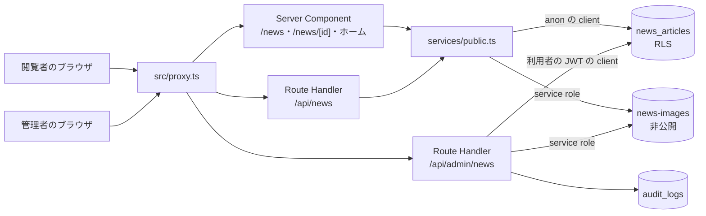
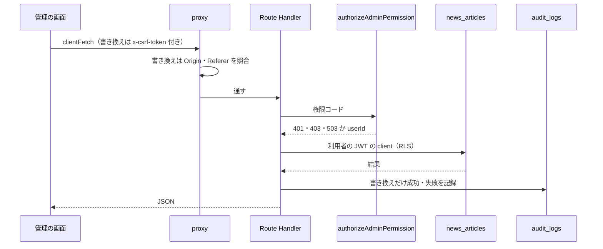
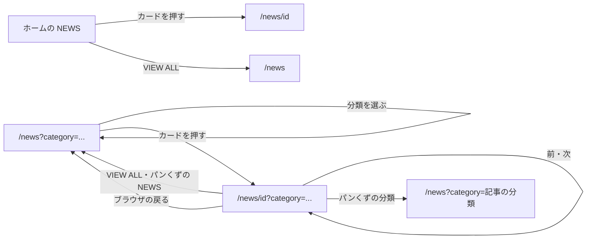
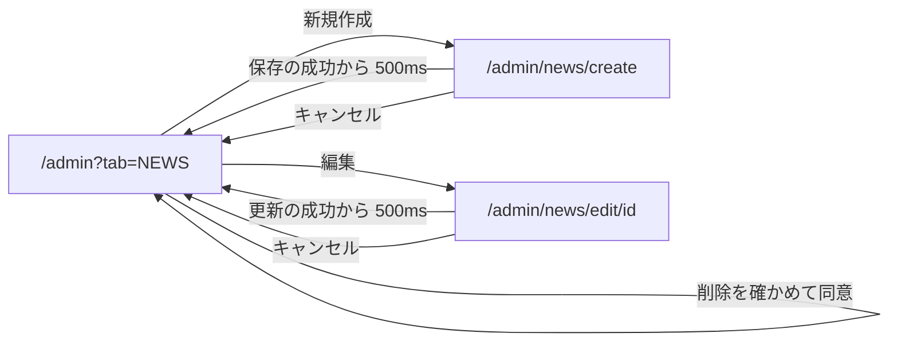
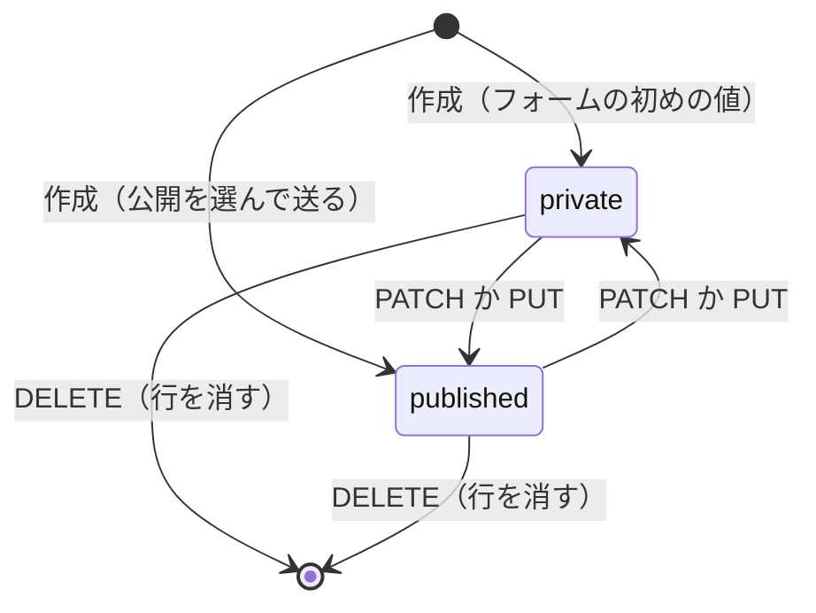
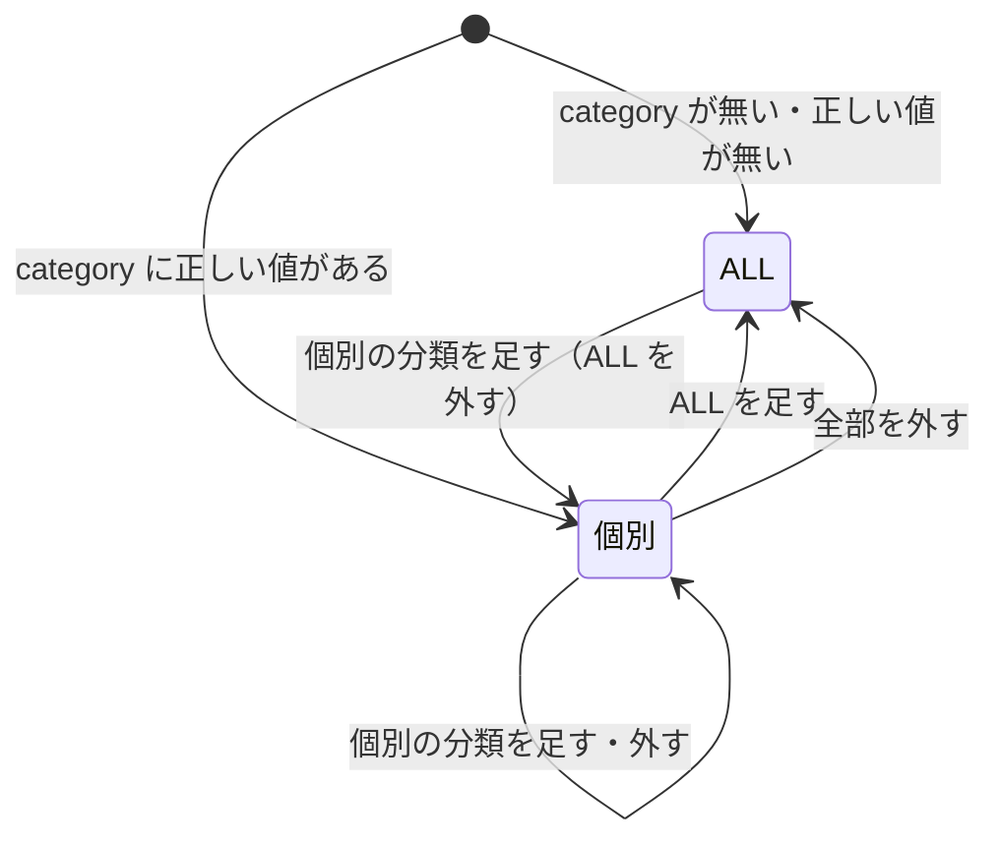

# NEWS の構造設計

> 状態: 推定 | 確認日: 2026-10-26 | 対象: NEWS（ニュース一覧 `/news`・詳細 `/news/[id]`・ホームの NEWS の区画・管理のニュース） | 基準コミット: `a03beaff`

## 概要

NEWS の領域の構成・画面・画面遷移・状態遷移・API・データを、追跡できる項目（`### <ID> <題>` と属性の表）で書く。
中身は 2026-10-24 の作業ツリーのコードを読んで起こした今の動きで、ユーザーの確認を受けていないので全部「推定」にした。要件と食い違う所は決めずに今のコードの動きを書き、食い違いは [trace-matrix.md](../../05_Quality/reports/trace-matrix.md) の「食い違い」節に載せる。

| 種類 | 数 | ID | 中身 |
| --- | --- | --- | --- |
| 構成 | 5 | `ARC-NEWS-001`〜`005` | 公開の読み出し、管理の書き換え、画像の置き場と署名、共有の proxy、未使用（削除の判断待ち）の単位 |
| 画面 | 6 | `SCR-NEWS-001`〜`006` | 一覧、詳細、管理の NEWS タブ、作成、編集、ホームの NEWS の区画 |
| 画面遷移 | 2 | `FLOW-NEWS-001`〜`002` | 一覧と詳細の行き来、管理の一覧と作成・編集の行き来 |
| 状態遷移 | 2 | `STATE-NEWS-001`〜`002` | 記事の公開の状態、一覧の分類の選択 |
| API | 8 | `API-NEWS-001`〜`008` | `GET /api/news`、管理の6つの窓口、未使用（削除の判断待ち）の Server Action |
| データ | 5 | `DATA-NEWS-001`〜`005` | 記事の表、RLS と付与、検索の関数、画像の置き場、権限 |

- 結論: 公開の側は Server Component から anon の client で直接 DB を読み、`/api/news` は今の画面から通らない。管理の側は利用者の端末で動く画面から Route Handler を通し、窓口で session・権限・2要素認証を確かめた上で、利用者の JWT の client で RLS に通す
- 状態の値は `private`・`published` の2つだが、DB の初めの値は `'draft'` で CHECK に合わない（STATE-NEWS-001）
- 今のコードが満たさないセキュリティ要件（例: SEC-NEWS-002・003・005・006・008・018・021）は、満たす形の構造を持たないので上位につながず、本文に「満たさない」と書いた
- 一部だけ満たすセキュリティ要件は、項目が受け持つコードの中に満たさない所がある時は上位にせず、満たさない所がほかのコードにだけある時は上位にした（例: SEC-NEWS-016 の「0件は 404」を満たさないのは `[id]/route.ts` なので、その窓口の項目の上位にはせず、作成の窓口 API-NEWS-003 の上位にはする）。この決まりは ADR と詳細設計の文書にも同じに当てた

## 範囲と根拠

| 項目 | 内容 |
| --- | --- |
| 範囲 | `scripts/trace/scope.json` の NEWS |
| 上位の文書 | [NEWS の要件](../../02_Requirements/areas/news.md)（要件・`SEC-NEWS-`・`DRV-NEWS-`）、`docs/03_BasicDesign/decisions/ADR-0001`〜`ADR-0023` |
| 対象のコード | `src/app/news/`、`src/app/api/news/route.ts`、`src/app/api/admin/news/`、`src/app/admin/news/`、`src/app/actions/news.ts`、`src/components/NewsSection.tsx`、`src/features/news/`、`src/lib/news-data.ts`、`src/lib/storage/news-images.ts`、`src/types/news.ts` |
| 対象の DB | `supabase/migrations/20260901102912_remote_schema.sql`（表・RLS・付与・検索の関数）、`supabase/migrations/20261023175712_group_g0_permissions.sql`（権限と `has_permission`）、`supabase/seed.sql`（手元の置き場） |
| 関連文書 | `docs/03_BasicDesign/ui/screen-list.md`、`docs/03_BasicDesign/api/api-spec.md` |
| 調べた時点 | 2026-10-24 の作業ツリー（コードは読んだだけで、動かしての確かめはしていない） |

範囲外の共有部品は ID を持たないので、項目の根拠と本文にファイルの道で書く。

| 共有部品 | 道 | NEWS での使われ方 |
| --- | --- | --- |
| 管理の認可 | `src/lib/auth/admin-rbac.ts` の `authorizeAdminPermission` | 管理の窓口ごとに token・session・DB の ACL・aal2 を確かめる |
| CSRF の Origin の検査と守りの見出し | `src/proxy.ts` | `/api` の書き換えの Origin・Referer の照合、全部の応答の見出し |
| 書き換えの送り方 | `src/lib/client-fetch.ts` の `clientFetch` | 管理の画面から窓口へ送る。書き換えには `x-csrf-token` を付ける |
| 回数の制限 | `src/features/auth/middleware/rateLimit.ts` の `enforceRateLimit` | `GET /api/news` だけが使う |
| 監査 | `src/lib/audit.ts` の `logAudit` | 管理の書き換えの成功と失敗を `audit_logs` に残す |
| Supabase の client | `src/lib/supabase/server.ts` の `createClient`・`createPublicClient`・`createServiceRoleClient` | 管理の DB 操作・公開の読み出し・画像の書き込みと署名 |

## 構成

矢印は呼び出しの向き。ラベルは使う Supabase の client。公開の道（上半分）は利用者の session を使わず、管理の道（下半分）は利用者の JWT を DB まで持ち込む。検索（`src/features/search/services/search.service.ts`、範囲外）も同じ置き場の画像に署名するが、図には入れていない。

### ARC-NEWS-001 公開の読み出しはページのサーバーの中で取り出しの関数を直接呼ぶ

| 属性 | 値 |
| --- | --- |
| 上位 | FR-NEWS-ALL-001、FR-NEWS-DETAIL-001、SEC-NEWS-001、ADR-0003、ADR-0004、ADR-0021 |
| 根拠 | 公開の読み出しの構造は、ページから直接読む（ADR-0021）・RLS と取り出しの条件の2段で守る（ADR-0003）・anon の client に限る（ADR-0004）の3つの判断が決めた。理由はその ADR に書き、ここでは繰り返さず、結果の構成だけを示す（SEC-NEWS-001） |
| 状態 | 推定 |
| 確かめ方 | 結合テスト |
| 出どころ | 実装から推定（`src/app/news/page.tsx`、`src/app/news/[id]/page.tsx`、`src/features/news/services/public.ts`） |

- 呼ぶ側: `/news`（`src/app/news/page.tsx`）、`/news/[id]`（`src/app/news/[id]/page.tsx`）、ホーム（`src/app/page.tsx`、範囲外）。どれも Server Component で、記事を client の部品 `PublicNewsGrid` に渡す
- 取り出しの関数（`src/features/news/services/public.ts`）: `getPublishedNews`（一覧）・`getPublishedNewsCount`（ホームの総数）・`getPublishedNewsDetailById`（1件）・`getPublishedNewsNavigation`（前後）。どれも `status='published'` を付ける。公開日の新しい順に並べるのは `getPublishedNews`と `getPublishedNewsNavigation` の2つで、`getPublishedNewsCount` と `getPublishedNewsDetailById` は並べない
- client: ADR-0004 のとおり、DB は `createPublicClient()` だけで読む。公開の取り出しは `image_url` を選ばず署名もしないので、service role を持たない（SEC-NEWS-005、ARC-NEWS-003）。2026-10-26 までは画像の署名のために service role の client も作っていた
- キャッシュ: `revalidate`・`use cache` などの指定は無く、`searchParams`・`params` を読むので要求ごとに描く（推定）
- 失敗: ページに try/catch は無い。取り出しの関数は Supabase の `error` を見ず、DB の失敗を空の一覧・記事なしとして返す（SEC-NEWS-020 は満たさない）。`getPublishedNewsCount` だけが失敗を記録して 0 を返す
- 件数: `/news` は `limit` を渡さず公開済みを全部取る。前後の記事のために公開済みを全部読む（SEC-NEWS-009 の画面の上限は満たさない）

### ARC-NEWS-002 管理の書き換えは画面から Route Handler を通し、利用者の session の client で DB を変える

| 属性 | 値 |
| --- | --- |
| 上位 | FR-ADMIN-003、FREQ-316-REQ-02（範囲外）、SEC-NEWS-014、SEC-NEWS-015、ADR-0005、ADR-0006、ADR-0010、ADR-0019 |
| 根拠 | 管理の画面は利用者の端末で動く client の部品なので、守りを画面に置けないため。窓口ごとに session・権限・aal2 を確かめ（SEC-NEWS-015、ADR-0006）、DB の操作も利用者の JWT で RLS に通せば、窓口の確かめが1か所崩れても DB が権限の無い変更を断る（ADR-0005）。書き換えは成功も失敗も監査に残し、後から追えるようにする（ADR-0010） |
| 状態 | 推定 |
| 確かめ方 | 結合テスト |
| 出どころ | 実装から推定（`src/app/api/admin/news/route.ts`、`src/app/api/admin/news/[id]/route.ts`）、`docs/03_BasicDesign/api/api-spec.md` |

- 画面: `NewsSection`（一覧）・`NewsForm`（作成・編集）。どちらも client の部品で、権限での出し分けはしない
- 窓口: `authorizeAdminPermission`（`src/lib/auth/admin-rbac.ts`）が token を確かめ（401）、session の生存と DB の ACL を並べて照会し（停止は 503、無効は 401）、権限が無ければ 403、`aal` が `aal2` でなければ 403 `MFA required` を返す
- DB: `createClient(request)`（`src/lib/supabase/server.ts`）で利用者の JWT を付け、RLS（DATA-NEWS-002）を効かせる。画像の書き込みだけは service role（ARC-NEWS-003）
- 監査: 窓口の中の `logNewsAudit` が `logAudit`（`src/lib/audit.ts`）を呼ぶ。resource は `news_article`、user agent だけを残し IP は残さない。監査の書き込みの失敗は警告だけで、操作は止めない。GET は監査しない。PUT・PATCH・DELETE は対象の行が0件でも成功と記録する（SEC-NEWS-016 の「0件は 404」を満たさないので上位にしない）
- CSRF: proxy の Origin の検査だけで守り、窓口は `requireCsrfOrDeny` を呼ばない（ADR-0019。決めた事か抜けかは未定）
- 画面のページ（`/admin/news/create`・`/admin/news/edit/[id]`）にサーバーの守りは無く、殻は誰でも開け、送った時に窓口が断る（推定）
- 回数の制限は無い（SEC-NEWS-021 は満たさない）

### ARC-NEWS-003 画像は非公開の置き場に service role で書き、読むたびに署名つき URL にして配る

| 属性 | 値 |
| --- | --- |
| 上位 | FREQ-185-REQ-01、FREQ-252-REQ-01、SEC-NEWS-004、DRV-NEWS-008、DRV-NEWS-010、ADR-0001、ADR-0002、ADR-0022 |
| 根拠 | 置き場を公開にすると非公開の記事の画像も URL を知る人に開かれ、記事の状態で決めた線引きが画像だけ崩れるため、置き場を非公開にし、読むたびに期限1時間の署名つき URL に置き換える（ADR-0001、SEC-NEWS-004）。検索の結果のサムネイルも同じ関数で署名し、出すために置き場を公開に戻さない（FREQ-185-REQ-01、ADR-0002） |
| 状態 | 推定 |
| 確かめ方 | 結合テスト |
| 出どころ | 実装から推定（`src/lib/storage/news-images.ts`、`src/app/api/admin/news/route.ts`、`src/app/api/admin/news/[id]/route.ts`） |

- 書く: 管理の POST・PUT が service role の client で置き場 `news-images` に上げ、表の `image_url` には署名前の道を入れる（DATA-NEWS-004）
- 配る: `signNewsImageFields` が行の `image_url` を `signNewsImageUrl` の結果に置き換える。保存の道・旧 public・sign・authenticated の URL から置き場の中の道を取り出し（`extractNewsImageObjectPath`）、期限 3600 秒で署名する
- 使う所: 管理の一覧と1件の GET、検索（`src/features/search/services/search.service.ts`、範囲外）。公開の取り出し（一覧・1件）は署名しない
- 公開の一覧・詳細・ホームは画像を出さない（FREQ-32）ので、`getPublishedNews`・`getPublishedNewsDetailById` は `image_url` を選ばず、署名も service role の client も使わない。型 `PublicNewsArticle` に `image_url` は無い（SEC-NEWS-005。2026-10-26 に満たした）
- 道にできない値と署名の失敗では元の値を返し、記録しない（SEC-NEWS-008 は満たさない。DRV-NEWS-008 が今の動き）。公開の道は署名しなくなったので、残る署名の経路（検索と管理）だけの話（波 1-C）
- 署名する前に道が `news/` の下か、URL のホストが自分のプロジェクトかを確かめない（SEC-NEWS-007 は満たさない。残る経路は検索と管理。波 1-C）
- 置き場を非公開にする設定は手元の見本にだけあり、移行に無い（SEC-NEWS-003 は満たさないので上位にしない。DATA-NEWS-004）

### ARC-NEWS-004 共有の proxy が Origin の検査と守りの見出しを全部の応答にかける

| 属性 | 値 |
| --- | --- |
| 上位 | FREQ-327-REQ-01（範囲外）、FREQ-327-REQ-03（範囲外）、SEC-NEWS-014、SEC-NEWS-024、ADR-0019 |
| 根拠 | 書き換えの Origin の検査と守りの見出しを窓口ごとに書くと、書き忘れや許可のオリジンが無い時の動きの食い違いが経路ごとに出るため、`src/proxy.ts` の1か所にまとめる（FREQ-327-REQ-03（範囲外）、ADR-0019）。NEWS の頁と窓口は自分では重ねない |
| 状態 | 推定 |
| 確かめ方 | 結合テスト |
| 出どころ | 実装から推定（`src/proxy.ts`） |

- `/api` の下の POST・PUT・PATCH・DELETE は、Origin（無ければ Referer）を許可のオリジンと照合し、合わない時とどちらも無い時に 403 `{error:'Forbidden origin'}` を返す
- 許可のオリジンが設定されていない時は、要求の見出しから比べる元を作る（推定。SEC-NEWS-014 の食い違いとして残る）
- 全部の応答に CSP（nonce 付き）・`X-Content-Type-Options: nosniff`・`X-Frame-Options: DENY`・`Strict-Transport-Security` を付ける
- `/admin` の画面のページは守らない（Origin の検査と見出しだけ）

### ARC-NEWS-005 未使用（削除の判断待ち）の単位は消さずに残し、呼ぶ所が無いことを記録する

| 属性 | 値 |
| --- | --- |
| 上位 | DRV-NEWS-015 |
| 根拠 | 未使用（削除の判断待ち）の3つの単位を消すかはユーザーが決める。決まるまで残すので、外から呼べる入口（`getLatestNews`）と、つなぐ時に要る守り（`ArticleBody` の URL の確かめ）を見落とさないよう、ここに記録する。製品の動きを決める構成ではなく、判断待ちの単位の置き場である（DRV-NEWS-015） |
| 状態 | 推定 |
| 確かめ方 | レビュー |
| 出どころ | 実装から推定（`src/app/news/NewsCategoryTabs.tsx`、`src/features/news/components/ArticleBody.tsx`、`src/app/actions/news.ts`） |

- `NewsCategoryTabs`（DD-NEWS-005）: 1つだけ選ぶ分類のタブ。今の一覧は ITEM・LOOK にそろえた複数選択（SCR-NEWS-001・STATE-NEWS-002）で、この部品を使わない
- `ArticleBody`（DD-NEWS-034）: 本文の軽い Markdown の部品。今の詳細の頁は本文を文字のまま出し（SCR-NEWS-002）、この部品を使わない。リンク・画像の URL の種類を確かめない（SEC-NEWS-013 の Markdown の部分は満たさない）
- `getLatestNews`（API-NEWS-008）: 最新の3件の Server Action。export された Server Action は外から呼べる（推定）
- どれも `src`・`tests`・`e2e` に import が無い。消すかは `docs/05_Quality/reports/unused-code.md` の判断の列でユーザーが決める

## 画面

### SCR-NEWS-001 ニュース一覧 `/news`

| 属性 | 値 |
| --- | --- |
| 上位 | FR-NEWS-ALL-001、FR-NEWS-ALL-002、FR-NEWS-ALL-003、FR-NEWS-ALL-004、FR-NEWS-ALL-005、FR-NEWS-ALL-006、FREQ-31-REQ-01、FREQ-32-REQ-01、FREQ-47-REQ-01、FREQ-48-REQ-01、FREQ-49-REQ-01、FREQ-119-REQ-01、FREQ-274-REQ-01、FREQ-274-REQ-02、DRV-NEWS-001、DRV-NEWS-002、DRV-NEWS-003、DRV-NEWS-004、DRV-NEWS-005、DRV-NEWS-006、ADR-0012、ADR-0013、ADR-0015、ADR-0017 |
| 根拠 | 公開済みの記事を新しい順に並べ、分類で絞って読めるようにするため（FR-NEWS-ALL-001・002）。絞り込みの部品・幅・余白を ITEM・LOOK の一覧にそろえ、一覧ごとに操作を覚え直させない（FREQ-47・48・49・119・274、ADR-0012）。見出しと画像を置かず、フィルターと文字の記事だけの静かな並びで見せる（FREQ-31・32、ADR-0015） |
| 状態 | 推定 |
| 確かめ方 | 結合テスト |
| 出どころ | 実装から推定（`src/app/news/page.tsx`、`src/features/news/components/PublicNewsGrid.tsx`）、`docs/03_BasicDesign/ui/screen-list.md` |

- 作り: Server Component の `src/app/news/page.tsx` が URL の `category` を読み、`PublicNewsGrid`（`variant="catalog"`）に記事を渡す
- 分類の読み取り: 値が1つで `categories`（`src/lib/news-data.ts`）にあれば DB で絞る。無い・複数・正しくない値は ALL で全部を取り、部品が画面で絞る（ADR-0013）
- 絞り込み: lg 以上は左のサイドバーの `MultiSelect`（ヘッダーの真下に sticky、DRV-NEWS-003）、それ未満は FILTER のボタンと左の引き出し（バーはヘッダーの真下に付いて動く、DRV-NEWS-002）。選び方の決まりは STATE-NEWS-002
- カード: 公開日（`YYYY.MM.DD`）・分類の `TagLabel`・題（h2）・概要（Markdown の印を外した文字、DRV-NEWS-004）。画像は出さない。触れると上下の線が伸びる（DRV-NEWS-005）。押すと詳細へ（FLOW-NEWS-001）
- ページの見出し `h1` は置かない。title と description は固定（`src/app/news/page.tsx`）
- 空と失敗: 公開の記事が無い時「現在、公開されている記事はありません」、絞った結果が0件の時「該当カテゴリの記事はありません」、部品が自分で取り出して失敗した時は赤い文「ニュースデータの取得に失敗しました」（DRV-NEWS-006、ADR-0017）。今の呼び元は記事を渡すので、部品が自分で取り出す枝は通らない（推定）
- BLOG は選択肢に出るが、DB の CHECK に無いので選ぶと必ず0件（推定）

### SCR-NEWS-002 ニュース詳細 `/news/[id]`

| 属性 | 値 |
| --- | --- |
| 上位 | FR-NEWS-DETAIL-001、FR-NEWS-DETAIL-002、FR-NEWS-DETAIL-003、FR-NEWS-DETAIL-004、FR-NEWS-DETAIL-005、FR-NEWS-DETAIL-006、FR-NEWS-DETAIL-007、FR-NEWS-DETAIL-008、SEC-NEWS-001、SEC-NEWS-013、ADR-0011、ADR-0013 |
| 根拠 | 記事を1件ずつ読み、前後の記事と一覧へ移れるようにするため（FR-NEWS-DETAIL-001〜003）。管理で書いた本文を HTML として出すと保存された XSS の入口になるので、文字のまま段落に分けて出す（SEC-NEWS-013、ADR-0011）。非公開の記事は無い記事と同じ 404 にし、有無も知らせない（SEC-NEWS-001） |
| 状態 | 推定 |
| 確かめ方 | 結合テスト |
| 出どころ | 実装から推定（`src/app/news/[id]/page.tsx`）、`docs/03_BasicDesign/ui/screen-list.md` |

- 作り: Server Component。`getPublishedNewsDetailById` で記事を、`getPublishedNewsNavigation` で前後を取る。メタの作成と本体で同じ記事を2回読む（推定）
- 404: 記事が無い・非公開・数でない id の時は `notFound()`（Next.js の既定の画面。`src/app` に `not-found.tsx` は無い）
- 分類: URL の `category` が1つの正しい値なら、記事の取り出しと前後をその分類で絞る。記事の分類と違う値を付けると 404 になる（推定。食い違いは trace-matrix.md の「食い違い」節）。複数の時は前後を ALL で出し、リンクには複数のまま引き継ぐ。正しくない値は ALL
- 中身: パンくず（NEWS → 記事の分類 → 題、`aria-current="page"`）、公開日、分類の `TagLabel`、題（h1）、本文（`\n\n` で段落の `p`、`whitespace-pre-line`）。画像は出さない
- 前後: 「前の記事: 題」「次の記事: 題」の `aria-label` 付きのリンクと VIEW ALL（一覧へ、分類を引き継ぐ）。スマホと sm 以上で2回描く
- メタ: title は「題 | NEWS | Le Fil des Heures」、description は本文の先頭120字。記事が無い時は固定の文

### SCR-NEWS-003 管理画面の NEWS タブの一覧

| 属性 | 値 |
| --- | --- |
| 上位 | FR-ADMIN-003、DRV-NEWS-013、DRV-NEWS-014、ADR-0006、ADR-0007 |
| 根拠 | 店長が記事の一覧から公開の切り替え・編集・削除へ1か所で届くようにするため（FR-ADMIN-003）。消した記事は戻せないので、押し間違いで消さないよう確かめを挟む（DRV-NEWS-013）。並びを公開側と同じ公開日の新しい順にそろえ、決まりを1つにする（DRV-NEWS-014） |
| 状態 | 推定 |
| 確かめ方 | 結合テスト |
| 出どころ | 実装から推定（`src/components/NewsSection.tsx`）、`docs/03_BasicDesign/ui/screen-list.md` |

- 置き場: `/admin?tab=NEWS` の中で `NewsSection` を描く（`src/app/admin/page.tsx`、範囲外）。タブと「新規作成」は店長の役の時だけ出す。窓口は権限で守るので、画面は役・窓口は権限と軸が違う（ADR-0007 で初期値ではサポーターに権限が無い）
- 取り出し: `GET /api/admin/news`（API-NEWS-002）
- 行: 画像（署名つき URL を `next/image` に渡す）、状態のバッジ（公開中・非公開）、分類の `TagLabel`（outline）、題、公開日、公開・非公開の切り替え、編集（`/admin/news/edit/<id>`）、削除のボタン
- 切り替え: 今の状態を反転して `PATCH`（API-NEWS-006）。失敗は `alert`、成功で読み直す
- 削除: 「この記事を削除してもよろしいですか？」に同意した時だけ `DELETE`（API-NEWS-007）。失敗は `alert`、成功で読み直す
- 取り出しの失敗も0件と同じ「ニュース記事がありません」になる（SEC-NEWS-020 は満たさない）
- 権限での出し分けはせず、`admin.news.read` だけの人にも切り替えと削除のボタンが出る（窓口が 403、推定）

### SCR-NEWS-004 記事の作成 `/admin/news/create`

| 属性 | 値 |
| --- | --- |
| 上位 | FR-ADMIN-003、FREQ-252-REQ-01、FREQ-252-REQ-02、FREQ-252-REQ-03、FREQ-515-REQ-01（範囲外）、DRV-NEWS-011、DRV-NEWS-012、ADR-0014、ADR-0018 |
| 根拠 | 記事には画像が要り、検索のサムネイルも画像がある前提なので、作る時は画像を必須にし、送る前に種類と大きさを確かめて無駄な送信を減らす（FREQ-252-REQ-02・03、ADR-0014）。書きかけをうっかり公開しないよう初めは非公開にする（DRV-NEWS-011）。分類の選択欄は選んだ値で受け、選んだ値と違う値が保存される不具合を防ぐ（FREQ-515-REQ-01（範囲外）、ADR-0018） |
| 状態 | 推定 |
| 確かめ方 | 結合テスト |
| 出どころ | 実装から推定（`src/app/admin/news/create/page.tsx`、`src/app/admin/news/NewsForm.tsx`）、`docs/03_BasicDesign/ui/screen-list.md` |

- 作り: client のページが `NewsForm` を `POST /api/admin/news`（API-NEWS-003）で包むだけ
- 欄: 題・分類（5つ）・公開日・概要・本文・状態（非公開・公開のラジオ）・画像
- 初めの値: 状態は非公開、分類は COLLECTION、公開日は端末の今日
- 画像: 押す・Enter と Space・ドラッグで選べ、選ぶと見本を出す。JPEG・PNG・WebP・GIF の外は「画像は JPEG / PNG / WebP / GIF を選択してください」、5MB 超は「画像サイズは5MB以下にしてください」。画像なしで送ると「画像を添付してください」で止める
- 送った後: 成功は「保存しました」の後 500ms で `/admin?tab=NEWS`（DRV-NEWS-012）。失敗はサーバーの `error` の文か「保存に失敗しました」、例外は「通信エラーが発生しました」
- 長さの上限（200・2000・10000 字）はフォームに無く、超えるとサーバーの 400 の英語の文が出る（推定）

### SCR-NEWS-005 記事の編集 `/admin/news/edit/[id]`

| 属性 | 値 |
| --- | --- |
| 上位 | FR-ADMIN-003、FREQ-252-REQ-01、FREQ-252-REQ-02、FREQ-252-REQ-03、FREQ-515-REQ-01（範囲外）、DRV-NEWS-012、ADR-0014、ADR-0018 |
| 根拠 | 公開した記事の誤りを直せるようにするため（FR-ADMIN-003）。直すたびに画像を付け直させないよう、付け直さなければ元の画像を使う（FREQ-252-REQ-02、ADR-0014）。作成と同じフォームを使い、欄の決まりを1つにする |
| 状態 | 推定 |
| 確かめ方 | 結合テスト |
| 出どころ | 実装から推定（`src/app/admin/news/edit/[id]/page.tsx`、`src/app/admin/news/NewsForm.tsx`）、`docs/03_BasicDesign/ui/screen-list.md` |

- 作り: client のページが URL の id で `GET /api/admin/news/<id>`（API-NEWS-004）を呼び、値を `NewsForm` に詰めて `PUT`（API-NEWS-005）で包む
- 表示: 読み込み中、エラー（id が無い時「記事IDの取得に失敗しました」、取り出しの失敗はサーバーの文か「記事の読み込みに失敗しました」）、フォーム
- 画像: 既にある画像（署名つき URL）を見本に出し、選び直せば見本を差し替える。画像なしでも送れる
- 分類は取り出した値を型の断言だけで入れ、確かめない
- 送った後: 成功は「更新しました」の後 500ms で `/admin?tab=NEWS`（DRV-NEWS-012）。失敗は「更新に失敗しました」か、サーバーの文

### SCR-NEWS-006 ホームの NEWS の区画

| 属性 | 値 |
| --- | --- |
| 上位 | FREQ-149-REQ-01、FREQ-149-REQ-02、FREQ-146-REQ-01、FREQ-275-REQ-01、FREQ-275-REQ-03、DRV-NEWS-005、ADR-0017 |
| 根拠 | 画面の幅で件数が変わるとモバイルで見えない記事が出るため、どの幅でも6件を出す（FREQ-149-REQ-01）。全部を出し切れる時に一覧への入口を出しても行き先に新しい記事が無いので、公開の総数が6件より多い時だけ VIEW ALL を出す（FREQ-149-REQ-02）。区画の見出しとボタンをほかの区画と同じ部品にそろえる（FREQ-146・275） |
| 状態 | 推定 |
| 確かめ方 | 結合テスト |
| 出どころ | 実装から推定（`src/features/news/components/PublicNewsGrid.tsx`、`src/app/page.tsx`） |

- 作り: ホーム（`src/app/page.tsx`、範囲外）が `getPublishedNews({limit:6})` と `getPublishedNewsCount()` を取り、`PublicNewsGrid`（`variant="home"`）に記事と総数を渡す
- 見出し: `SectionTitle`（下線付き）。記事の題は h3（DRV-NEWS-005）
- カード: 一覧と同じ中身。押すと `/news/<id>`（分類なし）
- VIEW ALL: 下の中央の `HomeSectionViewAll`（共通の Button、`aria-label="VIEW ALL NEWS"`）。総数が6件より多い時だけ出し、行き先は `/news`。総数の取り出しに失敗すると 0 になり VIEW ALL が消える
- 空と失敗: 0件は「現在、公開されている記事はありません」、部品が自分で取り出して失敗した時は赤い文（ADR-0017）
- FREQ-126（見出しの右に常に出す）とは合わない（食い違いは trace-matrix.md の「食い違い」節）

## 画面遷移

### FLOW-NEWS-001 一覧から詳細へ移り、分類の選択を保ったまま一覧へ戻る

| 属性 | 値 |
| --- | --- |
| 上位 | FR-NEWS-ALL-003、FR-NEWS-ALL-004、FR-NEWS-ALL-007、FR-NEWS-DETAIL-003、FR-NEWS-DETAIL-004、FR-NEWS-DETAIL-006、DRV-NEWS-001、ADR-0013 |
| 根拠 | 選んだ分類を URL の `category` に持てば、共有した URL で同じ絞り込みを開け、ブラウザの戻るでも詳細の VIEW ALL でも前の選択へ戻れるため（FR-NEWS-ALL-003・007、ADR-0013）。詳細でも同じ分類の中で前後を辿れるよう、分類を引き継ぐ（FR-NEWS-DETAIL-004） |
| 状態 | 推定 |
| 確かめ方 | 結合テスト |
| 出どころ | 実装から推定（`src/features/news/components/PublicNewsGrid.tsx`、`src/app/news/[id]/page.tsx`）、`docs/03_BasicDesign/ui/screen-list.md` |

- 分類を変えると `router.push(url, {scroll:false})` で同じルートを描き直し、サーバーも新しい `category` で読み直す（推定）。URL が変わると部品の選択も URL に合わせる
- カードのリンクは、ALL 以外を選んでいれば `/news/<id>?category=<カンマ区切り>`、ALL なら `/news/<id>`
- 詳細の VIEW ALL・パンくずの NEWS・前後のリンクは、受けた `category` から正しい値だけを残して引き継ぐ。パンくずの分類のリンクは記事そのものの分類へ移る
- 例外: 記事と違う1つの分類を付けて詳細を開くと 404（SCR-NEWS-002）。ホームからは分類を付けない

### FLOW-NEWS-002 管理の一覧から作成・編集へ移り、保存かキャンセルで一覧へ戻る

| 属性 | 値 |
| --- | --- |
| 上位 | FR-ADMIN-003、DRV-NEWS-012、DRV-NEWS-013 |
| 根拠 | 保存できたことを文で見せてから一覧へ戻し、次の記事の操作へ移りやすくするため（DRV-NEWS-012）。公開の切り替えと削除は一覧の上で終え、行き来を減らす（FR-ADMIN-003）。削除だけは戻せないので確かめを挟む（DRV-NEWS-013） |
| 状態 | 推定 |
| 確かめ方 | 結合テスト |
| 出どころ | 実装から推定（`src/app/admin/news/NewsForm.tsx`、`src/components/NewsSection.tsx`）、`docs/03_BasicDesign/ui/screen-list.md` |

- 保存・更新に失敗した時は同じ画面に文を出し、移らない
- 切り替えと削除は成功すると一覧を読み直し、失敗すると `alert` を出す
- 「新規作成」は店長の役の時だけ出る（`src/app/admin/page.tsx`、範囲外）

## 状態遷移

### STATE-NEWS-001 記事の公開の状態（非公開と公開済み）

| 属性 | 値 |
| --- | --- |
| 上位 | FR-ADMIN-003、SEC-NEWS-001、DRV-NEWS-011、DRV-NEWS-013、ADR-0020、ADR-0023 |
| 根拠 | 外へ出すかどうかを1つの列の2つの値で決めれば、公開の道（RLS と取り出しの条件）が `published` の1つだけを見ればよくなるため（ADR-0020、SEC-NEWS-001）。記事は非公開にすれば隠せるので、削除は要らなくなった記事の行を消す操作にする（ADR-0023） |
| 状態 | 推定 |
| 確かめ方 | 結合テスト |
| 出どころ | 実装から推定（`supabase/migrations/20260901102912_remote_schema.sql`、`src/app/api/admin/news/[id]/route.ts`、`src/app/admin/news/NewsForm.tsx`） |

- 値: `private`（非公開。要件の文の「下書き」に当たる）と `published`（公開済み）。DB の CHECK・管理の入力の形・型（`src/types/news.ts`）が同じ2つ
- DB の初めの値は `'draft'` で CHECK に合わない。`status` を省いた insert は CHECK の違反で落ちる（推定）。アプリは常に `status` を送るので表に出ない（食い違いは trace-matrix.md の「食い違い」節）
- 行き来に条件は無く、PUT（全体の更新）と PATCH（状態だけ）のどちらでも変えられる。前の状態は読まず、同じ状態への変更も成功として監査に残す
- 公開の日時の列は無く、`published_date` は管理者が入れる日付で状態と連動しない。予約公開は無く、未来の日付でも公開にした時点で見える
- 削除はどちらの状態からも行を消し、戻す手段は無い。置き場の画像は消さない
- 公開から非公開にしても、出した署名つき URL は期限（1時間）まで画像を開ける

### STATE-NEWS-002 一覧の分類の選択（ALL と個別の分類）

| 属性 | 値 |
| --- | --- |
| 上位 | FR-NEWS-ALL-002、DRV-NEWS-001、ADR-0012 |
| 根拠 | ITEM・LOOK の一覧と同じ複数選択の部品にそろえ（ADR-0012）、ALL と個別の分類が同時に選ばれた分かりにくい形を作らないため（DRV-NEWS-001） |
| 状態 | 推定 |
| 確かめ方 | 結合テスト |
| 出どころ | 実装から推定（`src/features/news/components/PublicNewsGrid.tsx`） |

- 「個別」は1つ以上の分類（ALL を含まない）が選ばれた状態
- URL の `category` はカンマで分け、大文字にし、`categories` にある物だけを残す。ALL を含めば ALL だけにする。重複は除く
- 選択が変わると URL に書き戻す（ALL なら `category` を消す）。ホームの区画は選択を持たない

## API

### API-NEWS-001 `GET /api/news` 公開済みの記事の一覧

| 属性 | 値 |
| --- | --- |
| 上位 | DRV-NEWS-007、SEC-NEWS-001、SEC-NEWS-009、ADR-0008、ADR-0009 |
| 根拠 | 一覧の部品が記事を渡されなかった時の取り出し先として作った窓口（DRV-NEWS-007）。認証の無い窓口なので、まとめて吸い出されて DB の負荷が増えないよう件数の上限と回数の制限を付け（SEC-NEWS-009、ADR-0008）、数え場所が落ちた時は通さない（ADR-0009）。失敗の応答は固定の文にして内部の情報を出さない（SEC-NEWS-019 の応答の部分。例外を丸ごと記録するので SEC-NEWS-019 は上位にしない） |
| 状態 | 推定 |
| 確かめ方 | 結合テスト |
| 出どころ | 実装から推定（`src/app/api/news/route.ts`）、`docs/03_BasicDesign/api/api-spec.md` |

| 項目 | 内容 |
| --- | --- |
| 認可 | なし（公開） |
| 入力 | クエリ `category`（確かめずに取り出しへ渡す）、`limit`（数字だけの文字なら整数。正なら20を上限に丸め、それ以外は12） |
| 回数の制限 | `enforceRateLimit({endpoint:'news:list', limit:60, windowSeconds:600})`。超えると 429、数え場所が使えないと 503 |
| 成功 | 200。公開済みの記事の配列 `id・title・published_date・category・content`、公開日の新しい順。`image_url`（署名つき URL）と本文 `detailed_content` は返さない |
| 失敗 | 例外は記録して 500 `{error:'Failed to fetch news'}`。DB の失敗は取り出しの関数が空にするので 200 `[]`（推定） |
| 使う所 | 今の画面からは通らない（推定）。検索の E2E の補助 `e2e/search-test-utils.ts` が呼ぶ |

- `image_url` は返さず、署名もしない（SEC-NEWS-005。2026-10-26 に満たした）。取り出しの関数が画像の列を選ばず、service role の client も作らないので、署名の失敗で 500 になる道も無い
- 満たさない要件: `Cache-Control` が無い（SEC-NEWS-006）、送り元を `x-forwarded-for` から取る（SEC-NEWS-011）、`category` を確かめない（SEC-NEWS-012）、例外を丸ごと `console.error` に渡す（SEC-NEWS-019、`src/app/api/news/route.ts`）
- `api-spec.md` は失敗を 429・500 とだけ書き、503 を書いていない

### API-NEWS-002 `GET /api/admin/news` 管理の記事の一覧

| 属性 | 値 |
| --- | --- |
| 上位 | FR-ADMIN-003、SEC-NEWS-015、DRV-NEWS-014、ADR-0005、ADR-0006 |
| 根拠 | 非公開の記事を含む一覧は管理の権限を持つ人だけに渡すため、`admin.news.read` と aal2 を求め、DB も利用者の JWT で RLS に通す（SEC-NEWS-015、ADR-0005・0006）。並びは公開側と同じ公開日の新しい順にそろえる（DRV-NEWS-014） |
| 状態 | 推定 |
| 確かめ方 | 結合テスト |
| 出どころ | 実装から推定（`src/app/api/admin/news/route.ts`）、`docs/03_BasicDesign/api/api-spec.md` |

| 項目 | 内容 |
| --- | --- |
| 認可 | `admin.news.read`。失敗は 401・403・503 |
| 入力 | なし |
| 成功 | 200 `{data}`。全部の列、非公開を含む、公開日の新しい順。`image_url` は署名つき URL。件数の上限とページ分けは無い |
| 失敗 | DB の失敗は 500 `Failed to fetch news articles`、例外は 500 |
| 監査 | しない |

### API-NEWS-003 `POST /api/admin/news` 記事の作成

| 属性 | 値 |
| --- | --- |
| 上位 | FR-ADMIN-003、FREQ-252-REQ-02、FREQ-252-REQ-03、SEC-NEWS-014、SEC-NEWS-015、SEC-NEWS-016、DRV-NEWS-009、DRV-NEWS-010、ADR-0010、ADR-0014、ADR-0019、ADR-0022 |
| 根拠 | 記事を作る窓口は表と置き場の両方を変えるので、`admin.news.manage` と aal2 を求め（SEC-NEWS-015）、成功も失敗も監査に残す（SEC-NEWS-016、ADR-0010）。表に長さの制約が無いので入口で上限を決め、画面の崩れと過大な保存を防ぐ（DRV-NEWS-009）。保存の名前は送られた名前を使わず日付と uuid で作り、上書きと推測を防ぐ（DRV-NEWS-010、ADR-0022） |
| 状態 | 推定 |
| 確かめ方 | 結合テスト |
| 出どころ | 実装から推定（`src/app/api/admin/news/route.ts`）、`docs/03_BasicDesign/api/api-spec.md` |

| 項目 | 内容 |
| --- | --- |
| 認可 | `admin.news.manage`。CSRF は proxy の Origin の検査（ARC-NEWS-004） |
| 入力 | multipart。`title`（1〜200 字）・`category`（COLLECTION・EVENT・COLLABORATION・SUSTAINABILITY・STORE）・`date`（`YYYY-MM-DD`、実在の日付は確かめない）・`content`（1〜2000 字）・`detailedContent`（1〜10000 字）・`status`（private・published）・`image`（必須、JPEG・PNG・WebP・GIF、5MB 以下） |
| 処理 | 置き場へ `news/<YYYY-MM-DD>/<uuid>.<MIME から決めた拡張子>`、`upsert:false`、`cacheControl:'3600'` で上げ、表へ署名前の道と一緒に入れる |
| 成功 | 201 `{success:true, id}`。監査 `admin.news.create` |
| 失敗 | 入力の誤り 400 `Invalid request`、画像なし 400 `Image file is required`、種類 400 `Unsupported image type`、大きさ 400 `Image size must be 5MB or less`、置き場の失敗 500（監査 `admin.news.create.upload_failed`）、表の失敗 500（監査 `admin.news.create.db_insert_failed`）、例外 500。multipart でない要求も 500（推定） |

- 画像の種類は送る側の申告 `File.type` だけで確かめる（SEC-NEWS-017 の中身の確かめは満たさないので上位にしない）
- 表の失敗の時に上げた画像を消さない（SEC-NEWS-018 は満たさない）

### API-NEWS-004 `GET /api/admin/news/[id]` 管理の記事の1件

| 属性 | 値 |
| --- | --- |
| 上位 | FR-ADMIN-003、SEC-NEWS-015、ADR-0005、ADR-0006 |
| 根拠 | 編集の画面に非公開の記事の中身を渡すので、一覧と同じく `admin.news.read` と aal2 を求め、DB も RLS に通す（SEC-NEWS-015、ADR-0005・0006） |
| 状態 | 推定 |
| 確かめ方 | 結合テスト |
| 出どころ | 実装から推定（`src/app/api/admin/news/[id]/route.ts`）、`docs/03_BasicDesign/api/api-spec.md` |

| 項目 | 内容 |
| --- | --- |
| 認可 | `admin.news.read` |
| 入力 | 道の `id`（形は確かめない） |
| 成功 | 200 `{data}`。全部の列、`image_url` は署名つき URL |
| 失敗 | 行が無い・DB の失敗・数でない id は、どれも 404 `Article not found`（推定）。例外は 500 |

- 「無い」と DB の失敗を同じ 404 にする（SEC-NEWS-020 は満たさない）

### API-NEWS-005 `PUT /api/admin/news/[id]` 記事の全体の更新

| 属性 | 値 |
| --- | --- |
| 上位 | FR-ADMIN-003、FREQ-252-REQ-02、FREQ-252-REQ-03、SEC-NEWS-014、SEC-NEWS-015、DRV-NEWS-009、ADR-0010、ADR-0014 |
| 根拠 | 記事の誤りを直す窓口で、作成と同じ入力の上限と権限の確かめを当て、決まりを1つにするため（DRV-NEWS-009、SEC-NEWS-015）。直すたびに画像を付け直させないよう画像は任意にする（FREQ-252-REQ-02、ADR-0014）。書き換えは監査に残す（ADR-0010） |
| 状態 | 推定 |
| 確かめ方 | 結合テスト |
| 出どころ | 実装から推定（`src/app/api/admin/news/[id]/route.ts`）、`docs/03_BasicDesign/api/api-spec.md` |

| 項目 | 内容 |
| --- | --- |
| 認可 | `admin.news.manage` |
| 入力 | 道の `id`。multipart は作成と同じ形で、`image` は任意（付ければ種類と 5MB を確かめる） |
| 処理 | 画像があれば置き場へ上げ、拡張子はファイル名の最後の `.` の後ろから取る（無ければ `jpg`）。表の行を更新する |
| 成功 | 200 `{success:true}`。監査 `admin.news.update` |
| 失敗 | 入力・画像の誤り 400、無い記事・形の悪い id 404（監査 `admin.news.update.not_found`）、置き場の失敗 500（監査 `admin.news.update.upload_failed`）、表の失敗 500（監査 `admin.news.update.failed`）、例外 500 |

- 更新は `.update(...).eq('id', id).select('id')` で変えた行を受け取り、0行（無い、または RLS が隠した）は 404 `{error:'Article not found'}` と失敗の監査にして、成功の監査は書かない（SEC-NEWS-016。2026-10-26 に満たした）。管理の窓口は利用者の session の client で書くので、RLS が隠した行も 404 になる
- 道の `id` は18桁以下の数字だけを DB に渡し、外れた id は DB にも置き場にも触らず 404 にする（監査には長さだけを残す）
- 画像は更新より先に上げるので、404 の時も上げた画像は置き場に残る（SEC-NEWS-018 は満たさない）
- 拡張子の取り方が作成（MIME から決める）と違う（SEC-NEWS-017 は満たさない）
- 差し替え前の画像を消さない（SEC-NEWS-018 は満たさない）

### API-NEWS-006 `PATCH /api/admin/news/[id]` 公開の状態だけの切り替え

| 属性 | 値 |
| --- | --- |
| 上位 | FR-ADMIN-003、SEC-NEWS-014、SEC-NEWS-015、ADR-0020 |
| 根拠 | 一覧のボタン1つで公開と非公開を切り替えられるよう、フォームを送らずに状態の列だけを変える窓口を分けるため（FR-ADMIN-003、ADR-0020）。外へ出す線引きを変える操作なので、`admin.news.manage` と aal2 を求め（SEC-NEWS-015）、監査に残す |
| 状態 | 推定 |
| 確かめ方 | 結合テスト |
| 出どころ | 実装から推定（`src/app/api/admin/news/[id]/route.ts`）、`docs/03_BasicDesign/api/api-spec.md` |

| 項目 | 内容 |
| --- | --- |
| 認可 | `admin.news.manage` |
| 入力 | 道の `id`、JSON `{status}`（`private` か `published`） |
| 成功 | 200 `{success:true}`。監査 `admin.news.status_update` |
| 失敗 | 値の誤り 400、無い記事・形の悪い id 404（監査 `admin.news.status_update.not_found`）、表の失敗 500（監査 `admin.news.status_update.failed`）、JSON の解析の失敗を含む例外 500 |

- 更新は `.update({status}).eq('id', id).select('id')` で変えた行を受け取り、0行は 404 `{error:'Article not found'}` と失敗の監査にして、成功の監査は書かない（SEC-NEWS-016。2026-10-26 に満たした）。道の `id` の確かめは API-NEWS-005 と同じ。前の状態を読まない

### API-NEWS-007 `DELETE /api/admin/news/[id]` 記事の削除

| 属性 | 値 |
| --- | --- |
| 上位 | FR-ADMIN-003、DRV-NEWS-013、SEC-NEWS-014、SEC-NEWS-015、ADR-0023 |
| 根拠 | 要らなくなった記事を表から除くため、行を消す（DRV-NEWS-013、ADR-0023）。戻せない操作なので `admin.news.manage` と aal2 を求め（SEC-NEWS-015）、成功も失敗も監査に残して誰が消したかを追えるようにする |
| 状態 | 推定 |
| 確かめ方 | 結合テスト |
| 出どころ | 実装から推定（`src/app/api/admin/news/[id]/route.ts`）、`docs/03_BasicDesign/api/api-spec.md` |

| 項目 | 内容 |
| --- | --- |
| 認可 | `admin.news.manage` |
| 入力 | 道の `id`、本文なし |
| 成功 | 200 `{success:true}`。監査 `admin.news.delete` |
| 失敗 | 無い記事・形の悪い id 404（監査 `admin.news.delete.not_found`）、表の失敗 500（監査 `admin.news.delete.failed`）、例外 500 |

- 削除は `.delete().eq('id', id).select('id')` で消した行を受け取り、0行は 404 `{error:'Article not found'}` と失敗の監査にして、成功の監査は書かない（SEC-NEWS-016。2026-10-26 に満たした）。道の `id` の確かめは API-NEWS-005 と同じ
- 置き場の画像は消さない（SEC-NEWS-018 は満たさない。`api-spec.md` は画像も消すと書く）

### API-NEWS-008 Server Action `getLatestNews` 最新の公開済みの記事3件（未使用（削除の判断待ち））

| 属性 | 値 |
| --- | --- |
| 上位 | DRV-NEWS-015、SEC-NEWS-001 |
| 根拠 | ホームに最新の公開済みの記事を3件出すために作られた取り出し（`src/app/actions/news.ts` のコメント）。今は未使用（削除の判断待ち）で、どこからも呼ばれず、一覧の頁も使わない。消すかが決まるまで残し（DRV-NEWS-015）、export された Server Action は外から呼べる POST の窓口になるため（推定）、窓口の一覧に載せて見落とさないようにする。返すのは公開済みだけ（SEC-NEWS-001） |
| 状態 | 推定 |
| 確かめ方 | 結合テスト |
| 出どころ | 実装から推定（`src/app/actions/news.ts`） |

- 中身: `getPublishedNews({limit:3})` を返すだけ。認可は無く、公開済みだけを返す（ARC-NEWS-001 と同じ守り）
- 呼ぶ所は無い（`src`・`tests`・`e2e` に import が無い）。ホームは `getPublishedNews({limit:6})` を直接呼ぶ
- SEC-NEWS-009 は満たさない（未使用の Server Action が残っている）

## データ

### DATA-NEWS-001 記事の表 `news_articles`

| 属性 | 値 |
| --- | --- |
| 上位 | FR-ADMIN-003、FR-NEWS-ALL-001、DRV-NEWS-009、ADR-0020 |
| 根拠 | 管理で書いた記事を公開と管理の両方から読むため、1つの表に持つ（FR-ADMIN-003）。公開日の新しい順に並べるので `published_date` に降順の索引を付ける（FR-NEWS-ALL-001）。公開するかは `status` の1列で決める（ADR-0020） |
| 状態 | 推定 |
| 確かめ方 | 結合テスト |
| 出どころ | 実装から推定（`supabase/migrations/20260901102912_remote_schema.sql`） |

| 列 | 型・制約 | 中身 |
| --- | --- | --- |
| `id` | bigint、identity、主キー | 記事の番号。公開側の型（`src/features/news/types.ts`）は string |
| `title` | text、NOT NULL | 題。長さの制約は無い |
| `category` | text、NOT NULL、CHECK（COLLECTION・EVENT・COLLABORATION・SUSTAINABILITY・STORE） | 分類。BLOG は無い |
| `published_date` | date、NOT NULL | 管理者が入れる公開日 |
| `image_url` | text、NOT NULL | 置き場の中の道（署名前） |
| `content` | text、NOT NULL | 概要 |
| `detailed_content` | text、NOT NULL | 本文 |
| `status` | text、NOT NULL、DEFAULT `'draft'`、CHECK（private・published） | 公開の状態（STATE-NEWS-001） |
| `created_at`・`updated_at` | timestamptz、NOT NULL、DEFAULT now() | 更新の前にトリガー `trg_news_articles_updated_at` が `updated_at` を今にする |

- 索引: `category`、`published_date` の降順、`status`
- 長さの上限（200・2000・10000 字）と `image_url` の形は窓口の入力の形だけにあり、表には無い。PostgREST で直接書くと窓口の確かめを飛ばせる（推定。SEC-NEWS-025 は満たさないので上位にしない）。公開日は列の型が date なので、形は表でも守られる
- 初めの値 `'draft'` が CHECK に合わない（STATE-NEWS-001、食い違いは trace-matrix.md の「食い違い」節）
- 後の移行でこの表を変える物は無い

### DATA-NEWS-002 `news_articles` の RLS の方針と表の付与

| 属性 | 値 |
| --- | --- |
| 上位 | SEC-NEWS-001、SEC-NEWS-015、FREQ-540-REQ-01（範囲外）、ADR-0003、ADR-0005、ADR-0006 |
| 根拠 | アプリの取り出しの条件が崩れても非公開の記事を外へ出さないよう、DB の段でも anon と一般の会員には公開済みだけを見せるため（SEC-NEWS-001、ADR-0003）。管理の読み書きは DB の ACL の権限で許し、窓口の確かめと同じ線引きを DB でも効かせる（FREQ-540-REQ-01（範囲外）、ADR-0005・0006） |
| 状態 | 推定 |
| 確かめ方 | 結合テスト |
| 出どころ | 実装から推定（`supabase/migrations/20260901102912_remote_schema.sql`、`supabase/migrations/20261023175712_group_g0_permissions.sql`） |

| 方針 | 役 | 操作 | 条件 |
| --- | --- | --- | --- |
| Anyone can view published news articles | anon | SELECT | `status='published'` |
| authenticated news read | authenticated | SELECT | `status='published'` か `has_permission('admin.news.read')` |
| admin news manage by permission insert | authenticated | INSERT | WITH CHECK `has_permission('admin.news.manage')` |
| admin news manage by permission update | authenticated | UPDATE | USING・WITH CHECK `has_permission('admin.news.manage')` |
| admin news manage by permission delete | authenticated | DELETE | `has_permission('admin.news.manage')` |
| Service role has full access to news articles | service_role | ALL | true |

- `has_permission` は SECURITY DEFINER・`search_path=''` で、`auth.uid()` が無ければ false、DB の ACL の表だけで決める（2026-10-23 の権限の作り直しで、役の近道を外した）。anon の EXECUTE は外してある（`supabase/migrations/20260921011535_harden_security_definer_search_path.sql`）
- DB は `aal` を見ない。権限を持つ人が aal1 の JWT で PostgREST を直接叩くと、非公開の読みと書き換えができる（推定。SEC-NEWS-002 は満たさない）
- DB は session が生きているかも見ない。ログアウト・失効の後も期限の残る access token で、同じ読み書きができる（推定。SEC-NEWS-002 は満たさない。窓口は `checkAuthSessionLiveness` で確かめる、`src/lib/auth/admin-rbac.ts`）
- 付与: anon・authenticated に DELETE・INSERT・MAINTAIN・REFERENCES・SELECT・TRIGGER・TRUNCATE・UPDATE を全部付け、守りは RLS の1段だけ（SEC-NEWS-022 は満たさない）
- PostgREST を直接通った変更は監査に残らない（推定）

### DATA-NEWS-003 検索の関数 `search_news`・`search_public_news`

| 属性 | 値 |
| --- | --- |
| 上位 | FR-SEARCH-001（範囲外）、SEC-NEWS-001 |
| 根拠 | 検索の領域が持つ（search_news を呼ぶのは検索の部品）。以下は廃止前の記録。サイト内の検索がニュースも横断して探せるよう、公開済みの記事を題と中身で探す関数を DB に置くため（FR-SEARCH-001）。呼び手の権限で動かし（SECURITY DEFINER にしない）、関数の中でも `status='published'` で絞って、RLS と合わせて非公開を出さない（SEC-NEWS-001） |
| 状態 | 廃止 |
| 確かめ方 | 結合テスト |
| 出どころ | 実装から推定（`supabase/migrations/20260901102912_remote_schema.sql`、`src/features/search/services/search.service.ts`） |

| 関数 | 中身 | 付与 | 使う所 |
| --- | --- | --- | --- |
| `search_news(search_query, limit_count default 8)` | invoker。`status='published'`。ILIKE の `%`・`_` を逃がす。`limit_count` を上限に丸めない | PUBLIC から外し、anon・authenticated に EXECUTE | 検索（`search.service.ts`、範囲外） |
| `search_public_news(p_query, p_limit default 6)` | invoker。`status='published'`。`p_limit` を 1〜20 に丸める。`%`・`_` を逃がさない | PUBLIC を含む全部に EXECUTE | 呼ぶ所は見当たらない |

- anon が `search_news` を直接呼ぶと件数の上限が無い。使われない `search_public_news` を PUBLIC に出している（SEC-NEWS-010 は満たさない）

### DATA-NEWS-004 画像の置き場 `news-images`

| 属性 | 値 |
| --- | --- |
| 上位 | DRV-NEWS-008、DRV-NEWS-010、ADR-0001、ADR-0022 |
| 根拠 | 非公開の記事の画像を公開の URL から開かせないよう、置き場を非公開にして service role と署名つき URL だけで扱うため（ADR-0001、DRV-NEWS-008）。保存の道を日付と uuid で作り、上書きと推測を防ぐ（DRV-NEWS-010、ADR-0022） |
| 状態 | 推定 |
| 確かめ方 | 結合テスト |
| 出どころ | 実装から推定（`supabase/seed.sql`、`src/lib/storage/news-images.ts`、`src/app/api/admin/news/route.ts`） |

| 項目 | 内容 |
| --- | --- |
| 定義 | 手元の見本 `supabase/seed.sql` が `public=false` で作るだけ。移行には無い。大きさ（`file_size_limit`）と種類（`allowed_mime_types`）の上限は付けない。全体の上限は `supabase/config.toml` の 50MiB |
| 方針 | `storage.objects` に news-images の方針は無い。手元では anon・authenticated は読み書きできず、service role だけ（推定） |
| 道 | 作る時 `news/<YYYY-MM-DD>/<uuid>.<MIME から決めた拡張子>`、直す時は拡張子をファイル名から取る。上書きしない、キャッシュ 3600 秒 |
| 署名 | service role で期限 3600 秒（ARC-NEWS-003）。署名するのは管理と検索で、公開の一覧・詳細は署名しない（SEC-NEWS-005） |
| 片付け | 作成の失敗・差し替え・削除の後も画像は残る |

- 本番の置き場の公開の設定と方針は移行で持っておらず、確かめていない（SEC-NEWS-003 の「移行で持つ」は満たさないので上位にしない）

### DATA-NEWS-005 お知らせの権限 `admin.news.read`・`admin.news.manage` と初めの割り当て

| 属性 | 値 |
| --- | --- |
| 上位 | FREQ-519-REQ-01（範囲外）、FREQ-540-REQ-01（範囲外）、SEC-NEWS-015、ADR-0006、ADR-0007 |
| 根拠 | 下書きを読むだけの人と記事を変える人を分けられるよう、閲覧と管理の2つの権限にするため（SEC-NEWS-015、ADR-0006）。役を店長とサポーターの2つのまま増やさず、店長が権限の画面で後から付けられるので、初めの割り当ては狭い側に置き、サポーターには付けない（FREQ-519-REQ-01（範囲外）、ADR-0007） |
| 状態 | 推定 |
| 確かめ方 | 結合テスト |
| 出どころ | 実装から推定（`supabase/migrations/20261023175712_group_g0_permissions.sql`、`src/lib/auth/admin-rbac.ts`） |

| 権限 | 名前 | 求める窓口・方針 | 初めの割り当て |
| --- | --- | --- | --- |
| `admin.news.read` | お知らせの閲覧 | 管理の GET（API-NEWS-002・004）、RLS の SELECT | 店長あり、サポーターなし |
| `admin.news.manage` | お知らせの管理 | 管理の POST・PUT・PATCH・DELETE（API-NEWS-003・005〜007）、RLS の INSERT・UPDATE・DELETE | 店長あり、サポーターなし |

- 割り当ては DB の ACL（`user_roles`・`roles`・`role_permissions`・`permissions`）に持ち、`has_permission` と `authorizeAdminPermission` が読む
- 店長は権限の画面でサポーターに付けられる。付けても管理の NEWS タブは役で出し分けるので出ない（推定、SCR-NEWS-003）

## 未確認事項

- 本番の置き場 `news-images` の公開の設定と `storage.objects` の方針（移行に無い）
- 本番の PostgREST の `max_rows` と、anon が `news_articles`・`search_news` を直接読んだ時の件数
- ページの描き方（要求ごとに描くか、キャッシュされるか）を本番のビルドで確かめていない
- 公開の一覧・詳細の取り出しで、記事が増えた時の重さ
- 管理の画面のページ（作成・編集）を開けるのは誰か。サーバーの守りが無い殻の扱いをどうするか
- 管理の CSRF を proxy の Origin の検査だけにするか（ADR-0019）
- ホームの VIEW ALL の出し方（FREQ-126 と FREQ-149）、分類が1つか複数か、BLOG を残すか（要件の文書の未確認事項と同じ）
- DATA-NEWS-003（`search_news`・`search_public_news`）は廃止にした。2つの関数は SQL で、呼ぶのは範囲外の `src/features/search/services/search.service.ts` なので、データの項目も詳細設計も SEARCH の領域が持つ。SEC-NEWS-010 の確かめは受け入れ条件（SEC-NEWS-010-AC-01・02）が受け持つ
- この文書の項目は全部「推定」。ユーザーの確認を受けたら「現行」にする
