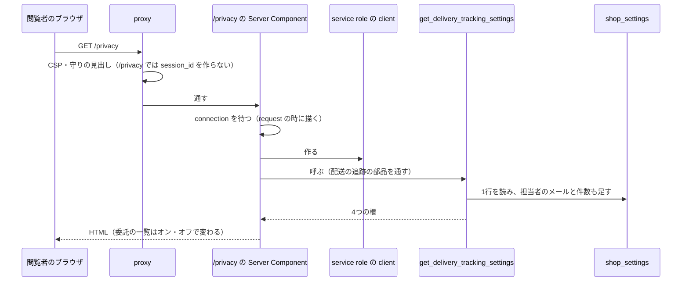
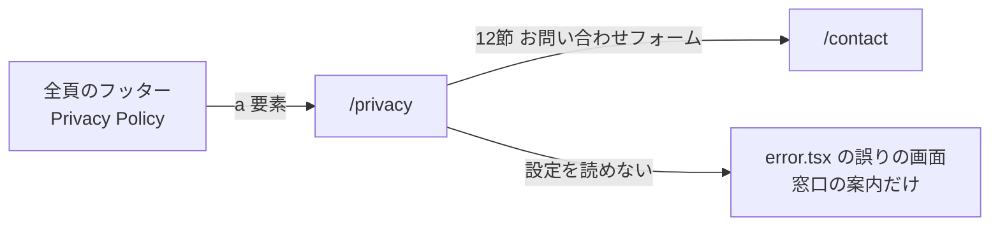
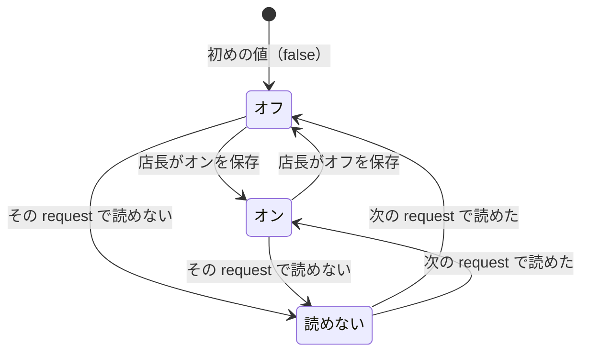

# PRIVACY の構造設計

> 状態: 推定 | 確認日: 2026-10-28 | 対象: PRIVACY（プライバシーポリシー `/privacy`） | 基準コミット: `4e84d5c5`

## 概要

PRIVACY の領域の構成・画面・画面遷移・状態遷移・データを、追跡できる項目（`### <ID> <題>` と属性の表）で書く。
中身は 2026-10-24 の作業ツリーのコードを読んで起こした今の動きで、ユーザーの確認を受けていないので全部「推定」にした。要件と食い違う所は決めずに今のコードの動きを書き、食い違いは `docs/05_Quality/reports/trace-matrix.md` の「食い違い」節に載せた。

| 種類 | 数 | ID | 中身 |
| --- | --- | --- | --- |
| 構成 | 2 | `ARC-PRIVACY-001`〜`002` | request のたびに設定を読む頁の描き方、共有の proxy と layout が頁にかける守り |
| 画面 | 1 | `SCR-PRIVACY-001` | プライバシーポリシー `/privacy` |
| 画面遷移 | 1 | `FLOW-PRIVACY-001` | フッターから開き、窓口の節からお問い合わせフォームへ移る |
| 状態遷移 | 1 | `STATE-PRIVACY-001` | 委託の一覧の出し分け（オフ・オン・読めない） |
| データ | 2 | `DATA-PRIVACY-001`〜`002` | 設定の関数の返り値と頁の使い方、設定の表と関数の権限 |

- API の項目は無い。`/privacy` は自分の窓口を持たず、頁のサーバーの中から DB の関数を直接呼ぶ（DATA-PRIVACY-001 に書いた）
- 結論: 頁は Server Component で、ビルドの時に固めず request のたびに描く。service role の client でショップの配送の追跡の設定を読み、オンの時だけ委託の一覧に 17TRACK の一文を足す。読めない時は頁の描画を失敗にする
- 今のコードが満たさないセキュリティ要件（SEC-PRIVACY-002・003・004・007・008・011・014・015・017・018・019）は、満たす形の構造を持たないので上位につながない。満たさない所は SEC の本文で1度だけ書き、ここでは SEC の番号で指す

## 範囲と根拠

| 項目 | 内容 |
| --- | --- |
| 範囲 | `scripts/trace/scope.json` の PRIVACY |
| 上位の文書 | [PRIVACY の要件](../../02_Requirements/areas/privacy.md)（要件・`SEC-PRIVACY-`・`DRV-PRIVACY-`）、[ADR-0350](../decisions/ADR-0350-privacy-request-time-render-fail-closed.md)・[ADR-0351](../decisions/ADR-0351-privacy-tracking-clause-by-shop-setting.md)・[ADR-0352](../decisions/ADR-0352-privacy-contact-email-text-and-form.md) |
| 対象のコード | `src/app/privacy/page.tsx`（範囲の src はこの1本だけ） |
| 対象の DB | `supabase/migrations/20261011222930_order_refund_records.sql`（`shop_settings` の表と権限）、`supabase/migrations/20261021220816_delivery_tracking_records.sql`（追跡の列）、`supabase/migrations/20261021221140_delivery_tracking_admin.sql`（設定の関数と権限） |
| 関連文書 | `docs/03_BasicDesign/ui/screen-list.md`、`docs/03_BasicDesign/ui/screen-flow.md`、`docs/04_DetailDesign/pages/17_privacy.md`（範囲外。文言を試験が固定している） |
| 調べた時点 | 2026-10-24 の作業ツリー（コードを読んで起こした。単体テストと DB を使わない結合テストは流して通した。E2E と DB の結合テストは流していない） |

範囲外の共有部品とほかの領域の部品は ID を持たないので、項目の根拠と本文にファイルの道で書く。

| 部品 | 道 | PRIVACY での使われ方 |
| --- | --- | --- |
| Supabase の client | `src/lib/supabase/server.ts` の `createServiceRoleClient` | 設定の関数を呼ぶ client を作る |
| 配送の追跡の読み書き（配送の追跡の部品） | `src/lib/orders/tracking/delivery-store.ts` の `getDeliveryTrackingSettings` | 設定の関数を呼び、返り値の型を確かめて4つの欄で返す。在庫の作業が同じファイルを変えている |
| 守りの見出しと Cookie | `src/proxy.ts`（matcher は全部の道） | CSP（nonce 付き）・`X-Frame-Options`・HSTS・`nosniff` を付ける。`session_id` の Cookie は `/cart`・`/checkout`・`/api/checkout` の応答だけで発行し、`/privacy` には付けない |
| 頁の殻 | `src/app/layout.tsx`、`src/contexts/Providers.tsx` | Header・Footer で包む。`/privacy` ではカートの取得を止める |
| ログインの状態 | `src/contexts/LoginContext.tsx` | 全頁で `/api/auth/me` を呼ぶ |
| フッターのリンク | `src/components/Footer.tsx` | `/privacy` への入口 |
| 追跡の切り替えの窓口（ADMIN） | `src/app/api/admin/settings/shop/route.ts` | 店長が設定を切り替える。頁の委託の一覧が変わる元 |

## 構成

矢印は呼び出しの向き。client を作れない時と関数が失敗した時は、S から先の応答が `error.tsx` の誤りの画面（窓口の案内だけ）になる（ARC-PRIVACY-001）。頁は窓口を持たず、利用者の端末で動く部品も持たない。

### ARC-PRIVACY-001 頁は request のたびに描き、service role で設定を読み、読めない時は頁を失敗にする

| 属性 | 値 |
| --- | --- |
| 上位 | FR-PRIVACY-001、DRV-PRIVACY-002、SEC-PRIVACY-005、SEC-PRIVACY-009、ADR-0350、ADR-0354、FREQ-495-REQ-01（範囲外） |
| 根拠 | 委託の一覧に 17TRACK の一文を出すかは店長が切り替える設定で決まる（FREQ-495-REQ-01（範囲外））ので、ビルドの時に固めた頁では切り替えが公表に届かない（DRV-PRIVACY-002、ADR-0350）。設定の関数は anon・一般会員から取り上げてあり（SEC-PRIVACY-001）、ログイン無しの閲覧者の session では読めないので service role の client を使う。読めない時に一文を黙って出し分けると誤った方針を公表するので、頁の失敗にする（SEC-PRIVACY-005） |
| 状態 | 推定 |
| 確かめ方 | 結合テスト |
| 出どころ | 実装から推定（`src/app/privacy/page.tsx`）、`docs/superpowers/plans/2026-10-21-delivery-status.md` |

- 作り: `src/app/privacy/page.tsx` の1本だけ。既定の書き出しの Server Component と、metadata を返す関数を持つ。利用者の端末で動く部品・Route Handler・Server Action は無い
- 描く時: 初めに Next.js の connection を待ち、ビルドの時に DB へ行かない。`revalidate` などの指定は無い
- 読み方: `createServiceRoleClient()`（`src/lib/supabase/server.ts`）で client を作り、`getDeliveryTrackingSettings`（`src/lib/orders/tracking/delivery-store.ts`）で設定を読む。頁が使うのは `enabled` だけ（DATA-PRIVACY-001）
- 失敗: try/catch は無い。client を作れない時も、関数が失敗した時も、返り値の形が合わない時も、例外がそのまま出て頁の描画が失敗する。例外の受け皿は `src/app/privacy/error.tsx`（DD-PRIVACY-002、ADR-0354）で、方針の本文・委託の一覧・誤りの文を出さず、窓口の案内と開き直すボタンだけを出す（SEC-PRIVACY-009）。`src/app` の直下には `error.tsx`・`global-error.tsx` は無い。誤りの画面が本番で中身を伏せるか（SEC-PRIVACY-008）は参照。`loading.tsx` と頁の中の `<Suspense>` は足さない（足すと流し始めた後の誤りになり、HTTP 状態が 200 になりうる）
- 重さ・受け取る欄・回数の制限・応答の `Cache-Control` は、SEC-PRIVACY-002・003・004・007 を参照
- 依存: 配送の追跡の部品（`delivery-store.ts`）の返り値の形が変わると、頁と単体テスト `tests/unit/components/PrivacyPage.test.tsx` の差し替えも直す必要が出る。在庫の作業の計画は頁を「維持」としている（`docs/superpowers/plans/2026-10-24-group-g1-allocation.md`）
- 試験: 結合テスト `tests/integration/ui/privacy-request-time-render.test.tsx` が、connection を待つ間は DB に触れないこと・request のたびに読み直すこと・service role の鍵で作った client の rpc で読むこと・読めない時（鍵や URL が無い、rpc の誤り、返り値の形が合わない、connection の失敗）に頁の描画が失敗することを確かめる。単体テスト `tests/unit/components/PrivacyPage.test.tsx` も、connection の後に読むことと読めない時に失敗にすることを確かめる

### ARC-PRIVACY-002 共有の proxy と layout が、頁に守りの見出しと殻をかける

| 属性 | 値 |
| --- | --- |
| 上位 | SEC-PRIVACY-013、SEC-PRIVACY-015、ADR-0355、NFR-SEC-001（範囲外）、NFR-SEC-003（範囲外） |
| 根拠 | 枠への埋め込みの禁止・CSP・HSTS を頁ごとに書くと書き忘れが出るので、全部の道にかかる `src/proxy.ts` の1か所にまとめている（SEC-PRIVACY-013、NFR-SEC-001（範囲外）の HSTS、NFR-SEC-003（範囲外）の CSP）。`/privacy` は自分では見出しを足さない |
| 状態 | 推定 |
| 確かめ方 | 結合テスト |
| 出どころ | 実装から推定（`src/proxy.ts`、`src/app/layout.tsx`、`src/contexts/Providers.tsx`）、`docs/05_Quality/reviews/security/security_review_privacy.md` |

- 見出し: proxy の matcher は全部の道（`/:path*`）。応答に CSP（`frame-ancestors 'none'`、`script-src` は `'self'` と nonce）・`X-Frame-Options: DENY`・`Strict-Transport-Security`・`X-Content-Type-Options: nosniff`・`Referrer-Policy: no-referrer`・`Permissions-Policy` を付ける（SEC-PRIVACY-013 は満たす）
- CSP の外のドメイン: `script-src` は全頁で同じに `challenges.cloudflare.com`・`js.stripe.com`・`*.js.stripe.com` を許し、使っていない `cdn.jsdelivr.net` は許さない（2026-10-28）。`challenges.cloudflare.com` はヘッダーのログインの窓（Turnstile）が使う。Stripe を全頁に残すのは、CSP が `next/link` の遷移で変わらないため（ユーザーの決定 Q29、`ADR-0108`、SEC-PRIVACY-014。上位につないでいない）
- Cookie: `session_id` の発行は許可リストの道（`/cart`・`/checkout`・`/api/checkout`）だけで、既定は配らない（`src/lib/session-cookie-policy.ts` の `shouldIssueSessionCookie`、2026-10-28）。`/privacy` には付かない。ヘッダーの `/cart` の `Link` は `prefetch={false}`（先読みの要求も proxy を通り `/cart` で発行されてしまうため）。`session_id` の読み手は決済の流れだけ（`checkout-route-guard`・`create-session`・`complete`・`src/lib/supabase/server.ts` の `x-session-id`）。ログインの成功で回す発行（`register.ts`）は別の仕組みで残る。SEC-PRIVACY-015、`ADR-0355`、`DD-PRIVACY-004` を参照
- 殻: root の layout が `Providers` で包み、Header と Footer を出す。`/privacy` の時だけ `CartProvider` を止める（`Providers.tsx`）。どの要件にも無い共有部品の判断で、上位につないでいない
- ログインの状態: `LoginContext.tsx` が全頁で `/api/auth/me` を呼ぶ。応答はメールを載せない（`id`・役割・`mfaVerified` だけ。SEC-PRIVACY-016、API-AUTH-013）
- 試験: 結合テスト `tests/integration/api/privacy-proxy-headers.test.ts` が、`/privacy` を通した proxy の応答に枠の禁止・HSTS・`nosniff`・CSP（nonce）が付くこと、`/privacy` で `session_id` を発行せず許可リストの道（`/cart`）では発行すること、proxy が `/privacy` にキャッシュの指定を足さないこと、proxy の対象が全部の道で `/privacy` も外れないことを確かめる。本番ビルドの応答で見出しを試す E2E は無い

## 画面

### SCR-PRIVACY-001 プライバシーポリシー `/privacy`

| 属性 | 値 |
| --- | --- |
| 上位 | FR-PRIVACY-001、FR-PRIVACY-002、FREQ-100-REQ-01、FREQ-101-REQ-01、DRV-PRIVACY-001、DRV-PRIVACY-003、DRV-PRIVACY-004、SEC-PRIVACY-012、ADR-0351、ADR-0352、ADR-0353 |
| 根拠 | 個人情報の扱いを本人が1つの頁で読めるよう、前置きと 1〜12 の節を番号付きの h2 で並べる（FR-PRIVACY-001、FREQ-100-REQ-01）。法務の長文を読み通せるよう、本文の行間を広げ見出しを本文より大きくする（FREQ-101-REQ-01）。検索の結果・タブ・共有で頁が分かるよう title・description・OGP を出す（FR-PRIVACY-002、DRV-PRIVACY-001）。いつの版かを末尾の日付で示し（DRV-PRIVACY-003）、窓口はメールの字とフォームへの入口の両方を置く（ADR-0352、DRV-PRIVACY-004） |
| 状態 | 推定 |
| 確かめ方 | 結合テスト |
| 出どころ | 実装から推定（`src/app/privacy/page.tsx`）、`docs/03_BasicDesign/ui/screen-list.md` |

- 作り: `max-w-3xl` の1列。h1「Privacy Policy / 個人情報の取り扱いについて」の下に、`space-y-8` で h2 を持つ13の `section` と、末尾の日付の `section` を並べる。目次と節の `id` は無い
- 節: 前置き「個人情報の取り扱いについて」、1. 定義、2. 収集方法、3. 利用目的、4. 第三者提供、5. 委託、6. 保有期間、7. 国外移転、8. 安全管理、9. Cookie 及び外部サービスの利用、10. 開示・訂正・利用停止等の請求、11. 本ポリシーの変更、12. お問い合わせ窓口。どれも h2。文は頁のコードに字で持つ
- 委託の一覧（5節）: 配送事業者・Stripe・サーバーの運用保守の3項目。追跡がオンの時だけ、2番目に 17TRACK の一文（渡すのは配送事業者名と伝票番号だけと書く）を足す。出し分けは STATE-PRIVACY-001、条件は ADR-0351
- 字の大きさ: 頁の見出しは `--lk-size-5xl`、節の見出しは `--lk-size-md`（`font-brand`）、本文と一覧は `--lk-size-xs`・行間 1.9、日付は `--lk-size-2xs`。FREQ-101-REQ-01 の文の `--lk-size-xl`・`space-y-12` とは違う（`docs/05_Quality/reports/trace-matrix.md` の「食い違い」節を参照）
- 窓口（12節）: 「事業者名：Le Fil des Heures」「お問い合わせ先：privacy@lefildesheures.com」を一覧の字で出す。メールは `mailto:` のリンクにしない。その下に `/contact` への内部のリンク「お問い合わせフォーム」（FLOW-PRIVACY-001）。メール箱が在るか・受け手と応える期間は SEC-PRIVACY-017・018 を参照
- 10節は「ご本人であることを確認」した上で応えると書く。確かめの手順は SEC-PRIVACY-019 を参照
- 末尾: 「制定日：2026年6月20日」は固定の字。「最終改定日」は基準日（2026年10月26日）と追跡の設定の更新時刻（日本時間の日付）の遅いほうを `resolveRevisionDate` で決めて出す（SEC-PRIVACY-012、ADR-0353、DD-PRIVACY-003）
- 9節の外部サービスは Stripe（1段落）と、Resend, Inc.・Supabase, Inc.・Cloudflare, Inc.（Cloudflare Turnstile）を挙げる段落（2026-10-26 追加。5節の委託の一覧は変えない）。2節に「メールマガジン」は書かない。2節・3節の「キャンペーン」の文は機能が無いまま残す（ユーザーの決定 2026-10-26。SEC-PRIVACY-011）
- メタ: title「Privacy Policy | Le Fil des Heures」、description は固定の文、og:title・og:description は同じ字、og:image は `/mainphoto.png`
- 試験: E2E `e2e/FR-PRIVACY-001`〜`004`（見出し・メタ・足した節・字の大きさ）、単体テスト `tests/unit/components/PrivacyPage.test.tsx`（委託の一覧と、ほかの節の文言）、結合テスト `tests/integration/ui/privacy-policy-screen.test.tsx`（h1・13の h2・section の作り・字の大きさ・日付・窓口・metadata）

## 画面遷移

### FLOW-PRIVACY-001 フッターから開き、窓口の節からお問い合わせフォームへ移る

| 属性 | 値 |
| --- | --- |
| 上位 | DRV-PRIVACY-004、FREQ-100-REQ-01、ADR-0352 |
| 根拠 | 方針を読んだ人が、開示などの請求や問い合わせへそのまま進めるよう、窓口の節に `/contact` への入口を置く（DRV-PRIVACY-004、ADR-0352）。メールの窓口（FREQ-100-REQ-01）を使わない人にも、フォームの道を残す |
| 状態 | 推定 |
| 確かめ方 | 結合テスト |
| 出どころ | 実装から推定（`src/components/Footer.tsx`、`src/app/privacy/page.tsx`）、`docs/03_BasicDesign/ui/screen-flow.md` |

- 入口: 全頁のフッターの「Privacy Policy」（`src/components/Footer.tsx`、範囲外の共有部品）。`next/link` でなく `a` 要素なので、頁をまるごと読み直す（推定）。頁の中にほかの入口の記述は無い
- 出口: 12節の「お問い合わせフォーム」は `next/link` で `/contact`（範囲外の CONTACT）へ移る。外のサイトへのリンクとメールの宛先へのリンクは無い
- 失敗: 設定を読めない時は頁の代わりに誤りの画面になる。窓口のメールとお問い合わせフォームへのリンクは、この画面にも出す（ARC-PRIVACY-001、SEC-PRIVACY-009、ADR-0354）
- 戻る道はブラウザの戻ると、Header・Footer のリンクだけ
- 試験: 結合テスト `tests/integration/ui/privacy-contact-flow.test.tsx` が、フッターのリンクが `a` 要素の素の `href`、12節のリンクが `next/link` で `/contact`、頁のリンクは `/contact` の1つだけ、設定を読めない時に窓口の節へ届かないことを確かめる

## 状態遷移

### STATE-PRIVACY-001 委託の一覧の出し分け（オフ・オン・読めない）

| 属性 | 値 |
| --- | --- |
| 上位 | SEC-PRIVACY-006、SEC-PRIVACY-005、DRV-PRIVACY-002、ADR-0350、ADR-0351、FREQ-490-REQ-01（範囲外）、FREQ-495-REQ-01（範囲外） |
| 根拠 | 17TRACK に渡すのは追跡がオンの間だけなので（FREQ-490-REQ-01（範囲外））、渡していない時に渡すと書かず、渡している時に書き漏らさないよう、一文の有無をショップの設定の1つに結ぶ（SEC-PRIVACY-006、ADR-0351）。設定を読めない時は、どちらの一覧も出さずに頁を失敗にする（SEC-PRIVACY-005、ADR-0350） |
| 状態 | 推定 |
| 確かめ方 | 結合テスト |
| 出どころ | 実装から推定（`src/app/privacy/page.tsx`）、`docs/superpowers/specs/2026-10-21-delivery-status-design.md`（決定 24・25） |

| 状態 | 決め手 | 画面 |
| --- | --- | --- |
| オフ | `shop_settings.delivery_tracking_enabled` が false（初めの値） | 委託の一覧は3項目。「17TRACK」の字は無い |
| オン | 同じ列が true | 委託の一覧は4項目で、2番目に 17TRACK の一文 |
| 読めない | その request で client を作れないか、関数が失敗したか、返り値の形が合わない | 頁を描かず、`error.tsx` の誤りの画面（案内と窓口だけ） |

- オン・オフを変えるのは、範囲外の管理の窓口（`src/app/api/admin/settings/shop/route.ts`）だけ。DB の関数 `admin_set_delivery_tracking` は service role だけが呼べる（DATA-PRIVACY-002）。鍵が無い時は窓口がオンを断るが、オンのまま鍵を外した状態はありうる。頁は鍵の有無を見ない
- 頁は状態を持たない。request のたびに読み直すので、保存の後に開いた時から一覧が変わる（共有のキャッシュが無いことは確かめていない。SEC-PRIVACY-007）
- 「読めない」は保存された状態ではなく、その request だけの結果
- 「最終改定日」は状態では変わらず、設定の更新時刻（追跡を切り替えた日）で決まる。切り替えていない間（`updatedAt` が null）は、オンでもオフでも基準日の2026年10月26日（SEC-PRIVACY-012）
- 試験: 結合テスト `tests/integration/ui/privacy-tracking-clause-state.test.tsx`（オフ3項目・オン4項目・enabled だけで決まること・切り替えが次の request から届くこと・最終改定日が基準日と切り替えた日の遅いほうになること・読めない状態が保存されないこと）、単体テスト `tests/unit/components/PrivacyPage.test.tsx`。オン・オフを実際の DB で切り替えて見る E2E は、範囲外の `e2e/FR-ACCOUNT-043-delivery-visibility.spec.ts` だけ（FREQ-495-AC-05（範囲外））

## データ

### DATA-PRIVACY-001 設定の関数 `get_delivery_tracking_settings` の返り値と、頁が使う欄

| 属性 | 値 |
| --- | --- |
| 上位 | DRV-PRIVACY-002、ADR-0351、FREQ-495-REQ-01（範囲外） |
| 根拠 | 頁が委託の一覧を決めるには、追跡がオンかの1つが要る（DRV-PRIVACY-002）。管理の画面と同じ関数を読むので、店長が保存した値と頁の表示が食い違わない。頁へ渡す形から鍵の欄を外し、鍵の有無で一文を出せないようにしている（ADR-0351） |
| 状態 | 推定 |
| 確かめ方 | 結合テスト |
| 出どころ | 実装から推定（`supabase/migrations/20261021221140_delivery_tracking_admin.sql`、`src/lib/orders/tracking/delivery-store.ts`、`supabase/migrations/20261021220816_delivery_tracking_records.sql`） |

| 返り値の列 | 元 | 頁へ渡る欄 | 頁で使うか |
| --- | --- | --- | --- |
| `enabled` | `shop_settings.delivery_tracking_enabled`（boolean、NOT NULL、初めは false） | `enabled` | 使う（STATE-PRIVACY-001） |
| `updated_at` | `shop_settings.delivery_tracking_updated_at` | `updatedAt` | 使う（最終改定日。SEC-PRIVACY-012、DD-PRIVACY-003） |
| `updated_by_email` | `auth.users.email`（`delivery_tracking_updated_by` で外部結合） | `updatedByEmail` | 使わない |
| `backfill_count` | `private.delivery_tracking_backfill_targets()` の件数 | `backfillCount` | 使わない |

- 関数: SQL・STABLE・SECURITY DEFINER・`search_path=''`。`shop_settings` の `id=1` の1行を読む
- 読み取りの部品（配送の追跡の部品）: 1行でなければ、また各欄の型が合わなければ例外にする。返す形から `keyConfigured` を外す
- 頁は4つの欄を受け取り、`enabled` だけを使う。担当者のメールと件数を受け取ること（SEC-PRIVACY-002）と、1回ごとに件数を数えること（SEC-PRIVACY-003）は、その SEC の項目を参照。運用の文書は、追跡をオンにする前に「オンか」だけを読む軽い関数に替えるとしている（`docs/06_Operations/webhook-queue-operations.md`）
- 関数と表は配送の追跡の追加の作業で作った物（PRIVACY の持ち物ではない）。PRIVACY の頁が読む形だけをここに書いた

### DATA-PRIVACY-002 設定の表と関数を、service role だけに許す

| 属性 | 値 |
| --- | --- |
| 上位 | SEC-PRIVACY-001、SEC-PRIVACY-010、NFR-SEC-005（範囲外） |
| 根拠 | 担当者のメールと件数を返す関数を、アプリを通さずに PostgREST から読ませないため（SEC-PRIVACY-001）。公表の委託の一覧は追跡の設定で変わるので、設定を変えられる道を、守りを通る管理の窓口の後ろの service role に限る（SEC-PRIVACY-010、NFR-SEC-005（範囲外）の権限管理） |
| 状態 | 推定 |
| 確かめ方 | 結合テスト |
| 出どころ | 実装から推定（`supabase/migrations/20261011222930_order_refund_records.sql`、`supabase/migrations/20261021221140_delivery_tracking_admin.sql`） |

| 対象 | anon・authenticated | service_role |
| --- | --- | --- |
| 表 `shop_settings` | 付与を全部外す。RLS の RESTRICTIVE の方針「deny direct client access」で USING・WITH CHECK とも false | SELECT だけ |
| 関数 `get_delivery_tracking_settings()` | PUBLIC・anon・authenticated から EXECUTE を外す | EXECUTE |
| 関数 `admin_set_delivery_tracking(boolean, uuid)` | 同上 | EXECUTE |

- 表は `id=1` の1行だけ（CHECK）。書き換えは SECURITY DEFINER の関数の中だけで行い、service role にも表の UPDATE は付けていない
- 公開の頁が service role を使うのは、この付与のため（ARC-PRIVACY-001）。service role は RLS を素通りするので、頁が受け取る欄の絞り込みは頁の側の決まりになる（SEC-PRIVACY-002）
- 試験: 返り値の形と列の元は結合テスト `tests/integration/db/privacy_settings_function.integration.test.ts`（DATA-PRIVACY-001）、権限は `tests/integration/db/privacy_settings_permissions.integration.test.ts`（DATA-PRIVACY-002）が確かめる。どちらも手元の Supabase の DB を使う試験で、書いただけで流していない。範囲外の `tests/integration/db/delivery_tracking_admin.integration.test.ts` も権限を確かめる。PostgREST の経路の E2E は無い

## 未確認事項

- 本番の誤りの画面の中身（中の事情を伏せるか）と、`/privacy` の応答の `Cache-Control` の実際の値
- 誤りの画面を足した後も HTTP 状態が 500 のままか（未実測。E2E `FR-PRIVACY-009` が確かめる）
- 本番の中継（CDN）が `/privacy` の応答を保つか
- 窓口のメール箱 `privacy@lefildesheures.com` が本番に在るか
- 在庫の作業が `delivery-store.ts` と `get_delivery_tracking_settings` の形を変えるか（今の計画は頁を「維持」とする）
- `shop_settings` と設定の関数の構造を、ADMIN の構造設計とどちらが持つか（今は PRIVACY の頁が読む形だけを DATA-PRIVACY-001・002 に書いた）
- `/privacy` でカートを止める共有部品の判断（`src/contexts/Providers.tsx`）を要件にするか
- この文書の項目は全部「推定」。ユーザーの確認を受けたら「現行」にする
