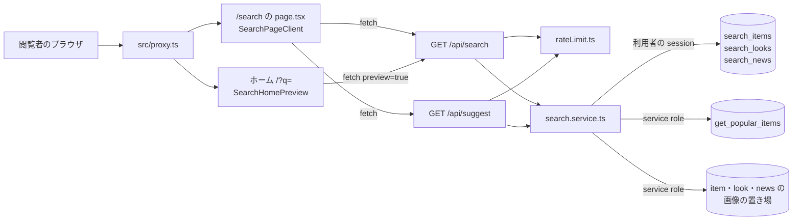
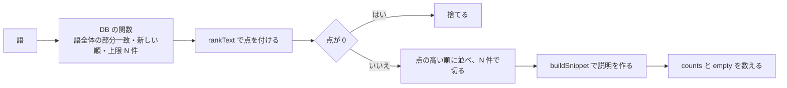
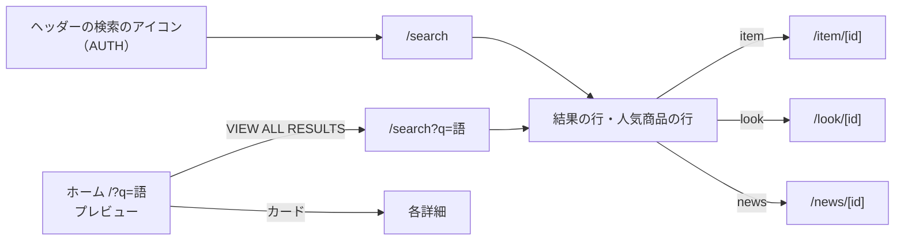
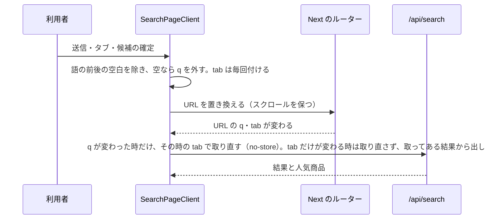
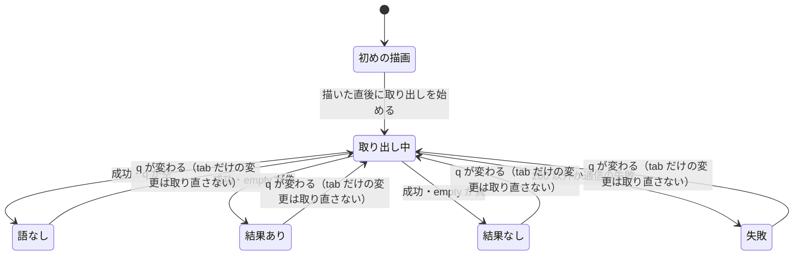
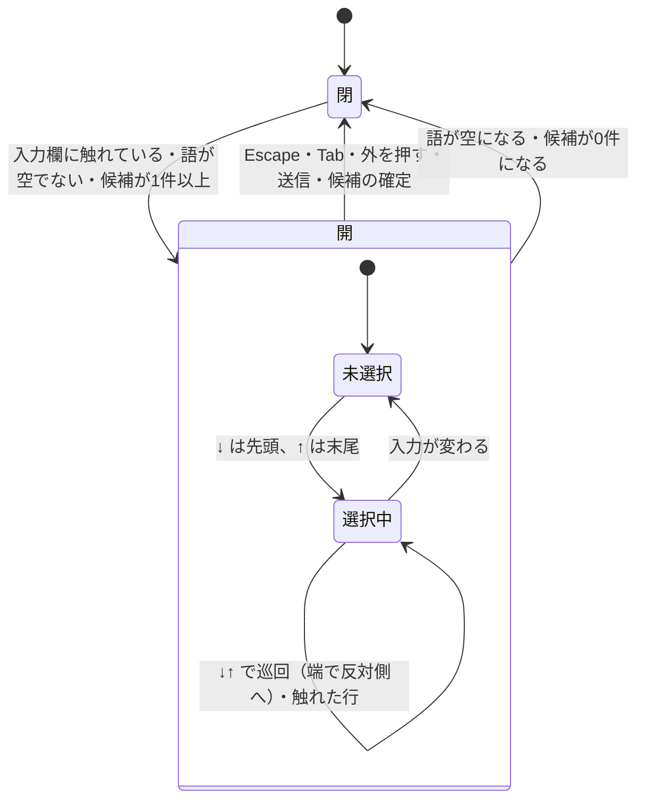

# SEARCH の構造設計

> 状態: 推定 | 確認日: 2026-10-26 | 対象: SEARCH（検索のページ `/search`・検索の窓口 `/api/search`・候補の窓口 `/api/suggest`・ホームの `/?q=` のプレビュー） | 基準コミット: `4facf63b`（作業ツリー）

## 概要

SEARCH の領域の構成・画面・画面遷移・状態遷移・API・データを、追跡できる項目（`### <ID> <題>` と属性の表）で書く。
中身は 2026-10-24 の作業ツリーのコードを読んで起こした今の動きで、ユーザーの確認を受けていないので全部「推定」にした。要件と食い違う所は決めずに今のコードの動きを書き、食い違いは [trace-matrix.md](../../05_Quality/reports/trace-matrix.md) の「食い違い」節に載せた。

| 種類 | 数 | ID | 中身 |
| --- | --- | --- | --- |
| 構成 | 5 | `ARC-SEARCH-001`〜`005` | 全体の作り、アプリでの並べ替え、画像の署名、人気商品、回数の制限と守りの見出し |
| 画面 | 4 | `SCR-SEARCH-001`〜`004` | 検索のページの枠と左のカラム、右の結果の欄、入力中の候補、ホームのプレビュー |
| 画面遷移 | 2 | `FLOW-SEARCH-001`〜`002` | 入口から検索のページと各詳細へ、ページの中で URL を置き換えて取り直す |
| 状態遷移 | 2 | `STATE-SEARCH-001`〜`002` | 結果の欄の見せ方、候補のリストの開閉と選択 |
| API | 2 | `API-SEARCH-001`〜`002` | `GET /api/search`、`GET /api/suggest` |
| データ | 3 | `DATA-SEARCH-001`〜`003` | 検索の関数（商品・ルック）、人気商品の関数、検索の関数（ニュース） |

- 結論: 検索のページとホームのプレビューは利用者の端末で動く部品で、2つの窓口を呼ぶ。窓口は共有の回数の制限を通した上で取り出しの関数（`search.service.ts`）を呼び、取り出しの関数は利用者の session の client で DB の検索の関数を、service role の client で人気商品の関数と画像の署名を呼ぶ
- 並びの点数・説明の切り出し・0件の判定はアプリが行い、DB の関数は公開済みの行を語の部分一致で新しい順に返すだけ
- 今のコードが満たさないセキュリティ要件（SEC-SEARCH-006・007・008・014〜016・020 の偽の送り元の側。004・005・010・017・018・019・021 と 020 の外のサイト側は 2026-10-26 に直し、満たす形の構造に上位をつないだ）は、満たす形の構造を持たないので上位につながず、本文に「満たさない」と書いた。一部だけ満たす物は、満たさない所がその項目の受け持つコードにある時は上位にせず、ほかの項目のコードにだけある時は上位にした（NEWS の構造設計と同じ決め方）

## 範囲と根拠

| 項目 | 内容 |
| --- | --- |
| 範囲 | `scripts/trace/scope.json` の SEARCH |
| 上位の文書 | [SEARCH の要件](../../02_Requirements/areas/search.md)（要件・`SEC-SEARCH-`・`DRV-SEARCH-`）、`docs/03_BasicDesign/decisions/ADR-0300`〜`ADR-0314`、NEWS の `ADR-0002`（検索の結果の NEWS の画像） |
| 対象のコード | `src/app/search/page.tsx`、`src/app/api/search/route.ts`、`src/app/api/suggest/route.ts`、`src/features/search/components/SearchPageClient.tsx`・`SearchHomePreview.tsx`、`src/features/search/services/search.service.ts`、`src/features/search/types/search.types.ts` |
| 対象の DB | `supabase/migrations/20260901102912_remote_schema.sql`（検索の関数と付与）、`supabase/migrations/20261013001143_order_return_receipts.sql`（人気商品の関数の最後の定義と付与） |
| 関連文書 | `docs/04_DetailDesign/pages/19_search.md`、`docs/03_BasicDesign/api/api-spec.md`・`route-inventory.md`（別の作業が書き換え中なので触らない）、`docs/03_BasicDesign/ui/design-guide.md`（古い画面の記述） |
| 範囲外の上位 | NEWS の `FREQ-185-REQ-01` は `（範囲外）` を付けて上位に書いた（SEARCH の持ち物ではない）。全体の `NFR-SEC-007`・`NFR-A11Y-002` は誰も定義しないので上位に書かず、根拠の文で触れる |
| 調べた時点 | 2026-10-24 の作業ツリー（コードは読んだだけで、動かしての確かめはしていない） |

範囲外の共有部品は ID を持たないので、項目の根拠と本文にファイルの道で書く。

| 共有部品 | 道 | SEARCH での使われ方 |
| --- | --- | --- |
| 回数の制限 | `src/features/auth/middleware/rateLimit.ts` の `enforceRateLimit` | 2つの窓口が呼ぶ。数え場所の失敗は 503 で断る |
| 守りの見出し | `src/proxy.ts` | 全部の応答に `Referrer-Policy: no-referrer` などを付ける |
| Supabase の client | `src/lib/supabase/server.ts` の `createClient`・`createServiceRoleClient` | 検索の関数（利用者の session）、人気商品の関数と署名（service role） |
| 画像の署名 | `src/lib/storage/item-images.ts`（ITEM の範囲外）・`look-images.ts`（LOOK）・`news-images.ts`（NEWS） | 結果と人気商品の画像を署名つき URL に置き換える |
| 読み上げの文 | `src/components/ui/LiveMessage/LiveMessage.tsx` | 結果の取り出しの失敗の文 |
| ヘッダーの入口 | `src/components/Header.tsx`（AUTH） | 検索のアイコンが `/search` へ移る |
| ホームの頁 | `src/app/page.tsx`（HOME） | ヒーローの直後に `SearchHomePreview` を描く |

## 構成

矢印は呼び出しの向き。ラベルは使う Supabase の client か、呼び方。検索のページの描画そのものはサーバーで DB を読まず、ページの殻を返した後に端末の部品が窓口を呼ぶ。`search_news` の定義は DATA-SEARCH-003 にある。

### ARC-SEARCH-001 検索は端末の部品から2つの窓口を呼び、窓口が取り出しの関数を通して DB の検索の関数を呼ぶ

| 属性 | 値 |
| --- | --- |
| 上位 | FR-SEARCH-001、FR-SEARCH-003、SEC-SEARCH-001、SEC-SEARCH-004、SEC-SEARCH-017、SEC-SEARCH-018、DRV-SEARCH-003、ADR-0300、ADR-0302、ADR-0310、ADR-0311 |
| 根拠 | 語とタブを URL に持ち、入力のたびに候補を取り直すので、画面は端末で動く部品にし、窓口から JSON を受ける形にした（ADR-0310）。語は DB の関数の引数で渡し、フィルタの文字列に組まないので、語で条件を書き換えられない（ADR-0300、NFR-SEC-007）。検索の関数は利用者の session の client で呼び、関数の中の公開の絞りと表の RLS の2段で下書きを外へ出さない（SEC-SEARCH-001、ADR-0302） |
| 状態 | 推定 |
| 確かめ方 | 結合テスト |
| 出どころ | 実装から推定（`src/features/search/services/search.service.ts`、`src/app/api/search/route.ts`、`src/app/api/suggest/route.ts`） |

- 入口: `/search`（`src/app/search/page.tsx`）は題・説明を返し、`SearchPageClient` を `Suspense` で包むだけ。ホームの `/?q=` は HOME の頁が `SearchHomePreview` を描く
- 窓口: `GET /api/search`（API-SEARCH-001）と `GET /api/suggest`（API-SEARCH-002）。どちらも外のサイトから読み込まれた要求を先に 403 で断り（SEC-SEARCH-020、ADR-0312）、共通の `searchQuerySchema` で `q` を確かめ（SEC-SEARCH-004）、回数の制限（ARC-SEARCH-005）を通してから取り出しの関数を呼ぶ
- 取り出しの関数（`search.service.ts`）: `executeSearch` が人気商品（ARC-SEARCH-004）と3種の検索を、`getSearchSuggestions` が候補を作る。3種の関数は同時に呼ぶ
- client: 検索の関数は `createClient()` で呼ぶ。ログインしていなければ anon、していればその人の session になる。service role は人気商品の関数と画像の署名だけに使う
- 型: 応答の形は `search.types.ts`（`SearchResult`・`SearchResultsResponse`・`SearchSuggestion`）。画面と窓口が同じ型を使う
- 失敗: 検索は 3 つの関数のどれか 1 つでも失敗したら全体を失敗にし（`SearchBackendError`。窓口は 500、画面は失敗の表示）、0件と区別できる（SEC-SEARCH-017、ADR-0311）。候補は失敗した種別を飛ばして続ける（DRV-SEARCH-003）。記録は関数名・誤りの名前・符号だけ（SEC-SEARCH-018）
- `tab` は窓口で結果を絞らず、受けた値をそのまま返す。出し分けは画面が行う
- 取り出しの関数の中の `getResultTypeLabel` は未使用（削除の判断待ち）で、どこからも使われず、画面の部品に同じ写しがある（DD-SEARCH-008）

### ARC-SEARCH-002 結果の並べ替えと説明の切り出しはアプリの取り出しの関数で行う

| 属性 | 値 |
| --- | --- |
| 上位 | FR-SEARCH-003、DRV-SEARCH-001、DRV-SEARCH-002、ADR-0303 |
| 根拠 | DB の関数は部分一致で新しい順に返すだけにし、題の頭に語がある物を先に出す点数はアプリで付ける（DRV-SEARCH-001、ADR-0303）。長い本文をそのまま出すと一致の場所が分からないので、一致の前後だけを切り出す（DRV-SEARCH-002） |
| 状態 | 推定 |
| 確かめ方 | 結合テスト |
| 出どころ | 実装から推定（`src/features/search/services/search.service.ts`） |

- 語の扱い: 前後の空白を落として小文字にし、空白・記号で語に分ける。分けられなければ全体を1語にする
- 点: 欄を並べた全体に語全体があれば 40 点。題が語全体で始まれば 80 点、含むだけなら 50 点。分けた1語ごとに、題に含めば 18 点、ほかの欄に含めば 8 点。語全体も全部の語も無ければ 0 点
- 欄: 商品は名前・説明・カテゴリ、ルックはテーマ・テーマの説明、ニュースは題・本文・分類
- 説明: 説明の欄で語全体が最初に合った所の前28字・後68字を切り、切った側に「…」を付ける。合わなければ商品はカテゴリ、ルックはシーズン、ニュースは分類
- メタ: 商品は「¥」とカンマ区切りの価格、ルックは「年 SS」か「年 AW」、ニュースは公開日の `-` を `.` に変えた形
- 数: `counts` は種別ごとの上限で切った後の数で、`empty` は3種の合計が 0 の時だけ真
- DB の関数が語全体の部分一致で絞るので、離れた2語の検索は DB で落ち、語ごとの点は並べ直しにしか効かない（推定）

### ARC-SEARCH-003 結果と人気商品の画像は service role で種別ごとに署名つき URL へ置き換える

| 属性 | 値 |
| --- | --- |
| 上位 | FREQ-185-REQ-01（範囲外）、ADR-0304、ADR-0002（範囲外） |
| 根拠 | 商品・ルック・ニュースの画像の置き場は非公開なので、表に入った値のままでは画像が出ない。置き場を公開に戻さず、応答を作るたびに種別ごとの署名の関数で署名つき URL に置き換える（FREQ-185-REQ-01、ADR-0304・0002） |
| 状態 | 推定 |
| 確かめ方 | 結合テスト |
| 出どころ | 実装から推定（`src/features/search/services/search.service.ts`、`src/lib/storage/item-images.ts`、`src/lib/storage/look-images.ts`） |

| 種別 | 署名の関数 | 期限 | 署名する値 |
| --- | --- | --- | --- |
| 商品 | `signItemImageUrl`（ITEM の共有部品） | 既定の7日。同じ道の URL をサーバーの記憶に持って使い回す | `image_url` |
| ルック | `signLookImageUrl`（LOOK） | 1時間 | `image_urls` の1枚目 |
| ニュース | `signNewsImageUrl`（NEWS） | 1時間 | `image_url` |

- 呼ぶ所: `executeSearch` の中の `signResultImages`。人気商品と3種の結果の両方を、service role の client で署名する。画像の無い行は null のまま
- 検索は期限を渡さず、共有部品の既定に任せる。商品だけが7日になる（SEC-SEARCH-014 は満たさない）
- 道にできない値と署名の失敗では元の値を返し、記録しない（SEC-SEARCH-015 は満たさない）
- 署名する前に、道が決まった場所の下か、URL のホストが自分の置き場かを確かめない（SEC-SEARCH-016 は満たさない）
- 署名つき URL の入る応答に `Cache-Control` を付けない（SEC-SEARCH-010 は満たさない。API-SEARCH-001）

### ARC-SEARCH-004 人気商品は service role の client で集計の関数を呼び、購入数を落として毎回4件返す

| 属性 | 値 |
| --- | --- |
| 上位 | FREQ-186-REQ-01、FREQ-186-REQ-02、FREQ-186-REQ-03、SEC-SEARCH-009、DRV-SEARCH-005、ADR-0305 |
| 根拠 | 購入数を数える注文の表は RLS で本人と管理の人にしか読めないので、service_role だけが呼べる集計の関数を service role の client から呼ぶ（FREQ-186-REQ-02、ADR-0305）。購入数は商品ごとの売れ行きなので応答に写さない（SEC-SEARCH-009）。0件の時と語の無い時にすぐ出せるよう、毎回の応答に含める（FREQ-186-REQ-03、DRV-SEARCH-005） |
| 状態 | 推定 |
| 確かめ方 | 結合テスト |
| 出どころ | 実装から推定（`src/features/search/services/search.service.ts`） |

- 呼び方: `getPopularItems` が `get_popular_items` を件数4で呼ぶ（DATA-SEARCH-002）。語の有無にかかわらず、3種の検索より先に呼ぶ
- 写し方: `mapPopularItem` が id・名前・説明（無ければカテゴリ）・`/item/<id>`・画像・価格のメタだけを写し、関数が返す購入数を落とす（FREQ-186-REQ-01 の並びは関数が決める）
- 失敗: 関数の失敗は名前と符号だけ記録して空の一覧にし、検索は続ける（人気商品は検索の結果ではないので、SEC-SEARCH-017 の全体を失敗にする決まりの外）
- 公開の窓口の要求ごとに service role の client を作る。何を外へ出すかは写し方の関数に任されている
- FREQ-186-REQ-02 の「SECURITY INVOKER」は DB の関数の側の話で、食い違いは SEC-SEARCH-009 に書いた（この項目の受け持つコードは要件どおり service role から呼び、購入数を出さない）

### ARC-SEARCH-005 公開の窓口は共有の回数の制限を通し、守りの見出しは共有の proxy が付ける

| 属性 | 値 |
| --- | --- |
| 上位 | FREQ-187-REQ-01、SEC-SEARCH-005、SEC-SEARCH-010、SEC-SEARCH-012、SEC-SEARCH-020、ADR-0306、ADR-0312 |
| 根拠 | 1回の検索で3つの関数・人気商品・署名を呼ぶので、続けて叩かれると DB と署名が詰まる。窓口ごとに回数の制限を掛け、プレビューは別の枠と少ない件数で数える（FREQ-187-REQ-01、SEC-SEARCH-005、ADR-0306）。`q` を URL に残すので、参照元の見出しで外へ語を送らないよう、共有の proxy の `Referrer-Policy` に任せる（SEC-SEARCH-012）。数え場所が使えない時は断る側に倒す決まりは共有部品が持つ（NEWS の ADR-0009 と同じ部品） |
| 状態 | 推定 |
| 確かめ方 | 結合テスト |
| 出どころ | 実装から推定（`src/app/api/search/route.ts`、`src/app/api/suggest/route.ts`、`src/features/auth/middleware/rateLimit.ts`、`src/proxy.ts`） |

| 窓口 | 数える名前 | 上限 | 窓の長さ |
| --- | --- | --- | --- |
| `/api/search`（`preview` が `'true'` 以外） | `search:public` | 120 回 | 600 秒 |
| `/api/search?preview=true` | `search:preview` | 20 回 | 600 秒 |
| `/api/suggest` | `suggest:public` | 200 回 | 600 秒 |

- 窓口は、先に `Sec-Fetch-Site` が同一オリジンでない要求を 403 で断り（枠に数えない）、`enforceRateLimit` を動的に読み込み、入力の確かめの後、取り出しの前に呼ぶ。超えたら 429（`Retry-After: 600`）、数え場所の失敗は 503
- 2つの枠は別々に数えるので、1つの送り元で合わせて140回使える（害は小さいと推定）
- 送り元は `x-forwarded-for` の先頭、無ければ `x-real-ip` を無条件に使い、`subject` は渡さない（SEC-SEARCH-006 は満たさない）
- 画面は候補を入力が止まって250ミリ秒後に呼び、タブを切り替えても検索を呼び直さない（SEC-SEARCH-005。SCR-SEARCH-003、FLOW-SEARCH-002、ADR-0313）
- proxy は matcher `'/:path*'` で全部の応答に `Referrer-Policy: no-referrer` を付ける。`Cache-Control` は付けない。2つの窓口は自分の全部の応答に `Cache-Control: private, no-store` を共有の `withNoStore` で付ける（SEC-SEARCH-010）

## 画面

### SCR-SEARCH-001 検索のページ `/search` の枠と左のカラム（見出し・入力欄・種別のタブ）

| 属性 | 値 |
| --- | --- |
| 上位 | FR-SEARCH-001、FREQ-184-REQ-01、FREQ-188-REQ-01、FREQ-188-REQ-02、FREQ-189-REQ-01、FREQ-192-REQ-01、FREQ-192-REQ-02、FREQ-193-REQ-01、FREQ-197-REQ-01、FREQ-198-REQ-01、FREQ-199-REQ-01、FREQ-199-REQ-03、FREQ-200-REQ-01、FREQ-200-REQ-02、SEC-SEARCH-011、DRV-SEARCH-009、ADR-0308、ADR-0310 |
| 根拠 | 左で語と種別を選び、右で結果を見る2カラムにし、探す操作と結果を同時に見られるようにする（FREQ-184-REQ-01、FREQ-197-REQ-01）。最初の画面を縦いっぱいにし、左を画面の高さで留めて操作の場所を動かさない（FREQ-188-REQ-01・02）。モバイルは見出しを見た目だけ隠して文書の構造を保ち、タブを全幅に並べて押しやすくする（FREQ-198-REQ-01、FREQ-199-REQ-01、FREQ-200-REQ-01）。タブの下線はヘッダーのナビと同じ線にそろえる（FREQ-192-REQ-02、FREQ-193-REQ-01、FREQ-200-REQ-02）。共有の端末に語を残さないよう、履歴を端末に保存しない（FREQ-189-REQ-01、SEC-SEARCH-011、ADR-0308） |
| 状態 | 推定 |
| 確かめ方 | 結合テスト |
| 出どころ | 実装から推定（`src/app/search/page.tsx`、`src/features/search/components/SearchPageClient.tsx`） |

- メタ: title「Search \| Le Fil des Heures」、description「Le Fil des Heures の商品・ルック・ニュースを横断検索できるページです。」、OG の画像 `/mainphoto.png`（DRV-SEARCH-009）。canonical と robots は返さない
- 殻: `Suspense` の間は「読み込み中...」を出す（`useSearchParams` を使う部品のため。Next.js 16.3.6 は静的な描画で `useSearchParams` を区切りの外で使うとビルドの誤り `missing-suspense-with-csr-bailout` にする。`node_modules/next` の実行時の中で確かめた）
- 枠: 最小の高さは画面の高さから 6.5rem（sm 7.25rem・md 8rem・lg 8.75rem・xl 9rem）を引いた値。md 以上は 38.2 対 61.8 の2列、md 未満は縦積み
- 左のカラム: md 以上はヘッダーの下（3.5rem）に画面の高さで留め、中身を縦の中央に置く。md 未満の間隔は 1.5rem
- 見出し: h1「SEARCH」。md 未満は `sr-only`、md 以上は見せる
- 入力欄: `type="search"`、`aria-label="Search"`、プレースホルダー「Search items, news, looks...」、下線の枠。右に40px 角の送信のボタン（`aria-label="検索"`、細線の虫眼鏡）。送ると FLOW-SEARCH-002 で URL を置き換える
- 入力欄は URL の `q` が変わるたびに、その値で詰め直す
- 種別のタブ: ALL・ITEM・LOOK・NEWS の4つ（`role="tablist"`・`role="tab"`・`aria-selected`）。md 未満は横一列の均等の配置で左右に内側の余白、md 以上は左寄せの縦並び。字間は `tracking-widest`（0.1em）
- 下線: 共通の `underline-animation-left2right` を幅 `calc(100% - 0.1em)` で付け、選んだタブは伸ばしたまま、ほかは触れた時だけ伸ばす。非選択の字は #474747、選択と触れた時は黒
- 保存: `localStorage` などの端末の保存の場所を使わない（RECENT SEARCHES は無い）
- FREQ-184-REQ-01・FREQ-188-REQ-02 の「lg」は FREQ-197-REQ-01 で md に、FREQ-193-REQ-01 の 0.2em は FREQ-200-REQ-02 で 0.1em に置き換わった形で持つ

### SCR-SEARCH-002 検索のページの右のカラム（結果の一覧・人気商品・0件）

| 属性 | 値 |
| --- | --- |
| 上位 | FR-SEARCH-001、FR-SEARCH-003、FR-SEARCH-004、FREQ-184-REQ-02、FREQ-184-REQ-03、FREQ-186-REQ-03、FREQ-191-REQ-01、FREQ-196-REQ-01、FREQ-199-REQ-02、FREQ-199-REQ-03、FREQ-201-REQ-01、SEC-SEARCH-013、DRV-SEARCH-007、ADR-0309 |
| 根拠 | 行を種別・題・メタ・サムネイル・矢印の同じ形にそろえ、ALL では種別を交互に混ぜて1本の一覧にし、どの種別の物かを行ごとに見分けられるようにする（FREQ-184-REQ-02）。語の合った所を強調して目当ての物を早く見分けさせる（FR-SEARCH-003）。見つからない時や語の無い時も人気商品を出して次に見る物を差し出す（FR-SEARCH-004、FREQ-186-REQ-03）。題・本文は管理の人が書き、`q` は誰でも URL に入れられるので、文字として出す形を崩さない（SEC-SEARCH-013）。操作できない並び順の表示は消さずに隠す（FREQ-196-REQ-01、ADR-0309） |
| 状態 | 推定 |
| 確かめ方 | 結合テスト |
| 出どころ | 実装から推定（`src/features/search/components/SearchPageClient.tsx`） |

- 見出しの行: 「{件数} RESULTS」だけ。件数は選んだタブの一覧の長さ（窓口の上限で切った後の数）。並び順の表示（RELEVANCE とシェブロン）はコメントにして残し、見出しの部品は並び順を出すかの値を受けても使わない（FREQ-191-REQ-01 の「SORT BY を消す」は満たし、RELEVANCE は FREQ-196-REQ-01 で隠した形）
- 行: 3:4 のサムネイル（幅 3.5rem、画像が無ければ #f5f5f5 の枠だけ。`alt` は空）、種別の名前、題、メタ、右矢印。行全体が `href` へのリンクで、行の間は黒10%の線。説明の文は出さない
- メタ: 商品は価格、ルックはシーズン、ニュースは公開日（ARC-SEARCH-002。FREQ-184-REQ-02 の「ITEM はカテゴリ」は FREQ-201-REQ-01 で価格に置き換わった形）
- 強調: 題の中で語全体（前後の空白を除く）に大文字と小文字を区別せずに合う所を `mark` で包む。語は正規表現の記号を逃がしてから使う。分けた1語ごとには強調しない
- ALL: 商品・ルック・ニュースの順に1件ずつ取り出して交互に並べる。ITEM・LOOK・NEWS のタブはその種別の一覧
- LOAD MORE: 初めは8行。一覧が表示の数より長い時だけ下に「LOAD MORE」を出し、押すごとに8行足す。語かタブが変わったら8行に戻す（タブだけの変更は取り直さず、取ってある結果から出し分ける）。窓口が1種別8件までしか返さないので、種別のタブでは出ず、ALL でも最大24件（推定）
- 文字: md 未満は種別の名前・題・メタ・見出しの行・LOAD MORE を1段ずつ小さくし、行の上下の余白を詰める（FREQ-199-REQ-02・03）
- 出力: 題・メタ・候補は React の文字として出し、HTML として解釈させない
- 見せ方の切り替え（語なし・読み込み中・失敗・0件・結果あり）は STATE-SEARCH-001

### SCR-SEARCH-003 入力中の候補のドロップダウン

| 属性 | 値 |
| --- | --- |
| 上位 | FREQ-190-REQ-01、FREQ-190-REQ-02、FREQ-192-REQ-01、FREQ-195-REQ-01、SEC-SEARCH-005、SEC-SEARCH-013、DRV-SEARCH-006、ADR-0308、ADR-0313 |
| 根拠 | 候補を入力欄の下に重ねて出し、下の種別のタブを押し下げない（FREQ-190-REQ-01）。キーボードと読み上げで同じ操作ができるよう combobox の定石に従い、選択を色以外の縦線でも示す（FREQ-190-REQ-02、NFR-A11Y-002）。行の高さを詰めても押せる大きさは保つ（FREQ-192-REQ-01）。後ろの「ALL」の字が覗かないよう左右に 1px 広げる（FREQ-195-REQ-01）。候補はサーバーの候補だけで、端末の履歴を混ぜない（ADR-0308） |
| 状態 | 推定 |
| 確かめ方 | 結合テスト |
| 出どころ | 実装から推定（`src/features/search/components/SearchPageClient.tsx`） |

- 入力欄: `role="combobox"`・`aria-expanded`・`aria-controls="search-suggestion-list"`・`aria-autocomplete="list"`・選んだ候補の `aria-activedescendant`・`autoComplete="off"`
- リスト: `role="listbox"`・`aria-label="検索候補"`。入力欄の下に重ね、左右に 1px ずつ広げる。最大8件
- 候補: `role="option"`・`aria-selected` のボタン。高さは 40px 以上。ラベルは語に合う所を黒の太字、ほかを #474747 で描き分け、右端に種別の名前。選んだ行は薄い面と黒 2px の縦線
- 読み上げ: リストが開いている間は「N 件の検索候補があります」を `aria-live="polite"` の見えない文で伝える
- 取り出し: 入力が止まって250ミリ秒たってから、前後の空白を除いて空でなければ `/api/suggest` を呼ぶ（最小の字数は置かない。ADR-0313）。新しい入力とアンマウントで前の要求を打ち切り、遅れて返った前の応答で候補を上書きしない。空なら待たずに候補を消す。失敗は誤りの中身を渡さず固定の文だけ記録して候補を消す（打ち切りは記録しない）
- 開閉と選択の動きは STATE-SEARCH-002、確定の後は FLOW-SEARCH-002

### SCR-SEARCH-004 ホームの `/?q=` の検索のプレビュー

| 属性 | 値 |
| --- | --- |
| 上位 | FR-SEARCH-002、SEC-SEARCH-013、SEC-SEARCH-021、DRV-SEARCH-010、ADR-0314 |
| 根拠 | ホームを離れずに結果の一部を先に見せ、続きは検索のページへ渡す（FR-SEARCH-002）。ホームの中で場所を取りすぎないよう3件に絞る（DRV-SEARCH-010）。題・説明は文字として出す（SEC-SEARCH-013）。URL の語は説明の文に埋めず「検索した語」の枠に分ける（SEC-SEARCH-021、ADR-0314。文言と見た目は案） |
| 状態 | 推定 |
| 確かめ方 | 結合テスト |
| 出どころ | 実装から推定（`src/features/search/components/SearchHomePreview.tsx`、`src/app/page.tsx`） |

- 置き場: ホームのヒーローの直後（HOME の頁が描く）。URL の `q` の前後の空白を除いて空なら何も描かない
- 取り出し: `/api/search?q=<語>&preview=true` を `no-store` で呼ぶ（1種別3件、`search:preview` の枠）
- 中身: 「PREVIEW」「Search Preview」固定の説明の文「入力した語に関連する結果をホーム上で即時プレビューしています。」（語を含めない。SEC-SEARCH-021）、説明の文の外の「検索した語」の枠（`<dl data-testid="search-preview-term">`、`<dt>検索した語</dt><dd><語></dd>`。語は文字として出す。ADR-0314、文言と見た目は案）、「VIEW ALL RESULTS」（`/search?q=<語>`）。結果は商品・ルック・ニュースの順に合わせた先頭3件をカード（メタ・題・説明）で出し、カード全体が詳細へのリンク
- 画像と強調は出さない。説明は ARC-SEARCH-002 の切り出し
- 0件は「プレビュー対象の検索結果は見つかりませんでした。」。取り出しの失敗は記録して区画ごと出さない
- 画面の中に `/?q=` へ移る導線は無く、URL を直接開いた時だけ出る（推定）

## 画面遷移

### FLOW-SEARCH-001 検索の入口から検索のページへ移り、結果から各詳細へ移る

| 属性 | 値 |
| --- | --- |
| 上位 | FR-SEARCH-001、FR-SEARCH-002、FREQ-01-REQ-01、FREQ-01-REQ-02、DRV-SEARCH-010 |
| 根拠 | どのページからもヘッダーの入口で探し始められるようにし（FREQ-01-REQ-01・02、FR-SEARCH-002）、結果の行からそのまま商品・ルック・ニュースの詳細へ届くようにする（FR-SEARCH-001）。ホームのプレビューの続きは検索のページへ渡す（DRV-SEARCH-010） |
| 状態 | 推定 |
| 確かめ方 | 結合テスト |
| 出どころ | 実装から推定（`src/components/Header.tsx`、`src/features/search/components/SearchHomePreview.tsx`、`src/features/search/services/search.service.ts`） |

- 矢印は利用者のリンクの操作。ヘッダーのアイコンは語を持たずに `/search` へ移り、ページは人気商品から始まる（STATE-SEARCH-001）
- 人気商品の行は全部 `/item/<id>` へ移る
- 行き先の詳細の頁は ITEM（範囲外）・LOOK・NEWS の物
- 検索のページの中の移り方（語・タブ・候補）は FLOW-SEARCH-002

### FLOW-SEARCH-002 検索のページの中で語・タブ・候補を確定すると URL を置き換えて取り直す

| 属性 | 値 |
| --- | --- |
| 上位 | FR-SEARCH-001、FREQ-190-REQ-02、SEC-SEARCH-005、DRV-SEARCH-004、DRV-SEARCH-006、ADR-0310、ADR-0313 |
| 根拠 | 語とタブを URL に持たせ、共有・再読み込み・戻るで同じ結果に戻れるようにする（FR-SEARCH-001）。タブを切り替えるたびに履歴が積まれないよう、URL は置き換えにしてスクロールの位置も保つ（DRV-SEARCH-004、ADR-0310）。候補を選んだらその名前と種別で探す（FREQ-190-REQ-02、DRV-SEARCH-006） |
| 状態 | 推定 |
| 確かめ方 | 結合テスト |
| 出どころ | 実装から推定（`src/features/search/components/SearchPageClient.tsx`） |

| 操作 | 語 | タブ |
| --- | --- | --- |
| 入力欄で送る（候補を選んでいない Enter・送信のボタン） | 入力欄の値 | 今のタブ |
| タブを押す | URL の今の `q` | 押したタブ |
| 候補を Enter かクリックで確定 | 候補の名前 | 候補の種別 |

- URL の `tab` が4つの値に無い時は ALL として扱う
- 窓口は `tab` で絞らないので、タブを切り替えるだけでは取り直さない（SEC-SEARCH-005）。取り直しの URL の `tab` は、その時の最新のタブ（`useRef` から読む）
- 候補を確定すると入力欄を候補の名前にし、リストを閉じる
- URL の `q` は前後の空白を除かずに読むので、空白だけの `q` を直接開くと語ありの側の見せ方になる（推定、STATE-SEARCH-001）

## 状態遷移

### STATE-SEARCH-001 検索のページの右のカラムの見せ方

| 属性 | 値 |
| --- | --- |
| 上位 | FR-SEARCH-004、FREQ-186-REQ-03、SEC-SEARCH-017、DRV-SEARCH-003、DRV-SEARCH-007 |
| 根拠 | 取り出しの間に空の画面や古い結果を見せると、壊れているか終わったかが分からないので、語の有無・読み込み中・失敗・0件で見せ方を分ける（DRV-SEARCH-007）。語が無い時も人気商品を出し、取り出し中は案内文を出さない（FREQ-186-REQ-03）。0件は文と人気商品を出す（FR-SEARCH-004）。検索の関数が1つでも失敗した時は、0件ではなく失敗の見せ方にする（SEC-SEARCH-017、DRV-SEARCH-003） |
| 状態 | 推定 |
| 確かめ方 | 結合テスト |
| 出どころ | 実装から推定（`src/features/search/components/SearchPageClient.tsx`） |

| 状態 | 右のカラム |
| --- | --- |
| 初めの描画（q なし） | 読み込み中の印はまだ偽（`SearchPageClient.tsx`）なので、「POPULAR ITEMS」の見出しと案内文「気になる商品名やトピックを入力すると、…」が一瞬出る |
| 初めの描画（q あり） | 結果がまだ無く読み込み中でもないので、「0 RESULTS」の見出しの行が一瞬出る |
| 取り出し中（q あり） | 見出しの行と結果の行の形の灰色の枠を5行（`aria-hidden`） |
| 取り出し中（q なし） | 「POPULAR ITEMS」の見出しだけ。前の人気商品があれば出したまま、無ければ案内文を出さない |
| 語なし | 「POPULAR ITEMS」と人気商品の行。人気商品が無ければ「気になる商品名やトピックを入力すると、商品・ルック・ニュースを横断した結果を表示します。」 |
| 結果あり | 「{件数} RESULTS」と結果の行（SCR-SEARCH-002） |
| 結果なし | 「「<語>」の検索結果はありません」「別のキーワードをお試しください。人気商品もあわせてご覧いただけます。」と「POPULAR ITEMS」の行 |
| 失敗 | 「検索結果を読み込めませんでした」を赤い字で読み上げにも伝える。前の結果は消す |

- 読み込み中の印は取り出しの effect の中で初めて真になる（`SearchPageClient.tsx`）ので、最初の描画は取り出し中の見せ方を通らない。q なしで案内文が一瞬出るのは、FREQ-186-REQ-03 の「取り出し中は案内文を出さない」と一部食い違う（推定。描いてすぐ effect が動くので、目に見えるかは確かめていない）
- 検索の関数が1つでも失敗すると窓口が 500 を返すので、「結果なし」ではなく「失敗」になる（SEC-SEARCH-017、ADR-0311）
- 失敗の時に q があると、失敗の文の下に「0 RESULTS」の見出しの行も出る（結果を消した後の一覧が空のため。推定）。q が無いと失敗の文と案内文が並ぶ
- 空白だけの q では、窓口が語なしとして `empty` を偽で返すので「0 RESULTS」になる（推定）
- 前の取り出しの応答が後から届いても、取り消しの印で捨てる

### STATE-SEARCH-002 入力中の候補のリストの開閉と選択の位置

| 属性 | 値 |
| --- | --- |
| 上位 | FREQ-190-REQ-01、FREQ-190-REQ-02、SEC-SEARCH-005 |
| 根拠 | combobox の定石どおり、↓↑ で巡回して選び、Enter で確定、Escape で閉じられるようにする（FREQ-190-REQ-02）。入力が変わったら選択を戻し、前の候補を選んだまま確定するのを防ぐ。リストは重ねて出すので、外を押したら閉じる（FREQ-190-REQ-01） |
| 状態 | 推定 |
| 確かめ方 | 結合テスト |
| 出どころ | 実装から推定（`src/features/search/components/SearchPageClient.tsx`） |

- 開いているかは、入力欄に触れている・語の前後の空白を除いて空でない・候補が1件以上の3つがそろう時
- Enter: 選んだ候補があればその候補で確定し（FLOW-SEARCH-002）、無ければフォームの送信に任せて入力欄の語で探す
- Escape はリストが閉じていても、触れている印と選択を外す
- 外を押したかは `mousedown` で見て、リストが開いている間だけ聞く
- 候補は入力が止まって250ミリ秒たってから届く（SEC-SEARCH-005、ADR-0313）。空にした時は待たずに閉じる

## API

### API-SEARCH-001 `GET /api/search` 横断検索と人気商品

| 属性 | 値 |
| --- | --- |
| 上位 | FR-SEARCH-001、FR-SEARCH-003、FR-SEARCH-004、FREQ-186-REQ-02、FREQ-186-REQ-03、FREQ-187-REQ-01、FREQ-201-REQ-02、SEC-SEARCH-001、SEC-SEARCH-003、SEC-SEARCH-004、SEC-SEARCH-005、SEC-SEARCH-009、SEC-SEARCH-010、SEC-SEARCH-017、SEC-SEARCH-018、SEC-SEARCH-019、SEC-SEARCH-020、DRV-SEARCH-003、DRV-SEARCH-005、ADR-0300、ADR-0306、ADR-0311、ADR-0312 |
| 根拠 | 1つの窓口で3種の結果と人気商品を返し、画面がタブで出し分けられるようにする（FR-SEARCH-001・004、DRV-SEARCH-005）。`preview` は文字が `'true'` の時だけ真にし、通常とプレビューの件数と回数の枠を取り違えない（FREQ-187-REQ-01）。語は関数の引数で渡し（SEC-SEARCH-003、ADR-0300）、公開済みだけを返し（SEC-SEARCH-001）、購入数を出さない（FREQ-186-REQ-02、FREQ-201-REQ-02、SEC-SEARCH-009）。処理の時間の見出しは付けない（SEC-SEARCH-019。DRV-SEARCH-008 は廃止）。外のサイトから読み込まれた要求は先に断り（SEC-SEARCH-020）、全部の応答を共有のキャッシュに残させない（SEC-SEARCH-010）。語を引数で渡す点は全体の NFR-SEC-007 にも沿う |
| 状態 | 推定 |
| 確かめ方 | 結合テスト |
| 出どころ | 実装から推定（`src/app/api/search/route.ts`、`src/features/search/services/search.service.ts`）、`docs/03_BasicDesign/api/api-spec.md` |

| 入力 | 決まり |
| --- | --- |
| `Sec-Fetch-Site`（見出し） | 無い・`same-origin`・`none` なら通す。ほかは 403 `{ error: 'Forbidden' }`（枠に数えない） |
| `q` | 前後の空白を落とし100字まで、制御文字（0x00〜0x1F・0x7F）を含まない。無ければ空。外れたら 400 |
| `tab` | `all`・`item`・`look`・`news` のどれか。無ければ `all`。ほかの値は 400 |
| `preview` | 文字が `'true'` の時だけ真。ほかの値は偽（400 にしない） |

| 結果 | 状態の番号 | 本文・見出し |
| --- | --- | --- |
| 成功 | 200 | `query`・`tab`・`items`・`looks`・`news`・`counts`（all・item・look・news）・`popularItems`・`empty` |
| 外のサイトから | 403 | `{ error: 'Forbidden' }` |
| 入力の誤り | 400 | `{ error: 'Invalid search query' }` |
| 回数の超過 | 429 | `{ error: 'Too many requests' }`、`Retry-After: 600` |
| 数え場所の失敗 | 503 | `{ error: 'Rate limiter unavailable' }`、`Retry-After: 600` |
| 例外・検索の関数の失敗 | 500 | `{ error: 'Failed to search content' }` |

- 全部の応答に `Cache-Control: private, no-store`（SEC-SEARCH-010）
- 件数: 1種別あたり通常8件、プレビュー3件。人気商品は毎回4件（ARC-SEARCH-004）
- 語が空なら3種の関数を呼ばず、空の3種・0の数・`empty: false` と人気商品を返す
- 結果の各要素は `id`・`type`・`title`・`description`・`href`・`imageUrl`（署名つき URL か null）・`meta`。購入数は含まない
- `tab` は結果を絞らず、受けた値を返すだけ
- 3つの検索関数のどれか1つでも失敗したら全体を失敗にして 500 を返す（SEC-SEARCH-017、ADR-0311）。人気商品の関数の失敗だけは空の一覧で続ける
- 記録は誤りの名前と符号だけ（検索関数の失敗は関数名も）で、検索語・Supabase の誤りの文は書かない。応答の本文は固定の文（SEC-SEARCH-018）
- 認証は求めない。ログインしていればその人の session で検索の関数を呼ぶ

### API-SEARCH-002 `GET /api/suggest` 入力中の候補

| 属性 | 値 |
| --- | --- |
| 上位 | FREQ-190-REQ-01、FREQ-190-REQ-03、SEC-SEARCH-001、SEC-SEARCH-003、SEC-SEARCH-004、SEC-SEARCH-005、SEC-SEARCH-010、SEC-SEARCH-017、SEC-SEARCH-018、SEC-SEARCH-020、DRV-SEARCH-003、DRV-SEARCH-006、ADR-0300、ADR-0306、ADR-0307、ADR-0311、ADR-0312 |
| 根拠 | ラベルに語が現れない候補は、なぜ出たのか利用者に分からず強調も当たらないので、ラベルに語を含む物だけを返す（FREQ-190-REQ-03、ADR-0307）。同じ名前の重なりを除き、最大8件に絞る（FREQ-190-REQ-01、DRV-SEARCH-006）。語は関数の引数で渡し（SEC-SEARCH-003、ADR-0300）、公開済みだけから作る（SEC-SEARCH-001）。入力のたびに呼ばれるので、検索より広い枠で回数を数える（SEC-SEARCH-005、ADR-0306）。語を引数で渡す点は全体の NFR-SEC-007 にも沿う |
| 状態 | 推定 |
| 確かめ方 | 結合テスト |
| 出どころ | 実装から推定（`src/app/api/suggest/route.ts`、`src/features/search/services/search.service.ts`）、`docs/03_BasicDesign/api/api-spec.md` |

| 入力 | 決まり |
| --- | --- |
| `Sec-Fetch-Site`（見出し） | 無い・`same-origin`・`none` なら通す。ほかは 403 `{ error: 'Forbidden' }`（枠に数えない） |
| `q` | 前後の空白を落とし100字まで、制御文字（0x00〜0x1F・0x7F）を含まない（`searchQuerySchema`。検索の窓口と同じ）。無ければ空 |

| 結果 | 状態の番号 | 本文・見出し |
| --- | --- | --- |
| 成功 | 200 | `{ suggestions: [{ label, type, href }] }` |
| 外のサイトから | 403 | `{ error: 'Forbidden' }` |
| 入力の誤り | 400 | `{ error: 'Invalid suggest query' }` |
| 回数の超過 | 429 | `{ error: 'Too many requests' }`、`Retry-After: 600` |
| 数え場所の失敗 | 503 | `{ error: 'Rate limiter unavailable' }`、`Retry-After: 600` |
| 例外 | 500 | `{ error: 'Failed to load suggestions' }` |

- 作り方: 3種の関数をそれぞれ8件で呼び、ARC-SEARCH-002 の点が 0 より大きく、ラベル（商品は名前・ルックはテーマ・ニュースは題）に語を含む物を候補にする。点の高い順に並べ、同じ種別で同じラベルの物は最初の1つだけを残し、8件で切る
- `href` は `/search?q=<ラベルを URL 用に符号化>&tab=<種別>`
- 語が空なら関数を呼ばず空の一覧
- 関数の失敗は、失敗した関数名と誤りの名前・符号だけを記録し、その種別を飛ばして成功した種別の候補を返す。投げない（DRV-SEARCH-003、SEC-SEARCH-017）
- `,().` は断らない（制御文字だけを見る。コードの注も同じ）（SEC-SEARCH-004）
- 全部の応答に `Cache-Control: private, no-store`（SEC-SEARCH-010）。例外の記録は名前と符号だけ（SEC-SEARCH-018）

## データ

### DATA-SEARCH-001 検索の関数 `search_items`・`search_looks`（と未使用（削除の判断待ち）の `search_public_items`・`search_public_looks`）

| 属性 | 値 |
| --- | --- |
| 上位 | FR-SEARCH-003、FREQ-201-REQ-01、SEC-SEARCH-001、SEC-SEARCH-002、SEC-SEARCH-003、SEC-SEARCH-007、SEC-SEARCH-008、ADR-0301、ADR-0302、ADR-0315 |
| 根拠 | 検索は語の部分一致で足り、全文検索や外の検索の仕組みを入れない（FR-SEARCH-003、ADR-0301）。関数は呼び手の権限で動かし、関数の中でも公開済みに絞るので、RLS が下書きを通す呼び手でも下書きを返さない（SEC-SEARCH-001・002、ADR-0302）。語は引数で受けて SQL に組まない（NFR-SEC-007）。商品の行のメタに価格を出すため、`search_items` は価格を返す（FREQ-201-REQ-01）。アプリを通らない PostgREST の直接の呼び出しでも負荷に上限を置くため、件数は 1〜8、語は先頭 100 字、`\` を先に逃がす（SEC-SEARCH-003・007、ADR-0315）。`search_public_items`・`search_public_looks` は未使用（削除の判断待ち）なので、DROP せず anon・authenticated・PUBLIC から EXECUTE を外した（SEC-SEARCH-008、ADR-0315） |
| 状態 | 推定 |
| 確かめ方 | 結合テスト |
| 出どころ | 実装から推定（`supabase/migrations/20260901102912_remote_schema.sql`） |
| 旧番号 | DATA-LOOK-004 |
| 旧所在 | `docs/03_BasicDesign/areas/look.md` の DATA-LOOK-004（検索の関数 `search_looks`・`search_public_looks`。LOOK が廃止にして SEARCH へ移した。`search_looks` は DATA-SEARCH-001、`search_public_looks` は未使用（削除の判断待ち）の行として同じ項目に入れた） |

| 関数 | 中身 | 付与 | 使う所 |
| --- | --- | --- | --- |
| `search_items(search_query, limit_count default 8)` | 呼び手の権限（SECURITY DEFINER を付けない）・`STABLE`。`status='published'` の商品を、名前・説明・カテゴリの ILIKE の部分一致で探す。語は先頭 100 字に切り、`\` を先に二重にしてから `%`・`_` を逃がす（模様は LATERAL で 1 回だけ作る）。作った日の新しい順に 1〜8 件（`GREATEST(1, LEAST(COALESCE(limit_count, 8), 8))`）。返す列は id・名前・説明・カテゴリ・画像・価格 | PUBLIC から外し、anon・authenticated・postgres・service_role に EXECUTE | 検索と候補（`search.service.ts`） |
| `search_looks(search_query, limit_count default 8)` | 同じ作り。`status='published'` のルックを、テーマ・テーマの説明で探す。返す列は id・年・季節・テーマ・テーマの説明・画像の配列 | 同上 | 検索と候補（`search.service.ts`） |
| `search_public_items`・`search_public_looks`（`p_query`, `p_limit default 6`） | 未使用（削除の判断待ち）。呼び手の権限。`status='published'`。件数を1〜20に丸める。`%`・`_` を逃がさない。本体は 2026-10-26 の移行で変えていない | PUBLIC・anon・authenticated から外し（2026-10-26、`sec_search_functions`）、postgres・service_role に EXECUTE | 呼ぶ所は見当たらない。呼べない（REVOKE 済み）。DROP は NEWS の試験を直した後に別の判断 |

- `search_news`・`search_public_news` は DATA-SEARCH-003。検索は `search_news` を2つの関数と同じ形で呼ぶ
- 大文字と小文字は区別しない。語全体の部分一致で、語を分けては探さない（ARC-SEARCH-002）
- `\` を先に逃がす（SEC-SEARCH-003 を満たす。移行 `sec_search_functions`、ADR-0315。この移行を当てた DB でだけ満たす）
- 空の語は模様が `'%%'` になって全部の公開の行に一致するが、件数は最大 8。`limit_count` が NULL・0・負でも誤りにせず 1〜8 に丸める
- `limit_count` を 8 に丸める（SEC-SEARCH-007 を満たす。アプリの呼び元の最大は 8: `/api/search` の `limitPerType`、候補の `limit`）。手元の PostgREST の上限は `supabase/config.toml` の `max_rows = 1000`、本番は運用で確認する
- 未使用（削除の判断待ち）の `search_public_*` は PUBLIC・anon・authenticated から EXECUTE を外した（SEC-SEARCH-008 を満たす）。ロールバックの旧い本体は移行のヘッダーに全文ある
- 関数の署名・戻りの列・`search_path` と SECURITY INVOKER は移行で変えていない（`CREATE OR REPLACE` が所有者と ACL を保つ）
- `search_path` に `public` を2回書く（害は無いと推定）
- 表の RLS（`items`・`looks`）は ITEM・LOOK の物。関数の中の絞りは RLS に頼らない

### DATA-SEARCH-002 人気商品の関数 `get_popular_items`

| 属性 | 値 |
| --- | --- |
| 上位 | FREQ-186-REQ-01、FREQ-201-REQ-01、SEC-SEARCH-001、SEC-SEARCH-009、ADR-0305 |
| 根拠 | 人気を「支払いの済んだ注文の数量の合計」で決め、公開の商品を多い順に、同じ数なら新しい順に返す（FREQ-186-REQ-01、ADR-0305）。注文の表を数えるので、呼べるのは service_role だけにし、anon・authenticated から注文を数えさせない（SEC-SEARCH-009）。公開済みの商品だけを返す（SEC-SEARCH-001）。行のメタに価格を出すため価格を返す（FREQ-201-REQ-01） |
| 状態 | 推定 |
| 確かめ方 | 結合テスト |
| 出どころ | 実装から推定（`supabase/migrations/20261013001143_order_return_receipts.sql`） |

| 項目 | 内容 |
| --- | --- |
| 引数 | `limit_count`（既定 4）。上限に丸めない |
| 返す列 | id・名前・説明・カテゴリ・画像・価格・`purchase_count` |
| 数え方 | `orders.status='paid'` で `order_items.line_kind='order'` の行の `quantity` の合計。交換の品の行は数えない。買われていない商品も0として後ろに並べる |
| 絞り | `items.status='published'` |
| 並び | 購入数の多い順、同じなら作った日の新しい順 |
| 権限 | `SECURITY DEFINER`、`search_path` は空 |
| 付与 | PUBLIC・anon・authenticated から外し、service_role だけに EXECUTE |

- 要件の文との権限の種類の食い違いは SEC-SEARCH-009 に書いた。決まりが定まっていないので、FREQ-186-REQ-02 はこの項目の上位にしない
- 全部を発送した注文（`shipped`）は数えない。移行の注は「既存の paid の注文の対象範囲は変えない」と書く（返品の移行を作った時の決定）
- 購入数を返すのは関数までで、応答に写さないのはアプリの写し方の関数（ARC-SEARCH-004）
- 定義を最後に変えたのは返品の移行で、注文と返品の側が持つ。検索の側では直さない

### DATA-SEARCH-003 検索の関数 `search_news`・`search_public_news`

| 属性 | 値 |
| --- | --- |
| 上位 | FR-SEARCH-001、FR-SEARCH-003、SEC-SEARCH-001、SEC-SEARCH-002、SEC-SEARCH-003、SEC-SEARCH-007、SEC-SEARCH-008、ADR-0301、ADR-0302、ADR-0315 |
| 根拠 | サイト内の検索がニュースも横断して探せるよう、公開済みの記事を題・本文・分類で探す関数を DB に置く（FR-SEARCH-001、ADR-0301）。呼び手の権限で動かし（SECURITY DEFINER にしない）、関数の中でも `status='published'` で絞って、RLS と合わせて下書きを出さない（SEC-SEARCH-001・002、ADR-0302）。記事の表と RLS は NEWS が持つが、この関数を呼ぶのは検索の部品なので、関数の定義は SEARCH が持つ。語を引数で受ける点は全体の NFR-SEC-007 にも沿う。件数は 1〜8、語は先頭 100 字、`\` を先に逃がすのは DATA-SEARCH-001 と同じ理由（SEC-SEARCH-003・007、ADR-0315）。`search_public_news` は未使用（削除の判断待ち）なので、DROP せず anon・authenticated・PUBLIC から EXECUTE を外した（SEC-SEARCH-008、SEC-NEWS-010、ADR-0315） |
| 状態 | 推定 |
| 確かめ方 | 結合テスト |
| 出どころ | 実装から推定（`supabase/migrations/20260901102912_remote_schema.sql` の `search_news`・`search_public_news`）、`tests/integration/db/search-functions.integration.test.ts` |
| 旧番号 | DATA-NEWS-003 |
| 旧所在 | `docs/03_BasicDesign/areas/news.md` の DATA-NEWS-003（検索の関数 `search_news`・`search_public_news`。NEWS が廃止にして SEARCH へ移した） |

| 関数 | 中身 | 付与 | 使う所 |
| --- | --- | --- | --- |
| `search_news(search_query, limit_count default 8)` | 呼び手の権限（SECURITY DEFINER を付けない）・`STABLE`。`status='published'` の記事を、題・本文・分類の ILIKE の部分一致で探す。語は先頭 100 字に切り、`\` を先に二重にしてから `%`・`_` を逃がす。公開日の新しい順に 1〜8 件（`GREATEST(1, LEAST(COALESCE(limit_count, 8), 8))`）。返す列は id・題・分類・画像・本文・公開日 | PUBLIC から外し、anon・authenticated・postgres・service_role に EXECUTE | 検索と候補（`search.service.ts`） |
| `search_public_news(p_query, p_limit default 6)` | 未使用（削除の判断待ち）。呼び手の権限。`status='published'`。件数を1〜20に丸める。`%`・`_` を逃がさない。本体は 2026-10-26 の移行で変えていない | PUBLIC・anon・authenticated から外し（2026-10-26、`sec_search_functions`）、postgres・service_role に EXECUTE | 呼ぶ所は見当たらない。呼べない（REVOKE 済み）。DROP は NEWS の試験を直した後に別の判断 |

- 大文字と小文字は区別しない。語全体の部分一致で、語を分けては探さない（ARC-SEARCH-002）
- `\` を先に逃がす（SEC-SEARCH-003）、`limit_count` を 1〜8 に丸める（SEC-SEARCH-007）、使われない `search_public_news` から anon・authenticated・PUBLIC の EXECUTE を外した（SEC-SEARCH-008）。どれも 2026-10-26 の移行 `sec_search_functions`（ADR-0315）で満たした。この移行を当てた DB でだけ満たす
- `search_path` に `public` を2回書く（害は無いと推定）
- 表の RLS（`news_articles`）は NEWS の物。関数の中の絞りは RLS に頼らない

## 未確認事項

- 本番の PostgREST の返す行数の上限と、本番の検索の関数・人気商品の関数の付与（移行だけを読んだ）
- 本番のビルドで、検索の窓口の応答の `Cache-Control: private, no-store` が `proxy.ts`・`next.config.ts` や中継に上書きされないか（E2E `FR-SEARCH-019` は値そのものを見るが、流していない）
- ホームの頁が `SearchHomePreview`（`useSearchParams` を使う）を `Suspense` で包まずに描く時の描き方（推定のまま。HOME の範囲）
- FREQ-184-REQ-01・02、FREQ-188-REQ-02、FREQ-190-REQ-01、FREQ-191-REQ-01、FREQ-193-REQ-01 は後の要求で一部が置き換わったまま上位にした。要件の側で「廃止」にするか文を直したら、上位を付け直す
- 今のコードが満たさないセキュリティ要件を直した時に、どの項目の上位に足すか（残りは SEC-SEARCH-006・014〜016・020 の偽の送り元の側。004・005・010・017〜019・021・020 の外のサイト側は 2026-10-26 に上位をつないだ。SEC-SEARCH-003・007・008 は同日、移行 `sec_search_functions` で満たして DATA-SEARCH-001・003 の上位に載せた）
- 詳細設計（`DD-SEARCH-001`〜`008`、`docs/04_DetailDesign/pages/19_search.md`）はある。結合テストと単体テストはまだ無いので、`validate-trace` は構造設計の項目と詳細設計の項目に `missing-child` を出し続ける
- DATA-SEARCH-001 の旧番号 DATA-LOOK-004 と DATA-SEARCH-003 の旧番号 DATA-NEWS-003 は、LOOK・NEWS が廃止にして SEARCH へ移した関数の項目。この持ち方でよいかをユーザーに確かめる
- この文書の項目は全部「推定」。ユーザーの確認を受けたら「現行」にする
