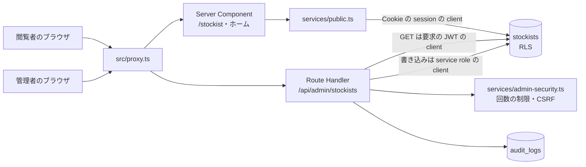
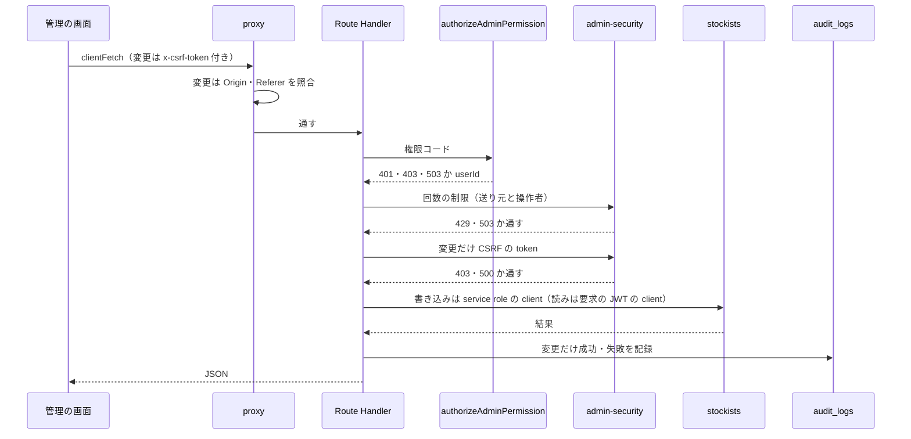
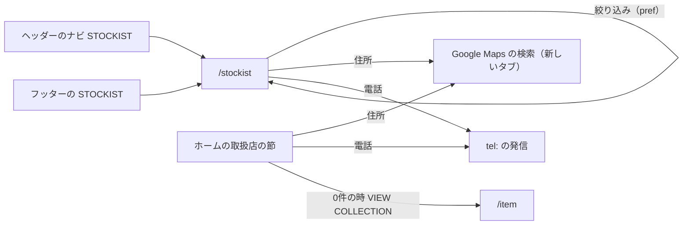
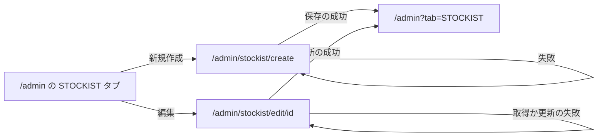
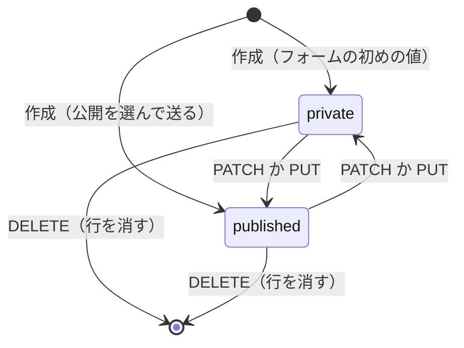
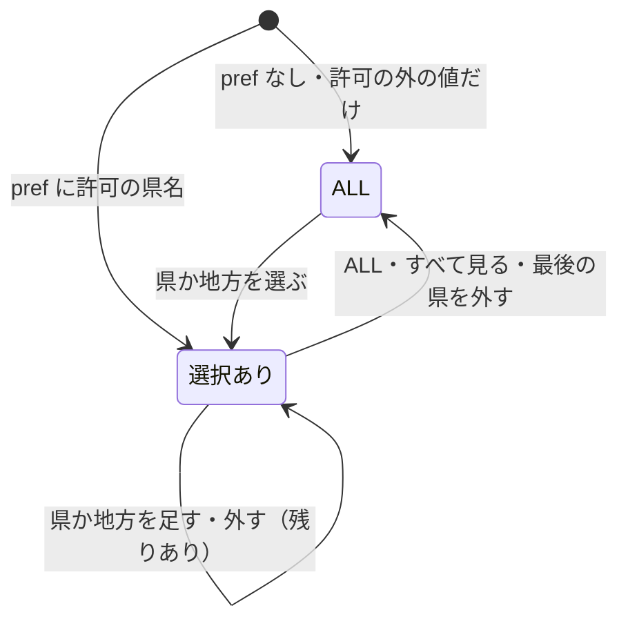

# STOCKIST の構造設計

> 状態: 推定 | 確認日: 2026-10-26 | 対象: STOCKIST（取扱店の一覧 `/stockist`・ホームの取扱店の節の部品・管理の取扱店） | 基準コミット: `4facf63b`

## 概要

STOCKIST の領域の構成・画面・画面遷移・状態遷移・API・データを、追跡できる項目（`### <ID> <題>` と属性の表）で書く。
中身は 2026-10-24 の作業ツリーのコードを読んで起こした今の動きで、ユーザーの確認を受けていないので全部「推定」にした。要件と食い違う所は決めずに今のコードの動きを書き、食い違いは `docs/05_Quality/reports/trace-matrix.md` の「食い違い」節（TM-STOCKIST-NN）に載せた。

| 種類 | 数 | ID | 中身 |
| --- | --- | --- | --- |
| 構成 | 4 | `ARC-STOCKIST-001`〜`004` | 公開の読み出し、管理の書き換え、管理の窓口の守りの部品、共有の proxy の Origin の確かめ |
| 画面 | 6 | `SCR-STOCKIST-001`〜`006` | 一覧、店のカード、ホームの取扱店の節、管理の STOCKIST タブ、作成、編集 |
| 画面遷移 | 2 | `FLOW-STOCKIST-001`〜`002` | 公開の入口と出口、管理の一覧と作成・編集の行き来 |
| 状態遷移 | 2 | `STATE-STOCKIST-001`〜`002` | 店の公開の状態、一覧の地方・都道府県の選択 |
| API | 6 | `API-STOCKIST-001`〜`006` | 管理の6つの窓口（一覧・作成・1件・更新・公開の切り替え・削除） |
| データ | 4 | `DATA-STOCKIST-001`〜`004` | 店の表、RLS と付与、地方と都道府県の対応、権限 |

- 結論: 公開の側は Server Component が取り出しの関数を直接呼び、公開の店だけを6つの列で返す。公開の API の窓口は無い。管理の側は利用者の端末で動く画面から Route Handler を通し、窓口で権限・2要素認証・回数の制限・CSRF の token を確かめた上で、読みは利用者の JWT の client で RLS に通し、書き込みは service role で行う（ADR-0267）
- 地方・都道府県の絞り込みは、全部の公開の店をサーバーで1回取り、画面の側で URL の `pref` と住所の先頭の県名を突き合わせて行う
- DB の表は `type` を NULL 可の列として持ち、管理の作成の窓口は `type` を送らない。移行 `stockists_type_optional`（2026-10-26）で NOT NULL を外したので、`type` は NULL のまま作られる（DATA-STOCKIST-001、API-STOCKIST-002）
- 今のコードが満たさないセキュリティ要件（SEC-STOCKIST-003・008・012・015・019〜021。002・009・010・011・013・014・018 は 2026-10-26 に直した）は、満たす形の構造を持たないので上位につながず、本文に「満たさない」と書いた。一部だけ満たす要件は NEWS と同じ決まりで、満たさない所がその項目の受け持つコードにある時は上位にせず、ほかのコードにだけある時は上位にした。SEC-STOCKIST-010・014 は 2026-10-26 に route の包み `withNoStore` と `describeErrorForLog` で満たしたので、API-STOCKIST-001〜006 の上位につなぐ

## 範囲と根拠

| 項目 | 内容 |
| --- | --- |
| 範囲 | `scripts/trace/scope.json` の STOCKIST |
| 上位の文書 | [STOCKIST の要件](../../02_Requirements/areas/stockist.md)（要件・`SEC-STOCKIST-`・`DRV-STOCKIST-`）、`docs/03_BasicDesign/decisions/ADR-0250`〜`ADR-0266` |
| 対象のコード | `src/app/stockist/page.tsx`、`src/features/stockist/`（`components/PublicStockistGrid.tsx`・`services/public.ts`・`services/admin-security.ts`・`region.ts`・`types.ts`）、`src/app/api/admin/stockists/`、`src/components/StockistSection.tsx`、`src/app/admin/stockist/` |
| 対象の DB | `supabase/migrations/20260901102912_remote_schema.sql`（表・索引・引き金・RLS・付与）、`supabase/migrations/20261023175712_group_g0_permissions.sql`（権限と `has_permission`）、`supabase/seed.sql`（手元の見本の6件） |
| 関連文書 | `docs/03_BasicDesign/ui/screen-list.md`、`docs/03_BasicDesign/ui/screen-flow.md`、`docs/03_BasicDesign/api/api-spec.md`（どれも読むだけにし、STOCKIST の構造設計はこの文書に書く） |
| 調べた時点 | 2026-10-24 の作業ツリー（コードと DB は読んだだけで、動かしての確かめはしていない） |

範囲外の共有部品は ID を持たないので、項目の根拠と本文にファイルの道で書く。

| 共有部品 | 道 | STOCKIST での使われ方 |
| --- | --- | --- |
| 管理の認可 | `src/lib/auth/admin-rbac.ts` の `authorizeAdminPermission` | 6つの窓口で token・session の生存・DB の ACL・aal2 を確かめる |
| CSRF の token の確かめ | `src/lib/csrfMiddleware.ts` の `requireCsrfOrDeny` | 変更の4つの窓口で、`x-csrf-token` を session の印と比べる |
| Origin の確かめと守りの見出し | `src/proxy.ts` | `/api` の変更の要求の Origin・Referer の照合、全部の応答の守りの見出し |
| 回数の制限 | `src/features/auth/middleware/rateLimit.ts` の `enforceRateLimit` | 管理の窓口の送り元と操作者の2本の数え |
| 監査 | `src/lib/audit.ts` の `logAudit` | 変更の成功・入力の誤り・DB の誤りを `audit_logs` に残す |
| Supabase の client | `src/lib/supabase/server.ts` の `createClient` | 公開の読み出し（Cookie の session に結びつく）と管理の DB の読み（要求の JWT）。管理の DB の書き込みは `createServiceRoleClient`（認可の後） |
| 書き換えの送り方 | `src/lib/client-fetch.ts` の `clientFetch` | 管理の画面から窓口へ送る。変更には `x-csrf-token` を付ける |
| 管理の頁の殻 | `src/app/admin/page.tsx`、`src/components/AdminSideNav.tsx`、`src/components/AdminTabs.tsx` | STOCKIST タブ、「新規作成」のボタン、一覧の部品の置き場（別の作業が作り直している共有の頁） |
| 画面の部品 | `src/components/ui/{Button,Card,Checkbox,Drawer,SectionTitle,StatusBadge,SingleSelect,TextField}` | カード・絞り込み・引き出し・フォーム |
| 全体の CSS | `src/styles/globals.css` | カードの余白・区切り線・行の間（黄金比の変数） |
| 入口のリンク | `src/components/Header.tsx`、`src/components/Footer.tsx`、`src/app/page.tsx` | `/stockist` への入口とホームの取扱店の節（AUTH・HOME などの領域） |

## 構成

矢印は呼び出しの向き。ラベルは使う Supabase の client。公開の道（上）は API を通らず、ページのサーバーの中で表を読む。管理の道（下）は窓口ごとに守りの部品を通り、読みだけ利用者の JWT を DB まで持ち込み、書き込みは認可の後に service role で行う。画像の置き場・外のサービスへの矢印は無い（Google Maps は閲覧者がリンクで開くだけ）。

### ARC-STOCKIST-001 公開の読み出しはページのサーバーの中で取り出しの関数を直接呼び、公開の店だけを6つの列で返す

| 属性 | 値 |
| --- | --- |
| 上位 | FREQ-13-REQ-01、FR-STOCKIST-003、SEC-STOCKIST-001、SEC-STOCKIST-002、SEC-STOCKIST-018、DRV-STOCKIST-001、ADR-0250、ADR-0253、ADR-0254、ADR-0257 |
| 根拠 | 店の数が少ない前提で、ページを作るサーバーの中で全部の公開の店を1回取り、店を入れた HTML をそのまま返すため（ADR-0250）。取り出しの条件と DB の RLS の2段で公開の店だけに絞り、返す列も6つに限れば、片方が崩れても非公開の店と内部の列を外へ出さない（SEC-STOCKIST-001、ADR-0254）。DB が一時的に落ちても頁全体を誤りにせず空の表示で済ませる（FR-STOCKIST-003、ADR-0253）。並びの要件が無いので、取るたびに並びが変わらないよう id の順にする（DRV-STOCKIST-001、ADR-0257） |
| 状態 | 推定 |
| 確かめ方 | 結合テスト |
| 出どころ | 実装から推定（`src/app/stockist/page.tsx`、`src/features/stockist/services/public.ts`、`src/app/page.tsx`） |

- 呼ぶ側: `/stockist`（`src/app/stockist/page.tsx`、`getPublicStockists`）とホーム（`src/app/page.tsx`、範囲外。`getHomePublicStockists`）。どちらも Server Component で、店を client の部品 `PublicStockistGrid` に渡す
- 取り出し: `status='published'` で絞り、id の昇順に並べる（`public.ts`）。選ぶ列は7つ（状態を含む）で、返す前に id・店舗名・住所・電話・営業時間・定休日の6つに詰め直す（`public.ts`）
- 件数: 上限は必ず 200 件（`PUBLIC_STOCKIST_FETCH_LIMIT`）。`/stockist` は件数を渡さず、上限の 200 件で取る。ホームは 6 件まで。呼び出しの件数が 200 を超える・無い・0 以下・NaN・無限の時も 200 を掛ける（`public.ts`、SEC-STOCKIST-018。2026-10-26）。PostgREST の `max_rows` を本番で設定するかは確かめていない
- client: `createPublicClient()`（引数なし）で、ログインの Cookie を引き継がない anon の client を使う（`public.ts`、SEC-STOCKIST-002。2026-10-26）。管理の権限を持つ人がログインしたまま開いても、DB の RLS は anon として働き、取り出しの条件と合わせて非公開の店は出ない（以前は `createClient()` で閲覧者の session を引き継いだ）
- 失敗: Supabase の `error` を見て、サーバーの記録に書き、空の一覧を返す（`public.ts`）。画面の側では0件と同じ表示になる（SCR-STOCKIST-001・003）
- 描き方: `/stockist` は `searchParams` を待って毎回サーバーで描く（`page.tsx`。絞り込みの部品が URL を読むため）。`revalidate`・`use cache` の指定は無い
- 未使用（削除の判断待ち）: 地図の埋め込みの URL の定数 `STOCKIST_MAP_EMBED_URL`（`public.ts`）はどこからも読まれない。消すかは `docs/05_Quality/reports/unused-code.md` の判断の列でユーザーが決める

### ARC-STOCKIST-002 管理の書き換えは画面から Route Handler を通し、認可の後に service role の client で DB を変える

| 属性 | 値 |
| --- | --- |
| 上位 | FR-ADMIN-006、FREQ-18-REQ-01、SEC-STOCKIST-006、FREQ-316-REQ-01（範囲外）、FREQ-316-REQ-02（範囲外）、FREQ-316-REQ-03（範囲外）、ADR-0258、ADR-0261、ADR-0262、ADR-0267 |
| 根拠 | 管理の画面は利用者の端末で動く client の部品なので、守りを画面に置けないため。窓口ごとに署名を確かめた token・有効な session・DB の ACL の権限・aal2 を確かめ（SEC-STOCKIST-006、FREQ-316（範囲外）、ADR-0262）、その後で書き込みを service role で行う。管理だけが書く表から anon・authenticated の書き込みの権限を外す（SEC-STOCKIST-003、SEC-STOCKIST-008）には、利用者の JWT で書く窓口を無くす必要があり、窓口の認可・回数の制限・CSRF が書き込みの守りになる（ADR-0267）。読みは利用者の JWT で RLS に通す（ADR-0258）。変更は成功も失敗も監査に残し、後から追えるようにする（ADR-0261） |
| 状態 | 推定 |
| 確かめ方 | 結合テスト |
| 出どころ | 実装から推定（`src/app/api/admin/stockists/route.ts`、`src/app/api/admin/stockists/[id]/route.ts`、`src/components/StockistSection.tsx`、`src/app/admin/stockist/`）、`docs/03_BasicDesign/api/api-spec.md` |

- 画面: `StockistSection`（一覧・公開の切り替え・削除）と `StockistForm`（作成・編集）。どちらも client の部品で、権限での出し分けはしない。タブと「新規作成」のボタンの出し分けは共有の `src/app/admin/page.tsx`（範囲外）
- 窓口の順: `[id]` の窓口は先に id の形を確かめて 400 を返す。次に認可、回数の制限、変更だけ CSRF の token、入力の確かめ、DB、監査の順（`route.ts`、`[id]/route.ts`）
- 認可: `authorizeAdminPermission`（`src/lib/auth/admin-rbac.ts`）が token を確かめ（401）、session の生存と DB の ACL を照会し（停止は 503、無効は 401）、権限が無ければ 403、`aal` が `aal2` でなければ 403 `MFA required` を返す
- DB: 読み（GET の2つ）は `createClient(request)` で要求の JWT を付け、RLS（DATA-STOCKIST-002）を効かせる。書き込み（POST・PUT・PATCH・DELETE）は、認可・回数の制限・CSRF・入力の確かめの後に `createServiceRoleClient()` を1回作って行う（ADR-0267）。RLS の書き込み方針は権限を外した後も二重の守りとして残る。窓口の認可が書き込みの唯一の守りなので、`authorizeAdminPermission` の位置（本文の検証より前）を変えない。例外（推定）: 認可は期限の猶予を見ずに token を確かめるが、読みの client は期限まで5秒以下の token を送らず、Cookie を読む client に落ちる（`src/lib/auth/request-token.ts`、`src/lib/supabase/server.ts`）。その時は Google OAuth の Cookie（`sb-<ref>-auth-token`）の別の session か、無ければ anon で動く。書き込みは service role の client に移したので、この落ち方の影響を受けない（THR-STOCKIST-013）
- 監査: 変更の4つは `logAudit`（`src/lib/audit.ts`）を呼ぶ。resource は `stockists`、送り元（`x-forwarded-for` の先頭）とブラウザの名を残す。GET は監査しない。送り元を信頼できる値から取ること・店名から制御文字を除くこと（SEC-STOCKIST-012）は満たさないので上位にしない。0件の変更を成功にしないこと・消した中身を残すこと（SEC-STOCKIST-013）は 2026-10-26 に満たした（PUT・PATCH・DELETE は変えた行を `.select()` で受け取り、0 行は 404 と結果 failure の監査。削除の成功の監査は `metadata.deleted` に id・name・address・status を残す。API-STOCKIST-004〜006）。認可で断った要求（401・403・`MFA required`・503）は共有の `admin-rbac.ts` が `console.warn` を出すだけで、監査しない（推定。SEC-STOCKIST-021 は満たさない）
- 画面のページ（`/admin/stockist/create`・`/admin/stockist/edit/[id]`）にサーバーの守りは無く、殻は誰でも開け、送った時に窓口が断る（SEC-STOCKIST-019 は満たさない）
- DB を直接叩く道: RLS は `has_permission` だけを見て aal2 と session の生存を見ないので、権限を持つ人の aal1 の JWT で PostgREST から直接書ける。この道は回数の制限・CSRF・監査を通らない（推定。SEC-STOCKIST-003 は満たさない）。窓口の書き込みは service role に移したので、表の書き込みの権限を外す移行を当てれば、この道を塞げる（ADR-0267。移行は別のタスク）

### ARC-STOCKIST-003 管理の窓口の回数の制限と CSRF の token の確かめを、取扱店の守りの部品にまとめる

| 属性 | 値 |
| --- | --- |
| 上位 | SEC-STOCKIST-007、SEC-STOCKIST-010、NFR-SEC-003（範囲外）、ADR-0259、ADR-0260、ADR-0266 |
| 根拠 | 2026-04-18 のレビューの P1（CSRF・回数の制限の抜け）を、6つの窓口で同じ形に直すため、守りを `admin-security.ts` の1か所に置く（ADR-0259・0260）。送り元の見出しは偽れるので、操作者の枠も数え、漏れた session で短い時間に大量の列挙・書き換えをさせない（SEC-STOCKIST-007）。変更の要求には、Origin の確かめ（ARC-STOCKIST-004）に加えて session の CSRF の token を求める（全体の NFR-SEC-003 を取扱店の窓口に当てはめた） |
| 状態 | 推定 |
| 確かめ方 | 結合テスト |
| 出どころ | 実装から推定（`src/features/stockist/services/admin-security.ts`）、`docs/05_Quality/reviews/code/2026-04-18-stockist-review.md` |

| 部品 | 中身 | 出どころ |
| --- | --- | --- |
| 読みの回数の制限 | 名前 `admin:stockists:read`、600 秒ごとに区切った窓で 120 回 | `admin-security.ts` |
| 変更の回数の制限 | 名前 `admin:stockists:mutation`、600 秒ごとに区切った窓で 20 回 | `admin-security.ts` |
| 2本の数え | 送り元の枠を先に見て、通れば操作者（userId）の枠を見る。超えたら 429 と `Retry-After`、数えの DB が使えない時は 503 | `admin-security.ts`、`rateLimit.ts` |
| CSRF の token | 共有の `requireCsrfOrDeny` を呼ぶ。refresh の Cookie が無ければ確かめない。token が無い・違う時は 403、DB の誤りは 500 | `admin-security.ts`、`csrfMiddleware.ts` |
| 拒否の応答への変換 | 結果が空なら通す。`Response` ならそのまま返す。試験の作り物の形（`status` と `_body`）なら JSON の応答に作り直す。どれでもない値は通す | `admin-security.ts` |
| token の回し | 結果が回した token の形なら、成功の応答で CSRF の Cookie を付け直す | `admin-security.ts` |

- 送り元: 共有の `enforceRateLimit` が `x-forwarded-for` を無条件に読む（`rateLimit.ts`）。信頼できる中継の値だけから取ることは満たさない（共有の部品の側。操作者の枠で補う）
- 拒否の判定: 分からない結果を「通す」に倒すので、SEC-STOCKIST-004 の「判定できない時は拒む」はこの部品では満たさない。この項目の上位にはしない（Origin の段は ARC-STOCKIST-004 の上位にした）
- 通らない道: 共有の `requireCsrfOrDeny` は token を回した形をもう作らない（`csrfMiddleware.ts`）。回した token の Cookie を付ける道と、試験の作り物の形を受ける道は、今の本番の道からは通らない（推定）
- 回数の制限は CSRF の token の確かめより前にある。別のサイトからの要求は proxy が先に止めるので枠を使わない（ARC-STOCKIST-004）
- 応答の見出し: 6つの窓口は、各ハンドラーを内側の関数にし、`export` が共有の包み `withNoStore`（`src/lib/http/no-store.ts`）で返す。認可の 401・403・503、CSRF の拒否、回数の 429・503、本体の全部の戻りと外側の `catch` の 500 の `Cache-Control` が `private, no-store` になる（SEC-STOCKIST-010、ADR-0266）
- 回数の制限は認可の後に呼ぶ（`route.ts`、`[id]/route.ts`）。認可で断られた要求（401・403）は送り元の枠にも操作者の枠にも数えない（推定。SEC-STOCKIST-020 は満たさないので上位にしない）

### ARC-STOCKIST-004 共有の proxy が取扱店の変更の要求の Origin を窓口の前で確かめる

| 属性 | 値 |
| --- | --- |
| 上位 | SEC-STOCKIST-004、SEC-STOCKIST-005、FREQ-327-REQ-01（範囲外）、NFR-SEC-003（範囲外）、ADR-0260 |
| 根拠 | `/api` の下の変更の要求を全部、1か所の proxy で Origin・Referer の照合にかければ、窓口ごとの付け忘れが出ないため（FREQ-327-REQ-01（範囲外））。別のオリジンの要求は窓口に届く前に拒むので、管理者本人の変更の枠を使い切らせない（SEC-STOCKIST-005）。窓口の CSRF の token（ARC-STOCKIST-003）と合わせて2段にする（SEC-STOCKIST-004、ADR-0260） |
| 状態 | 推定 |
| 確かめ方 | 結合テスト |
| 出どころ | 実装から推定（`src/proxy.ts`） |

- 道: proxy の対象は全部の道（`src/proxy.ts`）。`/api/admin/stockists` と `/api/admin/stockists/<id>` の POST・PUT・PATCH・DELETE は Origin の確かめの対象で、除外の一覧（Webhook・受信・定期の実行）に入らない（`proxy.ts`）
- 判定: Origin が無ければ Referer のオリジンを使い、どちらも無い変更の要求は通さない。許可のオリジンの設定があればそれと比べ、無ければ要求の自分のオリジンと比べる（`proxy.ts`）。外れたら 403 `Forbidden origin`（`proxy.ts`）
- GET の2つの窓口は Origin を見ない（読みは状態を変えないため）
- 守りの見出し: 全部の応答に CSP・`X-Content-Type-Options`・`X-Frame-Options`・HSTS などを付ける（`proxy.ts`）。管理の応答の `Cache-Control: private, no-store`（SEC-STOCKIST-010）は proxy でなく各 route の包み（ARC-STOCKIST-003）が付ける。proxy が窓口に届く前に返す Origin の 403 には付かない（波 3）

## 画面

### SCR-STOCKIST-001 取扱店の一覧 `/stockist`

| 属性 | 値 |
| --- | --- |
| 上位 | FREQ-13-REQ-01、FR-STOCKIST-001、FR-STOCKIST-005、FR-STOCKIST-006、FR-STOCKIST-010、FREQ-57-REQ-01、DRV-STOCKIST-007、DRV-STOCKIST-010、DRV-STOCKIST-011、DRV-STOCKIST-013、FREQ-118-REQ-01（範囲外）、FREQ-119-REQ-01（範囲外）、ADR-0250、ADR-0253 |
| 根拠 | 店の数が増えても1つの格子で見渡せ、狭い画面でもカードが潰れないよう、幅で列を変える（FR-STOCKIST-001、FREQ-118-REQ-01）。近くの店を地方と都道府県で探せるよう、絞り込みを LOOK・ITEM・NEWS の一覧と同じ置き場と幅に置く（FR-STOCKIST-010、FREQ-57-REQ-01、FREQ-119-REQ-01）。店が少ない今は検索・並び替え・ページ分けを置かない（FR-STOCKIST-006）。絞り込みの結果が0件でも行き止まりにしない（DRV-STOCKIST-007、ADR-0253）。検索の結果と共有のカードで取扱店の頁だと分かる題と説明を出す（FR-STOCKIST-005、DRV-STOCKIST-013） |
| 状態 | 推定 |
| 確かめ方 | 結合テスト |
| 出どころ | 実装から推定（`src/app/stockist/page.tsx`、`src/features/stockist/components/PublicStockistGrid.tsx`）、`docs/03_BasicDesign/ui/screen-list.md` |

| 幅 | 絞り込み | 格子 |
| --- | --- | --- |
| 640px 未満 | FILTER のバーをヘッダーの真下に留め、押すと左の引き出し（Drawer）が開く | 1列 |
| 640〜1023px | 同上 | 2列 |
| 1024〜1279px | 左の列（幅 58.25 の単位）をヘッダーの真下に留める。FILTER のバーは出さない | 2列 |
| 1280〜1535px | 左の列（288px） | 3列 |
| 1536px 以上 | 同上 | 4列 |

- 作り: ページは `PublicStockistGrid` の一覧の形（`variant="catalog"`）を置くだけ（`page.tsx`）。絞り込みと格子は client の部品の `CatalogGrid`（`PublicStockistGrid.tsx`）
- 格子: `grid-cols-1 sm:grid-cols-2 xl:grid-cols-3 2xl:grid-cols-4`（`PublicStockistGrid.tsx`）。カードは SCR-STOCKIST-002。幅の上限（1680px）は持たない
- 左の列: 1024px 以上で出し、高さは画面からヘッダーを引いた分、はみ出す分は列の中で動かす（DRV-STOCKIST-011）。幅は LOOK・ITEM・NEWS の一覧と同じ（FREQ-119-REQ-01）
- FILTER のバー: 1024px 未満で、ヘッダーの高さとずれの変数で位置を決めて画面に留め、同じ高さの見えない置き台を一覧の頭に置く（DRV-STOCKIST-010）。ボタンは引き出しが開いているかを読み上げに伝える
- 引き出し: 左から開き、閉じるボタン（`Close filter drawer`）を持つ。中身は左の列と同じ絞り込み。選んでも引き出しは閉じない
- 絞り込みの中身: `ALL`、店のある地方、その地方で店のある県（STATE-STOCKIST-002）。全体を「エリア（地方・都道府県）で絞り込む」の群として読み上げに伝える
- 空の時: 出す店が0件なら「該当する取扱店舗がございません。」と「すべて見る」（選んだ県を全部外す）を出す。公開の店が0件の時と、取り出しが失敗した時も同じ表示（DRV-STOCKIST-007）
- 題と説明: 題は「STOCKIST | Le Fil des Heures」、説明は取扱店舗の一覧である旨の文、OGP の題と説明は同じで画像は `/mainphoto.png`（`page.tsx`）。canonical・`og:url` は返さない（推定。NFR-SEO-003 は canonical も求めるので上位にしない）
- 見出し: h1 も、頁の見出しの部品（SectionTitle）も無い。最初の見出しはカードの店舗名の h3
- 置かない物: 言葉の検索・並び替え・ページ送り（FR-STOCKIST-006）

### SCR-STOCKIST-002 取扱店のカード（一覧とホームで共用）

| 属性 | 値 |
| --- | --- |
| 上位 | FR-STOCKIST-002、FR-STOCKIST-008、SEC-STOCKIST-016、DRV-STOCKIST-002、DRV-STOCKIST-003、DRV-STOCKIST-004、DRV-STOCKIST-012、NFR-A11Y-002（範囲外）、ADR-0255 |
| 根拠 | 来店の前に要る情報（どこに・いつ開いているか・連絡先）を1枚で分かるようにするため（FR-STOCKIST-002）。店舗名を見出しにしてスクリーンリーダーでカードを辿れるようにし、カードの区別は名前でなく id にする（FR-STOCKIST-008、NFR-A11Y-002）。地図を埋め込まずに住所から道順へ移れるリンクを置き（DRV-STOCKIST-002、ADR-0255）、スマートフォンからすぐ電話できるようにする（DRV-STOCKIST-003）。店舗の値は文字として出し、リンクは決まった形でだけ作る（SEC-STOCKIST-016）。モバイルではカードを短くする（DRV-STOCKIST-004）。余白はブランドの黄金比の決まりに合わせる（DRV-STOCKIST-012） |
| 状態 | 推定 |
| 確かめ方 | 結合テスト |
| 出どころ | 実装から推定（`src/features/stockist/components/PublicStockistGrid.tsx`、`src/styles/globals.css`）、`docs/05_Quality/reviews/uiux/uiux_review_stockist.md` |

| 順 | 中身 | 640px 未満 | 出どころ |
| --- | --- | --- | --- |
| 1 | 店舗名（h3） | 出す | `PublicStockistGrid.tsx` |
| 2 | 区切り線 | 出す | `StockistCard` |
| 3 | 住所。Google Maps の検索へのリンク（新しいタブ） | 出す | `StockistCard` |
| 4 | 電話。`tel:` のリンク。電話が空の店は行を出さない | 隠す | `StockistCard` |
| 5 | 営業時間 | 隠す | `StockistCard` |
| 6 | 定休日 | 隠す | `StockistCard` |

- 部品: 共有の `Card`（`size="sm"`・`hoverable`）に `stockist-card` の印を付け、余白・区切り線・行の間は全体の CSS の変数で決める（`globals.css`。同じ指定が同じファイルの別の所にもう一度ある）
- 余白: 見出しと区切り線の間・区切り線と詳細の間は見出しの文字の大きさから黄金比で作る変数（DRV-STOCKIST-012）。E2E `FR-STOCKIST-009` の求める上下の余白と今の値は合わない（記録では期待 16.92px・実 21.25px）
- リンクの作り: 住所は `https://www.google.com/maps/search/?api=1&query=` に `encodeURIComponent` した住所を付け、`target="_blank"` と `rel="noopener noreferrer"`。電話は数字と `+` 以外を消して `tel:` に付ける
- 読み上げ: 各行のアイコンは `aria-hidden`。店舗の値は React の文字として出し、HTML として入れない
- 区別: カードの key は店の id。カードの要素は共有の `Card` が決める
- 640px 未満で3行を隠すのは FR-STOCKIST-002 の「各カードに5つの情報」と食い違う（DRV-STOCKIST-004。要件の側の状態も推定）

### SCR-STOCKIST-003 ホームの取扱店の節（部品のホームの形）

| 属性 | 値 |
| --- | --- |
| 上位 | FR-STOCKIST-004、DRV-STOCKIST-005、DRV-STOCKIST-006、FR-HOME-005（範囲外）、ADR-0252、ADR-0257 |
| 根拠 | ホームでは取扱店があることを短く知らせ、モバイルでは縦に長くなり過ぎないよう3件に抑えるため（FR-STOCKIST-004）。1回の取り出し（6件）で幅ごとの出し分けを CSS で済ませる（ADR-0252）。店が1・2件の時に広い格子で余白ばかりにならないよう列を減らして中央に寄せ（DRV-STOCKIST-005）、0件の時は空の節で終わらせずオンラインの商品へ進める（DRV-STOCKIST-006）。節の置き場はホーム（FR-HOME-005）が持つ |
| 状態 | 推定 |
| 確かめ方 | 結合テスト |
| 出どころ | 実装から推定（`src/features/stockist/components/PublicStockistGrid.tsx`、`src/features/stockist/services/public.ts`、`src/app/page.tsx`） |

| 件数 | 格子 |
| --- | --- |
| 0 | 「現在、取扱店舗はございません。オンラインストアにて販売中です。」と `/item` への「VIEW COLLECTION」 |
| 1 | 1列、狭い幅で中央 |
| 2 | 640px 以上で2列、中ほどの幅で中央 |
| 3〜6 | 640px 以上で2列、1024px 以上で3列。4件目からは 768px 未満で隠す |

- 作り: `section#stockist` の中に共有の `SectionTitle`（題 `STOCKIST`）と格子を置く（`PublicStockistGrid.tsx`）。カードは SCR-STOCKIST-002
- 件数: 取り出しが6件まで（ADR-0252、並びは id の順で ADR-0257）。4件目から `hidden md:block`
- 一覧の頁 `/stockist` へのリンクはこの節に無い（入口はヘッダーとフッター。FLOW-STOCKIST-001）

### SCR-STOCKIST-004 管理画面の STOCKIST タブの一覧

| 属性 | 値 |
| --- | --- |
| 上位 | FR-ADMIN-006、FREQ-18-REQ-01、DRV-STOCKIST-014、ADR-0263、ADR-0264 |
| 根拠 | 店長が管理画面の1つのタブで、非公開の店も含めて全部の店を状態の札つきで見て、その場で公開を切り替え、編集へ移り、消せるようにするため（FR-ADMIN-006）。削除は行を消して戻せないので、確かめの窓を挟む（DRV-STOCKIST-014、ADR-0264）。状態は2つだけなので、ボタンは今の状態の反対へ切り替える（ADR-0263） |
| 状態 | 推定 |
| 確かめ方 | 結合テスト |
| 出どころ | 実装から推定（`src/components/StockistSection.tsx`、`src/app/admin/page.tsx`） |

- 置き場: 共有の `src/app/admin/page.tsx`（範囲外）の STOCKIST タブ。タブの見出しの横に `/admin/stockist/create` への「新規作成」を置く（`admin/page.tsx`）
- 取得: 開いた時に `GET /api/admin/stockists`（API-STOCKIST-001）を1回呼ぶ。読み込み中は「読み込み中...」、0件か取得の失敗は「STOCKISTがありません」（`StockistSection.tsx`）。取得の失敗を利用者に知らせる文は無い
- 格子: 1列、640px 以上で2列、1280px 以上で3列
- カード: 店舗名（h3）と「公開中」「非公開」の札、区切り線、住所・電話・営業時間・定休日の4行（電話が空でも行を出す）、下に「公開」か「非公開」・「編集」・「削除」のボタン。公開の店は背景を薄い緑にする
- 公開の切り替え: 今の状態の反対を `PATCH`（API-STOCKIST-005）で送り、成功したら一覧を取り直す。失敗は「ステータスの更新に失敗しました」の知らせの窓
- 削除: 「このSTOCKISTを削除してもよろしいですか？」の窓で受けた時だけ `DELETE`（API-STOCKIST-006）を送り、成功したら取り直す。失敗は「STOCKISTの削除に失敗しました」
- 編集: `/admin/stockist/edit/<id>` へのリンク
- アイコンに `aria-hidden` は無い

### SCR-STOCKIST-005 取扱店の作成 `/admin/stockist/create`

| 属性 | 値 |
| --- | --- |
| 上位 | FR-ADMIN-006、FREQ-18-REQ-01、DRV-STOCKIST-015、NFR-A11Y-005（範囲外）、ADR-0263、ADR-0265 |
| 根拠 | 作成と編集で同じ欄・同じ確かめを使えば、決まりが1つで済むため、一覧とは別の頁に同じフォームを置く（ADR-0265）。作ったばかりの店が確かめる前に公開されないよう、公開の状態の初めを非公開にし（DRV-STOCKIST-015、ADR-0263）、カードの5つの情報が欠けた店を作らないよう全部の欄を必須にする（DRV-STOCKIST-015）。各欄にラベルを付ける（NFR-A11Y-005） |
| 状態 | 推定 |
| 確かめ方 | 結合テスト |
| 出どころ | 実装から推定（`src/app/admin/stockist/create/page.tsx`、`src/app/admin/stockist/StockistForm.tsx`）、`docs/03_BasicDesign/ui/screen-list.md` |

| 欄 | 部品 | 初めの値 | 画面の確かめ |
| --- | --- | --- | --- |
| 公開状態 | `SingleSelect`（dropdown、ラベル「公開状態」） | 非公開 | — |
| 店舗名 | `TextField`（必須） | 空 | 前後の空白を除いて空なら送らない |
| 住所 | 同上 | 空 | 同上 |
| 電話番号 | 同上 | 空 | 同上 |
| 営業時間 | 同上 | 空 | 同上 |
| 定休日 | 同上 | 空 | 同上 |

- 作り: 頁はフォームに作成の窓口（`POST /api/admin/stockists`、API-STOCKIST-002）を渡すだけ（`create/page.tsx`）
- 送る: 前後の空白を除いた5つの欄と状態を JSON で送る（`StockistForm.tsx`）。空の欄があれば「必須項目を入力してください」を出して送らない。送る間はボタンを「保存中...」にして押せなくする
- 結果: 成功は「STOCKISTを保存しました」を出して `/admin?tab=STOCKIST` へ移る（FLOW-STOCKIST-002）。失敗は窓口の `error` の文か「STOCKISTの保存に失敗しました」、通信の失敗は「通信エラーが発生しました。時間をおいて再度お試しください」
- 種別（`type`）の欄は無い（ADR-0256。DB の表は NULL 可の列として持つ。DATA-STOCKIST-001）
- キャンセル・戻るのボタンは無い
- 頁の入口で権限を確かめない（SEC-STOCKIST-019 は満たさない）

### SCR-STOCKIST-006 取扱店の編集 `/admin/stockist/edit/[id]`

| 属性 | 値 |
| --- | --- |
| 上位 | FR-ADMIN-006、FREQ-18-REQ-01、DRV-STOCKIST-015、ADR-0265 |
| 根拠 | 作成と同じフォームを、今の値を入れた状態で開き、店の情報の変更を同じ確かめで送れるようにするため（FR-ADMIN-006、ADR-0265、DRV-STOCKIST-015） |
| 状態 | 推定 |
| 確かめ方 | 結合テスト |
| 出どころ | 実装から推定（`src/app/admin/stockist/edit/[id]/page.tsx`、`src/app/admin/stockist/StockistForm.tsx`）、`docs/03_BasicDesign/ui/screen-list.md` |

- 取得: URL の id で `GET /api/admin/stockists/<id>`（API-STOCKIST-003）を1回呼び、返った6つの値をフォームの初めの値にする（`edit/[id]/page.tsx`）
- 表示: 読み込み中は「読み込み中...」、取得の失敗は窓口の `error` の文か「STOCKISTの取得に失敗しました」を同じ頁に出す
- 送る: フォームは `PUT /api/admin/stockists/<id>`（API-STOCKIST-004）に、作成と同じ5つの欄と状態を送る。成功は「STOCKISTを更新しました」を出して `/admin?tab=STOCKIST` へ移る
- id の扱い: URL の id を確かめずに API の道に入れる。正の整数かを先に確かめること（SEC-STOCKIST-015）は満たさない
- キャンセル・戻るのボタンは無い。頁の入口で権限を確かめない（SEC-STOCKIST-019 は満たさない）

## 画面遷移

### FLOW-STOCKIST-001 ヘッダー・フッターから一覧へ入り、カードから地図と電話へ出る

| 属性 | 値 |
| --- | --- |
| 上位 | FREQ-13-REQ-01、DRV-STOCKIST-002、DRV-STOCKIST-003、DRV-STOCKIST-006、ADR-0255 |
| 根拠 | どの頁からでも取扱店に届くよう、全部の頁に出るヘッダーとフッターに入口を置く（FREQ-13-REQ-01）。店を見つけた人がそのまま来店・問い合わせへ進めるよう、住所から地図、電話番号から発信へ移れるようにする（DRV-STOCKIST-002・003、ADR-0255）。ホームで店が0件の時は商品の一覧へ渡す（DRV-STOCKIST-006） |
| 状態 | 推定 |
| 確かめ方 | 結合テスト |
| 出どころ | 実装から推定（`src/components/Header.tsx`、`src/components/Footer.tsx`、`src/features/stockist/components/PublicStockistGrid.tsx`）、`docs/03_BasicDesign/ui/screen-flow.md` |

矢印は押した時の移り先。ヘッダー・フッター・ホームの節の置き場は範囲外の部品で、STOCKIST の側では持たない。ヘッダー・フッターから出るほかの頁への移りは図に入れていない。

- 入口: ヘッダーのナビ（`src/components/Header.tsx`）とフッター（`src/components/Footer.tsx`）。ホームの取扱店の節から `/stockist` へのリンクは無い（SCR-STOCKIST-003）
- 絞り込み: 同じ道の `pref` を書き換えて履歴を1つ足す。画面の位置は動かさない（STATE-STOCKIST-002）
- 地図: 新しいタブで開き、開いた先から元の頁を触れない（`rel="noopener noreferrer"`）
- 電話: `tel:` のリンク。640px 未満のカードでは電話の行を隠すので、モバイルからは発信できない（DRV-STOCKIST-004）
- 試験: 入口を押して移る試験と、地図・電話のリンクの形の試験は無い

### FLOW-STOCKIST-002 管理の一覧から作成・編集へ移り、保存で一覧へ戻る

| 属性 | 値 |
| --- | --- |
| 上位 | FR-ADMIN-006、DRV-STOCKIST-015、ADR-0265 |
| 根拠 | 作成と編集を一覧と別の頁にし、保存できたら STOCKIST タブを開いた一覧へ戻して、結果をすぐ確かめられるようにするため（FR-ADMIN-006、ADR-0265、DRV-STOCKIST-015） |
| 状態 | 推定 |
| 確かめ方 | 結合テスト |
| 出どころ | 実装から推定（`src/app/admin/page.tsx`、`src/components/StockistSection.tsx`、`src/app/admin/stockist/StockistForm.tsx`）、`docs/03_BasicDesign/ui/screen-flow.md` |

矢印は押した時と保存の結果の移り先。公開の切り替えと削除は一覧の中で終わり、頁を移らない。

- 戻り先: 保存の成功で `router.push('/admin?tab=STOCKIST')`（`StockistForm.tsx`）。`tab` は初めに開くタブを決める（共有の `admin/page.tsx`）
- 失敗: 同じ頁に誤りの文を出して留まる
- キャンセル・戻るのボタンは無く、戻るにはブラウザの戻るか管理のナビを使う

## 状態遷移

### STATE-STOCKIST-001 店の公開の状態（非公開と公開）

| 属性 | 値 |
| --- | --- |
| 上位 | FR-ADMIN-006、SEC-STOCKIST-001、DRV-STOCKIST-015、ADR-0263、ADR-0264 |
| 根拠 | 外へ出すかどうかを1つの列の2つの値で決めれば、公開の道（RLS と取り出しの条件）が `published` の1つだけを見ればよくなるため（ADR-0263、SEC-STOCKIST-001）。作った店は確かめる前に出ないよう非公開から始める（DRV-STOCKIST-015）。要らなくなった店は非公開で隠せるので、削除は行を消す操作にする（ADR-0264） |
| 状態 | 推定 |
| 確かめ方 | 結合テスト |
| 出どころ | 実装から推定（`supabase/migrations/20260901102912_remote_schema.sql`、`src/app/api/admin/stockists/route.ts`、`src/app/api/admin/stockists/[id]/route.ts`、`src/app/admin/stockist/StockistForm.tsx`、`src/components/StockistSection.tsx`） |

- 値: `private`（非公開）と `published`（公開）。DB の CHECK・DB の初めの値（`private`）・窓口の入力の形・型（`src/features/stockist/types.ts`、`src/app/admin/stockist/types.ts`）が同じ2つ
- 行き来に条件は無く、PUT（全体の更新）と PATCH（状態だけ）のどちらでも変えられる。前の状態は読まず、同じ状態への変更も成功として監査に残す
- 削除はどちらの状態からも行を消し、戻す手段は無い。監査には消した id だけが残る
- 公開から非公開にすると、次に描く `/stockist`・ホームから消える（キャッシュの指定が無いため、推定）

### STATE-STOCKIST-002 一覧の地方・都道府県の選択（ALL と選んだ県）

| 属性 | 値 |
| --- | --- |
| 上位 | FREQ-57-REQ-01、FR-STOCKIST-010、SEC-STOCKIST-017、DRV-STOCKIST-008、DRV-STOCKIST-009、ADR-0250、ADR-0251 |
| 根拠 | 地方で一度に、県で個別に絞れるようにし（FREQ-57-REQ-01、FR-STOCKIST-010）、選んだ状態を URL に残して人に送ったり戻るで戻ったりできるようにするため（DRV-STOCKIST-008、ADR-0250）。URL の値は県名の許可の一覧で絞り、細工した URL で画面を乱させない（SEC-STOCKIST-017）。県は DB の列を足さず住所の先頭から決める（ADR-0251）。URL で絞った状態から入った人に、選ばれている県がすぐ見えるようにする（DRV-STOCKIST-009） |
| 状態 | 推定 |
| 確かめ方 | 結合テスト |
| 出どころ | 実装から推定（`src/features/stockist/components/PublicStockistGrid.tsx`、`src/features/stockist/region.ts`） |

状態は URL の `pref` が決め、画面はそれを読むだけ。矢印は押した時に `pref` を書き換えて、履歴を1つ足して移る（画面の位置は動かさない）。

| 操作 | 結果 | 出どころ |
| --- | --- | --- |
| URL の `pref` | カンマで分け、前後の空白を除き、47都道府県の正式な名前だけを残す。ほかは捨てる | `parsePrefList`・`selectedPrefectures` |
| ALL | 選んだ県を全部外す。印は選択が0の時だけ付く | `clearAll`・`renderAreaTree` |
| 県の箱 | その県を足すか外す | `togglePrefecture` |
| 地方の箱（県が2つ以上） | 配下の店のある県が全部選ばれていれば全部外し、そうでなければ全部足す。印は全部選ばれている時だけ付く | `toggleRegion`・`renderAreaTree` |
| 地方の箱（北海道） | 親子に分けず1つの箱で、県の箱と同じ動き | `renderAreaTree` |
| 開け閉めのボタン | 県が2つ以上の地方の下の県を出すか隠す。開いているかと地方の名前を読み上げに伝える | `renderAreaTree`・`toggleExpand` |
| `pref` の書き換え | 県を地方の定義の順に並べ直してカンマでつなぐ。空なら `pref` を消す。ほかの URL の値は残す | `setPrefectures` |

- 出す選択肢: 店のある地方と、その地方で店のある県だけ。並びは地方の定義の順。県の表示は短い名（「東京都」は「東京」、北海道はそのまま。`region.ts`）
- 出す店: 選択が0なら全部。選択があれば住所の先頭の県が選んだ県に入る店だけ。住所の先頭が県名でない店は、県を選んでいる間は出ない（`displayStockists`、`region.ts`）
- 開け閉めの初め: 最初に描く時だけ、選ばれた県を含む地方を開く。後で URL が変わっても開け閉めは引き継ぐ
- 引き出しの開閉は画面の中だけの状態で、URL に残さない

## API

### API-STOCKIST-001 `GET /api/admin/stockists` 管理の取扱店の一覧

| 属性 | 値 |
| --- | --- |
| 上位 | FR-ADMIN-006、SEC-STOCKIST-006、SEC-STOCKIST-007、SEC-STOCKIST-009、SEC-STOCKIST-010、SEC-STOCKIST-014、DRV-STOCKIST-001、ADR-0258、ADR-0259、ADR-0262、ADR-0266 |
| 根拠 | 管理の一覧は非公開の店も含めて返すので、閲覧の権限 `admin.stockists.read` と aal2 を求め、DB も RLS に通す（SEC-STOCKIST-006、ADR-0258・0262）。読みの枠で回数を制限し、漏れた session での列挙を抑える（SEC-STOCKIST-007、ADR-0259）。並びは公開の側と同じ id の順（DRV-STOCKIST-001） |
| 状態 | 推定 |
| 確かめ方 | 結合テスト |
| 出どころ | 実装から推定（`src/app/api/admin/stockists/route.ts`）、`docs/03_BasicDesign/api/api-spec.md` |

| 項目 | 内容 |
| --- | --- |
| 認可 | `admin.stockists.read`。回数の制限は読みの枠 |
| 入力 | 無し |
| 成功 | 200 `{data}`。全部の店を id の昇順、8 列（`id`・`name`・`address`・`phone`・`time`・`holiday`・`status`・`updated_at`。`type`・`created_at` は返さない） |
| 失敗 | 認可の 401・403・503、回数の 429・503、DB の誤り 500 `Failed to fetch stockists`、例外 500 |

- 列は `ADMIN_STOCKIST_COLUMNS`（`src/features/stockist/schemas.ts`）で絞る（`route.ts`、SEC-STOCKIST-009。2026-10-26）。一覧と1件（API-STOCKIST-003）で同じ定数を使う
- DB の誤りの記録は `console.error('Failed to fetch stockists:', { code })` で、誤りの本文を渡さない（SEC-STOCKIST-014）
- 応答の `Cache-Control` は `private, no-store`（`withNoStore`。SEC-STOCKIST-010、ADR-0266。2026-10-26）。外側の `catch` の記録は `{ name, code }` だけ（SEC-STOCKIST-014）

### API-STOCKIST-002 `POST /api/admin/stockists` 取扱店の作成

| 属性 | 値 |
| --- | --- |
| 上位 | FR-ADMIN-006、FREQ-18-REQ-01、SEC-STOCKIST-006、SEC-STOCKIST-007、SEC-STOCKIST-010、SEC-STOCKIST-011、SEC-STOCKIST-014、DRV-STOCKIST-015、ADR-0256、ADR-0258、ADR-0259、ADR-0260、ADR-0261、ADR-0263、ADR-0266 |
| 根拠 | 店を増やす窓口なので、管理の権限 `admin.stockists.manage` と aal2 を求め（SEC-STOCKIST-006、ADR-0262 の分け方）、変更の枠で回数を制限し（SEC-STOCKIST-007、ADR-0259）、CSRF の token を確かめ（ADR-0260）、成功も失敗も監査に残す（ADR-0261）。カードの5つの情報と状態を必須にし、長さの上限で画面の崩れと過大な保存を防ぐ（DRV-STOCKIST-015、ADR-0263）。種別は持たない決定で入力に無い（ADR-0256） |
| 状態 | 推定 |
| 確かめ方 | 結合テスト |
| 出どころ | 実装から推定（`src/app/api/admin/stockists/route.ts`）、`docs/03_BasicDesign/api/api-spec.md` |

| 項目 | 内容 |
| --- | --- |
| 認可 | `admin.stockists.manage`。回数の制限は変更の枠、CSRF の token（ARC-STOCKIST-003）、Origin（ARC-STOCKIST-004） |
| 入力 | JSON。`name`（前後の空白を除いて 1〜255 字）・`address`（1〜500 字）・`phone`（1〜50 字）・`time`（1〜120 字）・`holiday`（1〜120 字）・`status`（private・published）。`phone` 以外は制御文字・書式文字・行区切り・段落区切りを含む字を拒み、`phone` は数字・`+`・`-`・括弧・空白（半角と全角）だけを許す（`stockistWriteSchema`、SEC-STOCKIST-011） |
| 処理 | 6つの値で1行を入れ、新しい id を返させる。`type` は入れない |
| 成功 | 201 `{success:true, id}`。監査 `admin.stockists.create`（success、要約に店名） |
| 失敗 | 入力の誤り 400 `{ error: 'Invalid request', fields: [項目の名前] }`（監査 failure `Validation failed`。`details`・入力の値は返さない）、JSON でない本文 400 `{ error: 'Invalid request' }`（監査 failure `Invalid JSON`）、DB の誤り 500 `Failed to save stockist`（監査 error）、例外 500 |

- 種別: DB の表は `type` を NULL 可・既定値なしで持つ（DATA-STOCKIST-001。移行 `stockists_type_optional`、2026-10-26）。窓口は入れないので `type` は NULL のまま作られる。本番にこの移行を当てる前の表（NOT NULL）では、入れる時に必ず DB の誤りになり 500 を返す（FR-ADMIN-006-AC-02）
- 応答の `Cache-Control` は `private, no-store`（`withNoStore`。SEC-STOCKIST-010、ADR-0266。2026-10-26）。外側の `catch` の記録は `{ name, code }` だけ（SEC-STOCKIST-014）
- 字の種類の許可（SEC-STOCKIST-011）、誤りの応答で制約の中身を出さないこと・JSON でない本文を 400 にすること・DB の誤りの記録を符号だけにすること（SEC-STOCKIST-014）は 2026-10-26 に満たした（`src/features/stockist/schemas.ts`、IMPL-STOCKIST-149、DD-STOCKIST-034）
- 監査の送り元は `x-forwarded-for` の先頭をそのまま、要約の店名も整えずに入れる（SEC-STOCKIST-012 は満たさない）

### API-STOCKIST-003 `GET /api/admin/stockists/[id]` 管理の取扱店の1件

| 属性 | 値 |
| --- | --- |
| 上位 | FR-ADMIN-006、SEC-STOCKIST-006、SEC-STOCKIST-007、SEC-STOCKIST-009、SEC-STOCKIST-010、SEC-STOCKIST-014、ADR-0258、ADR-0259、ADR-0262、ADR-0266 |
| 根拠 | 編集の画面に非公開の店の中身を渡すので、一覧と同じく閲覧の権限と aal2 を求め、DB も RLS に通し、読みの枠で回数を制限する（SEC-STOCKIST-006・007、ADR-0258・0259・0262） |
| 状態 | 推定 |
| 確かめ方 | 結合テスト |
| 出どころ | 実装から推定（`src/app/api/admin/stockists/[id]/route.ts`）、`docs/03_BasicDesign/api/api-spec.md` |

| 項目 | 内容 |
| --- | --- |
| 認可 | `admin.stockists.read`。回数の制限は読みの枠 |
| 入力 | 道の `id`。正の整数でなければ認可の前に 400 `Invalid stockist id` |
| 成功 | 200 `{data}`。8 列（API-STOCKIST-001 と同じ `ADMIN_STOCKIST_COLUMNS`） |
| 失敗 | 行が無い時と DB の誤りは、どちらも 404 `Stockist not found`。認可の 401・403・503、回数の 429・503、例外 500 |

- id の形の確かめが認可より前なので、ログインしていない要求にも 400 を返す（害は小さい、推定）
- 列を絞った（SEC-STOCKIST-009。2026-10-26）。応答の `Cache-Control` は `private, no-store`（`withNoStore`。SEC-STOCKIST-010、ADR-0266。2026-10-26）。外側の `catch` の記録は `{ name, code }` だけ（SEC-STOCKIST-014）
- 道の `id` は `Number.isSafeInteger` で正の整数だけを受ける。桁あふれの値（`1e30` など）は DB に渡さず 400

### API-STOCKIST-004 `PUT /api/admin/stockists/[id]` 取扱店の全体の更新

| 属性 | 値 |
| --- | --- |
| 上位 | FR-ADMIN-006、SEC-STOCKIST-006、SEC-STOCKIST-007、SEC-STOCKIST-010、SEC-STOCKIST-011、SEC-STOCKIST-013、SEC-STOCKIST-014、DRV-STOCKIST-015、ADR-0258、ADR-0259、ADR-0260、ADR-0261、ADR-0266 |
| 根拠 | 店の情報を直す窓口で、作成と同じ入力の必須と上限・権限の確かめを当て、決まりを1つにするため（DRV-STOCKIST-015、SEC-STOCKIST-006）。変更の枠と CSRF の token で守り、成功も失敗も監査に残す（SEC-STOCKIST-007、ADR-0259・0260・0261） |
| 状態 | 推定 |
| 確かめ方 | 結合テスト |
| 出どころ | 実装から推定（`src/app/api/admin/stockists/[id]/route.ts`）、`docs/03_BasicDesign/api/api-spec.md` |

| 項目 | 内容 |
| --- | --- |
| 認可 | `admin.stockists.manage`。変更の枠、CSRF の token、Origin |
| 入力 | 道の `id`（正の整数でなければ 400）。JSON は作成と同じ6つの値で、全部必須 |
| 処理 | id の行の6つの値を書き換え、`.select('id')` で変えた行を受け取る。`updated_at` は DB の引き金が今の時刻にする |
| 成功 | 200 `{success:true}`。監査 `admin.stockists.update`（success、要約に店名） |
| 失敗 | 入力の誤り 400 `{ error: 'Invalid request', fields }`（監査 failure）、JSON でない本文 400（監査 failure `Invalid JSON`）、変えた行が 0 件 404 `Stockist not found`（監査 failure `Stockist not found`）、DB の誤り 500 `Failed to update stockist`（監査 error）、例外 500 |

- 変えた行が 0 件（無い id）は 404 にし、成功の監査を書かない（SEC-STOCKIST-013。2026-10-26）。窓口は認可の後に service role の client で書くので（ADR-0267）、aal2 でない session は書き込みの前に 403 で止まり、404 にならない
- SEC-STOCKIST-011・014 は API-STOCKIST-002 と同じ（`stockistWriteSchema`）。SEC-STOCKIST-012 は満たさない
- 応答の `Cache-Control` は `private, no-store`（`withNoStore`。SEC-STOCKIST-010、ADR-0266。2026-10-26）。外側の `catch` の記録は `{ name, code }` だけ（SEC-STOCKIST-014）

### API-STOCKIST-005 `PATCH /api/admin/stockists/[id]` 公開の状態だけの切り替え

| 属性 | 値 |
| --- | --- |
| 上位 | FR-ADMIN-006、SEC-STOCKIST-006、SEC-STOCKIST-007、SEC-STOCKIST-010、SEC-STOCKIST-013、SEC-STOCKIST-014、ADR-0258、ADR-0259、ADR-0260、ADR-0261、ADR-0263、ADR-0266 |
| 根拠 | 一覧のボタン1つで公開を切り替えられるよう、状態だけを受ける窓口を分けるため（FR-ADMIN-006、ADR-0263）。守りと監査は全体の更新と同じ（SEC-STOCKIST-006・007、ADR-0258・0259・0260・0261） |
| 状態 | 推定 |
| 確かめ方 | 結合テスト |
| 出どころ | 実装から推定（`src/app/api/admin/stockists/[id]/route.ts`）、`docs/03_BasicDesign/api/api-spec.md` |

| 項目 | 内容 |
| --- | --- |
| 認可 | `admin.stockists.manage`。変更の枠、CSRF の token、Origin |
| 入力 | 道の `id`（正の整数でなければ 400）。JSON `{status}`（private・published） |
| 処理 | id の行の `status` だけを書き換え、`.select('id')` で変えた行を受け取る |
| 成功 | 200 `{success:true}`。監査 `admin.stockists.patch`（success、要約に切り替えた先の状態） |
| 失敗 | 入力の誤り 400 `{ error: 'Invalid request', fields }`（監査 failure）、JSON でない本文 400（監査 failure `Invalid JSON`）、変えた行が 0 件 404 `Stockist not found`（監査 failure）、DB の誤り 500 `Failed to update status`（監査 error）、例外 500 |

- 変えた行が 0 件は 404 にし、成功の監査を書かない（SEC-STOCKIST-013。2026-10-26）
- 応答の `Cache-Control` は `private, no-store`（`withNoStore`。SEC-STOCKIST-010、ADR-0266。2026-10-26）。外側の `catch` の記録は `{ name, code }` だけ（SEC-STOCKIST-014）

### API-STOCKIST-006 `DELETE /api/admin/stockists/[id]` 取扱店の削除

| 属性 | 値 |
| --- | --- |
| 上位 | FR-ADMIN-006、SEC-STOCKIST-006、SEC-STOCKIST-007、SEC-STOCKIST-010、SEC-STOCKIST-013、SEC-STOCKIST-014、ADR-0258、ADR-0259、ADR-0260、ADR-0261、ADR-0264、ADR-0266 |
| 根拠 | 要らなくなった店の行を消す窓口で、管理の権限・変更の枠・CSRF の token で守り、結果を監査に残すため（SEC-STOCKIST-006・007、ADR-0258・0259・0260・0261）。非公開で隠せるので、削除は行を消して戻さない（ADR-0264） |
| 状態 | 推定 |
| 確かめ方 | 結合テスト |
| 出どころ | 実装から推定（`src/app/api/admin/stockists/[id]/route.ts`）、`docs/03_BasicDesign/api/api-spec.md` |

| 項目 | 内容 |
| --- | --- |
| 認可 | `admin.stockists.manage`。変更の枠、CSRF の token、Origin |
| 入力 | 道の `id`（正の整数でなければ 400）。本文なし |
| 処理 | id の行を DB から消し、`.select('id, name, address, status')` で消した行を受け取る |
| 成功 | 200 `{success:true}`。監査 `admin.stockists.delete`（success、`detail` は消した id だけ、`metadata.deleted` に `{ id, name, address, status }`） |
| 失敗 | 消した行が 0 件 404 `Stockist not found`（監査 failure）、DB の誤り 500 `Failed to delete stockist`（監査 error）、例外 500 |

- 消した行が 0 件は 404 にし、成功の監査を書かない。成功の監査には消した店の id・名前・住所・状態を残す。電話・営業時間は残さない（SEC-STOCKIST-013。2026-10-26）。`metadata` の鍵 `deleted` は `maskAuditEvent` の伏せ字の対象に当たらない（`maskAuditEvent` は `metadata` の最上位の鍵だけを見る）
- 応答の `Cache-Control` は `private, no-store`（`withNoStore`。SEC-STOCKIST-010、ADR-0266。2026-10-26）。外側の `catch` の記録は `{ name, code }` だけ（SEC-STOCKIST-014）

## データ

### DATA-STOCKIST-001 取扱店の表 `stockists`

| 属性 | 値 |
| --- | --- |
| 上位 | FR-ADMIN-006、FR-STOCKIST-002、DRV-STOCKIST-001、DRV-STOCKIST-015、ADR-0256、ADR-0257、ADR-0263 |
| 根拠 | カードの5つの情報（FR-STOCKIST-002）と公開の状態（ADR-0263）を1つの表の1行に持ち、管理の画面から出し入れできるようにするため（FR-ADMIN-006）。5つの情報と状態は必須にする（DRV-STOCKIST-015）。並びは id の順にし、特集の印と並び順の列は持たない（DRV-STOCKIST-001、ADR-0257）。種別は持たない決定をした（ADR-0256）が、列は残した。窓口が入れないので、移行 `stockists_type_optional` で NOT NULL だけを外した（列を消すと、見本・E2E の補助・結合試験の全書き換えと本番の種別の消失を伴うので後回し） |
| 状態 | 推定 |
| 確かめ方 | 結合テスト |
| 出どころ | 実装から推定（`supabase/migrations/20260901102912_remote_schema.sql`、`supabase/seed.sql`） |

| 列 | 型 | 必須 | 初めの値 | 制約 |
| --- | --- | --- | --- | --- |
| `id` | bigint | はい | 連番 `stockists_id_seq` | 主キー |
| `type` | text | いいえ | 無し | NULL か、`FLAGSHIP STORE`・`STORE`・`SELECT SHOP` のどれか（CHECK `stockists_type_check`） |
| `name` | text | はい | 無し | — |
| `address` | text | はい | 無し | — |
| `phone` | text | はい | 無し | — |
| `time` | text | はい | 無し | — |
| `holiday` | text | はい | 無し | — |
| `status` | text | はい | `private` | `private`・`published` のどれか |
| `created_at` | timestamptz | はい | 今の時刻 | — |
| `updated_at` | timestamptz | はい | 今の時刻 | 更新のたびに引き金が今の時刻にする |

- 索引: `status` に索引（`remote_schema.sql`）。公開の取り出しの絞りに使う
- 種別: 列を消す古い移行（`migrations/030_remove_stockist_type.sql`）は今の移行の置き場（`supabase/migrations/`）に無い。本番から取った写しでは必須・既定値なしだったが、移行 `stockists_type_optional`（2026-10-26）で NOT NULL だけを外した。管理の作成の窓口・フォーム・型のどれも種別を持たない（API-STOCKIST-002）ので、作った店の種別は NULL。手元の見本は種別つきで入れる（`seed.sql`）
- 長さ: 表に長さの制約は無く、窓口の入力の確かめ（API-STOCKIST-002・004）だけが上限を持つ
- 型: アプリの型は `src/features/stockist/types.ts`（公開の6つと記録の全体）・`src/app/admin/stockist/types.ts`（フォーム）・`src/components/StockistSection.tsx`（一覧）の3か所に同じ形を持ち、どれも `type` を持たない
- 住所の県: 県の列は無く、住所の先頭から決める（DATA-STOCKIST-003）

### DATA-STOCKIST-002 `stockists` の RLS の方針と表の付与

| 属性 | 値 |
| --- | --- |
| 上位 | SEC-STOCKIST-001、FR-ADMIN-006、ADR-0254、ADR-0258 |
| 根拠 | アプリの取り出しの条件が崩れても非公開の店を外へ出さないよう、DB の段でも anon と一般の会員には公開の店だけを見せるため（SEC-STOCKIST-001、ADR-0254）。管理の読み書きは DB の ACL の権限で許し、権限の線引きを窓口と DB の両方で同じ権限の名前にそろえる（FR-ADMIN-006、ADR-0258）。受け継ぐのは `has_permission` の役の近道を外して DB の ACL にそろえた所だけ（FREQ-540-AC-03（範囲外））。aal2 と session の生存を DB が見ないことは受け継がず、SEC-STOCKIST-003 に書く |
| 状態 | 推定 |
| 確かめ方 | 結合テスト |
| 出どころ | 実装から推定（`supabase/migrations/20260901102912_remote_schema.sql`、`supabase/migrations/20261023175712_group_g0_permissions.sql`） |

| 方針 | 役 | 操作 | 条件 |
| --- | --- | --- | --- |
| public stockists read published | anon | SELECT | `status='published'` |
| authenticated stockists read | authenticated | SELECT | `status='published'` か `has_permission('admin.stockists.read')` |
| admin stockists manage by permission insert | authenticated | INSERT | WITH CHECK `has_permission('admin.stockists.manage')` |
| admin stockists manage by permission update | authenticated | UPDATE | USING・WITH CHECK `has_permission('admin.stockists.manage')` |
| admin stockists manage by permission delete | authenticated | DELETE | `has_permission('admin.stockists.manage')` |

- `has_permission` は SECURITY DEFINER・`search_path=''` で、`auth.uid()` が無ければ false、DB の ACL の表（有効で期限内の役割）だけで決める（権限の移行で役の近道を外した）
- DB は `aal` も session の生存も見ない。権限を持つ人が aal1 の JWT や失効した session の残りの token で PostgREST を直接叩くと、非公開の読みができる（推定。SEC-STOCKIST-003-AC-01 は満たさない。波 5 で直す）。書き換えは 2026-10-26 から付与が無く、権限の誤り（`42501`）で断られる（SEC-STOCKIST-003-AC-02・AC-03 を満たす）。書き込みの方針（`manage by permission insert・update・delete`）は働かないが、消さずに二重の守りとして残す（ADR-0414）
- 付与: anon・authenticated に表の SELECT だけを付ける。INSERT・UPDATE・DELETE・TRUNCATE・TRIGGER・REFERENCES・MAINTAIN は付けない。連番 `stockists_id_seq` は anon・authenticated から全部外し、service_role に USAGE・SELECT を明示する（2026-10-26 の移行 `sec_grants_admin_tables`。ADR-0414）。service_role には表の ALL を明示する。管理の窓口の書き込みは認可の後に service role で行う（ADR-0267）。以前は表に 8 権限・連番に SELECT・UPDATE・USAGE を全部付け、守りは RLS の1段だけだった（`remote_schema.sql`。SEC-STOCKIST-008 を満たす）
- 確かめ: `tests/integration/db/stockist_grants_admin_tables.integration.test.ts`、`stockist_rls.integration.test.ts`
- PostgREST の行の上限（`max_rows`）は本番の設定を確かめていない（SEC-STOCKIST-018 の件数の上限の分は 2026-10-26 に公開の取り出しで満たした。`max_rows` の設定は残る）
- PostgREST を直接通った変更は監査に残らない（推定）

### DATA-STOCKIST-003 地方と都道府県の対応 `STOCKIST_REGIONS`

| 属性 | 値 |
| --- | --- |
| 上位 | FREQ-57-REQ-01、FR-STOCKIST-010、SEC-STOCKIST-017、ADR-0251 |
| 根拠 | 店の表に県の列を足さず、住所の先頭の県名から地方と県を決めるため、8つの地方と47都道府県の対応をコードに固定で持つ（ADR-0251、FREQ-57-REQ-01、FR-STOCKIST-010）。同じ47の名前を URL の `pref` の許可の一覧にも使う（SEC-STOCKIST-017） |
| 状態 | 推定 |
| 確かめ方 | 結合テスト |
| 出どころ | 実装から推定（`src/features/stockist/region.ts`、`src/features/stockist/components/PublicStockistGrid.tsx`） |

| 地方 | 県の数 |
| --- | --- |
| 北海道 | 1 |
| 東北 | 6 |
| 関東 | 7 |
| 中部 | 9 |
| 近畿 | 7 |
| 中国 | 5 |
| 四国 | 4 |
| 九州・沖縄 | 8 |

- 県の決め方: 住所の前後の空白を除き、47の正式な名前のどれで始まるかを定義の順に見る。どれでもなければ「県なし」（`region.ts`）
- 短い名: 北海道はそのまま、ほかは末尾の「都・府・県」を消す（`region.ts`）
- 47の名前の並べ直した一覧は `region.ts` と `PublicStockistGrid.tsx` に同じ物が2つある
- 未使用（削除の判断待ち）: 地方の名前の型 `StockistRegion`（`region.ts`）はどこからも使われない。消すかは `docs/05_Quality/reports/unused-code.md` の判断の列でユーザーが決める

### DATA-STOCKIST-004 取扱店の権限 `admin.stockists.read`・`admin.stockists.manage` と初めの割り当て

| 属性 | 値 |
| --- | --- |
| 上位 | FR-ADMIN-006、SEC-STOCKIST-006、FREQ-540-REQ-01（範囲外）、ADR-0262 |
| 根拠 | 取扱店の閲覧と管理を2つの権限に分け、窓口と RLS の両方が同じ権限の名前を見るようにするため（SEC-STOCKIST-006、ADR-0262）。店長に2つとも付け、サポーターには付けない（権限の設計の表の決まり。FREQ-540-REQ-01（範囲外）で崩さない） |
| 状態 | 推定 |
| 確かめ方 | 結合テスト |
| 出どころ | 実装から推定（`supabase/migrations/20261023175712_group_g0_permissions.sql`）、`docs/superpowers/specs/2026-10-23-group-g-design.md` |

| 権限 | 名前 | 使う所 | サポーター |
| --- | --- | --- | --- |
| `admin.stockists.read` | 取扱店の閲覧 | GET の2つの窓口、RLS の SELECT | 付けない |
| `admin.stockists.manage` | 取扱店の管理 | POST・PUT・PATCH・DELETE の窓口、RLS の INSERT・UPDATE・DELETE | 付けない |

- 割り当ての決まり: 権限の移行が、店長とサポーターの役ごとに権限を合わせ直す（`20261023175712_group_g0_permissions.sql`）。権限の設定の画面からの変更は共有の関数を通る
- 読みの権限だけを持つ役は、今の初めの割り当てには無い（SEC-STOCKIST-006-AC-04 は役を作って試す）

## 未確認事項

- 本番の DB の `stockists.type` が今も必須か（`select is_nullable from information_schema.columns where table_name = 'stockists' and column_name = 'type'`）。必須のままなら管理の作成（API-STOCKIST-002）はいつも 500 で、FR-ADMIN-006-AC-02・FREQ-18-AC-01 を満たさない。移行 `stockists_type_optional` を本番に当てるまで本番では満たさない
- `/stockist` に h1 を足すか（UI/UX のレビュー S-1 の「対応済」と今のコードが合わない）
- モバイルのカードで電話・営業時間・定休日を隠すことを残すか（FR-STOCKIST-002 と DRV-STOCKIST-004）
- 住所の地図のリンク（DRV-STOCKIST-002）を要件として認めるか（FR-STOCKIST-007 は WONT）
- カードの余白（DRV-STOCKIST-012）と E2E `FR-STOCKIST-009` の食い違いを、どちらに合わせるか
- 公開の画面の応答と管理の応答の `Cache-Control` の実際の値（本番ビルドで測っていない）
- 本番の PostgREST の `max_rows` の設定（本番は未デプロイ）
- この文書の項目は全部「推定」。ユーザーの確認を受けたら「現行」にする
