# ER 図（現行リポジトリの実装）

> 交換の印 オーナー修正 X4 Fix round 1 確認日: 2026-11-12。追記だけの表 `order_unit_event_waives`（返金しないで終えた (出来事, 分)）を足した（移行 20261112064013、本番未適用）。
> 交換の印 オーナー修正 X4 確認日: 2026-11-12。`order_unit_event_refunds` の主キーを `(event_id, refund_id, part)` に広げた（1つの返金が同じ出来事の今すぐと相談の分を持てる。FREQ-642-AC-37。移行 20261112064013、本番未適用）。
> 交換の印 オーナー修正 X1 確認日: 2026-11-12。発送枠は取り押さえの無い着から選び、不足分を取り押さえのある着で補う（FREQ-642-AC-34）。
> 交換の印 最終直し 確認日: 2026-11-11。前の注文の着数の「発送した着」を `private.order_unit_shipped_slots`（移行 A に足した関数。表・列は変えていない）で決める（R33）。
>
> 前の注文に戻す返金 確認日: 2026-11-10。`order_refunds.source` の値に `unit_hold_release` を足した（移行 `20261110135232_unit_binding_refunds.sql`、FREQ-642）。表・列は増えない。
>
> 交換の印と1着ずつの記録 確認日: 2026-11-10。新しい表 8 つ（`order_discount_snapshots`・`order_unit_slots`・`order_unit_exchange_links`・`order_unit_events`・`order_unit_event_lines`・`order_unit_holds`・`order_unit_event_refunds`・`order_return_line_treatments`）と関数 2 本の取り替えを、末尾の「交換の印と1着ずつの記録の表（FREQ-642 Task 2）」に追記した。移行 `20261110090325` は手元の DB で確かめた。本番は未適用。
>
> 会計の計画 2（前受金・出荷の日の売上・Stripe）確認日: 2026-11-09。新しい表 12 と、G・会計の既存の物への足し物（索引・連番・CHECK・関数 2 本）を、末尾の「会計の前受金・出荷・Stripe の表（計画 2 / FREQ-562〜574）」に追記した。外部キーは 11 本（G・H の `shipment_slips`・`order_items`・`order_line_unit_amounts` と会計の `accounting_journal_entries`・`accounting_accounts` へ）。移行 9 本（`20261108150000`〜`20261108230000`、S6〜S14）は手元の DB で確かめた。本番は未適用。旧 `admin_kpi_monthly_records` の食い違い（旧 `migrations/063` にだけ定義があった）は、S13 が `supabase/migrations/` に定義を持つことで解消した（6.1 の表を直した）。
>
> 会計の計画 1（仕訳の土台と期間）確認日: 2026-11-08。新しい表 9 つと `admin_finance_receipts` の列 2 つを、末尾の「会計の仕訳の土台と期間（計画 1 / FREQ-553〜561）」に追記した。移行 6 本（`20261107130000`〜`20261107130500`）は手元の DB で確かめた。本番は未適用。旧 `admin_kpi_monthly_records` との食い違いは計画 2 で扱う（この文書には書かない）。

> 返品の受け取りの数え方の直し 確認日: 2026-11-08。`order_return_receipts` に列 `consult_quantity` と CHECK を足した（テーブル・FK の数は変わらない）。末尾の「返品の受け取りの相談の点数（I-1・N-1 の直し、2026-11-08）」。移行 `20261108063711` は手元で確認し、2026-11-08 にオーナーの許可で本番へ当てた。

> 返品の品ごとの返金 Task 1 確認日: 2026-11-06。`order_return_receipt_lines` に列 `refund_choice` と CHECK を足し、一意の組を6列にし、`order_return_receipts.refund_choice` に `mixed` を足した（テーブル・FK の数は変わらない）。末尾の「返品の受け取りの品ごとの返金（FREQ-641 Task 1）」。移行 `20261106005536` は手元で確認し、本番は 2026-11-06 に適用済み。

> 波 2 確認日: 2026-10-27。権限・CHECK（`NOT VALID`）・`stockists.type` の NULL 可・関数 `admin_update_look`・検索の関数・連番と台帳系の表の権限・置き場の設定を、末尾の「波 2 の権限・制約・関数・置き場」に追記した。移行 6 本は本番未適用（本番は G-4 と一緒に当てる・オーナーの確認の後）。

> G-4 Task 4 確認日: 2026-10-26。割当の入替（G4C移行。表・列・制約・triggerの追加なし、書き手の許可一覧76本）。fix round 2後のcontroller fresh reset（g4t4b）でローカル適用・検証済み。本番未適用。

> G-4 Task 2 確認日: 2026-10-26。初回（g4t2a）: controllerのfresh reset後、PostgREST anon/authenticated各200、group_g* 50 suite・1,606成功・0失敗・1 pending（G1_CLEANUP_SUITE=1専用清掃の未起動）。修正round 1後（g4t2b）: controllerのfresh reset・PostgREST anon/authenticated各200、group_g* 50 suite・1,611成功・0失敗・1 pending（G1_CLEANUP_SUITE=1専用清掃の未起動）。unit＋全DB integrationは19,935成功・既知stockist_rlsの2失敗のみ（新規失敗なし）、G-0清掃12/12。本番未適用。

> G-3 Task 10 確認: 2026-10-26（表・FKの追加なし、4移行assertと75本を確定。controllerのfresh resetでgroup_g* 47 suiteを検証し、直した後はgroup_g3_concurrency 24/24を3回連続・group_g3_migration_asserts 64/64で通過） | 状態: 現行のソース（G-3 Task 8 の追跡の親と配送の結果の票への展開（表の変更なし、関数の置換）を 2026-10-26 に追記。グループ G-1 の4表・2列・12 FK を 2026-10-24 に、グループ G-2 の発注書の9表・22 FK を 2026-10-25 に追記。G-2 は本番へ適用済み（Task 1 の依頼で確認）。G-3 Task 1 の新6表・出荷日・守りを同日に追記し、controller reset後のDB全件でTask 1の新規失敗0を2026-10-25に確認した（全体は既知stockist2失敗によりexit 1）。G-2 Task 9 で手元の DB と突き合わせ、発注書の9表・22 FK、FK の合計 142〔public 起点 131・private 起点 11〕が DB と一致することを確かめた） | 確認日: 2026-10-25（G-3 Task 5の確定まで追記。controllerの実鍵PostgRESTを含む12 suiteで665/665成功） | 対象: `supabase/migrations/` の基準スキーマと後続変更 | G-3 Task 9 確認: 2026-10-26（修正前はfresh reset・12 suite・639/639成功、Fix round 1は再検証対象）

> G-4 Task 1 確認日: 2026-10-26。g4t1aでローカル適用・PostgREST両200、修正round 1の対象DB 3 suite・94/94成功。controllerのfresh reset後の全件g4t1は19,665成功・既知stockist_rlsの2失敗だけ、G-0清掃12/12。本番未適用。

## 概要

`supabase/migrations/` の基準スキーマと後続変更を時系列で確認し、テーブルと物理 FK を示す。基準と本書のカート・お気に入り・グループ D・グループ E-1・グループ E-2・グループ E-3 段1・段2・E-4・E-5・G-1・G-2（発注書の9表）・G-3 Task 1（発送票の6表）の追記を反映した掲載対象は **105 テーブル（public 94、private 9、security 2）と 155 FK（public 起点 141、private 起点 14）**。加えて、現行コードが使うもののこの SQL 列に定義がない **3 テーブルと旧 SQL の 2 FK**、グループ E-1 の移行 B で消した **1 ビュー**（消す前の定義）を第 6 節に記録する。`auth.users` は参照先の外部スキーマとして表示し、このテーブル数に含めない。他領域の後続変更を一括再集計した数ではない。

基準の確認日: **2026-10-03**。ソース基準コミット: `697836a1eb2b62e1a3257ce079ecf8f536e1cb06`。基準は [20260901102912_remote_schema.sql](../../../supabase/migrations/20260901102912_remote_schema.sql)、基準集計の最後の対象ファイルは [20260927100800_retire_legacy_order_rpcs.sql](../../../supabase/migrations/20260927100800_retire_legacy_order_rpcs.sql)。対象の 40 SQL ファイルの基準は59テーブル・63 FKで、後続の記載済みの追記を含む一覧は2026-10-09に数え直し、グループ E-1 の分を2026-10-10 に、グループ E-2 の分を2026-10-11 に、グループ E-3 の分を2026-10-13 に足した。配送の入口・表は E-4 の変更を 2026-10-21 に反映、注文状況のリンクの表は E-5 の変更を 2026-10-22 に反映。本番 DB の適用状況は確認していない。

グループ C（2026-10-08）の [20261008055720_checkout_order_owner_binding.sql](../../../supabase/migrations/20261008055720_checkout_order_owner_binding.sql) は、`checkout_drafts` に列 `buyer_user_id` を 1 つ足し、トリガーを 2 つ足す（下書きの買い手の変更禁止、注文の持ち主の付け替え禁止）。テーブルと FK の数は変わらない。この移行は 2026-10-08 に本番へ適用済み（上の件数の集計には含めない）。内容は 2.4・5.1・5.2 に書く。

2026-10-08 追記（FREQ-428〜432）: [移行 A: 持ち主と明細](../../../supabase/migrations/20261008220825_cart_wishlist_ownership.sql) は旧 `carts`・`wishlist` を削除し、`carts`・`cart_lines`・`wishlists`・`wishlist_lines` を作り、`checkout_drafts.cart_id` を足す。[移行 B: 決済 RPC](../../../supabase/migrations/20261008220944_cart_checkout_rpcs.sql) は明細の写しを `source_cart_line_id`（`cart_lines.id`）で扱う。本書のカート・お気に入り・下書き部分はこの2本に合わせた。基準集計との差分はテーブル +2、物理 FK +5（この追記の時点で計61テーブル・68 FK）。他領域の後続変更を一括再集計した数ではない。移行 A・B と [移行 C: バリアントのトリガー](../../../supabase/migrations/20261008220958_item_variant_sync.sql) は 2026-10-09（日本時間）に本番へ適用済み（版 20261008220825・20261008220944・20261008220958。適用後に旧関数9本と旧表が無いこと、4表の RLS、定期の片付け1件、関数の実行が service_role だけなこと、組み合わせの欠けた公開中の商品が0件なことを確かめた）。

2026-10-08 追記（全体レビュー、FREQ-433）: [移行 C: バリアントの同期](../../../supabase/migrations/20261008220958_item_variant_sync.sql) は `public.items` の `items_sync_variants` トリガーを足す。`AFTER INSERT OR UPDATE OF colors, sizes` で `private.sync_item_variants()` が `public.backfill_item_variants(NEW.id)` を呼び、商品の作成・色やサイズの追加の直後からカートに入れられるようにする。既存商品も一度同期する。テーブル・FK の数は変わらず、本番の適用状況は未確認。

2026-10-09 追記（グループ D、FREQ-434〜438）: [移行 A](../../../supabase/migrations/20261009095633_order_email_outbox.sql) で `private.order_email_outbox`（注文のメール。自動の行は `(order_id, kind)` で1行、手の再送は送信待ちの間1行、`provider_message_id` は重複なし）・`private.order_email_send_pause`（送信の一時停止。1行）・`private.resend_webhook_receipts`（Resend の知らせの受付済みの番号。3日）を足した。[移行 B](../../../supabase/migrations/20261009095736_order_email_enqueue.sql) で `private.order_emails`（古い送信権）を消した（本番の8行を取りやめの行として移す処理を含む）。差分はテーブル +2（3表追加・1表削除）、物理 FK +1（outbox の `order_id`・`requested_by` の2本追加・旧表の `order_id` の1本削除）で、前の追記の61テーブル・68 FKから **63テーブル・69 FK** になる。3つの表は関数だけで読み書きし、RLS を有効にして表の権限を外してある。移行 A・B は 2026-10-09（日本時間）に本番へ適用済み（版 20261009095633・20261009095736。当てる前の古い送信権の8行・注文2件が同じ数の取りやめ（`legacy_suppressed`）の行になったこと、古い表と古い関数が無いこと、片付けの定期処理が1件なこと、関数・表・制約・索引の定義が手元の移行と一致することを確かめた）。

2026-10-10 追記（グループ E-1、FREQ-439〜446）: [移行 A](../../../supabase/migrations/20261010120303_order_fulfillments.sql) で `public.order_fulfillments`（発送。1回の発送が1行。取り消しても行は残し、番号は使い回さない）・`public.order_fulfillment_lines`（発送の商品と数。追記だけ）・`public.order_item_completions`（受注生産の品の仕上がり。1回の記録の商品ごとに1行）を足した。3つの表は RLS を有効にして表の権限を外し、service_role は読むだけ、書くのは SECURITY DEFINER の DB の関数だけにした。[移行 B](../../../supabase/migrations/20261010122320_fulfillment_order_emails.sql) で `private.order_email_outbox` に `fulfillment_id`（発送のメールの行だけが持つ）を足し、ビュー `public.variant_backorder_summary` を消した（受注生産の数は `public.list_variant_stock_states` が返す）。前から発送済みの注文は、移行 A の末尾の `private.backfill_legacy_fulfillments()` が 1 回の発送（`legacy`）として写す（発送 → 仕上がり → 発送の商品の順で、何度呼んでも同じ結果）。移行 B は、前の発送のメールの行を発送に結ぶ（`private.link_legacy_shipped_emails()`）前に、この写しをもう一度呼ぶ（移行 A の後に前の関数で発送した注文も取りこぼさないため）。差分はテーブル +3、物理 FK +6（発送と仕上がりの表の5本と outbox の1本。実行した人の列 `created_by`・`cancelled_by` は、取消の列しか変えさせない守りと ON DELETE SET NULL がぶつかるので外部キーにしない）で、前の追記の63テーブル・69 FKから **66テーブル・75 FK** になる。本番の適用状況は未確認（本番へは push の後に当てる）。

2026-10-11 追記（グループ E-2、FREQ-447〜461）: [移行 A](../../../supabase/migrations/20261011222930_order_refund_records.sql) で `public.order_refunds`（返金。1件の返金が Stripe の返金1件。消さず、中身を直さず、進むのは状態・細目・時刻・印だけ）・`public.order_refund_lines`（返金した商品と数。確保を外した数などの4つの列だけを、0から1回だけ書ける）・`public.shop_settings`（ショップの設定。1行だけ）・`private.refund_ledger_state`（返金の記録に切り替えた時刻。1行だけ）を足し、`public.orders.paid_amount`（受け取った額。店内だけの列）と `public.stock_movements.refund_id` を足した。返金の2つの表とショップの設定は RLS を有効にして表の権限を外し、service_role は読むだけ、書くのは SECURITY DEFINER の DB の関数だけにした。切り替えの時刻の表は RLS を有効にして全ての権限を外し（service_role も読めない）、関数だけが読む。[移行 B](../../../supabase/migrations/20261011223147_order_refund_requests.sql) で返金を始める・材料を読む・返金を一覧する関数とショップの設定の関数、取り消した注文への入金の受け取った額と支払いの番号を書く関数 `public.record_cancelled_order_paid_amount`（空の時だけ書く）を、[移行 C](../../../supabase/migrations/20261011223453_order_refund_results.sql) で `private.order_email_outbox` に `refund_id`（返金のお知らせと、返金に結び付く支払い済みのキャンセルのお知らせの行だけが持つ）を足し、返金の結果を書く関数・外からの返金を記録する関数を作り、古い返金の関数 `public.apply_order_refund_projection` を消した。前からの返金（`stripe_refunds` の行）は、移行 A の末尾の `private.backfill_legacy_order_refunds()` が `legacy` の写しとして記録する（何度呼んでも同じ結果）。差分はテーブル +4（public +3、private +1）、物理 FK +5（返金の表の `order_id`・返金した商品の表の2本・台帳の `refund_id`・注文のメールの `refund_id`。実行した人の列 `actor_id` と設定を変えた人の列は、外部キーにしない）で、前の追記の66テーブル・75 FKから **70テーブル・80 FK** になる。2026-10-12 に本番へ適用済み（20261011222930・20261011223147・20261011223453）。

2026-10-13 追記（グループ E-3、FREQ-462〜474）: [移行 A](../../../supabase/migrations/20261012235910_order_return_records.sql) で `public.order_returns`（返品。お店が作る返品は作った時から受付中。消さず、直せるのは状態・時刻・する人・手数料の列だけ）・`public.order_return_lines`（返す品。発送の行の組を指す。作った後は一切変えない）・`public.order_return_receipts`（受け取りの記録。1回の操作が1行。追記だけ）・`public.order_return_receipt_lines`（受け取りの商品の扱い。追記だけ）・`public.shop_return_settings`（返品の設定。1行だけ）・`public.shop_return_reason_settings`（理由ごとの設定。理由ごとに1行）を足し、`public.order_items` に交換の品の列（`line_kind`・`exchange_return_line_id`・`exchange_paid_amount`）、`public.order_refunds` に `return_id`（道 `return`）、`public.stock_movements` に `return_id`（理由 `return`・`exchange`）、`private.order_email_outbox` に `return_id`・`return_receipt_id`（返品の4つの種類と、返金のお知らせの書き分け `return`）を足した。返品の4つの表と設定の2つの表は RLS を有効にして表の権限を外し、service_role は読むだけ、書くのは SECURITY DEFINER の DB の関数だけにした。権限の行 `admin.orders.return`（注文の返品）は店長とサポートの役割に付ける。[移行 B](../../../supabase/migrations/20261013000456_order_return_actions.sql) で返品を作る・取り消す・開き直す・届かないで終える・検品する・手数料の受け取りを記録する・支払いを待たずに送る関数と、読み出しの関数、設定を書く関数を作り、発送の取消に返品の守り（`FULFILLMENT_HAS_RETURN`）を足した。[移行 C](../../../supabase/migrations/20261013001143_order_return_receipts.sql) で受け取り・額を決めて返金する関数、E-2 の返金を始める関数の本体の切り出し（`private.begin_order_refund_core`）、返品の返金で引いた手数料を持つ列（`public.order_refunds.return_fee_deduction`）、交換の品の行・在庫・メールの予定の書き方、割引の割り振りと人気の商品からの交換の品の除外、発送の手数料待ちの守り（`FULFILLMENT_EXCHANGE_ON_HOLD`）を作った。差分はテーブル +6（public +6）、物理 FK +14（返品の表の `order_id` の1本・返す品の表の4本（返品・発送の行の組・交換の色とサイズの2本）・受け取りの記録の2本・受け取りの商品の扱いの2本・注文の商品の `exchange_return_line_id`・返金の `return_id`・台帳の `return_id`・注文のメールの `return_id` と `return_receipt_id`。実行した人の列と設定を変えた人の列は、外部キーにしない）で、前の追記の70テーブル・80 FK から **76テーブル・94 FK** になる。2026-10-13 に本番へ適用済み（20261012235910・20261013000456・20261013001143）。

E-3 段2（FREQ-475〜486）: [移行 D](../../../supabase/migrations/20261020144439_order_return_request_records.sql)・[移行 E](../../../supabase/migrations/20261020144842_order_return_customer_requests.sql)・[移行 F](../../../supabase/migrations/20261020150415_order_return_request_reviews.sql) で、写真の送り先・写真・キャンセルの申し込み・行の4表、items.return_ineligible、outbox.cancel_request_id、承認の更新の守りと6種類のメールの索引を足す。76表・94 FK に public 4表・public 起点7 FK・private 起点1 FK を足して80表・102 FK。2026-10-21 に本番へ適用済み（20261020144439・20261020144842・20261020150415）。

2026-10-24 追記（グループ G-1、FREQ-520〜524・535・540〜541）: 1本の移行 `supabase/migrations/20261023211425_group_g1_allocation.sql`（先頭の節が本番のテスト用の注文と関連記録を消す清掃、続く本体が下の追加、末尾が全部の確かめ。まとめて 1 取引で当てる）で、`private.group_g_operations`（操作の受付。追記だけ）・`public.order_item_allocations`（割当の現在値。仮確保 H と入金済みの割当 A）・`public.order_item_allocation_events`（割当の履歴。追記だけ）・`public.order_item_state_events`（品物ごとの状態の履歴。追記だけ）を足し、`public.orders.paid_at`（初めて入金を DB に記録した時刻。一度だけ書く）と `public.stock_movements.allocation_operation_id`（台帳の行を割当の操作に結ぶ）を足し、台帳の理由に `allocation_release` を足した。4表は RLS を有効にして表の権限を外し、service_role は public の3表を読むだけ（private の受付表は読むこともできない）、書くのは共通の在庫の鍵（advisory (190521,1)）を最初に取る private の SECURITY DEFINER の DB の関数だけにした。差分はテーブル +4（public +3、private +1）、物理 FK +12（public 起点 +11、private 起点 +1。実行した人の列 `actor_id` は外部キーにしない）で、前の追記の86テーブル・108 FK から **90テーブル・120 FK** になる。本番へは未適用（適用の手順と記録は [DB マイグレーション運用](../../06_Operations/db-migrations.md)）。内容は 2.10・3.3・4.3.4・5.1・5.2 と末尾の「在庫の割当と品物の状態の履歴」に書く。

2026-10-25 追記（グループ G-2、FREQ-526〜530・540）: 移行 `supabase/migrations/20261024153505_group_g2_purchasing_foundation.sql`（Task 1 の基盤の移行に Task 2 が本体と末尾の確かめを足す。本番へは未適用。適用の手順と記録は [DB マイグレーション運用](../../06_Operations/db-migrations.md)）で、発注書の9表 `public.purchase_orders`（発注書）・`public.purchase_order_lines`（発注書の行）・`public.purchase_order_revisions`（数量・単価・発注先の履歴。追記だけ）・`public.purchase_order_short_closures`（残りの打切り。追記だけ）・`public.purchase_order_receipts`（受け取りの操作。追記だけ）・`public.purchase_order_receipt_lines`（受け取りの商品と数。取消・訂正は負の行で相殺。追記だけ）・`public.purchase_order_attachment_reservations`（原本の置き場の予約。追記だけ）・`public.purchase_order_attachments`（原本。追記だけ）・`public.purchase_order_attachment_revisions`（原本の取引の記録と訂正。追記だけ）と、非公開の置き場 `purchase-order-documents`（`storage.buckets` の1行）を足した。9表は RLS を有効にして表の権限を外し、service_role は原本と予約の2表の `SELECT` だけ（保存キーの照会用）、書くのは共通の鍵を最初に取る SECURITY DEFINER の DB の関数（`writers` の移行の書き手）だけ。差分はテーブル +9（public +9）、物理 FK +22（`public` 起点 +22。操作の受付 `private.group_g_operations` への5本は遅延、`item_variants` と `stock_movements` への各1本、予約の差し替え元〔`purchase_order_attachment_reservations.replaces_attachment_id`→`purchase_order_attachments`〕の1本を含む。実行した人の列 `created_by`・`actor_id`・`uploaded_by` は外部キーにしない）で、前の追記の90テーブル・120 FK から **99テーブル・142 FK** になる。内容は 2.11・3.3・4.3.5 と末尾の「発注書・受け取り・原本の添付」に書く。

図は領域別に分割する。PK・FK と関係を読むための列だけを載せ、全列、CHECK、RLS、トリガー、RPC、Storage オブジェクトの一覧は SQL に委ねる（グループ E-1 の3つの表と `private.order_email_outbox` の追加の列だけは例外で、全列・CHECK・索引・RLS・トリガー・書く関数を第 3 節の「発送と仕上がりの列・索引」に書く。グループ E-2 の返金の2つの表・ショップの設定・切り替えの時刻の表と、追加の列も同じ例外で、第 3 節の「返金の列・索引」に書く。グループ E-3 の返品の4つの表・返品の設定の2つの表と、追加の列も同じ例外で、第 3 節の「返品の列・索引」に書く）。E-3 段2の追加4表も全列・CHECK・索引・RLS・守りを第3節に記す。グループ G-1 の追加4表と追加の2列も同じ例外で、全列・CHECK・索引・RLS・守り・書く関数を末尾の「在庫の割当と品物の状態の履歴」に書く。グループ G-2 の発注書の9表も同じ例外で、全列・CHECK・索引・RLS・守りを末尾の「発注書・受け取り・原本の添付」に書く。旧 `migrations/` と `supabase/pending/` は主な集計の基準に含めず、現行コードが依存する旧定義だけを補足する。

| 領域 | 内容 |
| --- | --- |
| 認証・権限・利用者データ | セッション、権限中間表、プロフィール、カート、お気に入り |
| 商品・LOOK・在庫・注文 | 商品バリアント、在庫台帳、注文と改訂、注文のメール（送る予定・送信の一時停止・配達の知らせの受付済み）、発送と仕上がりの記録、返金の記録・ショップの設定、返品と受け取りの記録・返品の設定、在庫の割当・品物の状態の履歴・操作の受付、発注書・発注の受け取り・原本の添付 |
| 決済・会計・問い合わせ | Stripe 記録、証憑、固定資産、原価配賦、年度締め、問い合わせ |
| 独立したテーブル | KPI、監査、アーカイブ、コンテンツ、キャッシュ、レート制限 |

## 1. 凡例と関係の範囲

- エンティティ名は SQL テーブル名の大文字表記。`AUTH_USERS`、`ORDER_EMAIL_OUTBOX`、`ORDER_EMAIL_SEND_PAUSE`、`RESEND_WEBHOOK_RECEIPTS`、`REFUND_LEDGER_STATE`、`SECURITY_*` 以外は `public` スキーマ。
- `PK` は主キー、`FK` は SQL の `REFERENCES`、`UK` は列単独の一意性。複合キー・式インデックスは後述の一覧に記載する。`NULL` は nullable、`NOT_NULL` は非 nullable。
- 親側 `||` は子行から必ず 1 親、`|o` は子行から 0 または 1 親。子側 `o{` は親行から 0 件以上、`o|` は親行から 0 または 1 件。FK は親行に子行の存在を要求しない。
- 実線は FK 列が子の PK を構成する関係、点線は PK を構成しない関係。**どちらも物理 FK** であり、アプリケーション上の関連を線で推測しない。
- 同じテーブルを複数の図に表示する場合がある。各 FK は 1 つの領域図に表示し、第 4 節で参照先、nullable、子件数、削除動作を確認できる。

## 2. 領域別 ER 図

### 2.1 認証・権限・プロフィール・カート

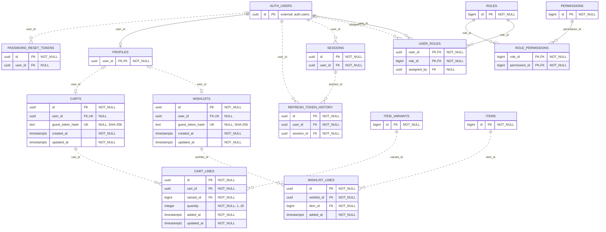

### 2.2 商品・バリアント・LOOK

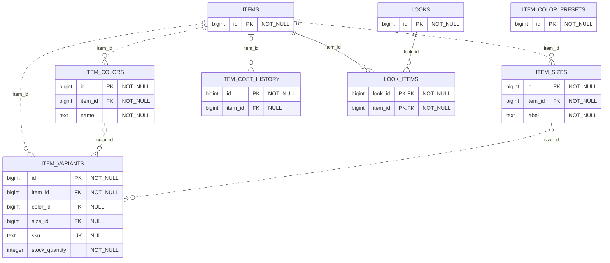

### 2.3 注文・改訂・在庫台帳・注文のメール

```mermaid
erDiagram
  ORDERS {
    uuid id PK "NOT_NULL"
    uuid user_id FK "NULL"
    text payment_intent_id UK "NULL"
    text checkout_session_id UK "NULL"
    uuid reviewed_by "NULL"
  }
  ORDER_ITEMS {
    uuid id PK "NOT_NULL"
    bigint item_id FK "NOT_NULL"
    uuid order_id FK "NOT_NULL"
    bigint variant_id FK "NULL"
    uuid exchange_return_line_id FK "NULL"
  }
  ORDER_REVISIONS {
    bigint id PK "NOT_NULL"
    uuid changed_by FK "NULL"
    uuid order_id FK "NOT_NULL"
    text source_event_id "NULL"
  }
  STOCK_MOVEMENTS {
    bigint id PK "NOT_NULL"
    bigint variant_id FK "NOT_NULL"
    uuid order_id FK "NULL"
    uuid order_item_id FK "NULL"
    uuid refund_id FK "NULL"
    uuid return_id FK "NULL"
    uuid created_by "NULL"
  }
  ORDER_EMAIL_OUTBOX {
    uuid id PK "NOT_NULL"
    bigint seq UK "NOT_NULL"
    uuid order_id FK "NOT_NULL"
    text kind "NOT_NULL"
    text variant "NULL"
    text origin "NOT_NULL"
    uuid requested_by FK "NULL"
    text status "NOT_NULL"
    integer attempts "NOT_NULL"
    timestamptz next_attempt_at "NOT_NULL"
    text provider_message_id UK "NULL"
    text delivery_status "NULL"
    uuid fulfillment_id FK "NULL"
    uuid refund_id FK "NULL"
    uuid return_id FK "NULL"
    uuid return_receipt_id FK "NULL"
  }
  ORDER_FULFILLMENTS {
    uuid id PK "NOT_NULL"
    uuid order_id FK "NOT_NULL"
    uuid request_key UK "NOT_NULL"
    uuid created_by "NULL"
    uuid cancelled_by "NULL"
  }
  ORDER_FULFILLMENT_LINES {
    uuid fulfillment_id PK,FK "NOT_NULL"
    uuid order_item_id PK,FK "NOT_NULL"
  }
  ORDER_ITEM_COMPLETIONS {
    uuid id PK "NOT_NULL"
    uuid order_id FK "NOT_NULL"
    uuid order_item_id FK "NOT_NULL"
    uuid request_key "NOT_NULL"
    uuid created_by "NULL"
    uuid cancelled_by "NULL"
  }
  ORDER_REFUNDS {
    uuid id PK "NOT_NULL"
    uuid order_id FK "NOT_NULL"
    uuid request_key UK "NULL"
    text stripe_refund_id UK "NULL"
    text source "NOT_NULL"
    text status "NOT_NULL"
    uuid actor_id "NULL"
    uuid return_id FK "NULL"
  }
  ORDER_REFUND_LINES {
    uuid id PK "NOT_NULL"
    uuid refund_id FK "NOT_NULL"
    uuid order_item_id FK "NOT_NULL"
    boolean before_shipment "NOT_NULL"
  }
  ORDER_RETURNS {
    uuid id PK "NOT_NULL"
    uuid order_id FK "NOT_NULL"
    integer number "NOT_NULL; (order_id, number) UK"
    uuid request_key UK "NOT_NULL"
    text source "NOT_NULL"
    text status "NOT_NULL"
    uuid created_by "NULL"
  }
  ORDER_RETURN_LINES {
    uuid id PK "NOT_NULL"
    uuid return_id FK "NOT_NULL"
    uuid fulfillment_id FK "NOT_NULL"
    uuid order_item_id FK "NOT_NULL"
    text resolution "NOT_NULL"
    bigint exchange_variant_id FK "NULL"
    bigint requested_exchange_variant_id FK "NULL"
  }
  ORDER_RETURN_RECEIPTS {
    uuid id PK "NOT_NULL"
    uuid return_id FK "NOT_NULL"
    uuid request_key UK "NOT_NULL"
    text kind "NOT_NULL"
    uuid refund_id FK "NULL"
    uuid actor_id "NULL"
  }
  ORDER_RETURN_RECEIPT_LINES {
    uuid id PK "NOT_NULL"
    uuid receipt_id FK "NOT_NULL"
    uuid return_line_id FK "NOT_NULL"
    text disposition "NOT_NULL"
  }
  SHOP_RETURN_SETTINGS {
    smallint id PK "NOT_NULL; 1だけ"
    text return_address_name "NULL"
    integer window_days "NULL"
  }
  SHOP_RETURN_REASON_SETTINGS {
    text reason PK "NOT_NULL"
    text shipping_payer "NOT_NULL"
    text out_of_stock_exchange "NOT_NULL"
  }
  SHOP_SETTINGS {
    smallint id PK "NOT_NULL; 1だけ"
    boolean auto_refund_cancelled_order_payment "NOT_NULL"
    boolean auto_cancel_amount_mismatch "NOT_NULL"
  }
  REFUND_LEDGER_STATE {
    smallint id PK "NOT_NULL; 1だけ"
    timestamptz started_at "NOT_NULL"
  }
  ORDER_EMAIL_SEND_PAUSE {
    boolean id PK "NOT_NULL"
    boolean paused "NOT_NULL"
    text reason "NULL"
    timestamptz next_probe_at "NULL"
  }
  RESEND_WEBHOOK_RECEIPTS {
    text svix_id PK "NOT_NULL"
    timestamptz received_at "NOT_NULL"
  }
  AUTH_USERS {
    uuid id PK "NOT_NULL"
  }
  ITEMS {
    bigint id PK "NOT_NULL"
  }
  AUTH_USERS {
    uuid id PK "external: auth.users"
  }
  PROFILES {
    uuid user_id PK,FK "NOT_NULL"
  }
  ITEM_VARIANTS {
    bigint id PK "NOT_NULL"
    text sku UK "NULL"
    integer stock_quantity "NOT_NULL"
  }
  ITEMS ||..o{ ORDER_ITEMS : "item_id"
  AUTH_USERS |o..o{ ORDER_REVISIONS : "changed_by"
  ORDERS ||..o{ ORDER_ITEMS : "order_id"
  ORDERS ||..o{ ORDER_REVISIONS : "order_id"
  PROFILES |o..o{ ORDERS : "user_id"
  ITEM_VARIANTS ||..o{ STOCK_MOVEMENTS : "variant_id"
  ORDERS |o..o{ STOCK_MOVEMENTS : "order_id"
  ORDER_ITEMS |o..o{ STOCK_MOVEMENTS : "order_item_id"
  ITEM_VARIANTS |o..o{ ORDER_ITEMS : "variant_id"
  ORDERS ||..o{ ORDER_EMAIL_OUTBOX : "order_id"
  AUTH_USERS |o..o{ ORDER_EMAIL_OUTBOX : "requested_by"
  ORDERS ||..o{ ORDER_FULFILLMENTS : "order_id"
  ORDER_FULFILLMENTS ||--o{ ORDER_FULFILLMENT_LINES : "fulfillment_id"
  ORDER_ITEMS ||--o{ ORDER_FULFILLMENT_LINES : "order_item_id"
  ORDERS ||..o{ ORDER_ITEM_COMPLETIONS : "order_id"
  ORDER_ITEMS ||..o{ ORDER_ITEM_COMPLETIONS : "order_item_id"
  ORDER_FULFILLMENTS |o..o{ ORDER_EMAIL_OUTBOX : "fulfillment_id"
  ORDERS ||..o{ ORDER_REFUNDS : "order_id"
  ORDER_REFUNDS ||..o{ ORDER_REFUND_LINES : "refund_id"
  ORDER_ITEMS ||..o{ ORDER_REFUND_LINES : "order_item_id"
  ORDER_REFUNDS |o..o{ STOCK_MOVEMENTS : "refund_id"
  ORDER_REFUNDS |o..o{ ORDER_EMAIL_OUTBOX : "refund_id"
  ORDERS ||..o{ ORDER_RETURNS : "order_id"
  ORDER_RETURNS ||..o{ ORDER_RETURN_LINES : "return_id"
  ORDER_FULFILLMENT_LINES ||..o{ ORDER_RETURN_LINES : "fulfillment_id, order_item_id"
  ITEM_VARIANTS |o..o{ ORDER_RETURN_LINES : "exchange_variant_id"
  ITEM_VARIANTS |o..o{ ORDER_RETURN_LINES : "requested_exchange_variant_id"
  ORDER_RETURNS ||..o{ ORDER_RETURN_RECEIPTS : "return_id"
  ORDER_REFUNDS |o..o{ ORDER_RETURN_RECEIPTS : "refund_id"
  ORDER_RETURN_RECEIPTS ||..o{ ORDER_RETURN_RECEIPT_LINES : "receipt_id"
  ORDER_RETURN_LINES ||..o{ ORDER_RETURN_RECEIPT_LINES : "return_line_id"
  ORDER_RETURN_LINES |o..o{ ORDER_ITEMS : "exchange_return_line_id"
  ORDER_RETURNS |o..o{ ORDER_REFUNDS : "return_id"
  ORDER_RETURNS |o..o{ STOCK_MOVEMENTS : "return_id"
  ORDER_RETURNS |o..o{ ORDER_EMAIL_OUTBOX : "return_id"
  ORDER_RETURN_RECEIPTS |o..o{ ORDER_EMAIL_OUTBOX : "return_receipt_id"
```

### 2.4 決済記録・Checkout 下書き

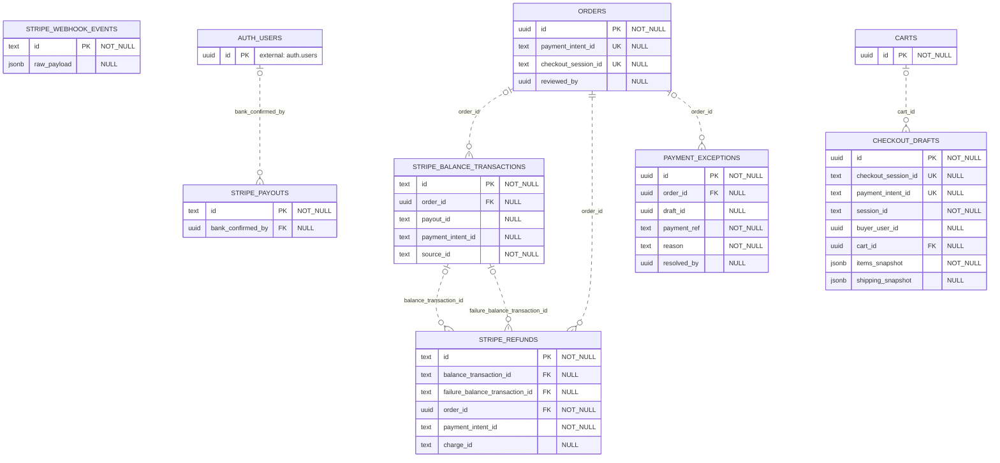

### 2.5 会計の業務関係

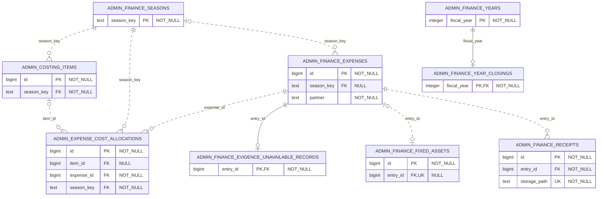

### 2.6 会計の実行者・確認者

#### 2.6.1 原価・取引・履歴の実行者

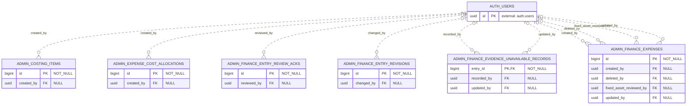

#### 2.6.2 テンプレート・固定資産・証憑・年度の実行者

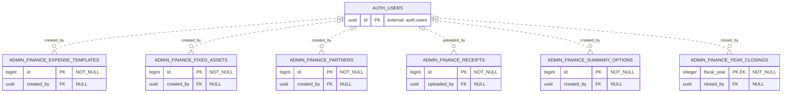

### 2.7 問い合わせ

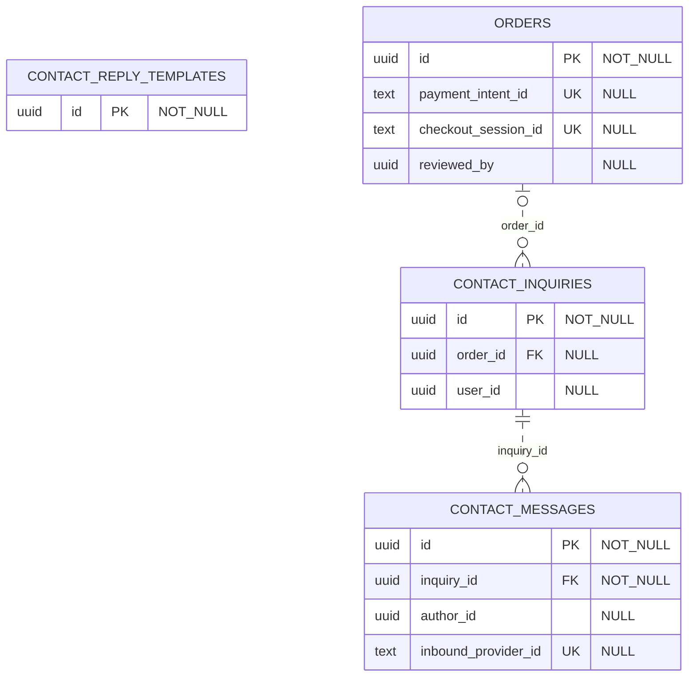

### 2.8 KPI・監査・保存・コンテンツ・補助データ

#### 2.8.1 KPI の記録・目標・資料

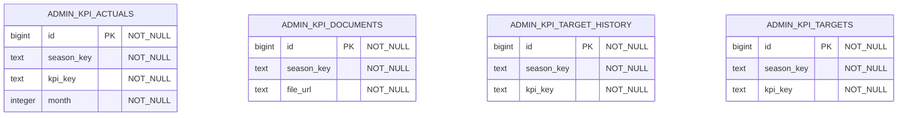

#### 2.8.2 監査・セキュリティ・アーカイブ

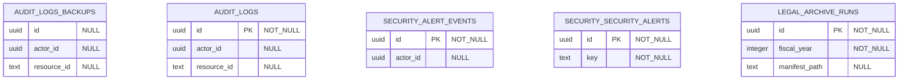

#### 2.8.3 コンテンツ・キャッシュ・レート制限

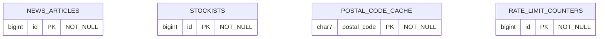

### 2.9 お客様の申し込みの追加の関係（E-3 段2）

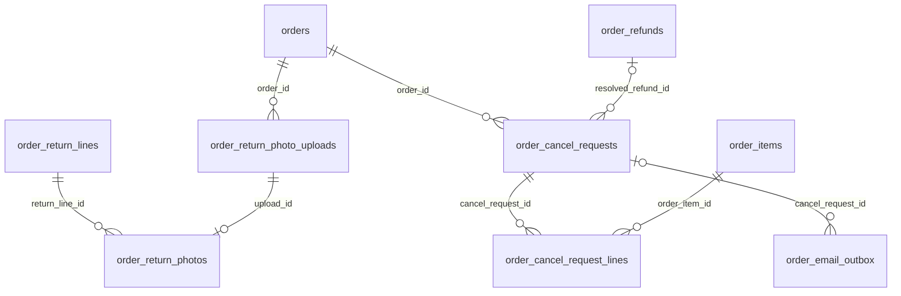

`customer_id`・`requested_by`・操作した人の UUID は物理 FK にしない。`storage_path` は Storage の場所の文字列であり物理 FK ではない。新しい8本はすべて ON DELETE RESTRICT。写真の実体は非公開の Storage に置き、DB には場所と消去の印を残す。

### 2.10 在庫の割当と品物の状態の履歴の関係（G-1）

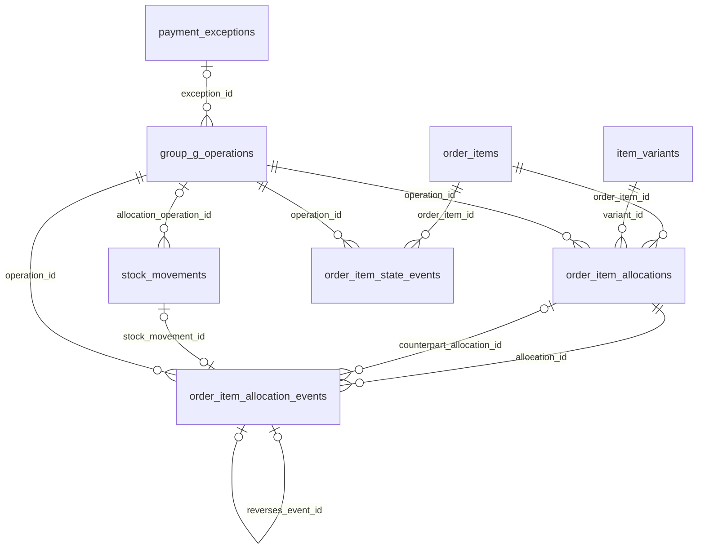

`group_g_operations` だけが `private`、ほかは `public`。線の意味は次のとおり。

| 線 | 意味 |
| --- | --- |
| 明細 → 割当 | 1つの注文の商品の行が、仮確保 H・入金済みの割当 A を何本も持てる。variant は明細の variant と同じ（制約で確かめる）。variant が空の明細は割り当てない |
| 割当 → 割当の履歴 | 割当の1本が、作る・種類を変える・減らす履歴を持つ。`counterpart_allocation_id` は入替（`transfer`）の両側が互いを指す。`reverses_event_id` は発送の消費（`consume`）を戻す履歴（`restore`）が元の消費を指す |
| 台帳 → 割当の履歴 | 在庫の台帳を動かす履歴（`hold`・`allocate`・`restore`・`release`）だけが、台帳の行を1つ指す。台帳の側の `allocation_operation_id` を持つ行は、履歴がちょうど1つ対応する |
| 操作の受付 → 割当・履歴・状態の履歴・台帳 | 1回の操作の番号。先に作り、受付の行は処理の終わりに1度だけ書く。参照は取引の終わりに確かめる（`DEFERRABLE INITIALLY DEFERRED`） |
| 要対応 → 操作の受付 | 支払額の違いの保留（`operation = 'payment_review_hold'`）だけが要対応を指す。保留は割当の H とは別物（割当を動かさず、FIFO が割り当てるのを止める印） |

12本の外部キーはすべて `ON DELETE RESTRICT`。実行した人の `actor_id` と、原因の `cause_id`（text）は物理 FK にしない（5.1）。

### 2.11 発注書・受け取り・原本の添付の関係（G-2）

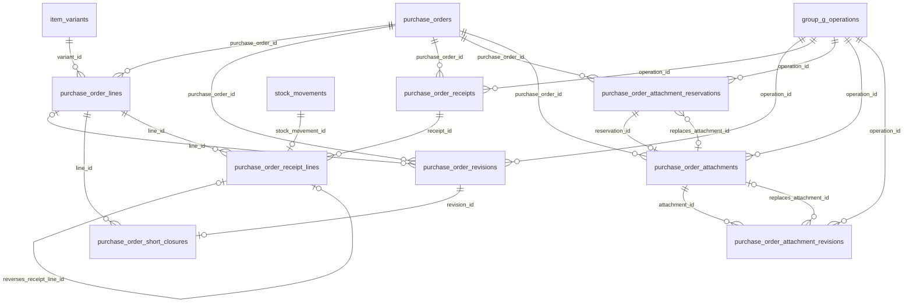

`group_g_operations` だけが `private`、ほかは `public`。線の意味は次のとおり。

| 線 | 意味 |
| --- | --- |
| 発注書 → 行 | 1つの発注書が1〜100行を持つ。同じ発注書の中で variant も `line_no`（入力の並び順）も重複しない。行は発注時の商品名・色・サイズの写しを持つ |
| 行・発注書 → 履歴 | 数量・単価・発注先・メモの変更ごとに1行を足す（行ごとの変更は `line_id` あり、発注書全体は空）。`revision_no` はその操作の後の発注書の版 |
| 行・履歴 → 打切り | 残りを打ち切った数・理由・人を1行（履歴 1 に打切り 0 または 1） |
| 発注書 → 受け取り → 受け取りの行 | 受け取りの1回の操作が1行。良品の受取は正の行、取消・数量訂正は負の行で相殺し（`reverses_receipt_line_id` が元の正の行を指す）、元の行は直さない |
| 台帳 → 受け取りの行 | 受け取りの行は台帳 `stock_movements` の無タグの行を1つ指す（正は `restock`、負は `adjustment`）。同じ台帳の行を2つの受け取りの行は指せない |
| 発注書 → 予約・原本 → 取引の記録 | 予約は保存キーを先に取り分ける。原本は予約を1つだけ使う（`reservation_id` UNIQUE）。取引の記録は原本ごとに版を積み、差し替えは新しい原本が元を指す（`replaces_attachment_id`） |
| 操作の受付 → 履歴・受け取り・予約・原本・取引の記録 | 1回の操作の番号。先に作り、受付の行は処理の終わりに1度だけ書く。参照は取引の終わりに確かめる（`DEFERRABLE INITIALLY DEFERRED`） |

22本の外部キーはすべて `ON DELETE RESTRICT`。実行した人の `created_by`・`actor_id`・`uploaded_by` は物理 FK にしない（利用者の削除が追記だけの履歴を更新しないため。5.1）。

## 3. 全テーブルとキーの一覧

以下は掲載対象の99テーブル・142 FKの定義元とキーの一覧。FK の有無は入出両方向で判定する。`audit_logs_backups.id` は主キーではなく nullable の通常列である。

### 3.1 認証・利用者

| テーブル | PK | PK 以外の一意性 | 物理 FK 接続 | 定義元 |
| --- | --- | --- | --- | --- |
| `public.profiles` | `(user_id)` | なし | 参照元 3 / 参照先 1 | [20260901102912:799](../../../supabase/migrations/20260901102912_remote_schema.sql#L799) |
| `public.sessions` | `(id)` | なし | 参照元 1 / 参照先 1 | [20260901102912:866](../../../supabase/migrations/20260901102912_remote_schema.sql#L866) |
| `public.refresh_token_history` | `(id)` | `(refresh_token_hash)` | 参照元 0 / 参照先 2 | [20260901102912:831](../../../supabase/migrations/20260901102912_remote_schema.sql#L831) |
| `public.password_reset_tokens` | `(id)` | `(token_hash)` | 参照元 0 / 参照先 1 | [20260901102912:759](../../../supabase/migrations/20260901102912_remote_schema.sql#L759) |
| `public.roles` | `(id)` | `(code)` | 参照元 2 / 参照先 0 | [20260901102912:854](../../../supabase/migrations/20260901102912_remote_schema.sql#L854) |
| `public.permissions` | `(id)` | `(code)` | 参照元 1 / 参照先 0 | [20260901102912:773](../../../supabase/migrations/20260901102912_remote_schema.sql#L773) |
| `public.user_roles` | `(user_id, role_id)` | なし | 参照元 0 / 参照先 3 | [20260901102912:1005](../../../supabase/migrations/20260901102912_remote_schema.sql#L1005) |
| `public.role_permissions` | `(role_id, permission_id)` | なし | 参照元 0 / 参照先 2 | [20260901102912:844](../../../supabase/migrations/20260901102912_remote_schema.sql#L844) |
| `public.carts` | `(id)` | `(user_id)`; `(guest_token_hash)` UNIQUE、持ち主はどちらか1つ | 参照元 2 / 参照先 1 | [移行 A](../../../supabase/migrations/20261008220825_cart_wishlist_ownership.sql) |
| `public.cart_lines` | `(id)` | `(cart_id, variant_id)` UNIQUE | 参照元 0 / 参照先 2 | [移行 A](../../../supabase/migrations/20261008220825_cart_wishlist_ownership.sql) |
| `public.wishlists` | `(id)` | `(user_id)`; `(guest_token_hash)` UNIQUE、持ち主はどちらか1つ | 参照元 1 / 参照先 1 | [移行 A](../../../supabase/migrations/20261008220825_cart_wishlist_ownership.sql) |
| `public.wishlist_lines` | `(id)` | `(wishlist_id, item_id)` UNIQUE | 参照元 0 / 参照先 2 | [移行 A](../../../supabase/migrations/20261008220825_cart_wishlist_ownership.sql) |

#### カートとお気に入りの列・索引（2026-10-08）

| 表 | 列と制約 |
| --- | --- |
| `carts`・`wishlists` | `id uuid` PK（gen_random_uuid）、`user_id uuid` nullable UNIQUE、`guest_token_hash text` nullable UNIQUE（64桁の小文字16進 SHA-256）、`created_at`・`updated_at timestamptz` NOT NULL（now）。`num_nonnulls(user_id,guest_token_hash)=1` |
| `cart_lines` | `id uuid` PK（gen_random_uuid）、`cart_id uuid`・`variant_id bigint`・`quantity integer`・`added_at`・`updated_at timestamptz` は NOT NULL。日時はnow、数量1〜20、`(cart_id,variant_id)` UNIQUE |
| `wishlist_lines` | `id uuid` PK（gen_random_uuid）、`wishlist_id uuid`・`item_id bigint`・`added_at timestamptz` は NOT NULL。日時はnow、`(wishlist_id,item_id)` UNIQUE |
| `checkout_drafts` | `cart_id uuid` nullable（カートを削除したら SET NULL）。`items_snapshot` の `source_cart_line_id` は `cart_lines.id` の写しで、JSON の値なので物理 FK ではない |

| 索引 | 対象・用途 |
| --- | --- |
| 持ち主の UNIQUE 索引 | `carts`・`wishlists` の `user_id` と `guest_token_hash` をそれぞれ一意にする |
| 明細の UNIQUE 索引 | `cart_lines(cart_id,variant_id)`、`wishlist_lines(wishlist_id,item_id)` |
| `cart_lines_variant_id_idx` | `cart_lines(variant_id)` |
| `wishlist_lines_item_id_idx` | `wishlist_lines(item_id)` |
| `checkout_drafts_cart_id_idx` | `checkout_drafts(cart_id)` |

4表は RLS と権限の取り消しで anon・authenticated からの直接読み書きを拒否し、service_role の API だけが読み書きする。明細変更のトリガーが持ち主の updated_at を進め、ゲストは最後に使ってから30日を過ぎると毎日削除される。定義は [移行 A](../../../supabase/migrations/20261008220825_cart_wishlist_ownership.sql)、決済の下書きとの照合は [移行 B](../../../supabase/migrations/20261008220944_cart_checkout_rpcs.sql) に従う。

### 3.2 商品・LOOK

| テーブル | PK | PK 以外の一意性 | 物理 FK 接続 | 定義元 |
| --- | --- | --- | --- | --- |
| `public.items` | `(id)` | なし | 参照元 7 / 参照先 0 | [20260901102912:572](../../../supabase/migrations/20260901102912_remote_schema.sql#L572) |
| `public.item_colors` | `(id)` | `(item_id, name)` | 参照元 1 / 参照先 1 | [20260919065336:7](../../../supabase/migrations/20260919065336_add_variant_inventory_tables.sql#L7) |
| `public.item_sizes` | `(id)` | `(item_id, label)` | 参照元 1 / 参照先 1 | [20260919065336:18](../../../supabase/migrations/20260919065336_add_variant_inventory_tables.sql#L18) |
| `public.item_variants` | `(id)` | `(sku)`; `(item_id, COALESCE(color_id, 0), COALESCE(size_id, 0))` 式 UNIQUE | 参照元 5 / 参照先 3 | [20260919065336:27](../../../supabase/migrations/20260919065336_add_variant_inventory_tables.sql#L27) |
| `public.item_cost_history` | `(id)` | なし | 参照元 0 / 参照先 1 | [20260901102912:557](../../../supabase/migrations/20260901102912_remote_schema.sql#L557) |
| `public.looks` | `(id)` | なし | 参照元 1 / 参照先 0 | [20260901102912:639](../../../supabase/migrations/20260901102912_remote_schema.sql#L639) |
| `public.look_items` | `(look_id, item_id)` | なし | 参照元 0 / 参照先 2 | [20260901102912:629](../../../supabase/migrations/20260901102912_remote_schema.sql#L629) |
| `public.item_color_presets` | `(id)` | `(name, hex)` | なし（独立） | [20260901102912:544](../../../supabase/migrations/20260901102912_remote_schema.sql#L544) |

### 3.3 注文・在庫台帳

| テーブル | PK | PK 以外の一意性 | 物理 FK 接続 | 定義元 |
| --- | --- | --- | --- | --- |
| `public.orders` | `(id)` | `(payment_intent_id)`; `(checkout_session_id)` | 参照元 14 / 参照先 1 | [20260901102912:718](../../../supabase/migrations/20260901102912_remote_schema.sql#L718) |
| `public.order_items` | `(id)` | なし | 参照元 5 / 参照先 4 | [20260901102912:677](../../../supabase/migrations/20260901102912_remote_schema.sql#L677) |
| `public.order_revisions` | `(id)` | なし | 参照元 0 / 参照先 2 | [20260901102912:698](../../../supabase/migrations/20260901102912_remote_schema.sql#L698) |
| `public.stock_movements` | `(id)` | なし | 参照元 0 / 参照先 5 | [20260919065355:6](../../../supabase/migrations/20260919065355_add_stock_movements.sql#L6) |
| `public.order_fulfillments` | `(id)` | `(order_id, number)`; `(request_key)` | 参照元 2 / 参照先 1 | [移行 A](../../../supabase/migrations/20261010120303_order_fulfillments.sql) |
| `public.order_fulfillment_lines` | `(fulfillment_id, order_item_id)` | なし | 参照元 1 / 参照先 2 | [移行 A](../../../supabase/migrations/20261010120303_order_fulfillments.sql) |
| `public.order_item_completions` | `(id)` | `(request_key, order_item_id)` | 参照元 0 / 参照先 2 | [移行 A](../../../supabase/migrations/20261010120303_order_fulfillments.sql) |
| `public.order_refunds` | `(id)` | `(request_key)`; `(stripe_refund_id)` | 参照元 5 / 参照先 2 | [E-2 移行 A](../../../supabase/migrations/20261011222930_order_refund_records.sql) |
| `public.order_refund_lines` | `(id)` | `(refund_id, order_item_id, before_shipment)` | 参照元 0 / 参照先 2 | [E-2 移行 A](../../../supabase/migrations/20261011222930_order_refund_records.sql) |
| `public.shop_settings` | `(id)` | なし（1行） | なし（独立） | [E-2 移行 A](../../../supabase/migrations/20261011222930_order_refund_records.sql) |
| `private.refund_ledger_state` | `(id)` | なし（1行） | なし（独立） | [E-2 移行 A](../../../supabase/migrations/20261011222930_order_refund_records.sql) |
| `public.order_returns` | `(id)` | `(order_id, number)`; `(request_key)` | 参照元 5 / 参照先 1 | [E-3 移行 A](../../../supabase/migrations/20261012235910_order_return_records.sql) |
| `public.order_return_lines` | `(id)` | なし | 参照元 3 / 参照先 4 | [E-3 移行 A](../../../supabase/migrations/20261012235910_order_return_records.sql) |
| `public.order_return_receipts` | `(id)` | `(request_key)` | 参照元 2 / 参照先 2 | [E-3 移行 A](../../../supabase/migrations/20261012235910_order_return_records.sql) |
| `public.order_return_receipt_lines` | `(id)` | `(receipt_id, return_line_id, disposition, resolution, exchange_method, refund_choice)`（NULLS NOT DISTINCT。2026-11-06 に6列） | 参照元 0 / 参照先 2 | [E-3 移行 A](../../../supabase/migrations/20261012235910_order_return_records.sql) |
| `public.shop_return_settings` | `(id)` | なし（1行） | なし（独立） | [E-3 移行 A](../../../supabase/migrations/20261012235910_order_return_records.sql) |
| `public.shop_return_reason_settings` | `(reason)` | なし | なし（独立） | [E-3 移行 A](../../../supabase/migrations/20261012235910_order_return_records.sql) |
| `public.order_return_photo_uploads` | `(id)` | `(storage_path)` | 参照元 1 / 参照先 1 | [E-3 段2 移行 D](../../../supabase/migrations/20261020144439_order_return_request_records.sql) |
| `public.order_return_photos` | `(id)` | `(upload_id)` | 参照元 0 / 参照先 2 | [E-3 段2 移行 D](../../../supabase/migrations/20261020144439_order_return_request_records.sql) |
| `public.order_cancel_requests` | `(id)` | `(request_key)`; `(order_id) WHERE status = 'requested'` | 参照元 2 / 参照先 2 | [E-3 段2 移行 D](../../../supabase/migrations/20261020144439_order_return_request_records.sql) |
| `public.order_cancel_request_lines` | `(id)` | `(cancel_request_id, order_item_id)` | 参照元 0 / 参照先 2 | [E-3 段2 移行 D](../../../supabase/migrations/20261020144439_order_return_request_records.sql) |
| `private.order_email_outbox` | `(id)` | `(seq)`; 自動 `(order_id, kind)`（発送のメール・返金に結び付く行・返品の4つの種類以外）; 自動の発送のメール `(fulfillment_id)`; 自動の返金に結び付く行 `(refund_id, kind)`; 自動の返品の受付のお知らせ `(return_id)`; 自動の受け取りに結び付く行（返品のメールと、受け取りと一緒の返金のお知らせ） `(return_receipt_id, kind)`; 手の送信待ち `(order_id, kind, fulfillment_id, refund_id)`（NULLS NOT DISTINCT）; `(provider_message_id)` | 参照元 0 / 参照先 6（orders・auth.users・order_fulfillments・order_refunds・order_returns・order_return_receipts） | [20261009095633:11](../../../supabase/migrations/20261009095633_order_email_outbox.sql#L11) |
| `private.order_email_send_pause` | `(id)` | なし（1行） | なし（独立） | [20261009095633:91](../../../supabase/migrations/20261009095633_order_email_outbox.sql#L91) |
| `private.resend_webhook_receipts` | `(svix_id)` | なし | なし（独立） | [20261009095633:110](../../../supabase/migrations/20261009095633_order_email_outbox.sql#L110) |

#### 配送の追加5表（E-4）

| テーブル | PK | PK以外の一意性 | 物理FK接続 | 定義元 |
| --- | --- | --- | --- | --- |
| `public.order_fulfillment_events` | `(id)` | `(fulfillment_id,tracking_version,status,happened_at)`; manualの `(request_key)` | 参照元 0 / 参照先 1 | [E-4 移行 A](../../../supabase/migrations/20261021220816_delivery_tracking_records.sql) |
| `public.order_fulfillment_tracking_changes` | `(id)` | `(request_key)`; `(fulfillment_id,tracking_version)` | 参照元 1 / 参照先 1 | [E-4 移行 A](../../../supabase/migrations/20261021220816_delivery_tracking_records.sql) |
| `public.order_fulfillment_attention` | `(id)` | 未解決の `(fulfillment_id,kind)` | 参照元 0 / 参照先 1 | [E-4 移行 A](../../../supabase/migrations/20261021220816_delivery_tracking_records.sql) |
| `private.fulfillment_tracking_registrations` | `(fulfillment_id,tracking_version)` | 組のUNIQUEは作らない | 参照元 0 / 参照先 1 | [E-4 移行 A](../../../supabase/migrations/20261021220816_delivery_tracking_records.sql) |
| `private.delivery_tracking_provider_gate` | `(id)` | なし（1行） | なし（独立） | [E-4 移行 A](../../../supabase/migrations/20261021220816_delivery_tracking_records.sql) |

E-4でorder_fulfillmentsを参照するFKは4本増える。outboxから番号の直しへのFKも1本増える。既存行の参照数表記は各段階時点の記録とし、列・索引と守りの最終契約は末尾の配送の節を参照する。

#### 注文状況のリンクの追加1表（E-5）

| テーブル | PK | PK以外の一意性 | 物理FK接続 | 定義元 |
| --- | --- | --- | --- | --- |
| `private.order_status_links` | `(order_id)` | `(token)` | 参照元 0 / 参照先 1 | [E-5 移行 A](../../../supabase/migrations/20261022084844_order_status_links.sql) |

E-5でordersを参照するFKが1本増える。既存行の参照数表記は各段階時点の記録とし、列・索引と権限の最終契約は末尾の注文状況のリンクの節を参照する。

#### 在庫の割当と品物の状態の履歴の追加4表（G-1）

| テーブル | PK | PK以外の一意性 | 物理FK接続 | 定義元 |
| --- | --- | --- | --- | --- |
| `private.group_g_operations` | `(id)` | `(operation, request_key)` | 参照元 4 / 参照先 1 | G-1 移行（`20261023211425_group_g1_allocation`） |
| `public.order_item_allocations` | `(id)` | なし | 参照元 2 / 参照先 3 | 同上 |
| `public.order_item_allocation_events` | `(id)` | `(operation_id, allocation_id, event_type, sequence)`; `(stock_movement_id)`; `(reverses_event_id)` | 参照元 1 / 参照先 5 | 同上 |
| `public.order_item_state_events` | `(id)` | `(operation_id, order_item_id, sequence, unit_from)` | 参照元 0 / 参照先 2 | 同上 |

G-1で `order_items`（+2）・`item_variants`（+1）・`stock_movements`（+1）・`payment_exceptions`（+1）を参照するFKが増え、`stock_movements` の参照先が1本増える。既存行の参照数表記は各段階時点の記録とし、列・索引・守りの最終契約は末尾の「在庫の割当と品物の状態の履歴」の節を参照する。

#### 発注書の追加9表（G-2）

| テーブル | PK | PK以外の一意性 | 物理FK接続 | 定義元 |
| --- | --- | --- | --- | --- |
| `public.purchase_orders` | `(id)` | `(number)` | 参照元 5 / 参照先 0 | G-2 移行（`20261024153505_group_g2_purchasing_foundation`） |
| `public.purchase_order_lines` | `(id)` | `(purchase_order_id, variant_id)`; `(purchase_order_id, line_no)` | 参照元 3 / 参照先 2 | 同上 |
| `public.purchase_order_revisions` | `(id)` | `(purchase_order_id, revision_no, line_id, kind)`（NULLS NOT DISTINCT） | 参照元 1 / 参照先 3 | 同上 |
| `public.purchase_order_short_closures` | `(id)` | `(revision_id)` | 参照元 0 / 参照先 2 | 同上 |
| `public.purchase_order_receipts` | `(id)` | なし | 参照元 1 / 参照先 2 | 同上 |
| `public.purchase_order_receipt_lines` | `(id)` | `(stock_movement_id)`; `(receipt_id, line_id)` | 参照元 1（自表） / 参照先 4 | 同上 |
| `public.purchase_order_attachment_reservations` | `(id)` | `(storage_path)` | 参照元 1 / 参照先 3 | 同上 |
| `public.purchase_order_attachments` | `(id)` | `(reservation_id)`; `(storage_path)` | 参照元 3 / 参照先 3 | 同上 |
| `public.purchase_order_attachment_revisions` | `(id)` | `(attachment_id, revision_no)` | 参照元 0 / 参照先 3 | 同上 |

G-2で `item_variants`（+1）・`stock_movements`（+1）・`private.group_g_operations`（+5）を参照するFKが増える（原本の予約が差し替え元の添付を指す1本は同じ G-2 の表の間のFK）。既存行の参照数表記は各段階時点の記録とし、列・索引・守りの最終契約は末尾の「発注書・受け取り・原本の添付」の節を参照する。

#### 発送と仕上がりの列・索引（2026-10-10）

| 表 | 列と制約 |
| --- | --- |
| `order_fulfillments` | `id uuid` PK（gen_random_uuid）、`order_id uuid` NOT NULL（RESTRICT）、`number integer` NOT NULL（1以上。`(order_id, number)` UNIQUE。取り消した分の番号は使い回さない）、`request_key uuid` NOT NULL UNIQUE、`shipping_carrier text`（yamato・sagawa・japanpost）、`tracking_number text`（`^[0-9A-Za-z-]{1,64}$`）、`notify_customer boolean` NOT NULL、`completes_order boolean` NOT NULL、`shipped_at timestamptz` NOT NULL（now）、`created_by uuid`・`cancelled_by uuid`（`auth.users` の番号。外部キーにしない: 消した人を空にする ON DELETE SET NULL は UPDATE として動き、取消の列しか変えさせない守りとぶつかるため。`stock_movements.created_by` と同じ）、`cancelled_at timestamptz`、`legacy boolean` NOT NULL（false）。G-3 Task 1 で `shipment_date date` を追加し、CHECK は `legacy OR shipment_date IS NOT NULL`、`legacy OR ((shipping_carrier IS NULL) = (tracking_number IS NULL))` と `cancelled_by IS NULL OR cancelled_at IS NOT NULL` |
| `order_fulfillment_lines` | `fulfillment_id uuid`・`order_item_id uuid`（どちらも RESTRICT）、`quantity integer` NOT NULL（1以上）。PK は `(fulfillment_id, order_item_id)`。追記だけ（変更と削除をトリガーで拒む） |
| `order_item_completions` | `id uuid` PK、`order_id uuid`・`order_item_id uuid`（RESTRICT。受注生産の品だけ）、`quantity integer` NOT NULL（1以上）、`request_key uuid` NOT NULL（`(request_key, order_item_id)` UNIQUE）、`created_by uuid`・`cancelled_by uuid`（`auth.users` の番号。外部キーにしない: 消した人を空にする ON DELETE SET NULL は UPDATE として動き、取消の列しか変えさせない守りとぶつかるため。`stock_movements.created_by` と同じ）、`created_at timestamptz` NOT NULL、`cancelled_at timestamptz`、`legacy boolean` NOT NULL。CHECK は `cancelled_by IS NULL OR cancelled_at IS NOT NULL` |
| `private.order_email_outbox` | `fulfillment_id uuid`（`order_fulfillments(id)`、RESTRICT）を足す。CHECK は `(kind = 'shipped') = (fulfillment_id IS NOT NULL)` |

| 索引 | 対象・用途 |
| --- | --- |
| `order_fulfillments(order_id, number)` の UNIQUE | その注文の何回目の発送か |
| `order_fulfillment_lines(order_item_id)` | 商品ごとの発送した数 |
| `order_item_completions(order_item_id)` | 商品ごとの仕上がった数 |
| `order_item_completions(order_id, created_at)` | その注文の仕上がりを新しい順に読む（履歴） |
| `private.order_email_outbox(fulfillment_id)`（`fulfillment_id` が空でない行だけ） | 発送の取消と再送で、その発送のメールを探す |
| `stock_movements(order_item_id)` | 前からある `stock_movements_order_item_id_idx`（20260919130048）を使う。移行 A では足していない（引き当て済みの数を、商品の行ごとに台帳から数える） |

3つの表は RLS を有効にし、anon・authenticated の権限を外し、service_role は SELECT だけを持つ。書くのは `admin_create_fulfillment`・`admin_cancel_fulfillment`・`admin_record_completion`・`admin_cancel_completion`（どれも SECURITY DEFINER）だけ。商品ごとの数は `private.order_line_fulfillment` の1か所で数え、`shipped ≤ completed ≤ quantity` を DB の関数とトリガーで守る（トリガー `private.check_order_line_fulfillment_bounds` が、発送の商品の追加と仕上がりの追加・取消の後に確かめ、破る時は `FULFILLMENT_BOUNDS_VIOLATED`（SQLSTATE 23514）で止める）。定義は [移行 A](../../../supabase/migrations/20261010120303_order_fulfillments.sql)・[移行 B](../../../supabase/migrations/20261010122320_fulfillment_order_emails.sql) に従う。

#### 返金の列・索引（2026-10-11）

| 表 | 列と制約 |
| --- | --- |
| `order_refunds` | `id uuid` PK（gen_random_uuid）、`order_id uuid` NOT NULL（RESTRICT）、`source text` NOT NULL（`admin`・`order_cancel`・`stripe_dashboard`・`auto_cancelled_order_payment`・`auto_amount_mismatch`・`legacy`・`return`・`unit_hold_release`。最後の1つは、後の注文の返品で前の注文に戻す返金で、`return_id` は空。移行 D、FREQ-642）、`request_key uuid` UNIQUE（画面を開いた時に作る二重防止の番号。管理画面の返金と支払い済みのキャンセルでは必須）、`request_fingerprint text`（`request_key` がある時は必須。中身の違う同じ番号を見分ける）、`stripe_refund_id text` UNIQUE（形は `^[a-z]{2,4}_[A-Za-z0-9]+$`。カード以外の支払いの返金の番号が `re_` 以外で来ても受けるため。Stripe の画面からの返金と写しでは必須）、`status text` NOT NULL（`awaiting_response`・`error`・`pending`・`succeeded`・`failed`）、`stripe_status`・`stripe_pending_reason`・`stripe_failure_reason`・`customer_action_expires_at`・`payment_method_type`・`reference_number`・`reference_type`（Stripe の細目。届いたら書く。エラーの時の `stripe_failure_reason` はこちらの理由 `stripe_rejected`・`not_found_in_stripe`）、`amount integer` NOT NULL（1以上）、`shipping_amount integer` NOT NULL（0以上。そのうちの送料）、`adjustment_amount integer` NOT NULL（計算との差。正も負もある）、`note text`（500字まで。店だけが見る）、`stripe_reason text`（`requested_by_customer`・`duplicate`・`fraudulent`）、`cancel_reason text`（`stock_unavailable`・`customer_request`・`suspected_fraud`・`other`。支払い済みのキャンセルと自動の取消だけ）、`notify_customer boolean` NOT NULL、`actor_id uuid`（実行した人の `auth.users` の番号。外部キーにしない: `stock_movements.created_by` と同じ）、`created_at timestamptz` NOT NULL（now）、`accepted_at`・`succeeded_at`・`failed_at`・`errored_at timestamptz`（状態の移り変わりの時刻）、`stock_applied_at`・`email_enqueued_at`・`failure_applied_at timestamptz`（在庫・メールの予定・失敗の後始末を1回だけにする印）。CHECK は `order_refunds_request_check`（管理画面の返金と支払い済みのキャンセルは `request_key` が必須。`request_key` と `request_fingerprint` は両方あるか両方無い）・`order_refunds_external_check`（Stripe の画面からの返金と写しは `stripe_refund_id` が必須で `request_key` が空）・`order_refunds_cancel_reason_check`（`cancel_reason` があるのは支払い済みのキャンセルと自動の取消だけ）・`order_refunds_legacy_check`（写しは在庫・メールを動かした印を持たず、`notify_customer` が false） |
| `order_refund_lines` | `id uuid` PK、`refund_id uuid`・`order_item_id uuid`（どちらも RESTRICT）、`quantity integer` NOT NULL（1〜999）、`before_shipment boolean` NOT NULL（発送前の品か、発送後の品か）、`restock_type text` NOT NULL（`cancel`・`no_restock`。発送後の品は `no_restock` だけ）、`amount integer` NOT NULL（0以上。割引を割り振った、この商品の分の返金額。DB が計算する。割引は商品の登録順に小計を足していった和で累積して丸めるので、どの商品の割引も0以上で、合計は注文の割引になる）、`released_quantity`・`restocked_quantity`・`rereserved_quantity`・`rereserve_shortage integer` NOT NULL（既定 0。確保を外した数・在庫に戻した数・失敗で確保し直した数・足りなかった数）。`(refund_id, order_item_id, before_shipment)` UNIQUE。CHECK は `order_refund_lines_restock_check`・`order_refund_lines_release_check` |
| `shop_settings` | `id smallint` PK（1だけ。CHECK `id = 1`）、`auto_refund_cancelled_order_payment boolean` NOT NULL（既定 true）、`auto_cancel_amount_mismatch boolean` NOT NULL（既定 false）、それぞれの `…_updated_by uuid`・`…_updated_at timestamptz`（最後に変えた人と時刻。外部キーにしない）。移行が1行を入れる |
| `private.refund_ledger_state` | `id smallint` PK（1だけ）、`started_at timestamptz` NOT NULL。移行 A を当てた時刻を1行入れる（これより前に Stripe で作られた返金は「前からの写し」にする） |
| `orders` | `paid_amount integer`（受け取った額。0以上。店内だけの列で、お客様の JWT に GRANT しない）を足す。書くのは、入金を記録する時（`mark_order_paid`）と、照合が取り消した注文への入金を見つけた時（`record_cancelled_order_paid_amount`。記録のたびに、空の時だけ）。CHECK `orders_refunded_amount_range` は `refunded_amount >= 0 AND refunded_amount <= GREATEST(total_amount, COALESCE(paid_amount, 0))` に作り直す |
| `stock_movements` | `refund_id uuid`（`order_refunds(id)`、RESTRICT）を足す。返金で動いた台帳の行が、どの返金かを残す |
| `private.order_email_outbox` | `refund_id uuid`（`order_refunds(id)`、RESTRICT）を足す。種類に `refund` を足し（CHECK `order_email_outbox_kind_check`）、書き分けに `canceled` の `paid` と `refund` の `standard`・`after_cancel` を足す（CHECK `order_email_outbox_variant_check`）。CHECK `order_email_outbox_refund_check` は `(refund_id IS NOT NULL) = (kind = 'refund' OR (kind = 'canceled' AND variant = 'paid'))` |
| `payment_exceptions` | 理由の CHECK を `payment_exceptions_reason_check` に作り直し、`refund_failed` を足す |

| 索引 | 対象・用途 |
| --- | --- |
| `order_refunds(order_id, created_at DESC)` | その注文の返金を新しい順に読む（履歴・お客様の画面） |
| `order_refunds(created_at)`（`status = 'awaiting_response'` の行だけ） | 毎時の見回りが、15分より前の返事待ちを探す |
| `order_refunds(order_id)`（`status = 'pending'` の行だけ） | 保留の返金がある注文と支払いを探す |
| `order_refund_lines(order_item_id)` | 商品ごとに返金した数を数える |
| `stock_movements(refund_id)`（`refund_id` が空でない行だけ） | 返金で動いた台帳の行を探す |
| `private.order_email_outbox` の一意の索引 | 自動の行は、発送のメール・返金に結び付く行以外が `(order_id, kind)`、返金に結び付く行が `(refund_id, kind)`。手の送信待ちは `(order_id, kind, fulfillment_id, refund_id)`（NULLS NOT DISTINCT） |

返金の2つの表・`shop_settings` は RLS を有効にし、anon・authenticated の権限を外し、service_role は SELECT だけを持つ。`private.refund_ledger_state` も RLS を有効にして全ての権限を外し（service_role も読めない）、関数（所有者の権限）だけが読む。書くのは `begin_order_refund`・`record_order_refund_result`・`record_external_order_refund`・`mark_order_refund_error`・`admin_update_shop_settings`（どれも SECURITY DEFINER）だけ。注文の受け取った額 `orders.paid_amount` を書くのは、`mark_order_paid` と `record_cancelled_order_paid_amount`（取り消した注文で空の時だけ。移行 B）と、取り消した注文への入金の自動の返金の `begin_order_refund`（空の時だけ）。返金の表は消せず、中身も直せない（トリガー `order_refunds_guard` が、進めてよい列と状態の移り方以外を `ORDER_REFUND_APPEND_ONLY`・`ORDER_REFUND_IMMUTABLE`・`ORDER_REFUND_INVALID_TRANSITION`（どれも SQLSTATE 23514）で止める）。商品ごとの数は E-1 の `private.order_line_fulfillment` の1か所で数え、返金した数の2つの列（`refunded_before_shipment`・`refunded_after_shipment`）を足した。`shipped + refunded_before_shipment ≤ quantity`・`refunded_after_shipment ≤ shipped`・`shipped ≤ completed` を、トリガー `private.check_order_line_fulfillment_bounds` が `FULFILLMENT_BOUNDS_VIOLATED`（SQLSTATE 23514）で守る。定義は [移行 A](../../../supabase/migrations/20261011222930_order_refund_records.sql)・[移行 B](../../../supabase/migrations/20261011223147_order_refund_requests.sql)・[移行 C](../../../supabase/migrations/20261011223453_order_refund_results.sql) に従う。

#### 返品の列・索引（2026-10-13）

| 表 | 列と制約 |
| --- | --- |
| `order_returns` | `id uuid` PK（gen_random_uuid）、`order_id uuid` NOT NULL（RESTRICT）、`number integer` NOT NULL（1以上。`(order_id, number)` UNIQUE。返品の番号 `{注文番号}-R{n}` の n。注文の行の鍵の中で「その注文の返品の数 + 1」にする）、`source text` NOT NULL（`customer_request`・`shop`。段1は `shop` だけ）、`status text` NOT NULL（`requested`・`open`・`closed`・`cancelled`・`declined`）、`request_key uuid` NOT NULL UNIQUE（二重防止の番号）、`request_fingerprint text` NOT NULL、`return_method text` NOT NULL（`customer_ships`・`shop_label`・`not_required`）、`return_shipping_payer text` NOT NULL（`shop`・`customer`）、`return_carrier text`（`yamato`・`sagawa`・`japanpost`・`other`）、`return_tracking_number text`（`^[0-9A-Za-z-]{1,64}$`）、`return_shipping_fee`・`exchange_fee`・`exchange_shipping_fee`・`fee_due_amount`・`fee_settled_amount`・`fee_pending_deduction integer` NOT NULL（0以上。既定 0。`fee_due_amount` は引けずにお客様からいただく、まだ決着していない額、`fee_settled_amount` は手数料の受け取りの記録・いただかないで終えるで決着した額の合計（決着のたびに、その時の `fee_due_amount` を足して `fee_due_amount` を0に戻す）、`fee_pending_deduction` は相談の受け取りで付き、額を決めて返金する時に引く額）、`restocking_fee_percent integer` NOT NULL（0〜100）、`fee_received_at`・`fee_received_by`・`fee_received_note`（手数料の受け取りの記録。メモは500字まで）、`fee_waived boolean` NOT NULL（既定 false。手数料をいただかないことにした印。真の時も `fee_received_at`・`fee_received_by` を入れる（CHECK `order_returns_fee_waived_check`）。決着した額は `fee_settled_amount` に移して `fee_due_amount` は0に戻す。受け取り・額を決めて返金で新しい手数料が付いて、`fee_received_at`・`fee_received_by`・`fee_received_note` を空に戻す時は、同じ更新で `fee_waived` も false に戻す）、`exchange_released_at`・`exchange_released_by`（支払いを待たずに送る）、`notify_customer boolean` NOT NULL、`shop_note text`（500字まで）、`created_at`・`created_by`・`closed_at`・`cancelled_at`・`cancelled_by`・`reopened_at`・`reopened_by`。段2の列（`requested_at`・`requested_by`・`declined_at`・`declined_by`・`decline_reason`・`decline_message`）は段1では空のまま。`approved_at`・`approved_by` は、お店が返品を作った時に、作った時刻と人を入れる。お客様の申し込み（`source = 'customer_request'`）では、承認の更新で入れる。実行した人の列は `auth.users` の番号で、外部キーにしない（`stock_movements.created_by` と同じ） |
| `order_return_lines` | `id uuid` PK、`return_id uuid` NOT NULL（RESTRICT）、`fulfillment_id uuid`・`order_item_id uuid` NOT NULL（`order_fulfillment_lines` の組を指す複合の外部キー、RESTRICT。その返品の注文の発送だけを指す）、`quantity integer` NOT NULL（1以上）、`reason text` NOT NULL（10の理由）、`reason_note text`（255字まで）、`resolution text` NOT NULL（`refund`・`exchange`。作った時の予定）、`exchange_variant_id bigint`・`exchange_method text`（`stock`・`make`。CHECK で、`resolution = 'exchange'` の時だけ両方が入る）、`customer_note`・`requested_resolution`・`requested_exchange_variant_id`（段2の列）、`created_at timestamptz` NOT NULL。数・理由・詳しい内容・ご希望は変えず、消せない。親が requested の間だけ、承認で resolution・exchange_variant_id・exchange_method の3列を変えられる。実際に決まった解決（在庫不足で作って送るに変えた・店長が返金に変えた）は、受け取りの商品の扱いに残す |
| `order_return_receipts` | `id uuid` PK、`return_id uuid` NOT NULL（RESTRICT）、`request_key uuid` NOT NULL UNIQUE、`request_fingerprint text` NOT NULL、`kind text` NOT NULL（`receive`・`inspect`・`close_missing`・`reopen`・`waive_refund`）、`refund_choice text`（`now`・`consult`・`mixed`・`none`。`mixed` は 2026-11-06 から。`kind = 'receive'` の時だけ入る。この受け取りで返金する品が0点（覆われた品だけ・交換だけ・お返しだけ）なら、選び方が今返金・相談でも `none` を入れる）、`refund_id uuid`（`order_refunds(id)`、RESTRICT。移行 C で DEFERRABLE INITIALLY DEFERRED。この受け取りと一緒に作った返金）、`notify_customer boolean` NOT NULL、`sent_back_message`（1000字まで）・`sent_back_carrier`・`sent_back_tracking_number`（お返しのメッセージと送り返しの配送業者・伝票番号）、`note text`（500字まで）、`actor_id uuid`・`actor_can_refund boolean`（した人と、返金の権限があったか）、`created_at timestamptz` NOT NULL、`consult_quantity integer`（2026-11-08 から。受け取りで返金待ちにした相談の点数。NULL はそれより前の記録。0以上）。追記だけ（変更と削除をトリガーで拒む） |
| `order_return_receipt_lines` | `id uuid` PK、`receipt_id uuid`・`return_line_id uuid` NOT NULL（どちらも RESTRICT）、`disposition text` NOT NULL（`restocked`・`not_restocked`・`pending_inspection`・`inspected_restocked`・`inspected_not_restocked`・`sent_back`・`missing`・`missing_reopened`・`refund_waived`）、`quantity integer` NOT NULL（1以上）、`resolution text`（`refund`・`exchange`。受け取った品（`restocked`・`not_restocked`・`pending_inspection`）の行だけが、その受け取りで実際に決まった解決を持つ）、`exchange_method text`（`resolution = 'exchange'` の時だけ）、`refund_choice text`（2026-11-06。`now`・`consult` は返金の受け取った品の行だけ。ほかと移行の前の行は NULL）。`(receipt_id, return_line_id, disposition, resolution, exchange_method, refund_choice)` UNIQUE（NULLS NOT DISTINCT）。追記だけ。交換の数・返金待ち・覆いは、返品の行の予定ではなく、この行の解決で数える |
| `shop_return_settings` | `id smallint` PK（1だけ。CHECK `id = 1`）、`window_days integer`（1〜365。空は無制限。既定 7）、`window_start text`（`each_item`・`last_item`。既定 `each_item`）、`delivery_buffer_days integer`（0〜14。既定 3）、`return_address_name`・`return_address_postal_code`・`return_address_line`・`return_address_phone`（4つとも空か、4つとも入っている。CHECK `shop_return_settings_address_check`）、`customer_paid_method text`（`customer_ships`・`shop_label`。既定 `customer_ships`）、`shop_label_fee integer`（0以上）、`no_return_needed_enabled`・`restocking_fee_enabled`・`exchange_fees_enabled`・`inspection_enabled boolean`（既定 false）、`restocking_fee_percent`・`exchange_fee`・`exchange_shipping_fee`、段2の列（`requests_enabled`・`request_types`・`notice_text`）、まとまりごとの `{requests\|window\|shipping\|reasons\|fees\|receiving}_updated_at`・`…_updated_by`（最後に変えた時刻と人。外部キーにしない）。移行が1行を入れる |
| `shop_return_reason_settings` | `reason text` PK（10の理由）、`shipping_payer text` NOT NULL（`shop`・`customer`）、`out_of_stock_exchange text` NOT NULL（`make`・`decline`）、段2の列（`shown`・`resolutions`・`photo`・`photo_instructions`）。最初の値は仕様書 8-3 の表。移行が10行を入れる |
| `order_items` | `line_kind text` NOT NULL（`order`・`exchange`。既定 `order`）、`exchange_return_line_id uuid`（`order_return_lines(id)`、RESTRICT）、`exchange_paid_amount integer`（0以上）を足す。CHECK `order_items_exchange_check` は、`order` の行は交換の2列が空、`exchange` の行は2列があって `item_price = 0`・`line_total = 0` |
| `order_refunds`・`order_refund_lines` | `order_refunds` に `return_id uuid`（`order_returns(id)`、RESTRICT）を足し、`source` に `return` を足す（CHECK `order_refunds_source_check`）。CHECK `order_refunds_return_check` は `(source = 'return') = (return_id IS NOT NULL)`。`return_fee_deduction integer` NOT NULL（0以上。既定 0。CHECK `order_refunds_return_fee_deduction_check`）も足す。その返品の返金で引いた手数料で、返金を作る時に決まる。返品の返金がエラーか失敗になった時に、この額を返品の `fee_pending_deduction` へ戻し（エラーの後に保留・成功へ移った時は引き直す）、ほかの道の返金は 0 のまま。`order_refund_lines.restock_type` に `return` を足す（`return` の行は発送後の行だけ。CHECK `order_refund_lines_restock_check`） |
| `stock_movements` | `return_id uuid`（`order_returns(id)`、RESTRICT）を足す。`reason` に `return`（返品の受け取り。+n）・`exchange`（交換の品の確保。−n）を足す（CHECK `stock_movements_reason_check`）。確保中の数 `private.order_line_reservations` は `exchange` を数え、`return` は数えない |
| `private.order_email_outbox` | `return_id uuid`（`order_returns(id)`、RESTRICT）、`return_receipt_id uuid`（`order_return_receipts(id)`、RESTRICT）を足す。種類に `return_accepted`・`return_received`・`return_sent_back`・`return_refund_pending_shop` を足し（CHECK `order_email_outbox_kind_check`）、`refund` の書き分けに `return` を足す（CHECK `order_email_outbox_variant_check`）。CHECK `order_email_outbox_return_check` が行の持ち方を決める（受付は返品の番号だけ。受け取り・お返し・店への知らせは返品と受け取りの番号の両方。返金のお知らせは返品の番号があれば受け取りの番号は任意。ほかの種類はどちらも空） |
| `permissions`・`role_permissions` | 権限の行 `admin.orders.return`（名前「注文の返品」）を足し、役割 `admin` と `supporter` に付ける |

| 索引 | 対象・用途 |
| --- | --- |
| `order_returns(status, created_at DESC)` | 状態ごとの返品を新しい順に読む |
| `order_return_lines(return_id)`・`order_return_lines(fulfillment_id, order_item_id)` | 返品の行を、返品から・発送の行の組から引く |
| `order_return_lines(requested_exchange_variant_id)`・`order_return_lines(exchange_variant_id)`（どちらも空でない行だけ） | 交換の色・サイズ（`item_variants`）の外部キーの索引 |
| `order_return_receipts(return_id, created_at)`・`order_return_receipts(refund_id)`（`refund_id` が空でない行だけ） | 受け取りを、返品から・返金から引く |
| `order_return_receipt_lines(return_line_id)` | 返品の行ごとの処理の数を数える |
| `order_items(exchange_return_line_id)`・`order_refunds(return_id)`・`stock_movements(return_id)`（どれも空でない行だけ） | 交換の品・返金・台帳を、返品の行・返品から引く |
| `private.order_email_outbox` の一意の索引 | 自動の行は、`(order_id, kind)`（発送のメール・返金に結び付く行・返品の4つの種類以外）に加えて、返品の受付が `(return_id)`、受け取りに結び付く行（3つの返品の種類と、受け取りと一緒の返金のお知らせ）が `(return_receipt_id, kind)`。1つの注文に返品が何回もあるため、返品の種類は注文ごとの索引から外した |

返品の4つの表と設定の2つの表は RLS を有効にし、anon・authenticated の権限を外し、service_role は SELECT だけを持つ。書くのは `admin_create_return`・`admin_receive_return`・`admin_refund_return`・`admin_cancel_return`・`admin_reopen_return`・`admin_close_return_missing`・`admin_inspect_return`・`admin_record_return_fee_payment`・`admin_release_return_exchange`・設定の更新の関数（どれも SECURITY DEFINER）だけ。返品の表は消せず、直せる列は状態・時刻・する人・手数料の受け取り（いただかない印を含む）・支払いを待たずに送る・手数料の額（決着した合計 `fee_settled_amount` を含む）に限る（トリガー `order_returns_guard` が、それ以外の変更を `ORDER_RETURN_IMMUTABLE`、許さない状態の移り方を `ORDER_RETURN_INVALID_TRANSITION`、削除を `ORDER_RETURN_APPEND_ONLY`（どれも SQLSTATE 23514）で止める）。返品の行・受け取りの記録・受け取りの商品の扱いは、変更も削除もトリガーが `ORDER_RETURN_APPEND_ONLY` で止める。返品の行ごとの処理の数は `private.order_return_line_progress`、商品ごとの返品できる数（申し込み `rq`・受付中で未処理 `op`・返金待ち `rw`・交換 `ex`・お返し `sb`）は `private.order_line_return_counts` の1か所で数え、窓口・画面・E-2 の返金の発送後に返せる数が同じ数を使う。定義は [移行 A](../../../supabase/migrations/20261012235910_order_return_records.sql)・[移行 B](../../../supabase/migrations/20261013000456_order_return_actions.sql)・[移行 C](../../../supabase/migrations/20261013001143_order_return_receipts.sql) に従う。

#### お客様の申し込みの列・索引・更新の守り（E-3 段2）

既存の段1の記述のうち、返品の行の更新、承認時の返品の更新、メールの種類と一意の索引は、この節が現行の定義を示す。段1の移行自体は書き換えない。`items.return_ineligible` と `private.order_email_outbox.cancel_request_id` 以外の新しい列の型も以下のとおり。

**移行 D が作る・変える物**（段1の表の形は、ここに書いた所のほかは変えない）

1. `public.items` に `return_ineligible boolean NOT NULL DEFAULT false`（返品不可）を足す。

2. `public.order_return_photo_uploads`（出した写真の送り先。1行が1つの送り先）

| 列 | 型 | 決まり |
|---|---|---|
| `id` | `uuid` | `PRIMARY KEY DEFAULT pg_catalog.gen_random_uuid()` |
| `order_id` | `uuid` | `NOT NULL REFERENCES public.orders (id) ON DELETE RESTRICT` |
| `customer_id` | `uuid` | `NOT NULL`（外部キーにしない。段1の「した人」の列と同じ考え） |
| `storage_path` | `text` | `NOT NULL CONSTRAINT order_return_photo_uploads_storage_path_key UNIQUE CONSTRAINT order_return_photo_uploads_storage_path_check CHECK (storage_path ~ '^requests/[0-9a-f-]{36}/[0-9a-f-]{36}$')` |
| `created_at` | `timestamptz` | `NOT NULL DEFAULT pg_catalog.now()` |
| `attached_at` | `timestamptz` | 申し込みに使った時刻。空から値へ1回だけ |
| `purged_at` | `timestamptz` | 置き場から消した時刻。空から値へ1回だけ |

索引: `order_return_photo_uploads_order_idx ON (order_id, created_at)`、`order_return_photo_uploads_unattached_idx ON (created_at) WHERE attached_at IS NULL AND purged_at IS NULL`。

3. `public.order_return_photos`（申し込みに付いた写真）

| 列 | 型 | 決まり |
|---|---|---|
| `id` | `uuid` | `PRIMARY KEY DEFAULT pg_catalog.gen_random_uuid()` |
| `return_line_id` | `uuid` | `NOT NULL REFERENCES public.order_return_lines (id) ON DELETE RESTRICT` |
| `upload_id` | `uuid` | `NOT NULL CONSTRAINT order_return_photos_upload_id_key UNIQUE REFERENCES public.order_return_photo_uploads (id) ON DELETE RESTRICT` |
| `storage_path` | `text` | `NOT NULL`（送り先の場所と同じ） |
| `content_type` | `text` | `NOT NULL CHECK (content_type IN ('image/jpeg', 'image/png'))` |
| `size_bytes` | `integer` | `NOT NULL CHECK (size_bytes BETWEEN 1 AND 10485760)`（撮影の情報を消した後の大きさ） |
| `created_at` | `timestamptz` | `NOT NULL DEFAULT pg_catalog.now()` |
| `purged_at` | `timestamptz` | 置き場から消した時刻。空から値へ1回だけ |

索引: `order_return_photos_line_idx ON (return_line_id)`。

4. `public.order_cancel_requests`（キャンセルの申し込み）

| 列 | 型 | 決まり |
|---|---|---|
| `id` | `uuid` | `PRIMARY KEY DEFAULT pg_catalog.gen_random_uuid()` |
| `order_id` | `uuid` | `NOT NULL REFERENCES public.orders (id) ON DELETE RESTRICT` |
| `status` | `text` | `NOT NULL CHECK (status IN ('requested', 'resolved', 'declined', 'closed'))` |
| `request_key` | `uuid` | `NOT NULL CONSTRAINT order_cancel_requests_request_key_key UNIQUE` |
| `request_fingerprint` | `text` | `NOT NULL` |
| `customer_note` | `text` | `CHECK (pg_catalog.char_length(customer_note) <= 300)`（ご連絡事項。空白だけは持たない＝空） |
| `requested_at` | `timestamptz` | `NOT NULL DEFAULT pg_catalog.now()` |
| `requested_by` | `uuid` | `NOT NULL`（お客様） |
| `decline_reason` | `text` | `CHECK (decline_reason IN ('window_passed', 'final_sale', 'other'))` |
| `decline_message` | `text` | `CHECK (pg_catalog.char_length(decline_message) <= 1000)` |
| `declined_at`・`declined_by` | `timestamptz`・`uuid` | お断り |
| `resolved_at`・`resolved_by` | `timestamptz`・`uuid` | 解決 |
| `resolved_refund_id` | `uuid` | `REFERENCES public.order_refunds (id) ON DELETE RESTRICT`（品を外した返金） |
| `resolved_by_cancel_at` | `timestamptz` | 品を外した注文の取消（未入金の取消・支払い済みのキャンセル）を確かめた時刻 |
| `closed_at`・`closed_by` | `timestamptz`・`uuid` | 解決済みにする |

表の CHECK `order_cancel_requests_state_check`:

```sql
CHECK (
  (status = 'requested' AND declined_at IS NULL AND resolved_at IS NULL AND closed_at IS NULL)
  OR (status = 'declined' AND declined_at IS NOT NULL AND decline_reason IS NOT NULL AND decline_message IS NOT NULL)
  OR (status = 'resolved' AND resolved_at IS NOT NULL AND ((resolved_refund_id IS NOT NULL) <> (resolved_by_cancel_at IS NOT NULL)))
  OR (status = 'closed' AND closed_at IS NOT NULL)
)
```

索引: `order_cancel_requests_open_idx`（`UNIQUE ON (order_id) WHERE status = 'requested'`。開いている申し込みは注文に1つ）、`order_cancel_requests_order_idx ON (order_id, requested_at DESC)`、`order_cancel_requests_refund_idx ON (resolved_refund_id) WHERE resolved_refund_id IS NOT NULL`。

5. `public.order_cancel_request_lines`

| 列 | 型 | 決まり |
|---|---|---|
| `id` | `uuid` | `PRIMARY KEY DEFAULT pg_catalog.gen_random_uuid()` |
| `cancel_request_id` | `uuid` | `NOT NULL REFERENCES public.order_cancel_requests (id) ON DELETE RESTRICT` |
| `order_item_id` | `uuid` | `NOT NULL REFERENCES public.order_items (id) ON DELETE RESTRICT` |
| `quantity` | `integer` | `NOT NULL CHECK (quantity >= 1)` |

制約: `order_cancel_request_lines_request_item_key UNIQUE (cancel_request_id, order_item_id)`。索引: `order_cancel_request_lines_order_item_idx ON (order_item_id)`（外部キーの索引）。

6. 守り（トリガー。エラーの文字は段1に揃える）

| 表 | 動き | 関数（新規） | 断る時の文字 |
|---|---|---|---|
| `order_return_photo_uploads` | 削除・TRUNCATE を断る。更新は `attached_at`・`purged_at` が空から値へ進む時だけ（ほかの列が変わる・値から別の値・値から空は断る） | `private.guard_return_photo_upload_change()` | 削除 `ORDER_RETURN_APPEND_ONLY`、更新 `ORDER_RETURN_IMMUTABLE` |
| `order_return_photos` | 同じ。更新は `purged_at` が空から値へ進む時だけ | `private.guard_return_photo_change()` | 同じ |
| `order_cancel_requests` | 削除・TRUNCATE を断る。更新は `status`・`decline_reason`・`decline_message`・`declined_at`・`declined_by`・`resolved_at`・`resolved_by`・`resolved_refund_id`・`resolved_by_cancel_at`・`closed_at`・`closed_by` だけ。状態は `requested` → `resolved`・`declined`・`closed` だけ | `private.guard_order_cancel_request_change()` | 削除 `ORDER_CANCEL_REQUEST_APPEND_ONLY`、列 `ORDER_CANCEL_REQUEST_IMMUTABLE`、状態 `ORDER_CANCEL_REQUEST_INVALID_TRANSITION` |
| `order_cancel_request_lines` | 更新・削除・TRUNCATE を断る。足す時は、品がその申し込みの注文の品であること | `private.reject_order_cancel_request_line_change()`・`private.check_cancel_request_line_order()` | `ORDER_CANCEL_REQUEST_APPEND_ONLY`・`CANCEL_REQUEST_LINE_NOT_IN_ORDER` |
| `order_return_lines`（段1） | 段1のトリガー `order_return_lines_no_change`（更新・削除を断る）を消し、削除だけを断る `order_return_lines_no_delete`（`private.reject_order_return_record_change()`）と、更新を守る `order_return_lines_review_guard`（新しい関数）を作る。更新は、変わる列が `resolution`・`exchange_variant_id`・`exchange_method` の中だけで、親の返品の状態が `requested` の時だけ許す。TRUNCATE のトリガーは段1のまま | `private.guard_order_return_line_change()` | `ORDER_RETURN_APPEND_ONLY` |
| `order_returns`（段1） | 段1の `private.guard_order_return_change()` を作り直す。変えてよい列は段1のまま。ただし、状態が `requested` から `open` に進む更新でだけ、`return_method`・`return_shipping_payer`・`return_carrier`・`return_tracking_number`・`return_shipping_fee`・`restocking_fee_percent`・`exchange_fee`・`exchange_shipping_fee`・`notify_customer`・`shop_note` も変えてよい。状態の移り方は段1のまま | `private.guard_order_return_change()`（作り直し） | 段1のまま |

7. `private.order_email_outbox`（段1の表に足す）
   - 列 `cancel_request_id uuid REFERENCES public.order_cancel_requests (id) ON DELETE RESTRICT`
   - `order_email_outbox_kind_check` を作り直す（今の10種類＋`return_requested`・`return_declined`・`return_request_shop`・`cancel_request_received`・`cancel_request_declined`・`cancel_request_shop`）
   - `order_email_outbox_variant_check` を作り直す（新しい6種類は `variant IS NULL`。ほかは段1のまま）
   - `order_email_outbox_return_check` を作り直す:

```sql
CHECK (
  (kind IN ('return_accepted', 'return_requested', 'return_declined', 'return_request_shop')
    AND return_id IS NOT NULL AND return_receipt_id IS NULL)
  OR (kind IN ('return_received', 'return_sent_back', 'return_refund_pending_shop')
      AND return_id IS NOT NULL AND return_receipt_id IS NOT NULL)
  OR (kind = 'refund' AND (return_receipt_id IS NULL OR return_id IS NOT NULL)
      AND ((variant = 'return') = (return_id IS NOT NULL)))
  OR (kind NOT IN ('return_accepted', 'return_requested', 'return_declined', 'return_request_shop',
                   'return_received', 'return_sent_back', 'return_refund_pending_shop', 'refund')
      AND return_id IS NULL AND return_receipt_id IS NULL)
)
```

   - 新しい CHECK `order_email_outbox_cancel_request_check`: `CHECK ((kind IN ('cancel_request_received', 'cancel_request_declined', 'cancel_request_shop')) = (cancel_request_id IS NOT NULL))`
   - 一意の索引: 段1の `order_email_outbox_auto_return_idx` を消して、同じ名前で `ON private.order_email_outbox (return_id, kind) WHERE origin = 'auto' AND kind IN ('return_accepted', 'return_requested', 'return_declined', 'return_request_shop')` に作り直す。新しい `order_email_outbox_auto_cancel_request_idx ON private.order_email_outbox (cancel_request_id, kind) WHERE origin = 'auto' AND cancel_request_id IS NOT NULL`。`order_email_outbox_auto_once_idx` を消して、同じ名前で `ON private.order_email_outbox (order_id, kind) WHERE origin = 'auto' AND kind <> 'shipped' AND refund_id IS NULL AND kind NOT IN ('return_accepted', 'return_received', 'return_sent_back', 'return_refund_pending_shop', 'return_requested', 'return_declined', 'return_request_shop', 'cancel_request_received', 'cancel_request_declined', 'cancel_request_shop')` に作り直す
   - `private.enqueue_order_email(uuid, text, text, uuid, uuid)` を作り直す。本文は段1の移行 C（`20261013001143_order_return_receipts.sql`）の本文のままで、最後の枝の `ON CONFLICT (order_id, kind) WHERE …` の条件だけを上の `order_email_outbox_auto_once_idx` の条件と同じ字にする

8. 写真の置き場: `INSERT INTO storage.buckets (id, name, public, file_size_limit, allowed_mime_types) VALUES ('return-photos', 'return-photos', false, 10485760, ARRAY['image/jpeg', 'image/png']) ON CONFLICT (id) DO NOTHING;`。`storage.objects` の方針は作らない（読み書きは service_role と署名つきの送り先・リンクだけ）

9. 見回りの印: `public.ops_job_heartbeats` の `ops_job_heartbeats_job_check` を作り直し、今の5つ（`webhook_worker`・`order_sweep`・`stripe_reconcile`・`order_email_worker`・`order_email_delivery_check`）に `return_photo_purge` を足す

10. RLS と権限: 新しい4つの表は段1の返品の表と同じ（RLS を有効、`anon`・`authenticated` を RESTRICTIVE の方針 `deny direct client access` で全部拒む、`PUBLIC`・`anon`・`authenticated`・`service_role` から全部外し、`service_role` に SELECT だけ）

`private.guard_order_return_line_change()` は親が requested の間に解決の3列だけを許す。承認の関数は行を更新してから親を open にする。`private.guard_order_cancel_request_change()` は requested 以外の行の同じ状態への更新も拒否する。公開の書く関数だけを service_role が実行し、新4表は読むだけである。`public.claim_order_email(integer)` は答えの最後に `cancel_request_id uuid` を足して作り直す。`public.request_order_email_resend` は作り直さず、新6種類を管理画面の再送の窓口が DB より先に拒否する。

### 3.4 決済・下書き

| テーブル | PK | PK 以外の一意性 | 物理 FK 接続 | 定義元 |
| --- | --- | --- | --- | --- |
| `public.stripe_balance_transactions` | `(id)` | なし | 参照元 2 / 参照先 1 | [20260901102912:907](../../../supabase/migrations/20260901102912_remote_schema.sql#L907) |
| `public.stripe_refunds` | `(id)` | なし | 参照元 0 / 参照先 3 | [20260901102912:963](../../../supabase/migrations/20260901102912_remote_schema.sql#L963) |
| `public.stripe_payouts` | `(id)` | なし | 参照元 0 / 参照先 1 | [20260901102912:934](../../../supabase/migrations/20260901102912_remote_schema.sql#L934) |
| `public.payment_exceptions` | `(id)` | `(payment_ref, reason)` | 参照元 0 / 参照先 1 | [20260927100500:6](../../../supabase/migrations/20260927100500_payment_exceptions.sql#L6) |
| `public.stripe_webhook_events` | `(id)` | なし | なし（独立） | [20260901102912:988](../../../supabase/migrations/20260901102912_remote_schema.sql#L988) |
| `public.checkout_drafts` | `(id)` | `(checkout_session_id)`; `(payment_intent_id)`; `(session_id, checkout_request_version, checkout_request_fingerprint)` 部分 UNIQUE（`status = created` かつ fingerprint 非 NULL） | 参照元 0 / 参照先 1 | [20260901102912:461](../../../supabase/migrations/20260901102912_remote_schema.sql#L461)。列 `buyer_user_id` の追加: [20261008055720](../../../supabase/migrations/20261008055720_checkout_order_owner_binding.sql)。列 `cart_id` の追加: [移行 A](../../../supabase/migrations/20261008220825_cart_wishlist_ownership.sql) |

### 3.5 会計

| テーブル | PK | PK 以外の一意性 | 物理 FK 接続 | 定義元 |
| --- | --- | --- | --- | --- |
| `public.admin_costing_items` | `(id)` | `(id, season_key)` | 参照元 1 / 参照先 2 | [20260901102912:39](../../../supabase/migrations/20260901102912_remote_schema.sql#L39) |
| `public.admin_expense_cost_allocations` | `(id)` | なし | 参照元 0 / 参照先 4 | [20260901102912:62](../../../supabase/migrations/20260901102912_remote_schema.sql#L62) |
| `public.admin_finance_entry_review_acks` | `(id)` | `(entry_ref, reason)` | 参照元 0 / 参照先 1 | [20260901102912:91](../../../supabase/migrations/20260901102912_remote_schema.sql#L91) |
| `public.admin_finance_entry_revisions` | `(id)` | なし | 参照元 0 / 参照先 1 | [20260901102912:108](../../../supabase/migrations/20260901102912_remote_schema.sql#L108) |
| `public.admin_finance_evidence_unavailable_records` | `(entry_id)` | なし | 参照元 0 / 参照先 3 | [20260901102912:123](../../../supabase/migrations/20260901102912_remote_schema.sql#L123) |
| `public.admin_finance_expense_templates` | `(id)` | `(name)` | 参照元 0 / 参照先 1 | [20260901102912:145](../../../supabase/migrations/20260901102912_remote_schema.sql#L145) |
| `public.admin_finance_expenses` | `(id)` | なし | 参照元 4 / 参照先 5 | [20260901102912:173](../../../supabase/migrations/20260901102912_remote_schema.sql#L173) |
| `public.admin_finance_fixed_assets` | `(id)` | `(entry_id)`（entry_id 非 NULL の部分 UNIQUE） | 参照元 0 / 参照先 2 | [20260901102912:209](../../../supabase/migrations/20260901102912_remote_schema.sql#L209) |
| `public.admin_finance_partners` | `(id)` | `(name)` | 参照元 0 / 参照先 1 | [20260901102912:240](../../../supabase/migrations/20260901102912_remote_schema.sql#L240) |
| `public.admin_finance_receipts` | `(id)` | `(storage_path)` | 参照元 0 / 参照先 2 | [20260901102912:254](../../../supabase/migrations/20260901102912_remote_schema.sql#L254) |
| `public.admin_finance_seasons` | `(season_key)` | なし | 参照元 3 / 参照先 0 | [20260901102912:274](../../../supabase/migrations/20260901102912_remote_schema.sql#L274) |
| `public.admin_finance_summary_options` | `(id)` | `(entry_type, normalized_name)` | 参照元 0 / 参照先 1 | [20260901102912:285](../../../supabase/migrations/20260901102912_remote_schema.sql#L285) |
| `public.admin_finance_year_closings` | `(fiscal_year)` | なし | 参照元 0 / 参照先 2 | [20260901102912:303](../../../supabase/migrations/20260901102912_remote_schema.sql#L303) |
| `public.admin_finance_years` | `(fiscal_year)` | なし | 参照元 1 / 参照先 0 | [20260901102912:322](../../../supabase/migrations/20260901102912_remote_schema.sql#L322) |

### 3.6 問い合わせ

| テーブル | PK | PK 以外の一意性 | 物理 FK 接続 | 定義元 |
| --- | --- | --- | --- | --- |
| `public.contact_inquiries` | `(id)` | なし | 参照元 1 / 参照先 1 | [20260901102912:488](../../../supabase/migrations/20260901102912_remote_schema.sql#L488) |
| `public.contact_messages` | `(id)` | `(inbound_provider_id)` | 参照元 0 / 参照先 1 | [20260901102912:511](../../../supabase/migrations/20260901102912_remote_schema.sql#L511) |
| `public.contact_reply_templates` | `(id)` | なし | なし（独立） | [20260901102912:529](../../../supabase/migrations/20260901102912_remote_schema.sql#L529) |

### 3.7 KPI・監査・保存・補助データ

| テーブル | PK | PK 以外の一意性 | 物理 FK 接続 | 定義元 |
| --- | --- | --- | --- | --- |
| `public.admin_kpi_actuals` | `(id)` | `(season_key, kpi_key, month)` | なし（独立） | [20260901102912:347](../../../supabase/migrations/20260901102912_remote_schema.sql#L347) |
| `public.admin_kpi_documents` | `(id)` | なし | なし（独立） | [20260901102912:363](../../../supabase/migrations/20260901102912_remote_schema.sql#L363) |
| `public.admin_kpi_target_history` | `(id)` | `(season_key, kpi_key)` | なし（独立） | [20260901102912:376](../../../supabase/migrations/20260901102912_remote_schema.sql#L376) |
| `public.admin_kpi_targets` | `(id)` | `(season_key, kpi_key)` | なし（独立） | [20260901102912:389](../../../supabase/migrations/20260901102912_remote_schema.sql#L389) |
| `public.audit_logs_backups` | **なし** | なし | なし（独立） | [20260901102912:407](../../../supabase/migrations/20260901102912_remote_schema.sql#L407) |
| `public.audit_logs` | `(id)` | なし | なし（独立） | [20260901102912:425](../../../supabase/migrations/20260901102912_remote_schema.sql#L425) |
| `public.legal_archive_runs` | `(id)` | `(archive_date, run_kind)` | なし（独立） | [20260901102912:605](../../../supabase/migrations/20260901102912_remote_schema.sql#L605) |
| `public.news_articles` | `(id)` | なし | なし（独立） | [20260901102912:658](../../../supabase/migrations/20260901102912_remote_schema.sql#L658) |
| `public.postal_code_cache` | `(postal_code)` | なし | なし（独立） | [20260901102912:785](../../../supabase/migrations/20260901102912_remote_schema.sql#L785) |
| `public.rate_limit_counters` | `(id)` | `(ip, endpoint, bucket)`（NULLS NOT DISTINCT） | なし（独立） | [20260901102912:816](../../../supabase/migrations/20260901102912_remote_schema.sql#L816) |
| `public.stockists` | `(id)` | なし | なし（独立） | [20260901102912:888](../../../supabase/migrations/20260901102912_remote_schema.sql#L888) |
| `security.alert_events` | `(id)` | なし | なし（独立） | [20260901102912:1030](../../../supabase/migrations/20260901102912_remote_schema.sql#L1030) |
| `security.security_alerts` | `(id)` | なし | なし（独立） | [20260901102912:1042](../../../supabase/migrations/20260901102912_remote_schema.sql#L1042) |

一意インデックスの定義: [固定資産 entry_id](../../../supabase/migrations/20260901102912_remote_schema.sql#L2815)、[カート](../../../supabase/migrations/20260901102912_remote_schema.sql#L2830)、[パスワードリセット token_hash](../../../supabase/migrations/20260901102912_remote_schema.sql#L2864)、[お気に入り](../../../supabase/migrations/20260901102912_remote_schema.sql#L2916)、[バリアントの組合せ](../../../supabase/migrations/20260919065336_add_variant_inventory_tables.sql#L41)、[Checkout の作成要求](../../../supabase/migrations/20260925000132_add_checkout_session_claim_rpcs.sql#L38)、[レート制限の NULL 一意性](../../../supabase/migrations/20260913132105_fix_rate_limit_counters_subject_counting.sql#L30)。

## 4. 全 FK の参照先・多重度・削除動作

各行は 1 つの物理 FK。`NULL可` は子の FK 列が NULL を許すか、`親あたりの子` はその FK 列の一意性で決まる上限を表す。`NO ACTION` は `ON DELETE` 未指定の定義。これはテーブル上の制約の一覧であり、トリガーによる追加制限やアプリケーションで実際に削除できるかは表していない。

### 4.1 認証・権限・プロフィール・カート

| 子テーブル.FK 列 | 参照先 | 型 / NULL可 | 親あたりの子 | ON DELETE | 定義元 |
| --- | --- | --- | --- | --- | --- |
| `public.password_reset_tokens.user_id` | `auth.users(id)` | `uuid` / 可 | 0..N | `CASCADE` | [20260901102912:2707](../../../supabase/migrations/20260901102912_remote_schema.sql#L2707) |
| `public.carts.user_id` | `public.profiles(user_id)` | `uuid` / 可 | 0..1 | `CASCADE` | [移行 A](../../../supabase/migrations/20261008220825_cart_wishlist_ownership.sql) |
| `public.cart_lines.cart_id` | `public.carts(id)` | `uuid` / 不可 | 0..N | `CASCADE` | [移行 A](../../../supabase/migrations/20261008220825_cart_wishlist_ownership.sql) |
| `public.cart_lines.variant_id` | `public.item_variants(id)` | `bigint` / 不可 | 0..N | `CASCADE` | [移行 A](../../../supabase/migrations/20261008220825_cart_wishlist_ownership.sql) |
| `public.profiles.user_id` | `auth.users(id)` | `uuid` / 不可 | 0..1 | `CASCADE` | [20260901102912:2716](../../../supabase/migrations/20260901102912_remote_schema.sql#L2716) |
| `public.refresh_token_history.user_id` | `auth.users(id)` | `uuid` / 不可 | 0..N | `CASCADE` | [20260901102912:2719](../../../supabase/migrations/20260901102912_remote_schema.sql#L2719) |
| `public.role_permissions.permission_id` | `public.permissions(id)` | `bigint` / 不可 | 0..N | `CASCADE` | [20260901102912:2722](../../../supabase/migrations/20260901102912_remote_schema.sql#L2722) |
| `public.role_permissions.role_id` | `public.roles(id)` | `bigint` / 不可 | 0..N | `CASCADE` | [20260901102912:2725](../../../supabase/migrations/20260901102912_remote_schema.sql#L2725) |
| `public.refresh_token_history.session_id` | `public.sessions(id)` | `uuid` / 不可 | 0..N | `CASCADE` | [20260901102912:2728](../../../supabase/migrations/20260901102912_remote_schema.sql#L2728) |
| `public.sessions.user_id` | `auth.users(id)` | `uuid` / 不可 | 0..N | `CASCADE` | [20260901102912:2731](../../../supabase/migrations/20260901102912_remote_schema.sql#L2731) |
| `public.user_roles.assigned_by` | `auth.users(id)` | `uuid` / 可 | 0..N | `SET NULL` | [20260901102912:2750](../../../supabase/migrations/20260901102912_remote_schema.sql#L2750) |
| `public.user_roles.role_id` | `public.roles(id)` | `bigint` / 不可 | 0..N | `RESTRICT` | [20260901102912:2753](../../../supabase/migrations/20260901102912_remote_schema.sql#L2753) |
| `public.user_roles.user_id` | `auth.users(id)` | `uuid` / 不可 | 0..N | `CASCADE` | [20260901102912:2756](../../../supabase/migrations/20260901102912_remote_schema.sql#L2756) |
| `public.wishlists.user_id` | `public.profiles(user_id)` | `uuid` / 可 | 0..1 | `CASCADE` | [移行 A](../../../supabase/migrations/20261008220825_cart_wishlist_ownership.sql) |
| `public.wishlist_lines.wishlist_id` | `public.wishlists(id)` | `uuid` / 不可 | 0..N | `CASCADE` | [移行 A](../../../supabase/migrations/20261008220825_cart_wishlist_ownership.sql) |
| `public.wishlist_lines.item_id` | `public.items(id)` | `bigint` / 不可 | 0..N | `CASCADE` | [移行 A](../../../supabase/migrations/20261008220825_cart_wishlist_ownership.sql) |

### 4.2 商品・バリアント・LOOK

| 子テーブル.FK 列 | 参照先 | 型 / NULL可 | 親あたりの子 | ON DELETE | 定義元 |
| --- | --- | --- | --- | --- | --- |
| `public.item_cost_history.item_id` | `public.items(id)` | `bigint` / 可 | 0..N | `CASCADE` | [20260901102912:2683](../../../supabase/migrations/20260901102912_remote_schema.sql#L2683) |
| `public.look_items.item_id` | `public.items(id)` | `bigint` / 不可 | 0..N | `CASCADE` | [20260901102912:2686](../../../supabase/migrations/20260901102912_remote_schema.sql#L2686) |
| `public.look_items.look_id` | `public.looks(id)` | `bigint` / 不可 | 0..N | `CASCADE` | [20260901102912:2689](../../../supabase/migrations/20260901102912_remote_schema.sql#L2689) |
| `public.item_colors.item_id` | `public.items(id)` | `bigint` / 不可 | 0..N | `CASCADE` | [20260919065336:9](../../../supabase/migrations/20260919065336_add_variant_inventory_tables.sql#L9) |
| `public.item_sizes.item_id` | `public.items(id)` | `bigint` / 不可 | 0..N | `CASCADE` | [20260919065336:20](../../../supabase/migrations/20260919065336_add_variant_inventory_tables.sql#L20) |
| `public.item_variants.item_id` | `public.items(id)` | `bigint` / 不可 | 0..N | `CASCADE` | [20260919065336:29](../../../supabase/migrations/20260919065336_add_variant_inventory_tables.sql#L29) |
| `public.item_variants.color_id` | `public.item_colors(id)` | `bigint` / 可 | 0..N | `RESTRICT` | [20260919065336:30](../../../supabase/migrations/20260919065336_add_variant_inventory_tables.sql#L30) |
| `public.item_variants.size_id` | `public.item_sizes(id)` | `bigint` / 可 | 0..N | `RESTRICT` | [20260919065336:31](../../../supabase/migrations/20260919065336_add_variant_inventory_tables.sql#L31) |

### 4.3 注文・改訂・在庫台帳・注文のメール

| 子テーブル.FK 列 | 参照先 | 型 / NULL可 | 親あたりの子 | ON DELETE | 定義元 |
| --- | --- | --- | --- | --- | --- |
| `public.order_items.item_id` | `public.items(id)` | `bigint` / 不可 | 0..N | `RESTRICT` | [20260901102912:2692](../../../supabase/migrations/20260901102912_remote_schema.sql#L2692) |
| `public.order_revisions.changed_by` | `auth.users(id)` | `uuid` / 可 | 0..N | `SET NULL` | [20260901102912:2695](../../../supabase/migrations/20260901102912_remote_schema.sql#L2695) |
| `public.order_items.order_id` | `public.orders(id)` | `uuid` / 不可 | 0..N | `CASCADE` | [20260901102912:2701](../../../supabase/migrations/20260901102912_remote_schema.sql#L2701) |
| `public.order_revisions.order_id` | `public.orders(id)` | `uuid` / 不可 | 0..N | `RESTRICT` | [20260901102912:2704](../../../supabase/migrations/20260901102912_remote_schema.sql#L2704) |
| `public.orders.user_id` | `public.profiles(user_id)` | `uuid` / 可 | 0..N | `SET NULL` | [20260901102912:2713](../../../supabase/migrations/20260901102912_remote_schema.sql#L2713) |
| `public.stock_movements.variant_id` | `public.item_variants(id)` | `bigint` / 不可 | 0..N | `RESTRICT` | [20260919065355:8](../../../supabase/migrations/20260919065355_add_stock_movements.sql#L8) |
| `public.stock_movements.order_id` | `public.orders(id)` | `uuid` / 可 | 0..N | `SET NULL` | [20260919065355:12](../../../supabase/migrations/20260919065355_add_stock_movements.sql#L12) |
| `public.stock_movements.order_item_id` | `public.order_items(id)` | `uuid` / 可 | 0..N | `SET NULL` | [20260919065355:13](../../../supabase/migrations/20260919065355_add_stock_movements.sql#L13) |
| `public.order_items.variant_id` | `public.item_variants(id)` | `bigint` / 可 | 0..N | `RESTRICT` | [20260919065442:10](../../../supabase/migrations/20260919065442_add_order_items_variant_columns.sql#L10) |
| `private.order_email_outbox.order_id` | `public.orders(id)` | `uuid` / 不可 | 0..N | `CASCADE` | [移行 A:14](../../../supabase/migrations/20261009095633_order_email_outbox.sql#L14) |
| `private.order_email_outbox.requested_by` | `auth.users(id)` | `uuid` / 可 | 0..N | `SET NULL` | [移行 A:18](../../../supabase/migrations/20261009095633_order_email_outbox.sql#L18) |
| `public.order_fulfillments.order_id` | `public.orders(id)` | `uuid` / 不可 | 0..N | `RESTRICT` | [E-1 移行 A](../../../supabase/migrations/20261010120303_order_fulfillments.sql) |
| `public.order_fulfillment_lines.fulfillment_id` | `public.order_fulfillments(id)` | `uuid` / 不可 | 0..N | `RESTRICT` | [E-1 移行 A](../../../supabase/migrations/20261010120303_order_fulfillments.sql) |
| `public.order_fulfillment_lines.order_item_id` | `public.order_items(id)` | `uuid` / 不可 | 0..N | `RESTRICT` | [E-1 移行 A](../../../supabase/migrations/20261010120303_order_fulfillments.sql) |
| `public.order_item_completions.order_id` | `public.orders(id)` | `uuid` / 不可 | 0..N | `RESTRICT` | [E-1 移行 A](../../../supabase/migrations/20261010120303_order_fulfillments.sql) |
| `public.order_item_completions.order_item_id` | `public.order_items(id)` | `uuid` / 不可 | 0..N | `RESTRICT` | [E-1 移行 A](../../../supabase/migrations/20261010120303_order_fulfillments.sql) |
| `private.order_email_outbox.fulfillment_id` | `public.order_fulfillments(id)` | `uuid` / 可 | 0..N | `RESTRICT` | [E-1 移行 B](../../../supabase/migrations/20261010122320_fulfillment_order_emails.sql) |
| `public.order_refunds.order_id` | `public.orders(id)` | `uuid` / 不可 | 0..N | `RESTRICT` | [E-2 移行 A](../../../supabase/migrations/20261011222930_order_refund_records.sql) |
| `public.order_refund_lines.refund_id` | `public.order_refunds(id)` | `uuid` / 不可 | 0..N | `RESTRICT` | [E-2 移行 A](../../../supabase/migrations/20261011222930_order_refund_records.sql) |
| `public.order_refund_lines.order_item_id` | `public.order_items(id)` | `uuid` / 不可 | 0..N | `RESTRICT` | [E-2 移行 A](../../../supabase/migrations/20261011222930_order_refund_records.sql) |
| `public.stock_movements.refund_id` | `public.order_refunds(id)` | `uuid` / 可 | 0..N | `RESTRICT` | [E-2 移行 A](../../../supabase/migrations/20261011222930_order_refund_records.sql) |
| `private.order_email_outbox.refund_id` | `public.order_refunds(id)` | `uuid` / 可 | 0..N | `RESTRICT` | [E-2 移行 C](../../../supabase/migrations/20261011223453_order_refund_results.sql) |
| `public.order_returns.order_id` | `public.orders(id)` | `uuid` / 不可 | 0..N | `RESTRICT` | [E-3 移行 A](../../../supabase/migrations/20261012235910_order_return_records.sql) |
| `public.order_return_lines.return_id` | `public.order_returns(id)` | `uuid` / 不可 | 0..N | `RESTRICT` | [E-3 移行 A](../../../supabase/migrations/20261012235910_order_return_records.sql) |
| `public.order_return_lines.(fulfillment_id, order_item_id)` | `public.order_fulfillment_lines(fulfillment_id, order_item_id)` | `uuid, uuid` / 不可 | 0..N | `RESTRICT` | [E-3 移行 A](../../../supabase/migrations/20261012235910_order_return_records.sql) |
| `public.order_return_lines.requested_exchange_variant_id` | `public.item_variants(id)` | `bigint` / 可 | 0..N | `RESTRICT` | [E-3 移行 A](../../../supabase/migrations/20261012235910_order_return_records.sql) |
| `public.order_return_lines.exchange_variant_id` | `public.item_variants(id)` | `bigint` / 可 | 0..N | `RESTRICT` | [E-3 移行 A](../../../supabase/migrations/20261012235910_order_return_records.sql) |
| `public.order_return_receipts.return_id` | `public.order_returns(id)` | `uuid` / 不可 | 0..N | `RESTRICT` | [E-3 移行 A](../../../supabase/migrations/20261012235910_order_return_records.sql) |
| `public.order_return_receipts.refund_id` | `public.order_refunds(id)` | `uuid` / 可 | 0..N | `RESTRICT` | [E-3 移行 A](../../../supabase/migrations/20261012235910_order_return_records.sql) |
| `public.order_return_receipt_lines.receipt_id` | `public.order_return_receipts(id)` | `uuid` / 不可 | 0..N | `RESTRICT` | [E-3 移行 A](../../../supabase/migrations/20261012235910_order_return_records.sql) |
| `public.order_return_receipt_lines.return_line_id` | `public.order_return_lines(id)` | `uuid` / 不可 | 0..N | `RESTRICT` | [E-3 移行 A](../../../supabase/migrations/20261012235910_order_return_records.sql) |
| `public.order_items.exchange_return_line_id` | `public.order_return_lines(id)` | `uuid` / 可 | 0..N | `RESTRICT` | [E-3 移行 A](../../../supabase/migrations/20261012235910_order_return_records.sql) |
| `public.order_refunds.return_id` | `public.order_returns(id)` | `uuid` / 可 | 0..N | `RESTRICT` | [E-3 移行 A](../../../supabase/migrations/20261012235910_order_return_records.sql) |
| `public.stock_movements.return_id` | `public.order_returns(id)` | `uuid` / 可 | 0..N | `RESTRICT` | [E-3 移行 A](../../../supabase/migrations/20261012235910_order_return_records.sql) |
| `private.order_email_outbox.return_id` | `public.order_returns(id)` | `uuid` / 可 | 0..N | `RESTRICT` | [E-3 移行 A](../../../supabase/migrations/20261012235910_order_return_records.sql) |
| `private.order_email_outbox.return_receipt_id` | `public.order_return_receipts(id)` | `uuid` / 可 | 0..N | `RESTRICT` | [E-3 移行 A](../../../supabase/migrations/20261012235910_order_return_records.sql) |

### 4.3.1 お客様の申し込みの追加8 FK（E-3 段2）

| 参照元 | 参照先 | NULL | 親からの多重度 | 削除動作 |
| --- | --- | --- | --- | --- |
| `public.order_return_photo_uploads.order_id` | `public.orders.id` | 不可 | 0..多 | RESTRICT |
| `public.order_return_photos.return_line_id` | `public.order_return_lines.id` | 不可 | 0..多 | RESTRICT |
| `public.order_return_photos.upload_id` | `public.order_return_photo_uploads.id` | 不可 | 0..1（UNIQUE） | RESTRICT |
| `public.order_cancel_requests.order_id` | `public.orders.id` | 不可 | 0..多 | RESTRICT |
| `public.order_cancel_requests.resolved_refund_id` | `public.order_refunds.id` | 可 | 0..多 | RESTRICT |
| `public.order_cancel_request_lines.cancel_request_id` | `public.order_cancel_requests.id` | 不可 | 0..多 | RESTRICT |
| `public.order_cancel_request_lines.order_item_id` | `public.order_items.id` | 不可 | 0..多 | RESTRICT |
| `private.order_email_outbox.cancel_request_id` | `public.order_cancel_requests.id` | 可 | 0..多 | RESTRICT |

### 4.3.2 配送の追加5 FK（E-4）

| 参照元 | 参照先 | NULL | 親からの多重度 | 削除動作 |
| --- | --- | --- | --- | --- |
| `public.order_fulfillment_events.fulfillment_id` | `public.order_fulfillments.id` | 不可 | 0..多 | RESTRICT |
| `public.order_fulfillment_tracking_changes.fulfillment_id` | `public.order_fulfillments.id` | 不可 | 0..多 | RESTRICT |
| `public.order_fulfillment_attention.fulfillment_id` | `public.order_fulfillments.id` | 不可 | 0..多 | RESTRICT |
| `private.fulfillment_tracking_registrations.fulfillment_id` | `public.order_fulfillments.id` | 不可 | 0..多 | RESTRICT |
| `private.order_email_outbox.tracking_change_id` | `public.order_fulfillment_tracking_changes.id` | 可 | 0..多（autoは部分一意） | RESTRICT |

### 4.3.3 注文状況のリンクの追加1 FK（E-5）

| 参照元 | 参照先 | NULL | 親からの多重度 | 削除動作 |
| --- | --- | --- | --- | --- |
| `private.order_status_links.order_id` | `public.orders.id` | 不可 | 0..1（PKのため1注文1本） | RESTRICT |

### 4.3.4 在庫の割当と品物の状態の履歴の追加12 FK（G-1）

| 参照元 | 参照先 | NULL | 親からの多重度 | 削除動作 |
| --- | --- | --- | --- | --- |
| `private.group_g_operations.exception_id` | `public.payment_exceptions.id` | 可（`payment_review_hold` の行だけが持つ） | 0..多 | RESTRICT |
| `public.order_item_allocations.order_item_id` | `public.order_items.id` | 不可 | 0..多 | RESTRICT |
| `public.order_item_allocations.variant_id` | `public.item_variants.id` | 不可 | 0..多 | RESTRICT |
| `public.order_item_allocations.operation_id` | `private.group_g_operations.id` | 不可 | 0..多 | RESTRICT（遅延） |
| `public.order_item_allocation_events.allocation_id` | `public.order_item_allocations.id` | 不可 | 0..多 | RESTRICT |
| `public.order_item_allocation_events.counterpart_allocation_id` | `public.order_item_allocations.id` | 可（`transfer` の行だけが持つ） | 0..多 | RESTRICT |
| `public.order_item_allocation_events.reverses_event_id` | `public.order_item_allocation_events.id` | 可（`restore` の行だけが持つ） | 0..1（UNIQUE） | RESTRICT |
| `public.order_item_allocation_events.stock_movement_id` | `public.stock_movements.id` | 可（`hold`・`allocate`・`restore`・`release` だけが持つ） | 0..1（UNIQUE） | RESTRICT |
| `public.order_item_allocation_events.operation_id` | `private.group_g_operations.id` | 不可 | 0..多 | RESTRICT（遅延） |
| `public.order_item_state_events.order_item_id` | `public.order_items.id` | 不可 | 0..多 | RESTRICT |
| `public.order_item_state_events.operation_id` | `private.group_g_operations.id` | 不可 | 0..多 | RESTRICT（遅延） |
| `public.stock_movements.allocation_operation_id` | `private.group_g_operations.id` | 可（割当に結ぶ行だけが持つ） | 0..多 | RESTRICT（遅延） |

「遅延」は `DEFERRABLE INITIALLY DEFERRED`。操作の番号を先に作り、受付の行を処理の終わりに書く順を許すため、参照は取引の終わりに確かめる。

### 4.3.5 発注書の追加22 FK（G-2）

| 参照元 | 参照先 | NULL | 親からの多重度 | 削除動作 |
| --- | --- | --- | --- | --- |
| `public.purchase_order_lines.purchase_order_id` | `public.purchase_orders.id` | 不可 | 1..100 | RESTRICT |
| `public.purchase_order_lines.variant_id` | `public.item_variants.id` | 不可 | 0..多 | RESTRICT |
| `public.purchase_order_revisions.purchase_order_id` | `public.purchase_orders.id` | 不可 | 0..多 | RESTRICT |
| `public.purchase_order_revisions.line_id` | `public.purchase_order_lines.id` | 可（発注書全体の変更の行は空） | 0..多 | RESTRICT |
| `public.purchase_order_revisions.operation_id` | `private.group_g_operations.id` | 不可 | 0..多 | RESTRICT（遅延） |
| `public.purchase_order_short_closures.line_id` | `public.purchase_order_lines.id` | 不可 | 0..多 | RESTRICT |
| `public.purchase_order_short_closures.revision_id` | `public.purchase_order_revisions.id` | 不可 | 0..1（UNIQUE） | RESTRICT |
| `public.purchase_order_receipts.purchase_order_id` | `public.purchase_orders.id` | 不可 | 0..多 | RESTRICT |
| `public.purchase_order_receipts.operation_id` | `private.group_g_operations.id` | 不可 | 0..多 | RESTRICT（遅延） |
| `public.purchase_order_receipt_lines.receipt_id` | `public.purchase_order_receipts.id` | 不可 | 0..多 | RESTRICT |
| `public.purchase_order_receipt_lines.line_id` | `public.purchase_order_lines.id` | 不可 | 0..多 | RESTRICT |
| `public.purchase_order_receipt_lines.reverses_receipt_line_id` | `public.purchase_order_receipt_lines.id` | 可（負の行〔相殺〕だけが持つ） | 0..多 | RESTRICT |
| `public.purchase_order_receipt_lines.stock_movement_id` | `public.stock_movements.id` | 不可 | 0..1（UNIQUE） | RESTRICT |
| `public.purchase_order_attachment_reservations.purchase_order_id` | `public.purchase_orders.id` | 不可 | 0..多 | RESTRICT |
| `public.purchase_order_attachment_reservations.replaces_attachment_id` | `public.purchase_order_attachments.id` | 可（差し替えの予約だけが持つ。確定が版 1 の同じ列へ写す） | 0..多 | RESTRICT |
| `public.purchase_order_attachment_reservations.operation_id` | `private.group_g_operations.id` | 不可 | 0..多 | RESTRICT（遅延） |
| `public.purchase_order_attachments.purchase_order_id` | `public.purchase_orders.id` | 不可 | 0..多 | RESTRICT |
| `public.purchase_order_attachments.reservation_id` | `public.purchase_order_attachment_reservations.id` | 不可 | 0..1（UNIQUE） | RESTRICT |
| `public.purchase_order_attachments.operation_id` | `private.group_g_operations.id` | 不可 | 0..多 | RESTRICT（遅延） |
| `public.purchase_order_attachment_revisions.attachment_id` | `public.purchase_order_attachments.id` | 不可 | 0..多 | RESTRICT |
| `public.purchase_order_attachment_revisions.replaces_attachment_id` | `public.purchase_order_attachments.id` | 可（差し替えの新しい原本の版 1 だけが持つ） | 0..多 | RESTRICT |
| `public.purchase_order_attachment_revisions.operation_id` | `private.group_g_operations.id` | 不可 | 0..多 | RESTRICT（遅延） |

「遅延」は 4.3.4 と同じ。親からの多重度の 1..100 は発注書ごとの行数の上限（関数が確かめる。DB の制約は行番号が 1 以上であることと、variant・行番号の重複の拒否）。

### 4.4 決済記録・Checkout 下書き

| 子テーブル.FK 列 | 参照先 | 型 / NULL可 | 親あたりの子 | ON DELETE | 定義元 |
| --- | --- | --- | --- | --- | --- |
| `public.stripe_balance_transactions.order_id` | `public.orders(id)` | `uuid` / 可 | 0..N | `RESTRICT` | [20260901102912:2734](../../../supabase/migrations/20260901102912_remote_schema.sql#L2734) |
| `public.stripe_payouts.bank_confirmed_by` | `auth.users(id)` | `uuid` / 可 | 0..N | `RESTRICT` | [20260901102912:2737](../../../supabase/migrations/20260901102912_remote_schema.sql#L2737) |
| `public.stripe_refunds.balance_transaction_id` | `public.stripe_balance_transactions(id)` | `text` / 可 | 0..N | `RESTRICT` | [20260901102912:2740](../../../supabase/migrations/20260901102912_remote_schema.sql#L2740) |
| `public.stripe_refunds.failure_balance_transaction_id` | `public.stripe_balance_transactions(id)` | `text` / 可 | 0..N | `RESTRICT` | [20260901102912:2743](../../../supabase/migrations/20260901102912_remote_schema.sql#L2743) |
| `public.stripe_refunds.order_id` | `public.orders(id)` | `uuid` / 不可 | 0..N | `RESTRICT` | [20260901102912:2747](../../../supabase/migrations/20260901102912_remote_schema.sql#L2747) |
| `public.payment_exceptions.order_id` | `public.orders(id)` | `uuid` / 可 | 0..N | `NO ACTION` | [20260927100500:12](../../../supabase/migrations/20260927100500_payment_exceptions.sql#L12) |
| `public.checkout_drafts.cart_id` | `public.carts(id)` | `uuid` / 可 | 0..N | `SET NULL` | [移行 A](../../../supabase/migrations/20261008220825_cart_wishlist_ownership.sql) |

### 4.5 会計の業務関係

| 子テーブル.FK 列 | 参照先 | 型 / NULL可 | 親あたりの子 | ON DELETE | 定義元 |
| --- | --- | --- | --- | --- | --- |
| `public.admin_expense_cost_allocations.item_id` | `public.admin_costing_items(id)` | `bigint` / 可 | 0..N | `RESTRICT` | [20260901102912:2611](../../../supabase/migrations/20260901102912_remote_schema.sql#L2611) |
| `public.admin_expense_cost_allocations.expense_id` | `public.admin_finance_expenses(id)` | `bigint` / 不可 | 0..N | `RESTRICT` | [20260901102912:2638](../../../supabase/migrations/20260901102912_remote_schema.sql#L2638) |
| `public.admin_finance_evidence_unavailable_records.entry_id` | `public.admin_finance_expenses(id)` | `bigint` / 不可 | 0..1 | `CASCADE` | [20260901102912:2641](../../../supabase/migrations/20260901102912_remote_schema.sql#L2641) |
| `public.admin_finance_fixed_assets.entry_id` | `public.admin_finance_expenses(id)` | `bigint` / 可 | 0..1 | `SET NULL` | [20260901102912:2650](../../../supabase/migrations/20260901102912_remote_schema.sql#L2650) |
| `public.admin_finance_receipts.entry_id` | `public.admin_finance_expenses(id)` | `bigint` / 不可 | 0..N | `CASCADE` | [20260901102912:2656](../../../supabase/migrations/20260901102912_remote_schema.sql#L2656) |
| `public.admin_costing_items.season_key` | `public.admin_finance_seasons(season_key)` | `text` / 不可 | 0..N | `RESTRICT` | [20260901102912:2662](../../../supabase/migrations/20260901102912_remote_schema.sql#L2662) |
| `public.admin_expense_cost_allocations.season_key` | `public.admin_finance_seasons(season_key)` | `text` / 不可 | 0..N | `RESTRICT` | [20260901102912:2665](../../../supabase/migrations/20260901102912_remote_schema.sql#L2665) |
| `public.admin_finance_expenses.season_key` | `public.admin_finance_seasons(season_key)` | `text` / 可 | 0..N | `SET NULL` | [20260901102912:2668](../../../supabase/migrations/20260901102912_remote_schema.sql#L2668) |
| `public.admin_finance_year_closings.fiscal_year` | `public.admin_finance_years(fiscal_year)` | `integer` / 不可 | 0..1 | `CASCADE` | [20260901102912:2677](../../../supabase/migrations/20260901102912_remote_schema.sql#L2677) |

### 4.6 会計の実行者・確認者

| 子テーブル.FK 列 | 参照先 | 型 / NULL可 | 親あたりの子 | ON DELETE | 定義元 |
| --- | --- | --- | --- | --- | --- |
| `public.admin_costing_items.created_by` | `auth.users(id)` | `uuid` / 可 | 0..N | `SET NULL` | [20260901102912:2605](../../../supabase/migrations/20260901102912_remote_schema.sql#L2605) |
| `public.admin_expense_cost_allocations.created_by` | `auth.users(id)` | `uuid` / 可 | 0..N | `SET NULL` | [20260901102912:2608](../../../supabase/migrations/20260901102912_remote_schema.sql#L2608) |
| `public.admin_finance_entry_review_acks.reviewed_by` | `auth.users(id)` | `uuid` / 可 | 0..N | `SET NULL` | [20260901102912:2614](../../../supabase/migrations/20260901102912_remote_schema.sql#L2614) |
| `public.admin_finance_entry_revisions.changed_by` | `auth.users(id)` | `uuid` / 可 | 0..N | `SET NULL` | [20260901102912:2617](../../../supabase/migrations/20260901102912_remote_schema.sql#L2617) |
| `public.admin_finance_evidence_unavailable_records.recorded_by` | `auth.users(id)` | `uuid` / 可 | 0..N | `SET NULL` | [20260901102912:2620](../../../supabase/migrations/20260901102912_remote_schema.sql#L2620) |
| `public.admin_finance_evidence_unavailable_records.updated_by` | `auth.users(id)` | `uuid` / 可 | 0..N | `SET NULL` | [20260901102912:2623](../../../supabase/migrations/20260901102912_remote_schema.sql#L2623) |
| `public.admin_finance_expense_templates.created_by` | `auth.users(id)` | `uuid` / 可 | 0..N | `SET NULL` | [20260901102912:2626](../../../supabase/migrations/20260901102912_remote_schema.sql#L2626) |
| `public.admin_finance_expenses.created_by` | `auth.users(id)` | `uuid` / 可 | 0..N | `SET NULL` | [20260901102912:2629](../../../supabase/migrations/20260901102912_remote_schema.sql#L2629) |
| `public.admin_finance_expenses.deleted_by` | `auth.users(id)` | `uuid` / 可 | 0..N | `SET NULL` | [20260901102912:2632](../../../supabase/migrations/20260901102912_remote_schema.sql#L2632) |
| `public.admin_finance_expenses.fixed_asset_reviewed_by` | `auth.users(id)` | `uuid` / 可 | 0..N | `SET NULL` | [20260901102912:2635](../../../supabase/migrations/20260901102912_remote_schema.sql#L2635) |
| `public.admin_finance_expenses.updated_by` | `auth.users(id)` | `uuid` / 可 | 0..N | `SET NULL` | [20260901102912:2644](../../../supabase/migrations/20260901102912_remote_schema.sql#L2644) |
| `public.admin_finance_fixed_assets.created_by` | `auth.users(id)` | `uuid` / 可 | 0..N | `SET NULL` | [20260901102912:2647](../../../supabase/migrations/20260901102912_remote_schema.sql#L2647) |
| `public.admin_finance_partners.created_by` | `auth.users(id)` | `uuid` / 可 | 0..N | `SET NULL` | [20260901102912:2653](../../../supabase/migrations/20260901102912_remote_schema.sql#L2653) |
| `public.admin_finance_receipts.uploaded_by` | `auth.users(id)` | `uuid` / 可 | 0..N | `SET NULL` | [20260901102912:2659](../../../supabase/migrations/20260901102912_remote_schema.sql#L2659) |
| `public.admin_finance_summary_options.created_by` | `auth.users(id)` | `uuid` / 可 | 0..N | `SET NULL` | [20260901102912:2671](../../../supabase/migrations/20260901102912_remote_schema.sql#L2671) |
| `public.admin_finance_year_closings.closed_by` | `auth.users(id)` | `uuid` / 可 | 0..N | `SET NULL` | [20260901102912:2674](../../../supabase/migrations/20260901102912_remote_schema.sql#L2674) |

### 4.7 問い合わせ

| 子テーブル.FK 列 | 参照先 | 型 / NULL可 | 親あたりの子 | ON DELETE | 定義元 |
| --- | --- | --- | --- | --- | --- |
| `public.contact_messages.inquiry_id` | `public.contact_inquiries(id)` | `uuid` / 不可 | 0..N | `CASCADE` | [20260901102912:2680](../../../supabase/migrations/20260901102912_remote_schema.sql#L2680) |
| `public.contact_inquiries.order_id` | `public.orders(id)` | `uuid` / 可 | 0..N | `SET NULL` | [20260901102912:2698](../../../supabase/migrations/20260901102912_remote_schema.sql#L2698) |

## 5. 物理 FK を持たない関連と現行変更

### 5.1 ID・名称・スナップショットの関連

次の値は他の記録を参照する用途でも SQL FK ではない。図の線には含めない。

| 列・記録 | SQL 上の構造 | 根拠 |
| --- | --- | --- |
| `checkout_drafts.items_snapshot[].source_cart_line_id` | `cart_lines.id` の写し。JSON の参照に物理 FK はなく、注文受付で下書きの cart_id に属するかを確かめる | [移行 B](../../../supabase/migrations/20261008220944_cart_checkout_rpcs.sql) |
| `orders`、`checkout_drafts` の `session_id` | text のアプリケーション用セッション識別子。`public.sessions.id` への FK はない | [下書き](../../../supabase/migrations/20260901102912_remote_schema.sql#L461) / [注文](../../../supabase/migrations/20260901102912_remote_schema.sql#L718) |
| `checkout_drafts.items_snapshot`、`shipping_snapshot` | JSONB。商品・利用者・注文への FK はない。下書き表に `order_id`、`user_id` 列はない（買い手は次の行の `buyer_user_id`） | [下書き定義](../../../supabase/migrations/20260901102912_remote_schema.sql#L461) |
| `checkout_drafts.buyer_user_id` | 「確認へ進む」でサーバーが確かめた会員の ID を持つ uuid の通常列。空はゲスト。`auth.users`・`profiles` への FK は付けない。会員を消した後も ID が残り、その会員として誰もログインできないので、「注文する」は必ず断られる側に倒れる。FK で空にすると、消した会員の下書きがゲストの下書きに変わり、ゲストとして注文できてしまう。下書きは 30 日で消えるので、残った ID は溜まらない | [グループ C の移行](../../../supabase/migrations/20261008055720_checkout_order_owner_binding.sql) |
| `orders` と `checkout_drafts` の Checkout Session / PaymentIntent ID | それぞれの表で一意性を持つ text。表間 FK や Stripe 側への DB FK はない | [基準下書き](../../../supabase/migrations/20260901102912_remote_schema.sql#L461) / [注文の一意性変更](../../../supabase/migrations/20260927100100_order_payment_columns.sql#L6) |
| `stripe_balance_transactions.payout_id`、`source_id`、各表の `payment_intent_id` / `charge_id` | Stripe 識別子の通常列。`payout_id` から `stripe_payouts.id` への FK はない | [決済記録](../../../supabase/migrations/20260901102912_remote_schema.sql#L907) |
| `payment_exceptions.draft_id`、`resolved_by`、`orders.reviewed_by`、`stock_movements.created_by` | UUID の通常列。`checkout_drafts` / `auth.users` への FK はない | [例外表](../../../supabase/migrations/20260927100500_payment_exceptions.sql#L6) / [注文変更](../../../supabase/migrations/20260927100100_order_payment_columns.sql#L23) / [在庫台帳の理由コメント](../../../supabase/migrations/20260919065355_add_stock_movements.sql#L15) |
| `order_refunds.actor_id`、`shop_settings` の `auto_refund_cancelled_order_payment_updated_by`・`auto_cancel_amount_mismatch_updated_by` | UUID の通常列（実行した人・設定を最後に変えた人の `auth.users` の番号）。`auth.users` への FK はない。`order_refunds.actor_id` は、消した人を空にする `ON DELETE SET NULL` が更新として動き、返金の記録の「進めてよい列」の守りとぶつかるため（`stock_movements.created_by` と同じ）。設定の2つの列も同じく通常列 | [E-2 移行 A](../../../supabase/migrations/20261011222930_order_refund_records.sql) |
| `order_returns` の `requested_by`・`approved_by`・`declined_by`・`fee_received_by`・`exchange_released_by`・`created_by`・`cancelled_by`・`reopened_by`、`order_return_receipts.actor_id`、`shop_return_settings` の `{requests\|window\|shipping\|reasons\|fees\|receiving}_updated_by` | UUID の通常列（実行した人・設定を最後に変えた人の `auth.users` の番号）。`auth.users` への FK はない。理由は E-2 の `order_refunds.actor_id` と同じ（消した人を空にする `ON DELETE SET NULL` が更新として動き、記録を直させない守りとぶつかるため） | [E-3 移行 A](../../../supabase/migrations/20261012235910_order_return_records.sql) |
| `group_g_operations.actor_id`、`order_item_allocation_events.actor_id`、`order_item_state_events.actor_id`、`group_g_operations.cause_id` | `actor_id` は UUID の通常列（操作した人の `auth.users` の番号。システムの処理は空）で、`auth.users` への FK はない。追記だけの履歴を、利用者の削除の `ON DELETE SET NULL` が更新として動いて壊さないため（E-2 の `order_refunds.actor_id` と同じ理由）。`cause_id` は原因（注文・要対応・返金・返品・variant など）の番号を持つ text で、`cause_type` と組で読む。表への FK はない | G-1 移行（`20261023211425_group_g1_allocation`） |
| `purchase_orders.created_by`、`purchase_order_revisions.actor_id`、`purchase_order_short_closures.actor_id`、`purchase_order_receipts.actor_id`、`purchase_order_attachment_reservations.created_by`、`purchase_order_attachments.uploaded_by`、`purchase_order_attachment_revisions.actor_id`、`purchase_order_attachments.storage_path`・`purchase_order_attachment_reservations.storage_path` | 実行した人の列は UUID の通常列（NOT NULL。操作した人の `auth.users` の番号の写し）で、`auth.users` への FK はない。追記だけの履歴を、利用者の削除が更新として動いて壊さないため（G-1 の `actor_id` と同じ理由）。`storage_path` は置き場 `purchase-order-documents` の中の場所の文字列で、`storage.objects` への FK はない（一意なだけ） | G-2 移行（`20261024153505_group_g2_purchasing_foundation`） |
| `admin_finance_entry_revisions.entry_id`、`admin_finance_entry_review_acks.entry_ref` | bigint / text の履歴参照。経費・注文への FK はない。実行者列の FK は別途存在する | [改訂](../../../supabase/migrations/20260901102912_remote_schema.sql#L108) / [確認記録](../../../supabase/migrations/20260901102912_remote_schema.sql#L91) |
| 経費・テンプレートの `partner` | 相手先名称の text。`admin_finance_partners` への FK はない | [経費](../../../supabase/migrations/20260901102912_remote_schema.sql#L173) / [テンプレート](../../../supabase/migrations/20260901102912_remote_schema.sql#L145) |
| KPI の `season_key` / `kpi_key`、`item_cost_history.season_key`、`legal_archive_runs.fiscal_year` | 通常列または複合一意キー。会計のシーズン・年度・KPI 表間の FK はない | [KPI](../../../supabase/migrations/20260901102912_remote_schema.sql#L347) / [商品原価履歴](../../../supabase/migrations/20260901102912_remote_schema.sql#L557) / [保存実行](../../../supabase/migrations/20260901102912_remote_schema.sql#L605) |
| 問い合わせの `user_id` / `author_id`、監査・セキュリティの `actor_id` / `resource_id` | 利用者・対象の記録用通常列。利用者や対象テーブルへの FK はない | [問い合わせ](../../../supabase/migrations/20260901102912_remote_schema.sql#L488) / [監査](../../../supabase/migrations/20260901102912_remote_schema.sql#L407) / [セキュリティ](../../../supabase/migrations/20260901102912_remote_schema.sql#L1030) |
| `admin_finance_receipts.storage_path`、KPI の `file_url`、アーカイブの `manifest_path`、画像 URL | パス・URL の通常列。`storage.objects` への FK はない | [証憑](../../../supabase/migrations/20260901102912_remote_schema.sql#L254) / [KPI ファイル](../../../supabase/migrations/20260901102912_remote_schema.sql#L363) / [アーカイブ](../../../supabase/migrations/20260901102912_remote_schema.sql#L605) |

### 5.2 最終構造の読み方

- `profiles.user_id`、`admin_finance_evidence_unavailable_records.entry_id`、`admin_finance_year_closings.fiscal_year` は PK と FK を兼ねるため、親から見て 0..1 件。`admin_finance_fixed_assets.entry_id` は nullable の部分 UNIQUE なので両側とも 0..1 の関係になる。
- `item_variants.color_id` / `size_id`、`order_items.variant_id`、`item_cost_history.item_id`、カート・お気に入りの `user_id`、注文の `user_id` は nullable。`stripe_refunds.order_id` は **非 nullable**。注文と返金の関係は必須の親として表示する。
- [order_items.item_id の型変更](../../../supabase/migrations/20260919065442_add_order_items_variant_columns.sql#L7)後の型は bigint。[items.stock_quantity は削除済み](../../../supabase/migrations/20260921121038_retire_item_stock_quantity.sql#L633)で、現行の在庫列は `item_variants.stock_quantity`。`items.colors` / `sizes` は SQL 上では残る。
- [orders.payment_intent_id は nullable 化](../../../supabase/migrations/20260927100100_order_payment_columns.sql#L6)され、`checkout_session_id` の UNIQUE が追加されている。どちらの Stripe ID も SQL FK ではない。
- [Checkout 要求識別子のマイグレーション](../../../supabase/migrations/20260925000132_add_checkout_session_claim_rpcs.sql#L3)には「保留中・互換段階」のコメントが残るが、現行 [create-session Route Handler](../../../src/app/api/checkout/create-session/route.ts#L368) は `claim_checkout_draft` を使用し、[識別子の列を取得](../../../src/app/api/checkout/create-session/route.ts#L714)する。本書はそのソース上の定義を記録し、デプロイ済みとの判定は行わない。
- [グループ C の移行](../../../supabase/migrations/20261008055720_checkout_order_owner_binding.sql)は、2 つのトリガーで持ち主の決まりを DB に置く。`checkout_drafts.buyer_user_id` は作った後に変えられない（`checkout_drafts_buyer_immutable`、例外 `CHECKOUT_DRAFT_BUYER_IMMUTABLE`）。`orders.user_id` は空から会員へだけ書け、会員から別の会員への付け替えは `ORDER_OWNER_IMMUTABLE` で断る（`orders_owner_immutable`。`SECURITY DEFINER` で `profiles` を見る）。会員から空への更新は、その会員の `profiles` の行が無い時、つまり会員を消して FK の `ON DELETE SET NULL` が空にする時だけ通る。
- [グループ E-1 の移行 A](../../../supabase/migrations/20261010120303_order_fulfillments.sql) は、発送した数・仕上がった数を、変えられない `order_items` ではなく 3 つの新しい表に持つ（商品ごとの数は `private.order_line_fulfillment` の 1 か所で数え、`shipped ≤ completed ≤ quantity` を DB の関数とトリガーで守る）。`orders.shipped_at`・`shipping_carrier`・`tracking_number` は「全部の商品を発送した時」の値として残し、発送の取消で未発送が出たら空に戻す（`shipped_at` で戻し先を決める返金の取り消しの決まりが、そのまま使える）。`private.order_email_outbox.fulfillment_id` は、種類が `shipped` の行だけが持つ（`(kind = 'shipped') = (fulfillment_id IS NOT NULL)` の CHECK）。
- [グループ E-2 の移行 A](../../../supabase/migrations/20261011222930_order_refund_records.sql) は、返金を `order_refunds`・`order_refund_lines` に1件ずつ持つ。`orders.refunded_amount`（成功した返金の合計）の意味は変えず、全額の判定は受け取った額 `orders.paid_amount` で行い（支払額が注文の合計と違う注文でも、全部返す・全額でキャンセルする、を正しく決めるため）、状態の移り方（返金の合計が全額に届いたらキャンセル）だけは、受け取った額が0か空の注文を注文の合計で比べる（`COALESCE(NULLIF(paid_amount, 0), total_amount)`。返金が0円のままキャンセルにならないため）。CHECK `orders_refunded_amount_range` の上限は `GREATEST(total_amount, COALESCE(paid_amount, 0))` にした。`private.order_email_outbox.refund_id` は、種類が `refund` の行と、返金に結び付く支払い済みのキャンセルのお知らせ（種類 `canceled`・書き分け `paid`）の行だけが持つ。前の返金の関数 `public.apply_order_refund_projection` は [移行 C](../../../supabase/migrations/20261011223453_order_refund_results.sql) で消し、結果を書く関数に置き換えた。
- [グループ E-3 の移行 A](../../../supabase/migrations/20261012235910_order_return_records.sql) は、返品を `order_returns`・`order_return_lines` に、受け取りを `order_return_receipts`・`order_return_receipt_lines` に持つ。返品の行（`order_return_lines`）は数・理由・詳しい内容・ご希望を変えず、親が requested の間だけ承認で解決の3列を変えられ、open の後は変えない、実際に決まった解決（在庫不足で作って送るに変えた・店長が返金に変えた）は受け取りの商品の扱い（`resolution`・`exchange_method`）に残す。商品ごとの返品できる数は `private.order_line_return_counts` の1か所で数え、E-2 の返金の発送後に返せる数も `s − ra − rq − op − rw − ex` にした。返金待ち（rw）と覆いは、返品の行ごとの数を出す本体 `private.order_return_line_states_core` の1か所で数える（未保存の受け取りの明細も足して数えられるので、受け取りの関数は受け取りの前後の返金待ちの差を「この受け取りで返金待ちが増える数」として出す。保存済みの記録だけを数える `private.order_return_line_states` は、これを空の明細で呼ぶ）。「届かない」で閉じた後に開き直して受け取った返金の品は、その品が「届かない」だった間（届かないの記録から次の開き直しまで、両端を含む）に作ったふつうの返金（道が `return` 以外の発送後の返金）だけの当て先として先に数える（二重の返金を避ける側。返し足りない時は、ふつうの返金の画面で選べる数が同じだけ増える）。ふつうの返金を始めた後・結果を書いた後・エラーにした後も、その注文の受付中の返品の状態を確かめ直す（鍵の順は注文 → 返品 → 返金）。交換の品は `order_items` に値段0の行（`line_kind = 'exchange'`）として足し、元の支払額を `exchange_paid_amount` に持つ。`private.order_email_outbox` の自動の行の一意の索引は、返品の4つの種類を外して作り直した（1つの注文に返品が何回もあるため）。2026-10-13 に本番へ適用済み（20261012235910・20261013000456・20261013001143）。
- E-3 段2の最終構造は、4表と items.return_ineligible、outbox.cancel_request_id、承認の1回だけの更新、返品ごと・種類ごと／キャンセルの申し込みごと・種類ごとのメールの索引、非公開 return-photos を含む。写真の実体の消去は Storage API、DB の行は消さない。2026-10-21 に本番へ適用済み（20261020144439・20261020144842・20261020150415）。
- グループ G-1 の移行は、空き在庫の数 F（`item_variants.stock_quantity`）と追記だけの台帳 `stock_movements` を、割当の現在値と履歴で補う（F + A + H = 手元の在庫。A は入金済みの割当、H は未入金の仮確保）。割当・状態・操作の履歴の3表は追記だけで、更新・削除・全消しをトリガーが断る。割当の現在値は削除できず、変えられるのは「H から A への種類の変更」と「残数量が減ること」だけで、そのたびに `version` を 1 進める。`orders.paid_at` は初めて入金を DB に記録した時刻で、書いたら変えられない（`orders_paid_at_once`、例外 `GROUP_G_PAID_AT_IMMUTABLE`）。品物の状態の保存列は `orders`・`order_items` に足さず、原本から投影した値を `order_item_state_events` に変化した数量だけ追記する。移行は旧の発送4関数と仕上がりの手動記録2関数を即拒否する定義に置き換え、仕上がりの表への書込みを止める。旧の写しの関数2本（`private.backfill_legacy_fulfillments`・`private.link_legacy_shipped_emails`）は消す。本番へは未適用。
- 2026-10-03 の基準範囲にはテーブルの DROP や FK の DROP / 差し替えはない。2026-10-08 の移行 A は旧カート・お気に入りの表を作り直す。一方、CHECK、通常列、UNIQUE、RPC の変更はあるため、基準 SQL だけでは最終構造を表せない。

## 6. 現行コードの追加依存とビュー

### 6.1 現行マイグレーション列にない 3 テーブル

以下の 3 テーブルは現行の `.from()` 呼び出しに存在するが、`supabase/migrations/` の基準 SQL と後続変更には CREATE TABLE がない。定義は旧 `migrations/` に存在するため、**現行コードの依存と旧 SQL の構造**として示す。第 2〜4 節とE-4・E-5・G-1追記の90テーブル・120 FKには加算していない。実 DB に存在するか、旧 SQL のとおりの制約があるかは未確認である。

| 現行コードの参照テーブル | 旧 SQL の PK / UNIQUE | 旧 SQL の FK | 定義元 / 現行の参照元 |
| --- | --- | --- | --- |
| `admin_kpi_monthly_records`（2026-11-09 から S13 が `supabase/migrations/` でも定義する。下の計画 2 の節） | bigint `id` PK、`(month_key, metric_key)` UNIQUE | なし | [063 の定義](../../../migrations/063_create_admin_kpi_monthly_records.sql#L10) / [月次記録 API](../../../src/app/api/admin/kpi/monthly-record/route.ts#L59) / [Meta 同期](../../../src/lib/meta/sync-kpi.ts#L206) |
| `public.admin_meta_kpi_connections` | uuid `id` PK、`provider` UNIQUE | nullable uuid `connected_by` → `auth.users(id)`、ON DELETE SET NULL | [079 の定義](../../../migrations/079_create_meta_kpi_integration.sql#L1) / [接続状態 API](../../../src/app/api/admin/kpi/meta/route.ts#L12) |
| `public.admin_meta_kpi_sync_runs` | uuid `id` PK | 非 nullable uuid `connection_id` → `public.admin_meta_kpi_connections(id)`、ON DELETE CASCADE | [079 の定義](../../../migrations/079_create_meta_kpi_integration.sql#L20) / [同期 API](../../../src/app/api/admin/kpi/meta/sync/route.ts#L23) |

063 の CREATE TABLE はスキーマを修飾していない。ここでは現行 Supabase クライアントが指定するテーブル名を記録する。079 は `public` を明示している。

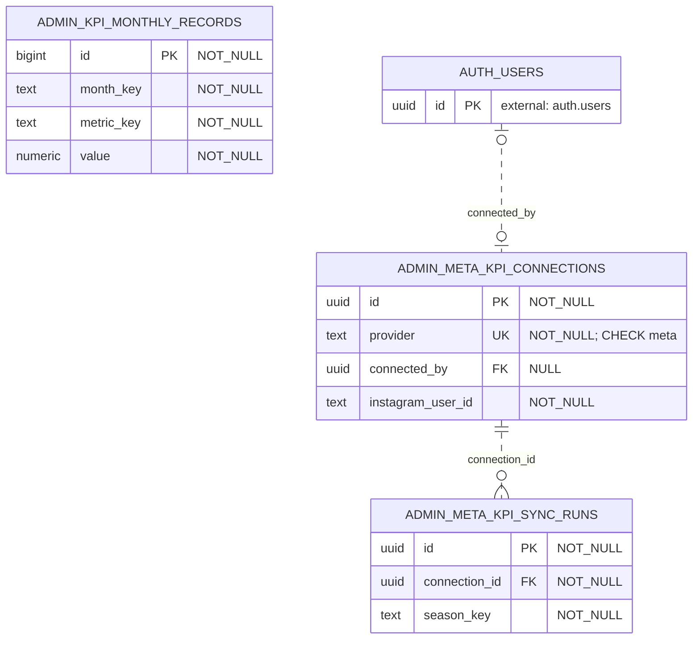

接続表の `connected_by` 自体に UNIQUE はないが、`provider` が `NOT NULL`、`CHECK (provider = 'meta')`、UNIQUE を同時に満たすため、旧 SQL 定義では接続表全体が最大 1 行になる。この制約により、利用者から接続への子件数も 0..1 としている。`season_key` はシーズン表への FK ではなく、Instagram/Facebook/広告アカウントの ID も外部サービス識別子の text である。

### 6.2 `public.variant_backorder_summary` ビュー（2026-10-10 に消した）

グループ E-1 の[移行 B](../../../supabase/migrations/20261010122320_fulfillment_order_emails.sql)で消した。受注生産の数は、仕上がっていない数だけを数える `public.list_variant_stock_states` が返す（[在庫の画面](../../04_DetailDesign/pages/16_admin.md)）。以下は消す前の定義の記録。

[ビューの定義](../../../supabase/migrations/20260919065518_add_variant_backorder_summary.sql#L5)は `public.order_items` の `fulfillment_type = 'backorder'` かつ `variant_id IS NOT NULL` の行を `variant_id` で集計し、`variant_id` と `sum(quantity)::integer AS backorder_quantity` を返す。`security_invoker = true` の通常ビューであり、独立したテーブル、PK、FK は持たない。消す前は、[商品バリアント API](../../../src/app/api/admin/items/[id]/variants/route.ts) だけが参照していた。

## 配送の記録・列・権限（E-4 / FREQ-497）

[配送の詳細設計](../../superpowers/specs/2026-10-21-delivery-status-design.md)・[実装計画](../../superpowers/plans/2026-10-21-delivery-status.md)を参照。以下は実装後の契約であり、既存の決定の本文は履歴として残す。

追加は5表と5 FK。publicの出来事・番号の直し・要対応の3表、privateの登録表・providerの枠の2表。発送への4 FK（3public・1private）とoutboxから直しへの1 FK（private）を追加する。FKはすべて `ON DELETE RESTRICT`。実行者uuidはFKにしない。`orders.status` と `order_status` の値は増やさない。

3移行はA → B → Cの順、各BEGIN〜COMMIT: [20261021220816_delivery_tracking_records.sql](../../../supabase/migrations/20261021220816_delivery_tracking_records.sql) → [20261021221140_delivery_tracking_admin.sql](../../../supabase/migrations/20261021221140_delivery_tracking_admin.sql) → [20261021221410_delivery_tracking_sync.sql](../../../supabase/migrations/20261021221410_delivery_tracking_sync.sql)。Aは記録・守り・outbox・claim・心拍、Bは管理操作・読み出し・返品期限、Cは追跡のclaim・結果・合図・期限・provider枠。本番には 2026-10-22 に A → B → C の順で続けて当て、当てた文の md5 と bytes がファイルと一致し、定義と権限の指紋（308 行）が手元と一致したことを読み取りで確かめた（作業中の仮の版は 20261022100000・20261022100100・20261022100200）。

### 配送の5表と追加の外部キー

主要列を示す。出来事・番号の直し・要対応は public、登録・呼び出し間隔の枠は private。5本の外部キーはすべて削除を拒否する（`ON DELETE RESTRICT`）。呼び出し間隔の枠は独立した1行で、外部キーを持たない。

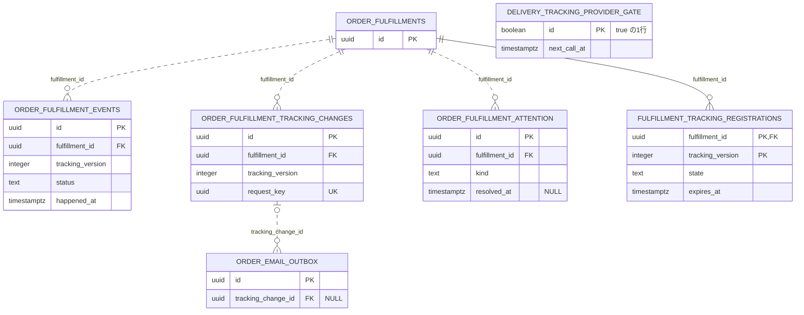

### 列・制約・索引と更新の守り

実装の名前・型・CHECKを以下に記す。新しい FK はすべて `ON DELETE RESTRICT`、した人の uuid は FK にしない（利用者を消す UPDATE と追記の守りを衝突させない）。指定の無い時刻は nullable、既定値は無い。

| 表 | 足す列・定義 |
|---|---|
| `public.shop_settings` | `delivery_tracking_enabled boolean NOT NULL DEFAULT false`、`delivery_tracking_updated_at timestamptz`、`delivery_tracking_updated_by uuid` |
| `public.order_fulfillments` | `delivery_status text NOT NULL DEFAULT 'confirmed' CHECK (delivery_status IN ('confirmed','in_transit','out_for_delivery','attempted_delivery','ready_for_pickup','delivered','delayed','failure'))`、`delivery_status_at timestamptz NOT NULL DEFAULT pg_catalog.now()`、`delivered_at timestamptz`、`tracking_version integer NOT NULL DEFAULT 1 CHECK (tracking_version >= 1)`、`request_fingerprint text`（nullable、Bで既存行を補い、新規の関数は必ず入れる） |

`delivery_status_at` は既存行を `shipped_at` に揃え、新規はBの作成関数が発送した時刻を明示する。既定はAの間の古い作成関数との互換用（同じ取引のnow）。CHECK `order_fulfillments_delivery_check`: `(delivery_status = 'delivered') = (delivered_at IS NOT NULL) AND (delivered_at IS NULL OR delivered_at >= shipped_at)`。

`private.restrict_fulfillment_record_update()` を置き換え、取消の2列だけの1回の更新は従来どおり許す（Aの間の古い取消関数も動く）。追加の配送の列は、呼ぶ側が `set_config('app.fulfillment_change', 'tracking_edit' | 'manual' | 'tracking', true)` を取引内で置き、終了時は前の値へ戻す。トリガーは SECURITY INVOKER のまま、既存 `public.admin_create_fulfillment(uuid,uuid,uuid,text,text,boolean,jsonb)` の owner と `current_user` が同じことも必要とする（service_role が GUC を真似ても権限にならない）。固定列は `to_jsonb(NEW) - 許す列` で比較し、取消済みの変更・追跡での delivered からの戻し・飛び越した版を拒否。削除/TRUNCATE の既存トリガーは保つ。settings の配送3列も同じ owner と操作印 `app.delivery_tracking_setting='toggle'` で toggle 関数だけを許す。

`request_fingerprint` は値から別の値/NULLへ変えない。古い行でNULLの時だけ、tracking_editの関数が直す前の値とlinesから指紋を作って同じ更新で入れてよい（列の守りにもこの1回だけを足す）。

`public.order_fulfillment_events`:

| 列 | 型・決まり |
|---|---|
| `id` | `uuid PRIMARY KEY DEFAULT pg_catalog.gen_random_uuid()` |
| `fulfillment_id` | `uuid NOT NULL REFERENCES public.order_fulfillments(id)` |
| `tracking_version` | `integer NOT NULL CHECK (tracking_version >= 1)` |
| `status` | `text NOT NULL`、上の8値の CHECK `order_fulfillment_events_status_check` |
| `happened_at`・`recorded_at` | `timestamptz NOT NULL`・`timestamptz NOT NULL DEFAULT pg_catalog.now()` |
| `source` | `text NOT NULL CHECK (source IN ('shipment','tracking','manual','tracking_edit'))` |
| `provider_sub_status` | `text CHECK (provider_sub_status IS NULL OR char_length(provider_sub_status) BETWEEN 1 AND 100)`（記号だけ） |
| `created_by` | `uuid` |
| `request_key`・`request_fingerprint` | `uuid`・`text`（manual だけ必須、ほかは両方 NULL） |

制約 `order_fulfillment_events_once_key UNIQUE (fulfillment_id,tracking_version,status,happened_at)`、部分一意索引 `order_fulfillment_events_manual_request_idx(request_key) WHERE request_key IS NOT NULL`、読む索引 `(fulfillment_id,tracking_version,happened_at DESC,recorded_at DESC,id)`。CHECK `order_fulfillment_events_request_check`: `(source='manual' AND request_key IS NOT NULL AND request_fingerprint IS NOT NULL AND created_by IS NOT NULL) OR (source<>'manual' AND request_key IS NULL AND request_fingerprint IS NULL)`。UPDATE/DELETE/TRUNCATE は全拒否。

`public.order_fulfillment_tracking_changes`:

| 列 | 型・決まり |
|---|---|
| `id` | `uuid PRIMARY KEY DEFAULT pg_catalog.gen_random_uuid()` |
| `fulfillment_id` | `uuid NOT NULL REFERENCES public.order_fulfillments(id)` |
| `from_carrier`・`to_carrier` | `text`・`text NOT NULL`、`yamato/sagawa/japanpost` の CHECK（from は legacy の NULL 可） |
| `from_tracking_number`・`to_tracking_number` | `text`・`text NOT NULL`、`^[0-9A-Za-z-]{1,64}$` の CHECK（from は NULL 可） |
| `tracking_version` | `integer NOT NULL CHECK (tracking_version >= 2)` |
| `notify_customer` | `boolean NOT NULL` |
| `request_key`・`request_fingerprint` | `uuid NOT NULL UNIQUE`・`text NOT NULL` |
| `changed_by`・`changed_at` | `uuid NOT NULL`・`timestamptz NOT NULL DEFAULT pg_catalog.now()` |

制約 `order_fulfillment_tracking_changes_version_key UNIQUE(fulfillment_id,tracking_version)`、索引 `(fulfillment_id,changed_at DESC)`。全行追記だけ。

`private.fulfillment_tracking_registrations`:

| 列 | 型・決まり |
|---|---|
| `fulfillment_id`・`tracking_version` | `uuid REFERENCES public.order_fulfillments(id)`・`integer CHECK (tracking_version>=1)`、ともに NOT NULL、組の PRIMARY KEY |
| `carrier`・`tracking_number` | `text NOT NULL CHECK (carrier IN ('yamato','sagawa','japanpost'))`・`text NOT NULL CHECK (tracking_number ~ '^[0-9A-Z-]{1,64}$')` |
| `state` | `text NOT NULL DEFAULT 'pending' CHECK (state IN ('pending','registered','stopped','failed'))` |
| `failure_kind` | `text CHECK (failure_kind IN ('invalid_number','repeated_error'))` |
| `expires_at` | `timestamptz NOT NULL` |
| `ever_registered`・`retry_allowed` | `boolean NOT NULL DEFAULT false`・`boolean NOT NULL DEFAULT true` |
| `stop_reason` | `text CHECK (stop_reason IN ('delivered','expired','replaced','cancelled','provider_stopped','disabled'))` |
| `next_run_at` | `timestamptz NOT NULL DEFAULT pg_catalog.now()` |
| `attempts`・`read_attempts` | `integer NOT NULL DEFAULT 0 CHECK (attempts>=0)`・`integer NOT NULL DEFAULT 0 CHECK (read_attempts>=0)` |
| `last_error_code` | `text CHECK (last_error_code IS NULL OR last_error_code ~ '^[a-z0-9_-]{1,64}$')` |
| `lease_token`・`lease_expires_at` | `uuid`・`timestamptz`（片方だけ NULL は不可） |
| `provider_status`・`provider_sub_status` | `text`・`text`、各 `char_length(...) BETWEEN 1 AND 100` または NULL |
| `last_read_at`・`registered_at`・`stopped_at` | `timestamptz` |
| `signal_revision`・`claimed_signal_revision` | `bigint NOT NULL DEFAULT 0 CHECK (signal_revision>=0)`・`bigint` |
| `stop_signaled`・`provider_stop_pending` | `boolean NOT NULL DEFAULT false`・`boolean NOT NULL DEFAULT false` |
| `provider_stop_attempted_at`・`retrack_attempted_at` | `timestamptz`（外の停止とやり直しを試した記録） |

CHECK: `(state='failed') = (failure_kind IS NOT NULL)`、`(state='stopped') = (stop_reason IS NOT NULL)`、`(state='stopped') = (stopped_at IS NOT NULL)`、`(lease_token IS NULL) = (lease_expires_at IS NULL)`、`NOT ever_registered OR registered_at IS NOT NULL`。索引 `fulfillment_tracking_due_idx(next_run_at) WHERE state<>'stopped'`、`fulfillment_tracking_pair_idx(carrier,tracking_number)`、`fulfillment_tracking_stop_idx(next_run_at) WHERE provider_stop_pending`。組への UNIQUE は作らない。lease 失効は再び借りられ、削除/TRUNCATE は拒否する。

`public.order_fulfillment_attention`:

| 列 | 型・決まり |
|---|---|
| `id` | `uuid PRIMARY KEY DEFAULT pg_catalog.gen_random_uuid()`（resolve の attentionId） |
| `fulfillment_id` | `uuid NOT NULL REFERENCES public.order_fulfillments(id)` |
| `kind` | `text NOT NULL CHECK (kind IN ('delivery_failure','attempted_delivery','tracking_not_found','tracking_registration_failed','tracking_stalled'))` |
| `opened_at` | `timestamptz NOT NULL DEFAULT pg_catalog.now()` |
| `resolved_at`・`resolved_by`・`resolution` | `timestamptz`・`uuid`・`text CHECK (resolution IN ('auto','manual'))` |

CHECK `order_fulfillment_attention_resolution_check`: `(resolved_at IS NULL AND resolved_by IS NULL AND resolution IS NULL) OR (resolved_at IS NOT NULL AND resolution IS NOT NULL AND ((resolution='auto' AND resolved_by IS NULL) OR (resolution='manual' AND resolved_by IS NOT NULL)))`。部分一意索引 `order_fulfillment_attention_open_idx(fulfillment_id,kind) WHERE resolved_at IS NULL`、索引 `(opened_at,id) WHERE resolved_at IS NULL`。更新は開いた行の resolved の3列を一度だけ。削除/TRUNCATE は拒否。

provider の枠だけの補助表 `private.delivery_tracking_provider_gate` は、下表の定義で最初の1行を作る。RLS・service_role SELECT のみ、関数だけ更新。17TRACK の情報を増やす表ではない。

| provider枠の列 | 型・制約 |
| --- | --- |
| `id` | boolean、PRIMARY KEY、DEFAULT true、CHECK(id) |
| `next_call_at` | timestamptz NOT NULL DEFAULT pg_catalog.now() |

outbox の変更（既存の return/refund/cancel の CHECK と索引は保つ）:

- `tracking_version integer CHECK (tracking_version>=1)`、`tracking_change_id uuid REFERENCES public.order_fulfillment_tracking_changes(id)` を追加。
- kind CHECK は現16値の末尾に `'out_for_delivery','delivered','shipping_update'` を追加。variant CHECK の `variant IS NULL` の枝にも3つを追加。
- `order_email_outbox_fulfillment_check`: `(kind IN ('shipped','out_for_delivery','delivered','shipping_update')) = (fulfillment_id IS NOT NULL)`。
- `order_email_outbox_tracking_check`: `((kind IN ('out_for_delivery','delivered','shipping_update')) = (tracking_version IS NOT NULL)) AND ((kind='shipping_update') = (tracking_change_id IS NOT NULL))`。shipping_update の id は同じ fulfillment/version の直しに属することを enqueue 関数で確かめる。
- `order_email_outbox_auto_delivery_idx`: UNIQUE `(fulfillment_id,tracking_version,kind) WHERE origin='auto' AND kind IN ('out_for_delivery','delivered')`。
- `order_email_outbox_auto_tracking_change_idx`: UNIQUE `(tracking_change_id) WHERE origin='auto' AND kind='shipping_update'`。
- `order_email_outbox_auto_once_idx` と enqueue 最後の枝の述語は、両方を次の**同じ文**へ置き換える。

```sql
WHERE origin = 'auto' AND kind <> 'shipped' AND refund_id IS NULL
  AND kind NOT IN ('return_accepted', 'return_received', 'return_sent_back', 'return_refund_pending_shop', 'return_requested', 'return_declined', 'return_request_shop', 'cancel_request_received', 'cancel_request_declined', 'cancel_request_shop', 'out_for_delivery', 'delivered', 'shipping_update')
```

`ops_job_heartbeats_job_check` は今の `webhook_worker/order_sweep/stripe_reconcile/order_email_worker/order_email_delivery_check/return_photo_purge` に `delivery_tracking` を足す。移行 A と移行 B の末尾は既存の取消でない発送へ `(version=1,status='confirmed',happened_at=shipped_at,source='shipment')` の最初の出来事を1行だけ作り、登録・メールは作らない。

実際の索引名は `order_fulfillment_events_history_idx`（発送・版・出来事/記録時刻降順・id）、`order_fulfillment_tracking_changes_history_idx`（発送・変更時刻降順）、`order_fulfillment_attention_queue_idx`（未解決のopened_at・id）。上記の一意索引と `fulfillment_tracking_due_idx`・`fulfillment_tracking_pair_idx`・`fulfillment_tracking_stop_idx` も移行Aに定義する。

全新表でRLSを有効にし、anon/authenticatedはRESTRICTIVEのdenyと権限剥奪、service_roleはSELECTだけ。直接UPDATE/DELETE/TRUNCATEを許可しない。public RPCはSECURITY DEFINER・空のsearch_path・完全修飾名とし、PUBLIC/anon/authenticatedのEXECUTEを外しservice_roleだけに与える。private補助のPUBLIC EXECUTEも外す。

### 競合・再開・メールのclaim

鍵の順番は注文 → 発送。同じ（業者・大文字の番号）は組のadvisory lockも取り、lease_token・版・取消・設定を結果保存時に再検証する。`signal_revision` と `claimed_signal_revision` によって読み直し中の合図を次回に残す。外への停止は番号の直し・取消でまだ止まっていない登録だけを止め、ever_registeredかつ同じ組の止まっていない行が無い時だけ `provider_stop_pending`。外へ送る直前にも同じ条件を再確認する。配達済み・期限切れ・設定オフでは外へ停止を送らない。

再オンは期限内・現版・取消なし・配達済みでない `disabled` の行を同じ主キーのまま再開し、もうある登録を重ねない。登録成功では `tracking_registration_failed` と `tracking_not_found` の両方をautoで閉じる。手で閉じた要対応を同じ条件で開き直さず、いったん解消して新しい条件になった時だけ再発を開く。

`claim_order_email` の戻りは17列（順序固定）: `email_id`・`order_id`・`kind`・`variant`・`origin`・`attempts`・`lease_token`・`subject`・`body_text`・`payment_expired_sent`・`fulfillment_id`・`refund_id`・`return_id`・`return_receipt_id`・`cancel_request_id`・`tracking_version`・`tracking_change_id`。最後の2列を足し、DROP/CREATEの後にEXECUTE権限を戻す。`get_order_delivery_detail` のregistrationは `ever_registered` も返す。TSでは `everRegistered` として顧客への表示条件に使う。

## 注文状況のリンクと権限（E-5 / FREQ-505）

[詳細設計](../../superpowers/specs/2026-10-22-order-status-page-design.md)・[実装計画](../../superpowers/plans/2026-10-22-order-status-page.md)を参照。[移行A](../../../supabase/migrations/20261022084844_order_status_links.sql) → [移行B](../../../supabase/migrations/20261022084944_order_status_returns.sql)の2本。既存の表の列・型は変えず、1表・1 FKを追加する。E-4までの85表・107 FKに足して、合わせて86表・108 FK。これはソース上の構造であり本番適用の証拠ではない。

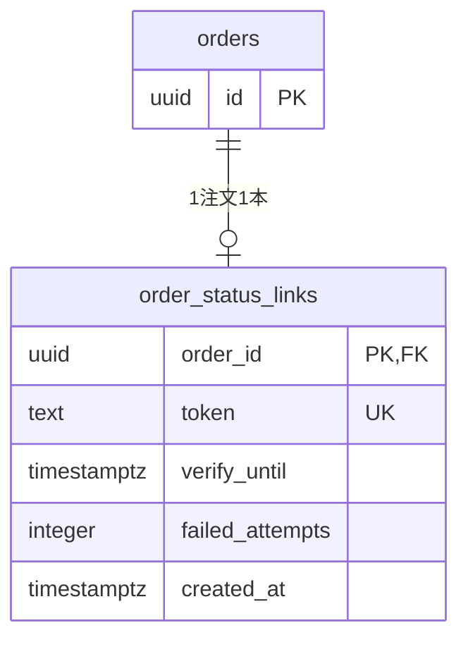

| 列 | 型・制約 |
| --- | --- |
| `order_id` | uuid PRIMARY KEY、`REFERENCES public.orders(id) ON DELETE RESTRICT` |
| `token` | text NOT NULL。`order_status_links_token_key UNIQUE(token)`、`order_status_links_token_check` は `^[A-Za-z0-9_-]{43}$` |
| `verify_until` | timestamptz NULL、既定NULL |
| `failed_attempts` | integer NOT NULL DEFAULT 0。`order_status_links_failed_attempts_check` は0〜20 |
| `created_at` | timestamptz NOT NULL DEFAULT pg_catalog.now() |

表名は `private.order_status_links`。PKとtokenの一意索引だけで検索し、期限の全件検索用索引や定期削除は作らない。RLSを有効化し、`order_status_links_deny_clients` は `AS RESTRICTIVE FOR ALL TO anon, authenticated USING(false) WITH CHECK(false)`。PUBLIC・anon・authenticated・service_roleから全権限を外した後、service_roleへSELECTだけを与える。直接書き込みは許可しない。private schemaのUSAGEを顧客へ増やさない。

publicのRPCは完全修飾名・`SECURITY DEFINER`・`SET search_path = ''`・所有者postgres。PUBLIC/anon/authenticatedのEXECUTEを外しservice_roleだけへ付与。privateの補助はSECURITY INVOKER、同じ空search_pathと所有者で、service_roleを含め直接EXECUTEを与えない。

| 関数 | 契約 |
| --- | --- |
| `public.ensure_order_status_link(_order_id uuid)` | 無ければON CONFLICTで作成し既存tokenを返す。1注文1本で再発行しない |
| `public.get_order_status_link(_token text)` | order_id/customer_id/verify_until/failed_attempts/phone_availableだけ。形不正・無い・隠す状態は0行 |
| `public.verify_order_status_phone(_token text,_last_four text)` | 行ロック内で存在 → expired → unavailable → locked → 固定4回の照合。ok/mismatch/locked/unavailable/expired。電話は返さない |
| `public.get_order_status_public_material(_order_id uuid)` | 個人情報や番号を取得しない公開専用JSON。無い・隠す状態はSQL NULL |
| `public.complete_order_email(_email_id uuid,_lease_token uuid,_provider_message_id text)` | 既存のlease・pause・booleanを維持。成功UPDATEのRETURNINGだけから期限を進める |
| `private.order_status_phone_last_four` / `private.order_status_four_equal` | 全角数字をそろえ末尾4桁。4回のASCII/XOR/OR比較。DB内だけ |
| `private.build_customer_order_returns(_order public.orders,_include_private boolean)` | 既存JSONの共有。falseは返送先・送り返しの業者/番号のキーと取得を省く |
| `public.get_customer_order_returns(_order_id uuid,_customer_id uuid)` | 既存の持ち主条件と拒否を維持して芯をtrueで呼ぶ |
| `public.get_order_status_returns(_order_id uuid,_include_private boolean DEFAULT false)` | 所有者条件なし。無い・NULL・隠す状態はSQL NULL、trueだけ個人情報を含む。NULLの真偽引数は22023 |

移行は各BEGIN〜COMMIT、最後に `NOTIFY pgrst, 'reload schema';`。過去の移行は変更しない。乱数は `extensions.gen_random_bytes(32)`。配置が違うpgcryptoを勝手に移設せず `ORDER_STATUS_CRYPTO_UNAVAILABLE` で止める。

## 在庫の割当と品物の状態の履歴（G-1 / FREQ-520〜524・535・540〜541）

[設計書 6〜8章](../../superpowers/specs/2026-10-23-group-g-design.md)・[実装計画](../../superpowers/plans/2026-10-24-group-g1-allocation.md)を参照。移行は1本 `supabase/migrations/20261023211425_group_g1_allocation.sql`（本番へ適用した後は、MCP が記録した版にファイル名を直す。リンクにしないのはそのため）。先頭の `BEGIN;`〜末尾の `COMMIT;` を1組だけ持ち、清掃（本番のテスト用の注文と関連記録の削除）・本体（以下）・末尾の全部の確かめを1取引で当てる。ソース上の構造であり、本番へは未適用。適用の手順と記録は [DB マイグレーション運用](../../06_Operations/db-migrations.md)。

差分はテーブル +4（public +3、private +1）、物理 FK +12、追加の列 2、台帳の理由 +1。E-5 までの86テーブル・108 FKに足して、合わせて90テーブル・120 FK。図は 2.10、FK の一覧は 4.3.4。

### 数の保存と書く者

| 記号 | 意味 | 持ち方 |
| --- | --- | --- |
| F | 空き在庫 | `item_variants.stock_quantity`。割当・仮確保に取り分けた数を含まない。動かすのは台帳 `stock_movements` のトリガーだけ（意味は変えない） |
| A | 入金済みの割当 | `order_item_allocations` のうち `kind = 'paid'` の `remaining_quantity` の和 |
| H | 未入金の仮確保 | 同じく `kind = 'payment_hold'` の和 |
| 手元の在庫 | `F + A + H` | A と H は排他（同じ明細が両方の残りを持たない）。H から A への切替は F も手元の在庫も変えず、台帳の行も足さない |

書けるのは、共通の在庫の鍵（advisory `(190521, 1)`）を取った private の SECURITY DEFINER の DB の関数だけ。順序と流れは [在庫の割当の流れ](../../04_DetailDesign/sequence/inventory-allocation.md)、割当の状態は [在庫の割当の状態](../../04_DetailDesign/states/inventory-allocation.md) に書く。

| 守り | 内容 |
| --- | --- |
| 表の権限 | 4表とも RLS を有効にし、anon・authenticated の全操作を `RESTRICTIVE` の方針（`*_deny_all`、`USING (false) WITH CHECK (false)`）で拒否。PUBLIC・anon・authenticated・service_role の全権限を外し、service_role には public の3表の `SELECT` だけを与える。private の `group_g_operations` は誰にも権限を与えない（service_role も読めない）。新しい sequence は作らない |
| 台帳 | `stock_movements` の `INSERT` と `stock_movements_id_seq` の `USAGE` を service_role から外した。台帳のトリガー `stock_movements_apply` の本体（`private.apply_group_g_stock_movement`）は共通の鍵を持たない書込みを `GROUP_G_INVENTORY_LOCK_REQUIRED`（55000）で断る |
| private の関数 | 新しい関数は所有者 postgres・`SECURITY DEFINER SET search_path = ''`・完全修飾名。PUBLIC・anon・authenticated・service_role の実行権限を外し、公開の入口（service_role 専用の `SECURITY INVOKER` の委譲）に必要な関数にだけ service_role の `EXECUTE` を与える。`private` スキーマの `USAGE` と `private.set_request_context()` の実行権限には触れない |
| 書き手の閉じた一覧 | `private.group_g_writer_allowlist()` が56関数の OID の集合を返す。移行の末尾の確かめは、この集合が期待と一致することを見る。4表・`stock_movements`・`order_fulfillments`・`order_item_completions` への書込みと `item_variants.stock_quantity` の更新を持つ関数が、この集合の中だけであることは `tests/integration/db/group_g1_writer_inventory.integration.test.ts` が `pg_proc.prosrc` を走査して確かめる（動的 SQL で参照する未審査の関数も断る） |

### 4表の列と制約

#### `private.group_g_operations`（操作の受付）

| 列 | 型・制約 |
| --- | --- |
| `id` | uuid PRIMARY KEY。呼ぶ側が先に決める |
| `operation` | text NOT NULL。操作の種類（例: `place_order_from_checkout_draft`・`mark_order_paid`・`stock_move`・`payment_review_hold`・`payment_review_release`・`payment_exception_dispatch`） |
| `request_key` | uuid NOT NULL。再送のキー。`group_g_operations_operation_request_key_key` UNIQUE `(operation, request_key)` |
| `fingerprint` | text NOT NULL。入力の SHA-256（64桁の小文字16進、`group_g_operations_fingerprint_check`）。同じキーで中身が違う再送は断る（在庫の窓口は `GROUP_G_REQUEST_KEY_CONFLICT`、23505） |
| `cause_type`・`cause_id` | text NOT NULL。原因の種類と番号（注文・要対応・variant など。FK なし） |
| `exception_id` | uuid NULL、`payment_exceptions(id)` へ `RESTRICT`。`group_g_operations_exception_check` で `(operation = 'payment_review_hold') = (exception_id IS NOT NULL)` |
| `actor_id` | uuid NULL（FK なし） |
| `result` | jsonb NOT NULL。結果の写し（再送の応答に使う）。保留の行は `group_g_operations_review_hold_check` で `cause_type = 'payment_exception'`・`cause_id = exception_id`・`result.active = true`・`result.order_id` が文字列 |
| `created_at` | timestamptz NOT NULL DEFAULT now() |

支払額の違いの保留（`payment_review_hold`）は、要対応の行が必ず要る。解除は `payment_review_release` の行を足して表す（保留の行は直さない）。要対応の最初の通知・返金の権利は `payment_exception_dispatch` の行を1つ足して表す（要対応ごとに1つ）。追記だけ。

#### `public.order_item_allocations`（割当の現在値）

| 列 | 型・制約 |
| --- | --- |
| `id` | uuid PRIMARY KEY DEFAULT gen_random_uuid() |
| `order_item_id` | uuid NOT NULL、`order_items(id)` へ `RESTRICT` |
| `variant_id` | bigint NOT NULL、`item_variants(id)` へ `RESTRICT`。明細の variant と同じ（遅延の確かめ） |
| `quantity` | integer NOT NULL、0 より大きい。作った時の数量で、変えない |
| `remaining_quantity` | integer NOT NULL、0 以上 `quantity` 以下。減るだけ（戻す時は `restore` で新しい行を作る） |
| `kind` | text NOT NULL、`payment_hold`（H）か `paid`（A）。変えられるのは H から A だけ |
| `operation_id` | uuid NOT NULL、操作の受付へ `RESTRICT`（遅延）。作った操作で、変えない |
| `version` | bigint NOT NULL DEFAULT 0、0 以上。残数量か種類が変わるたびにちょうど +1、変わらない更新では変えない |
| `created_at`・`updated_at` | timestamptz NOT NULL DEFAULT now() |

索引: `order_item_allocations_variant_kind_item_idx (variant_id, kind, order_item_id)`、`order_item_allocations_item_id_idx (order_item_id, id)`。行は削除できない。

#### `public.order_item_allocation_events`（割当の履歴）

| 列 | 型・制約 |
| --- | --- |
| `id` | uuid PRIMARY KEY DEFAULT gen_random_uuid() |
| `allocation_id` | uuid NOT NULL、割当へ `RESTRICT` |
| `event_type` | text NOT NULL。下の7値 |
| `quantity` | integer NOT NULL、0 より大きい |
| `operation_id` | uuid NOT NULL、操作の受付へ `RESTRICT`（遅延） |
| `sequence` | integer NOT NULL、0 より大きい。同じ操作の中の順。`order_item_allocation_events_operation_key` UNIQUE `(operation_id, allocation_id, event_type, sequence)` |
| `counterpart_allocation_id` | uuid NULL、割当へ `RESTRICT`。`(event_type = 'transfer')` と同時に非空、自分自身は不可 |
| `reverses_event_id` | uuid NULL、自表の履歴へ `RESTRICT`、UNIQUE。`(event_type = 'restore')` と同時に非空 |
| `stock_movement_id` | bigint NULL、`stock_movements(id)` へ `RESTRICT`、UNIQUE。`hold`・`allocate`・`restore`・`release` と同時に非空 |
| `reason` | text NULL。下の15値のどれか |
| `actor_id` | uuid NULL（FK なし） |
| `created_at` | timestamptz NOT NULL DEFAULT now() |

索引: `order_item_allocation_events_allocation_created_idx (allocation_id, created_at, id)`。追記だけ。

| `event_type` | 意味 | 台帳（`stock_movements`） | G-1 で書く関数 |
| --- | --- | --- | --- |
| `hold` | H を作る | `purchase`、負数 | 注文の受付 |
| `promote` | H を A に変える（数量は変えない） | なし | 入金 |
| `allocate` | A を作る | `purchase`（交換の品は `exchange`）、負数 | FIFO |
| `release` | 残数量を減らして空きへ戻す | `cancel`・`refund`・`allocation_release`、正数 | 未入金の解放・取消・返金・在庫を減らす操作 |
| `consume` | 発送で使う（A だけ） | なし | なし（G-3 が書く。制約は受け付ける） |
| `restore` | 発送の消費を戻した新しい A | `purchase`・`exchange`、負数 | なし（G-3） |
| `transfer` | 同じ variant の割当の入替（両側が対） | なし | 割当の入替 `private.admin_swap_order_allocations`（G-4 Task 4。出し手の割当と受け手の新しい割当に1つずつ、理由 `allocation_swap`） |

履歴の理由 `reason` は、次の15値だけ（`order_item_allocation_events_reason_check`）。`src/lib/inventory/allocation-types.ts` の `ALLOCATION_EVENT_REASON_CODES` と同じ集合で、単体試験が突き合わせる。管理者のメモのような自由な文は台帳の `note` に残し、ここには書かない。

| 値 | 場面 |
| --- | --- |
| `checkout` | 注文の受付で H を作る |
| `stripe_payment_paid` | 入金で H を A に変える |
| `fifo` | FIFO で A を作る |
| `stock_adjustment` | 在庫を減らす操作で、足りない分の A を外す |
| `refund_restock` / `refund_release` | 返金で割当を外す（在庫へ戻す / 在庫へ戻さずに外す） |
| `stripe_checkout_expired` / `stripe_voucher_expired` | 未入金の支払い期限切れで H を外す |
| `admin_cancel` / `admin_cancel_failed_order` | 店の取消（未入金・失敗した注文）で H を外す |
| `resolve_payment_exception` | 要対応の解決（取消）で H を外す |
| `status_change` | 上のどれにも当たらない状態変更の理由 |
| `fixture_allocation` / `fixture_release` / `fixture_shipment` | 手元の試験の材料だけが書く |

#### `public.order_item_state_events`（品物ごとの状態の履歴）

| 列 | 型・制約 |
| --- | --- |
| `id` | uuid PRIMARY KEY DEFAULT gen_random_uuid() |
| `order_item_id` | uuid NOT NULL、`order_items(id)` へ `RESTRICT` |
| `unit_from`・`unit_to` | integer NOT NULL。0 始まりの半開区間 `[unit_from, unit_to)`。`unit_from >= 0`、`unit_to > unit_from` |
| `quantity` | integer、`unit_to - unit_from` の生成列（`GENERATED ALWAYS AS … STORED`） |
| `from_status`・`to_status` | text NULL。12の状態のどれか（`unpaid`・`payment_expired`・`in_production`・`ready`・`shipped`・`delivered`・`cancel_requested`・`cancelled`・`return_requested`・`return_in_progress`・`refund_waiting`・`returned`）。新しく表に出た数量だけ `from_status` が空、表から外れた数量だけ `to_status` が空。両方空と同じ状態への変化は不可 |
| `operation_id` | uuid NOT NULL、操作の受付へ `RESTRICT`（遅延） |
| `sequence` | integer NOT NULL、0 より大きい。`order_item_state_events_operation_key` UNIQUE `(operation_id, order_item_id, sequence, unit_from)` |
| `reason` | text NULL（変化の原因の短い名前。例: `place_order_from_checkout_draft`・`stripe_payment_paid`・`fifo`・`stock_move`）。`actor_id` uuid NULL（FK なし）。`created_at` timestamptz NOT NULL DEFAULT now() |
| `version` | bigint NOT NULL、0 より大きい。明細ごとに履歴が積まれる順 |

索引: `order_item_state_events_item_version_idx (order_item_id, version, id)`。追記だけ。現在の状態は保存せず、原本（入金・割当・発送・配送・取消申請・返品・返金）から `private.group_g_item_state_ranges(uuid[])` が数量の重ならない区間に投影する。履歴は原因と同じ取引で、変化した数量だけ `private.record_group_g_item_state_changes` が足す。読み出しは `public.list_admin_order_item_states(uuid[])`（service_role 専用、一度に200注文まで）。

### 追加の2列と台帳の理由

| 対象 | 内容 |
| --- | --- |
| `public.orders.paid_at` | timestamptz NULL。初めて入金を DB に記録した時刻（`clock_timestamp()`）。Stripe のイベント時刻や注文日時で代用しない。金額が違う入金でも設定し、書いたら変えられない（トリガー `orders_paid_at_once`、例外 `GROUP_G_PAID_AT_IMMUTABLE`）。列の権限は後から足した列に及ばないので、お客様の Data API からは隠れる店内だけの列 |
| `public.stock_movements.allocation_operation_id` | uuid NULL、操作の受付へ `RESTRICT`（遅延）。割当の履歴に結ぶ台帳の行だけが持つ。持つ行は `hold`・`allocate`・`restore`・`release` の履歴がちょうど1つ対応する（遅延のトリガー `group_g_stock_movement_consistency`） |
| `stock_movements_reason_check` | 理由に `allocation_release`（割当の解放。正数）を足し、`purchase`・`restock`・`adjustment`・`cancel`・`refund`・`return`・`exchange`・`allocation_release` の8値にした |

### トリガーと数の確かめ

| 名前 | 表 | 内容 |
| --- | --- | --- |
| `*_no_update`・`*_no_delete`・`*_no_truncate`（9本） | 割当の履歴・状態の履歴・操作の受付 | 更新・削除・全消しを `GROUP_G_HISTORY_IMMUTABLE`（55000）で断る（所有者の通常の SQL も同じ） |
| `order_item_allocations_change_guard` | 割当の現在値 | 削除と、`id`・明細・variant・数量・作った操作・作った時刻の変更を断る。種類は H から A だけ、残数量は増やせない、`version` は変化があった時にちょうど +1 |
| `group_g_allocation_bounds`（遅延、割当と割当の履歴の2本） | 割当・割当の履歴 | commit の時に触れた割当と相手の割当を確かめ、違反は `GROUP_G_ALLOCATION_BOUNDS`（23514）、`DETAIL` に違反の種類（`variant_mismatch`・`creation_event`・`kind_history`・`remaining_events`・`consume_kind`・`stock_movement`・`restore`・`transfer_pair`・`hold_paid_overlap`・`item_bounds`）を入れる |
| `group_g_stock_movement_consistency`（遅延） | 台帳 | 操作の番号を持つ台帳の行は、同じ variant・明細・数量・操作の履歴が1つ対応すること |
| `orders_paid_at_once` | 注文 | `paid_at` を書いた後の変更を断る |
| `order_item_completions_disabled` | 仕上がりの表 | 新しい INSERT・UPDATE を `MANUAL_COMPLETION_DISABLED`（55000）で断る。service_role の書込み権限も外した |

数の確かめ（`group_g_allocation_bounds`）が見るもの: 履歴の作る行がちょうど1つで数量・操作が行と一致する／H で作った行だけが `promote` を1回持てる／残数量は `release`・`consume`・入替の出し手の合計を数量から引いた値／`consume` は A だけ／台帳の行は同じ variant・同じ操作で、作る履歴は負数・`release` は正数／`restore` は別の割当の同じ明細・同じ variant・同じ数量の `consume` を1回だけ戻す／入替は両側の履歴が対になり、両側とも A／1つの明細で H と A の残りを同時に持たない／A と H の残数量の和は、明細の数量から取り消していない発送の数量を引いた値以下。

### 旧の発送・仕上がりの停止と共通の鍵

- 旧の発送4関数（`admin_create_fulfillment`・`admin_cancel_fulfillment`・`admin_update_fulfillment_tracking`・`admin_mark_fulfillment_delivered`）は `LEGACY_FULFILLMENT_DISABLED`、仕上がりの手動記録2関数（`admin_record_completion`・`admin_cancel_completion`）は `MANUAL_COMPLETION_DISABLED`（どちらも 55000）で、引数の検証や行の鍵より前に断る固定の定義に置き換えた。戻り型と service_role の実行権限は変えない。G-3 の発送票まで再開しない。
- 全ての更新の入口は、共通の鍵（advisory `(190521, 1)`）を最初に取る。行の鍵の順は advisory → `checkout_drafts`（注文作成時だけ）→ `items`（KEY SHARE）→ `item_variants` → `orders` → `order_items` → 割当 → 返品 → 返品の行 → 受け取り → 受け取りの行 → 返金 → 返金の行 → キャンセルの申し込み → 申し込みの行 → 補助の行。配送の追跡の設定（`shop_settings`）だけは advisory の直後・`orders` の前に取る例外。詳しくは [在庫の割当の流れ](../../04_DetailDesign/sequence/inventory-allocation.md) の「共通の鍵と行の鍵の順」。

## 発注書・受け取り・原本の添付（G-2 / FREQ-526〜530・540）

[設計書 8章](../../superpowers/specs/2026-10-23-group-g-design.md)・[実装計画](../../superpowers/plans/2026-10-24-group-g2-purchasing.md)の Task 2 を参照。移行は1本 `supabase/migrations/20261024153505_group_g2_purchasing_foundation.sql`（本番へ適用した後は、MCP が記録した版にファイル名を直す。リンクにしないのはそのため）。先頭の `BEGIN;`〜末尾の `COMMIT;` を1組だけ持ち、本体（`-- G2A_BODY_BEGIN`〜`-- G2A_BODY_END`。Task 1 の権限の切替・G-1 の持ち越し・公開関数11本の実行権の剥奪の後に、以下の9表・守り・置き場）と末尾の確かめ（`-- G2A_FINAL_ASSERT_BEGIN`〜`-- G2A_FINAL_ASSERT_END`）を1取引で当てる。**データを変える文は無い**（変更はスキーマと `storage.buckets` の1行だけ）。本番へは未適用。適用の手順と記録は [DB マイグレーション運用](../../06_Operations/db-migrations.md)。

差分はテーブル +9（public +9）、物理 FK +22、置き場 +1。G-1 までの90テーブル・120 FKに足して、合わせて99テーブル・142 FK。図は 2.11、FK の一覧は 4.3.5。新しい sequence は作らない（主キーは `uuid DEFAULT gen_random_uuid()`）。

### 値の範囲

| 項目 | 範囲 |
| --- | --- |
| 発注番号 `number` | `PO-` + 日付8桁 + `-` + 4桁（`^PO-[0-9]{8}-[0-9]{4}$`）、一意。採番は `admin_create_purchase_order` が共通の鍵の下で行う |
| 発注先 `supplier_name` | 1〜100文字。メモ `memo` は空（NULL）か500文字まで |
| 段階 `stage` | `ordered`（発注確定直後。数量は仮）か `quantity_confirmed`。既定は `ordered`。ほかの段階（一部受取・受取済み・打切り済み）は保存せず、読み出しが導出する |
| 版 `version` | 1 以上。発注書も行も、変わる更新ごとにちょうど +1 |
| 仮数量 `provisional_quantity` | 1〜99999。確定数量 `confirmed_quantity` は NULL（未確定）か 0〜99999。納品済み `received_quantity` は 0 以上で、確定数量以下、未確定の間は 0 |
| 未納 `outstanding_quantity` | `confirmed_quantity - received_quantity` の生成列（`GENERATED ALWAYS AS … STORED`）。未確定は NULL |
| 単価 `unit_price_yen` | NULL（未登録）か 0〜9999999。NULL と 0 円は別の値として保存する |
| 理由 `reason` | 空（NULL）か 1〜200文字。打切りの理由は必須。受け取りの `kind = 'reverse'` は理由が必須、`receive` は NULL |
| 受取行の数量 `quantity` | 0 以外で -99999〜99999。正は良品の受取、負は相殺。負の行だけが相殺元 `reverses_receipt_line_id` を持つ |
| 原本 | `kind` は `quote`（見積書）か `invoice`（請求書）。ファイル名 1〜255文字。`mime_type` は `application/pdf`・`image/jpeg`・`image/png`、`size_bytes` は 1〜20971520（20 MiB）、`sha256` は64桁の小文字16進、`sha256_source` は `browser` か `server` |
| 取引の記録 | `transaction_date` は 2000-01-01 以後、`amount_yen` は 0〜99999999999、`currency` は大文字3字（`^[A-Z]{3}$`）、`counterparty` は 1〜100文字。版 2 以降と無効化（`voided`）は理由が必須。差し替えの元 `replaces_attachment_id` は版 1 だけが持つ |

### 9表の列

実行した人の列（`created_by`・`actor_id`・`uploaded_by`）は uuid NOT NULL で FK なし。`id` は uuid PRIMARY KEY DEFAULT gen_random_uuid()、`created_at` は timestamptz NOT NULL DEFAULT now()（全表）。

| 表 | 列（`id`・`created_at` 以外） | 索引 |
| --- | --- | --- |
| `purchase_orders` | `number`、`supplier_name`、`memo`、`stage`、`version`、`ordered_at`（NOT NULL DEFAULT now()。変えない）、`created_by`、`updated_at` | なし（`number` の一意だけ） |
| `purchase_order_lines` | `purchase_order_id`、`line_no`（入力の並び順。一覧・詳細はこの順）、`variant_id`、`item_name`・`color_name`・`size_label`（発注時の写し。色・サイズは NULL 可）、`provisional_quantity`、`confirmed_quantity`、`received_quantity`、`unit_price_yen`、`outstanding_quantity`、`version`、`updated_at` | `purchase_order_lines_variant_outstanding_idx (variant_id) WHERE outstanding_quantity > 0` |
| `purchase_order_revisions` | `purchase_order_id`、`line_id`（NULL 可）、`revision_no`、`kind`（`order`・`header`・`quantity`・`short_close`）、`before_quantity`・`after_quantity`、`before_unit_price_yen`・`after_unit_price_yen`、`before_supplier_name`・`after_supplier_name`、`before_memo`・`after_memo`、`reason`、`actor_id`、`operation_id` | なし（一意 `(purchase_order_id, revision_no, line_id, kind)` が NULLS NOT DISTINCT） |
| `purchase_order_short_closures` | `line_id`、`revision_id`、`closed_quantity`（打ち切った未納数。0 より大きい）、`reason`（NOT NULL）、`actor_id` | なし |
| `purchase_order_receipts` | `purchase_order_id`、`kind`（`receive`・`reverse`。既定 `receive`）、`received_on`（date。相殺は操作した日の日本時間）、`memo`（200文字まで）、`reason`、`actor_id`、`operation_id` | なし |
| `purchase_order_receipt_lines` | `receipt_id`、`line_id`、`quantity`、`reverses_receipt_line_id`、`stock_movement_id` | `purchase_order_receipt_lines_line_idx (line_id)`、`purchase_order_receipt_lines_reverses_idx (reverses_receipt_line_id) WHERE reverses_receipt_line_id IS NOT NULL` |
| `purchase_order_attachment_reservations` | `purchase_order_id`、`kind`、`original_file_name`、`storage_path`（一意）、`created_by`、`operation_id`、`expires_at`、`replaces_attachment_id`（uuid、NULL 可。差し替えの予約だけが、差し替える添付を持つ）。予約が使われたかは原本側の `reservation_id` で決まり、予約の行は変えない | なし |
| `purchase_order_attachments` | `purchase_order_id`、`reservation_id`（一意）、`kind`、`original_file_name`、`storage_path`（予約と同じ値。一意）、`mime_type`、`size_bytes`、`sha256`、`sha256_source`、`uploaded_by`、`operation_id` | なし |
| `purchase_order_attachment_revisions` | `attachment_id`、`revision_no`、`transaction_date`、`amount_yen`、`currency`、`counterparty`、`voided`（既定 false）、`reason`、`replaces_attachment_id`、`actor_id`、`operation_id` | `purchase_order_attachment_revisions_search_idx (transaction_date, amount_yen, counterparty)`、`purchase_order_attachment_revisions_attachment_idx (attachment_id, revision_no DESC)` |

制約の名前は `<表>_<列>_check`・`_key`・`_fkey` の形で、列の範囲の CHECK と組の CHECK（`purchase_order_lines_confirmed_received_check`・`purchase_order_lines_unconfirmed_received_check`・`purchase_order_receipts_kind_reason_check`・`purchase_order_receipt_lines_reverses_check`・`purchase_order_attachment_revisions_revision_reason_check`・`…_voided_reason_check`・`…_replaces_check`）を含め、移行の末尾の確かめが87本を名前・種類・列で突き合わせる。

### 発注書の守り

| 守り | 内容 |
| --- | --- |
| 追記専用の7表 | `purchase_order_revisions`・`purchase_order_short_closures`・`purchase_order_receipts`・`purchase_order_receipt_lines`・`purchase_order_attachment_reservations`・`purchase_order_attachments`・`purchase_order_attachment_revisions` に `<表>_no_update`・`_no_delete`（行）・`_no_truncate`（文）。G-1 の履歴と同じ `private.reject_group_g_event_mutation()` が `GROUP_G_HISTORY_IMMUTABLE`（55000）で断る（所有者の通常の SQL も、service_role に権限を足しても同じ）。TRUNCATE は外部キーの確かめが先に走るので、指す側の表を同じ文に並べない限りトリガーに届かない |
| `purchase_orders`・`purchase_order_lines` | 削除と TRUNCATE は同じ関数で断る（`*_no_delete`・`*_no_truncate`）。UPDATE は `private.guard_group_g_purchase_order_change()`（`*_change_guard`、BEFORE UPDATE の行）が守る: 識別の列（発注書は `id`・`number`・`ordered_at`・`created_by`・`created_at`、行は `id`・`purchase_order_id`・`line_no`・`variant_id`・発注時の3つの写し・`provisional_quantity`・`created_at`）の変更は `GROUP_G_PURCHASE_ORDER_GUARD`（55000、`DETAIL = immutable_column`）。何も変わらない更新は通す。何かが変わる更新は `version = 旧 + 1`（違えば同じ例外で `DETAIL = version`）と、この接続が共通の鍵（advisory `(190521, 1)`）を持っていること（無ければ `GROUP_G_INVENTORY_LOCK_REQUIRED`、55000） |
| 受取行の台帳との突き合わせ | `private.check_purchase_order_receipt_line()`（`purchase_order_receipt_lines_check_line`、BEFORE INSERT の行、SECURITY DEFINER）。受取行が結ぶ台帳の行は、その明細と同じ variant、`delta = quantity`、理由は正なら `restock`・負なら `adjustment`、`allocation_operation_id IS NULL`（G-1 の整合トリガーが見る「タグ付き」の行とぶつからない無タグの行）。受け取りと明細は同じ発注書。種類 `receive` の受け取りは正の行だけ、種類 `reverse` の受け取りは負の行だけ（Task 3 で足した。違えば `DETAIL` は `kind`）。負の行の相殺元は、同じ発注書・同じ明細の、種類 `receive` の受け取りの中の正の行。違えば `GROUP_G_PO_RECEIPT_LINE_MISMATCH`（23514、`DETAIL` は `movement`・`line_order`・`kind`・`reverses`） |
| 納品数の確かめ | `private.check_purchase_order_line_received()`（`group_g_po_line_received`、`purchase_order_lines` の INSERT／UPDATE と `purchase_order_receipt_lines` の INSERT の遅延トリガー、`DEFERRABLE INITIALLY DEFERRED`、SECURITY DEFINER）。commit の時に、触れた明細の `received_quantity` が受取行の合計と等しいこと（違えば `GROUP_G_PO_RECEIVED_MISMATCH`、23514）と、1つの正の行への相殺の合計が元の数量を超えないこと（超えれば `GROUP_G_PO_REVERSE_EXCEEDS_RECEIVED`、23514）を確かめる |
| 表の権限 | 9表とも RLS を有効にし、anon・authenticated の全操作を `RESTRICTIVE` の方針 `"deny direct client access"`（`USING (false) WITH CHECK (false)`）で拒否。PUBLIC・anon・authenticated・service_role の全権限（PostgreSQL 17 の `MAINTAIN` を含む）を外し、service_role には `purchase_order_attachments` と `purchase_order_attachment_reservations` の `SELECT` だけを与える（保存キーの照会用。他の7表は service_role も読めない）。所有者は postgres。新しい関数は PUBLIC・anon・authenticated・service_role の実行権限を外す。`private` スキーマの `USAGE` と `private.set_request_context()` の実行権限には触れない |
| 移行の末尾の確かめ | `$g2a_final_objects$`（9表の存在・空・RLS・所有者・方針・列・制約・索引・トリガー〔30本。名前・時機・関数・有効〕・3関数の所有者／`search_path`／実行権・置き場の値と方針）と `$g2a_final_table_acl$`（表の権限を意味で比べる。本番の既定の権限で別の付与先が付いても問わず、「要る」と「無い」だけを見る）。違えば `GROUP_G_MIGRATION_ASSERTION_FAILED`（55000、`DETAIL` が項目名）で全部戻る |

### 置き場 `purchase-order-documents`

`storage.buckets` に1行（`INSERT … ON CONFLICT (id) DO NOTHING`）: `public = false`、`file_size_limit = 20971520`（20 MiB）、`allowed_mime_types = {application/pdf, image/jpeg, image/png}`。`storage.objects` の方針は作らない（anon・authenticated は何もできず、読み書きは service_role と署名つきの送り先・リンクだけ）。同じ id の置き場が別の設定で既にある場合は、末尾の確かめが止める。物の削除は置き場の窓口（Storage API）で行う（SQL で消すと中身が残る）。

## 7. 関連ドキュメント

- [システム構成](../architecture/system-overview.md)
- [API](../api/api-spec.md)
- [注文・決済の状態遷移](../../04_DetailDesign/states/order-payment.md)
- [在庫の割当の流れ（G-1）](../../04_DetailDesign/sequence/inventory-allocation.md)
- [在庫の割当の状態（G-1）](../../04_DetailDesign/states/inventory-allocation.md)
- [DB マイグレーション運用](../../06_Operations/db-migrations.md)

## 発送票と出荷日（G-3 Task 1 / FREQ-533・540）

[基盤の移行](../../../supabase/migrations/20261025053324_group_g3_shipping_foundation.sql) は public 5表・private 1表と13 FKを追加する。99表・142 FK から105表・155 FKへのソース上の差分であり、ローカルDBにはcontroller resetで適用し、2026-10-25のDB全件でTask 1の新規失敗0を確認した（全体は既知stockist2失敗によりexit 1）。実行者の UUID 列には FK を付けず、利用者の削除が追記専用の表を更新しないようにする。

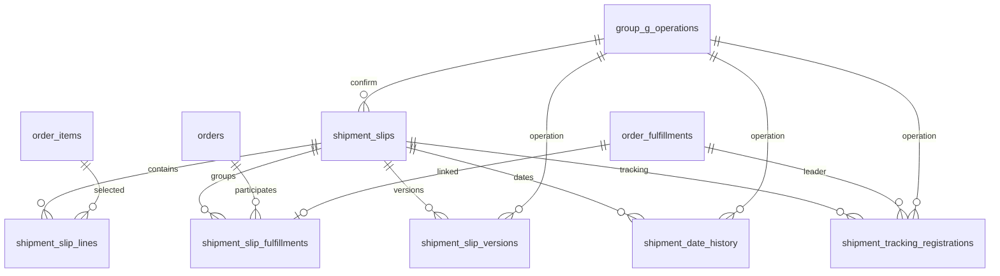

図の shipment_tracking_registrations と group_g_operations は private、他は public。矢印は FK を表し、4本の操作IDへの FK は DEFERRABLE INITIALLY DEFERRED、票・明細・注文・発送への FK は RESTRICT である。

### 列・制約・索引

全6表に `created_at timestamptz NOT NULL DEFAULT pg_catalog.now()` を持つ。票と出荷日履歴の `id uuid` は `DEFAULT gen_random_uuid()` の主キーで、新sequenceは作らない。下表の FK 列と主キーの列は NOT NULL（票の confirm_operation_id は確定前だけNULL）。

| 表 | 列・制約・索引 |
| --- | --- |
| `public.shipment_slips` | `id uuid PK`、`number text NOT NULL UNIQUE`（`^SL-[0-9]{8}-[0-9]{4}$`）、`stage text NOT NULL`（draft/confirmed/cancelled/discarded）、`version integer NOT NULL DEFAULT 1`（1以上）、`customer_kind text NOT NULL`（member/guest）、`customer_user_id uuid`、`customer_email text`、`ship_to_full_name/ship_to_postal_code/ship_to_prefecture/ship_to_city/ship_to_address/ship_to_phone text NOT NULL`（各1文字以上）、`ship_to_building text`、`draft_lines jsonb NOT NULL DEFAULT '[]'`（配列）、`shipping_carrier text`（yamato/sagawa/japanpost）、`tracking_number text`（`^[0-9A-Za-z-]{1,64}$`）、`notify_customer boolean`、`shipment_date date`、`tracking_version integer NOT NULL DEFAULT 1`（1以上）、`expires_at timestamptz`、`confirm_request_key uuid UNIQUE`、`confirm_operation_id uuid`（private.group_g_operations へ遅延FK）、`confirmed_at/cancelled_at/discarded_at timestamptz`、`confirmed_by/cancelled_by/discarded_by uuid`、`created_by uuid NOT NULL`、`updated_at timestamptz NOT NULL DEFAULT now()`。索引 `(stage, updated_at DESC)` |
| `public.shipment_slip_lines` | `slip_id uuid` → shipment_slips、`order_item_id uuid` → order_items、`quantity integer NOT NULL`（1〜99999）、PK `(slip_id, order_item_id)`、索引 `(order_item_id)` |
| `public.shipment_slip_fulfillments` | `slip_id uuid` → shipment_slips、`order_id uuid` → orders、`fulfillment_id uuid NOT NULL UNIQUE` → order_fulfillments、PK `(slip_id, order_id)`、索引 `shipment_slip_fulfillments_order_idx (order_id)`（G-4、通常の非一意 btree） |
| `public.shipment_slip_versions` | `slip_id uuid` → shipment_slips、`version integer NOT NULL`、`kind text NOT NULL`（confirm/tracking_update/delivered/date_correction/cancel）、その版の `shipping_carrier text`・`tracking_number text`・`tracking_version integer`・`shipment_date date`、`reason text`（入れる時は1〜200文字）、`actor_id uuid NOT NULL`、`operation_id uuid NOT NULL` → group_g_operations（遅延）、PK `(slip_id, version)` |
| `public.shipment_date_history` | `id uuid PK`、`slip_id uuid` → shipment_slips、`version integer NOT NULL`、`kind text NOT NULL`（initial/correction）、`previous_date/new_date date NOT NULL`、`reason text`（correction の時だけ非NULL・1〜200文字）、`actor_id uuid NOT NULL`、`operation_id uuid NOT NULL` → group_g_operations（遅延）、UNIQUE `(slip_id, version)` |
| `private.shipment_tracking_registrations` | `slip_id uuid` → shipment_slips、`tracking_version integer NOT NULL`（1以上）、`leader_fulfillment_id uuid NOT NULL` → order_fulfillments、`carrier text NOT NULL`（yamato/sagawa/japanpost）、`tracking_number text NOT NULL`（`^[0-9A-Z-]{1,64}$`。大文字）、`operation_id uuid NOT NULL` → group_g_operations（遅延）、PK `(slip_id, tracking_version)`、UNIQUE `(leader_fulfillment_id, tracking_version)` |

票の CHECK は `(customer_kind='member') = (customer_user_id IS NOT NULL)` と `(customer_kind='guest') = (customer_email IS NOT NULL)`、`(stage='draft') = (expires_at IS NOT NULL)`、`(stage='cancelled') = (cancelled_at IS NOT NULL)`、`(stage='discarded') = (discarded_at IS NOT NULL)`、`(shipping_carrier IS NULL) = (tracking_number IS NULL)`。confirmed/cancelled は confirmed_at・shipment_date・notify_customer・confirm_operation_id・confirm_request_key がすべて非NULL。

`public.order_fulfillments` に `shipment_date date` を足し、`order_fulfillments_shipment_date_check` は `legacy OR shipment_date IS NOT NULL`、`order_fulfillments_tracking_check` は `legacy OR ((shipping_carrier IS NULL) = (tracking_number IS NULL))` とする。発送時刻 shipped_at を出荷日で置き換えない。

### RLS・権限・変更の守り

6表の所有者は postgres、RLS 有効、restrictive policy `deny direct client access` は anon/authenticated に `USING (false) WITH CHECK (false)`。PUBLIC・anon・authenticated・service_role は表の権限を一切持たず、service_role にも直接 SELECT を付けない。5表（票本体以外）は `<表名>_no_update/_no_delete/_no_truncate` が `private.reject_group_g_event_mutation()` で UPDATE/DELETE/TRUNCATE を拒否する。

shipment_slips_change_guard は private.guard_group_g_shipment_slip_change() で DELETE を拒否し、shipment_slips_no_truncate は TRUNCATE を拒否する。UPDATE は app.group_g_slip_change の印が必要で、id/number/created_at/created_by は不変、版は必ず旧版+1、updated_at は変更可。違反は `GROUP_G_HISTORY_IMMUTABLE / 55000`。

| 操作印 | 段階の遷移 | 版・updated_at 以外に変更できる列 |
| --- | --- | --- |
| draft | draft → draft | draft_lines・customer_kind・customer_user_id・customer_email・ship_to_*・expires_at |
| discard | draft → discarded | stage・discarded_at・discarded_by・expires_at（NULL） |
| confirm | draft → confirmed | stage・confirmed_at・confirmed_by・confirm_operation_id・confirm_request_key・shipping_carrier・tracking_number・notify_customer・shipment_date・expires_at（NULL） |
| tracking | confirmed → confirmed | shipping_carrier・tracking_number・tracking_version |
| deliver | confirmed → confirmed | なし |
| date | confirmed → confirmed | shipment_date |
| cancel | confirmed → cancelled | stage・cancelled_at・cancelled_by |

private.restrict_fulfillment_record_update() の既存の分岐を保ち、shipment_date の印では未取消の発送の shipment_date だけを変更できる。tracking_version も変えられない。

遅延 constraint trigger `group_g_shipment_consumption` は、発送行の INSERT・発送の cancelled_at UPDATE・割当イベント consume/restore の INSERT の3か所で、private.check_group_g_shipment_consumption() を呼ぶ。明細ごとに有効な非legacyの発送行の合計と consume − restore を比較し、取引末尾で一致させる。不一致は `GROUP_G_SHIPMENT_CONSUMPTION / 23514`、DETAIL は line_without_consume/consume_without_line/cancel_without_restore/restore_without_cancel。同じ票で取消の状態が食い違う場合は slip_partial_cancel。最初から取消済みで消費・復元のない材料は0=0で通る。

新しい守りの2関数は private・postgres 所有・SECURITY DEFINER・search_path=''、誰にも EXECUTE を付けない。置換する発送の更新の守りも既存の所有者・属性・ACLを保つ。理由の CHECK は既存15値に `shipment_confirm`（発送の確定）・`shipment_cancel`（発送の取消）を足す。

public.item_delete_blockers(bigint[]) は戻り値の追加のため DROP → CREATE し、item_id/has_orders/has_stock_movements/has_open_checkouts/has_purchase_orders の5列を返す。発注書の行と variant から商品を判定し、発注書だけがある商品も削除を止める。STABLE・SECURITY DEFINER・search_path=''・postgres 所有、service_role だけ EXECUTE 可。画面の理由は「注文がある」「在庫の記録がある」「決済中のお客様がいる」「発注書がある」の順。

末尾 assert はオブジェクト・権限を意味で照合し、PG17以降の MAINTAIN も検査する。この取引で6表の行を書いていないことは `created_at = transaction_timestamp()` の行がないことで確かめる。[発送票モデル](../../../tests/integration/db/group_g3_model.integration.test.ts) と [商品削除の守り](../../../tests/integration/db/item_checkout_guards.integration.test.ts) を含むcontroller reset後の実装者DB全件で、2026-10-25にTask 1の新規失敗0を確認した。この当時の全DB実行は既知stockist2失敗によりexit 1だった。最新のG-3対象については、controllerが実鍵PostgRESTを含む12 suiteで665/665成功を確認した（2026-10-25）。対象12 suiteの成功を全DB試験の成功とは区別する。

### Fix round 2 実装者の検証記録


| Fix round 2 実装者検証（2026-10-25） | 結果 |
| --- | --- |
| DB全件 `npx.cmd jest tests/integration/db --runInBand` | exit 1。suiteは118成功・stockistの1失敗・11 skip・計130、testは3266成功・stockistの2失敗・12 skip・計3280。205.889秒。Task 1の新規失敗0 |
| レビュー修正後の対象DB6 suite | 234件成功。DB全件の既知stockist2失敗と区別する |
| G-0基準のG-1清掃suite | G1_CLEANUP_SUITE=1の特別実行はcontroller判断待ち。通常全件のskipやsuiteの成功表示は、G-0基準の清掃の成功を証明しない |

## 注文一覧表・注文の詳細の土台（G-4 Task 1）

### 注文の読取（G-4 Task 2、2026-10-26）

[G4B移行](../../../supabase/migrations/20261026054705_group_g4_orders_reads.sql) は表・FKを追加せず、G-1の `private.group_g_item_state_ranges(uuid[])` を読む。書き手の75本とG4A・G-1〜G-3は変更しない。SQL・[DB試験](../../../tests/integration/db/group_g4_reads.integration.test.ts)・[改ざん試験](../../../tests/integration/db/group_g4_migration_asserts.integration.test.ts) を作成済み。初回（g4t2a）: controllerのfresh reset後、PostgREST anon/authenticated各200、group_g* 50 suite・1,606成功・0失敗・1 pending（G1_CLEANUP_SUITE=1専用清掃の未起動）。修正round 1後（g4t2b）: controllerのfresh reset・PostgREST anon/authenticated各200、group_g* 50 suite・1,611成功・0失敗・1 pending（G1_CLEANUP_SUITE=1専用清掃の未起動）。unit＋全DB integrationは19,935成功・既知stockist_rlsの2失敗のみ（新規失敗なし）、G-0清掃12/12。本番未適用。

| 関数（引数型） | 戻り値・境界 |
| --- | --- |
| `private.group_g_order_candidates(jsonb,integer)` | `TABLE(order_ids uuid[], matched_orders bigint, capped boolean)` 1行。形・キー・語・日付・状態を検証し、注文条件と商品条件に合う新しいcap件を返す。状態条件は投影後 |
| `private.group_g_order_attention_ids(uuid[])` | `uuid[]`。未解決の支払い例外、未確認のreview、未解決の発送のattentionの和集合 |
| `private.group_g_order_item_rows(uuid[])` | `TABLE(order_id uuid, order_item_id uuid, status text, status_rank integer, quantity integer, blocked_reasons text[], is_exchange boolean, unit_price integer, line_amount integer, refund_amount integer, first_unit integer)` |
| `private/public.list_admin_order_item_rows(jsonb,integer,integer,uuid)` | `jsonb` 1値。ordersCapped・ordersCap・totalRows・totalOrders・rows。limit 1〜100、offset 0以上 |
| `private/public.export_admin_order_item_rows(jsonb,uuid)` | `jsonb` 1値。rowCount・orderCount・rows。頁で切らず、needsAttention・blockedReasonsを含めない |
| `private/public.get_admin_order_detail(uuid,uuid)` | `jsonb` 1値。order・amounts・rows・attention・permissions |
| `private/public.list_admin_order_item_state_history(uuid,uuid)` | id・日時・明細と購入時の写し・交換印・数量・前後状態・理由・actor・operation・ref_kind/ref_id/ref_label・note・counterpart_order_idの18列、日時DESC→id、最大301行 |

全11関数はpostgres所有・STABLE・空search_path。privateはDEFINER、publicは同署名のSQL INVOKER委譲。内部3本はPUBLIC/anon/authenticated/service_roleのEXECUTEなし、本体4本と入口4本はservice_roleだけが実行できる。4本とも `admin.orders.read` を有効な役割の和集合で確かめる。private schemaのUSAGEは変更しない。

| 計算・出力 | 契約 |
| --- | --- |
| 商品額 | orderの正味額 `net=line_total−private.order_line_discountsのline_discount`。区間 `[a,b)` の額はbigintの `net*b/Q−net*a/Q`。区間で計算後、明細×状態に合算。交換の単価と商品額は0 |
| 商品返金 | succeededの自分の明細だけを発送前→cancelled、return_idあり→returned、発送後→delivered次にshippedの3種類で分ける。各種類の額R・数量n、対象数量T、分母m=min(n,T)。累積数量をmで切ったfloorの差を区間で計算する。T=0なら同じ明細の全区間を状態順位→開始順で使う。交換も自分を指す成功返金だけを同じ式で配る |
| 行のまとめ方 | 同じ状態の離れた区間も1行。数量・金額・返金を合算、阻害理由はreasons CTEで明細×状態ごとに一度だけ昇順の和集合へ集約し、LEFT JOINする。理由なしは空配列、first_unitは最小開始位置。重い処理は対象注文をMATERIALIZEDで確定してから投影 |
| 状態順位 | unpaid(1)、payment_expired(2)、in_production(3)、ready(4)、shipped(5)、delivered(6)、cancel_requested(7)、cancelled(8)、return_requested(9)、return_in_progress(10)、refund_waiting(11)、returned(12) |
| 詳細の返金 | refundAttachedToRowsは行返金和。refundNotAttachedは成功した送料＋調整額をヘッダから直接合算し、負も保持。refundProcessingAmountはawaiting_response・pendingのamount和。refundedAmountとの差から作らない |
| 詳細の旗 | read=orders.read、manage=orders.manage、refund=orders.refund、return=orders.return、allocate=orders.allocate+orders.read、shippingRead=shipping.read+orders.read（各コードの先頭はadmin.） |
| 状態履歴の参照 | shipment_slip→発送票番号、purchase_order→発注番号。それ以外はNULL。allocation_swapはresultのreasonと受け手/出し手の反対側の注文IDを返す |

一覧は新しい5000注文の中で商品/色/サイズ/状態を行単位に絞る。CSVはこのcapを受けず全件か20000行超の断り。詳しい絞り込みとエラーは [読取の流れ](../../04_DetailDesign/sequence/order-administration.md) を参照。

[G4A](../../../supabase/migrations/20261026045859_group_g4_orders_foundation.sql) は表・列・FKを増やさず、発送票を注文IDで引く非一意 btree 索引を追加する。確定本体は `CREATE OR REPLACE` で同じ OID・所有者・ACL を保ち、期限の比較だけを `expires_at <= now()` にそろえる（FREQ-540-AC-14）。

`order_item_allocation_events_reason_check` は NULL または次の18値を許す。TS の `ALLOCATION_EVENT_REASON_CODES` と同じ集合で、18値目の `allocation_swap` の表示は「割当の入替」。G-3 時点の17値を検査する assert の再実行では、取引内で当時の CHECK を再現してから改ざんと検査を行う（FREQ-523-AC-03 の土台）。

| 理由の集合（定義順） |
| --- |
| `fifo`・`checkout`・`stripe_payment_paid`・`stock_adjustment`・`refund_restock`・`refund_release` |
| `stripe_checkout_expired`・`stripe_voucher_expired`・`admin_cancel`・`admin_cancel_failed_order` |
| `resolve_payment_exception`・`status_change`・`fixture_allocation`・`fixture_release`・`fixture_shipment` |
| `shipment_confirm`・`shipment_cancel`・`allocation_swap` |

索引の利用・置換前後の属性・期限の等号境界・CHECK・末尾 assert と改ざん拒否は [土台の DB 試験](../../../tests/integration/db/group_g4_foundation.integration.test.ts) と [移行 assert の DB 試験](../../../tests/integration/db/group_g4_migration_asserts.integration.test.ts) で検証した。2026-10-26のcontroller fresh reset（g4t1a）でG4Aが適用され、PostgRESTのanon/authenticatedが各200。実鍵PostgRESTを含むgroup_g*全49 suiteは1,526成功・1失敗（所有者をanonへ変更する材料がassert前に42501、SQL変更なしで修正）・1 pending（group_g1_cleanupのG1_CLEANUP_SUITE=1限定試験）。修正round 1のローカルDB 3 suiteは94/94成功。controllerのfresh reset後のunit＋全DB（g4t1）は19,665成功・既知stockist_rlsの2失敗だけで新規失敗なし、G-0清掃は別に12/12成功。pendingの正式名と検証境界は [テスト仕様](../../05_Quality/tests/test-spec.md) に記録。本番未適用。

### 割当の入替（G-4 Task 4、2026-10-26）

確認日: 2026-10-26。[G4C移行](../../../supabase/migrations/20261026101624_group_g4_orders_swap.sql) は表・列・制約・triggerを増やさない。G-1の割当の境界trigger（`group_g_allocation_bounds` の `transfer_pair` など）は緩めず、入替の書込みがその条件を満たすように本体側を作る。fix round 2後のcontroller fresh reset（g4t4b）でローカル適用・検証済み、本番未適用（結果は [DBマイグレーション運用](../../06_Operations/db-migrations.md) の「G4Cの適用と再検証」）。

同じ variant の「出し手」（donor。発送準備中の数を持つ注文）から「受け手」（taker。受注生産中で在庫待ちの注文）へ、発送準備中の割当 `q` 点を移す。移すのは割当の持ち主だけで、在庫の台帳（`stock_movements`）・`item_variants.stock_quantity`（F）・FIFO は触らない。A（paid の割当の残数量の和）・H・F の合計と手元の数は変わらない。

| 対象 | 書く内容 |
| --- | --- |
| `order_item_allocations`（出し手の行） | `kind='paid'` で残数量が正の行を `created_at, id` の昇順に、必要な数量に達するまで `take = min(残り, 必要)` ずつ使い、`remaining_quantity` を `take` 減らし `version` を1進め、`updated_at` を更新する |
| `order_item_allocations`（受け手の新しい行） | 使った出し手の行1本につき1行。受け手の明細・同じ `variant_id`・`kind='paid'`・`quantity = remaining_quantity = take`・同じ `operation_id` |
| `order_item_allocation_events` | 行ごとに `transfer` の対。出し手: `allocation_id`＝出し手の行・`counterpart_allocation_id`＝受け手の新しい行。受け手: 逆。どちらも `quantity=take`・同じ `operation_id`・`reason='allocation_swap'`・`actor_id`・`stock_movement_id` はNULL。`sequence` は出し手が 2k−1、受け手が 2k（k は使った割当行の通し番号） |
| `order_item_state_events` | 入替の前後の投影の差を `allocation_swap` として1つの操作に記録する（出し手 `ready→in_production`、受け手 `in_production→ready`） |
| `private.group_g_operations` | operation `allocation_swap`・cause_type `order_item`・cause_id＝受け手の明細ID。結果は `{id(受け手の注文ID), operationId, takerOrderId, takerOrderItemId, donorOrderId, donorOrderItemId, quantity, reason, replayed}`。同じ鍵・同じ指紋の再送は前の結果に `replayed:true` |

数量の条件（投影 `group_g_item_state_ranges` から）: 受け手の `in_production` のうち阻害理由が `{stock_shortage}` だけの数量の和 `T`、出し手の `ready` のうち阻害理由が空の数量の和 `D`。`q ≤ T` かつ `q ≤ D`。出し手の明細にキャンセルの申し込み（`cancel_requested`）か返金処理中（`refund_processing`）の区間が1つでもあれば入替えない（`GROUP_G_SWAP_DONOR_PENDING_REQUEST`）。この規則で出し手の割当の数は発送準備中の数と一致し、入替で出し手の発送準備中が必ず `q` 減って状態の履歴が残る。両方の注文は `status IN ('paid','shipped')`（出荷済みの注文の交換の行も相手になる）。

`private.list_admin_allocation_swap_candidates(受け手の注文ID, 受け手の明細ID, actor)`（STABLE、public 入口あり）は、権限 `admin.orders.allocate` と `admin.orders.read` の両方を確かめ、受け手の明細が無い・指定の注文に属さない場合は `GROUP_G_SWAP_ITEM_NOT_FOUND / P0002` で断る。その後、受け手の注文が paid/shipped 以外なら書込みと同じ `GROUP_G_SWAP_ORDER_NOT_PAID / 22023` で断り、受け手の `T` が0なら空を返す。出し手は同じ variant の有効な paid 割当（`remaining_quantity > 0`）を持つ明細に MATERIALIZED で先に絞ってから状態を投影する（候補の結果は同じ）。同じ variant の他の paid/shipped の注文で `D>0` かつ申請・返金処理中の区間がない明細を `order_created_at DESC, donor_order_id, donor_order_item_id` の最大50行で返す。列は `donor_order_id`・`donor_order_item_id`・`order_created_at`・`swappable_quantity`（D）・`taker_quantity`（T）。

書き手の許可一覧は G4A の75本に `private.admin_swap_order_allocations(uuid,uuid,uuid,integer,text,uuid,uuid)` を足した76本。押さえの道具 `private.lock_group_g_allocation_swap(uuid,uuid,uuid)` は一覧に載せず、誰にもEXECUTEを与えない。

## 荷作り表・発送票の読取（G-3 Task 2）

確認日: 2026-10-25。[読取の移行](../../../supabase/migrations/20261025070821_group_g3_shipping_reads.sql) は関数13本だけを追加し、表・FK・G-1/G-2の投影と書き手65本は変えない。ローカルへの適用後、controllerが実鍵PostgRESTを含む12 suiteで665/665成功を確認した（2026-10-25）。本番は未適用。

| private関数 | 責務・戻り値 | 権限 |
| --- | --- | --- |
| `group_g_shipment_ready(uuid[])` | paid注文かつpaid割当の残数が正の注文をMATERIALIZEDで先に絞り、既存の状態範囲からreadyを合計する。NULL配列は全候補、空配列は0件。阻害理由はpayment_review・exchange_fee_waiting・variant_missing・address_incomplete・paid_at_missingの順。理由があればshippable=0。発送準備数の唯一の定義で、後続の下書き保存・発送確定も使う | 所有者内部のみ |
| `group_g_bundle_key(uuid)` / `group_g_bundle_verdict(uuid[])` | キーは顧客種別・IDか正規化メール・配送先をJSON配列にしてmd5。会員メールは同一性に含めず、建物の空は空文字。判定は空/NULL配列・不在ID・NULL要素を住所不足とし、住所不足→顧客不一致→住所不一致→NULL。非空かつ全IDが実在するとき、非NULLキー全一致と判定NULLが同値。不在/NULL IDのキーはNULL、重複する実在IDは同じ注文 | 所有者内部のみ |
| `list_admin_packing(uuid,integer,integer,uuid)` | 18列。準備数・選択数・阻害理由・他の有効な下書き番号・bundle_ok・bundle_key・bigintのtotal_count。注文日、注文ID、明細IDの順。指定票が不在ならGROUP_G_SLIP_NOT_FOUND / P0002、下書き以外ならGROUP_G_SLIP_NOT_DRAFT / 55000 | service_role + actorのshipping.readとorders.read。存在確認より先に判定 |
| `list_admin_shipment_slips(text,integer,integer,uuid)` | 12列。全段階または指定段階、期限・注文数・数量・総数、updated_at降順・ID順 | 同上 |
| `get_admin_shipment_slip(uuid,uuid)` | camelCaseのJSON。下書きはdraft_linesと現在のshippable、確定・取消は発送票行。準備数をMATERIALIZEDで1回だけ計算しlines/issuesで共有。住所不足は該当明細ごとにorderItemIdつきで1件、入金日時なしはpaid注文だけ。他の注文状態・阻害理由・数量超過も明細単位。期限・顧客/住所不一致は票単位。cancelBlockersは発送ごとに返品・発送後返金・注文状態を調べる。履歴・発送・代表登録の要約も返す | 同上。不在はGROUP_G_SLIP_NOT_FOUND / P0002 |
| `list_admin_order_shipment_slips(uuid,uuid)` | 注文の発送が属する票の4列。下書きは含まない | 同上 |
| `list_shipment_accounting_inputs(date,date,integer)` | 確定・取消票の発送行を出荷日範囲で読む7列。最新日付履歴IDと発送のcancelled_atを含む。actorなし、HTTP窓口なし | service_roleのみ |

新しい本体8本はpostgres所有のSTABLE DEFINER・空search_path。読取5本だけに同名・同引数・同戻り型のpublic SQL INVOKER入口を置き、双方をservice_role専用にする。内部3本はservice_roleもEXECUTEできない。private schemaのUSAGEは操作しない。

準備数の先絞りはG-3の読取だけに作用する。既存のG-1投影とG-2在庫一覧は置換しない。G-1のreadyにはpaid割当が必要なため候補を落とさず、閉じた注文の長い履歴を投影へ渡さない。DB [読取](../../../tests/integration/db/group_g3_reads.integration.test.ts)・[PostgREST](../../../tests/integration/db/group_g3_postgrest_paths.integration.test.ts)と既存G-1/G-2回帰の実測は未実施。

会計入力の`_limit`は切り詰めで、署名は変更しない。会計Taskは **`rows = _limit`なら、より多い行がある可能性がある** として、全件を読めた扱いにしない。範囲や上限を調整して`rows < _limit`を確認し、1日だけでも上限に達する場合は未完了として扱う。今回ページ引数と索引は追加しない。

2026-10-25のFix round 1は上記のissue粒度・不正ID/票の拒否・準備数の共用を反映した。前版のローカル191件成功の後、Task 5までのSQLを適用してcontrollerが実鍵PostgRESTを含む12 suiteで665/665成功を確認した（2026-10-25）。先絞りはpaid割当なしのpaid注文も渡したG-1投影との数量比較、住所の前後空白は7項目それぞれのキー比較でも確かめる。

## 発送票の書込み関数（G-3 Task 4・5・6）

確認日: 2026-10-25。[書き手の移行](../../../supabase/migrations/20261025100130_group_g3_shipping_slips.sql) は関数9本（Task 4の5本とTask 5の4本）を追加し、**表・FK・列・制約・trigger は変えない**（Task 1 の6表と守りを使う）。書き手の閉じた一覧（`private.group_g_writer_allowlist()`）は G-2 の65本＋保存・破棄・消費・追跡登録・確定の5本＝70本へ置換する。Task 5までローカルへ適用してcontrollerが実鍵PostgRESTを含む12 suiteで665/665成功を確認した（2026-10-25）。本番は未適用。レビュー後の数量変数名の整理は挙動を変えず、再適用をcontrollerが担当する。

| 関数 | 責務 | 書く表 | 権限 |
| --- | --- | --- | --- |
| `private.lock_group_g_shipment_slips(uuid[],uuid[],boolean)` | 票の書込みに共通の押さえ。最初の文が共通の鍵 `(190521,1)`。設定の行（追跡に触れる時だけ `FOR SHARE`）→ 対象の読取（明細・票の選択・確定行・発送が指す注文と variant）→ `lock_group_g_inventory` → 票の行（id昇順 `FOR UPDATE`）→ 追跡に触れる時だけ代表の登録の行。ロックした注文 ID を返す | なし（行の鍵だけ） | 誰も EXECUTE できない |
| `private.admin_save_shipment_slip_draft(uuid,integer,jsonb,uuid,uuid)` と同名の public 入口 | 下書きの作成（票 ID が NULL）と、選択の丸ごとの入れ替え。確かめの順は 引数 → 押さえ → 権限（4つ）→ 指紋と再送 → 存在 → 下書き → 版 → 明細の存在 → 未払い → 阻害理由 → 同梱 → 数量 → 書込み。顧客と送り先の写しは先頭の明細（`orderItemId` 昇順）の注文から取る。有効期限は `now() + 7日`。成功は `{id, number, version, replayed}` | `shipment_slips`（INSERT または印 `draft` の UPDATE）、`group_g_operations`（`shipment_slip_save`）。在庫・割当・台帳・注文・発送は書かない | service_role だけ（public は SQL INVOKER の委譲） |
| `private.admin_discard_shipment_slip_draft(uuid,integer,uuid,uuid)` と同名の public 入口 | 下書きの破棄。印 `discard` で `stage = discarded`・`discarded_at`・`discarded_by`・`expires_at = NULL`・版+1 | `shipment_slips`（UPDATE）、`group_g_operations`（`shipment_slip_discard`） | 同上 |

票の番号は `SL-` と日本時間の `YYYYMMDD` と4桁の連番（その日の最大＋1。`shipment_slips.number` の UNIQUE が最後の守り。9999 を超えると `GROUP_G_SLIP_NUMBER_EXHAUSTED`）。指紋は 操作・票・行（`orderItemId` 昇順）・実行者 の SHA-256（版は含めない）。2つの下書きが同じ明細を選べるので、`shipment_slip_lines` には書かない（確定で初めて書く）。新しい関数はすべて postgres 所有・空の search_path・anon/authenticated/PUBLIC の EXECUTE なし。private schema の USAGE は操作しない。詳しい順序は[発送票の下書きの流れ](../../04_DetailDesign/sequence/shipping.md)、段階は[発送票の状態](../../04_DetailDesign/states/shipping.md)。
### 発送確定で書く行（G-3 Task 5）

| 関数 | 保存するもの・順 | 実行権限 |
| --- | --- | --- |
| `private.consume_group_g_allocations(uuid,integer,uuid,uuid)` | 共通advisoryを確認。paid割当をcreated_at,id昇順で減らしversion+1。consume・sequence 1・reason shipment_confirm。Fと台帳は不変 | 所有者のみ |
| `private.register_group_g_slip_tracking(uuid,integer,uuid,uuid)` | advisoryと設定共有lockの下で注文ID最小の有効発送を代表にする。票×追跡版の親は1行、番号はupper。追跡オンだけ代表の既存登録を1行。期限は版1がshipped_at+30日、以後はnow()+30日 | 所有者のみ |
| `private.admin_confirm_shipment_slip(uuid,integer,text,text,date,boolean,uuid,uuid)` | 引数→lock helper(true)→権限→指紋と再送→票/段階/版/期限→paid/阻害/同梱/数量/日付。注文ごとの発送ヘッダー→明細ごとの消費→その発送行INSERT→出来事・結びつき→必要なら注文shippedとoutbox。G-1即時境界を各文で満たし、最終の消費と行はG-3遅延ガードで一致させる。追跡の親→票confirmed→確定行・版・日付initial履歴→状態差分→操作結果 | service_roleのみ。public同名はINVOKER委譲 |

発送の要求番号は `md5('slip_fulfillment:' || 確定request_key || ':' || order_id)::uuid`。出荷日は全注文のJST入金日以上・今日以下。initial履歴は同日も1行、previous_dateはJST今日。shipped_atとconfirmed_atは操作時刻。操作印は成功・失敗とも復帰する。消費ガードは確定済み発送数とconsumeの一致を取引末尾で検査する。旧4RPCは停止のまま。[DB試験](../../../tests/integration/db/group_g3_confirm.integration.test.ts)を含め、controllerが実鍵PostgRESTを含む12 suiteで665/665成功を確認した（2026-10-25）。

### 発送の取消で書く行（G-3 Task 6）

確認日: 2026-10-25。同じ移行 `20261025100130_group_g3_shipping_slips.sql` に関数3本（`restore_group_g_shipment`・`admin_cancel_shipment_slip` とその public 入口）を追記した。**表・FK・列・制約・trigger は変えない**。書き手の閉じた一覧は70本へ restore・cancel の2本を足した72本へ置換する。controllerがresetして適用し、別接続の試験と実鍵PostgRESTを含む21 suiteで1,287/1,287成功、全件の単体とDBで18,318件成功（別セッションの意図的なstockist_rlsの赤2件だけ）を確認した（2026-10-25）。本番は未適用。

| 関数 | 保存するもの・順 | 実行権限 |
| --- | --- | --- |
| `private.restore_group_g_shipment(uuid,uuid,uuid,uuid,text)` | 共通advisoryを確認。その発送の行の明細ごと・確定の操作の `consume` 出来事ごと（id昇順）に、① `stock_movements`（reason `restock`・+n・`allocation_operation_id` なし・`order_id`・`order_item_id`・備考）② 新しい割当（`kind` paid・数量=残り=n・取消の操作）③ `stock_movements`（reason `purchase`、交換の品は `exchange`・−n・取消の操作の印・備考）④ `order_item_allocation_events` の `restore`（`reverses_event_id`・台帳は③・連番1・理由 `shipment_cancel`）。戻した合計を返す。元の割当は更新しない。同じ consume の二重 restore は `reverses_event_id` の一意で止まる | 所有者のみ |
| `private.admin_cancel_shipment_slip(uuid,integer,uuid,uuid)` と同名の public 入口 | 引数 → lock helper(true) → 権限 → 指紋と再送 → 存在 → 段階 → 版 → 拒否の検査（全注文分。`CANCEL_NOT_ALLOWED` → `HAS_RETURN` → `REFUNDED`）→ 状態の before と操作印 → 発送ごと（`order_id` 昇順）に、`order_fulfillments.cancelled_at`・`cancelled_by` → 追跡登録 cancelled と要対応 auto → restore → 注文を paid へ（shipped で未発送が残る時）→ 未送信の発送メールを skipped → 票 cancelled（印 `cancel`・版+1）・`shipment_slip_versions`（種類 `cancel`）→ 状態の差分（`shipment_slip_cancel`）→ `group_g_operations`（`shipment_slip_cancel`）。お客様向けのメールは作らない | service_roleのみ。public同名はINVOKER委譲 |

取消の指紋は `{operation, slip_id, actor_id}` の SHA-256（版は含めない）。空き在庫Fは restock の +n と purchase の −n で動かず、手元（F+A+H）が消費した数だけ戻る。詳しい順序と即時の確かめとの関係は[発送の取消](../../04_DetailDesign/sequence/shipping.md)、段階は[発送票の状態](../../04_DetailDesign/states/shipping.md)。[DB試験](../../../tests/integration/db/group_g3_cancel.integration.test.ts)。

### 伝票番号の後入力・訂正と手動の配達済みで書く行（G-3 Task 7）

確認日: 2026-10-25。第4の移行 [`20261025134538_group_g3_shipping_actions.sql`](../../../supabase/migrations/20261025134538_group_g3_shipping_actions.sql)（節の印 `G3D`）に関数4本（`admin_update_shipment_slip_tracking`・`admin_mark_shipment_slip_delivered` とそれぞれの public 入口）を足した。**表・FK・列・制約・trigger は変えない**（先の3本の移行は変えない）。書き手の閉じた一覧は72本へ2本を足した74本へ置換する。controller が fresh reset して適用し、実鍵PostgRESTを含む19 suiteで1,079/1,079成功、全件の単体とDBで18,870件成功（別セッションの意図的なstockist_rlsの赤2件だけ）を確認した（2026-10-25）。本番は未適用。

| 関数 | 保存するもの・順 | 実行権限 |
| --- | --- | --- |
| `private.admin_update_shipment_slip_tracking(uuid,integer,text,text,boolean,uuid,uuid)` と同名の public 入口 | 引数（運送会社と番号は両方必須。空は `GROUP_G_SLIP_TRACKING_INCOMPLETE`）→ lock helper(true) → 権限 → 指紋と再送 → 存在 → 段階 → 版 → 変更なし（`GROUP_G_SLIP_TRACKING_UNCHANGED`）→ 状態の before と操作印 → 発送ごと（`order_id` 昇順）に `order_fulfillment_tracking_changes`（`from_*` は今の値、`tracking_version` = 票の版+1、派生の `request_key`、E-4 の指紋）・`order_fulfillments`（印 `tracking_edit`。配達済みは `confirmed`・`delivered_at` NULL へ）・`order_fulfillment_events`（`tracking_edit`）・全部送った注文の運送会社と番号 → 代表の登録を replaced で止める・要対応を auto で閉じる・`register_group_g_slip_tracking`（票×版の親と、追跡オンなら代表の登録）→ 通知オンなら `shipping_update` を発送ごとに1通 → 票（印 `tracking`）・`shipment_slip_versions`（`tracking_update`）・状態の差分（`shipment_slip_tracking_update`）・`group_g_operations`（`shipment_slip_tracking_update`）。成功は `{id, version, trackingVersion, replayed}` | service_role のみ。public 同名は INVOKER 委譲 |
| `private.admin_mark_shipment_slip_delivered(uuid,integer,date,boolean,uuid,uuid)` と同名の public 入口 | 引数 → lock helper(true) → 権限 → 指紋と再送 → 存在 → 段階 → 版 → すでに配達済み（`GROUP_G_SLIP_ALREADY_DELIVERED`）→ 届いた日の範囲（`GROUP_G_SLIP_DELIVERY_DATE_INVALID`）→ 状態の before と操作印 → 発送ごとに `order_fulfillments`（印 `manual`。`delivered_at` = `GREATEST(shipped_at, LEAST(届いた日 12:00 JST, now()))`）・`order_fulfillment_events`（`delivered`／`manual`、派生の `request_key`）、代表だけ登録を stopped／delivered・要対応を auto、発送の通知と入力の両方がオンなら `delivered` メール → 票（印 `deliver`）・`shipment_slip_versions`（`delivered`）・状態の差分（`shipment_slip_deliver`）・`group_g_operations`（`shipment_slip_deliver`）。成功は `{id, version, deliveredAt, replayed}` | 同上 |

指紋は 操作・票・入力（伝票番号は運送会社・番号・通知、配達済みは届いた日・通知）・実行者 の SHA-256（版は含めない）。発送ごとの派生の要求番号は `md5('slip_tracking:' || 共通のキー || ':' || fulfillment_id)::uuid`（変更行）と `md5('slip_delivered:' || 共通のキー || ':' || fulfillment_id)::uuid`（出来事）。末尾 assert（`$g3d_final_objects$`）は4関数の所有者・属性・ACL を意味で、書込み本体2本の押さえ前の参照を、書き手74本をOIDまで照合する。旧4RPC（作成・取消・伝票の訂正・手動の配達済み）は `LEGACY_FULFILLMENT_DISABLED`／55000 のまま。詳しい順序は[伝票番号の後入力・訂正と手動の配達済み](../../04_DetailDesign/sequence/shipping.md)、段階は[発送票の状態](../../04_DetailDesign/states/shipping.md)。[DB試験](../../../tests/integration/db/group_g3_tracking.integration.test.ts)。

### 追跡の親（代表の登録）と配送の結果の票への展開（G-3 Task 8）

確認日: 2026-10-26。**表・FK・列・制約・trigger は変えない**。読取の移行 [`20261025070821_group_g3_shipping_reads.sql`](../../../supabase/migrations/20261025070821_group_g3_shipping_reads.sql)（節の印 `G3B`）に内部の助け1本と既存3関数の置換、確定済みの actions の移行 [`20261025134538_group_g3_shipping_actions.sql`](../../../supabase/migrations/20261025134538_group_g3_shipping_actions.sql)（節の印 `G3D`）に既存1関数の置換を足した（どちらも本番未適用の第2・第4の移行を編集。同じ名前・同じ引数・同じ戻り型・所有者・ACL・属性のまま。書き手の閉じた一覧は74本のまま）。DB の実測は controller の reset 後。

**設計 8-1 との差**: 設計書は `private.shipment_tracking_registrations` に「票ID、追跡版、登録状態、lease、再送情報」を持たせ、注文別登録の親・外部登録の作業単位にする案だった。実装は親の行を**同一性と所属**だけにした: 票・追跡の版・代表の発送・運送会社・番号（大文字）・操作。登録の状態・借りの印（lease）・再試行・外への停止の印は、代表の発送の**既存E-4の行**（`private.fulfillment_tracking_registrations`）が持つ。借り出し（`claim_delivery_tracking`）・登録/停止の結果・期限切れは従来のコードのまま、票×版に1行（代表の1行）だけを扱う。要対応（`order_fulfillment_attention`）も代表の発送にだけ付き、票の詳細の `registration` が代表の注文IDを示す。参加の発送には登録の行も要対応も作らない。

| 関数 | 変更 | 実行権限 |
| --- | --- | --- |
| `private.tracking_registration_owner(uuid,integer) RETURNS uuid`（新・STABLE DEFINER・読むだけ） | その発送が `shipment_slip_fulfillments` で結ぶ票に、その追跡の版の親の行があれば `leader_fulfillment_id`、無ければ引数の発送そのもの（票に属さない発送・親の行の無い版も自分） | だれも EXECUTE できない（所有者の関数からだけ） |
| `private.delivery_tracking_backfill_targets()`（置換） | 条件に `AND private.tracking_registration_owner(f.id, f.tracking_version) = f.id` を1行足す。追跡をあとからオンにしても、参加の発送に登録を作らない（`admin_set_delivery_tracking` の `backfilled_count` と `get_delivery_tracking_settings` の件数は票ごとに1） | 変更なし（だれも EXECUTE できない） |
| `public.get_order_delivery_detail(uuid)`・`public.get_order_status_public_material(uuid)`（置換） | `'registration'` を引く副問合せの `r.fulfillment_id = f.id` を `r.fulfillment_id = private.tracking_registration_owner(f.id, f.tracking_version)` に変える。ほかは1文字も変えない（票に属さない発送の出力は同じ）。参加の注文のお客様にも代表の登録の状態（公開の材料は `state`・`ever_registered` だけ）で配送の状況が出る | 変更なし（service_role のみ） |
| `private.record_delivery_read_result(uuid,integer,uuid,jsonb)`（置換。書き手の閉じた一覧の中・名前も数も変わらない） | G-1 の本体との差は、(1) 代表の発送が票の代表（親の行がその発送を代表と呼ぶ）なら、行の鍵を**表ごとに票の全注文（`ANY(票の注文)`）でまとめて**取ってから次の表へ進む（orders → order_items → 割当 → 返品 → 返品の明細 → 返品の受取 → 受取の明細 → 返金 → 返金の明細 → 取消申請 → 取消申請の明細 → 発送、その後に代表の登録の行。前の表へは戻らない。票に属さない発送は従来どおり自分の注文だけ）、(2) 対象 = 代表（先頭）＋その票の他の有効な発送のうち同じ追跡の版でまだ配達済みでないもの（`order_id` 昇順）へ、出来事・状況・配達中/配達済みのメール・配達済みの反映（操作の記録と品物の状態。冪等キーは G-1 の式を対象の発送IDで）を同じ内容で書く、(3) 登録の行の更新・要対応の開閉・戻り値は代表について1回だけ | 変更なし（private・public とも service_role のみ） |

在庫の閉包の道具（variant・商品・近隣の注文まで広げる）は、この worker の経路が今より多く取ることになるので呼ばない。末尾の確かめは reads の `shipping_internal_functions`／`shipping_replaced_readers`、actions の `shipping_action_replaced`（属性と ACL の不変、共通の押さえの数と位置、対象への展開。DETAIL 名は Task 10 で `shipping_*` に統一）。詳しい順序は[追跡の親と配送の読み直しの結果の票への展開](../../04_DetailDesign/sequence/shipping.md)、運用は[webhook-queue-operations](../../06_Operations/webhook-queue-operations.md)。[DB試験](../../../tests/integration/db/group_g3_tracking_parent.integration.test.ts)。

## 出荷日の訂正（G-3 Task 9）

確認日: 2026-10-26。表・列追加なし。第4移行actionsへprivate/publicのadmin_correct_shipment_dateを追記。本番未適用、controllerが修正前のTask 9をfresh resetし、実鍵PostgRESTを含む12 suite・639/639成功（2026-10-26）。Fix round 1の後も、controllerがfresh resetし実鍵PostgRESTを含む12 suite・642/642成功（2026-10-26）。

票と有効発送のshipment_dateを更新し、shipment_date_historyにcorrection・新しい版・previous_date・new_date・reason・actor_id・operation_id、shipment_slip_versionsにdate_correctionと理由を追記する。履歴は更新・削除しない。group_g_operationsはshipment_date_correct、cause_type=shipment_slip。同キー同指紋は再送、異内容は23505。list_shipment_accounting_inputsのrevision_idは訂正ごとに変わる最新履歴id。shipped_at・confirmed_at・delivered_at、返品期限・計上基準は不変。

## G-3 Task 10 の最終集計と検査境界

確認日: 2026-10-26。G-3の追加は引き続き **6表・13 FK**（public 5表/10 FK、private 1表/3 FK）。本書の掲載対象は **105表・155 FK**（public 94表/141 FK、private 9表/14 FK、security 2表）で、Tasks 2〜10は表とFKを増やさない。他領域の後続移行はこの掲載対象に混ぜていない。このTaskではソースを再集計し（G-3の4移行は`CREATE TABLE`6・`REFERENCES`13）、ライブDBの検査はcontrollerのfresh reset後に`group_g3_migration_asserts`（64/64）が行った。

書き手はG-2の65本＋G-3の10本＝75本。読取5本・内部4本・ロックhelperと守り2本は閉集合の外。service_roleの新しいEXECUTEは書込み本体/入口14本と読取本体/入口10本だけ。内部のconsume/register/restoreは許可された本体だけから呼ぶ。

[4移行の末尾assert](../../../tests/integration/db/group_g3_migration_asserts.integration.test.ts) は表・列・CHECK・trigger・所有者・ACL・関数集合とOIDを検査する。G3Cは72本、G3Dは75本で照合し、試験時の差替は取引内に限る。ACLは意味で比較し、PG17以降のMAINTAINも対象とする。[全入口の並行試験](../../../tests/integration/db/group_g3_concurrency.integration.test.ts) と [実PostgREST](../../../tests/integration/db/group_g3_postgrest_paths.integration.test.ts) の結果は単体/静的検査で代替しない。現行のサイズ・MD5・適用順と担当は [移行運用](../../06_Operations/db-migrations.md) のTask 10節を参照する。

## 波 2 の権限・制約・関数・置き場（SEC-HOME・AUTH・LOOK・NEWS・SEARCH・STOCKIST・ADMIN / 2026-10-27）

確認日: 2026-10-27。**本節の内容は移行 6 本（`20261026130100`〜`130600`）が入れる形で、本番へは未適用（本番は G-4 と一緒に当てる・オーナーの確認の後）。** 手元は `npm run db:reset` で 6 本とも適用され、DB 結合試験は 144 suite 通過・0 失敗（4339 件通過）。適用の手順・本番の事前の確認・ロールバックは [移行運用](../../06_Operations/db-migrations.md) の「波 2 権限・検索・制約・置き場の移行 6 本」に書いた。表・列・FK の増減はない（`stockists.type` の NULL 可と CHECK 7 本の追加だけが列の定義の変更）。上の 2・3・4 章の定義元は基準スキーマ（`20260901102912_remote_schema.sql`）のままで、そこでは anon・authenticated・postgres・service_role に全権限が付いていた（`ALTER DEFAULT PRIVILEGES` はどこにも無い）。本節はその後の差分である。

### 権限（anon・authenticated に残すもの）

| 対象 | 移行 | 変更後の権限 |
| --- | --- | --- |
| `public.items` | 130200 | anon・authenticated は表の権限をすべて失い、**公開 21 列の SELECT だけ**（`id`・`name`・`description`・`price`・`category`・`image_url`・`image_urls`・`colors`・`sizes`・`product_details`・`status`・`created_at`・`updated_at`・`material`・`origin`・`sewing_region`・`care`・`season`・`product_note`・`made_to_order_lead_days`・`return_ineligible`）。原価 2 列（`pattern_cost`・`mass_production_cost`）は service_role だけ。`product_note` は顧客向けなので公開のまま。管理の書き込みは service role。新しい列は移行が GRANT するまで見えない（自己検査が、公開列にも原価列にも無い列を見つけると移行を止める） |
| `public.item_cost_history` | 130200 | 「Allow all」の PUBLIC 方針を外し、authenticated の SELECT と、方針 `admin item_cost_history read by finance permission`（`admin.finance.read`）だけ。書き込みは service_role。一般会員の JWT の select は権限の誤りでなく「200 で 0 件」。読む画面・窓口・関数は `src`・`scripts` に無い |
| `public.sessions`・`password_reset_tokens`・`rate_limit_counters`・`audit_logs`・`audit_logs_backups` と連番 `rate_limit_counters_id_seq` | 130200 | anon・authenticated は何も持たない（RESTRICTIVE の deny 方針は二つ目の関門として残す）。呼び手は service role か SECURITY DEFINER の関数だけ |
| `public.profiles` | 130200 | anon は全権限を失う。authenticated は SELECT・INSERT・UPDATE・DELETE のみ（TRUNCATE・REFERENCES・TRIGGER・MAINTAIN を外す。`/api/profile` が利用者の JWT で書くため） |
| `public.legal_archive_runs`・`order_revisions`・`stripe_balance_transactions`・`stripe_payouts`・`stripe_refunds` | 130200（5 の節。2026-10-27 追加） | anon・authenticated から INSERT・UPDATE・DELETE・TRUNCATE・REFERENCES・TRIGGER・MAINTAIN を外す。**SELECT は触らない**（手元では anon が 5 表を、authenticated が `stripe_*` 3 表を読める権限が残るが、RLS があり `stripe_*` は読む方針が無く、`legal_archive_runs`・`order_revisions` の読む方針は authenticated だけなので行は出ない。余分な SELECT を外すかは別の判断）。本番は書き込み側の権限が元から無いので 5 表は本番では変化なし |
| 連番 `public.order_revisions_id_seq`（上の 5 表のうち `order_revisions` の所有する連番。`pg_depend` で探して 1 本だけ） | 130200（5 の節） | PUBLIC・anon・authenticated から全権限を外す。**本番は anon = authenticated = SELECT・UPDATE・USAGE のままなので、この連番だけは本番の実変更**。`order_revisions` は SECURITY DEFINER の trigger（`private.record_order_revision`）が書く |
| `public.looks`・`look_items`・`news_articles`・`stockists` | 130300 | anon・authenticated は **SELECT だけ**（行を見せるかは既存の公開の読む方針と、authenticated の管理者の枝が決める）。書き込み方針 `admin … manage by permission insert / update / delete` は消さずに残す（権限を誰かが戻した時の二つ目の関門） |
| `public.item_color_presets` | 130300 | authenticated は SELECT だけ。**anon は何も持たない**（読む方針が `admin item_color_presets read by permission` の authenticated だけで、anon は元から 0 件の 200 だった。今は 42501） |
| 連番 `public.stockists_id_seq` | 130300 | PUBLIC・anon・authenticated から全権限を外す。service_role は **USAGE・SELECT だけ**（基準スキーマの SELECT・UPDATE・USAGE から UPDATE を外した。service role の INSERT は `nextval` に USAGE が要る） |
| 連番 `public.looks_id_seq`・`news_articles_id_seq`・`item_color_presets_id_seq`（identity の連番。2026-10-27 追加） | 130300 | PUBLIC・anon・authenticated から全権限を外す。identity 列への INSERT は連番の権限を見ないので、service role の INSERT は変わらない。止めるのは Data API からの直の `nextval()`・`setval()`・`currval()`。service_role の付与は触らない |

service_role の権限は移行が明示する（後の REVOKE で消えないように）。権限の一覧は [`auth_grants_inventory.integration.test.ts`](../../../tests/integration/db/auth_grants_inventory.integration.test.ts)（DATA-AUTH-006）が守り、「既知の例外」の一覧は静的な読みからの上限である。

### 列の変更

| 対象 | 移行 | 内容 |
| --- | --- | --- |
| `public.stockists.type` | 130100 | NOT NULL を外し **NULL 可**にする（CHECK `FLAGSHIP STORE`・`STORE`・`SELECT SHOP` は残し、NULL は通り、未知の値は断る）。管理の作成の窓口は `type` を送らないので、以前は 23502 で作成がいつも失敗していた |

### CHECK 7 本（`NOT VALID`）

130500 が足す。`NOT VALID` なので既存の行は走査せず、本番の行は書き換わらないが、以後の INSERT と **UPDATE は検査する**（旧い行は公開の切り替えの PATCH も `23514` になりうる。`VALIDATE` は本番の行の点検の後の別の移行で、この波に含めない）。

| 表 | 制約名 | 条件 |
| --- | --- | --- |
| `looks` | `looks_theme_length_check` | `char_length(theme) BETWEEN 1 AND 200` |
| `looks` | `looks_theme_description_length_check` | `char_length(theme_description) <= 4000` |
| `looks` | `looks_image_urls_path_check` | NULL 要素なし、改行を含む要素なし（改行で割った数 = 要素数）、改行で連結した全体が `looks/` で始まる安全な道筋（英数字で始まる `[A-Za-z0-9._-]` の段をスラッシュでつないだもの）の並びに 1 つの正規表現で一致（空配列は可） |
| `news_articles` | `news_articles_title_length_check` | `char_length(title) <= 200` |
| `news_articles` | `news_articles_content_length_check` | `char_length(content) <= 2000` |
| `news_articles` | `news_articles_detailed_content_length_check` | `char_length(detailed_content) <= 10000` |
| `news_articles` | `news_articles_image_url_path_check` | `image_url ~ '^news/…'`（`looks/` が `news/` になるだけで道筋の形は同じ） |

道筋の判定はアプリの `isOwnLookImagePath`・`isOwnNewsImagePath` と同じ式を、補助関数を作らずに直接書いた（ADR-0162。CHECK は書く側の役で評価されるので、関数を挟むと EXECUTE の付与が増える）。

### 関数と方針

| 対象 | 移行 | 内容 |
| --- | --- | --- |
| `public.admin_update_look(bigint, integer, text, text, text, text[], text, bigint[])` | 130500 | `looks` の行の更新と `look_items` の入れ替え（削除→重複を除いて挿入）を **1 取引**で行う。`SECURITY INVOKER`・`search_path = ''`・戻り値は更新**前**の `image_urls`（窓口が置き換わった画像を置き場から消すのに使う）。行を `SELECT … FOR UPDATE` で先に締め、同時の PUT は順に走る。`_image_urls` が NULL なら今の画像を保つ。関連の段の失敗（外部キー違反 `23503` 以外）は `LOOK_ITEMS_WRITE_FAILED`（`P0001`）に付け直し、行の更新ごと巻き戻る。行が無ければ `LOOK_NOT_FOUND`（`P0002`）。EXECUTE は service_role だけ（ADR-0163） |
| `public.look_items` の読む方針 | 130500 | 旧い `Anyone can view look items for published looks`（anon）・`authenticated look items read` を、`anon reads links of published looks to published items`・`authenticated reads published links, admins read all` に作り直す。条件は「親の LOOK が `published` **かつ** 紐づく商品が `published`」。authenticated だけ、管理者の枝 `has_permission('admin.looks.read')` が残る（管理の読みへの aal2 は波 5） |
| `public.search_items`・`search_looks`・`search_news`（`text, integer`） | 130400 | 署名・戻り列・`SET search_path TO 'public', 'public', 'pg_temp'`・SECURITY INVOKER・所有者・ACL は変えない。`limit_count` は NULL・0・負数も含めて **1〜8 に丸める**（以前は 21 で 21 件、10000 で全公開行、NULL で無制限）。検索語は**先頭 100 字**。LIKE の逃がしは `\` を先に二重にしてから `%`・`_` を逃がし、パターンは LATERAL で 1 回だけ組む |
| `public.search_public_items`・`search_public_looks`・`search_public_news`（`text, integer`） | 130400 | DROP せず、PUBLIC・anon・authenticated の EXECUTE を外す（呼ぶ所が `src` に無く、検索語を逃がしていなかった）。owner の postgres と service_role は EXECUTE を持ち続ける。anon・authenticated が呼ぶと 42501 |

### 置き場の設定（`storage.buckets`）

表ではないが、移行 130600 が設定を持つ。`look-images`・`news-images` は `public = false`・`file_size_limit = 5242880`（5 MiB）・`allowed_mime_types = image/jpeg・image/png・image/webp・image/gif`。本番に既にあるので `ON CONFLICT (id) DO UPDATE` で 3 つの設定を合わせる（既存のファイルは触らず、5 MiB 超の既存ファイルは残る）。`storage.objects` に置き場を名指しする方針は作らない（anon・authenticated は置き場に何もできず、読み書きは service role と署名付き URL だけ）。`item-images` は対象外で触らない。手元の見本 `supabase/seed.sql` の行は `ON CONFLICT DO NOTHING`、見本の画像の道筋は `items/e2e/`・`looks/e2e/`・`news/e2e/` の形。

## 波 5 のアプリの session への結び付けと `has_permission` の aal2（SEC-AUTH-005・010 ほか / 2026-10-29）

確認日: 2026-10-29。**M1 `20261029120000_sec_app_session_binding` は本番適用済み（2026-10-29）。M2 `20261029120100_sec_has_permission_aal2_member_rls` も本番適用済み（2026-10-29。単独で適用）**。結び付いた生きた session を持たない JWT は `has_permission` が false で、会員の表も読めない（利用者はアプリでログインし直す）（手元は `db:reset` で当てる）。適用の手順・事前の確認・ロールバックは [db-migrations.md](../../06_Operations/db-migrations.md) の波 5 の節。根拠は [ADR-0417](../decisions/ADR-0417-auth-bind-app-session-to-gotrue-session-id.md)・[ADR-0418](../decisions/ADR-0418-auth-has-permission-requires-aal2-and-bound-session.md)、領域の設計は [auth.md](../areas/auth.md) の `DATA-AUTH-007`・`DATA-AUTH-008`。

### 列と索引（M1）

| 対象 | 内容 |
| --- | --- |
| `public.sessions.auth_session_id` | `uuid` / NULL 可。GoTrue の `auth.sessions.id`（JWT の `session_id` クレーム）。アプリのログインを通って作られた行だけが持つ。既存の行は NULL のまま（「アプリが結んでいない行」の意味で、本番の 48 行は結ばれていない）。FK は張らない（`auth.sessions` はアプリが管理しない表）。refresh と、補助の totp の amr を足した refresh では GoTrue の `session_id` が変わらない（Task 0 の実測。本物の `mfa.verify` は preview で確かめる）ので、`persistNewSession` が前の行の値を引き継ぐ。表は 15 列から **16 列** |
| 索引 `sessions_auth_session_id_live_idx` | 部分（`WHERE revoked_at IS NULL AND auth_session_id IS NOT NULL`）・**一意にしない**（新しい行を先に入れて古い行を後で失効させるので、一瞬 2 行が同じ id を持つ） |

### 関数（M1）

いずれも SECURITY DEFINER・`search_path ''`・所有者 postgres。

| 関数 | EXECUTE | 内容 |
| --- | --- | --- |
| `private.app_session_is_live(uuid)` | postgres だけ | `auth_session_id` が一致する自前の行が失効しておらず、かつ `auth.sessions` の行が生きている（`not_after` を過ぎていない）時に true。`sessions.expires_at` は使わない（書き手で意味が違う） |
| `public.is_app_session_active(uuid)` | postgres・service_role | 読む側（`authenticateRequest`）の RPC。旗 `AUTH_REQUIRE_APP_SESSION` が有効の時だけ `is_auth_session_active` の代わりに呼ぶ。`auth_grants_inventory` に追加 |
| `private.is_app_bound_live_session()` | postgres・authenticated・service_role | RLS 用。JWT の `session_id` を形の検査の後で uuid にして `app_session_is_live` を呼ぶ。`session_id` が無い・不正でも false で、例外にならない |

### `public.has_permission(text)` の契約（M2）

関数 1 つの置き換え（`CREATE OR REPLACE`。所有者と EXECUTE は保たれ、GRANT・REVOKE は書かない）で、`has_permission` を呼ぶ約 100 本の方針に効く。前の契約は ACL の表だけを見ていた。新しい契約は、次の順に判定して最初に外れた所で false。

1. `auth.uid()` が空 → false（変更なし）
2. `claims.aal` が `aal2` でない（無ければ aal1 扱い）→ false。ACL の表を引く前に判定するので、会員と anon は表を引かない
3. ACL に `permission_code` が無い → false（G-0 の `SELECT EXISTS` を一字一句そのまま）
4. ACL が真の時だけ `private.app_session_is_live(claims.session_id)`。結び付いていない・失効・`auth.sessions` の行が無い・`session_id` が無い・形が悪い → false

`private.group_g_actor_has_permissions(_actor_id, …)` は `auth.uid()` に依らず service_role から呼ぶので、G-2／G-3／G-4 の書き手は変わらない。公開の読みの `(status = 'published' OR has_permission(...))` は OR の側が合わなくなるだけで、一般の会員は公開済みを読み続ける。

### 会員の表の RESTRICTIVE の方針（M2）

`profiles`・`orders`・`order_items` に各 1 本、名前は `require app bound live session`。`AS RESTRICTIVE FOR ALL TO authenticated`・`USING` と `WITH CHECK` とも `(SELECT private.is_app_bound_live_session())`。既存の PERMISSIVE な方針（`auth.uid() = user_id` など）に重なり、結び付いた生きた session でない authenticated は 0 行・更新 0 行になる。**anon には付けない**（ゲストの注文は `app.session_id` で読み、その道は変えない）。`carts`・`wishlists`・`checkout_drafts`・`contact_*`・`refresh_token_history`・`postal_code_cache` は既に全拒否、`user_roles` は `has_permission('admin.users.read')` を通る。**会員の行を返す新しい表を足したら、同じ方針を足す。**


## 割引の記録基盤（H1 / FREQ-542・543）

2026-10-29追加。[H1移行](../../../supabase/migrations/20261029130000_group_h_discounts_foundation.sql)は実装済みで、手元の DB reset・結合試験は controller が通過を確かめた（2026-10-29、単体＋DB 結合 21,184 通過・0 失敗）。本番は未適用。既存のER集計はその時点の履歴とし、以下の7表を追加する。

| 表 | 主キーと関連 | 主な守り |
| --- | --- | --- |
| discounts | UUID id、created_by/updated_by→auth.users | 名称1〜100、種類/方法/値/対象/最低条件/対象者、％1〜99、円1以上かつ最低額>値、期間、guest/自動/広告/repeatの組合せ、要求キー一意、版1以上 |
| discount_items | (discount_id,item_id)、割引→discounts、服→items | product/excludeまたはrepeat,set/includeだけ。セットは遅延検査で2〜10種類 |
| discount_codes | UUID id、discount_id→discounts、assigned_user_id→auth.users | C照合の大文字ASCIIコード1〜64が全体で一意。assignedはguest不可。共有と単発の束を混ぜず、束の接尾辞は紛らわしい文字を除いた4〜8字 |
| discount_assignments | UUID id、(discount_id,code_id)→discount_codes、user_id→auth.users | (code_id,user_id)一意。共有assignedだけ。退会でNULLになった割当の行を他人へ再使用しない |
| discount_redemptions | UUID id、discount_id→discounts、(discount_id,code_id)→discount_codes、order_id→orders、user_id/attention_resolved_by→auth.users | (order_id,discount_id)一意、reserved/confirmed/cancelled、額0以上、写し/照合回復/要対応。本人のconfirmed全体への一意制約は置かない |
| order_line_discount_allocations | (order_item_id,discount_id)、orders/order_items/discountsを参照 | 額0以上、明細のorder_id一致、INSERT後UPDATE/DELETE/TRUNCATE禁止 |
| order_line_unit_amounts | (order_item_id,unit_index)、orders/order_itemsを参照 | index/額0以上、数量ぶんの0始まり連続index、支払額の和=行合計−割引の和を遅延検査。H5ではrefund_id（order_refundsへのFK）/refund_before_shipment/return_line_id（order_return_linesへのFK）だけを内部writerが同じG鍵下で更新可。金額・注文・明細・index・作成日時とDELETE/TRUNCATEは不変 |

業務FKは全てON DELETE RESTRICT。auth.usersへのFKだけNULL可・ON DELETE SET NULLで、退会後も割引・使用・支払額を保持する。割当先NULLのassigned codeを誰でも使えるcodeへ変えない。全7表はRLS有効、PUBLIC/anon/authenticated/service_roleに表・列の直接権限を与えない。

checkout_draftsのdiscount_result/discount_facts/discount_engine_version/discount_snapshot_hashは全NULLまたは全存在。既存行へ補完しない。結果はversion=1のobjectでallocations/unitAmountsがarray、factsはobject、engine_version=1、hashは小文字SHA256 hex64。行ごとの厳密な金額はTask 6で扱う。

private.order_line_discounts(uuid)は保存allocationが1件でもある注文の通常行をLEFT JOINし、対象外は0を返す。保存がない注文は旧累積丸めの本文を保ち、交換行は常に0。controller裁定により従来のSQL/STABLE/SECURITY INVOKERを保ち、search_pathは空、PUBLIC/anon/authenticated/service_roleのEXECUTEは無い。呼出元のDEFINER本体を通し、新public入口は作らない。privateの不変/関連/行総和/設定検査helperとH保存の有無を読むgroup_h_order_has_units(uuid)はpostgres所有・DEFINER・空search_pathで、service_roleも直接実行不可。order_itemsの遅延検査はorder_id/quantity/line_total/line_kindのUPDATEだけで、WHENは旧/新の注文にHの着別金額がある時だけイベントを作る。設定検査も使用列だけのUPDATEに絞り、会員FKのNULL化では起動しない。H1のGET/SET目録は32件へ広げ（会計の計画 1 の S0 で38件になった。末尾の「会計の仕訳の土台と期間」）、既存public INVOKER入口・固定2権限・版・要求キー・監査を保つ。注文の行配分/着別金額のorder_idを含め、FK読取を支える明示索引は15本。

## 割引の管理と割り当て表（H2 / FREQ-543・544・546・547）

2026-10-29追加。[H2移行](../../../supabase/migrations/20261029130100_group_h_discounts_admin.sql) は静的検査のみで、DB適用・結合・並行・PostgRESTはcontroller待ち。本番未適用。７表のまま、要求キーはdiscounts.creation_request_key/hashとadmin_requestsを使い、Gの業務operationへ混ぜない。全writerはG共通→H目録→必要な本人キー→割引id昇順で鍵を取る。

| 表・列 | H2での意味 |
| --- | --- |
| discounts.admin_requests | actorを含む操作本文のSHA256と元の結果。再送で同じ結果、異本文は固定の競合。名前・メール・検索語は入れない |
| discounts.search_attention_at/count | guardの未解決注意と累積回数。10分窓で１回、記録は設定版を変えず、manageの版付きupdateで表示だけ閉じる |
| discount_assignments.original_user_id | 共有assigned行の元の会員ID。FKではなく、退会後もidentity_keyの使用履歴に結ぶ。INSERT時に固定し、以後変更禁止。表示用user_idは従来どおりNULL化 |
| discount_codes.unassigned_at | 未使用の単発assignedコードを外した時刻。文字と元の割当を保持し、誰でも使えるコードへ変えず、contextと割当表から外す |

割当表は共有assignedが１会員１行、単発assignedが１code１行、anyoneが１code・実使用者１行。予約/確定は最新の有効使用日時と注文を返し、取消だけならunusedで日時/注文はNULL。guestは先頭１字とドメインだけ、壊れたメールは`***`、結び付け済みのguest行は重ねない。氏名の結合は頁の対象だけで行い、１呼出し１snapshot・limit1〜100/offset0以上のjsonbで返す。

自動の25件/分類ごと６件と併用ONセットの共有item禁止は半開区間の全期間を検査し、writerと遅延constraint triggerの両方で守る。SQL定数と純粋エンジン定数の一致は [assert試験](../../../tests/integration/db/group_h_migration_asserts.integration.test.ts) に固定する。checkout contextはSTABLEで、guest previewではメールを捨て、注文/返金/本人回数の読取を実行しない。confirm/acceptanceは同メールの会員注文も含む有料履歴と初回予約を分ける。会員の前回着数は通常行−成功返金、交換/未入金は除く。

## グループH Task 9: 単位ごとの返金・返品の占有

`order_line_unit_amounts`の1行が1着で、refund_idと発送前/後の組は両方NULLまたは両方値あり。INSERT時のclaim3列はNULLに限る。返品はreturn_line_idで承認時に固定する。返金の親・返品の行・注文・商品の対応を内部関数とguardで確かめる。awaiting_response/pending/succeededは占有、error/failedはrefundの組だけ解放し、同じ返品の待ち単位は保つ。未処理分は取消/却下で解放し、sent_back・missing・refund_waivedは受取記録のAFTER INSERT triggerから同じG鍵・取引内で解放する。交換と成功返金のclaimは保持する。missingの開き直しではG-1が残す待ち数量のclaimを取り直す。

error後のStripe成功は保存した返金額を記録し、残る最安free単位だけを取り直す。数量または額が合わなければrefund_failedの要対応を残す。保存単位額と返金額は変更しない。この履歴を持つ回復行は、要対応が存在する場合に限りclaimの不足・額の不一致をassertで許す。

通常の返金はfreeをpaid_amount ASC,unit_index ASCで取り、同じ明細の発送前を先にする。返品の返金はその返品のclaimを使う。交換の元額は同じ単位の和、交換品自身へH単位や新しい割引を足さない。返品の受取履歴の区間で交換済みの単位を判定し、相談待ちの単位と重ねない。金額列を書き換えず、redemptionsも更新しない。

同じ返品行では返金・交換に安いclaimを残し、sent_back・missing・refund_waivedは高いclaimから解放する。対応付けでは返金しない完了分を高い側へまとめ、既に解放した数も高い側から除く。受取の行順や分けた受取の先後で、17000円の返金が20000円に変わらない。

H判定は単位の存在（割引0も含む）。旧行と交換の計算は従来のhelperを保つ。表・列の直接DMLはservice_roleにも許可しない。移行は[H5](../../../supabase/migrations/20261029130400_group_h_discounts_refunds.sql)、DBの動作確認はcontroller。

## 返品の受け取りの品ごとの返金（FREQ-641 Task 1）

移行は [20261106005536_return_receive_per_item.sql](../../../supabase/migrations/20261106005536_return_receive_per_item.sql)。根拠は[設計書](../../superpowers/specs/2026-11-06-return-receive-per-item-design.md)の3章。手元の DB で確認し、本番には 2026-11-06 にオーナーの許可を得て当てた。

| 表 | 変えたもの |
| --- | --- |
| `public.order_return_receipt_lines` | 列 `refund_choice text`（NULL 可）。CHECK `order_return_receipt_lines_refund_choice_check`: NULL か、`now`・`consult` で、`resolution = 'refund'` かつ `disposition` が `restocked`・`not_restocked`・`pending_inspection` の行だけ。一意の組 `order_return_receipt_lines_line_key` を `UNIQUE NULLS NOT DISTINCT (receipt_id, return_line_id, disposition, resolution, exchange_method, refund_choice)` に置き換えた（同じ行・同じ状態の今と相談の2行を並べられる） |
| `public.order_return_receipts` | CHECK `order_return_receipts_refund_choice_check` を `now`・`consult`・`mixed`・`none` にした（`kind = 'receive'` の時だけ入る決まりは変えない） |

追記だけの決まり（変更・削除・TRUNCATE をトリガーで断る）は変えない。移行の前の受け取りの行は `refund_choice` が NULL のまま残し（埋め直しはしない）、読む関数は親の `refund_choice`（`now`・`consult`）で補う。表の直接の書き込みは service_role にも許さない。新しい読み出しの関数 `private.return_receive_amounts(uuid)` は表を書かず、G の書き手の許可一覧（77本）にも足さない。テーブル・FK の数は変わらない。

## 返品の受け取りの相談の点数（I-1・N-1 の直し、2026-11-08）

移行は [20261108063711_return_receive_unit_dedup.sql](../../../supabase/migrations/20261108063711_return_receive_unit_dedup.sql)。手元の DB で確認した。本番適用済み（2026-11-08、MCP の apply_migration。版 20261108063711）。

| 表 | 変えたもの |
| --- | --- |
| `public.order_return_receipts` | 列 `consult_quantity integer`（NULL 可・既定値なし）。受け取り（`kind = 'receive'`）で DB が返金待ちにした相談の点数（ふつうの返金で先に返した品の覆いで抑えた後の数）。NULL はこの移行より前の記録。CHECK `order_return_receipts_consult_quantity_check`: NULL か0以上 |

値は `private.admin_receive_return` が受け取りの記録を INSERT する時に書く（追記だけの決まりは変えない。前の記録は埋め直さない）。受け取りの指紋 `request_fingerprint` と再送の一致の確かめには入れない。表の権限は前と同じ（service_role は SELECT だけ。anon・authenticated は読めない）。テーブル・FK の数は変わらない。

## 会計の仕訳の土台と期間（計画 1 / FREQ-553〜561）

移行は [S1 権限と領収書](../../../supabase/migrations/20261107130100_accounting_p1_grants_receipts.sql)・[S2 仕訳の土台](../../../supabase/migrations/20261107130200_accounting_p1_journal_foundation.sql)・[S3 期間と設定](../../../supabase/migrations/20261107130300_accounting_p1_period_reads.sql)・[S4 手入力の仕訳](../../../supabase/migrations/20261107130400_accounting_p1_manual_entry_journal.sql)。S0 は権限のコードを足すだけ（表なし）、S5 は本番の手入力の取引を仕訳へ移すだけ（表なし）。適用の順と戻し方は[運用の手引き](../../06_Operations/accounting-p1-journal-foundation.md)と [db-migrations.md](../../06_Operations/db-migrations.md)。手元の DB で確かめた。本番は未適用。

### 新しい 9 表と関連

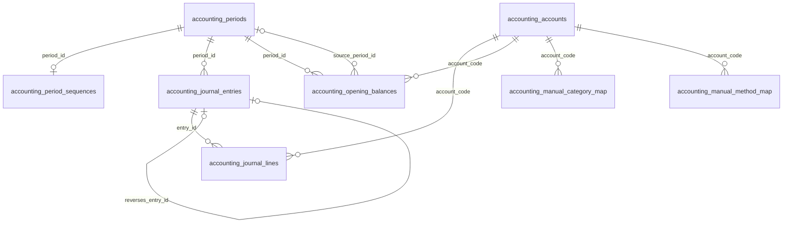

全 FK は `ON DELETE RESTRICT`。9 表とも RLS 有効で方針は 0 本、所有者は `postgres`、`PUBLIC`・`anon`・`authenticated`・`service_role` の権限を全部外して `service_role` に SELECT だけ付ける。書くのは `SECURITY DEFINER` の関数だけ。

| 表（移行） | 主キー | 列と制約 |
| --- | --- | --- |
| `accounting_accounts`（S2） | `code` | `account_type`（asset・liability・equity・revenue・expense）、`normal_side`（debit・credit）、`scope`（common・soleProprietor・corporation）、`carryover_role`（carry・capital_sole・owner_draw・owner_contribution・retained_corp・pl_zero）。`code` は数字 4 桁。162 科目と代わりの `9999` で 163 行。後の移行は足すだけ（UPDATE・DELETE・TRUNCATE はトリガーで断る） |
| `accounting_periods`（S2） | `id` | `business_type`（soleProprietor・corporation）、`name`（1〜60 字）、`starts_on`・`ends_on`、`corporate_tax_extension_months`・`consumption_tax_extension_months`（0〜1。消費税は法人税以下）、`consumption_tax_status`（exempt・taxable。`consumption_taxable_from` は taxable の時だけで期間の中）、`version`、`creation_request_key`（一意）・`creation_request_hash`、`admin_requests`、`legacy_fiscal_year`（一意）。CHECK: 始まり ≦ 終わり、1 年未満（2 月 29 日始まりは翌年 2 月 28 日まで）、個人は 1 月 1 日始まりで同じ年の終わり。重なり・すき間は S3 の遅延トリガー `accounting_periods_layout` が確かめる。DELETE・TRUNCATE はトリガー（`accounting_periods_no_delete`・`accounting_periods_no_truncate`）で断る。UPDATE は `accounting_periods_guard_update` が、作成時の列（事業の形・始まり・作成者・要求の鍵・旧の年）の書き換えを断り、終わりの日は個人の最後の期間をやめた日の登録・選び直しに限る |
| `accounting_period_sequences`（S2） | `period_id` | `last_entry_no`（0 以上）。仕訳の通し番号の数え |
| `accounting_journal_entries`（S2） | `id` | `period_id`・`entry_no`（組で一意・1 以上）、`entry_date`（日本時間の日）、`event_kind`、`dedupe_key`（一意）、`content_hash`、`description`（500 字まで）、`recorded_at`・`source_recorded_at`（前者以前）・`recorded_by`、`is_late`、`reverses_entry_id`（一意・自己参照）、`reason`、`source_table`・`source_id`、`migrated_from`・`migrated_at`。取り消し（`event_kind = 'reversal'`）は `reverses_entry_id` と `reason` が要り、それ以外は両方 NULL。UPDATE・DELETE・TRUNCATE はトリガーで断る |
| `accounting_journal_lines`（S2） | `(entry_id, line_no)` | `line_no` 1〜200、`account_code`、`debit`・`credit`（0 以上の整数円）、`sub_account`（`^[a-z0-9_:.-]{1,64}$`）、`counterparty`・`order_id`・`memo`。借貸の一致・片側だけは遅延の制約トリガー `accounting_journal_entries_balance`・`accounting_journal_lines_balance` が確かめる。UPDATE・DELETE・TRUNCATE はトリガーで断る |
| `accounting_settings`（S3） | `id`（1 だけ） | `business_start_date`（1 度だけ入れられる）、`cutover_on`（移行の日。日本時間の今日）、`current_business_type`、`sole_business_ended_on`（個人の最後の期間の終わり）、`sole_end_changes`（変更の履歴の配列）、`version`、`admin_requests`。1 行を移行が入れ、DELETE・TRUNCATE は断る |
| `accounting_opening_balances`（S3） | `(period_id, closing_version, account_code)` | `signed_amount`（符号つきの整数円）、`closing_version`（1 以上）、`source`（initial・closing_carryover）、`source_period_id`。追記だけで、計画 1 は行を足さない（計画 6 が締めた版を足す） |
| `accounting_manual_category_map`（S4） | `source_text` | 手入力の科目名から勘定 `account_code` への対応。追記だけ（UPDATE・DELETE・TRUNCATE はトリガーで断る） |
| `accounting_manual_method_map`（S4） | `(source_text, direction, business_type)` | 入出金方法から勘定への対応。`direction`（expense・income）、`business_type`。追記だけ（UPDATE・DELETE・TRUNCATE はトリガーで断る） |

`admin_finance_expenses` には S4 のトリガー `accounting_manual_entry_journal`（INSERT・UPDATE で仕訳を足す）と、DELETE・TRUNCATE を断る 2 本（`ENABLE ALWAYS`）を足した。`admin_finance_entry_revisions` には履歴の書き換えを断るトリガー `accounting_entry_revisions_guard`（`changed_by` を NULL に変える 1 つだけ通す）と TRUNCATE を断る 1 本を足した。列は増やしていない。

### 領収書の列と置き場（S1）

| 対象 | 変えたもの |
| --- | --- |
| `public.admin_finance_receipts` | 列 `evidence_kind text NOT NULL DEFAULT 'unconfirmed'`（CHECK `admin_finance_receipts_evidence_kind_check`: electronic・paper・unconfirmed）と列 `paper_original_kept boolean NULL`（CHECK `admin_finance_receipts_paper_original_kept_check`: NULL か `evidence_kind = 'paper'`）。既存の行は埋め直さず unconfirmed と読む |
| `storage.buckets` の `finance-receipts` | 移行で作る。非公開・上限 20 MiB（20971520）・形式は PDF・JPEG・PNG・WebP・HEIC の 5 つ。`storage.objects` に `finance-receipts` を名指しする方針は置かない（あれば S1 の最後の確かめが止める） |

### 表の権限の締め直し（S1）

`admin_finance_*` の 12 表と、その 12 表が持つ 8 つの連番から、`PUBLIC`・`anon`・`authenticated` の権限（SELECT を含む）を全部外し、`service_role` に明示で付け直した。利用者の JWT で 12 表を直接読み書きする道は無く、アプリは `service_role` の route を通る。RLS の方針（45 本）は変えない。


## 会計の前受金・出荷・Stripe の表（計画 2 / FREQ-562〜574）

確認日: 2026-11-09。移行は [S6 計上の土台](../../../supabase/migrations/20261108150000_accounting_p2_posting_tables.sql)・[S9 Stripe の計上](../../../supabase/migrations/20261108180000_accounting_p2_stripe_posting.sql)・[S10 dispute の受け取り](../../../supabase/migrations/20261108190000_accounting_p2_dispute_intake.sql)・[S11 dispute の計上](../../../supabase/migrations/20261108200000_accounting_p2_dispute_posting.sql)・[S13 月の KPI の記録](../../../supabase/migrations/20261108220000_accounting_p2_kpi_monthly_records.sql)・[S14 年末の出荷](../../../supabase/migrations/20261108230000_accounting_p2_year_end_shipments.sql)。S7・S8・S12 は関数だけで表を足さない。適用の順と戻し方は [db-migrations.md](../../06_Operations/db-migrations.md) の計画 2 の節と[運用の手引き](../../06_Operations/accounting-p2-posting-stripe.md)。会計は `scripts/trace/scope.json` の範囲の外なので、この文書に手で書く。

### 新しい 12 表と関連

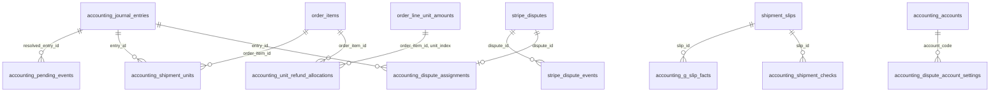

全 FK は `ON DELETE RESTRICT`。12 表とも RLS 有効で方針は 0 本、所有者は `postgres`、`PUBLIC`・`anon`・`authenticated`・`service_role` の権限を全部外して `service_role` に SELECT だけ付ける。書くのは `SECURITY DEFINER` の関数だけ（`record_stripe_dispute` など）。`accounting_pending_events`・`accounting_stripe_invoice_records`・`accounting_dispute_account_settings`・`accounting_shipping_options`・`admin_kpi_monthly_records` は行を更新できる（理由の更新・版つきの更新）。`stripe_disputes` は更新できる列が決まっている（下の表）。ほかは追記だけ（UPDATE・DELETE・TRUNCATE を `private.reject_accounting_mutation` が断る。`ENABLE ALWAYS`）。

| 表（移行） | 主キー | 列と制約 |
| --- | --- | --- |
| `accounting_pending_events`（S6） | `id` | 仕訳にできない出来事。`event_kind`（仕訳の種類の目録の中）・`source_table`・`source_id`（組で一意）、`order_id`、`reason`（CHECK で 18 種: `payment_journal_missing`・`order_not_postable`・`amount_mismatch`・`no_order`・`units_insufficient`・`shipment_date_mismatch`・`deferred_revenue_short`・`period_missing`・`posting_error`・`before_cutover`・`unknown_category`・`payout_mismatch`・`dispute_refund_overlap`・`dispute_return_refund_pending`・`dispute_withdrawal_missing`・`dispute_shipment_pending`・`shipment_lines_mismatch`・`no_revenue`）、`detail`（jsonb の object。理由ごとの鍵の検査は書き手 `accounting_park_event` が行う）、`first_detected_at`・`last_detected_at`・`detection_count`（1 以上）、`resolved_at`・`resolved_entry_id`（→ `accounting_journal_entries`）・`resolved_by`・`resolution_note`（500 字まで）・`resolution_request_key`（一意）・`resolution_request_hash`。索引 `(resolved_at, first_detected_at)`・`(order_id)` |
| `accounting_shipment_units`（S6） | `(entry_id, order_item_id, unit_index)` | 出荷の仕訳が使った着。`entry_id` → `accounting_journal_entries`、`order_item_id` → `order_items`、`unit_index`（0 以上）、`paid_amount`（0 以上）、`refunded_amount`（0 以上）。追記だけ |
| `accounting_unit_refund_allocations`（S6） | `(order_item_id, unit_index, refund_key)` | 出荷前の返金の着ごとの額。`order_item_id` → `order_items`、`(order_item_id, unit_index)` → `order_line_unit_amounts`、`refund_key`（`^[A-Za-z0-9_.:-]{1,128}$`。返金の番号、`reapply:`・`cover:`・`release:` の前置き）、`amount`（0 でない整数。解放は負）、`fact_seq`（一意）・`locked_at`（G の鍵の中で取った番号と時刻）。着ごとの合計が 0 〜 支払額に収まることを遅延の制約トリガー `accounting_check_unit_allocation_sum` が確かめる（違反は DETAIL `unit_allocation_sum`）。追記だけ |
| `accounting_g_slip_facts`（S6） | `(slip_id, kind)` | 発送票の確定・取り消しの事実。`slip_id` → `shipment_slips`、`kind`（`confirm`・`cancel`）、`fact_seq`（一意）・`locked_at`。G の確定・取り消しの関数が段を変えた直後に書く（番号は G の鍵 `(190521,1)` を持つ間だけ取る）。追記だけ |
| `accounting_stripe_invoice_records`（S9） | `invoice_month` | Stripe の適格請求書の月の記録（手で入れる）。`invoice_month`（`YYYY-MM`）、`invoice_total`・`invoice_tax`（0 以上）、`document_ref`（200 字まで）、`entered_by`・`entered_at`、`version`（1 以上）、`admin_requests`（jsonb の object。要求の鍵の再送の記録） |
| `stripe_disputes`（S10） | `id` | カード会社からの支払いの取り消し。`id`（`dp_…`）、`payment_intent_id`・`charge_id`・`order_id`（FK なし。更新で NULL に戻らない）、`amount`（正）、`currency`、`reason`（1〜64 字。原因）、`status`、`is_charge_refundable`、`evidence_due_by`、`evidence_details`（jsonb。`service_role` の SELECT だけで、読みの関数は返さない）、`stripe_created_at`、`synced_at`。更新できる列は状態・期限・証拠・同期時刻だけ（`stripe_disputes_guard_update` が `id`・`amount`・`currency`・`reason`・`charge_id`・`payment_intent_id`・`stripe_created_at` の変更を `ACCOUNTING_HISTORY_IMMUTABLE` で断る）。DELETE・TRUNCATE は断る |
| `stripe_dispute_events`（S10） | `id` | dispute の履歴（追記だけ）。`dispute_id` → `stripe_disputes`、`stripe_event_id`（一意）、`event_type`（`reconcile` は毎晩の読み直し）、`status`、`occurred_at`、`stripe_event_created_at`（NULL 可。Stripe の知らせの時刻。確定の時刻に使う）、`balance_transaction_ids`（text の配列）、`raw_payload`（jsonb。個人の情報を含みうるので `service_role` の SELECT だけ）、`created_at`。索引 `(dispute_id, occurred_at)` |
| `accounting_dispute_account_settings`（S11） | `reason` | 原因ごとの、確定した損失の科目。`reason`（1〜64 字。Stripe の 16 の原因）、`account_code` → `accounting_accounts`（費用か収益の科目だけ）、`version`（1 以上）、`updated_by`・`updated_at`、`admin_requests`。行は削除できない（設定を外す道は無い） |
| `accounting_dispute_assignments`（S11） | `dispute_id` | 「確定・科目の決定待ち」の振り替え（X）の記録。`dispute_id` → `stripe_disputes`、`entry_id` → `accounting_journal_entries`、`assigned_by`・`assigned_at`、`request_key`（一意）・`request_hash`。1 つの dispute に 1 回。追記だけ |
| `admin_kpi_monthly_records`（S13） | `id`（identity） | 月の KPI の記録。`month_key`（`YYYY-MM`）、`metric_key`（`^(src|kpi):[A-Za-z0-9_]{1,64}$`）、`value`（numeric）、`created_at`・`updated_at`（`admin_kpi_monthly_records_touch` が更新で時刻を進める）。`(month_key, metric_key)` 一意。値を空にすると行を削除する。書くのは `admin_set_kpi_monthly_records`（店長の画面）と `system_upsert_kpi_monthly_records`（Meta の同期）だけ |
| `accounting_shipment_checks`（S14） | `(slip_id, checked_shipment_date, checked_tracking_version)` | 年末の出荷の確かめの印。`slip_id` → `shipment_slips`、印を付けた時の出荷日と追跡の版（その後に直すと印が古いと分かる）、`checked_by`（NOT NULL）・`checked_at`、`note`（200 字まで）、`request_key`（一意）・`request_hash`。追記だけ |
| `accounting_shipping_options`（S14） | `id`（1 だけ） | 運送会社の受付日を使うオプション。`carrier_date_check_enabled`（既定 false）、`changed_at`・`changed_by`、`version`、`admin_requests`。移行が 1 行を入れ、DELETE・TRUNCATE は断る |

### 既存の物への足し物

| 対象（移行） | 足したもの |
| --- | --- |
| `public.accounting_journal_lines`（S6） | 部分索引 `accounting_journal_lines_order_account_idx (order_id, account_code) WHERE order_id IS NOT NULL`。注文ごとの前受金（2150）の残高を引く |
| `private.accounting_g_fact_seq`（S6） | 連番（bigint）。誰にも権限を付けず、`SECURITY DEFINER` の道具 `accounting_take_g_fact_seq` だけが G の鍵の中で取る。番号の順がコミットの順になる |
| `ops_job_heartbeats_job_check`（S6） | 8 つ目の印 `accounting_post` を足した |
| `private.admin_confirm_shipment_slip`・`private.admin_cancel_shipment_slip`（S6） | 段を変えた直後に事実を書く 1 行ずつ（`-- ACC_P2_BEGIN … _END` の間）。引数・戻り・権限・G の書き手の一覧は変えない |
| `accounting_journal_entries` の種類の目録 | 計画 2 が使う種類（`payment_confirmed`・`shipment_confirmed`・`shipment_redated`・`stripe_fee`・`stripe_tax_adjustment`・`payout_started`・`bank_arrived`・`payout_failed`・`balance_topup`・`dispute_event`）は計画 1 の S2 の 27 種に最初から入っている（足していない）。補助科目 `dispute_pending`・`dispute_confirmed_unassigned` は 1470 の行の `sub_account` に入る |
| 仕訳の印（`dedupe_key`） | `payment_confirmed:<payment intent>`、`shipment_confirmed:<発送票の番号>`、`shipment_redated:<日付の履歴の行>`、`stripe:fee:<取引>`、`dispute_event:<dispute>:<段>:<参照>`（段は `withdrawn`・`confirmed`・`reversal`・`assigned`）など。同じ印の内容が違うと 409 |

G・H の表（`shipment_slips`・`order_items`・`order_line_unit_amounts`）へ外部キーを張ったため、G・H の既存の試験の TRUNCATE などの期待を直した（[db-migrations.md](../../06_Operations/db-migrations.md) の「G・H の試験に足した変更」）。G・H の表・列・制約は変えていない。

## 交換の印と1着ずつの記録の表（FREQ-642 Task 2）

確認日: 2026-11-10。移行 [20261110090325_unit_binding_schema.sql](../../../supabase/migrations/20261110090325_unit_binding_schema.sql) が public の表を 8 つ足す。手元の DB で確かめた。本番は未適用。設計は [交換の印の設計書](../../superpowers/specs/2026-11-08-exchange-unit-binding-design.md) の 2-2・4-1〜4-4。8 つとも RLS を有効にし、制限つきの方針「deny direct client access」を付け、表の権限を外して `service_role` に SELECT だけを渡す。書くのは private の関数だけ。`order_line_unit_amounts` の列・主キー・守りは変えていない。

| 表 | 主キー | 中身 |
| --- | --- | --- |
| `order_discount_snapshots` | `(order_id)` | H の注文の注文の時の割引の写し。`engine_version`・`definitions`（額が付いた割引の定義の配列）・`codes`（使った割引コード）・`facts`（下書きの `priorUnitsByItem`・`buyer`・`at`・`hasPreviousOrder`・`hasFirstOrderReservation`・`usage`）・`lines`（`lineKey`・`orderItemId`・`itemId`・`unitPrice`・`quantity`）。追記だけ |
| `order_unit_slots` | `(order_item_id, unit_index)` | 1着ごとの枠。`state`（`kept`・`returned_customer`・`returned_shop`）・`current_price`（初めは `paid_amount`）・持ち主（`holder_order_item_id`・`holder_unit_index`。初めは自分）・`last_event_id`。注文の行の着ごとに `order_line_unit_amounts` へ RESTRICT で結ぶ。唯一、状態を書き換える表で、行は消せない（DELETE・TRUNCATE は `GROUP_H_IMMUTABLE`） |
| `order_unit_exchange_links` | `(exchange_order_item_id, exchange_unit_index)` | 交換の品の着から元の枠（`slot_*`）への結び。さらに交換した時は前の交換の品の着（`previous_*`）。追記だけ |
| `order_unit_events` | `(id)`、`seq` は一意の連番 | 状態を変えた出来事（`return_receive`・`pre_shipment_cancel`・`cancel_reverted`・`hold_release`）と、その時の E・手数料・差し引いた合計・標準の返金（今すぐ `now_refund` と相談 `consult_refund` の和に一致）。`reverts_event_id` は一意。追記だけ |
| `order_unit_event_lines` | `(id)` | 出来事の着ごとの行（`returned`・`kept`・`hold`）。状態と値段の前後・割り振り・直し・今すぐ／相談の別・発送済みかどうか。追記だけ |
| `order_unit_holds` | `(id)` | 前の注文から差し引いた額（正）と戻した額（負）。どの出来事で、どの前の注文と後の注文か。追記だけ |
| `order_unit_event_refunds` | `(event_id, refund_id, part)`（X4 で広げた。移行 A では `(event_id, refund_id)`） | 出来事と返金（`order_refunds`）のつなぎ。`part` は `now`・`consult`・`release`。受け取りの時の返金が失敗した後の返し直しは、1つの返金が同じ出来事の `now` と `consult` の2行を持つ（FREQ-642-AC-37）。`release` は他の分と同じ（出来事, 返金）を持たない。追記だけ |
| `order_unit_event_waives` | `(event_id, part)` | 返品の「額を決めて返金する」を0円で行った（返金しないで終えた、`waive_refund` の受け取り `receipt_id`）時に閉じた (出来事, 分)。`part` は `now`・`consult`。この分は返し直しで二度持たない（FREQ-642-AC-37、X4 Fix round 1。移行 20261112064013、本番未適用）。`receipt_id` に索引。追記だけ・RLS で直接の読み書きを断り、service_role は読むだけ |
| `order_return_line_treatments` | `(id)` | 返品の行ごとの割引の扱い（`shop`・`customer`）の履歴。最後の行が今の扱い。誰がいつ直したかを持つ。追記だけ |

足した外部キーは RESTRICT だけで、`orders`・`order_items`・`order_returns`・`order_return_receipts`・`order_return_lines`・`order_refunds`・`order_line_unit_amounts` と、この 8 表の間（枠 → 出来事、交換の結び → 枠、出来事の行 → 枠・出来事、差し引き → 出来事、出来事と返金のつなぎ → 出来事・返金）。`item_id` の型は `order_items.item_id` に合わせて `bigint`。出来事の金額の列は `NOT NULL DEFAULT 0`。`actor_id` に外部キーは付けない。

足した連番は `public.order_unit_events_seq_seq`（権限はすべて外した）。関数の本文は 2 本取り替えた: `private.group_h_copy_order_discounts`（注文を受けた時に、写し 1 行と、着ごとの枠を足す）と `private.get_checkout_discount_context`（会員の前の注文の着数を、枠のある注文は `state = 'kept'` の枠の数（status が `cancelled` の注文は、発送していない着を数えない。発送した着は `private.order_unit_shipped_slots` が決める。会計の `accounting_shipped_units` が答える数を、発送前の返金が付いていない若い番号の枠から順に当てる。数に足りなければ、取り押さえのある着を unit_index 昇順で補い、必ずその数を返す（返金額では決めない。FREQ-642-AC-34、2026-11-12 X1）。R33）、枠の無い古い注文は今までの式で数える）。理由ごとの設定は、`defective`・`wrong_item` の `resolutions` を `exchange_only` に直した。
