# ER 図（現行リポジトリの実装）

## 概要

`supabase/migrations/` の基準スキーマと後続変更を時系列で確認し、テーブルと物理 FK を示す。基準と本書のカート・お気に入り・グループ D・グループ E-1・グループ E-2・グループ E-3 の追記を反映した掲載対象は **76 テーブル（public 70、private 4、security 2）と 94 FK（public 起点 88、private 起点 6）**。加えて、現行コードが使うもののこの SQL 列に定義がない **3 テーブルと旧 SQL の 2 FK**、グループ E-1 の移行 B で消した **1 ビュー**（消す前の定義）を第 6 節に記録する。`auth.users` は参照先の外部スキーマとして表示し、このテーブル数に含めない。他領域の後続変更を一括再集計した数ではない。

基準の確認日: **2026-10-03**。ソース基準コミット: `697836a1eb2b62e1a3257ce079ecf8f536e1cb06`。基準は [20260901102912_remote_schema.sql](../../../supabase/migrations/20260901102912_remote_schema.sql)、基準集計の最後の対象ファイルは [20260927100800_retire_legacy_order_rpcs.sql](../../../supabase/migrations/20260927100800_retire_legacy_order_rpcs.sql)。対象の 40 SQL ファイルの基準は59テーブル・63 FKで、後続の記載済みの追記を含む一覧は2026-10-09に数え直し、グループ E-1 の分を2026-10-10 に、グループ E-2 の分を2026-10-11 に、グループ E-3 の分を2026-10-13 に足した。本番 DB の適用状況は確認していない。

グループ C（2026-10-08）の [20261008055720_checkout_order_owner_binding.sql](../../../supabase/migrations/20261008055720_checkout_order_owner_binding.sql) は、`checkout_drafts` に列 `buyer_user_id` を 1 つ足し、トリガーを 2 つ足す（下書きの買い手の変更禁止、注文の持ち主の付け替え禁止）。テーブルと FK の数は変わらない。この移行は 2026-10-08 に本番へ適用済み（上の件数の集計には含めない）。内容は 2.4・5.1・5.2 に書く。

2026-10-08 追記（FREQ-428〜432）: [移行 A: 持ち主と明細](../../../supabase/migrations/20261008220825_cart_wishlist_ownership.sql) は旧 `carts`・`wishlist` を削除し、`carts`・`cart_lines`・`wishlists`・`wishlist_lines` を作り、`checkout_drafts.cart_id` を足す。[移行 B: 決済 RPC](../../../supabase/migrations/20261008220944_cart_checkout_rpcs.sql) は明細の写しを `source_cart_line_id`（`cart_lines.id`）で扱う。本書のカート・お気に入り・下書き部分はこの2本に合わせた。基準集計との差分はテーブル +2、物理 FK +5（この追記の時点で計61テーブル・68 FK）。他領域の後続変更を一括再集計した数ではない。移行 A・B と [移行 C: バリアントのトリガー](../../../supabase/migrations/20261008220958_item_variant_sync.sql) は 2026-10-09（日本時間）に本番へ適用済み（版 20261008220825・20261008220944・20261008220958。適用後に旧関数9本と旧表が無いこと、4表の RLS、定期の片付け1件、関数の実行が service_role だけなこと、組み合わせの欠けた公開中の商品が0件なことを確かめた）。

2026-10-08 追記（全体レビュー、FREQ-433）: [移行 C: バリアントの同期](../../../supabase/migrations/20261008220958_item_variant_sync.sql) は `public.items` の `items_sync_variants` トリガーを足す。`AFTER INSERT OR UPDATE OF colors, sizes` で `private.sync_item_variants()` が `public.backfill_item_variants(NEW.id)` を呼び、商品の作成・色やサイズの追加の直後からカートに入れられるようにする。既存商品も一度同期する。テーブル・FK の数は変わらず、本番の適用状況は未確認。

2026-10-09 追記（グループ D、FREQ-434〜438）: [移行 A](../../../supabase/migrations/20261009095633_order_email_outbox.sql) で `private.order_email_outbox`（注文のメール。自動の行は `(order_id, kind)` で1行、手の再送は送信待ちの間1行、`provider_message_id` は重複なし）・`private.order_email_send_pause`（送信の一時停止。1行）・`private.resend_webhook_receipts`（Resend の知らせの受付済みの番号。3日）を足した。[移行 B](../../../supabase/migrations/20261009095736_order_email_enqueue.sql) で `private.order_emails`（古い送信権）を消した（本番の8行を取りやめの行として移す処理を含む）。差分はテーブル +2（3表追加・1表削除）、物理 FK +1（outbox の `order_id`・`requested_by` の2本追加・旧表の `order_id` の1本削除）で、前の追記の61テーブル・68 FKから **63テーブル・69 FK** になる。3つの表は関数だけで読み書きし、RLS を有効にして表の権限を外してある。移行 A・B は 2026-10-09（日本時間）に本番へ適用済み（版 20261009095633・20261009095736。当てる前の古い送信権の8行・注文2件が同じ数の取りやめ（`legacy_suppressed`）の行になったこと、古い表と古い関数が無いこと、片付けの定期処理が1件なこと、関数・表・制約・索引の定義が手元の移行と一致することを確かめた）。

2026-10-10 追記（グループ E-1、FREQ-439〜446）: [移行 A](../../../supabase/migrations/20261010120303_order_fulfillments.sql) で `public.order_fulfillments`（発送。1回の発送が1行。取り消しても行は残し、番号は使い回さない）・`public.order_fulfillment_lines`（発送の商品と数。追記だけ）・`public.order_item_completions`（受注生産の品の仕上がり。1回の記録の商品ごとに1行）を足した。3つの表は RLS を有効にして表の権限を外し、service_role は読むだけ、書くのは SECURITY DEFINER の DB の関数だけにした。[移行 B](../../../supabase/migrations/20261010122320_fulfillment_order_emails.sql) で `private.order_email_outbox` に `fulfillment_id`（発送のメールの行だけが持つ）を足し、ビュー `public.variant_backorder_summary` を消した（受注生産の数は `public.list_variant_stock_states` が返す）。前から発送済みの注文は、移行 A の末尾の `private.backfill_legacy_fulfillments()` が 1 回の発送（`legacy`）として写す（発送 → 仕上がり → 発送の商品の順で、何度呼んでも同じ結果）。移行 B は、前の発送のメールの行を発送に結ぶ（`private.link_legacy_shipped_emails()`）前に、この写しをもう一度呼ぶ（移行 A の後に前の関数で発送した注文も取りこぼさないため）。差分はテーブル +3、物理 FK +6（発送と仕上がりの表の5本と outbox の1本。実行した人の列 `created_by`・`cancelled_by` は、取消の列しか変えさせない守りと ON DELETE SET NULL がぶつかるので外部キーにしない）で、前の追記の63テーブル・69 FKから **66テーブル・75 FK** になる。本番の適用状況は未確認（本番へは push の後に当てる）。

2026-10-11 追記（グループ E-2、FREQ-447〜461）: [移行 A](../../../supabase/migrations/20261011222930_order_refund_records.sql) で `public.order_refunds`（返金。1件の返金が Stripe の返金1件。消さず、中身を直さず、進むのは状態・細目・時刻・印だけ）・`public.order_refund_lines`（返金した商品と数。確保を外した数などの4つの列だけを、0から1回だけ書ける）・`public.shop_settings`（ショップの設定。1行だけ）・`private.refund_ledger_state`（返金の記録に切り替えた時刻。1行だけ）を足し、`public.orders.paid_amount`（受け取った額。店内だけの列）と `public.stock_movements.refund_id` を足した。返金の2つの表とショップの設定は RLS を有効にして表の権限を外し、service_role は読むだけ、書くのは SECURITY DEFINER の DB の関数だけにした。切り替えの時刻の表は RLS を有効にして全ての権限を外し（service_role も読めない）、関数だけが読む。[移行 B](../../../supabase/migrations/20261011223147_order_refund_requests.sql) で返金を始める・材料を読む・返金を一覧する関数とショップの設定の関数、取り消した注文への入金の受け取った額と支払いの番号を書く関数 `public.record_cancelled_order_paid_amount`（空の時だけ書く）を、[移行 C](../../../supabase/migrations/20261011223453_order_refund_results.sql) で `private.order_email_outbox` に `refund_id`（返金のお知らせと、返金に結び付く支払い済みのキャンセルのお知らせの行だけが持つ）を足し、返金の結果を書く関数・外からの返金を記録する関数を作り、古い返金の関数 `public.apply_order_refund_projection` を消した。前からの返金（`stripe_refunds` の行）は、移行 A の末尾の `private.backfill_legacy_order_refunds()` が `legacy` の写しとして記録する（何度呼んでも同じ結果）。差分はテーブル +4（public +3、private +1）、物理 FK +5（返金の表の `order_id`・返金した商品の表の2本・台帳の `refund_id`・注文のメールの `refund_id`。実行した人の列 `actor_id` と設定を変えた人の列は、外部キーにしない）で、前の追記の66テーブル・75 FKから **70テーブル・80 FK** になる。2026-10-12 に本番へ適用済み（20261011222930・20261011223147・20261011223453）。

2026-10-13 追記（グループ E-3、FREQ-462〜474）: [移行 A](../../../supabase/migrations/20261012100000_order_return_records.sql) で `public.order_returns`（返品。お店が作る返品は作った時から受付中。消さず、直せるのは状態・時刻・する人・手数料の列だけ）・`public.order_return_lines`（返す品。発送の行の組を指す。作った後は一切変えない）・`public.order_return_receipts`（受け取りの記録。1回の操作が1行。追記だけ）・`public.order_return_receipt_lines`（受け取りの商品の扱い。追記だけ）・`public.shop_return_settings`（返品の設定。1行だけ）・`public.shop_return_reason_settings`（理由ごとの設定。理由ごとに1行）を足し、`public.order_items` に交換の品の列（`line_kind`・`exchange_return_line_id`・`exchange_paid_amount`）、`public.order_refunds` に `return_id`（道 `return`）、`public.stock_movements` に `return_id`（理由 `return`・`exchange`）、`private.order_email_outbox` に `return_id`・`return_receipt_id`（返品の4つの種類と、返金のお知らせの書き分け `return`）を足した。返品の4つの表と設定の2つの表は RLS を有効にして表の権限を外し、service_role は読むだけ、書くのは SECURITY DEFINER の DB の関数だけにした。権限の行 `admin.orders.return`（注文の返品）は店長とサポートの役割に付ける。[移行 B](../../../supabase/migrations/20261012100100_order_return_actions.sql) で返品を作る・取り消す・開き直す・届かないで終える・検品する・手数料の受け取りを記録する・支払いを待たずに送る関数と、読み出しの関数、設定を書く関数を作り、発送の取消に返品の守り（`FULFILLMENT_HAS_RETURN`）を足した。[移行 C](../../../supabase/migrations/20261012100200_order_return_receipts.sql) で受け取り・額を決めて返金する関数、E-2 の返金を始める関数の本体の切り出し（`private.begin_order_refund_core`）、返品の返金で引いた手数料を持つ列（`public.order_refunds.return_fee_deduction`）、交換の品の行・在庫・メールの予定の書き方、割引の割り振りと人気の商品からの交換の品の除外、発送の手数料待ちの守り（`FULFILLMENT_EXCHANGE_ON_HOLD`）を作った。差分はテーブル +6（public +6）、物理 FK +14（返品の表の `order_id` の1本・返す品の表の4本（返品・発送の行の組・交換の色とサイズの2本）・受け取りの記録の2本・受け取りの商品の扱いの2本・注文の商品の `exchange_return_line_id`・返金の `return_id`・台帳の `return_id`・注文のメールの `return_id` と `return_receipt_id`。実行した人の列と設定を変えた人の列は、外部キーにしない）で、前の追記の70テーブル・80 FK から **76テーブル・94 FK** になる。移行の名前は手元の版で、本番の適用状況は未確認（本番へは push の後に当てる）。

図は領域別に分割する。PK・FK と関係を読むための列だけを載せ、全列、CHECK、RLS、トリガー、RPC、Storage オブジェクトの一覧は SQL に委ねる（グループ E-1 の3つの表と `private.order_email_outbox` の追加の列だけは例外で、全列・CHECK・索引・RLS・トリガー・書く関数を第 3 節の「発送と仕上がりの列・索引」に書く。グループ E-2 の返金の2つの表・ショップの設定・切り替えの時刻の表と、追加の列も同じ例外で、第 3 節の「返金の列・索引」に書く。グループ E-3 の返品の4つの表・返品の設定の2つの表と、追加の列も同じ例外で、第 3 節の「返品の列・索引」に書く）。旧 `migrations/` と `supabase/pending/` は主な集計の基準に含めず、現行コードが依存する旧定義だけを補足する。

| 領域 | 内容 |
| --- | --- |
| 認証・権限・利用者データ | セッション、権限中間表、プロフィール、カート、お気に入り |
| 商品・LOOK・在庫・注文 | 商品バリアント、在庫台帳、注文と改訂、注文のメール（送る予定・送信の一時停止・配達の知らせの受付済み）、発送と仕上がりの記録、返金の記録・ショップの設定、返品と受け取りの記録・返品の設定 |
| 決済・会計・問い合わせ | Stripe 記録、証憑、固定資産、原価配賦、年度締め、問い合わせ |
| 独立したテーブル | KPI、監査、アーカイブ、コンテンツ、キャッシュ、レート制限 |

## 1. 凡例と関係の範囲

- エンティティ名は SQL テーブル名の大文字表記。`AUTH_USERS`、`ORDER_EMAIL_OUTBOX`、`ORDER_EMAIL_SEND_PAUSE`、`RESEND_WEBHOOK_RECEIPTS`、`REFUND_LEDGER_STATE`、`SECURITY_*` 以外は `public` スキーマ。
- `PK` は主キー、`FK` は SQL の `REFERENCES`、`UK` は列単独の一意性。複合キー・式インデックスは後述の一覧に記載する。`NULL` は nullable、`NOT_NULL` は非 nullable。
- 親側 `||` は子行から必ず 1 親、`|o` は子行から 0 または 1 親。子側 `o{` は親行から 0 件以上、`o|` は親行から 0 または 1 件。FK は親行に子行の存在を要求しない。
- 実線は FK 列が子の PK を構成する関係、点線は PK を構成しない関係。**どちらも物理 FK** であり、アプリケーション上の関連を線で推測しない。
- 同じテーブルを複数の図に表示する場合がある。各 FK は 1 つの領域図に表示し、第 4 節で参照先、nullable、子件数、削除動作を確認できる。

## 2. 領域別 ER 図

### 2.1 認証・権限・プロフィール・カート

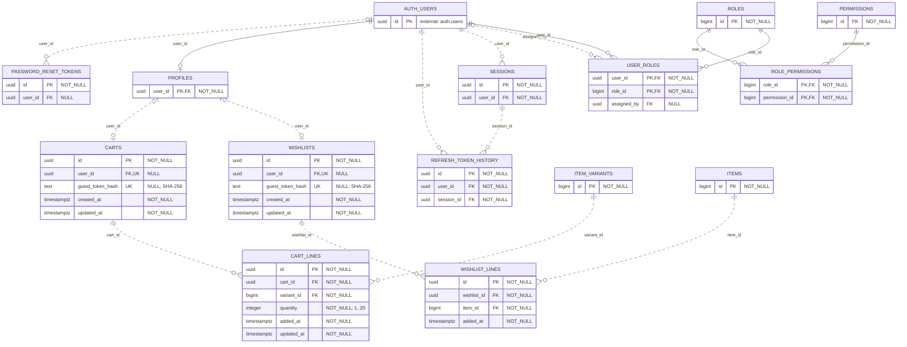

### 2.2 商品・バリアント・LOOK

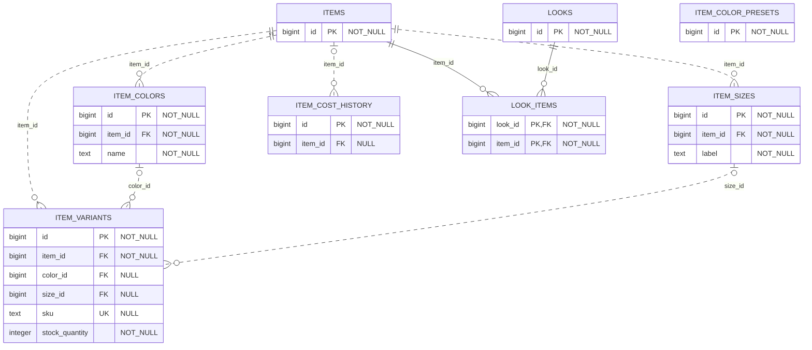

### 2.3 注文・改訂・在庫台帳・注文のメール

```mermaid
erDiagram
  ORDERS {
    uuid id PK "NOT_NULL"
    uuid user_id FK "NULL"
    text payment_intent_id UK "NULL"
    text checkout_session_id UK "NULL"
    uuid reviewed_by "NULL"
  }
  ORDER_ITEMS {
    uuid id PK "NOT_NULL"
    bigint item_id FK "NOT_NULL"
    uuid order_id FK "NOT_NULL"
    bigint variant_id FK "NULL"
    uuid exchange_return_line_id FK "NULL"
  }
  ORDER_REVISIONS {
    bigint id PK "NOT_NULL"
    uuid changed_by FK "NULL"
    uuid order_id FK "NOT_NULL"
    text source_event_id "NULL"
  }
  STOCK_MOVEMENTS {
    bigint id PK "NOT_NULL"
    bigint variant_id FK "NOT_NULL"
    uuid order_id FK "NULL"
    uuid order_item_id FK "NULL"
    uuid refund_id FK "NULL"
    uuid return_id FK "NULL"
    uuid created_by "NULL"
  }
  ORDER_EMAIL_OUTBOX {
    uuid id PK "NOT_NULL"
    bigint seq UK "NOT_NULL"
    uuid order_id FK "NOT_NULL"
    text kind "NOT_NULL"
    text variant "NULL"
    text origin "NOT_NULL"
    uuid requested_by FK "NULL"
    text status "NOT_NULL"
    integer attempts "NOT_NULL"
    timestamptz next_attempt_at "NOT_NULL"
    text provider_message_id UK "NULL"
    text delivery_status "NULL"
    uuid fulfillment_id FK "NULL"
    uuid refund_id FK "NULL"
    uuid return_id FK "NULL"
    uuid return_receipt_id FK "NULL"
  }
  ORDER_FULFILLMENTS {
    uuid id PK "NOT_NULL"
    uuid order_id FK "NOT_NULL"
    uuid request_key UK "NOT_NULL"
    uuid created_by "NULL"
    uuid cancelled_by "NULL"
  }
  ORDER_FULFILLMENT_LINES {
    uuid fulfillment_id PK,FK "NOT_NULL"
    uuid order_item_id PK,FK "NOT_NULL"
  }
  ORDER_ITEM_COMPLETIONS {
    uuid id PK "NOT_NULL"
    uuid order_id FK "NOT_NULL"
    uuid order_item_id FK "NOT_NULL"
    uuid request_key "NOT_NULL"
    uuid created_by "NULL"
    uuid cancelled_by "NULL"
  }
  ORDER_REFUNDS {
    uuid id PK "NOT_NULL"
    uuid order_id FK "NOT_NULL"
    uuid request_key UK "NULL"
    text stripe_refund_id UK "NULL"
    text source "NOT_NULL"
    text status "NOT_NULL"
    uuid actor_id "NULL"
    uuid return_id FK "NULL"
  }
  ORDER_REFUND_LINES {
    uuid id PK "NOT_NULL"
    uuid refund_id FK "NOT_NULL"
    uuid order_item_id FK "NOT_NULL"
    boolean before_shipment "NOT_NULL"
  }
  ORDER_RETURNS {
    uuid id PK "NOT_NULL"
    uuid order_id FK "NOT_NULL"
    integer number "NOT_NULL; (order_id, number) UK"
    uuid request_key UK "NOT_NULL"
    text source "NOT_NULL"
    text status "NOT_NULL"
    uuid created_by "NULL"
  }
  ORDER_RETURN_LINES {
    uuid id PK "NOT_NULL"
    uuid return_id FK "NOT_NULL"
    uuid fulfillment_id FK "NOT_NULL"
    uuid order_item_id FK "NOT_NULL"
    text resolution "NOT_NULL"
    bigint exchange_variant_id FK "NULL"
    bigint requested_exchange_variant_id FK "NULL"
  }
  ORDER_RETURN_RECEIPTS {
    uuid id PK "NOT_NULL"
    uuid return_id FK "NOT_NULL"
    uuid request_key UK "NOT_NULL"
    text kind "NOT_NULL"
    uuid refund_id FK "NULL"
    uuid actor_id "NULL"
  }
  ORDER_RETURN_RECEIPT_LINES {
    uuid id PK "NOT_NULL"
    uuid receipt_id FK "NOT_NULL"
    uuid return_line_id FK "NOT_NULL"
    text disposition "NOT_NULL"
  }
  SHOP_RETURN_SETTINGS {
    smallint id PK "NOT_NULL; 1だけ"
    text return_address_name "NULL"
    integer window_days "NULL"
  }
  SHOP_RETURN_REASON_SETTINGS {
    text reason PK "NOT_NULL"
    text shipping_payer "NOT_NULL"
    text out_of_stock_exchange "NOT_NULL"
  }
  SHOP_SETTINGS {
    smallint id PK "NOT_NULL; 1だけ"
    boolean auto_refund_cancelled_order_payment "NOT_NULL"
    boolean auto_cancel_amount_mismatch "NOT_NULL"
  }
  REFUND_LEDGER_STATE {
    smallint id PK "NOT_NULL; 1だけ"
    timestamptz started_at "NOT_NULL"
  }
  ORDER_EMAIL_SEND_PAUSE {
    boolean id PK "NOT_NULL"
    boolean paused "NOT_NULL"
    text reason "NULL"
    timestamptz next_probe_at "NULL"
  }
  RESEND_WEBHOOK_RECEIPTS {
    text svix_id PK "NOT_NULL"
    timestamptz received_at "NOT_NULL"
  }
  AUTH_USERS {
    uuid id PK "NOT_NULL"
  }
  ITEMS {
    bigint id PK "NOT_NULL"
  }
  AUTH_USERS {
    uuid id PK "external: auth.users"
  }
  PROFILES {
    uuid user_id PK,FK "NOT_NULL"
  }
  ITEM_VARIANTS {
    bigint id PK "NOT_NULL"
    text sku UK "NULL"
    integer stock_quantity "NOT_NULL"
  }
  ITEMS ||..o{ ORDER_ITEMS : "item_id"
  AUTH_USERS |o..o{ ORDER_REVISIONS : "changed_by"
  ORDERS ||..o{ ORDER_ITEMS : "order_id"
  ORDERS ||..o{ ORDER_REVISIONS : "order_id"
  PROFILES |o..o{ ORDERS : "user_id"
  ITEM_VARIANTS ||..o{ STOCK_MOVEMENTS : "variant_id"
  ORDERS |o..o{ STOCK_MOVEMENTS : "order_id"
  ORDER_ITEMS |o..o{ STOCK_MOVEMENTS : "order_item_id"
  ITEM_VARIANTS |o..o{ ORDER_ITEMS : "variant_id"
  ORDERS ||..o{ ORDER_EMAIL_OUTBOX : "order_id"
  AUTH_USERS |o..o{ ORDER_EMAIL_OUTBOX : "requested_by"
  ORDERS ||..o{ ORDER_FULFILLMENTS : "order_id"
  ORDER_FULFILLMENTS ||--o{ ORDER_FULFILLMENT_LINES : "fulfillment_id"
  ORDER_ITEMS ||--o{ ORDER_FULFILLMENT_LINES : "order_item_id"
  ORDERS ||..o{ ORDER_ITEM_COMPLETIONS : "order_id"
  ORDER_ITEMS ||..o{ ORDER_ITEM_COMPLETIONS : "order_item_id"
  ORDER_FULFILLMENTS |o..o{ ORDER_EMAIL_OUTBOX : "fulfillment_id"
  ORDERS ||..o{ ORDER_REFUNDS : "order_id"
  ORDER_REFUNDS ||..o{ ORDER_REFUND_LINES : "refund_id"
  ORDER_ITEMS ||..o{ ORDER_REFUND_LINES : "order_item_id"
  ORDER_REFUNDS |o..o{ STOCK_MOVEMENTS : "refund_id"
  ORDER_REFUNDS |o..o{ ORDER_EMAIL_OUTBOX : "refund_id"
  ORDERS ||..o{ ORDER_RETURNS : "order_id"
  ORDER_RETURNS ||..o{ ORDER_RETURN_LINES : "return_id"
  ORDER_FULFILLMENT_LINES ||..o{ ORDER_RETURN_LINES : "fulfillment_id, order_item_id"
  ITEM_VARIANTS |o..o{ ORDER_RETURN_LINES : "exchange_variant_id"
  ITEM_VARIANTS |o..o{ ORDER_RETURN_LINES : "requested_exchange_variant_id"
  ORDER_RETURNS ||..o{ ORDER_RETURN_RECEIPTS : "return_id"
  ORDER_REFUNDS |o..o{ ORDER_RETURN_RECEIPTS : "refund_id"
  ORDER_RETURN_RECEIPTS ||..o{ ORDER_RETURN_RECEIPT_LINES : "receipt_id"
  ORDER_RETURN_LINES ||..o{ ORDER_RETURN_RECEIPT_LINES : "return_line_id"
  ORDER_RETURN_LINES |o..o{ ORDER_ITEMS : "exchange_return_line_id"
  ORDER_RETURNS |o..o{ ORDER_REFUNDS : "return_id"
  ORDER_RETURNS |o..o{ STOCK_MOVEMENTS : "return_id"
  ORDER_RETURNS |o..o{ ORDER_EMAIL_OUTBOX : "return_id"
  ORDER_RETURN_RECEIPTS |o..o{ ORDER_EMAIL_OUTBOX : "return_receipt_id"
```

### 2.4 決済記録・Checkout 下書き

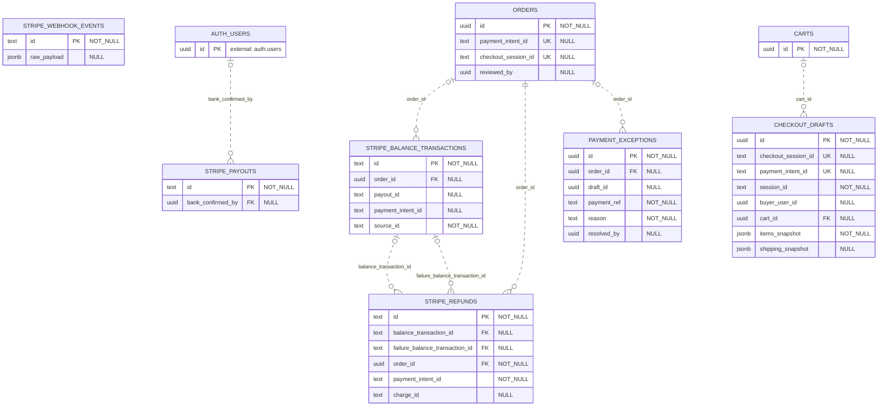

### 2.5 会計の業務関係

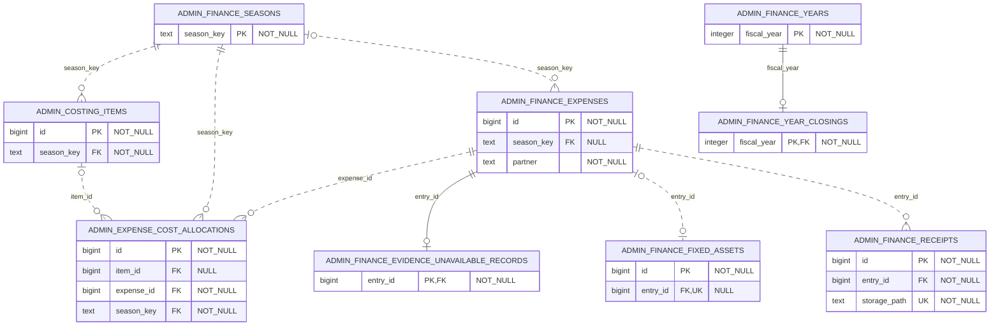

### 2.6 会計の実行者・確認者

#### 2.6.1 原価・取引・履歴の実行者

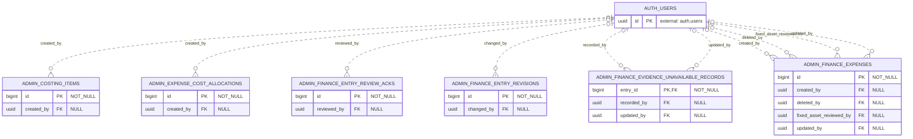

#### 2.6.2 テンプレート・固定資産・証憑・年度の実行者

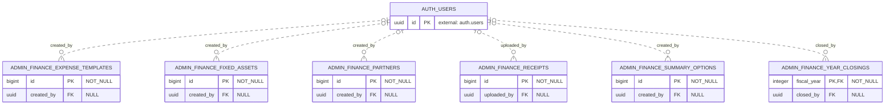

### 2.7 問い合わせ

```mermaid
erDiagram
  CONTACT_INQUIRIES {
    uuid id PK "NOT_NULL"
    uuid order_id FK "NULL"
    uuid user_id "NULL"
  }
  CONTACT_MESSAGES {
    uuid id PK "NOT_NULL"
    uuid inquiry_id FK "NOT_NULL"
    uuid author_id "NULL"
    text inbound_provider_id UK "NULL"
  }
  CONTACT_REPLY_TEMPLATES {
    uuid id PK "NOT_NULL"
  }
  ORDERS {
    uuid id PK "NOT_NULL"
    text payment_intent_id UK "NULL"
    text checkout_session_id UK "NULL"
    uuid reviewed_by "NULL"
  }
  CONTACT_INQUIRIES ||..o{ CONTACT_MESSAGES : "inquiry_id"
  ORDERS |o..o{ CONTACT_INQUIRIES : "order_id"
```

### 2.8 KPI・監査・保存・コンテンツ・補助データ

#### 2.8.1 KPI の記録・目標・資料

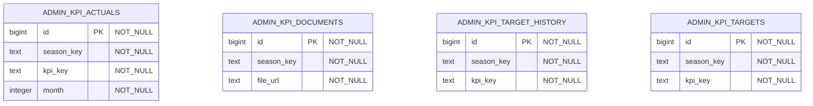

#### 2.8.2 監査・セキュリティ・アーカイブ

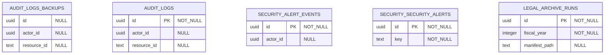

#### 2.8.3 コンテンツ・キャッシュ・レート制限

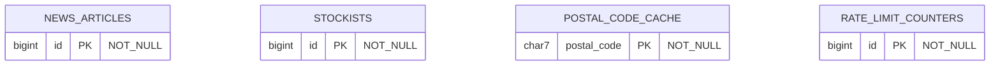

## 3. 全テーブルとキーの一覧

以下は掲載対象の76テーブル・94 FKの定義元とキーの一覧。FK の有無は入出両方向で判定する。`audit_logs_backups.id` は主キーではなく nullable の通常列である。

### 3.1 認証・利用者

| テーブル | PK | PK 以外の一意性 | 物理 FK 接続 | 定義元 |
| --- | --- | --- | --- | --- |
| `public.profiles` | `(user_id)` | なし | 参照元 3 / 参照先 1 | [20260901102912:799](../../../supabase/migrations/20260901102912_remote_schema.sql#L799) |
| `public.sessions` | `(id)` | なし | 参照元 1 / 参照先 1 | [20260901102912:866](../../../supabase/migrations/20260901102912_remote_schema.sql#L866) |
| `public.refresh_token_history` | `(id)` | `(refresh_token_hash)` | 参照元 0 / 参照先 2 | [20260901102912:831](../../../supabase/migrations/20260901102912_remote_schema.sql#L831) |
| `public.password_reset_tokens` | `(id)` | `(token_hash)` | 参照元 0 / 参照先 1 | [20260901102912:759](../../../supabase/migrations/20260901102912_remote_schema.sql#L759) |
| `public.roles` | `(id)` | `(code)` | 参照元 2 / 参照先 0 | [20260901102912:854](../../../supabase/migrations/20260901102912_remote_schema.sql#L854) |
| `public.permissions` | `(id)` | `(code)` | 参照元 1 / 参照先 0 | [20260901102912:773](../../../supabase/migrations/20260901102912_remote_schema.sql#L773) |
| `public.user_roles` | `(user_id, role_id)` | なし | 参照元 0 / 参照先 3 | [20260901102912:1005](../../../supabase/migrations/20260901102912_remote_schema.sql#L1005) |
| `public.role_permissions` | `(role_id, permission_id)` | なし | 参照元 0 / 参照先 2 | [20260901102912:844](../../../supabase/migrations/20260901102912_remote_schema.sql#L844) |
| `public.carts` | `(id)` | `(user_id)`; `(guest_token_hash)` UNIQUE、持ち主はどちらか1つ | 参照元 2 / 参照先 1 | [移行 A](../../../supabase/migrations/20261008220825_cart_wishlist_ownership.sql) |
| `public.cart_lines` | `(id)` | `(cart_id, variant_id)` UNIQUE | 参照元 0 / 参照先 2 | [移行 A](../../../supabase/migrations/20261008220825_cart_wishlist_ownership.sql) |
| `public.wishlists` | `(id)` | `(user_id)`; `(guest_token_hash)` UNIQUE、持ち主はどちらか1つ | 参照元 1 / 参照先 1 | [移行 A](../../../supabase/migrations/20261008220825_cart_wishlist_ownership.sql) |
| `public.wishlist_lines` | `(id)` | `(wishlist_id, item_id)` UNIQUE | 参照元 0 / 参照先 2 | [移行 A](../../../supabase/migrations/20261008220825_cart_wishlist_ownership.sql) |

#### カートとお気に入りの列・索引（2026-10-08）

| 表 | 列と制約 |
| --- | --- |
| `carts`・`wishlists` | `id uuid` PK（gen_random_uuid）、`user_id uuid` nullable UNIQUE、`guest_token_hash text` nullable UNIQUE（64桁の小文字16進 SHA-256）、`created_at`・`updated_at timestamptz` NOT NULL（now）。`num_nonnulls(user_id,guest_token_hash)=1` |
| `cart_lines` | `id uuid` PK（gen_random_uuid）、`cart_id uuid`・`variant_id bigint`・`quantity integer`・`added_at`・`updated_at timestamptz` は NOT NULL。日時はnow、数量1〜20、`(cart_id,variant_id)` UNIQUE |
| `wishlist_lines` | `id uuid` PK（gen_random_uuid）、`wishlist_id uuid`・`item_id bigint`・`added_at timestamptz` は NOT NULL。日時はnow、`(wishlist_id,item_id)` UNIQUE |
| `checkout_drafts` | `cart_id uuid` nullable（カートを削除したら SET NULL）。`items_snapshot` の `source_cart_line_id` は `cart_lines.id` の写しで、JSON の値なので物理 FK ではない |

| 索引 | 対象・用途 |
| --- | --- |
| 持ち主の UNIQUE 索引 | `carts`・`wishlists` の `user_id` と `guest_token_hash` をそれぞれ一意にする |
| 明細の UNIQUE 索引 | `cart_lines(cart_id,variant_id)`、`wishlist_lines(wishlist_id,item_id)` |
| `cart_lines_variant_id_idx` | `cart_lines(variant_id)` |
| `wishlist_lines_item_id_idx` | `wishlist_lines(item_id)` |
| `checkout_drafts_cart_id_idx` | `checkout_drafts(cart_id)` |

4表は RLS と権限の取り消しで anon・authenticated からの直接読み書きを拒否し、service_role の API だけが読み書きする。明細変更のトリガーが持ち主の updated_at を進め、ゲストは最後に使ってから30日を過ぎると毎日削除される。定義は [移行 A](../../../supabase/migrations/20261008220825_cart_wishlist_ownership.sql)、決済の下書きとの照合は [移行 B](../../../supabase/migrations/20261008220944_cart_checkout_rpcs.sql) に従う。

### 3.2 商品・LOOK

| テーブル | PK | PK 以外の一意性 | 物理 FK 接続 | 定義元 |
| --- | --- | --- | --- | --- |
| `public.items` | `(id)` | なし | 参照元 7 / 参照先 0 | [20260901102912:572](../../../supabase/migrations/20260901102912_remote_schema.sql#L572) |
| `public.item_colors` | `(id)` | `(item_id, name)` | 参照元 1 / 参照先 1 | [20260919065336:7](../../../supabase/migrations/20260919065336_add_variant_inventory_tables.sql#L7) |
| `public.item_sizes` | `(id)` | `(item_id, label)` | 参照元 1 / 参照先 1 | [20260919065336:18](../../../supabase/migrations/20260919065336_add_variant_inventory_tables.sql#L18) |
| `public.item_variants` | `(id)` | `(sku)`; `(item_id, COALESCE(color_id, 0), COALESCE(size_id, 0))` 式 UNIQUE | 参照元 5 / 参照先 3 | [20260919065336:27](../../../supabase/migrations/20260919065336_add_variant_inventory_tables.sql#L27) |
| `public.item_cost_history` | `(id)` | なし | 参照元 0 / 参照先 1 | [20260901102912:557](../../../supabase/migrations/20260901102912_remote_schema.sql#L557) |
| `public.looks` | `(id)` | なし | 参照元 1 / 参照先 0 | [20260901102912:639](../../../supabase/migrations/20260901102912_remote_schema.sql#L639) |
| `public.look_items` | `(look_id, item_id)` | なし | 参照元 0 / 参照先 2 | [20260901102912:629](../../../supabase/migrations/20260901102912_remote_schema.sql#L629) |
| `public.item_color_presets` | `(id)` | `(name, hex)` | なし（独立） | [20260901102912:544](../../../supabase/migrations/20260901102912_remote_schema.sql#L544) |

### 3.3 注文・在庫台帳

| テーブル | PK | PK 以外の一意性 | 物理 FK 接続 | 定義元 |
| --- | --- | --- | --- | --- |
| `public.orders` | `(id)` | `(payment_intent_id)`; `(checkout_session_id)` | 参照元 12 / 参照先 1 | [20260901102912:718](../../../supabase/migrations/20260901102912_remote_schema.sql#L718) |
| `public.order_items` | `(id)` | なし | 参照元 4 / 参照先 4 | [20260901102912:677](../../../supabase/migrations/20260901102912_remote_schema.sql#L677) |
| `public.order_revisions` | `(id)` | なし | 参照元 0 / 参照先 2 | [20260901102912:698](../../../supabase/migrations/20260901102912_remote_schema.sql#L698) |
| `public.stock_movements` | `(id)` | なし | 参照元 0 / 参照先 5 | [20260919065355:6](../../../supabase/migrations/20260919065355_add_stock_movements.sql#L6) |
| `public.order_fulfillments` | `(id)` | `(order_id, number)`; `(request_key)` | 参照元 2 / 参照先 1 | [移行 A](../../../supabase/migrations/20261010120303_order_fulfillments.sql) |
| `public.order_fulfillment_lines` | `(fulfillment_id, order_item_id)` | なし | 参照元 1 / 参照先 2 | [移行 A](../../../supabase/migrations/20261010120303_order_fulfillments.sql) |
| `public.order_item_completions` | `(id)` | `(request_key, order_item_id)` | 参照元 0 / 参照先 2 | [移行 A](../../../supabase/migrations/20261010120303_order_fulfillments.sql) |
| `public.order_refunds` | `(id)` | `(request_key)`; `(stripe_refund_id)` | 参照元 4 / 参照先 2 | [E-2 移行 A](../../../supabase/migrations/20261011222930_order_refund_records.sql) |
| `public.order_refund_lines` | `(id)` | `(refund_id, order_item_id, before_shipment)` | 参照元 0 / 参照先 2 | [E-2 移行 A](../../../supabase/migrations/20261011222930_order_refund_records.sql) |
| `public.shop_settings` | `(id)` | なし（1行） | なし（独立） | [E-2 移行 A](../../../supabase/migrations/20261011222930_order_refund_records.sql) |
| `private.refund_ledger_state` | `(id)` | なし（1行） | なし（独立） | [E-2 移行 A](../../../supabase/migrations/20261011222930_order_refund_records.sql) |
| `public.order_returns` | `(id)` | `(order_id, number)`; `(request_key)` | 参照元 5 / 参照先 1 | [E-3 移行 A](../../../supabase/migrations/20261012100000_order_return_records.sql) |
| `public.order_return_lines` | `(id)` | なし | 参照元 2 / 参照先 4 | [E-3 移行 A](../../../supabase/migrations/20261012100000_order_return_records.sql) |
| `public.order_return_receipts` | `(id)` | `(request_key)` | 参照元 2 / 参照先 2 | [E-3 移行 A](../../../supabase/migrations/20261012100000_order_return_records.sql) |
| `public.order_return_receipt_lines` | `(id)` | `(receipt_id, return_line_id, disposition, resolution, exchange_method)`（NULLS NOT DISTINCT） | 参照元 0 / 参照先 2 | [E-3 移行 A](../../../supabase/migrations/20261012100000_order_return_records.sql) |
| `public.shop_return_settings` | `(id)` | なし（1行） | なし（独立） | [E-3 移行 A](../../../supabase/migrations/20261012100000_order_return_records.sql) |
| `public.shop_return_reason_settings` | `(reason)` | なし | なし（独立） | [E-3 移行 A](../../../supabase/migrations/20261012100000_order_return_records.sql) |
| `private.order_email_outbox` | `(id)` | `(seq)`; 自動 `(order_id, kind)`（発送のメール・返金に結び付く行・返品の4つの種類以外）; 自動の発送のメール `(fulfillment_id)`; 自動の返金に結び付く行 `(refund_id, kind)`; 自動の返品の受付のお知らせ `(return_id)`; 自動の受け取りに結び付く行（返品のメールと、受け取りと一緒の返金のお知らせ） `(return_receipt_id, kind)`; 手の送信待ち `(order_id, kind, fulfillment_id, refund_id)`（NULLS NOT DISTINCT）; `(provider_message_id)` | 参照元 0 / 参照先 6（orders・auth.users・order_fulfillments・order_refunds・order_returns・order_return_receipts） | [20261009095633:11](../../../supabase/migrations/20261009095633_order_email_outbox.sql#L11) |
| `private.order_email_send_pause` | `(id)` | なし（1行） | なし（独立） | [20261009095633:91](../../../supabase/migrations/20261009095633_order_email_outbox.sql#L91) |
| `private.resend_webhook_receipts` | `(svix_id)` | なし | なし（独立） | [20261009095633:110](../../../supabase/migrations/20261009095633_order_email_outbox.sql#L110) |

#### 発送と仕上がりの列・索引（2026-10-10）

| 表 | 列と制約 |
| --- | --- |
| `order_fulfillments` | `id uuid` PK（gen_random_uuid）、`order_id uuid` NOT NULL（RESTRICT）、`number integer` NOT NULL（1以上。`(order_id, number)` UNIQUE。取り消した分の番号は使い回さない）、`request_key uuid` NOT NULL UNIQUE、`shipping_carrier text`（yamato・sagawa・japanpost）、`tracking_number text`（`^[0-9A-Za-z-]{1,64}$`）、`notify_customer boolean` NOT NULL、`completes_order boolean` NOT NULL、`shipped_at timestamptz` NOT NULL（now）、`created_by uuid`・`cancelled_by uuid`（`auth.users` の番号。外部キーにしない: 消した人を空にする ON DELETE SET NULL は UPDATE として動き、取消の列しか変えさせない守りとぶつかるため。`stock_movements.created_by` と同じ）、`cancelled_at timestamptz`、`legacy boolean` NOT NULL（false）。CHECK は `legacy OR (shipping_carrier IS NOT NULL AND tracking_number IS NOT NULL)` と `cancelled_by IS NULL OR cancelled_at IS NOT NULL` |
| `order_fulfillment_lines` | `fulfillment_id uuid`・`order_item_id uuid`（どちらも RESTRICT）、`quantity integer` NOT NULL（1以上）。PK は `(fulfillment_id, order_item_id)`。追記だけ（変更と削除をトリガーで拒む） |
| `order_item_completions` | `id uuid` PK、`order_id uuid`・`order_item_id uuid`（RESTRICT。受注生産の品だけ）、`quantity integer` NOT NULL（1以上）、`request_key uuid` NOT NULL（`(request_key, order_item_id)` UNIQUE）、`created_by uuid`・`cancelled_by uuid`（`auth.users` の番号。外部キーにしない: 消した人を空にする ON DELETE SET NULL は UPDATE として動き、取消の列しか変えさせない守りとぶつかるため。`stock_movements.created_by` と同じ）、`created_at timestamptz` NOT NULL、`cancelled_at timestamptz`、`legacy boolean` NOT NULL。CHECK は `cancelled_by IS NULL OR cancelled_at IS NOT NULL` |
| `private.order_email_outbox` | `fulfillment_id uuid`（`order_fulfillments(id)`、RESTRICT）を足す。CHECK は `(kind = 'shipped') = (fulfillment_id IS NOT NULL)` |

| 索引 | 対象・用途 |
| --- | --- |
| `order_fulfillments(order_id, number)` の UNIQUE | その注文の何回目の発送か |
| `order_fulfillment_lines(order_item_id)` | 商品ごとの発送した数 |
| `order_item_completions(order_item_id)` | 商品ごとの仕上がった数 |
| `order_item_completions(order_id, created_at)` | その注文の仕上がりを新しい順に読む（履歴） |
| `private.order_email_outbox(fulfillment_id)`（`fulfillment_id` が空でない行だけ） | 発送の取消と再送で、その発送のメールを探す |
| `stock_movements(order_item_id)` | 前からある `stock_movements_order_item_id_idx`（20260919130048）を使う。移行 A では足していない（引き当て済みの数を、商品の行ごとに台帳から数える） |

3つの表は RLS を有効にし、anon・authenticated の権限を外し、service_role は SELECT だけを持つ。書くのは `admin_create_fulfillment`・`admin_cancel_fulfillment`・`admin_record_completion`・`admin_cancel_completion`（どれも SECURITY DEFINER）だけ。商品ごとの数は `private.order_line_fulfillment` の1か所で数え、`shipped ≤ completed ≤ quantity` を DB の関数とトリガーで守る（トリガー `private.check_order_line_fulfillment_bounds` が、発送の商品の追加と仕上がりの追加・取消の後に確かめ、破る時は `FULFILLMENT_BOUNDS_VIOLATED`（SQLSTATE 23514）で止める）。定義は [移行 A](../../../supabase/migrations/20261010120303_order_fulfillments.sql)・[移行 B](../../../supabase/migrations/20261010122320_fulfillment_order_emails.sql) に従う。

#### 返金の列・索引（2026-10-11）

| 表 | 列と制約 |
| --- | --- |
| `order_refunds` | `id uuid` PK（gen_random_uuid）、`order_id uuid` NOT NULL（RESTRICT）、`source text` NOT NULL（`admin`・`order_cancel`・`stripe_dashboard`・`auto_cancelled_order_payment`・`auto_amount_mismatch`・`legacy`）、`request_key uuid` UNIQUE（画面を開いた時に作る二重防止の番号。管理画面の返金と支払い済みのキャンセルでは必須）、`request_fingerprint text`（`request_key` がある時は必須。中身の違う同じ番号を見分ける）、`stripe_refund_id text` UNIQUE（形は `^[a-z]{2,4}_[A-Za-z0-9]+$`。カード以外の支払いの返金の番号が `re_` 以外で来ても受けるため。Stripe の画面からの返金と写しでは必須）、`status text` NOT NULL（`awaiting_response`・`error`・`pending`・`succeeded`・`failed`）、`stripe_status`・`stripe_pending_reason`・`stripe_failure_reason`・`customer_action_expires_at`・`payment_method_type`・`reference_number`・`reference_type`（Stripe の細目。届いたら書く。エラーの時の `stripe_failure_reason` はこちらの理由 `stripe_rejected`・`not_found_in_stripe`）、`amount integer` NOT NULL（1以上）、`shipping_amount integer` NOT NULL（0以上。そのうちの送料）、`adjustment_amount integer` NOT NULL（計算との差。正も負もある）、`note text`（500字まで。店だけが見る）、`stripe_reason text`（`requested_by_customer`・`duplicate`・`fraudulent`）、`cancel_reason text`（`stock_unavailable`・`customer_request`・`suspected_fraud`・`other`。支払い済みのキャンセルと自動の取消だけ）、`notify_customer boolean` NOT NULL、`actor_id uuid`（実行した人の `auth.users` の番号。外部キーにしない: `stock_movements.created_by` と同じ）、`created_at timestamptz` NOT NULL（now）、`accepted_at`・`succeeded_at`・`failed_at`・`errored_at timestamptz`（状態の移り変わりの時刻）、`stock_applied_at`・`email_enqueued_at`・`failure_applied_at timestamptz`（在庫・メールの予定・失敗の後始末を1回だけにする印）。CHECK は `order_refunds_request_check`（管理画面の返金と支払い済みのキャンセルは `request_key` が必須。`request_key` と `request_fingerprint` は両方あるか両方無い）・`order_refunds_external_check`（Stripe の画面からの返金と写しは `stripe_refund_id` が必須で `request_key` が空）・`order_refunds_cancel_reason_check`（`cancel_reason` があるのは支払い済みのキャンセルと自動の取消だけ）・`order_refunds_legacy_check`（写しは在庫・メールを動かした印を持たず、`notify_customer` が false） |
| `order_refund_lines` | `id uuid` PK、`refund_id uuid`・`order_item_id uuid`（どちらも RESTRICT）、`quantity integer` NOT NULL（1〜999）、`before_shipment boolean` NOT NULL（発送前の品か、発送後の品か）、`restock_type text` NOT NULL（`cancel`・`no_restock`。発送後の品は `no_restock` だけ）、`amount integer` NOT NULL（0以上。割引を割り振った、この商品の分の返金額。DB が計算する。割引は商品の登録順に小計を足していった和で累積して丸めるので、どの商品の割引も0以上で、合計は注文の割引になる）、`released_quantity`・`restocked_quantity`・`rereserved_quantity`・`rereserve_shortage integer` NOT NULL（既定 0。確保を外した数・在庫に戻した数・失敗で確保し直した数・足りなかった数）。`(refund_id, order_item_id, before_shipment)` UNIQUE。CHECK は `order_refund_lines_restock_check`・`order_refund_lines_release_check` |
| `shop_settings` | `id smallint` PK（1だけ。CHECK `id = 1`）、`auto_refund_cancelled_order_payment boolean` NOT NULL（既定 true）、`auto_cancel_amount_mismatch boolean` NOT NULL（既定 false）、それぞれの `…_updated_by uuid`・`…_updated_at timestamptz`（最後に変えた人と時刻。外部キーにしない）。移行が1行を入れる |
| `private.refund_ledger_state` | `id smallint` PK（1だけ）、`started_at timestamptz` NOT NULL。移行 A を当てた時刻を1行入れる（これより前に Stripe で作られた返金は「前からの写し」にする） |
| `orders` | `paid_amount integer`（受け取った額。0以上。店内だけの列で、お客様の JWT に GRANT しない）を足す。書くのは、入金を記録する時（`mark_order_paid`）と、照合が取り消した注文への入金を見つけた時（`record_cancelled_order_paid_amount`。記録のたびに、空の時だけ）。CHECK `orders_refunded_amount_range` は `refunded_amount >= 0 AND refunded_amount <= GREATEST(total_amount, COALESCE(paid_amount, 0))` に作り直す |
| `stock_movements` | `refund_id uuid`（`order_refunds(id)`、RESTRICT）を足す。返金で動いた台帳の行が、どの返金かを残す |
| `private.order_email_outbox` | `refund_id uuid`（`order_refunds(id)`、RESTRICT）を足す。種類に `refund` を足し（CHECK `order_email_outbox_kind_check`）、書き分けに `canceled` の `paid` と `refund` の `standard`・`after_cancel` を足す（CHECK `order_email_outbox_variant_check`）。CHECK `order_email_outbox_refund_check` は `(refund_id IS NOT NULL) = (kind = 'refund' OR (kind = 'canceled' AND variant = 'paid'))` |
| `payment_exceptions` | 理由の CHECK を `payment_exceptions_reason_check` に作り直し、`refund_failed` を足す |

| 索引 | 対象・用途 |
| --- | --- |
| `order_refunds(order_id, created_at DESC)` | その注文の返金を新しい順に読む（履歴・お客様の画面） |
| `order_refunds(created_at)`（`status = 'awaiting_response'` の行だけ） | 毎時の見回りが、15分より前の返事待ちを探す |
| `order_refunds(order_id)`（`status = 'pending'` の行だけ） | 保留の返金がある注文と支払いを探す |
| `order_refund_lines(order_item_id)` | 商品ごとに返金した数を数える |
| `stock_movements(refund_id)`（`refund_id` が空でない行だけ） | 返金で動いた台帳の行を探す |
| `private.order_email_outbox` の一意の索引 | 自動の行は、発送のメール・返金に結び付く行以外が `(order_id, kind)`、返金に結び付く行が `(refund_id, kind)`。手の送信待ちは `(order_id, kind, fulfillment_id, refund_id)`（NULLS NOT DISTINCT） |

返金の2つの表・`shop_settings` は RLS を有効にし、anon・authenticated の権限を外し、service_role は SELECT だけを持つ。`private.refund_ledger_state` も RLS を有効にして全ての権限を外し（service_role も読めない）、関数（所有者の権限）だけが読む。書くのは `begin_order_refund`・`record_order_refund_result`・`record_external_order_refund`・`mark_order_refund_error`・`admin_update_shop_settings`（どれも SECURITY DEFINER）だけ。注文の受け取った額 `orders.paid_amount` を書くのは、`mark_order_paid` と `record_cancelled_order_paid_amount`（取り消した注文で空の時だけ。移行 B）と、取り消した注文への入金の自動の返金の `begin_order_refund`（空の時だけ）。返金の表は消せず、中身も直せない（トリガー `order_refunds_guard` が、進めてよい列と状態の移り方以外を `ORDER_REFUND_APPEND_ONLY`・`ORDER_REFUND_IMMUTABLE`・`ORDER_REFUND_INVALID_TRANSITION`（どれも SQLSTATE 23514）で止める）。商品ごとの数は E-1 の `private.order_line_fulfillment` の1か所で数え、返金した数の2つの列（`refunded_before_shipment`・`refunded_after_shipment`）を足した。`shipped + refunded_before_shipment ≤ quantity`・`refunded_after_shipment ≤ shipped`・`shipped ≤ completed` を、トリガー `private.check_order_line_fulfillment_bounds` が `FULFILLMENT_BOUNDS_VIOLATED`（SQLSTATE 23514）で守る。定義は [移行 A](../../../supabase/migrations/20261011222930_order_refund_records.sql)・[移行 B](../../../supabase/migrations/20261011223147_order_refund_requests.sql)・[移行 C](../../../supabase/migrations/20261011223453_order_refund_results.sql) に従う。

#### 返品の列・索引（2026-10-13）

| 表 | 列と制約 |
| --- | --- |
| `order_returns` | `id uuid` PK（gen_random_uuid）、`order_id uuid` NOT NULL（RESTRICT）、`number integer` NOT NULL（1以上。`(order_id, number)` UNIQUE。返品の番号 `{注文番号}-R{n}` の n。注文の行の鍵の中で「その注文の返品の数 + 1」にする）、`source text` NOT NULL（`customer_request`・`shop`。段1は `shop` だけ）、`status text` NOT NULL（`requested`・`open`・`closed`・`cancelled`・`declined`）、`request_key uuid` NOT NULL UNIQUE（二重防止の番号）、`request_fingerprint text` NOT NULL、`return_method text` NOT NULL（`customer_ships`・`shop_label`・`not_required`）、`return_shipping_payer text` NOT NULL（`shop`・`customer`）、`return_carrier text`（`yamato`・`sagawa`・`japanpost`・`other`）、`return_tracking_number text`（`^[0-9A-Za-z-]{1,64}$`）、`return_shipping_fee`・`exchange_fee`・`exchange_shipping_fee`・`fee_due_amount`・`fee_settled_amount`・`fee_pending_deduction integer` NOT NULL（0以上。既定 0。`fee_due_amount` は引けずにお客様からいただく、まだ決着していない額、`fee_settled_amount` は手数料の受け取りの記録・いただかないで終えるで決着した額の合計（決着のたびに、その時の `fee_due_amount` を足して `fee_due_amount` を0に戻す）、`fee_pending_deduction` は相談の受け取りで付き、額を決めて返金する時に引く額）、`restocking_fee_percent integer` NOT NULL（0〜100）、`fee_received_at`・`fee_received_by`・`fee_received_note`（手数料の受け取りの記録。メモは500字まで）、`fee_waived boolean` NOT NULL（既定 false。手数料をいただかないことにした印。真の時も `fee_received_at`・`fee_received_by` を入れる（CHECK `order_returns_fee_waived_check`）。決着した額は `fee_settled_amount` に移して `fee_due_amount` は0に戻す。受け取り・額を決めて返金で新しい手数料が付いて、`fee_received_at`・`fee_received_by`・`fee_received_note` を空に戻す時は、同じ更新で `fee_waived` も false に戻す）、`exchange_released_at`・`exchange_released_by`（支払いを待たずに送る）、`notify_customer boolean` NOT NULL、`shop_note text`（500字まで）、`created_at`・`created_by`・`closed_at`・`cancelled_at`・`cancelled_by`・`reopened_at`・`reopened_by`。段2の列（`requested_at`・`requested_by`・`declined_at`・`declined_by`・`decline_reason`・`decline_message`）は段1では空のまま。`approved_at`・`approved_by` は、お店が返品を作った時に、作った時刻と人を入れる。実行した人の列は `auth.users` の番号で、外部キーにしない（`stock_movements.created_by` と同じ） |
| `order_return_lines` | `id uuid` PK、`return_id uuid` NOT NULL（RESTRICT）、`fulfillment_id uuid`・`order_item_id uuid` NOT NULL（`order_fulfillment_lines` の組を指す複合の外部キー、RESTRICT。その返品の注文の発送だけを指す）、`quantity integer` NOT NULL（1以上）、`reason text` NOT NULL（10の理由）、`reason_note text`（255字まで）、`resolution text` NOT NULL（`refund`・`exchange`。作った時の予定）、`exchange_variant_id bigint`・`exchange_method text`（`stock`・`make`。CHECK で、`resolution = 'exchange'` の時だけ両方が入る）、`customer_note`・`requested_resolution`・`requested_exchange_variant_id`（段2の列）、`created_at timestamptz` NOT NULL。作った後は一切変えず、消せない。実際に決まった解決（在庫不足で作って送るに変えた・店長が返金に変えた）は、受け取りの商品の扱いに残す |
| `order_return_receipts` | `id uuid` PK、`return_id uuid` NOT NULL（RESTRICT）、`request_key uuid` NOT NULL UNIQUE、`request_fingerprint text` NOT NULL、`kind text` NOT NULL（`receive`・`inspect`・`close_missing`・`reopen`・`waive_refund`）、`refund_choice text`（`now`・`consult`・`none`。`kind = 'receive'` の時だけ入る。この受け取りで返金する品が0点（覆われた品だけ・交換だけ・お返しだけ）なら、選び方が今返金・相談でも `none` を入れる）、`refund_id uuid`（`order_refunds(id)`、RESTRICT。移行 C で DEFERRABLE INITIALLY DEFERRED。この受け取りと一緒に作った返金）、`notify_customer boolean` NOT NULL、`sent_back_message`（1000字まで）・`sent_back_carrier`・`sent_back_tracking_number`（お返しのメッセージと送り返しの配送業者・伝票番号）、`note text`（500字まで）、`actor_id uuid`・`actor_can_refund boolean`（した人と、返金の権限があったか）、`created_at timestamptz` NOT NULL。追記だけ（変更と削除をトリガーで拒む） |
| `order_return_receipt_lines` | `id uuid` PK、`receipt_id uuid`・`return_line_id uuid` NOT NULL（どちらも RESTRICT）、`disposition text` NOT NULL（`restocked`・`not_restocked`・`pending_inspection`・`inspected_restocked`・`inspected_not_restocked`・`sent_back`・`missing`・`missing_reopened`・`refund_waived`）、`quantity integer` NOT NULL（1以上）、`resolution text`（`refund`・`exchange`。受け取った品（`restocked`・`not_restocked`・`pending_inspection`）の行だけが、その受け取りで実際に決まった解決を持つ）、`exchange_method text`（`resolution = 'exchange'` の時だけ）。`(receipt_id, return_line_id, disposition, resolution, exchange_method)` UNIQUE（NULLS NOT DISTINCT）。追記だけ。交換の数・返金待ち・覆いは、返品の行の予定ではなく、この行の解決で数える |
| `shop_return_settings` | `id smallint` PK（1だけ。CHECK `id = 1`）、`window_days integer`（1〜365。空は無制限。既定 7）、`window_start text`（`each_item`・`last_item`。既定 `each_item`）、`delivery_buffer_days integer`（0〜14。既定 3）、`return_address_name`・`return_address_postal_code`・`return_address_line`・`return_address_phone`（4つとも空か、4つとも入っている。CHECK `shop_return_settings_address_check`）、`customer_paid_method text`（`customer_ships`・`shop_label`。既定 `customer_ships`）、`shop_label_fee integer`（0以上）、`no_return_needed_enabled`・`restocking_fee_enabled`・`exchange_fees_enabled`・`inspection_enabled boolean`（既定 false）、`restocking_fee_percent`・`exchange_fee`・`exchange_shipping_fee`、段2の列（`requests_enabled`・`request_types`・`notice_text`）、まとまりごとの `{requests\|window\|shipping\|reasons\|fees\|receiving}_updated_at`・`…_updated_by`（最後に変えた時刻と人。外部キーにしない）。移行が1行を入れる |
| `shop_return_reason_settings` | `reason text` PK（10の理由）、`shipping_payer text` NOT NULL（`shop`・`customer`）、`out_of_stock_exchange text` NOT NULL（`make`・`decline`）、段2の列（`shown`・`resolutions`・`photo`・`photo_instructions`）。最初の値は仕様書 8-3 の表。移行が10行を入れる |
| `order_items` | `line_kind text` NOT NULL（`order`・`exchange`。既定 `order`）、`exchange_return_line_id uuid`（`order_return_lines(id)`、RESTRICT）、`exchange_paid_amount integer`（0以上）を足す。CHECK `order_items_exchange_check` は、`order` の行は交換の2列が空、`exchange` の行は2列があって `item_price = 0`・`line_total = 0` |
| `order_refunds`・`order_refund_lines` | `order_refunds` に `return_id uuid`（`order_returns(id)`、RESTRICT）を足し、`source` に `return` を足す（CHECK `order_refunds_source_check`）。CHECK `order_refunds_return_check` は `(source = 'return') = (return_id IS NOT NULL)`。`return_fee_deduction integer` NOT NULL（0以上。既定 0。CHECK `order_refunds_return_fee_deduction_check`）も足す。その返品の返金で引いた手数料で、返金を作る時に決まる。返品の返金がエラーか失敗になった時に、この額を返品の `fee_pending_deduction` へ戻し（エラーの後に保留・成功へ移った時は引き直す）、ほかの道の返金は 0 のまま。`order_refund_lines.restock_type` に `return` を足す（`return` の行は発送後の行だけ。CHECK `order_refund_lines_restock_check`） |
| `stock_movements` | `return_id uuid`（`order_returns(id)`、RESTRICT）を足す。`reason` に `return`（返品の受け取り。+n）・`exchange`（交換の品の確保。−n）を足す（CHECK `stock_movements_reason_check`）。確保中の数 `private.order_line_reservations` は `exchange` を数え、`return` は数えない |
| `private.order_email_outbox` | `return_id uuid`（`order_returns(id)`、RESTRICT）、`return_receipt_id uuid`（`order_return_receipts(id)`、RESTRICT）を足す。種類に `return_accepted`・`return_received`・`return_sent_back`・`return_refund_pending_shop` を足し（CHECK `order_email_outbox_kind_check`）、`refund` の書き分けに `return` を足す（CHECK `order_email_outbox_variant_check`）。CHECK `order_email_outbox_return_check` が行の持ち方を決める（受付は返品の番号だけ。受け取り・お返し・店への知らせは返品と受け取りの番号の両方。返金のお知らせは返品の番号があれば受け取りの番号は任意。ほかの種類はどちらも空） |
| `permissions`・`role_permissions` | 権限の行 `admin.orders.return`（名前「注文の返品」）を足し、役割 `admin` と `supporter` に付ける |

| 索引 | 対象・用途 |
| --- | --- |
| `order_returns(status, created_at DESC)` | 状態ごとの返品を新しい順に読む |
| `order_return_lines(return_id)`・`order_return_lines(fulfillment_id, order_item_id)` | 返品の行を、返品から・発送の行の組から引く |
| `order_return_lines(requested_exchange_variant_id)`・`order_return_lines(exchange_variant_id)`（どちらも空でない行だけ） | 交換の色・サイズ（`item_variants`）の外部キーの索引 |
| `order_return_receipts(return_id, created_at)`・`order_return_receipts(refund_id)`（`refund_id` が空でない行だけ） | 受け取りを、返品から・返金から引く |
| `order_return_receipt_lines(return_line_id)` | 返品の行ごとの処理の数を数える |
| `order_items(exchange_return_line_id)`・`order_refunds(return_id)`・`stock_movements(return_id)`（どれも空でない行だけ） | 交換の品・返金・台帳を、返品の行・返品から引く |
| `private.order_email_outbox` の一意の索引 | 自動の行は、`(order_id, kind)`（発送のメール・返金に結び付く行・返品の4つの種類以外）に加えて、返品の受付が `(return_id)`、受け取りに結び付く行（3つの返品の種類と、受け取りと一緒の返金のお知らせ）が `(return_receipt_id, kind)`。1つの注文に返品が何回もあるため、返品の種類は注文ごとの索引から外した |

返品の4つの表と設定の2つの表は RLS を有効にし、anon・authenticated の権限を外し、service_role は SELECT だけを持つ。書くのは `admin_create_return`・`admin_receive_return`・`admin_refund_return`・`admin_cancel_return`・`admin_reopen_return`・`admin_close_return_missing`・`admin_inspect_return`・`admin_record_return_fee_payment`・`admin_release_return_exchange`・設定の更新の関数（どれも SECURITY DEFINER）だけ。返品の表は消せず、直せる列は状態・時刻・する人・手数料の受け取り（いただかない印を含む）・支払いを待たずに送る・手数料の額（決着した合計 `fee_settled_amount` を含む）に限る（トリガー `order_returns_guard` が、それ以外の変更を `ORDER_RETURN_IMMUTABLE`、許さない状態の移り方を `ORDER_RETURN_INVALID_TRANSITION`、削除を `ORDER_RETURN_APPEND_ONLY`（どれも SQLSTATE 23514）で止める）。返品の行・受け取りの記録・受け取りの商品の扱いは、変更も削除もトリガーが `ORDER_RETURN_APPEND_ONLY` で止める。返品の行ごとの処理の数は `private.order_return_line_progress`、商品ごとの返品できる数（申し込み `rq`・受付中で未処理 `op`・返金待ち `rw`・交換 `ex`・お返し `sb`）は `private.order_line_return_counts` の1か所で数え、窓口・画面・E-2 の返金の発送後に返せる数が同じ数を使う。定義は [移行 A](../../../supabase/migrations/20261012100000_order_return_records.sql)・[移行 B](../../../supabase/migrations/20261012100100_order_return_actions.sql)・[移行 C](../../../supabase/migrations/20261012100200_order_return_receipts.sql) に従う。

### 3.4 決済・下書き

| テーブル | PK | PK 以外の一意性 | 物理 FK 接続 | 定義元 |
| --- | --- | --- | --- | --- |
| `public.stripe_balance_transactions` | `(id)` | なし | 参照元 2 / 参照先 1 | [20260901102912:907](../../../supabase/migrations/20260901102912_remote_schema.sql#L907) |
| `public.stripe_refunds` | `(id)` | なし | 参照元 0 / 参照先 3 | [20260901102912:963](../../../supabase/migrations/20260901102912_remote_schema.sql#L963) |
| `public.stripe_payouts` | `(id)` | なし | 参照元 0 / 参照先 1 | [20260901102912:934](../../../supabase/migrations/20260901102912_remote_schema.sql#L934) |
| `public.payment_exceptions` | `(id)` | `(payment_ref, reason)` | 参照元 0 / 参照先 1 | [20260927100500:6](../../../supabase/migrations/20260927100500_payment_exceptions.sql#L6) |
| `public.stripe_webhook_events` | `(id)` | なし | なし（独立） | [20260901102912:988](../../../supabase/migrations/20260901102912_remote_schema.sql#L988) |
| `public.checkout_drafts` | `(id)` | `(checkout_session_id)`; `(payment_intent_id)`; `(session_id, checkout_request_version, checkout_request_fingerprint)` 部分 UNIQUE（`status = created` かつ fingerprint 非 NULL） | 参照元 0 / 参照先 1 | [20260901102912:461](../../../supabase/migrations/20260901102912_remote_schema.sql#L461)。列 `buyer_user_id` の追加: [20261008055720](../../../supabase/migrations/20261008055720_checkout_order_owner_binding.sql)。列 `cart_id` の追加: [移行 A](../../../supabase/migrations/20261008220825_cart_wishlist_ownership.sql) |

### 3.5 会計

| テーブル | PK | PK 以外の一意性 | 物理 FK 接続 | 定義元 |
| --- | --- | --- | --- | --- |
| `public.admin_costing_items` | `(id)` | `(id, season_key)` | 参照元 1 / 参照先 2 | [20260901102912:39](../../../supabase/migrations/20260901102912_remote_schema.sql#L39) |
| `public.admin_expense_cost_allocations` | `(id)` | なし | 参照元 0 / 参照先 4 | [20260901102912:62](../../../supabase/migrations/20260901102912_remote_schema.sql#L62) |
| `public.admin_finance_entry_review_acks` | `(id)` | `(entry_ref, reason)` | 参照元 0 / 参照先 1 | [20260901102912:91](../../../supabase/migrations/20260901102912_remote_schema.sql#L91) |
| `public.admin_finance_entry_revisions` | `(id)` | なし | 参照元 0 / 参照先 1 | [20260901102912:108](../../../supabase/migrations/20260901102912_remote_schema.sql#L108) |
| `public.admin_finance_evidence_unavailable_records` | `(entry_id)` | なし | 参照元 0 / 参照先 3 | [20260901102912:123](../../../supabase/migrations/20260901102912_remote_schema.sql#L123) |
| `public.admin_finance_expense_templates` | `(id)` | `(name)` | 参照元 0 / 参照先 1 | [20260901102912:145](../../../supabase/migrations/20260901102912_remote_schema.sql#L145) |
| `public.admin_finance_expenses` | `(id)` | なし | 参照元 4 / 参照先 5 | [20260901102912:173](../../../supabase/migrations/20260901102912_remote_schema.sql#L173) |
| `public.admin_finance_fixed_assets` | `(id)` | `(entry_id)`（entry_id 非 NULL の部分 UNIQUE） | 参照元 0 / 参照先 2 | [20260901102912:209](../../../supabase/migrations/20260901102912_remote_schema.sql#L209) |
| `public.admin_finance_partners` | `(id)` | `(name)` | 参照元 0 / 参照先 1 | [20260901102912:240](../../../supabase/migrations/20260901102912_remote_schema.sql#L240) |
| `public.admin_finance_receipts` | `(id)` | `(storage_path)` | 参照元 0 / 参照先 2 | [20260901102912:254](../../../supabase/migrations/20260901102912_remote_schema.sql#L254) |
| `public.admin_finance_seasons` | `(season_key)` | なし | 参照元 3 / 参照先 0 | [20260901102912:274](../../../supabase/migrations/20260901102912_remote_schema.sql#L274) |
| `public.admin_finance_summary_options` | `(id)` | `(entry_type, normalized_name)` | 参照元 0 / 参照先 1 | [20260901102912:285](../../../supabase/migrations/20260901102912_remote_schema.sql#L285) |
| `public.admin_finance_year_closings` | `(fiscal_year)` | なし | 参照元 0 / 参照先 2 | [20260901102912:303](../../../supabase/migrations/20260901102912_remote_schema.sql#L303) |
| `public.admin_finance_years` | `(fiscal_year)` | なし | 参照元 1 / 参照先 0 | [20260901102912:322](../../../supabase/migrations/20260901102912_remote_schema.sql#L322) |

### 3.6 問い合わせ

| テーブル | PK | PK 以外の一意性 | 物理 FK 接続 | 定義元 |
| --- | --- | --- | --- | --- |
| `public.contact_inquiries` | `(id)` | なし | 参照元 1 / 参照先 1 | [20260901102912:488](../../../supabase/migrations/20260901102912_remote_schema.sql#L488) |
| `public.contact_messages` | `(id)` | `(inbound_provider_id)` | 参照元 0 / 参照先 1 | [20260901102912:511](../../../supabase/migrations/20260901102912_remote_schema.sql#L511) |
| `public.contact_reply_templates` | `(id)` | なし | なし（独立） | [20260901102912:529](../../../supabase/migrations/20260901102912_remote_schema.sql#L529) |

### 3.7 KPI・監査・保存・補助データ

| テーブル | PK | PK 以外の一意性 | 物理 FK 接続 | 定義元 |
| --- | --- | --- | --- | --- |
| `public.admin_kpi_actuals` | `(id)` | `(season_key, kpi_key, month)` | なし（独立） | [20260901102912:347](../../../supabase/migrations/20260901102912_remote_schema.sql#L347) |
| `public.admin_kpi_documents` | `(id)` | なし | なし（独立） | [20260901102912:363](../../../supabase/migrations/20260901102912_remote_schema.sql#L363) |
| `public.admin_kpi_target_history` | `(id)` | `(season_key, kpi_key)` | なし（独立） | [20260901102912:376](../../../supabase/migrations/20260901102912_remote_schema.sql#L376) |
| `public.admin_kpi_targets` | `(id)` | `(season_key, kpi_key)` | なし（独立） | [20260901102912:389](../../../supabase/migrations/20260901102912_remote_schema.sql#L389) |
| `public.audit_logs_backups` | **なし** | なし | なし（独立） | [20260901102912:407](../../../supabase/migrations/20260901102912_remote_schema.sql#L407) |
| `public.audit_logs` | `(id)` | なし | なし（独立） | [20260901102912:425](../../../supabase/migrations/20260901102912_remote_schema.sql#L425) |
| `public.legal_archive_runs` | `(id)` | `(archive_date, run_kind)` | なし（独立） | [20260901102912:605](../../../supabase/migrations/20260901102912_remote_schema.sql#L605) |
| `public.news_articles` | `(id)` | なし | なし（独立） | [20260901102912:658](../../../supabase/migrations/20260901102912_remote_schema.sql#L658) |
| `public.postal_code_cache` | `(postal_code)` | なし | なし（独立） | [20260901102912:785](../../../supabase/migrations/20260901102912_remote_schema.sql#L785) |
| `public.rate_limit_counters` | `(id)` | `(ip, endpoint, bucket)`（NULLS NOT DISTINCT） | なし（独立） | [20260901102912:816](../../../supabase/migrations/20260901102912_remote_schema.sql#L816) |
| `public.stockists` | `(id)` | なし | なし（独立） | [20260901102912:888](../../../supabase/migrations/20260901102912_remote_schema.sql#L888) |
| `security.alert_events` | `(id)` | なし | なし（独立） | [20260901102912:1030](../../../supabase/migrations/20260901102912_remote_schema.sql#L1030) |
| `security.security_alerts` | `(id)` | なし | なし（独立） | [20260901102912:1042](../../../supabase/migrations/20260901102912_remote_schema.sql#L1042) |

一意インデックスの定義: [固定資産 entry_id](../../../supabase/migrations/20260901102912_remote_schema.sql#L2815)、[カート](../../../supabase/migrations/20260901102912_remote_schema.sql#L2830)、[パスワードリセット token_hash](../../../supabase/migrations/20260901102912_remote_schema.sql#L2864)、[お気に入り](../../../supabase/migrations/20260901102912_remote_schema.sql#L2916)、[バリアントの組合せ](../../../supabase/migrations/20260919065336_add_variant_inventory_tables.sql#L41)、[Checkout の作成要求](../../../supabase/migrations/20260925000132_add_checkout_session_claim_rpcs.sql#L38)、[レート制限の NULL 一意性](../../../supabase/migrations/20260913132105_fix_rate_limit_counters_subject_counting.sql#L30)。

## 4. 全 FK の参照先・多重度・削除動作

各行は 1 つの物理 FK。`NULL可` は子の FK 列が NULL を許すか、`親あたりの子` はその FK 列の一意性で決まる上限を表す。`NO ACTION` は `ON DELETE` 未指定の定義。これはテーブル上の制約の一覧であり、トリガーによる追加制限やアプリケーションで実際に削除できるかは表していない。

### 4.1 認証・権限・プロフィール・カート

| 子テーブル.FK 列 | 参照先 | 型 / NULL可 | 親あたりの子 | ON DELETE | 定義元 |
| --- | --- | --- | --- | --- | --- |
| `public.password_reset_tokens.user_id` | `auth.users(id)` | `uuid` / 可 | 0..N | `CASCADE` | [20260901102912:2707](../../../supabase/migrations/20260901102912_remote_schema.sql#L2707) |
| `public.carts.user_id` | `public.profiles(user_id)` | `uuid` / 可 | 0..1 | `CASCADE` | [移行 A](../../../supabase/migrations/20261008220825_cart_wishlist_ownership.sql) |
| `public.cart_lines.cart_id` | `public.carts(id)` | `uuid` / 不可 | 0..N | `CASCADE` | [移行 A](../../../supabase/migrations/20261008220825_cart_wishlist_ownership.sql) |
| `public.cart_lines.variant_id` | `public.item_variants(id)` | `bigint` / 不可 | 0..N | `CASCADE` | [移行 A](../../../supabase/migrations/20261008220825_cart_wishlist_ownership.sql) |
| `public.profiles.user_id` | `auth.users(id)` | `uuid` / 不可 | 0..1 | `CASCADE` | [20260901102912:2716](../../../supabase/migrations/20260901102912_remote_schema.sql#L2716) |
| `public.refresh_token_history.user_id` | `auth.users(id)` | `uuid` / 不可 | 0..N | `CASCADE` | [20260901102912:2719](../../../supabase/migrations/20260901102912_remote_schema.sql#L2719) |
| `public.role_permissions.permission_id` | `public.permissions(id)` | `bigint` / 不可 | 0..N | `CASCADE` | [20260901102912:2722](../../../supabase/migrations/20260901102912_remote_schema.sql#L2722) |
| `public.role_permissions.role_id` | `public.roles(id)` | `bigint` / 不可 | 0..N | `CASCADE` | [20260901102912:2725](../../../supabase/migrations/20260901102912_remote_schema.sql#L2725) |
| `public.refresh_token_history.session_id` | `public.sessions(id)` | `uuid` / 不可 | 0..N | `CASCADE` | [20260901102912:2728](../../../supabase/migrations/20260901102912_remote_schema.sql#L2728) |
| `public.sessions.user_id` | `auth.users(id)` | `uuid` / 不可 | 0..N | `CASCADE` | [20260901102912:2731](../../../supabase/migrations/20260901102912_remote_schema.sql#L2731) |
| `public.user_roles.assigned_by` | `auth.users(id)` | `uuid` / 可 | 0..N | `SET NULL` | [20260901102912:2750](../../../supabase/migrations/20260901102912_remote_schema.sql#L2750) |
| `public.user_roles.role_id` | `public.roles(id)` | `bigint` / 不可 | 0..N | `RESTRICT` | [20260901102912:2753](../../../supabase/migrations/20260901102912_remote_schema.sql#L2753) |
| `public.user_roles.user_id` | `auth.users(id)` | `uuid` / 不可 | 0..N | `CASCADE` | [20260901102912:2756](../../../supabase/migrations/20260901102912_remote_schema.sql#L2756) |
| `public.wishlists.user_id` | `public.profiles(user_id)` | `uuid` / 可 | 0..1 | `CASCADE` | [移行 A](../../../supabase/migrations/20261008220825_cart_wishlist_ownership.sql) |
| `public.wishlist_lines.wishlist_id` | `public.wishlists(id)` | `uuid` / 不可 | 0..N | `CASCADE` | [移行 A](../../../supabase/migrations/20261008220825_cart_wishlist_ownership.sql) |
| `public.wishlist_lines.item_id` | `public.items(id)` | `bigint` / 不可 | 0..N | `CASCADE` | [移行 A](../../../supabase/migrations/20261008220825_cart_wishlist_ownership.sql) |

### 4.2 商品・バリアント・LOOK

| 子テーブル.FK 列 | 参照先 | 型 / NULL可 | 親あたりの子 | ON DELETE | 定義元 |
| --- | --- | --- | --- | --- | --- |
| `public.item_cost_history.item_id` | `public.items(id)` | `bigint` / 可 | 0..N | `CASCADE` | [20260901102912:2683](../../../supabase/migrations/20260901102912_remote_schema.sql#L2683) |
| `public.look_items.item_id` | `public.items(id)` | `bigint` / 不可 | 0..N | `CASCADE` | [20260901102912:2686](../../../supabase/migrations/20260901102912_remote_schema.sql#L2686) |
| `public.look_items.look_id` | `public.looks(id)` | `bigint` / 不可 | 0..N | `CASCADE` | [20260901102912:2689](../../../supabase/migrations/20260901102912_remote_schema.sql#L2689) |
| `public.item_colors.item_id` | `public.items(id)` | `bigint` / 不可 | 0..N | `CASCADE` | [20260919065336:9](../../../supabase/migrations/20260919065336_add_variant_inventory_tables.sql#L9) |
| `public.item_sizes.item_id` | `public.items(id)` | `bigint` / 不可 | 0..N | `CASCADE` | [20260919065336:20](../../../supabase/migrations/20260919065336_add_variant_inventory_tables.sql#L20) |
| `public.item_variants.item_id` | `public.items(id)` | `bigint` / 不可 | 0..N | `CASCADE` | [20260919065336:29](../../../supabase/migrations/20260919065336_add_variant_inventory_tables.sql#L29) |
| `public.item_variants.color_id` | `public.item_colors(id)` | `bigint` / 可 | 0..N | `RESTRICT` | [20260919065336:30](../../../supabase/migrations/20260919065336_add_variant_inventory_tables.sql#L30) |
| `public.item_variants.size_id` | `public.item_sizes(id)` | `bigint` / 可 | 0..N | `RESTRICT` | [20260919065336:31](../../../supabase/migrations/20260919065336_add_variant_inventory_tables.sql#L31) |

### 4.3 注文・改訂・在庫台帳・注文のメール

| 子テーブル.FK 列 | 参照先 | 型 / NULL可 | 親あたりの子 | ON DELETE | 定義元 |
| --- | --- | --- | --- | --- | --- |
| `public.order_items.item_id` | `public.items(id)` | `bigint` / 不可 | 0..N | `RESTRICT` | [20260901102912:2692](../../../supabase/migrations/20260901102912_remote_schema.sql#L2692) |
| `public.order_revisions.changed_by` | `auth.users(id)` | `uuid` / 可 | 0..N | `SET NULL` | [20260901102912:2695](../../../supabase/migrations/20260901102912_remote_schema.sql#L2695) |
| `public.order_items.order_id` | `public.orders(id)` | `uuid` / 不可 | 0..N | `CASCADE` | [20260901102912:2701](../../../supabase/migrations/20260901102912_remote_schema.sql#L2701) |
| `public.order_revisions.order_id` | `public.orders(id)` | `uuid` / 不可 | 0..N | `RESTRICT` | [20260901102912:2704](../../../supabase/migrations/20260901102912_remote_schema.sql#L2704) |
| `public.orders.user_id` | `public.profiles(user_id)` | `uuid` / 可 | 0..N | `SET NULL` | [20260901102912:2713](../../../supabase/migrations/20260901102912_remote_schema.sql#L2713) |
| `public.stock_movements.variant_id` | `public.item_variants(id)` | `bigint` / 不可 | 0..N | `RESTRICT` | [20260919065355:8](../../../supabase/migrations/20260919065355_add_stock_movements.sql#L8) |
| `public.stock_movements.order_id` | `public.orders(id)` | `uuid` / 可 | 0..N | `SET NULL` | [20260919065355:12](../../../supabase/migrations/20260919065355_add_stock_movements.sql#L12) |
| `public.stock_movements.order_item_id` | `public.order_items(id)` | `uuid` / 可 | 0..N | `SET NULL` | [20260919065355:13](../../../supabase/migrations/20260919065355_add_stock_movements.sql#L13) |
| `public.order_items.variant_id` | `public.item_variants(id)` | `bigint` / 可 | 0..N | `RESTRICT` | [20260919065442:10](../../../supabase/migrations/20260919065442_add_order_items_variant_columns.sql#L10) |
| `private.order_email_outbox.order_id` | `public.orders(id)` | `uuid` / 不可 | 0..N | `CASCADE` | [移行 A:14](../../../supabase/migrations/20261009095633_order_email_outbox.sql#L14) |
| `private.order_email_outbox.requested_by` | `auth.users(id)` | `uuid` / 可 | 0..N | `SET NULL` | [移行 A:18](../../../supabase/migrations/20261009095633_order_email_outbox.sql#L18) |
| `public.order_fulfillments.order_id` | `public.orders(id)` | `uuid` / 不可 | 0..N | `RESTRICT` | [E-1 移行 A](../../../supabase/migrations/20261010120303_order_fulfillments.sql) |
| `public.order_fulfillment_lines.fulfillment_id` | `public.order_fulfillments(id)` | `uuid` / 不可 | 0..N | `RESTRICT` | [E-1 移行 A](../../../supabase/migrations/20261010120303_order_fulfillments.sql) |
| `public.order_fulfillment_lines.order_item_id` | `public.order_items(id)` | `uuid` / 不可 | 0..N | `RESTRICT` | [E-1 移行 A](../../../supabase/migrations/20261010120303_order_fulfillments.sql) |
| `public.order_item_completions.order_id` | `public.orders(id)` | `uuid` / 不可 | 0..N | `RESTRICT` | [E-1 移行 A](../../../supabase/migrations/20261010120303_order_fulfillments.sql) |
| `public.order_item_completions.order_item_id` | `public.order_items(id)` | `uuid` / 不可 | 0..N | `RESTRICT` | [E-1 移行 A](../../../supabase/migrations/20261010120303_order_fulfillments.sql) |
| `private.order_email_outbox.fulfillment_id` | `public.order_fulfillments(id)` | `uuid` / 可 | 0..N | `RESTRICT` | [E-1 移行 B](../../../supabase/migrations/20261010122320_fulfillment_order_emails.sql) |
| `public.order_refunds.order_id` | `public.orders(id)` | `uuid` / 不可 | 0..N | `RESTRICT` | [E-2 移行 A](../../../supabase/migrations/20261011222930_order_refund_records.sql) |
| `public.order_refund_lines.refund_id` | `public.order_refunds(id)` | `uuid` / 不可 | 0..N | `RESTRICT` | [E-2 移行 A](../../../supabase/migrations/20261011222930_order_refund_records.sql) |
| `public.order_refund_lines.order_item_id` | `public.order_items(id)` | `uuid` / 不可 | 0..N | `RESTRICT` | [E-2 移行 A](../../../supabase/migrations/20261011222930_order_refund_records.sql) |
| `public.stock_movements.refund_id` | `public.order_refunds(id)` | `uuid` / 可 | 0..N | `RESTRICT` | [E-2 移行 A](../../../supabase/migrations/20261011222930_order_refund_records.sql) |
| `private.order_email_outbox.refund_id` | `public.order_refunds(id)` | `uuid` / 可 | 0..N | `RESTRICT` | [E-2 移行 C](../../../supabase/migrations/20261011223453_order_refund_results.sql) |
| `public.order_returns.order_id` | `public.orders(id)` | `uuid` / 不可 | 0..N | `RESTRICT` | [E-3 移行 A](../../../supabase/migrations/20261012100000_order_return_records.sql) |
| `public.order_return_lines.return_id` | `public.order_returns(id)` | `uuid` / 不可 | 0..N | `RESTRICT` | [E-3 移行 A](../../../supabase/migrations/20261012100000_order_return_records.sql) |
| `public.order_return_lines.(fulfillment_id, order_item_id)` | `public.order_fulfillment_lines(fulfillment_id, order_item_id)` | `uuid, uuid` / 不可 | 0..N | `RESTRICT` | [E-3 移行 A](../../../supabase/migrations/20261012100000_order_return_records.sql) |
| `public.order_return_lines.requested_exchange_variant_id` | `public.item_variants(id)` | `bigint` / 可 | 0..N | `RESTRICT` | [E-3 移行 A](../../../supabase/migrations/20261012100000_order_return_records.sql) |
| `public.order_return_lines.exchange_variant_id` | `public.item_variants(id)` | `bigint` / 可 | 0..N | `RESTRICT` | [E-3 移行 A](../../../supabase/migrations/20261012100000_order_return_records.sql) |
| `public.order_return_receipts.return_id` | `public.order_returns(id)` | `uuid` / 不可 | 0..N | `RESTRICT` | [E-3 移行 A](../../../supabase/migrations/20261012100000_order_return_records.sql) |
| `public.order_return_receipts.refund_id` | `public.order_refunds(id)` | `uuid` / 可 | 0..N | `RESTRICT` | [E-3 移行 A](../../../supabase/migrations/20261012100000_order_return_records.sql) |
| `public.order_return_receipt_lines.receipt_id` | `public.order_return_receipts(id)` | `uuid` / 不可 | 0..N | `RESTRICT` | [E-3 移行 A](../../../supabase/migrations/20261012100000_order_return_records.sql) |
| `public.order_return_receipt_lines.return_line_id` | `public.order_return_lines(id)` | `uuid` / 不可 | 0..N | `RESTRICT` | [E-3 移行 A](../../../supabase/migrations/20261012100000_order_return_records.sql) |
| `public.order_items.exchange_return_line_id` | `public.order_return_lines(id)` | `uuid` / 可 | 0..N | `RESTRICT` | [E-3 移行 A](../../../supabase/migrations/20261012100000_order_return_records.sql) |
| `public.order_refunds.return_id` | `public.order_returns(id)` | `uuid` / 可 | 0..N | `RESTRICT` | [E-3 移行 A](../../../supabase/migrations/20261012100000_order_return_records.sql) |
| `public.stock_movements.return_id` | `public.order_returns(id)` | `uuid` / 可 | 0..N | `RESTRICT` | [E-3 移行 A](../../../supabase/migrations/20261012100000_order_return_records.sql) |
| `private.order_email_outbox.return_id` | `public.order_returns(id)` | `uuid` / 可 | 0..N | `RESTRICT` | [E-3 移行 A](../../../supabase/migrations/20261012100000_order_return_records.sql) |
| `private.order_email_outbox.return_receipt_id` | `public.order_return_receipts(id)` | `uuid` / 可 | 0..N | `RESTRICT` | [E-3 移行 A](../../../supabase/migrations/20261012100000_order_return_records.sql) |

### 4.4 決済記録・Checkout 下書き

| 子テーブル.FK 列 | 参照先 | 型 / NULL可 | 親あたりの子 | ON DELETE | 定義元 |
| --- | --- | --- | --- | --- | --- |
| `public.stripe_balance_transactions.order_id` | `public.orders(id)` | `uuid` / 可 | 0..N | `RESTRICT` | [20260901102912:2734](../../../supabase/migrations/20260901102912_remote_schema.sql#L2734) |
| `public.stripe_payouts.bank_confirmed_by` | `auth.users(id)` | `uuid` / 可 | 0..N | `RESTRICT` | [20260901102912:2737](../../../supabase/migrations/20260901102912_remote_schema.sql#L2737) |
| `public.stripe_refunds.balance_transaction_id` | `public.stripe_balance_transactions(id)` | `text` / 可 | 0..N | `RESTRICT` | [20260901102912:2740](../../../supabase/migrations/20260901102912_remote_schema.sql#L2740) |
| `public.stripe_refunds.failure_balance_transaction_id` | `public.stripe_balance_transactions(id)` | `text` / 可 | 0..N | `RESTRICT` | [20260901102912:2743](../../../supabase/migrations/20260901102912_remote_schema.sql#L2743) |
| `public.stripe_refunds.order_id` | `public.orders(id)` | `uuid` / 不可 | 0..N | `RESTRICT` | [20260901102912:2747](../../../supabase/migrations/20260901102912_remote_schema.sql#L2747) |
| `public.payment_exceptions.order_id` | `public.orders(id)` | `uuid` / 可 | 0..N | `NO ACTION` | [20260927100500:12](../../../supabase/migrations/20260927100500_payment_exceptions.sql#L12) |
| `public.checkout_drafts.cart_id` | `public.carts(id)` | `uuid` / 可 | 0..N | `SET NULL` | [移行 A](../../../supabase/migrations/20261008220825_cart_wishlist_ownership.sql) |

### 4.5 会計の業務関係

| 子テーブル.FK 列 | 参照先 | 型 / NULL可 | 親あたりの子 | ON DELETE | 定義元 |
| --- | --- | --- | --- | --- | --- |
| `public.admin_expense_cost_allocations.item_id` | `public.admin_costing_items(id)` | `bigint` / 可 | 0..N | `RESTRICT` | [20260901102912:2611](../../../supabase/migrations/20260901102912_remote_schema.sql#L2611) |
| `public.admin_expense_cost_allocations.expense_id` | `public.admin_finance_expenses(id)` | `bigint` / 不可 | 0..N | `RESTRICT` | [20260901102912:2638](../../../supabase/migrations/20260901102912_remote_schema.sql#L2638) |
| `public.admin_finance_evidence_unavailable_records.entry_id` | `public.admin_finance_expenses(id)` | `bigint` / 不可 | 0..1 | `CASCADE` | [20260901102912:2641](../../../supabase/migrations/20260901102912_remote_schema.sql#L2641) |
| `public.admin_finance_fixed_assets.entry_id` | `public.admin_finance_expenses(id)` | `bigint` / 可 | 0..1 | `SET NULL` | [20260901102912:2650](../../../supabase/migrations/20260901102912_remote_schema.sql#L2650) |
| `public.admin_finance_receipts.entry_id` | `public.admin_finance_expenses(id)` | `bigint` / 不可 | 0..N | `CASCADE` | [20260901102912:2656](../../../supabase/migrations/20260901102912_remote_schema.sql#L2656) |
| `public.admin_costing_items.season_key` | `public.admin_finance_seasons(season_key)` | `text` / 不可 | 0..N | `RESTRICT` | [20260901102912:2662](../../../supabase/migrations/20260901102912_remote_schema.sql#L2662) |
| `public.admin_expense_cost_allocations.season_key` | `public.admin_finance_seasons(season_key)` | `text` / 不可 | 0..N | `RESTRICT` | [20260901102912:2665](../../../supabase/migrations/20260901102912_remote_schema.sql#L2665) |
| `public.admin_finance_expenses.season_key` | `public.admin_finance_seasons(season_key)` | `text` / 可 | 0..N | `SET NULL` | [20260901102912:2668](../../../supabase/migrations/20260901102912_remote_schema.sql#L2668) |
| `public.admin_finance_year_closings.fiscal_year` | `public.admin_finance_years(fiscal_year)` | `integer` / 不可 | 0..1 | `CASCADE` | [20260901102912:2677](../../../supabase/migrations/20260901102912_remote_schema.sql#L2677) |

### 4.6 会計の実行者・確認者

| 子テーブル.FK 列 | 参照先 | 型 / NULL可 | 親あたりの子 | ON DELETE | 定義元 |
| --- | --- | --- | --- | --- | --- |
| `public.admin_costing_items.created_by` | `auth.users(id)` | `uuid` / 可 | 0..N | `SET NULL` | [20260901102912:2605](../../../supabase/migrations/20260901102912_remote_schema.sql#L2605) |
| `public.admin_expense_cost_allocations.created_by` | `auth.users(id)` | `uuid` / 可 | 0..N | `SET NULL` | [20260901102912:2608](../../../supabase/migrations/20260901102912_remote_schema.sql#L2608) |
| `public.admin_finance_entry_review_acks.reviewed_by` | `auth.users(id)` | `uuid` / 可 | 0..N | `SET NULL` | [20260901102912:2614](../../../supabase/migrations/20260901102912_remote_schema.sql#L2614) |
| `public.admin_finance_entry_revisions.changed_by` | `auth.users(id)` | `uuid` / 可 | 0..N | `SET NULL` | [20260901102912:2617](../../../supabase/migrations/20260901102912_remote_schema.sql#L2617) |
| `public.admin_finance_evidence_unavailable_records.recorded_by` | `auth.users(id)` | `uuid` / 可 | 0..N | `SET NULL` | [20260901102912:2620](../../../supabase/migrations/20260901102912_remote_schema.sql#L2620) |
| `public.admin_finance_evidence_unavailable_records.updated_by` | `auth.users(id)` | `uuid` / 可 | 0..N | `SET NULL` | [20260901102912:2623](../../../supabase/migrations/20260901102912_remote_schema.sql#L2623) |
| `public.admin_finance_expense_templates.created_by` | `auth.users(id)` | `uuid` / 可 | 0..N | `SET NULL` | [20260901102912:2626](../../../supabase/migrations/20260901102912_remote_schema.sql#L2626) |
| `public.admin_finance_expenses.created_by` | `auth.users(id)` | `uuid` / 可 | 0..N | `SET NULL` | [20260901102912:2629](../../../supabase/migrations/20260901102912_remote_schema.sql#L2629) |
| `public.admin_finance_expenses.deleted_by` | `auth.users(id)` | `uuid` / 可 | 0..N | `SET NULL` | [20260901102912:2632](../../../supabase/migrations/20260901102912_remote_schema.sql#L2632) |
| `public.admin_finance_expenses.fixed_asset_reviewed_by` | `auth.users(id)` | `uuid` / 可 | 0..N | `SET NULL` | [20260901102912:2635](../../../supabase/migrations/20260901102912_remote_schema.sql#L2635) |
| `public.admin_finance_expenses.updated_by` | `auth.users(id)` | `uuid` / 可 | 0..N | `SET NULL` | [20260901102912:2644](../../../supabase/migrations/20260901102912_remote_schema.sql#L2644) |
| `public.admin_finance_fixed_assets.created_by` | `auth.users(id)` | `uuid` / 可 | 0..N | `SET NULL` | [20260901102912:2647](../../../supabase/migrations/20260901102912_remote_schema.sql#L2647) |
| `public.admin_finance_partners.created_by` | `auth.users(id)` | `uuid` / 可 | 0..N | `SET NULL` | [20260901102912:2653](../../../supabase/migrations/20260901102912_remote_schema.sql#L2653) |
| `public.admin_finance_receipts.uploaded_by` | `auth.users(id)` | `uuid` / 可 | 0..N | `SET NULL` | [20260901102912:2659](../../../supabase/migrations/20260901102912_remote_schema.sql#L2659) |
| `public.admin_finance_summary_options.created_by` | `auth.users(id)` | `uuid` / 可 | 0..N | `SET NULL` | [20260901102912:2671](../../../supabase/migrations/20260901102912_remote_schema.sql#L2671) |
| `public.admin_finance_year_closings.closed_by` | `auth.users(id)` | `uuid` / 可 | 0..N | `SET NULL` | [20260901102912:2674](../../../supabase/migrations/20260901102912_remote_schema.sql#L2674) |

### 4.7 問い合わせ

| 子テーブル.FK 列 | 参照先 | 型 / NULL可 | 親あたりの子 | ON DELETE | 定義元 |
| --- | --- | --- | --- | --- | --- |
| `public.contact_messages.inquiry_id` | `public.contact_inquiries(id)` | `uuid` / 不可 | 0..N | `CASCADE` | [20260901102912:2680](../../../supabase/migrations/20260901102912_remote_schema.sql#L2680) |
| `public.contact_inquiries.order_id` | `public.orders(id)` | `uuid` / 可 | 0..N | `SET NULL` | [20260901102912:2698](../../../supabase/migrations/20260901102912_remote_schema.sql#L2698) |

## 5. 物理 FK を持たない関連と現行変更

### 5.1 ID・名称・スナップショットの関連

次の値は他の記録を参照する用途でも SQL FK ではない。図の線には含めない。

| 列・記録 | SQL 上の構造 | 根拠 |
| --- | --- | --- |
| `checkout_drafts.items_snapshot[].source_cart_line_id` | `cart_lines.id` の写し。JSON の参照に物理 FK はなく、注文受付で下書きの cart_id に属するかを確かめる | [移行 B](../../../supabase/migrations/20261008220944_cart_checkout_rpcs.sql) |
| `orders`、`checkout_drafts` の `session_id` | text のアプリケーション用セッション識別子。`public.sessions.id` への FK はない | [下書き](../../../supabase/migrations/20260901102912_remote_schema.sql#L461) / [注文](../../../supabase/migrations/20260901102912_remote_schema.sql#L718) |
| `checkout_drafts.items_snapshot`、`shipping_snapshot` | JSONB。商品・利用者・注文への FK はない。下書き表に `order_id`、`user_id` 列はない（買い手は次の行の `buyer_user_id`） | [下書き定義](../../../supabase/migrations/20260901102912_remote_schema.sql#L461) |
| `checkout_drafts.buyer_user_id` | 「確認へ進む」でサーバーが確かめた会員の ID を持つ uuid の通常列。空はゲスト。`auth.users`・`profiles` への FK は付けない。会員を消した後も ID が残り、その会員として誰もログインできないので、「注文する」は必ず断られる側に倒れる。FK で空にすると、消した会員の下書きがゲストの下書きに変わり、ゲストとして注文できてしまう。下書きは 30 日で消えるので、残った ID は溜まらない | [グループ C の移行](../../../supabase/migrations/20261008055720_checkout_order_owner_binding.sql) |
| `orders` と `checkout_drafts` の Checkout Session / PaymentIntent ID | それぞれの表で一意性を持つ text。表間 FK や Stripe 側への DB FK はない | [基準下書き](../../../supabase/migrations/20260901102912_remote_schema.sql#L461) / [注文の一意性変更](../../../supabase/migrations/20260927100100_order_payment_columns.sql#L6) |
| `stripe_balance_transactions.payout_id`、`source_id`、各表の `payment_intent_id` / `charge_id` | Stripe 識別子の通常列。`payout_id` から `stripe_payouts.id` への FK はない | [決済記録](../../../supabase/migrations/20260901102912_remote_schema.sql#L907) |
| `payment_exceptions.draft_id`、`resolved_by`、`orders.reviewed_by`、`stock_movements.created_by` | UUID の通常列。`checkout_drafts` / `auth.users` への FK はない | [例外表](../../../supabase/migrations/20260927100500_payment_exceptions.sql#L6) / [注文変更](../../../supabase/migrations/20260927100100_order_payment_columns.sql#L23) / [在庫台帳の理由コメント](../../../supabase/migrations/20260919065355_add_stock_movements.sql#L15) |
| `order_refunds.actor_id`、`shop_settings` の `auto_refund_cancelled_order_payment_updated_by`・`auto_cancel_amount_mismatch_updated_by` | UUID の通常列（実行した人・設定を最後に変えた人の `auth.users` の番号）。`auth.users` への FK はない。`order_refunds.actor_id` は、消した人を空にする `ON DELETE SET NULL` が更新として動き、返金の記録の「進めてよい列」の守りとぶつかるため（`stock_movements.created_by` と同じ）。設定の2つの列も同じく通常列 | [E-2 移行 A](../../../supabase/migrations/20261011222930_order_refund_records.sql) |
| `order_returns` の `requested_by`・`approved_by`・`declined_by`・`fee_received_by`・`exchange_released_by`・`created_by`・`cancelled_by`・`reopened_by`、`order_return_receipts.actor_id`、`shop_return_settings` の `{requests\|window\|shipping\|reasons\|fees\|receiving}_updated_by` | UUID の通常列（実行した人・設定を最後に変えた人の `auth.users` の番号）。`auth.users` への FK はない。理由は E-2 の `order_refunds.actor_id` と同じ（消した人を空にする `ON DELETE SET NULL` が更新として動き、記録を直させない守りとぶつかるため） | [E-3 移行 A](../../../supabase/migrations/20261012100000_order_return_records.sql) |
| `admin_finance_entry_revisions.entry_id`、`admin_finance_entry_review_acks.entry_ref` | bigint / text の履歴参照。経費・注文への FK はない。実行者列の FK は別途存在する | [改訂](../../../supabase/migrations/20260901102912_remote_schema.sql#L108) / [確認記録](../../../supabase/migrations/20260901102912_remote_schema.sql#L91) |
| 経費・テンプレートの `partner` | 相手先名称の text。`admin_finance_partners` への FK はない | [経費](../../../supabase/migrations/20260901102912_remote_schema.sql#L173) / [テンプレート](../../../supabase/migrations/20260901102912_remote_schema.sql#L145) |
| KPI の `season_key` / `kpi_key`、`item_cost_history.season_key`、`legal_archive_runs.fiscal_year` | 通常列または複合一意キー。会計のシーズン・年度・KPI 表間の FK はない | [KPI](../../../supabase/migrations/20260901102912_remote_schema.sql#L347) / [商品原価履歴](../../../supabase/migrations/20260901102912_remote_schema.sql#L557) / [保存実行](../../../supabase/migrations/20260901102912_remote_schema.sql#L605) |
| 問い合わせの `user_id` / `author_id`、監査・セキュリティの `actor_id` / `resource_id` | 利用者・対象の記録用通常列。利用者や対象テーブルへの FK はない | [問い合わせ](../../../supabase/migrations/20260901102912_remote_schema.sql#L488) / [監査](../../../supabase/migrations/20260901102912_remote_schema.sql#L407) / [セキュリティ](../../../supabase/migrations/20260901102912_remote_schema.sql#L1030) |
| `admin_finance_receipts.storage_path`、KPI の `file_url`、アーカイブの `manifest_path`、画像 URL | パス・URL の通常列。`storage.objects` への FK はない | [証憑](../../../supabase/migrations/20260901102912_remote_schema.sql#L254) / [KPI ファイル](../../../supabase/migrations/20260901102912_remote_schema.sql#L363) / [アーカイブ](../../../supabase/migrations/20260901102912_remote_schema.sql#L605) |

### 5.2 最終構造の読み方

- `profiles.user_id`、`admin_finance_evidence_unavailable_records.entry_id`、`admin_finance_year_closings.fiscal_year` は PK と FK を兼ねるため、親から見て 0..1 件。`admin_finance_fixed_assets.entry_id` は nullable の部分 UNIQUE なので両側とも 0..1 の関係になる。
- `item_variants.color_id` / `size_id`、`order_items.variant_id`、`item_cost_history.item_id`、カート・お気に入りの `user_id`、注文の `user_id` は nullable。`stripe_refunds.order_id` は **非 nullable**。注文と返金の関係は必須の親として表示する。
- [order_items.item_id の型変更](../../../supabase/migrations/20260919065442_add_order_items_variant_columns.sql#L7)後の型は bigint。[items.stock_quantity は削除済み](../../../supabase/migrations/20260921121038_retire_item_stock_quantity.sql#L633)で、現行の在庫列は `item_variants.stock_quantity`。`items.colors` / `sizes` は SQL 上では残る。
- [orders.payment_intent_id は nullable 化](../../../supabase/migrations/20260927100100_order_payment_columns.sql#L6)され、`checkout_session_id` の UNIQUE が追加されている。どちらの Stripe ID も SQL FK ではない。
- [Checkout 要求識別子のマイグレーション](../../../supabase/migrations/20260925000132_add_checkout_session_claim_rpcs.sql#L3)には「保留中・互換段階」のコメントが残るが、現行 [create-session Route Handler](../../../src/app/api/checkout/create-session/route.ts#L368) は `claim_checkout_draft` を使用し、[識別子の列を取得](../../../src/app/api/checkout/create-session/route.ts#L714)する。本書はそのソース上の定義を記録し、デプロイ済みとの判定は行わない。
- [グループ C の移行](../../../supabase/migrations/20261008055720_checkout_order_owner_binding.sql)は、2 つのトリガーで持ち主の決まりを DB に置く。`checkout_drafts.buyer_user_id` は作った後に変えられない（`checkout_drafts_buyer_immutable`、例外 `CHECKOUT_DRAFT_BUYER_IMMUTABLE`）。`orders.user_id` は空から会員へだけ書け、会員から別の会員への付け替えは `ORDER_OWNER_IMMUTABLE` で断る（`orders_owner_immutable`。`SECURITY DEFINER` で `profiles` を見る）。会員から空への更新は、その会員の `profiles` の行が無い時、つまり会員を消して FK の `ON DELETE SET NULL` が空にする時だけ通る。
- [グループ E-1 の移行 A](../../../supabase/migrations/20261010120303_order_fulfillments.sql) は、発送した数・仕上がった数を、変えられない `order_items` ではなく 3 つの新しい表に持つ（商品ごとの数は `private.order_line_fulfillment` の 1 か所で数え、`shipped ≤ completed ≤ quantity` を DB の関数とトリガーで守る）。`orders.shipped_at`・`shipping_carrier`・`tracking_number` は「全部の商品を発送した時」の値として残し、発送の取消で未発送が出たら空に戻す（`shipped_at` で戻し先を決める返金の取り消しの決まりが、そのまま使える）。`private.order_email_outbox.fulfillment_id` は、種類が `shipped` の行だけが持つ（`(kind = 'shipped') = (fulfillment_id IS NOT NULL)` の CHECK）。
- [グループ E-2 の移行 A](../../../supabase/migrations/20261011222930_order_refund_records.sql) は、返金を `order_refunds`・`order_refund_lines` に1件ずつ持つ。`orders.refunded_amount`（成功した返金の合計）の意味は変えず、全額の判定は受け取った額 `orders.paid_amount` で行い（支払額が注文の合計と違う注文でも、全部返す・全額でキャンセルする、を正しく決めるため）、状態の移り方（返金の合計が全額に届いたらキャンセル）だけは、受け取った額が0か空の注文を注文の合計で比べる（`COALESCE(NULLIF(paid_amount, 0), total_amount)`。返金が0円のままキャンセルにならないため）。CHECK `orders_refunded_amount_range` の上限は `GREATEST(total_amount, COALESCE(paid_amount, 0))` にした。`private.order_email_outbox.refund_id` は、種類が `refund` の行と、返金に結び付く支払い済みのキャンセルのお知らせ（種類 `canceled`・書き分け `paid`）の行だけが持つ。前の返金の関数 `public.apply_order_refund_projection` は [移行 C](../../../supabase/migrations/20261011223453_order_refund_results.sql) で消し、結果を書く関数に置き換えた。
- [グループ E-3 の移行 A](../../../supabase/migrations/20261012100000_order_return_records.sql) は、返品を `order_returns`・`order_return_lines` に、受け取りを `order_return_receipts`・`order_return_receipt_lines` に持つ。返品の行（`order_return_lines`）は作った後に数も解決も変えず、実際に決まった解決（在庫不足で作って送るに変えた・店長が返金に変えた）は受け取りの商品の扱い（`resolution`・`exchange_method`）に残す。商品ごとの返品できる数は `private.order_line_return_counts` の1か所で数え、E-2 の返金の発送後に返せる数も `s − ra − rq − op − rw − ex` にした。返金待ち（rw）と覆いは、返品の行ごとの数を出す本体 `private.order_return_line_states_core` の1か所で数える（未保存の受け取りの明細も足して数えられるので、受け取りの関数は受け取りの前後の返金待ちの差を「この受け取りで返金待ちが増える数」として出す。保存済みの記録だけを数える `private.order_return_line_states` は、これを空の明細で呼ぶ）。「届かない」で閉じた後に開き直して受け取った返金の品は、ふつうの返金（道が `return` 以外の発送後の返金）の当て先として先に数える（二重の返金を避ける側。返し足りない時は、ふつうの返金の画面で選べる数が同じだけ増える）。ふつうの返金を始めた後・結果を書いた後・エラーにした後も、その注文の受付中の返品の状態を確かめ直す（鍵の順は注文 → 返品 → 返金）。交換の品は `order_items` に値段0の行（`line_kind = 'exchange'`）として足し、元の支払額を `exchange_paid_amount` に持つ。`private.order_email_outbox` の自動の行の一意の索引は、返品の4つの種類を外して作り直した（1つの注文に返品が何回もあるため）。移行の名前は手元の版で、本番の適用状況は未確認（本番へは push の後に当てる）。
- 2026-10-03 の基準範囲にはテーブルの DROP や FK の DROP / 差し替えはない。2026-10-08 の移行 A は旧カート・お気に入りの表を作り直す。一方、CHECK、通常列、UNIQUE、RPC の変更はあるため、基準 SQL だけでは最終構造を表せない。

## 6. 現行コードの追加依存とビュー

### 6.1 現行マイグレーション列にない 3 テーブル

以下の 3 テーブルは現行の `.from()` 呼び出しに存在するが、`supabase/migrations/` の基準 SQL と後続変更には CREATE TABLE がない。定義は旧 `migrations/` に存在するため、**現行コードの依存と旧 SQL の構造**として示す。第 2〜4 節の70テーブル・80 FKには加算していない。実 DB に存在するか、旧 SQL のとおりの制約があるかは未確認である。

| 現行コードの参照テーブル | 旧 SQL の PK / UNIQUE | 旧 SQL の FK | 定義元 / 現行の参照元 |
| --- | --- | --- | --- |
| `admin_kpi_monthly_records` | bigint `id` PK、`(month_key, metric_key)` UNIQUE | なし | [063 の定義](../../../migrations/063_create_admin_kpi_monthly_records.sql#L10) / [月次記録 API](../../../src/app/api/admin/kpi/monthly-record/route.ts#L59) / [Meta 同期](../../../src/lib/meta/sync-kpi.ts#L206) |
| `public.admin_meta_kpi_connections` | uuid `id` PK、`provider` UNIQUE | nullable uuid `connected_by` → `auth.users(id)`、ON DELETE SET NULL | [079 の定義](../../../migrations/079_create_meta_kpi_integration.sql#L1) / [接続状態 API](../../../src/app/api/admin/kpi/meta/route.ts#L12) |
| `public.admin_meta_kpi_sync_runs` | uuid `id` PK | 非 nullable uuid `connection_id` → `public.admin_meta_kpi_connections(id)`、ON DELETE CASCADE | [079 の定義](../../../migrations/079_create_meta_kpi_integration.sql#L20) / [同期 API](../../../src/app/api/admin/kpi/meta/sync/route.ts#L23) |

063 の CREATE TABLE はスキーマを修飾していない。ここでは現行 Supabase クライアントが指定するテーブル名を記録する。079 は `public` を明示している。

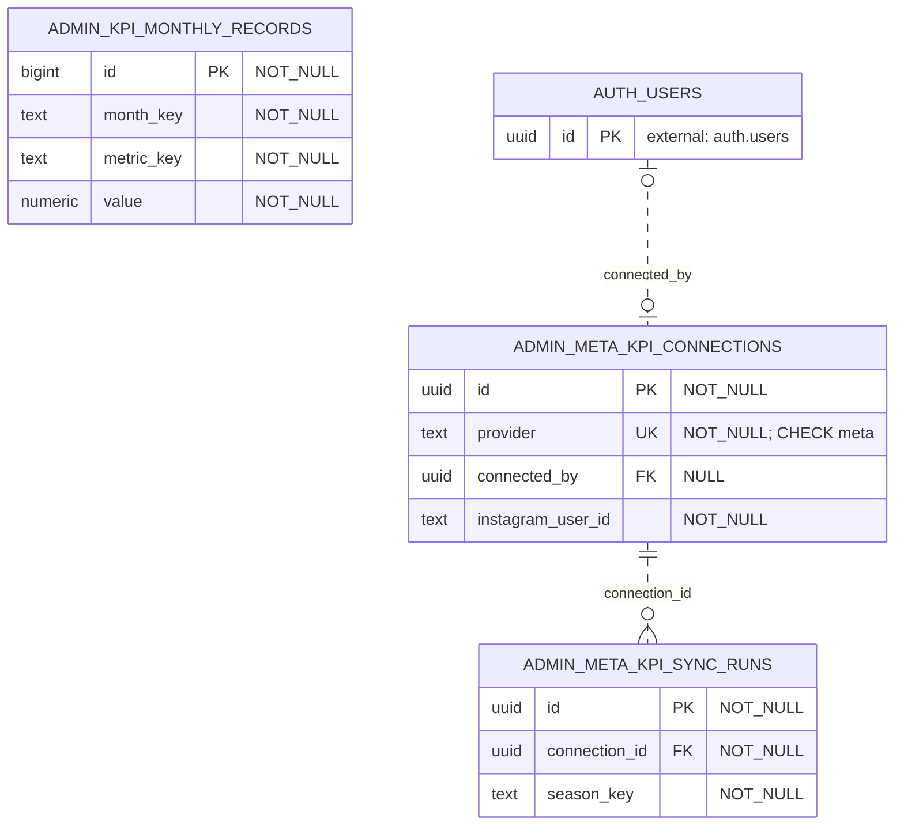

接続表の `connected_by` 自体に UNIQUE はないが、`provider` が `NOT NULL`、`CHECK (provider = 'meta')`、UNIQUE を同時に満たすため、旧 SQL 定義では接続表全体が最大 1 行になる。この制約により、利用者から接続への子件数も 0..1 としている。`season_key` はシーズン表への FK ではなく、Instagram/Facebook/広告アカウントの ID も外部サービス識別子の text である。

### 6.2 `public.variant_backorder_summary` ビュー（2026-10-10 に消した）

グループ E-1 の[移行 B](../../../supabase/migrations/20261010122320_fulfillment_order_emails.sql)で消した。受注生産の数は、仕上がっていない数だけを数える `public.list_variant_stock_states` が返す（[在庫の画面](../../04_DetailDesign/pages/16_admin.md)）。以下は消す前の定義の記録。

[ビューの定義](../../../supabase/migrations/20260919065518_add_variant_backorder_summary.sql#L5)は `public.order_items` の `fulfillment_type = 'backorder'` かつ `variant_id IS NOT NULL` の行を `variant_id` で集計し、`variant_id` と `sum(quantity)::integer AS backorder_quantity` を返す。`security_invoker = true` の通常ビューであり、独立したテーブル、PK、FK は持たない。消す前は、[商品バリアント API](../../../src/app/api/admin/items/[id]/variants/route.ts) だけが参照していた。

## 7. 関連ドキュメント

- [システム構成](../architecture/system-overview.md)
- [API](../api/api-spec.md)
- [注文・決済の状態遷移](../../04_DetailDesign/states/order-payment.md)
