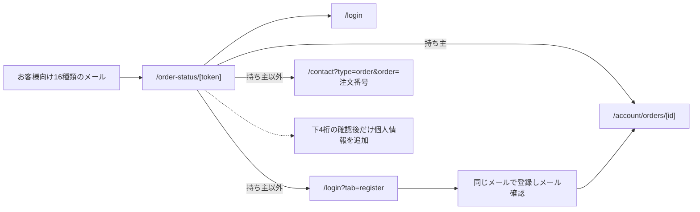
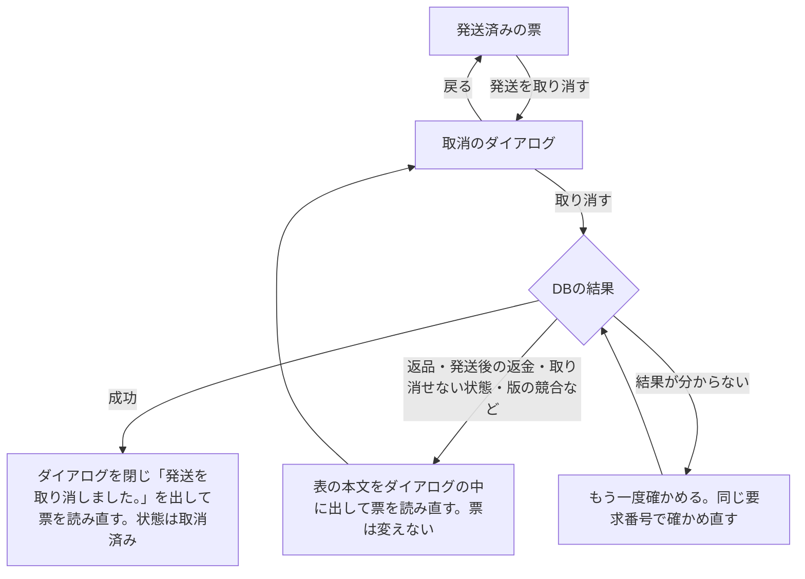
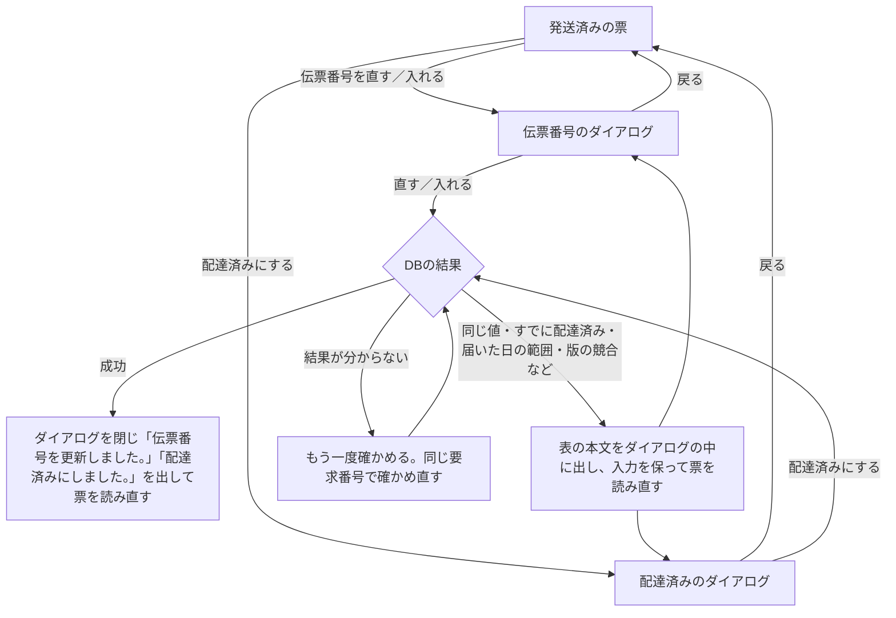
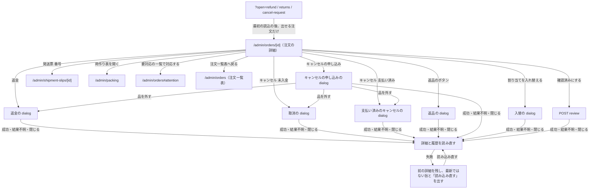
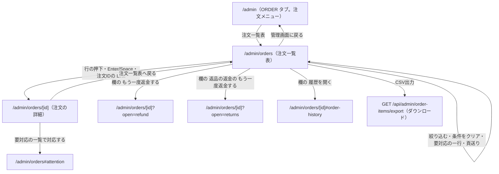
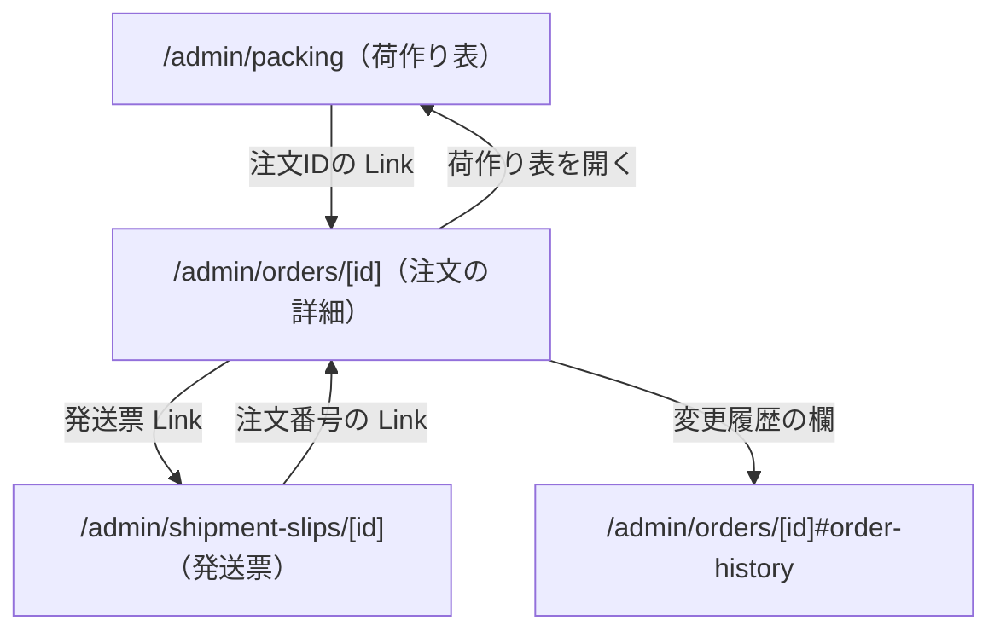
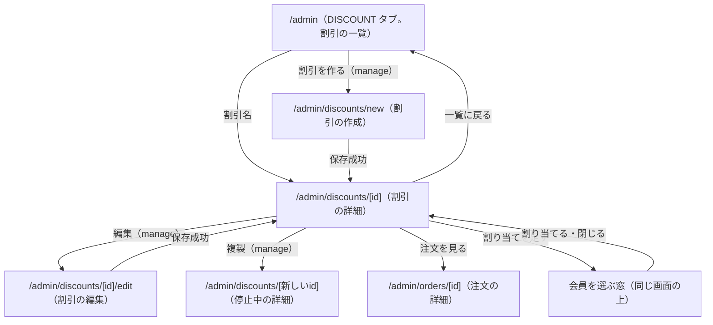

# 画面遷移図

> H Task 5 確認日: 2026-10-29。割引の管理で3ルート（`/admin/discounts/new`・`/admin/discounts/[id]`・`/admin/discounts/[id]/edit`）を足し、画面は50ルートになった。導線は末尾の「割引の管理からの導線（H Task 5）」に示す。本文の数え直しは行わない。

> 波 4 確認日: 2026-10-28。画面ルートの数は変えない（47ルート）。`/admin` の CONTACT タブ（同じルート内の表示）を足し、LOOK の「新規作成」から `/admin/look/create` への遷移を権限（`meta.canManage`）で出す形にした。`/admin/stockist/create` は開いた時に `GET /api/admin/stockists/access` で権限を確かめてからフォームを出す。

> G-4 Task 8 確認日: 2026-10-27。画面ルートの数は変えない（47ルート）。荷作り表の注文IDと発送票の頁の注文番号から注文の詳細へ移る導線を、末尾の「荷作り表・発送票からの導線（G-4 Task 8）」に追加した。荷作り表から注文の履歴を dialog で開く導線は撤去した。

> G-4 Task 7 確認日: 2026-10-26。注文一覧表（`/admin/orders`）の1ルートを追加し、画面は47ルートになった。ORDER タブは注文一覧表への入口だけになり、一覧から詳細への導線と要対応の欄の移動先を末尾の「注文一覧表からの導線（G-4 Task 7）」に追加した。本文の「40ルート」は全画面図の数のまま数え直さず、G-4 の2ルート（注文の詳細・注文一覧表）は末尾の追加図に示す。

> G-4 Task 6 確認日: 2026-10-26。注文の詳細（`/admin/orders/[id]`）の1ルートと、詳細の頁の中の操作と読み直しの遷移を末尾の「注文の詳細からの操作と遷移（G-4 Task 6）」に追加した。注文一覧表（`/admin/orders`）と一覧・荷作り表・発送票からの導線は Task 7・8。本文の「45」「40ルート」などの数え直しは Task 7 の後に行う。

> 状態: 全画面ルートと現行ソースの導線をレビュー | 確認日: 2026-10-26（波1-Aで未使用の `/auth/callback` ページを削除。以下の日付は各項の反映日）、2026-10-03（購入の導線は2026-10-07、E-5は2026-10-22、G-1 の旧配送の入口の撤去は2026-10-24に、G-2 Task 3 の在庫一覧表の導線と Task 4 の発注の確定後の移動と Task 5 の発注一覧表・発注書の頁の導線と Task 6 の発注書の頁の操作と Task 7 の受け取りとその取消・数量訂正と Task 8 の取引書類の節と書類検索と G-3 Task 3 の荷作り表と Task 4 の発送票の頁（下書き）と Task 6 の発送の取消と Task 7 の伝票番号の入力・訂正と手動の配達済みは2026-10-25に反映） | 対象: 47画面ルート（2026-10-26 に数え直し、G-0 の権限画面と G-2 の発注一覧表・発注書の頁・取引書類の検索と G-3 の荷作り表・発送票の頁と G-4 の注文一覧表・注文の詳細を足した） | G-3 Task 9 確認: 2026-10-26（修正前はfresh reset・12 suite・639/639成功、Fix round 1は再検証対象）

## 概要

[画面一覧](screen-list.md)の47ルートについて、ページと描画コンポーネントのリンク、自動遷移、認証・外部決済からの戻りを示す。従来の37ルート（波1-Aで `/auth/callback` を削除した後）と、後から足した管理の7ルート（G-0 の権限画面・G-2 の在庫一覧表・発注一覧表・発注書の頁・取引書類の検索・G-3 の荷作り表・発送票の頁）は全画面図、E-5の1ルートとG-4の注文一覧表・注文の詳細の2ルートと導線は末尾の追加図に示す。タブ、絞り込み、フォームの結果は同じルート内の状態として扱う。API、メール、外部サービス、エラー境界は画面ルート数に含めない。

## 図の読み方

- ラベルのない実線は画面リンク。ラベル付き実線はリンクの条件、自動遷移、または API・外部サービスを経由する処理を示す。
- 点線は同じルート内の状態・クエリ変更。詳細画面の前後移動・関連商品は `[id]` が変わるため実線で示す。
- 共通ヘッダーとフッターは [Providers](../../../src/contexts/Providers.tsx) が全ページに配置する。各画面から共通ナビゲーションへ戻る線を繰り返さず、共通ノードにリンクを集約する。
- ヘッダーの管理リンク表示条件と、遷移先ページ・操作 API の権限確認は別である。[画面一覧の表示条件](screen-list.md#画面表示と操作権限)を参照する。
- 図内の区分は所在を探すための `subgraph` であり、全体で1つの遷移図である。40ルートと条件付き導線を含むため、詳細は拡大表示と下の補足表で確認する。

## 全画面遷移図

> FREQ-418・421 により、購入は入力 → 最終確認 → 受付・支払い → 完了へ変更した。完了後も `session_id` を URL に残す。

```mermaid
%%{init: {"flowchart": {"nodeSpacing": 25, "rankSpacing": 35}}}%%
flowchart LR
    Header["共通ヘッダー"]
    Footer["共通フッター"]

    subgraph Browse["顧客向け閲覧 (15ルート)"]
        direction TB
        Home["/"]
        About["/about"]
        NewsList["/news"]
        NewsDetail["/news/[id]"]
        ItemList["/item"]
        ItemDetail["/item/[id]"]
        LookList["/look"]
        LookDetail["/look/[id]"]
        Stockist["/stockist"]
        Contact["/contact"]
        Search["/search"]
        Wishlist["/wishlist"]
        Privacy["/privacy"]
        Terms["/terms"]
        Legal["/legal"]
    end

    subgraph Purchase["購入 (2ルート)"]
        direction TB
        Cart["/cart"]
        Checkout["/checkout"]
    end

    subgraph AuthAccount["認証・アカウント (9ルート)"]
        direction TB
        Login["/login"]
        LoginVerify["/login/verify メール OTP"]
        AuthVerified["/auth/verified"]
        PasswordReset["/auth/password-reset"]
        PasswordResetVerify["/auth/password-reset/verify"]
        Account["/account"]
        OrderDetail["/account/orders/[id]"]
        OrderReturnRequest["/account/orders/[id]/return"]
    end

    subgraph Management["管理・開発補助 (16ルート)"]
        direction TB
        Admin["/admin"]
        AdminCreateUser["/admin/create-user 専用入口未確認"]
        AdminInventory["/admin/inventory"]
        AdminPurchaseOrders["/admin/purchase-orders"]
        AdminPurchaseOrderDetail["/admin/purchase-orders/[id]"]
        AdminPurchaseOrderDocuments["/admin/purchase-orders/documents"]
        AdminPacking["/admin/packing"]
        AdminPermissions["/admin/settings/permissions"]
        AdminItemCreate["/admin/item/create"]
        AdminItemEdit["/admin/item/edit/[id]"]
        AdminLookCreate["/admin/look/create"]
        AdminLookEdit["/admin/look/edit/[id]"]
        AdminNewsCreate["/admin/news/create"]
        AdminNewsEdit["/admin/news/edit/[id]"]
        AdminStockistCreate["/admin/stockist/create"]
        AdminStockistEdit["/admin/stockist/edit/[id]"]
        UiGallery["/ui"]
        LoadingGallery["/loading"]
    end

    OAuthStart["API: /api/auth/oauth/start"]
    Google["外部: Google OAuth"]
    OAuthCallback["API: /api/auth/oauth/callback"]
    RegisterApi["POST /api/auth/register"]
    ConfirmationEmail["登録確認メール"]
    ConfirmApi["GET /api/auth/confirm"]
    Stripe["Stripe: 決済 / 外部認証"]
    CheckoutError["checkout/error.tsx"]
    MetaConnect["API: /api/admin/kpi/meta/connect"]
    MetaOAuth["外部: Facebook OAuth"]
    MetaCallback["API: /api/admin/kpi/meta/callback"]

    Header --> Home
    Header --> NewsList
    Header --> ItemList
    Header --> LookList
    Header --> Stockist
    Header --> About
    Header --> Contact
    Header --> UiGallery
    Header --> Search
    Header --> Wishlist
    Header --> Cart
    Header -->|未ログイン| Login
    Header -->|ログイン済み| Account
    Header -->|admin のみ| LoadingGallery
    Header -->|admin / supporter| Admin

    Footer -->|ALL / category| ItemList
    Footer --> LookList
    Footer --> NewsList
    Footer --> Stockist
    Footer --> About
    Footer --> Contact
    Footer --> Privacy
    Footer --> Terms
    Footer --> Legal

    Home -->|検索: q| Search
    Home --> ItemList
    Home --> ItemDetail
    Home --> NewsList
    Home --> NewsDetail
    Home --> LookList
    Home --> LookDetail
    Home --> About
    About --> ItemList
    About --> LookList
    NewsList --> NewsDetail
    NewsDetail -->|一覧・カテゴリ| NewsList
    NewsDetail -->|前後の記事| NewsDetail
    ItemList --> ItemDetail
    ItemDetail -->|関連商品| ItemDetail
    ItemDetail -->|取得エラー時| ItemList
    LookList --> LookDetail
    LookList --> ItemDetail
    LookDetail --> ItemDetail
    LookDetail --> LookList
    LookDetail -->|前後のLOOK| LookDetail
    Wishlist --> ItemDetail
    Wishlist -->|空状態| ItemList
    Search --> ItemDetail
    Search --> NewsDetail
    Search --> LookDetail
    Privacy --> Contact
    Legal --> Contact
    NewsList -. category .-> NewsList
    ItemList -. 絞り込み / sort / 追加読込 .-> ItemList
    LookList -. season .-> LookList
    Stockist -. pref .-> Stockist
    Search -. q / tab / LOAD MORE .-> Search
    Contact -. 送信結果 .-> Contact
    ItemDetail -. 選択 / カート / 保存 .-> ItemDetail
    Wishlist -. 保存解除 / カート追加 .-> Wishlist

    Cart --> ItemDetail
    Cart -->|買い物を続ける| ItemList
    Cart --> Checkout
    Cart -. 数量変更 / 削除 .-> Cart
    Checkout -. 確認へ進む: Session作成・最終確認 .-> Checkout
    Checkout -->|注文する: 受付・在庫確保の後に支払い| Stripe
    Stripe -. 外部認証不要: complete・完了表示 .-> Checkout
    Stripe -->|外部認証から復帰: resume・complete| Checkout
    Checkout -. 最終確認・完了はsession_idをURLに残す .-> Checkout
    Checkout -->|受付拒否: 在庫・価格の変化や購入不可| Cart
    Checkout -. エラー発生時 .-> CheckoutError
    CheckoutError -. 再表示 .-> Checkout
    CheckoutError -->|カートに戻る| Cart
    Checkout -->|完了: 注文履歴| Account
    Checkout -->|完了: 買い物へ| ItemList
    Checkout -->|ゲスト会員登録| Login

    Login -->|自動: ログイン / 検証待ち| LoginVerify
    LoginVerify -->|自動: user / 通信例外| Account
    LoginVerify -->|自動: admin / supporter| AuthVerified
    LoginVerify -->|検証切れ / 再確認失敗 / やり直し| Login
    Login -. 登録タブ / 完了 .-> Login
    Login -->|登録POST| RegisterApi
    RegisterApi -. 受付結果表示 .-> Login
    RegisterApi --> ConfirmationEmail
    ConfirmationEmail -->|メールの確認リンク| ConfirmApi
    ConfirmApi -->|自動: 登録の戻り先| AuthVerified
    Login -->|Googleログイン開始| OAuthStart
    OAuthStart --> Google
    Google --> OAuthCallback
    OAuthCallback -->|自動: user・通常next| Account
    OAuthCallback -->|自動: 特権・通常next| AuthVerified
    AuthVerified -->|自動: user / リンク| Account
    AuthVerified -->|自動: MFA完了| Admin
    AuthVerified -. TOTP / 未認証 .-> AuthVerified
    AuthVerified -->|未認証: リンク| Login
    Login --> PasswordReset
    PasswordReset -->|メールのtoken| PasswordResetVerify
    PasswordResetVerify -->|自動: 確認結果| PasswordReset
    PasswordResetVerify -->|通信失敗: リンク| Login
    PasswordResetVerify -. 通信再試行 .-> PasswordResetVerify
    PasswordReset -. 入力 / メール / 更新 .-> PasswordReset
    PasswordReset -->|完了: ログイン| Login
    Account -. 4タブ切替 .-> Account
    Account --> OrderDetail
    Account -->|未ログイン: リンク| Login
    Account -->|自動: ログアウト| Home
    OrderDetail -->|戻る: 注文タブ| Account
    OrderDetail --> Contact
    OrderDetail -->|未ログイン: リンク| Login
    OrderDetail -. 再度購入 .-> OrderDetail
    OrderDetail -->|返品・交換を申し込む| OrderReturnRequest
    OrderReturnRequest -->|注文の画面に戻る・受付後| OrderDetail
    OrderReturnRequest -->|未ログイン: リンク| Login

    Admin -. タブ / 拒否案内 .-> Admin
    Admin --> AdminNewsCreate
    Admin --> AdminNewsEdit
    Admin --> AdminItemCreate
    Admin --> AdminItemEdit
    Admin -->|LOOK: 新規作成 canManage| AdminLookCreate
    Admin --> AdminLookEdit
    Admin --> AdminStockistCreate
    Admin --> AdminStockistEdit
    Admin -->|INVENTORY: 在庫一覧表| AdminInventory
    AdminInventory -->|管理画面に戻る| Admin
    Admin -->|INVENTORY: 発注一覧表| AdminPurchaseOrders
    AdminInventory -->|発注確定: created=1 を付けて移動| AdminPurchaseOrderDetail
    AdminPurchaseOrders -->|発注書番号| AdminPurchaseOrderDetail
    AdminPurchaseOrders -->|在庫一覧表| AdminInventory
    AdminPurchaseOrders -->|管理画面に戻る| Admin
    AdminPurchaseOrderDetail -->|発注一覧表に戻る| AdminPurchaseOrders
    AdminPurchaseOrders -->|取引書類を検索| AdminPurchaseOrderDocuments
    AdminPurchaseOrderDocuments -->|発注書番号| AdminPurchaseOrderDetail
    AdminPurchaseOrderDocuments -->|発注一覧表に戻る| AdminPurchaseOrders
    Admin -->|PACKING: 荷作り表| AdminPacking
    AdminPacking -->|管理画面に戻る: PACKING| Admin
    Admin -->|SETTINGS: 権限| AdminPermissions
    AdminPermissions -->|管理画面に戻る: SETTINGS| Admin
    AdminNewsCreate -->|保存 / キャンセル: NEWS| Admin
    AdminNewsEdit -->|保存 / キャンセル: NEWS| Admin
    AdminItemCreate -->|保存 / キャンセル: ITEM| Admin
    AdminItemEdit -->|保存 / キャンセル: ITEM| Admin
    AdminLookCreate -->|保存 / キャンセル: LOOK| Admin
    AdminLookEdit -->|保存 / キャンセル: LOOK| Admin
    AdminStockistCreate -->|保存: STOCKIST| Admin
    AdminStockistEdit -->|保存: STOCKIST| Admin
    AdminCreateUser -. 作成結果 .-> AdminCreateUser
    Admin -->|KPI: Meta接続| MetaConnect
    MetaConnect --> MetaOAuth
    MetaOAuth --> MetaCallback
    MetaCallback -->|自動: 接続結果| Admin
```

## クエリ・条件付き導線の補足

| 導線 | 現行実装での扱い |
| --- | --- |
| 共通ナビゲーション | モバイルドロワーは NEWS・ITEM の `category`、LOOK の `season` を指定して一覧へ進む。フッターの商品カテゴリリンクも `/item?category=...`。ホームの取扱店セクションには `/stockist` への専用リンクはなく、共通ヘッダー・フッターから開く |
| 一覧・検索 | 商品の絞り込み、並び順、取扱店の `pref`、検索の `q`・`tab` は [画面一覧のクエリ表](screen-list.md#同じルート内の状態とクエリ)にまとめる。ホームから詳細へ進むカード・検索プレビューも図に含める |
| 登録メール確認 | 登録UIは `redirect_to=/auth/verified` を指定する。確認 API 自体の既定は `/account`。確認失敗でも指定先に戻り、その先で未認証案内になる場合がある |
| ログインOTP確認 | 成功後に `/api/auth/me` で認証・ロールを再確認する。一般利用者は `/account`、admin/supporterは `/auth/verified`。再確認が未認証なら `/login`、再確認の通信例外ならロールを問わず `/account`。OTP自体の検証エラーは確認画面に留まる |
| Google OAuth | 通常の `next=/auth/verified` の場合、一般利用者だけ `/account` へ戻す。別の戻り先が指定された場合は API の検証済み指定先を使う。API が JSON エラーを返す分岐をログイン画面への自動遷移として描かない |
| パスワード再設定 | 現行メールは直接 `/auth/password-reset/verify?token=...` を指定する。確認画面が `POST /api/auth/password-reset/link` を呼び、成功・期限切れ・token不在に応じて再設定画面へ戻る。別入口の同APIのGETも確認画面へ中継する |
| 決済 | `/checkout` の入力画面にStripeの部品を置かず、「確認へ進む」でSessionを作り、最終確認画面の `FinalConfirmationStep` に `CheckoutProvider` / `PaymentElement` を置く。「注文する」で受付・在庫確保の後に支払い、completeで完了表示する。外部認証からの復帰は `?session_id=...` をresumeで照会し、支払い済みならcomplete、開いていれば最終確認画面、ほかは入力画面へ進む。最終確認・完了の後もURLに`session_id`を残す（D9）。空カートでは同画面に案内を表示する |
| 購入完了・注文詳細 | 完了表示の注文履歴リンクは `/account`。注文詳細の戻るリンクは `/account?tab=orders`。ゲスト登録カードは `/login?tab=register&email=...` でメール初期値を渡す。再度購入はカート追加後も注文詳細に留まる |
| 注文商品の予約注文分岐 | [OrderItemRow](../../../src/features/account/components/OrderItemRow.tsx)には `itemId` があり `stockStatus=sold_out` の場合に `/contact?subject=予約注文：{商品名}` へ進む分岐がある。現行の注文詳細APIは `stockStatus` を返さないため、注文詳細での通常導線としては確認できない。contactはこのクエリから件名を初期入力しない |
| 管理タブ・フォーム | admin は12タブ（INVENTORY は ORDER の次、PACKING は INVENTORY の次、CONTACT は PACKING の次、SETTINGS は最後）、supporter は ORDER・INVENTORY・PACKING・CONTACT。CONTACT タブは管理のお問い合わせ（`ContactSection`）を同じ `/admin` の中で開くだけで、ルートは移らない（波4・2026-10-28）。LOOK タブの「新規作成」は役でなく一覧の `meta.canManage`（`admin.looks.manage` の権限）が true の時だけ出て、押すと `/admin/look/create` へ移る。ORDER タブは役割で出し分けず、「注文一覧表」（`/admin/orders`。G-4 Task 7 で作った）へのリンクだけを置く。PACKING タブは役割で出し分けず、「荷作り表」（`/admin/packing`。G-3 Task 3 で作った）へのリンクを置く。荷作り表の「管理画面に戻る」は `/admin?tab=PACKING`、注文IDの押下は注文の詳細 `/admin/orders/[id]` へ移る（G-4 Task 8。以前の履歴のダイアログは撤去した）、「発送」で下書きを作ると `/admin/shipment-slips/[id]` へ移り（G-3 Task 4。移動先の頁が「下書きを保存しました。」を1回出す）、下の発送票の「開く」も同じ頁へ移る。発送票の頁（下書き）の「この行を外す」「追加」は同じルート内の状態（選択を丸ごと入れ替えて読み直す）、「下書きを破棄」は同じルート内の確かめのダイアログで、成功すると同じ頁が「破棄済み」の表示に変わる。「荷作り表に戻る」は `/admin/packing`。INVENTORY タブは役割で出し分けず、「在庫一覧表」（`/admin/inventory`）と「発注一覧表」（`/admin/purchase-orders`。G-2 Task 5 で作った）へのリンクを置く。在庫一覧表の「管理画面に戻る」は `/admin`。在庫一覧表の「発注」→「発注書確認」→「発注確定」は同じルート内の状態で、確定に成功すると `/admin/purchase-orders/[id]?created=1` へ移り、その頁（G-2 Task 5）が目印を見て作成の通知を出す。発注一覧表は発注書番号から発注書の頁へ、「在庫一覧表」「管理画面に戻る」へ移り、発注書の頁は「発注一覧表に戻る」で一覧へ戻る。発注書の頁の操作（G-2 Task 6）は同じルート内のダイアログで、「数量確定」「数量を訂正」「発注を取り消す」「残りを打ち切る」「発注先・メモを訂正」を開き、成功すると閉じて通知を出し、同じ頁を読み直す（ルートは移らない）。受け取り（G-2 Task 7）も同じ頁のダイアログで、未納のある行がある時の「全部受け取る」「一部を受け取る」と、受け取りの履歴の「この受け取りを取り消す」「数量を訂正」を開く。取消・訂正は、外す割当があると同じダイアログの中で確認の段（「割り当て済みの品を○点外し、受注生産中に戻します。」）に移り、確認の後に送り直す（ルートは移らない）。取引書類（G-2 Task 8）も同じ頁の節で、「書類を追加」「差し替える」「情報を訂正」「無効にする」「続きから保存」はダイアログ、「表示」「印刷」は60秒の署名つきリンクを新しいタブで、「ダウンロード」は保存として開き、保存・訂正・無効化の成功で通知を出して同じ頁を読み直す（ルートは移らない）。置き場のファイルが種類の検査に通らず断られた時は、続きから保存を繰り返させず、同じダイアログでファイルを選び直させて新しい予約で保存する。発注一覧表の「取引書類を検索」は `/admin/purchase-orders/documents` へ移り、結果の発注書番号から発注書の頁へ、結果の各行の「原本を見る」で原本を新しいタブで開き（ルートは移らない）、「発注一覧表に戻る」で一覧へ戻る（条件・頁送り・「印刷」は同じルート内の状態）。`/admin?tab=...` は初期タブを指定するが、サイドナビ操作は表示状態だけを変更する。ITEM・LOOK・NEWS は保存成功・キャンセルで戻り、STOCKIST は保存成功時に戻る。STOCKIST の作成の頁（`/admin/stockist/create`）は開いた時に `GET /api/admin/stockists/access` を呼び（波4・2026-10-28）、通るまで「読み込み中...」、204でフォーム、401・403・それ以外は固定の1行を出してフォームは出さない（ルートは移らない） |
| `/admin/create-user` | 専用の入口リンクは未確認。作成成功後も同画面に留まる。共通ナビゲーションは利用できる |
| Meta接続 | KPIの接続操作から外部OAuthへ進む。callbackは既定のAPIパスを環境設定で変更できる。通常の戻り先は `/admin?meta=connected` または `?meta=error&meta_reason=...` で、`tab` は付与しない |

## その他の外部リンク

認証・決済・Metaの戻りを伴う経路は上図に示した。次のリンクは別タブや端末機能を開くため、遷移先を表で示す。

| 起点 | 遷移先・条件 | 根拠 |
| --- | --- | --- |
| ヘッダーのドロワー・フッター | 設定されたSNS URLを別タブで開く。表示名からURLを推測せず `VISIBLE_SOCIAL_LINKS` の実値を使う | [Header](../../../src/components/Header.tsx)、[Footer](../../../src/components/Footer.tsx)、[social.ts](../../../src/lib/social.ts) |
| ホーム・取扱店の店舗カード | 住所から Google Maps 検索を別タブで開く。電話番号が表示されるカードは `tel:` リンク | [PublicStockistGrid](../../../src/features/stockist/components/PublicStockistGrid.tsx) |
| 注文詳細 | 配送業者と追跡番号がある場合に、配送業者の追跡URLを別タブで開く | [注文詳細](../../../src/app/account/orders/%5Bid%5D/page.tsx)、[shipping-carriers.ts](../../../src/lib/orders/shipping-carriers.ts) |
| 管理のACCOUNTING・固定資産詳細 | 添付証憑がある場合、閲覧APIが返す署名付きStorage URLを別タブで開く。取得失敗は同じ管理画面のメッセージ | [CostProfitSection](../../../src/components/CostProfitSection.tsx)、[証憑閲覧API](../../../src/app/api/admin/kpi/cost-profit/receipt/route.ts) |

## 実装根拠とレビュー範囲

| 対象 | 主な確認元 |
| --- | --- |
| 全40ルート・共通ナビゲーション | `src/app/**/page.tsx`、[Providers](../../../src/contexts/Providers.tsx)、[Header](../../../src/components/Header.tsx)、[Footer](../../../src/components/Footer.tsx) |
| ホーム・一覧・検索 | [ホーム](../../../src/app/page.tsx)、[公開商品一覧](../../../src/features/items/components/PublicItemGrid.tsx)、[公開LOOK一覧](../../../src/features/look/components/PublicLookGrid.tsx)、[公開NEWS一覧](../../../src/features/news/components/PublicNewsGrid.tsx)、[ホーム検索](../../../src/features/search/components/SearchHomePreview.tsx)、[検索画面](../../../src/features/search/components/SearchPageClient.tsx) |
| 詳細・保存・取扱店 | [商品詳細](../../../src/app/item/%5Bid%5D/ItemDetailClient.tsx)、[関連商品](../../../src/features/items/components/RelatedItems.tsx)、[LOOK詳細](../../../src/app/look/%5Bid%5D/page.tsx)、[NEWS詳細](../../../src/app/news/%5Bid%5D/page.tsx)、[保存一覧](../../../src/app/wishlist/page.tsx)、[取扱店](../../../src/features/stockist/components/PublicStockistGrid.tsx) |
| 購入 | [カート](../../../src/app/cart/page.tsx)、[注文概要](../../../src/app/cart/_components/OrderSummary.tsx)、[チェックアウト](../../../src/app/checkout/page.tsx)、[最終確認画面](../../../src/app/checkout/_components/FinalConfirmationStep.tsx)、[place-order](../../../src/app/api/checkout/place-order/route.ts)、[resume](../../../src/app/api/checkout/resume/route.ts)、[ゲスト登録案内](../../../src/features/checkout/components/GuestRegisterPrompt.tsx)、[エラー境界](../../../src/app/checkout/error.tsx) |
| 認証・再設定 | [LoginContext](../../../src/contexts/LoginContext.tsx)、[ログイン](../../../src/app/login/page.tsx)、[OTP確認](../../../src/app/login/verify/VerifyOtpClient.tsx)、[OAuth callback API](../../../src/app/api/auth/oauth/callback/route.ts)、[認証確認](../../../src/app/auth/verified/page.tsx)、[登録メール確認API](../../../src/app/api/auth/confirm/route.ts)、[再設定メールAPI](../../../src/app/api/auth/password-reset/request/route.ts)、[再設定リンク確認](../../../src/app/auth/password-reset/verify/VerifyClient.tsx) |
| アカウント | [アカウント](../../../src/app/account/page.tsx)、[注文詳細](../../../src/app/account/orders/%5Bid%5D/page.tsx)、[返品・交換の申し込み](../../../src/app/account/orders/%5Bid%5D/return/page.tsx)、[再度購入](../../../src/features/account/hooks/useReorder.ts) |
| 管理・開発補助 | [管理ページ](../../../src/app/admin/page.tsx)、[ITEMフォーム](../../../src/app/admin/item/ItemForm.tsx)、[LOOKフォーム](../../../src/app/admin/look/LookForm.tsx)、[NEWSフォーム](../../../src/app/admin/news/NewsForm.tsx)、[STOCKISTフォーム](../../../src/app/admin/stockist/StockistForm.tsx)、[ユーザー作成](../../../src/app/admin/create-user/page.tsx)、[UI](../../../src/app/ui/page.tsx)、[LOADING](../../../src/app/loading/page.tsx) |
| Meta | [接続UI](../../../src/components/MetaKpiConnection.tsx)、[接続API](../../../src/app/api/admin/kpi/meta/connect/route.ts)、[callback API](../../../src/app/api/admin/kpi/meta/callback/route.ts) |

今回のレビューはルート定義、描画されるコンポーネントの導線、関連APIの戻り先をソースで確認したもの。40ルートは図・画面一覧に各1件ずつ対応する（E-5 の1ルートは末尾の追加図）。実環境の公開範囲、リンク先に実データが存在すること、全画面の実行時表示や外部サービス側の画面は実行検証していない。認証処理の詳細は[シーケンス図](../../04_DetailDesign/sequence/auth-login-mfa.md)、購入の状態は[注文・決済状態図](../../04_DetailDesign/states/order-payment.md)を参照する。

## 配送の状況（E-4 / FREQ-488〜497）

[配送の詳細設計](../../superpowers/specs/2026-10-21-delivery-status-design.md)・[実装計画](../../superpowers/plans/2026-10-21-delivery-status.md)を参照。以下は実装後の契約であり、既存の決定の本文は履歴として残す。

G-1停止（Task 15、2026-10-24）: 注文の履歴の「伝票番号を直す」「配達済みにする」と2つのdialog、一覧の「発送済みにする」「仕上がりを記録する」、履歴の「この発送を取り消す」は撤去した。G-3 で、一覧の表の上は「発送は荷作り表から行います。」と「荷作り表を開く」（`/admin/packing`）、履歴の上は「発送・発送取消・伝票番号の訂正・手動の配達済みは、発送票から行います。」に置き換えた（履歴の発送の行には、票に属する発送なら「発送票 ○○ を開く」を出す）。下の表の2つの操作は移行前の契約。

新しいページURLは0、38画面ルートの数は維持する。以下は同じルート内の遷移。

| 起点 | 操作 | 同じ画面内の行き先・戻り先 |
| --- | --- | --- |
| `/admin` 注文の履歴 | 「伝票番号を直す」 | 履歴内の入力dialog → 保存・再確認 → 履歴と一覧の読直し |
| `/admin` 注文の履歴 | 「配達済みにする」 | 履歴内の日付dialog → 保存・再確認 → 履歴と一覧の読直し |
| `/admin` 要対応「配送」 | 「履歴を開く」 | 既存の注文履歴。「対応済みにする」は組を再取得 |
| `/admin` SETTINGS | 追跡トグル | 正確な件数付きのオン確認／記録保持のオフ確認 → 直前GET → PUT → 同じ欄 |
| `/account/orders/[id]` | 新番号の追跡リンク | 既存の配送業者の外部ページ。状況・移り変わり・お届け日は同じ注文詳細に出す |

取り消した発送の操作を出さず、配達済みの発送は番号の直しだけを許す。結果不明の「もう一度確かめる」は同じキーと本文を再送する。新規の内部ページや新規の設定ページへは遷移しない。

## 注文の状況からの遷移（E-5 / FREQ-498〜505）

[詳細設計](../../superpowers/specs/2026-10-22-order-status-page-design.md)・[実装計画](../../superpowers/plans/2026-10-22-order-status-page.md)・[ページ仕様](../../04_DetailDesign/pages/20_order_status.md)を参照。従来の38ルートへ1ルートを加えた39ルート。下図は追加の導線で、個人情報の確認は同じページの状態。

確認期限後も公開ページへ入れる。401後も公開を残し、ログインへの自動転送はしない。登録URLへメールやtokenを足さない。問い合わせqueryは初期入力だけで認可を決めない。

## 発送票の確認と確定（G-3 Task 5）

下書きに「荷物の情報」を表示する。運送会社（未定・ヤマト運輸・佐川急便・日本郵便）・伝票番号・出荷日（JSTの今日）・「お客様に発送のメールを送る」（初期オン）を入力し「発送票確認」で確認へ進む。issuesがある間は確認不可。「発送票の確認」は注文ごとの品物と数、送り先、荷物の情報を並べ、「発送確定」・「戻る」を出す。戻っても入力を保つ。

確定は `POST /api/admin/shipment-slips/[id]/confirm`。二重押下は通信1回。同じ内容の再押下・通信不明の「もう一度確かめる」は同じ要求番号と本文、内容変更は新しい要求番号。確定を断られたら確認画面を閉じて票を読み直し、表と問題を表示する。問題がある間は確認・確定へ進めない。版競合でも入力を保つ。成功は「発送を確定しました。」を出して票を読み直す。確定済みは出荷日・発送した時刻・伝票（なければ「伝票番号は未入力です」）・注文ごとの発送と配達状況・「出荷日の履歴」・「荷物の履歴」を表示する。発送した時刻と両履歴の時刻は、発注書の管理画面と同じ日本時間のYYYY/MM/DD HH:mmで出す。後続操作のボタンはまだ追加しない。

[画面単体](../../../tests/unit/components/ShipmentSlipSection.test.tsx)と[確定窓口単体](../../../tests/unit/api/admin/shipment-slip-confirm-route.test.ts)で検証する。DB・実ブラウザ・3幅の確認はcontrollerの担当。

## 発送の取消（G-3 Task 6）

発送済みの票の「発送を取り消す」から、ダイアログ「発送を取り消す」（説明・取消を止める理由・「取り消す」「戻る」）を開く。「取り消す」は `POST /api/admin/shipment-slips/[id]/cancel` を1回送る（送信中は閉じず、二重押下は通信1回。同じ内容の再押下・通信不明の「もう一度確かめる」は同じ要求番号と本文、読み直した版で押し直す時は新しい要求番号）。

[取消のダイアログ単体](../../../tests/unit/components/ShipmentSlipCancelDialog.test.tsx)と[票の頁単体](../../../tests/unit/components/ShipmentSlipSection.test.tsx)で検証する。

## 伝票番号の入力・訂正と手動の配達済み（G-3 Task 7）

発送済みの票の「伝票番号を直す」（番号が無い票は「伝票番号を入れる」）と「配達済みにする」から、それぞれのダイアログを開く。「直す」「入れる」は `POST /api/admin/shipment-slips/[id]/tracking`、「配達済みにする」は `POST /api/admin/shipment-slips/[id]/delivered` を1回送る（送信中は閉じず、二重押下は通信1回。同じ内容の再押下・通信不明の「もう一度確かめる」は同じ要求番号と本文、読み直した版で押し直す時は新しい要求番号）。

[伝票番号のダイアログ単体](../../../tests/unit/components/ShipmentSlipTrackingDialog.test.tsx)・[配達済みのダイアログ単体](../../../tests/unit/components/ShipmentSlipDeliveredDialog.test.tsx)・[票の頁単体](../../../tests/unit/components/ShipmentSlipSection.test.tsx)で検証する。

## 発送票からの出荷日訂正（G-3 Task 9）

確認日: 2026-10-26。確定済み票→権限がある人だけ訂正→新しい出荷日と必須理由→送信→成功通知→詳細と履歴の再読込。権限なしは店長だけの説明。版競合は入力を保ち再読込、結果不明は同じ要求で再確認。[管理画面詳細](../../04_DetailDesign/pages/16_admin.md)を参照。DB・ブラウザの実測はcontroller担当。

## 注文の詳細からの操作と遷移（G-4 Task 6 / FREQ-539・FREQ-523-AC-05）

確認日: 2026-10-26。新しいページ `/admin/orders/[id]` を1ルート足した（`src/app/**/page.tsx` は46件）。注文一覧表（`/admin/orders`）は G-4 Task 7 で追加した（下の「注文一覧表からの導線（G-4 Task 7）」）。荷作り表・発送票から詳細へ進む導線は Task 8 で足した（下の「荷作り表・発送票からの導線（G-4 Task 8）」）。旧 `/admin?tab=ORDER` の一覧・dialog・handler は Task 7 で撤去した。下は詳細の頁の中の遷移で、dialog は同じ画面の上に開く。

`?open=` は最初の読込が済んだ時に、その操作を出せる注文なら対応する dialog を開き、すぐ `router.replace` で query を消す（出せない注文・知らない値は何もしない）。品を外した返金・取消は、受理された後にだけキャンセルの申し込みを解決する（解決だけの失敗は案内を出す）。入替は成功で「割当を入れ替えました。」を出して詳細を読み直す。結果が分からない時は「もう一度確かめる」で同じ要求番号と本文を送り直す。変更履歴は詳細の欄に埋め込み、先頭に「品物の状態の変化」を出す。

[詳細頁の部品単体](../../../tests/unit/components/AdminOrderDetailSection.test.tsx)・[品物の表単体](../../../tests/unit/components/AdminOrderItemsTable.test.tsx)・[入替dialog単体](../../../tests/unit/components/AllocationSwapDialog.test.tsx)・[履歴単体](../../../tests/unit/components/OrderHistoryPanel.test.tsx)で検証する。390/768/1280pxの実測とE2Eはcontroller担当（未実行）。

## 注文一覧表からの導線（G-4 Task 7 / FREQ-536・538・539-AC-05）

確認日: 2026-10-26。新しいページ `/admin/orders` を1ルート足した（`src/app/**/page.tsx` は47件）。ORDER タブは「注文一覧表」へのリンクだけを持つ。絞り込み・頁送り・要対応の一行・CSV出力は同じルートの状態で、URL は変わらない（条件と頁はこのタブの sessionStorage にだけ持つ）。

要対応の欄の操作（確認済みにする・解決済みにする・注文を取り消して解決・配送の対応済みにする）は一覧の頁の中で行い、成功すると欄と今の条件・頁の一覧を読み直す。詳細から戻って一覧を開き直すと、適用していた条件と頁を復元して読む。

[一覧の頁単体](../../../tests/unit/components/AdminOrderItemListSection.test.tsx)・[表単体](../../../tests/unit/components/AdminOrderItemTable.test.tsx)・[要対応のhook単体](../../../tests/unit/hooks/useOrderAttention.test.tsx)・[ORDER タブの入口単体](../../../tests/unit/components/AdminGroupG1LegacyStop.test.tsx)で検証する。390/768/1280pxの実測とE2Eはcontroller担当（未実行）。

## 荷作り表・発送票からの導線（G-4 Task 8 / FREQ-539-AC-05）

確認日: 2026-10-27。ルートは増えない。荷作り表の注文ID、発送票の頁の注文番号（同梱する品物の表・追加の候補・発送票の確認の見出し・確定済みの票の「注文ごとの発送」）は、注文の詳細への Link で、押すと同じタブで詳細へ移る。以前の「注文IDの押下で履歴の dialog を開く」導線は無い。詳細の「発送」の欄の発送票 Link で、元の発送票へ戻れる。

## 割引の管理からの導線（H Task 5 / FREQ-547）

確認日: 2026-10-29。DISCOUNTタブは CONTACT の直後に出る。一覧の絞り込み・検索・頁送りは同じルートの状態で、URLは変わらない。詳細の止める・再開・割り当て・外す・確認済みは同じ画面の中で行い、成功すると詳細を読み直す。

[タブ単体](../../../tests/unit/components/DiscountSection.test.tsx)・[一覧単体](../../../tests/unit/features/discounts/DiscountList.test.tsx)・[詳細単体](../../../tests/unit/features/discounts/DiscountDetail.test.tsx)・[フォーム単体](../../../tests/unit/features/discounts/DiscountForm.test.tsx)。幅（390/768/1280px）とキーボードの実測はTask 11。
