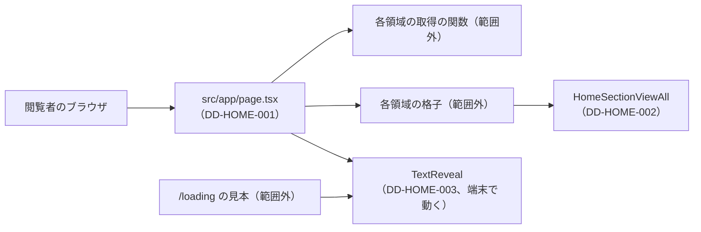

# 1.1 ホームページ（HOME）詳細設計

> 状態: 推定 | 確認日: 2026-10-24 | 対象: ホーム `/` のページ・VIEW ALL のボタン・ブランド名を1文字ずつ出す部品 | 基準コミット: `a03beaff`

## 概要

ホーム `/` を作る HOME のコードの単位ごとに、入出力・正常と異常の流れ・状態・認可・単体テストの観点を、追跡できる項目（`### <ID> <題>` と属性の表）で書く。
中身は 2026-10-24 の作業ツリーのコードを読んで起こした今の動きで、ユーザーの確認を受けていないので全部「推定」にした。要件・構造設計と食い違う所は決めずに今のコードの動きを書き、食い違いは `docs/05_Quality/reports/trace-matrix.md` の「食い違い」節（TM-HOME-NN）に載せる。

| ID | 単位 | 中身 | 旧番号 |
| --- | --- | --- | --- |
| `DD-HOME-001` | `src/app/page.tsx` | ホームのページ。7つの取得を並べて待ち、ヒーロー・各区画・ABOUT を並べる。題・説明・OG を返す | `IMPL-HOME-001`〜`003`・`005`〜`011` |
| `DD-HOME-002` | `src/features/home/components/HomeSectionViewAll.tsx` | ITEM・LOOK・NEWS の区画の下の VIEW ALL のボタン | `IMPL-HOME-004` |
| `DD-HOME-003` | `src/components/animations/TextReveal.tsx` | 文字列を1文字ずつ出す部品（ヒーローのブランド名） | なし |

- 結論: HOME の3つの単位はどれも分岐が少ない。ページは条件の分岐を持たず、区画の出し分けは各領域の格子の部品が持つ。VIEW ALL のボタンも分岐を持たない。分岐の網羅で手間が要るのは `TextReveal` だけで、そのうち `ref` が空の時の早期の戻りは、単体テストで `React.useRef` を差し替えて通す
- 番号は `DD-HOME-001`〜`029` をこの頁で使う。今は `001`〜`003` を使い、`004` 以降は空けておく
- 旧版のこの頁の機能要件対応表（`IMPL-HOME-001`〜`011`）は、各項目の「旧番号」に移した。表の中身の古い所（FR-HOME-003 の「不要」、FR-HOME-007 の `sizes="100vw"`、NFR-HOME-001 の「priority 未設定」ほか）は今のコードに合わせて書き直した

## 範囲と根拠

| 項目 | 内容 |
| --- | --- |
| 範囲 | `scripts/trace/scope.json` の HOME の `src`（3ファイル。3つとも `.tsx` なので、単位はファイル1つずつ） |
| 上位の文書 | [HOME の構造設計](../../03_BasicDesign/areas/home.md)（`ARC-HOME-`・`SCR-HOME-`・`FLOW-HOME-`・`STATE-HOME-`）、[HOME の要件](../../02_Requirements/areas/home.md)（`FR-HOME-`・`NFR-HOME-`・`SEC-HOME-`・`DRV-HOME-`） |
| 対象のコード | `src/app/page.tsx`、`src/features/home/components/HomeSectionViewAll.tsx`、`src/components/animations/TextReveal.tsx` |
| 関連文書 | [ニュース一覧の詳細設計](02_news_list.md)の `DD-NEWS-001`（ホームの NEWS の区画の格子）、[ABOUT の詳細設計](08_about.md)（READ OUR STORY の行き先） |
| 調べた時点 | 2026-10-24 の作業ツリー（コードは読んだだけで、動かしての確かめはしていない） |

### 実装の単位

| ファイル | 単位（symbol） | DD |
| --- | --- | --- |
| `src/app/page.tsx` | `<file>`（中の `generateMetadata` と `Home` を含む） | DD-HOME-001 |
| `src/features/home/components/HomeSectionViewAll.tsx` | `<file>`（中の `HomeSectionViewAll` を含む） | DD-HOME-002 |
| `src/components/animations/TextReveal.tsx` | `<file>`（中の `TextReveal` を含む） | DD-HOME-003 |

単位は `scripts/trace/parse-code.ts` の `parseCodeUnits` で数えた（3ファイルとも `["<file>"]`）。

範囲外の共有部品・他の領域の部品は ID を持たないので、項目の本文にファイルの道で書く。

| 部品 | 道 | ホームでの使われ方 |
| --- | --- | --- |
| ITEM の取得 | `src/lib/items/public.ts` の `getPublishedItems`（商品）・`getPublishedItemsCount`（総数） | 公開済みの商品10件と総数。署名と在庫の読みは service role |
| LOOK の取得 | `src/lib/look/server.ts` の `getPublishedLooks`（LOOK）・`getPublishedLooksCount`（総数） | 公開済みの LOOK 8件と総数。画像の署名は service role（`hydrateLooks`） |
| NEWS の取得 | `src/features/news/services/public.ts` の `getPublishedNews`（記事）・`getPublishedNewsCount`（総数） | 公開済みの記事6件と総数（DD-NEWS-003） |
| 取扱店の取得 | `src/features/stockist/services/public.ts` の `getHomePublicStockists` | 公開済みの取扱店6件 |
| 各領域の格子 | `PublicItemGrid`・`PublicLookGrid`・`PublicNewsGrid`・`PublicStockistGrid`・`SearchHomePreview` | ホームの区画を描き、VIEW ALL の出し分けのクラスを作る |
| 共有の部品 | `src/components/ui/SectionTitle/SectionTitle.tsx`、`src/components/ui/Button/Button.tsx`（`href` があれば `next/link` を返す）、`src/lib/utils.ts` の `cn` | ABOUT の見出し、VIEW ALL と READ OUR STORY、クラスの結合 |
| 共有の layout | `src/app/layout.tsx` の `dynamic = "force-dynamic"` と `metadata.metadataBase` | 毎回サーバーで描く設定と、OG の住所の起点（`metadataBase`） |

矢印は import して呼ぶ向き。`HomeSectionViewAll` はページからは直に呼ばれず、ITEM・LOOK・NEWS の格子の部品の中から呼ばれる。`TextReveal` はホームのほか `/loading` の見本（`src/app/loading/_components/AnimationShowcase.tsx`）も使う。

## 詳細設計

### DD-HOME-001 ホームのページ page.tsx

| 属性 | 値 |
| --- | --- |
| 上位 | ARC-HOME-001、ARC-HOME-002、ARC-HOME-003、ARC-HOME-004、SCR-HOME-001、SCR-HOME-002、SCR-HOME-003、FLOW-HOME-001、SEC-HOME-001、SEC-HOME-008 |
| 根拠 | 4つの領域の新しい物を1つの頁に並べるため、取り出しと見た目は各領域の関数と部品に任せ、ページは並べ方と件数だけを持つ（ARC-HOME-001、SCR-HOME-001）。呼ぶのは公開済みに絞る取得の関数だけにし、ページの側で絞りを書き忘れる場所を作らない（ARC-HOME-002、SEC-HOME-001）。中身の文は React の文字として描き、生の HTML を描かない（ARC-HOME-003、SEC-HOME-008）。題・説明・OG は引数に左右されないので固定の値で返し、画像の道は相対にして共有の layout の起点で絶対の住所にする（ARC-HOME-004。SEC-HOME-018 の前半だが、上位にはしない）。最初の画面で一番大きな写真は、HTML を返す前に先読みを頼む（ARC-HOME-004、SCR-HOME-002） |
| 状態 | 推定 |
| 確かめ方 | 単体テスト |
| 出どころ | 実装から推定（`src/app/page.tsx`）、この頁の旧版の機能要件対応表 |
| 旧番号 | IMPL-HOME-001、IMPL-HOME-002、IMPL-HOME-003、IMPL-HOME-005、IMPL-HOME-006、IMPL-HOME-007、IMPL-HOME-008、IMPL-HOME-009、IMPL-HOME-010、IMPL-HOME-011 |

#### 対応要件

FR-HOME-001・002・003・005・006・007・008・009、NFR-HOME-001・002、FREQ-147-REQ-01・03、FREQ-148-REQ-01・03、FREQ-149-REQ-01（NEWS）、FREQ-283-REQ-01、DRV-HOME-001・002・003・004・006、SEC-HOME-001・008。

#### 入出力

| 項目 | 内容 |
| --- | --- |
| 入力 | 無い。`params`・`searchParams` を受けない（`page.tsx`）。検索の窓の `?q=` は `SearchHomePreview` が端末で読む |
| 呼ぶ物 | `getPublishedItems(10)`・`getPublishedLooks(8)`・`getPublishedNews({limit: 6})`・`getHomePublicStockists()`・`getPublishedItemsCount()`・`getPublishedLooksCount()`・`getPublishedNewsCount()` を1つの `Promise.all` で（`page.tsx`）。件数は頁の中の定数 |
| 副作用 | `ReactDOM.preload("/mainphoto.png", {as: "image"})`。DB への書き込みは無い |
| 出力（本体） | JSX。ヒーローの `section`、検索の窓、ITEM・LOOK・NEWS の格子（`variant="home"`・行・総数）、`section#about`、取扱店の格子（`variant="home"`・行） |
| 出力（メタ） | metadata の関数が `{title, description, openGraph: {title, description, images: ["/mainphoto.png"]}}` を返す。title は「Le Fil des Heures」 |

#### 正常フロー

1. 7つの取得を一度に呼んで全部を待つ（`page.tsx`、ARC-HOME-001）。商品は10件・LOOK は8件・NEWS は6件を求め、取扱店は取得の関数の中で6件（`src/features/stockist/services/public.ts`）。総数は商品・LOOK・NEWS の3つ
2. ヒーロー画像の先読みを頼む
3. ヒーロー（SCR-HOME-002）: 画面の見える高さいっぱいの区画に、`/mainphoto.png` を優先の印つきで敷く（代替テキストはブランドを表す文、`sizes="(max-width: 1023px) 300vw, 100vw"`）。暗くする重ねは読み上げから隠す。ブランド名は `TextReveal` の h1 で、出始めは 100ms 後（DD-HOME-003）。SCROLL の字と縦線は白 90% で、まとめて読み上げから隠す
4. 検索の窓を置く。描くかは `SearchHomePreview` が決める
5. ITEM・LOOK・NEWS の格子に `variant="home"` と取った行と総数を渡す。件数の出し分けと VIEW ALL は格子の部品の中（SCR-HOME-004、DD-HOME-002）
6. ABOUT（SCR-HOME-003）: h2 `ABOUT`、考えの文2つ、3本柱を固定の配列から描く、READ OUR STORY のボタンで `/about` へ（FLOW-HOME-001）、手元の画像 `/about.png`
7. 取扱店の格子に `variant="home"` と行を渡す

#### 異常フロー

| 場合 | 動き | 道 |
| --- | --- | --- |
| 商品の読みが DB の誤り | 取得の関数が記録して空の配列を返す。区画は残り、格子が空の文を出す | `getPublishedItems` の誤りの枝 |
| 商品の読みで `data` が空 | 空の配列 | `getPublishedItems` の空の枝 |
| 商品・LOOK・NEWS の総数の読みが DB の誤り | 記録して 0。VIEW ALL は出ない | `getPublishedItemsCount`・`getPublishedLooksCount`・`getPublishedNewsCount` の誤りの枝 |
| LOOK の読みが DB の誤り・空 | 記録して空の配列 | `getPublishedLooks` の誤りの枝 |
| NEWS の読みが DB の誤り | 誤りを見ずに `data ?? []` で空の配列（記録しない。TM-HOME-26） | `getPublishedNews` |
| 取扱店の読みが DB の誤り | 記録して空の配列 | `getHomePublicStockists`（中の `getPublicStockists`）の誤りの枝 |
| 取得の関数のどれかが例外を投げる（client を作れない・署名の失敗など） | 1つの `Promise.all` ごと落ち、ページ全体が失敗する。`src/app/` に失敗の画面（`error.tsx`）は無いので、Next.js の既定の失敗の画面になる（推定）。この扱いは SEC-HOME-014 | `page.tsx` の `Home` の `Promise.all` |
| `private.set_request_context` の権限が欠けた DB | DB の読みが全部空になり、どの区画も空の文を出す（旧版の運用メモの BUG-PUBLIC-001）。復旧は `migrations/050_restore_public_read_access_after_pre_request_hook.sql` の適用 | `migrations/049_set_wishlist_session_context_pre_request.sql` |

- ページの中に条件の分岐は無い（`if`・三項・`&&`・`??`・既定の引数が無い）。3本柱の `map` は分岐でない

#### 状態・永続化

- ページは状態を持たない。共有の layout の `force-dynamic`（`src/app/layout.tsx`）で要求ごとにサーバーで描き、7つを取り直す。頁の結果のキャッシュは無い
- 永続化は無い（読むだけ）

#### 認証認可

- 認可なし（公開）。ページは session を読まない
- 下書きを出さない守りは呼ぶ先の取得の関数の `status='published'` にある（SEC-HOME-001。`getPublishedItems`・`getPublishedItemsCount`、`getPublishedLooks`・`getPublishedLooksCount`、`getPublishedNews`・`getPublishedNewsCount`、`getHomePublicStockists`）。商品と取扱店は閲覧者の session の client で読む（ARC-HOME-002、SEC-HOME-002）
- 生の HTML を描く書き方（`dangerouslySetInnerHTML`）は無い（SEC-HOME-008）
- OG の画像は相対の道で返し、絶対の住所は共有の layout の `metadataBase`（`getSiteUrl` の値）で作る。設定が無い時の扱いは SEC-HOME-018

#### テスト観点

分岐は0なので、分岐の網羅は単体テストで描くだけで 100% になる（2026-10-24 に `TRACE_AREAS=HOME` で測って 100%）。置き場は `tests/unit/home/home-page.test.tsx`（`scope.json` の `tests/unit/**/home/**` に当たる名前）。7つの取得の関数・各領域の格子・`SearchHomePreview`・`next/image`・`ReactDOM.preload` は差し替え、`await Home()` の結果を React Testing Library で描く。

| # | 観点 | 入力 | 期待 |
| --- | --- | --- | --- |
| 1 | 題・説明・OG | metadata の関数を呼ぶ | title「Le Fil des Heures」、description とOG の title・description が同じ文、OG の画像が `["/mainphoto.png"]` |
| 2 | 取得の引数 | 取得の関数を差し替えて描く | 商品は 10、LOOK は 8、NEWS は `{limit: 6}` で1回ずつ呼ばれ、取扱店と3つの総数も1回ずつ呼ばれる |
| 3 | 先読み | 描く | `ReactDOM.preload` が `"/mainphoto.png"` と `{as: "image"}` で1回呼ばれる |
| 4 | 格子への渡し | 取得の関数が決まった配列と総数を返す | ITEM・LOOK・NEWS の格子に `variant="home"` と同じ配列と総数、取扱店の格子に `variant="home"` と同じ配列が渡る |
| 5 | 区画の並び | 描く | ヒーロー・検索の窓・ITEM・LOOK・NEWS・ABOUT・取扱店の順（DRV-HOME-006） |
| 6 | ヒーロー | 描く | h1 の名前が「Le Fil des Heures」、写真の代替テキストがブランドを表す文で優先の印あり、重ねと SCROLL の印が `aria-hidden` |
| 7 | ABOUT | 描く | `section#about` に h2 `ABOUT`、3本柱の h3 が3つ、READ OUR STORY のリンクが `/about`、画像の住所が `/about.png` |
| 8 | 空の時 | 取得の関数が全部空の配列と 0 を返す | 例外を投げず、ヒーローと ABOUT が描かれる |
| 9 | 取得の例外 | 取得の関数の1つが reject | `Home()` が reject する（今の動き。SEC-HOME-014） |

- `tests/unit/home/home-page.test.tsx` が試す。E2E は `FR-HOME-001`〜`009`・`012`・`013`・`017`〜`020`・`NFR-HOME-001`・`002` がホームを試す

### DD-HOME-002 VIEW ALL のボタン HomeSectionViewAll

| 属性 | 値 |
| --- | --- |
| 上位 | SCR-HOME-004、FLOW-HOME-001 |
| 根拠 | ITEM・LOOK・NEWS の区画の下から一覧へ移る入口を、同じ見た目の共通のボタン1つにまとめるため（SCR-HOME-004、FLOW-HOME-001）。同じ "VIEW ALL" が1つの頁に3つ並ぶので、読み上げの名前を呼ぶ側に必ず渡させ、行き先を区別できるようにする（SCR-HOME-004、DRV-HOME-005）。出すか隠すかは総数を知る呼ぶ側が決めるので、ボタンは外側のクラスを受け取って足すだけにする（SCR-HOME-004） |
| 状態 | 推定 |
| 確かめ方 | 単体テスト |
| 出どころ | 実装から推定（`src/features/home/components/HomeSectionViewAll.tsx`）、この頁の旧版の機能要件対応表 |
| 旧番号 | IMPL-HOME-004 |

#### 対応要件

FR-HOME-004、FREQ-146-REQ-01（NEWS）、FREQ-147-REQ-03、FREQ-148-REQ-03、DRV-HOME-005。

#### 入出力

| 項目 | 内容 |
| --- | --- |
| 入力 | `href`（必須）、`ariaLabel`（必須）、`className`（任意）（`HomeSectionViewAll.tsx`） |
| 出力 | 外側の `div`（中央寄せと上の余白のクラスに `className` を足す）の中に、共通の `Button`（`variant="secondary"`・`size="3xs"`・`shape="square"`・`href`・`aria-label`・`data-testid="home-section-view-all"`）。文字は `VIEW ALL` |
| 呼ぶ所 | `PublicItemGrid.tsx`・`PublicLookGrid.tsx`・`PublicNewsGrid.tsx`（ホームの区画）。3つとも出し分けのクラスを `className` に渡す |

#### 正常フロー

1. 外側のクラスを `cn` で結ぶ。`className` が無ければ既定のクラスだけ
2. `Button` に `href` を渡し、`next/link` のリンクとして描かせる（`src/components/ui/Button/Button.tsx`）

#### 異常フロー

| 場合 | 動き | 道 |
| --- | --- | --- |
| `className` を渡されない | 出し分けのクラスが付かず、常に見える。ホームの呼ぶ側は総数を渡すので今は起きない（推定） | `HomeSectionViewAll.tsx` |

- 分岐は無い（`className` は既定の値を持たない任意の引数で、`cn` は関数の呼び出し）

#### 状態・永続化

- 状態も永続化も無い。Server Component でも Client Component の中でも描ける作り（`'use client'` を持たない）

#### 認証認可

- 認可なし（公開）。`href` は呼ぶ側の固定の文字列（`/item`・`/look`・`/news`）で、利用者の入力を受けない

#### テスト観点

分岐は0。置き場は `tests/unit/home/home-section-view-all.test.tsx`。

| # | 観点 | 入力 | 期待 |
| --- | --- | --- | --- |
| 1 | リンクと名前 | `href="/item"`、`ariaLabel="VIEW ALL ITEMS"` | 名前「VIEW ALL ITEMS」のリンクが1つで、`href` が `/item`、字が `VIEW ALL`、`data-testid="home-section-view-all"` |
| 2 | ボタンの見た目 | 1 と同じ | 共通の `Button` の secondary の印（`data-ui-button`・variant の属性）が付き、矢印の図が無い |
| 3 | 外側のクラス（あり） | `className="hidden sm:flex"` | 外側の `div` に既定のクラスと `hidden`・`sm:flex` が両方ある |
| 4 | 外側のクラス（なし） | `className` なし | 外側の `div` に既定のクラスだけ |

- `tests/unit/home/home-section-view-all.test.tsx` が直接試す。`tests/unit/components/HomeItemsGrid.test.tsx` と `tests/features/look/PublicLookGrid.test.tsx` が親の格子の中で間接に見る（どちらも HOME の範囲外）

### DD-HOME-003 文字列を1文字ずつ出す部品 TextReveal

| 属性 | 値 |
| --- | --- |
| 上位 | STATE-HOME-001、SCR-HOME-002、SEC-HOME-008 |
| 根拠 | 画面に入ったかと動きを減らす設定は端末でしか分からないので、この部品だけ利用者の端末で動かす（STATE-HOME-001）。1文字ずつの span を読み上げに出すと1文字ずつ綴られるので、外側に元の文字列の名前を付け、span は読み上げから隠す（SCR-HOME-002、FREQ-278-REQ-04）。動きを減らす設定では待たずに最初から見せ、移ろいも付けない（STATE-HOME-001、FREQ-278-REQ-05）。文字列は React の子として描き、HTML として解釈させない（SEC-HOME-008） |
| 状態 | 推定 |
| 確かめ方 | 単体テスト |
| 出どころ | 実装から推定（`src/components/animations/TextReveal.tsx`、`src/app/page.tsx`） |

#### 対応要件

FREQ-278-REQ-01・04・05、FR-HOME-009（h1 を1つにする）。

#### 入出力

| 項目 | 内容 |
| --- | --- |
| 入力 | `text`（必須）、`as`（既定 `div`。`h1`・`h2`・`h3`・`p`・`span`）、`className`（既定 空）、`delay`（既定 0ms）、`stagger`（既定 30ms）、`once`（既定 真）（`TextReveal.tsx`） |
| 読む外の値 | `window.matchMedia('(prefers-reduced-motion: reduce)')`、`IntersectionObserver` で画面に1割入ったか |
| 出力 | `as` の要素に `className` と `aria-label={text}`。中に1文字ずつの `span`（`aria-hidden`・`inline-block`）。空白は NBSP にして詰まらないようにする |
| ホームでの使い方 | `as="h1"`・`text="Le Fil des Heures"`・`delay={100}`・`className` に `hero-title` ほか。`stagger`・`once` は既定（`page.tsx`） |

#### 正常フロー

1. 描いた直後は `isVisible` も `reduceMotion` も偽で、全部の span が透明・自分の高さの分だけ下
2. 動きの設定の購読: 今の値を `reduceMotion` に入れ、変わるたびに入れ直す。消える時に購読をやめる
3. 画面の見張り: 要素を見張り、1割以上入ったら `isVisible` を真にする。`once` が真なら見張りをやめる。`once` が偽で画面から出たら `isVisible` を偽に戻す。消える時と `once` が変わる時に `disconnect`
4. 見えるか: `isVisible` か `reduceMotion` のどちらかが真なら見える
5. span の形: 見える時は不透明・元の位置。動きありなら `delay + 何文字目 × stagger` ms 後から 0.4 秒かけて移る。動きを減らす設定では移ろいを付けない

#### 異常フロー

| 場合 | 動き | 道 |
| --- | --- | --- |
| 見張りの時に要素がまだ無い | 見張らずに戻る。要素は必ず描くので本当の実行では届かない。単体テストでは `React.useRef` を差し替えて通す（テスト観点の 13） | `TextReveal.tsx` |
| JS が動かない | サーバーの HTML は全部の文字が透明のまま残る見込み（推定。確かめていない） | `TextReveal.tsx` |
| 画面から出た（`once` が真） | 見えたまま。ホームはこの道 | `TextReveal.tsx` |

- `IntersectionObserver` が無い古いブラウザの扱いは無い（呼べば例外。推定）

#### 状態・永続化

- 部品の中の状態: `isVisible`・`reduceMotion`。決まりは STATE-HOME-001
- 永続化は無い

#### 認証認可

- 認可なし（公開）。`text` は React の子として描き、`aria-label` も属性の値として逃がされる（SEC-HOME-008）
- span の見た目は style の属性で当てる。本番の CSP が style の属性を許すのは、この部品の動きと、区画の字の大きさ（ITEM の価格・SCROLL・ABOUT の本文など）のため（FREQ-280、ARC-HOME-003）

#### テスト観点

分岐の網羅 100% に要る単体テスト。置き場は `tests/unit/home/text-reveal.test.tsx`。`window.matchMedia` と `IntersectionObserver` を作り物にし、見張りの callback と設定の `change` を手で呼ぶ。

| # | 観点 | 入力 | 期待 |
| --- | --- | --- | --- |
| 1 | 既定の引数 | `text` だけ | `div` で描かれ、`className` が空、名前が `text`、span が文字数だけあり全部 `aria-hidden` |
| 2 | 渡した引数 | `as="h1"`・`className`・`delay=100`・`stagger=50`・`once=false` | h1 で描かれ、3文字目の移ろいの待ちが 200ms |
| 3 | 空白 | `text="a b"` | 2つ目の span の字が NBSP |
| 4 | 描いた直後 | 動きの設定は偽、まだ画面に入らない | 全部の span が `opacity: 0` と `translateY(100%)`、移ろいあり |
| 5 | 画面に入る（`once` 真） | 見張りの callback を `isIntersecting: true` で呼ぶ | 全部の span が `opacity: 1`、`unobserve` が呼ばれる |
| 6 | 画面から出る（`once` 真） | 5 の後に `isIntersecting: false` | 見えたまま |
| 7 | 画面に入る（`once` 偽） | `once=false` で `isIntersecting: true` | 見える。`unobserve` は呼ばれない |
| 8 | 画面から出る（`once` 偽） | 7 の後に `isIntersecting: false` | 透明に戻る |
| 9 | 動きを減らす設定（最初から） | `matches: true` | 画面に入る前から `opacity: 1`、`transition: none` |
| 10 | 動きを減らす設定の変化 | 描いた後に `matches` を真にして `change` を呼ぶ | `transition: none` に変わる |
| 11 | 後始末 | 部品を外す | `removeEventListener` と `disconnect` が呼ばれる |
| 12 | 文字列の逃がし | `text="<b>x</b>"` | `b` の要素ができず、字として出る |
| 13 | 要素の参照が空（`useRef` の差し替え） | `React.useRef` を、`current` が常に空の参照を返す物に差し替えて描く | 見張りが作られず、全部の span が透明のまま。部品を外しても例外にならない |
| 14 | `once` が変わる | `once` 真で描き、`once` 偽に描き直す | 最初の見張りが `disconnect` され、見張りが作り直される（合計2つ） |

- `if (!el) return` は ref が必ず付くので本当の実行では届かない。単体テストで `React.useRef` を、`current` が常に空の参照を返す物に差し替えて通す（13）。分岐の網羅は 100%
- `tests/unit/home/text-reveal.test.tsx` が試す。E2E は `FR-HOME-018` が span の数・最後の状態・名前・動きを減らす設定を試す

## 未確認事項

- 取得の関数が例外を投げる場合（client を作る時の環境変数の欠け・署名の失敗など）が実際にあるか。あればページ全体が落ちる（DD-HOME-001、SEC-HOME-014）
- Next.js の既定の失敗の画面が本番ビルドで何を出すか（`error.tsx` が無い時）
- JS が動かない時にブランド名が見えないままになるか（DD-HOME-003）
- `TextReveal` の `once` が偽の道（`/loading` の見本だけが使う）をホームの領域で持ち続けるか
- この頁の項目は全部「推定」。ユーザーの確認を受けたら「現行」にする
