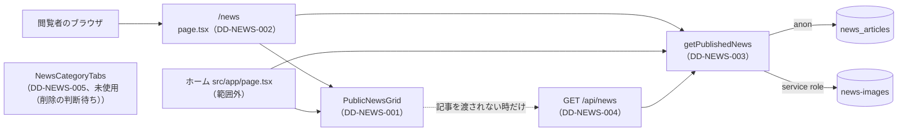

# 1.2 ニュース一覧ページ（NEWS LIST）詳細設計

> 状態: 推定 | 確認日: 2026-10-26 | 対象: ニュース一覧 `/news` と、その取り出し・部品・`GET /api/news` | 基準コミット: `a03beaff`

## 概要

ニュース一覧 `/news` を作るコードの単位ごとに、入出力・正常と異常の流れ・状態・認可・単体テストの観点を、追跡できる項目（`### <ID> <題>` と属性の表）で書く。
中身は 2026-10-24 の作業ツリーのコードを読んで起こした今の動きで、ユーザーの確認を受けていないので全部「推定」にした。要件・構造設計と食い違う所は決めずに今のコードの動きを書き、食い違いは `docs/05_Quality/reports/trace-matrix.md` の「食い違い」節に載せる。

| ID | 単位 | 中身 | 旧番号 |
| --- | --- | --- | --- |
| `DD-NEWS-001` | `src/features/news/components/PublicNewsGrid.tsx` | 一覧とホームの区画の格子。分類の選択・URL との同期・空と失敗の表示 | `IMPL-NEWS-LIST-002`・`003`・`004`・`007` |
| `DD-NEWS-002` | `src/app/news/page.tsx` | 一覧のページ。URL の `category` を1つの分類に直して取り出し、メタを出す | `IMPL-NEWS-LIST-005`・`006` |
| `DD-NEWS-003` | `getPublishedNews`（`src/features/news/services/public.ts`） | 公開済みの記事を新しい順に取り出す（画像の列は選ばず署名しない） | `IMPL-NEWS-LIST-001` |
| `DD-NEWS-004` | `src/app/api/news/route.ts` | `GET /api/news`。回数の制限・件数の上限・固定の失敗の文 | なし |
| `DD-NEWS-005` | `src/app/news/NewsCategoryTabs.tsx` | 1つだけ選ぶ分類のタブ。未使用（削除の判断待ち） | なし |

- 結論: 一覧の取り出しはページのサーバーの中で `getPublishedNews` を直接呼び、部品は渡された記事を画面の上で絞るだけ。`/api/news` と部品の自分で取り出す枝は、今の画面からは通らない（推定）
- 分類が1つの時だけ DB で絞り、複数の時は全部を取って画面で絞る。BLOG は選べるが DB に行が無いので必ず0件になる（推定）
- 番号は `DD-NEWS-001`〜`029` をこの頁で使う。今は `001`〜`005` を使い、`006` 以降は空けておく

## 範囲と根拠

| 項目 | 内容 |
| --- | --- |
| 範囲 | `scripts/trace/scope.json` の NEWS のうち、一覧のページにかかわる単位 |
| 上位の文書 | [NEWS の構造設計](../../03_BasicDesign/areas/news.md)（`ARC-`・`SCR-`・`FLOW-`・`STATE-`・`API-`・`DATA-`）、[NEWS の要件](../../02_Requirements/areas/news.md)（`FR-NEWS-ALL-`・`SEC-NEWS-`・`DRV-NEWS-`） |
| 対象のコード | `src/app/news/page.tsx`、`src/app/news/NewsCategoryTabs.tsx`、`src/features/news/components/PublicNewsGrid.tsx`、`src/features/news/services/public.ts` の `getPublishedNews`、`src/app/api/news/route.ts` |
| 単位の無いファイル | `src/features/news/types.ts`（型だけ）、`src/types/news.ts`（型だけ）、`src/lib/news-data.ts`（関数でない const だけ。`categories` は分類の一覧で BLOG を含み、`newsData` はどこからも使われない） |
| 関連文書 | [ニュース詳細の詳細設計](03_news_detail.md)、`docs/03_BasicDesign/api/api-spec.md` |
| 調べた時点 | 2026-10-24 の作業ツリー（コードは読んだだけで、動かしての確かめはしていない） |

範囲外の共有部品は ID を持たないので、項目の本文にファイルの道で書く。

| 共有部品 | 道 | 一覧での使われ方 |
| --- | --- | --- |
| Supabase の client | `src/lib/supabase/server.ts` の `createPublicClient`・`createServiceRoleClient` | 記事は anon の鍵・session なしで読む。公開の取り出しは service role を使わない（SEC-NEWS-005）。管理と検索は署名に使う |
| 画像の署名 | `src/lib/storage/news-images.ts` の `signNewsImageUrl`・`signNewsImageFields` | 行ごとに `image_url` を期限 3600 秒の署名つき URL に置き換える。公開の一覧・詳細は呼ばない（管理と検索が使う） |
| 回数の制限 | `src/features/auth/middleware/rateLimit.ts` の `enforceRateLimit` | `GET /api/news` だけが使う。超えると 429、数え場所が落ちると 503 |
| 画面の部品 | `src/components/ui/`（`MultiSelect`・`Drawer`・`Button`・`TagLabel`・`SectionTitle`・`TabSegmentControl`）、`src/features/home/components/HomeSectionViewAll.tsx` | 絞り込み・引き出し・分類の札・ホームの VIEW ALL |

実線は今の画面が通る呼び出し、点線は今の呼び元からは通らない呼び出し（推定）。`NewsCategoryTabs` はどこからも呼ばれないので矢印が無い。

## 詳細設計

### DD-NEWS-001 一覧とホームの区画の格子 PublicNewsGrid

| 属性 | 値 |
| --- | --- |
| 上位 | SCR-NEWS-001、SCR-NEWS-006、STATE-NEWS-002、FLOW-NEWS-001、SEC-NEWS-013 |
| 根拠 | 分類の選択は利用者の操作に合わせてすぐ描き直す必要があるので、利用者の端末で動く部品に置く（SCR-NEWS-001）。選んだ分類を URL に書き戻せば、共有した URL・ブラウザの戻る・詳細からの戻りで同じ絞り込みを開ける（STATE-NEWS-002、FLOW-NEWS-001）。一覧とホームの区画でカードの中身をそろえるため、1つの部品を2つの形で使う（SCR-NEWS-006）。題と概要は React の文字として出し、管理で書いた文字を HTML として解釈させない（SEC-NEWS-013） |
| 状態 | 推定 |
| 確かめ方 | 単体テスト |
| 出どころ | 実装から推定（`src/features/news/components/PublicNewsGrid.tsx`）、この頁の旧版の機能要件対応表 |
| 旧番号 | IMPL-NEWS-LIST-002、IMPL-NEWS-LIST-003、IMPL-NEWS-LIST-004、IMPL-NEWS-LIST-007 |

#### 対応要件

FR-NEWS-ALL-002・003・004・007、FREQ-31・32・47・48・49・119・149・274・275、DRV-NEWS-001〜006。

#### 入出力

| 項目 | 内容 |
| --- | --- |
| 入力（catalog） | `variant:"catalog"`、`articles?`（`PublicNewsArticle[]`）、`initialCategory?`（`categories` の1つ）、`className?`、`buildHref?` |
| 入力（home） | `variant:"home"`、`articles?`、`fetchLimit?`（無ければ 6）、`totalCount?`、`className?` |
| 読む外の値 | URL の `category`（`useSearchParams`）、`usePathname` |
| 出力 | JSX。catalog は引き出し・左のサイドバー・FILTER のバー・記事の列。home は `section#news`・見出し・記事の列・VIEW ALL |
| 副作用 | 選択を変えると `router.push(<URL>, {scroll:false})`。`articles` が無い時だけ `fetch('/api/news…', {cache:'no-store'})` |

#### 正常フロー

1. 初めの選択: catalog は URL の `category` を `parseCategorySelection` で読む。空なら `initialCategory ?? "ALL"`、正しい値が無ければ ALL、ALL を含めば ALL だけ、重複を除く。home は ALL
2. URL が変わった時: catalog だけ、URL から選択を読み直し、今の選択と同じなら状態を変えない（`isSameSelection`）
3. 記事の元: `articles` があればそれ、無ければ取り出した物。home は `fetchLimit` で切る
4. 画面の絞り: home と、ALL を含む選択はそのまま。ほかは記事の `category` が選択にある物だけ
5. 選択の操作（`applyCategorySelection`、DRV-NEWS-001）: 全部外すと ALL、ALL を足すと ALL だけ、ALL の時にほかを足すと ALL を外す、それ以外は受けた値のまま。どれも URL に書き戻す
6. URL への書き戻し（`syncCategoryQuery`）: ほかのクエリは残し、ALL を除いた選択をカンマで結んで `category` に入れる。残りが無ければ `category` を消す。クエリが空なら `pathname` だけ
7. カードのリンク（`resolveBuildHref`、FLOW-NEWS-001）: catalog で `buildHref` があればそれ、ALL 以外を選んでいれば `/news/<id>?category=<encodeURIComponent(カンマ区切り)>`、それ以外は `/news/<id>`
8. カード（FR-NEWS-ALL-004）: `<time dateTime>` に公開日（`-` を `.` に）、分類の `TagLabel`、題（catalog は h2・home は h3、DRV-NEWS-005）、概要（`toPlainPreview` で Markdown の印を外す、DRV-NEWS-004）。画像は出さない（FREQ-32）
9. 絞り込みの見た目: lg 以上は左のサイドバーの `MultiSelect`（DRV-NEWS-003）、それ未満は FILTER のバー（見えない場所取りと固定の2つ・、DRV-NEWS-002）と左の引き出し
10. home の VIEW ALL（FREQ-149-REQ-02）: `totalCount` が数で `fetchLimit` より多ければ `flex`、以下なら `hidden`、数でなければ class なし（見える）

#### 異常フロー

| 場合 | 動き |
| --- | --- |
| URL の `category` が空・空白だけ | 初めの値（`initialCategory`、無ければ ALL） |
| URL の `category` に正しい値が1つも無い | ALL |
| `articles` が渡されず、取り出しの応答が `ok` でない | 空の一覧と「ニュースデータの取得に失敗しました」（赤い文）。console に記録 |
| `articles` が渡されず、取り出しが例外（通信の失敗・JSON の解析の失敗） | 同上 |
| 取り出しの最中 | 骨組みを5行出す |
| 公開の記事が0件 | 「現在、公開されている記事はありません」 |
| catalog で絞った結果が0件 | 「該当カテゴリの記事はありません」 |
| home で `totalCount` が渡されない | VIEW ALL を常に出す |

- 今の呼び元（`src/app/news/page.tsx`、`src/app/page.tsx`）はどちらも `articles` を渡すので、取り出しの枝と骨組み・失敗の表示は通らない（推定）
- home で取り出す時は `fetchLimit+1` 件を求めるが、余った1件は VIEW ALL の判断に使わず切り捨てる（推定。食い違いは `docs/05_Quality/reports/trace-matrix.md` の「食い違い」節）
- `syncCategoryQuery` の home の早期の戻りは、選択の部品が catalog にしか出ないので届かない（推定）。home の `fetchLimit ?? 6` の右側も、`fetchLimit` が home で必ず数なので届かない（推定）

#### 状態・永続化

- 部品の中の状態: `fetchedArticles`・`loading`・`error`・`isFilterDrawerOpen`・`selectedCategories`。選択の状態の決まりは STATE-NEWS-002
- 永続化はしない。選択を残す所は URL の `category` だけで、ブラウザの履歴に1件ずつ足す（`router.push`）。保存もストレージも使わない

#### 認証認可

- 認可なし（公開）。下書きを出さない守りは渡す側（DD-NEWS-003 と RLS）にあり、この部品は確かめない
- 題・概要・分類・公開日は全部 JSX の文字として出し、`dangerouslySetInnerHTML` を使わない（SEC-NEWS-013）
- 受け取った `image_url`（署名つき URL）は描かない

#### テスト観点

分岐の網羅 100% に要る単体テスト（React Testing Library。`next/navigation`・`next/link` は差し替える）。

| # | 観点 | 入力 | 期待 |
| --- | --- | --- | --- |
| 1 | URL が無く初めの値も無い | catalog、`category` なし、`initialCategory` なし | ALL が選ばれ、全部の記事が出る |
| 2 | URL が無く初めの値がある | catalog、`category` なし、`initialCategory:"EVENT"` | EVENT が選ばれ、EVENT だけが出る |
| 3 | URL が空白だけ | `category="  "` | 初めの値が選ばれる |
| 4 | URL の小文字と空白 | `category=" event , store "` | EVENT と STORE が選ばれる |
| 5 | URL の正しくない値だけ | `category="FOO"` | ALL |
| 6 | URL に ALL を含む | `category="EVENT,ALL"` | ALL だけ |
| 7 | URL の重複 | `category="EVENT,EVENT"` | EVENT が1つ |
| 8 | URL が変わった時に選択を合わせる | 描いた後に `category` を STORE に変えて描き直す | STORE が選ばれる |
| 9 | URL が変わっても同じ選択なら状態を変えない | 同じ `category` で描き直す | 選択の配列が同じ物のまま（描き直しの数が増えない） |
| 10 | URL の長さ違い・中身違いの比べ | EVENT → EVENT,STORE、EVENT → STORE | どちらも選択が変わる |
| 11 | home は URL を読まない | home、`category="EVENT"` | 全部の記事が出る |
| 12 | 全部を外す | 選択の部品から `[]` | ALL、`router.push('/news', {scroll:false})` |
| 13 | ALL の外から ALL を足す | 選択 EVENT で `["EVENT","ALL"]` | ALL だけ、`category` を消す |
| 14 | ALL の時にほかを足す | 選択 ALL で `["ALL","EVENT"]` | EVENT だけ、`/news?category=EVENT` |
| 15 | 個別のまま足す・外す | 選択 EVENT で `["EVENT","STORE"]` | `/news?category=EVENT%2CSTORE` |
| 16 | ALL の時に1つだけ受ける | 選択 ALL で `["EVENT"]` | EVENT（最後の枝） |
| 17 | ほかのクエリを残す | URL `?foo=1` で EVENT を選ぶ | `/news?foo=1&category=EVENT` |
| 18 | カードのリンク（buildHref） | catalog、`buildHref` を渡す | 渡した関数の値 |
| 19 | カードのリンク（個別の選択） | catalog、選択 EVENT,STORE | `/news/<id>?category=EVENT%2CSTORE` |
| 20 | カードのリンク（ALL） | catalog、選択 ALL | `/news/<id>` |
| 21 | カードのリンク（home） | home | `/news/<id>` |
| 22 | カードの中身 | 公開日 `2025-01-02`、概要に Markdown | `2025.01.02`、`time[dateTime]`、分類の札、印を外した概要、`img` が無い |
| 23 | 概要の印の外し方 | 画像・リンク・コード・見出し・引用・箇条書き・太字・斜体・続く空白 | それぞれの印が消え、文字だけが残る |
| 24 | 見出しの段 | catalog と home | catalog は h2、home は h3 |
| 25 | 題に HTML の印 | 題 `` | 文字として出て、要素にならない |
| 26 | 取り出しの成功（catalog） | `articles` なし、fetch が `ok` | `/api/news` を `cache:'no-store'` で呼び、記事が出る |
| 27 | 取り出しの成功（home） | home、`articles` なし、`fetchLimit` なし | `/api/news?limit=7` を呼び、6件まで出る |
| 28 | 取り出しの応答が ok でない | fetch が `ok:false` | 赤い文「ニュースデータの取得に失敗しました」（catalog・home の両方） |
| 29 | 取り出しの例外 | fetch が reject | 同上 |
| 30 | 取り出しの最中 | fetch を待たせる | 骨組みが出る（catalog・home の両方） |
| 31 | 0件 | `articles=[]` | 「現在、公開されている記事はありません」（catalog・home の両方） |
| 32 | 絞った結果が0件 | catalog、記事は EVENT だけ、選択 STORE | 「該当カテゴリの記事はありません」 |
| 33 | home の件数の切り | home、記事8件、`fetchLimit:3` | 3件 |
| 34 | VIEW ALL（多い） | home、`totalCount:7` | VIEW ALL に `flex` |
| 35 | VIEW ALL（以下） | home、`totalCount:6` | VIEW ALL に `hidden` |
| 36 | VIEW ALL（総数なし） | home、`totalCount` なし | VIEW ALL に `flex`・`hidden` が無い |
| 37 | 引き出しの開け閉め | FILTER を押し、閉じるを押す | 開いて `aria-expanded=true`、閉じる |
| 38 | FILTER の場所取り | catalog | 場所取りのバーは `aria-hidden`、ボタンは `tabIndex=-1` で押しても開かない |

- 今ある `tests/unit/components/PublicNewsGrid.test.tsx` は 37 の開ける側だけを試す。テスト名に ID が無い
- 届かない分岐（`syncCategoryQuery` の home の `?? 6`）は試さず、`docs/05_Quality/reports/test-gaps.md` の「届かない分岐」に理由を書く候補

### DD-NEWS-002 一覧のページ page.tsx

| 属性 | 値 |
| --- | --- |
| 上位 | SCR-NEWS-001、ARC-NEWS-001 |
| 根拠 | ページを作るサーバーの中で取り出せば、自分の API への往復が無く、記事を入れた HTML をそのまま返せるため（ARC-NEWS-001）。URL の `category` は外から来る値なので、分類の一覧にある1つの値だけを DB の絞りに渡し、それ以外は ALL にして取り出しの条件に変な値を入れない（SCR-NEWS-001）。一覧の title と description は記事に左右されないので固定の文にする（SCR-NEWS-001） |
| 状態 | 推定 |
| 確かめ方 | 単体テスト |
| 出どころ | 実装から推定（`src/app/news/page.tsx`）、この頁の旧版の機能要件対応表 |
| 旧番号 | IMPL-NEWS-LIST-005、IMPL-NEWS-LIST-006 |

#### 対応要件

FR-NEWS-ALL-001・005・006、FREQ-31（ページの h1 を置かない）。

#### 入出力

| 項目 | 内容 |
| --- | --- |
| 入力 | `searchParams?: Promise<{category?: string}>` |
| 出力（本体） | `
` の中の `PublicNewsGrid variant="catalog" articles initialCategory` |
| 出力（メタ） | `generateMetadata()` が `{title:'NEWS | Le Fil des Heures', description:<固定の文>}` |
| 呼ぶ物 | `getPublishedNews({category: activeCategory})`（DD-NEWS-003） |

#### 正常フロー

1. `searchParams` があれば待って受け、無ければ `undefined`
2. `resolveCategory`（export しない）: `category ?? 'ALL'` を大文字にし、`categories`（`src/lib/news-data.ts`）にあればその値、無ければ ALL
3. `getPublishedNews({category})` を1回呼ぶ。`limit` は渡さないので公開済みを全部取る
4. 記事と、直した分類を `initialCategory` として部品に渡す。ページの `h1` は置かない

#### 異常フロー

| 場合 | 動き |
| --- | --- |
| `searchParams` が無い・`category` が無い | ALL で全部を取る |
| 分類の一覧に無い値（例 `FOO`） | ALL で全部を取る |
| カンマ区切りの複数（例 `EVENT,STORE`） | 一覧に無い1つの文字なので ALL で全部を取り、部品が画面で絞る |
| `BLOG` | 一覧にあるので DB を BLOG で絞り、DB の CHECK に BLOG が無いので必ず0件（推定） |
| 取り出しが例外（例: service role の環境変数が無い） | 受けずに上へ投げ、Next.js の既定のエラーの画面（`src/app` に `error.tsx` は無い、推定） |
| DB の失敗 | 取り出しが空の配列にするので、0件の表示になる（DD-NEWS-003） |

#### 状態・永続化

- 状態は持たない。`revalidate`・`use cache` の指定は無く、`searchParams` を読むので要求ごとに描く（推定）
- 部品が `router.push` で URL を変えると、このページも新しい `category` で描き直す（推定）

#### 認証認可

- 認可なし（公開）。下書きを出さない守りは DD-NEWS-003 と RLS（DATA-NEWS-002）
- 分類は大文字にして一覧と照らすだけで、空白は外さない（`" EVENT"` は ALL になる。部品は空白を外して EVENT で絞るので、見える結果は同じ）

#### テスト観点

分岐の網羅 100% に要る単体テスト（`getPublishedNews` と `PublicNewsGrid` は差し替える）。

| # | 観点 | 入力 | 期待 |
| --- | --- | --- | --- |
| 1 | `searchParams` なし | 引数なし | `getPublishedNews({category:'ALL'})`、`initialCategory='ALL'` |
| 2 | `category` なし | `searchParams={}` | ALL |
| 3 | 小文字の正しい値 | `category='event'` | `getPublishedNews({category:'EVENT'})` |
| 4 | 正しくない値 | `category='FOO'` | ALL |
| 5 | 複数 | `category='EVENT,STORE'` | ALL |
| 6 | BLOG | `category='BLOG'` | `getPublishedNews({category:'BLOG'})` |
| 7 | 記事を部品へ渡す | 取り出しが2件 | `PublicNewsGrid` に `variant='catalog'`・2件・直した分類 |
| 8 | 取り出しの例外 | 取り出しが reject | ページの関数が reject する |
| 9 | メタ | `generateMetadata()` | 固定の title と description |

### DD-NEWS-003 公開済みニュースの一覧の取得 getPublishedNews

| 属性 | 値 |
| --- | --- |
| 上位 | ARC-NEWS-001、ARC-NEWS-003、DATA-NEWS-001、SEC-NEWS-001 |
| 根拠 | 下書きを外へ出さないため、取り出しの条件に毎回 `status='published'` を付け、読み出しは anon の鍵の client に限って RLS でも絞る2段にする（SEC-NEWS-001、ARC-NEWS-001）。新しい知らせを先に見せるため、索引のある `published_date` の降順で並べる（DATA-NEWS-001）。公開の画面は画像を出さないので、画像の列は選ばず、署名もしない（SEC-NEWS-005、ARC-NEWS-003） |
| 状態 | 推定 |
| 確かめ方 | 単体テスト |
| 出どころ | 実装から推定（`src/features/news/services/public.ts`）、この頁の旧版の機能要件対応表 |
| 旧番号 | IMPL-NEWS-LIST-001 |

#### 対応要件

FR-NEWS-ALL-001・005、FREQ-149-REQ-01（ホームの6件）、DRV-NEWS-007・008。

#### 入出力

| 項目 | 内容 |
| --- | --- |
| 入力 | `options?: {category?: string; limit?: number}` |
| 出力 | `Promise<PublicNewsArticle[]>`。列は `id・title・published_date・category・content`。`image_url` と本文 `detailed_content` は含まない |
| 呼び元 | `src/app/news/page.tsx`（分類だけ）、`src/app/api/news/route.ts`（分類と 1〜20 の件数）、`src/app/page.tsx`（件数 6、範囲外）、`src/app/actions/news.ts`（件数 3、呼ぶ所なし） |
| 使う client | `createPublicClient()` だけ（service role は作らない） |

#### 正常フロー

1. `news_articles` から5つの列（`image_url` を除く）を選び、`status='published'`、`published_date` の降順
2. `category` が空でなく `ALL` でなければ `eq('category', category)`。値は確かめない
3. `limit` が数で、有限で、0 より大きければ小数を切り捨てて `limit`。それ以外は件数を絞らない
4. 結果の行をそのまま返す（署名しない）

#### 異常フロー

| 場合 | 動き |
| --- | --- |
| DB の失敗（`error` が返る） | `error` を見ず、`data` が `null` なので空の配列を返す。記録しない（SEC-NEWS-020） |
| `limit` が 0・負・`NaN`・`Infinity`・数でない | 件数を絞らず全部を取る |
| `category` が分類の一覧に無い値・小文字 | そのまま DB で絞り、0件（推定） |
| service role の環境変数が無い | 影響しない（service role を使わない） |
| 同じ公開日の記事 | 2つ目の並びの鍵が無く、順が決まらない（推定） |

#### 状態・永続化

- 読むだけで書かない。キャッシュは無い（推定）
- 読む表は `news_articles`（DATA-NEWS-001）。置き場 `news-images` には触らない

#### 認証認可

- 利用者の session を使わず、常に anon の役で読む。RLS の「Anyone can view published news articles」（DATA-NEWS-002）とコードの `status='published'` の2段で下書きを出さない（SEC-NEWS-001）
- service role は使わない。画像の列も選ばないので署名つき URL は返らない（SEC-NEWS-005。2026-10-26 に満たした）。件数の上限は呼び手任せ（SEC-NEWS-009-AC-03）

#### テスト観点

分岐の網羅 100% に要る単体テスト（`@/lib/supabase/server` と `@/lib/storage/news-images` は差し替え、問い合わせの組み立てを記録する。署名と service role の client が呼ばれないことも確かめる）。

| # | 観点 | 入力 | 期待 |
| --- | --- | --- | --- |
| 1 | 既定の問い合わせ | `options` なし | `select('id, title, published_date, category, content')`・`eq('status','published')`・`order('published_date',{ascending:false})`、`category` と `limit` を付けない |
| 2 | 分類で絞る | `{category:'EVENT'}` | `eq('category','EVENT')` |
| 3 | ALL は絞らない | `{category:'ALL'}` | `eq('category', …)` が無い |
| 4 | 空の分類は絞らない | `{category:''}` | `eq('category', …)` が無い |
| 5 | 件数（整数） | `{limit:6}` | `limit(6)` |
| 6 | 件数（小数） | `{limit:2.7}` | `limit(2)` |
| 7 | 件数（0・負） | `{limit:0}`、`{limit:-1}` | `limit` が無い |
| 8 | 件数（有限でない） | `{limit:Infinity}`、`{limit:NaN}` | `limit` が無い |
| 9 | 署名しない | 行が2件 | 行をそのまま返し、`image_url` のキーが無い。`signNewsImageFields`・`createServiceRoleClient` を呼ばない |
| 10 | DB の失敗 | `{data:null, error:{…}}` | 空の配列 |
| 11 | 公開の client を使う | 呼ぶ | 記事の問い合わせは `createPublicClient` の client で、service role の client は作らない |
| 12 | 環境変数が無くても動く | `createServiceRoleClient` が投げる設定 | 一覧は返る（呼ばないので） |

### DD-NEWS-004 公開済みニュースの JSON の窓口 GET /api/news

| 属性 | 値 |
| --- | --- |
| 上位 | API-NEWS-001、SEC-NEWS-001、SEC-NEWS-009 |
| 根拠 | 認証の無い窓口なので、続けて叩かれても DB と署名の負荷が増えないよう、回数の制限（10分に60回）と件数の上限（20件）を窓口で掛ける（SEC-NEWS-009、API-NEWS-001）。数え場所が落ちた時は通さない側に倒し、制限が外れた状態で開けない（API-NEWS-001）。失敗の応答は固定の文にして内部の情報を出さない（SEC-NEWS-019 の応答の部分。例外を丸ごと記録するので SEC-NEWS-019 は上位にしない）。返す記事は取り出しの関数に任せ、公開済みだけにする（SEC-NEWS-001） |
| 状態 | 推定 |
| 確かめ方 | 単体テスト |
| 出どころ | 実装から推定（`src/app/api/news/route.ts`）、`docs/03_BasicDesign/api/api-spec.md`、`docs/05_Quality/reviews/code/2026-04-18-news-review.md` |

#### 対応要件

DRV-NEWS-007、SEC-NEWS-009-AC-01・02、SEC-NEWS-019-AC-01（応答の部分）。SEC-NEWS-019 は、この窓口が例外を丸ごと記録するので上位にしていない（SEC-NEWS-019 の項目を参照）。

#### 入出力

| 項目 | 内容 |
| --- | --- |
| 入力 | `GET` の `NextRequest`。クエリ `category`（任意の文字）、`limit`（任意の文字） |
| 出力（成功） | 200、DD-NEWS-003 の配列をそのまま JSON に |
| 出力（失敗） | 429 `{error:'Too many requests'}`・503 `{error:'Rate limiter unavailable'}`（どちらも `Retry-After: 600`、`enforceRateLimit` が作る）、500 `{error:'Failed to fetch news'}` |
| 定数 | `DEFAULT_LIMIT = 12`、`MAX_LIMIT = 20` |

#### 正常フロー

1. `enforceRateLimit` を動的に読み込み、`{endpoint:'news:list', limit:60, windowSeconds:600}` で数える。応答が返らなければ続ける
2. `category` はクエリの値、無ければ `undefined`。大文字にも確かめもしない
3. `limit` は数字だけの文字なら整数に読み、ほかは `undefined`
4. 読んだ値が真で、有限で、0 より大きければ `min(値, 20)`、それ以外は 12
5. `getPublishedNews({category, limit})` の結果を 200 で返す

#### 異常フロー

| 場合 | 動き |
| --- | --- |
| 10分に61回目 | `enforceRateLimit`（`src/features/auth/middleware/rateLimit.ts`）の 429 をそのまま返す |
| 数え場所の失敗 | 503 をそのまま返す（通さない側） |
| `limit` が無い・数字でない（`abc`・`-1`・`1.5`） | 12 |
| `limit=0` | 読んだ値が偽なので 12 |
| `limit` が大きすぎて `Infinity` に読める | 有限でないので 12 |
| `limit` が 20 を超える | 20 |
| `category` が分類の一覧に無い・小文字 | 確かめずに渡し、0件の 200（推定。SEC-NEWS-012） |
| DB の失敗 | 取り出しが空にするので 200 `[]`（推定。SEC-NEWS-020） |
| 取り出し・回数の制限の読み込みが例外 | 例外を丸ごと `console.error` に残し（SEC-NEWS-019）、500 の固定の文 |

#### 状態・永続化

- この窓口は状態を持たない。回数の制限が呼ばれるたびに数え場所の行を足す（`src/features/auth/middleware/rateLimit.ts`）
- `Cache-Control` を付けない（SEC-NEWS-006）。Next.js 16 の Route Handler の GET は既定でキャッシュしない（推定）

#### 認証認可

- 認可なし（公開）。返す項目に本文 `detailed_content` も `image_url` も入らない（SEC-NEWS-005。2026-10-26 に `image_url` を外した）
- 回数の送り元は `x-forwarded-for` の先頭を先に見る（`src/features/auth/middleware/rateLimit.ts`。SEC-NEWS-011）
- 書き換えの窓口ではないので proxy の Origin の検査は掛からない（ARC-NEWS-004）
- 今の画面からは呼ばれず、E2E の補助 `e2e/search-test-utils.ts` だけが呼ぶ（推定）

#### テスト観点

分岐の網羅 100% に要る単体テスト（`@/features/auth/middleware/rateLimit` と `getPublishedNews` は差し替える）。

| # | 観点 | 入力 | 期待 |
| --- | --- | --- | --- |
| 1 | 回数の制限の値 | 呼ぶ | `enforceRateLimit` に `endpoint:'news:list'`・`limit:60`・`windowSeconds:600` と要求 |
| 2 | 429 を通す | 制限が 429 を返す | 同じ応答を返し、取り出しを呼ばない |
| 3 | 503 を通す | 制限が 503 を返す | 同じ応答を返し、取り出しを呼ばない |
| 4 | 既定の件数 | クエリなし | `getPublishedNews({category:undefined, limit:12})`、200 |
| 5 | 数字の件数 | `limit=5` | `limit:5` |
| 6 | 上限で丸める | `limit=25` | `limit:20` |
| 7 | 0 | `limit=0` | `limit:12` |
| 8 | 数字でない | `limit=abc`、`limit=-1`、`limit=1.5` | `limit:12` |
| 9 | 有限でない | `limit` に 400 桁の数字 | `limit:12` |
| 10 | 分類をそのまま渡す | `category=event` | `category:'event'` |
| 11 | 成功の本文 | 取り出しが2件 | 200 で同じ2件の配列 |
| 12 | 取り出しの例外 | 取り出しが reject | 500 `{error:'Failed to fetch news'}`、console に記録 |
| 13 | 制限の例外 | `enforceRateLimit` が reject | 500 の固定の文 |

### DD-NEWS-005 1つだけ選ぶ分類のタブ NewsCategoryTabs — 未使用（削除の判断待ち）

| 属性 | 値 |
| --- | --- |
| 上位 | ARC-NEWS-005 |
| 根拠 | 未使用（削除の判断待ち）の部品。一覧の分類の選び方を横のタブ1つで選ぶ形で作った（旧版のこの頁の「カテゴリタブ UI」）。今の一覧は ITEM・LOOK にそろえた複数選択（STATE-NEWS-002）に置き換わり、どこからも呼ばれない。消すかどうかが決まるまで、範囲内のコードの単位として動きを残し、見落とさないようにする（ARC-NEWS-005） |
| 状態 | 推定 |
| 確かめ方 | 単体テスト |
| 出どころ | 実装から推定（`src/app/news/NewsCategoryTabs.tsx`。呼ぶ所が無いことは `src`・`tests`・`e2e` の import の検索で確かめた） |

#### 対応要件

ARC-NEWS-005（その上は DRV-NEWS-015）。今の一覧の画面 SCR-NEWS-001 は複数選択の `MultiSelect` で、この部品と中身が合わないので上位にしていない。

#### 入出力

| 項目 | 内容 |
| --- | --- |
| 入力 | `activeCategory`（`categories` の1つ） |
| 読む外の値 | `useSearchParams` |
| 出力 | `TabSegmentControl`（`segment-pill`・`md`）に `categories` の7つ（BLOG を含む）を並べた JSX |
| 副作用 | タブを選ぶと `router.push(<URL>)` |

#### 正常フロー

1. 選んだ値が ALL なら `category` を消し、ほかなら `category=<値>` を入れる。ほかのクエリは残す
2. クエリが空なら `/news`、あれば `/news?<クエリ>` へ移る。`scroll:false` は付けない

#### 異常フロー

| 場合 | 動き |
| --- | --- |
| 呼ぶ所が無い | 画面に出ない。`src`・`tests`・`e2e` に import が無い |
| BLOG を選ぶ | `category=BLOG` へ移り、一覧は0件（推定） |

#### 状態・永続化

- 部品の中の状態は持たない。選んだ値は URL の `category` にだけ残す

#### 認証認可

- 認可なし（公開）。分類の文字は固定の一覧から作るので、入力の値は出さない

#### テスト観点

| # | 観点 | 入力 | 期待 |
| --- | --- | --- | --- |
| 1 | タブの並び | `activeCategory:'ALL'` | 7つのタブ、ALL が選ばれている |
| 2 | ALL を選ぶ | URL `?category=EVENT` で ALL | `router.push('/news')` |
| 3 | 個別を選ぶ | URL なしで EVENT | `router.push('/news?category=EVENT')` |
| 4 | ほかのクエリを残す | URL `?foo=1` で ALL | `router.push('/news?foo=1')` |

## 実装の単位

コードの TSDoc の `@design` は、この表に従って書く。単位の数え方は `scripts/trace/parse-code.ts` の `parseCodeUnits`（2026-10-24 に実行）。

| ファイル | 単位（symbol） | 詳細設計 |
| --- | --- | --- |
| `src/features/news/components/PublicNewsGrid.tsx` | `<file>` | DD-NEWS-001 |
| `src/app/news/page.tsx` | `<file>` | DD-NEWS-002 |
| `src/features/news/services/public.ts` | `getPublishedNews` | DD-NEWS-003 |
| `src/app/api/news/route.ts` | `<file>` | DD-NEWS-004 |
| `src/app/news/NewsCategoryTabs.tsx` | `<file>` | DD-NEWS-005 |

- `src/features/news/types.ts`・`src/types/news.ts`・`src/lib/news-data.ts` は `parseCodeUnits` の結果が空で、単位が無い
- 同じファイルの `getPublishedNewsCount`・`getPublishedNewsDetailById`・`getPublishedNewsNavigation` はこの頁で扱わない（ホームと詳細の頁が扱う）

## 未確認事項

- 一覧のページが要求ごとに描かれるか、キャッシュされるかを本番のビルドで確かめていない
- 公開の記事が増えた時の一覧の重さ（`limit` を渡さず全部を取る。署名は 2026-10-26 にやめた）
- `/api/news` と部品の自分で取り出す枝を残すか（今の画面からは通らない、推定）
- `NewsCategoryTabs` を消すか（`docs/05_Quality/reports/unused-code.md` で判断する）
- BLOG を分類に残すか、分類は1つか複数か（要件の文書の未確認事項と同じ）
- この頁の項目は全部「推定」。ユーザーの確認を受けたら「現行」にする
