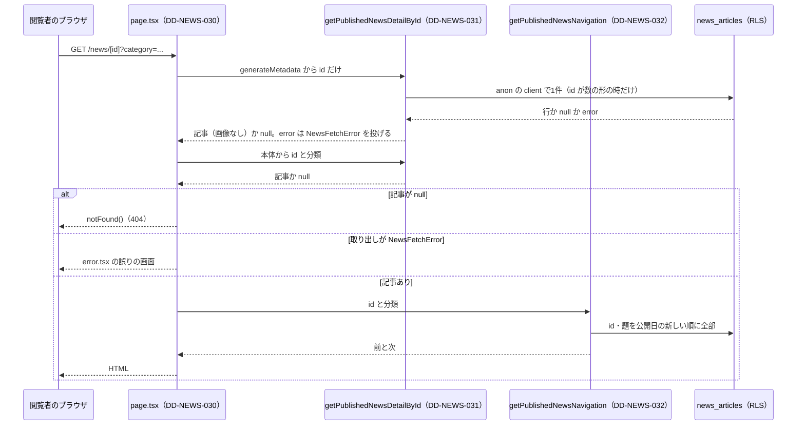

# 1.3 ニュース詳細ページ（NEWS DETAIL）詳細設計

> 状態: 推定 | 確認日: 2026-10-26 | 対象: `/news/[id]` の頁、公開の1件・前後・総数の取り出し、使われていない本文の部品 | 基準コミット: `a03beaff`

## 概要

ニュース詳細の頁 `/news/[id]` と、それを支える公開の取り出しの関数を、詳細設計の項目（`DD-NEWS-030`〜`034`）で書く。
中身は 2026-10-24 の作業ツリーのコードを読んで起こした今の動きで、ユーザーの確認を受けていないので全部「推定」にした。要件と食い違う所は決めずに今のコードの動きを書き、食い違いは `docs/05_Quality/reports/trace-matrix.md` の「食い違い」節に載せる。

| ID | 題 | 単位 | 旧番号 |
| --- | --- | --- | --- |
| DD-NEWS-030 | ニュース詳細の頁 | `src/app/news/[id]/page.tsx` | IMPL-NEWS-DETAIL-001・002・004〜008 |
| DD-NEWS-031 | 公開済みの記事1件の取り出し | `getPublishedNewsDetailById` | — |
| DD-NEWS-032 | 前後の記事の取り出し | `getPublishedNewsNavigation` | IMPL-NEWS-DETAIL-003 |
| DD-NEWS-033 | 公開済みの記事の総数 | `getPublishedNewsCount` | — |
| DD-NEWS-034 | 本文の軽い Markdown の部品 — 未使用（削除の判断待ち） | `src/features/news/components/ArticleBody.tsx` | — |
| DD-NEWS-070 | 公開の入口の確かめ（記事の id・分類） | `src/features/news/lib/news-input.ts` の `isNewsId`・`resolveNewsCategory` | — |

- 結論: 頁は Server Component で、URL の `category` を確かめてから1件と前後を取り出す。記事が無い・非公開・数でない id は 404 になる。DB の失敗は 404 にせず、`src/app/news/error.tsx` の誤りの画面に出す（2026-10-26。ADR-0024）
- 本文は `\n\n` で段落の `p` に分け、文字のまま出す。Markdown を解釈する `ArticleBody` はどこからもつながっていない
- 取り出しの関数は Supabase の `error` を読む（2026-10-26）。1件の取り出しは失敗を `NewsFetchError` で投げ、前後の取り出しは失敗を記録して前後なしで返し、総数は記録して 0 を返す。記録は誤りの名前と符号だけ

## 範囲と根拠

| 項目 | 内容 |
| --- | --- |
| 範囲 | `scripts/trace/scope.json` の NEWS。この頁は `DD-NEWS-030`〜`DD-NEWS-059` を使う（今は 030〜034）。公開の入口の確かめ `DD-NEWS-070` もこの頁に置く |
| 上位の文書 | [NEWS の構造設計](../../03_BasicDesign/areas/news.md)（`ARC-`・`SCR-`・`FLOW-`）、[NEWS の要件](../../02_Requirements/areas/news.md)（`FR-NEWS-DETAIL-`・`SEC-NEWS-`・`DRV-NEWS-`） |
| 対象のコード | `src/app/news/[id]/page.tsx`、`src/features/news/services/public.ts`（`getPublishedNewsDetailById`・`getPublishedNewsNavigation`・`getPublishedNewsCount`）、`src/features/news/components/ArticleBody.tsx` |
| 頼る範囲外の部品 | `src/lib/supabase/server.ts` の `createPublicClient`（anon の鍵・session なし。service role は使わない）、`src/lib/news-data.ts` の `categories`（BLOG を含む7つ）、`src/components/ui/Button/Button`、`src/components/ui/TagLabel/TagLabel` |
| DB | `news_articles`（`supabase/migrations/20260901102912_remote_schema.sql`、`id` は bigint）、anon の RLS は `status='published'` だけ（同じ移行ファイルの RLS の方針） |
| E2E | `e2e/FR-NEWS-DETAIL-001`〜`008-*.spec.ts`（補助 `e2e/news-detail-test-utils.ts`） |
| 調べた時点 | 2026-10-24 の作業ツリー。コードは読んだだけで動かしていない。単体テストは対象のどの単位にも無い |

旧い表（`IMPL-NEWS-DETAIL-001`〜`008`）の中身は、新しい項目の旧番号として次のとおり引き継いだ。

| 旧番号 | 旧い要件 | 旧い実装の概要 | 新しい項目 |
| --- | --- | --- | --- |
| IMPL-NEWS-DETAIL-001 | FR-NEWS-DETAIL-001 | RSC で `getPublishedNewsDetailById` を呼ぶ（画像は取らず署名しない）。無ければ `notFound()` | DD-NEWS-030 |
| IMPL-NEWS-DETAIL-002 | FR-NEWS-DETAIL-002 | `h1` に題、`TagLabel` に分類、公開日、`detailed_content` を段落で | DD-NEWS-030 |
| IMPL-NEWS-DETAIL-003 | FR-NEWS-DETAIL-003 | `getPublishedNewsNavigation` で前後のリンク、VIEW ALL で一覧へ | DD-NEWS-032（リンクの描き方は DD-NEWS-030） |
| IMPL-NEWS-DETAIL-004 | FR-NEWS-DETAIL-004 | `category` を確かめて前後へ渡す。無効な値は ALL | DD-NEWS-030 |
| IMPL-NEWS-DETAIL-005 | FR-NEWS-DETAIL-005 | `generateMetadata` で題と本文の要約 | DD-NEWS-030 |
| IMPL-NEWS-DETAIL-006 | FR-NEWS-DETAIL-006 | パンくず（NEWS > 分類 > 記事）と分類のリンク | DD-NEWS-030 |
| IMPL-NEWS-DETAIL-007 | FR-NEWS-DETAIL-007 | PREV・NEXT に行き先の題を含む `aria-label` | DD-NEWS-030 |
| IMPL-NEWS-DETAIL-008 | FR-NEWS-DETAIL-008 | `split("\n\n")` で段落、`whitespace-pre-line` | DD-NEWS-030 |

## 実装の単位

コードに `@impl`・`@design` を書く時はこの表に従う（`.claude/skills/documentation-guide/SKILL.md` の 9）。単位の一覧は `scripts/trace/parse-code.ts` の `parseCodeUnits` の出力。

| ファイル | 単位（symbol） | 種類 | DD |
| --- | --- | --- | --- |
| `src/app/news/[id]/page.tsx` | `<file>` | ファイル（頁） | DD-NEWS-030 |
| `src/features/news/services/public.ts` | `getPublishedNewsDetailById` | 関数 | DD-NEWS-031 |
| `src/features/news/services/public.ts` | `getPublishedNewsNavigation` | 関数 | DD-NEWS-032 |
| `src/features/news/services/public.ts` | `getPublishedNewsCount` | 関数 | DD-NEWS-033 |
| `src/features/news/components/ArticleBody.tsx` | `<file>` | ファイル（部品） | DD-NEWS-034 |
| `src/features/news/lib/news-input.ts` | `isNewsId` | 関数 | DD-NEWS-070 |
| `src/features/news/lib/news-input.ts` | `resolveNewsCategory` | 関数 | DD-NEWS-070 |

- 同じファイルの `getPublishedNews` と `NewsFetchError` は一覧の頁の詳細設計（DD-NEWS-003）で扱い、この表には入れない
- 頁の中の `resolveCategoryListParam`・`resolveCategory`・`buildDescription`・`generateMetadata`・`NewsDetailPage` は、`.tsx` の中の関数なのでファイルの単位に含める

矢印は呼び出しと戻りの向き。メタの作成と本体で同じ記事を2回取り出す（React の `cache()` は使っていない）。総数（DD-NEWS-033）はホームが呼ぶので図に入れていない。

## 詳細設計

### DD-NEWS-030 ニュース詳細の頁

| 属性 | 値 |
| --- | --- |
| 上位 | SCR-NEWS-002、FLOW-NEWS-001、ARC-NEWS-001、SEC-NEWS-001、SEC-NEWS-012、SEC-NEWS-013、SEC-NEWS-020 |
| 根拠 | 記事を1件ずつ読み、前後の記事と一覧へ移れるようにするため（SCR-NEWS-002）。一覧で選んだ分類を URL の `category` で受け取り、前後と戻りのリンクに引き継げば、詳細を挟んでも同じ絞り込みへ戻れる（FLOW-NEWS-001）。取り出しの関数が非公開の記事を null にするので、頁はそれを無い記事と同じ 404 にして有無を知らせない（SEC-NEWS-001）。本文を文字のまま段落に分けて出し、管理で書いた HTML を閲覧者の端末で動かさない（SEC-NEWS-013）。id が数の形でなければ DB を呼ばず 404 にし（SEC-NEWS-012）、取り出しの失敗は 404 にせず誤りの画面に任せて「無い」と見分ける（SEC-NEWS-020、ADR-0024） |
| 状態 | 推定 |
| 確かめ方 | 単体テスト |
| 出どころ | 実装から推定（`src/app/news/[id]/page.tsx`）、旧 `docs/04_DetailDesign/pages/03_news_detail.md` の表 |
| 旧番号 | IMPL-NEWS-DETAIL-001、IMPL-NEWS-DETAIL-002、IMPL-NEWS-DETAIL-004、IMPL-NEWS-DETAIL-005、IMPL-NEWS-DETAIL-006、IMPL-NEWS-DETAIL-007、IMPL-NEWS-DETAIL-008 |

#### 対応要件

FR-NEWS-DETAIL-001〜008、SEC-NEWS-001、SEC-NEWS-012（公開の詳細の id と分類。2026-10-26 に満たした）、SEC-NEWS-013、SEC-NEWS-020（公開の取り出しの失敗。同日に満たした）。

#### 入出力

| 向き | 中身 |
| --- | --- |
| 入力 | `params: Promise<{ id: string }>`、`searchParams?: Promise<{ category?: string }>`（`page.tsx`） |
| 出力（`generateMetadata`） | `Metadata` の `title`・`description` |
| 出力（`NewsDetailPage`） | 頁の JSX、または `notFound()` の throw |

頁の中の関数（export しない）:

| 関数 | 入力 → 出力 | 決まり |
| --- | --- | --- |
| `resolveCategoryListParam` | `category` → リンクに引き継ぐ値か `null` | カンマで分け、trim・大文字にし、`categories` にあり `ALL` でない物だけを残し、重複を除いてカンマで結ぶ |
| `resolveNewsCategory`（`news-input.ts`、DD-NEWS-070） | `category` → 取り出しに渡す1つの分類 | 大文字にした値がそのまま `categories` にあればそれ、無ければ `ALL`。カンマ区切りの複数は `ALL` になる |
| `buildDescription` | 本文 → description | 空白を1つに詰めて trim。120字を超えたら先頭120字に `...` |

#### 正常フロー

1. `generateMetadata` が、`isNewsId(id)` が真の時だけ `getPublishedNewsDetailById(id)` を分類なしで呼び、title を `「題 | NEWS | Le Fil des Heures」`、description を `buildDescription(detailed_content)` にする
2. 本体が `params` と `searchParams` を待ち、`persistedCategoryList` と `activeCategory`（`resolveNewsCategory`）を作る
3. `isNewsId(id)` が偽なら `notFound()`。真なら `getPublishedNewsDetailById(id, { category: activeCategory })` で記事を取る
4. `getPublishedNewsNavigation(id, { category: activeCategory })` で前後を取る
5. `navCategoryParam` を `?category=<encodeURIComponent(persistedCategoryList)>` か空にする
6. 描く物
   - パンくず: `NEWS`（`/news` ＋ `navCategoryParam`）→ 記事の分類（`/news?category=<encodeURIComponent(article.category)>`）→ 題（`aria-current="page"`）
   - 公開日は `-` を `.` に置き換えて出す。分類は `TagLabel`。題は `h1`
   - 本文は `detailed_content.split("\n\n")` の1つずつを `p` の中に文字として入れ、`whitespace-pre-line` で1つの改行も見せる
   - 前後: スマホと sm 以上で2回描く。リンクは `/news/<id>` ＋ `navCategoryParam`、`aria-label` は `前の記事: <題>`・`次の記事: <題>`
   - VIEW ALL: `Button` で `/news` ＋ `navCategoryParam`
7. 画像は描かない（頁に `img` が無い）。DD-NEWS-031 は `image_url` を返さない（2026-10-26 から。SEC-NEWS-005）

#### 異常フロー

| 条件 | 動き |
| --- | --- |
| `searchParams` が無い | `resolvedSearchParams` は `undefined`、分類は ALL・引き継ぎなし |
| `category` が無い・空・空白だけ | 引き継ぎは `null`、取り出しは ALL |
| `category` が許可の一覧に無い値だけ・`ALL` だけ | 引き継ぎは `null`（残りが0件）、取り出しは ALL |
| `category` が小文字（例 `event`） | 大文字にして受ける |
| `category` が複数（例 `EVENT,STORE`） | 取り出しと前後は ALL、リンクには `EVENT,STORE` を引き継ぐ |
| `category` が1つの正しい値で、記事の分類と違う | 記事の取り出しが null → 404 |
| 記事が無い・非公開 | DD-NEWS-031 が null → `notFound()`。Next.js の既定の 404（`src/app` に `not-found.tsx` は無い） |
| 数でない id（`abc`・`1.5`・19 桁など） | `isNewsId` が偽 → DB を呼ばず `notFound()`。メタは取り出しを呼ばず固定の title・description（投げない） |
| DB の失敗 | DD-NEWS-031 が `NewsFetchError` を投げ、頁も reject して `src/app/news/error.tsx` の誤りの画面（DD-NEWS-069）。404 にしない |
| メタの作成で記事が null | title `NEWS DETAIL \| Le Fil des Heures`、description は固定文 |
| 本文が空・空白だけ | description は `Le Fil des Heuresのニュース詳細ページです。` |
| 本文が120字を超える | description は先頭120字＋`...` |
| 前の記事が無い・次の記事が無い | リンクの代わりに空の `div` |
| 取り出しの関数が throw（client の作成の失敗など） | try/catch は無く、同じ階層の `error.tsx` の誤りの画面 |
| 前後の取り出しが失敗 | DD-NEWS-032 が記録して前後なしで返すので、記事の本体は出す |

- `?category=` が記事と違う時、メタは分類なしで取り出すので題の入った title を作り、本体は 404 になる（メタの取り出しは分類を渡さず、本体は渡すため）
- 前後のリンクは `navCategoryParam` を付けるので、複数の分類を引き継いだまま ALL の前後へ移る

#### 状態・永続化

頁は状態を持たず、書き込みもしない。キャッシュの指定（`revalidate`・`dynamic`・`use cache`）は無く、`params`・`searchParams` を読むので要求ごとに描く（推定）。1回の表示で記事を2回（メタの作成と本体）、前後のために公開済みの id と題を全部（DD-NEWS-032）読む。

#### 認証認可

認証は求めない（公開の頁）。利用者の Cookie は使わず、取り出しは anon の client（DD-NEWS-031・032）。下書きを出さない守りは取り出しの関数の `status='published'` と RLS に任せ、頁は null を 404 にするだけ。回数の制限は無い。

#### テスト観点

`getPublishedNewsDetailById`・`getPublishedNewsNavigation` と `next/navigation` の `notFound`（throw する物に差し替える）を差し替え、`generateMetadata` と既定の export を直接呼んで、返った JSX を React Testing Library で描く。

| # | 試し | 通す分岐 |
| --- | --- | --- |
| 1 | メタ: 記事が null → 固定の title・description | メタの作成で記事が null の枝 |
| 2 | メタ: 本文が120字以下 → title が `題 \| NEWS \| Le Fil des Heures`、description が空白を詰めた本文 | 記事あり・本文が空でなく・120字以内の枝 |
| 3 | メタ: 本文が121字 → 先頭120字＋`...` | 本文が120字を超える枝 |
| 4 | メタ: 本文が空白と改行だけ → 固定の description | 本文が空白だけ（詰めると空）の枝 |
| 5 | メタ: 取り出しを id だけで呼び、分類を渡さない | メタの作成の取り出しの引数（分類を渡さない） |
| 6 | 本体: `searchParams` を渡さない → 取り出しに `ALL`、パンくずの NEWS と VIEW ALL が `/news` | `searchParams` が undefined、`category` が無い、引き継ぎなしの枝 |
| 7 | 本体: `searchParams` が `{}` → 6 と同じ | `searchParams` はあるが `category` が無い枝 |
| 8 | 本体: `category='  '` → 引き継ぎなし、取り出しは ALL | `category` が空白だけの枝（trim して空） |
| 9 | 本体: `category='event'` → 取り出しに `EVENT`、リンクが `?category=EVENT` | 小文字の1つの正しい値を大文字にして受ける枝、引き継ぎありの枝 |
| 10 | 本体: `category='EVENT,STORE,EVENT'` → 取り出しは ALL、リンクは `?category=EVENT%2CSTORE` | 複数の値で重複を除く枝、取り出しは ALL になる枝 |
| 11 | 本体: `category='ALL'` → 引き継ぎなし、取り出しは ALL | ALL だけの値の枝（残りが0件） |
| 12 | 本体: `category='INVALID'` → 引き継ぎなし、取り出しは ALL | 許可の一覧に無い値だけの枝 |
| 13 | 本体: 記事が null → `notFound` を呼び、前後を取り出さない | 記事が無い時に `notFound` を呼ぶ枝 |
| 13a | 本体: `abc`・`0`・`01`・`1.5`・`-1`・19 桁の id → `notFound` を呼び、取り出しも前後も呼ばない | `isNewsId` が偽の枝（SEC-NEWS-012） |
| 13b | 本体: 取り出しが reject → 頁が reject し、`notFound` を呼ばない | 取り出しの失敗を 404 にしない枝（SEC-NEWS-020） |
| 5a | メタ: 数でない id → 取り出しを呼ばず固定の title・description（投げない） | メタの作成で `isNewsId` が偽の枝 |
| 14 | 本体: 前と次がある → `前の記事: 題`・`次の記事: 題` のリンクが2つずつ、href が `/news/<id>` ＋引き継ぎ | 前の記事あり・次の記事ありの枝（スマホと sm 以上の4か所） |
| 15 | 本体: 前も次も無い → 前後のリンクが無く、VIEW ALL は2つ | 前の記事なし・次の記事なしの枝 |
| 16 | 本体: 本文 `a\n\nb\nc` → `p` が2つ、2つ目の文字が `b\nc` | 本文の段落分けの描画 |
| 17 | 本体: 本文に `<script>` を含む → 文字として出て `script` の要素ができない | 本文を文字として出す描画 |
| 18 | 本体: 公開日 `2026-10-24` が `2026.10.24`、パンくずの分類のリンクが `/news?category=<記事の分類>`、題に `aria-current="page"` | 公開日の置き換え、パンくずの分類のリンク、現在の頁の印の描画 |

### DD-NEWS-031 公開済みの記事1件の取り出し

| 属性 | 値 |
| --- | --- |
| 上位 | ARC-NEWS-001、ARC-NEWS-003、SCR-NEWS-002、SEC-NEWS-001、SEC-NEWS-012、SEC-NEWS-020 |
| 根拠 | 詳細の頁がサーバーの中で1件を直接取り出し、記事を入れた HTML をそのまま返せるようにするため（ARC-NEWS-001）。anon の client で `status='published'` を付けて読み、取り出しの条件と RLS の2段で非公開の記事を返さない（SEC-NEWS-001）。分類を受けて絞れば、詳細でも一覧と同じ分類の中だけを辿れる（SCR-NEWS-002）。公開の頁は画像を出さないので、画像の列は選ばず署名もしない（SEC-NEWS-005、ARC-NEWS-003）。id が数の形でなければ DB を呼ばず null にし（SEC-NEWS-012）、行が無い時（null）と失敗（`NewsFetchError`）を `.maybeSingle()` で分ける（SEC-NEWS-020） |
| 状態 | 推定 |
| 確かめ方 | 単体テスト |
| 出どころ | 実装から推定（`src/features/news/services/public.ts`） |

#### 対応要件

FR-NEWS-DETAIL-001、FR-NEWS-DETAIL-004、SEC-NEWS-001、SEC-NEWS-005（画面で使わない画像の道を載せない）、SEC-NEWS-012（数でない id を問い合わせない。2026-10-26）、SEC-NEWS-020（失敗を「無い」と区別する。同日）。

#### 入出力

| 向き | 中身 |
| --- | --- |
| 入力 | `id: string`、`options?: { category?: string }` |
| 出力 | `Promise<PublicNewsDetailArticle \| null>`。記事は `id, title, published_date, category, content, detailed_content`。`image_url` は含まない |

#### 正常フロー

1. `isNewsId(id)` が偽なら DB を呼ばず null を返す
2. `createPublicClient()` を作る（service role の client は作らない）
3. `news_articles` から上の列を選び、`status='published'`・`id=<id>` で絞る
4. `options.category` があり `ALL` でなければ `category=<値>` でも絞る
5. `.maybeSingle()` で1行を取る
6. `error` があれば誤りの名前と符号だけ記録して `NewsFetchError` を投げる
7. 行があればそのまま返す（署名しない）。無ければ null

#### 異常フロー

| 条件 | 動き |
| --- | --- |
| `options` が無い・`category` が無い・`ALL` | 分類で絞らない |
| 行が無い・非公開・分類が違う | `.maybeSingle()` が `data=null`・`error=null` を返し、null |
| id が数の形でない（例 `abc`・`0`・`01`・19 桁・空） | DB を呼ばず null（`isNewsId` が偽。DD-NEWS-070） |
| DB・RLS の失敗（`error` あり） | `{ name, code }` だけ `console.error` に出し、`NewsFetchError`（`code` つき）を投げる。404 にしない |
| service role の環境変数が無い | 影響しない（service role を使わない） |

- 分類の値は確かめない。呼び元（DD-NEWS-030）が `resolveNewsCategory`（DD-NEWS-070）で確かめた値か `ALL` を渡す

#### 状態・永続化

読むだけ。キャッシュは無い。署名はしない。

#### 認証認可

anon の鍵・session なしの client で読む（`src/lib/supabase/server.ts`）。RLS で anon は `status='published'` だけを読め（`remote_schema.sql`）、コードでも `status='published'` を付けるので二重に守る。

#### テスト観点

`@/lib/supabase/server` の2つの client と `@/lib/storage/news-images` の `signNewsImageFields` を差し替え、問い合わせの組み立ての呼び出しを記録する。署名と service role の client が呼ばれないことも確かめる。

| # | 試し | 通す分岐 |
| --- | --- | --- |
| 1 | `options` なし → `select` の列に `detailed_content`、`eq('status','published')`・`eq('id',id)`、`eq('category',…)` は呼ばない | `options` が undefined の枝 |
| 2 | `{ category: 'ALL' }` → 分類で絞らない | `category` が `ALL` の枝 |
| 3 | `{}` → 分類で絞らない | `category` が undefined の枝 |
| 4 | `{ category: 'EVENT' }` → `eq('category','EVENT')` | `category` が `ALL` 以外の枝 |
| 4a | `abc`・`0`・`01`・`1.5`・`-1`・19 桁・空の id → `from` を呼ばず null | `isNewsId` が偽の枝 |
| 4b | `.maybeSingle()` で取る | 1行の取り方 |
| 5 | `data=null`・`error=null` → null、署名を呼ばない | 行が無い時に null を返す枝（署名を呼ばない） |
| 5a | `error`（`code:'PGRST301'` など） → `NewsFetchError`（`code` が一致）で reject。`console.error` の第 2 引数は `{ name, code }` で `message` を含まない | 失敗を投げる枝 |
| 6 | 行あり → 行をそのまま返し、`image_url` が無く、`signNewsImageFields`・`createServiceRoleClient` を呼ばない | 行がある時にそのまま返す枝 |

### DD-NEWS-032 前後の記事の取り出し

| 属性 | 値 |
| --- | --- |
| 上位 | ARC-NEWS-001、SCR-NEWS-002、FLOW-NEWS-001、SEC-NEWS-001、SEC-NEWS-020 |
| 根拠 | 詳細から一覧へ戻らずに隣の記事へ移れるようにするため（SCR-NEWS-002）。一覧と同じ公開日の新しい順で前後を決め、分類を受けて絞れば一覧で選んだ分類の中だけを辿れる（FLOW-NEWS-001）。題と id だけを anon の client で公開済みから選び、非公開の記事の題を前後のリンクに出さない（SEC-NEWS-001）。前後は添え物なので、取り出しの失敗は記録して前後なしで返し、記事の本体を隠さない（SEC-NEWS-020、ADR-0024） |
| 状態 | 推定 |
| 確かめ方 | 単体テスト |
| 出どころ | 実装から推定（`src/features/news/services/public.ts`）、旧 `docs/04_DetailDesign/pages/03_news_detail.md` |
| 旧番号 | IMPL-NEWS-DETAIL-003 |

#### 対応要件

FR-NEWS-DETAIL-003、FR-NEWS-DETAIL-004、FR-NEWS-DETAIL-007（題を返して `aria-label` に使わせる）、SEC-NEWS-001。SEC-NEWS-020（失敗を前後なしで返し記録する。2026-10-26）。SEC-NEWS-009（公開の取り出しに件数の上限）は、この関数が扱わないので上位にしていない（SEC の項目を参照）。

#### 入出力

| 向き | 中身 |
| --- | --- |
| 入力 | `id: string`（今の記事）、`options?: { category?: string }` |
| 出力 | `Promise<{ prevArticle: PublicNewsTitle \| null; nextArticle: PublicNewsTitle \| null }>`。`prevArticle` は1つ新しい記事、`nextArticle` は1つ古い記事 |

#### 正常フロー

1. `createPublicClient()` を作る
2. `news_articles` から `id, title` を、`status='published'`・公開日の新しい順で選ぶ。件数の上限は付けない
3. `options.category` があり `ALL` でなければ `category=<値>` で絞る
4. 結果の中で `String(item.id) === id` の位置を探す。DB の `id` は bigint なので文字にして比べる
5. 位置が 0 より大きければ1つ前を `prevArticle`、位置が最後でなければ1つ後を `nextArticle` にする

#### 異常フロー

| 条件 | 動き |
| --- | --- |
| `options` が無い・`category` が無い・`ALL` | 分類で絞らない |
| DB・RLS の失敗（`error` あり） | `{ name, code }` だけ `console.error` に出し、前後とも null で返す（投げない） |
| 今の記事が結果に無い（分類が違う・非公開・数でない id） | 位置が -1、前後とも null |
| 今の記事が先頭（一番新しい） | `prevArticle` は null |
| 今の記事が最後（一番古い） | `nextArticle` は null |
| 公開日が同じ記事が並ぶ | 第2の並びのキーが無く、前後が揺れうる（推定） |

#### 状態・永続化

読むだけ。公開済みの記事の id と題を毎回全部読む。キャッシュは無い。

#### 認証認可

anon の client だけを使う（service role は使わない）。RLS とコードの `status='published'` で、非公開の記事は前後の候補に入らない。

#### テスト観点

`createPublicClient` を差し替え、問い合わせが返す `data` を試しごとに変える。

| # | 試し | 通す分岐 |
| --- | --- | --- |
| 1 | `options` なし → `eq('category',…)` を呼ばない、`order('published_date',{ascending:false})` | `options` が undefined の枝 |
| 2 | `{ category: 'ALL' }`・`{}` → 分類で絞らない | `category` が `ALL`・undefined の枝 |
| 3 | `{ category: 'STORE' }` → `eq('category','STORE')` | `category` が `ALL` 以外の枝 |
| 4 | `error`（`code:'57014'` など） → 前後とも null、`console.error` を1回（第 2 引数は `{ name, code }` で `message` を含まない） | `error` ありの枝 |
| 4a | `data=null`・`error=null` → 前後とも null | `data` が null で空の配列にする枝 |
| 5 | 3件の先頭の id → 前は null、次は2件目 | 今の記事が先頭（前なし・次あり）の枝 |
| 6 | 3件の真ん中 → 前は1件目、次は3件目 | 今の記事が真ん中（前あり・次あり）の枝 |
| 7 | 3件の最後 → 前は2件目、次は null | 今の記事が最後（前あり・次なし）の枝 |
| 8 | 結果に無い id → 前後とも null | 今の記事が結果に無い（位置が見つからない）枝 |
| 9 | DB の id が数の `5`、引数が `'5'` → 位置が見つかる | id を文字にして比べる処理 |

### DD-NEWS-033 公開済みの記事の総数

| 属性 | 値 |
| --- | --- |
| 上位 | ARC-NEWS-001、SCR-NEWS-006、SEC-NEWS-001 |
| 根拠 | ホームの NEWS の区画は、公開の総数が6件より多い時だけ一覧への VIEW ALL を出すので、記事を全部読まずに数だけを知るため（SCR-NEWS-006）。行の中身を返さない `head:true` の数え方にし、anon の client と `status='published'` で非公開の記事を数に入れない（SEC-NEWS-001） |
| 状態 | 推定 |
| 確かめ方 | 単体テスト |
| 出どころ | 実装から推定（`src/features/news/services/public.ts`、`src/app/page.tsx`） |

#### 対応要件

FREQ-149-REQ-02（ホームの VIEW ALL の出し分け）、SEC-NEWS-001。失敗を記録して 0 を返す（0 になりホームの VIEW ALL が消える）。0件と失敗を区別しないので SEC-NEWS-020 は上位にしていない。

#### 入出力

| 向き | 中身 |
| --- | --- |
| 入力 | なし |
| 出力 | `Promise<number>`。公開済みの記事の数 |

#### 正常フロー

1. `createPublicClient()` を作る
2. `news_articles` を `select('id', { count: 'exact', head: true })`・`status='published'` で数える
3. `count ?? 0` を返す

#### 異常フロー

| 条件 | 動き |
| --- | --- |
| Supabase の `error` がある | `console.error('Failed to count published news:', { name, code })`（誤りの名前と符号だけ）を出して 0 |
| `error` が無く `count` が null | 0 |

- 呼び元はホーム（`src/app/page.tsx`、範囲外）だけ。詳細の頁は呼ばない

#### 状態・永続化

読むだけ。行の中身は受け取らない。キャッシュは無い。

#### 認証認可

anon の client だけを使う。RLS とコードの `status='published'` で、非公開の記事は数に入らない。

#### テスト観点

| # | 試し | 通す分岐 |
| --- | --- | --- |
| 1 | `count=7` → 7。`select('id',{count:'exact',head:true})`・`eq('status','published')` を呼ぶ | `error` なし・`count` が数の枝 |
| 2 | `error` あり → 0、`console.error` を1回（第 2 引数は `{ name, code }`）呼ぶ | `error` ありの枝 |
| 3 | `error` なし・`count=null` → 0 | `error` なし・`count` が null の枝 |

### DD-NEWS-034 本文の軽い Markdown の部品 — 未使用（削除の判断待ち）

| 属性 | 値 |
| --- | --- |
| 上位 | ARC-NEWS-005 |
| 根拠 | 未使用（削除の判断待ち）の部品。詳細の本文を見出し・箇条書き・リンク・画像のある読み物として出す案のために作られ、uiux のレビュー ND-1 が詳細の本文に使ったと記録している（`docs/05_Quality/reviews/uiux/uiux_review_news_id.md`）。生の HTML を出さず JSX だけを作れば、Markdown を解釈しても管理で書いた HTML を動かさない。今は詳細の頁を含めどこからも import されず、消すかが決まるまで範囲内の単位として残す（ARC-NEWS-005） |
| 状態 | 推定 |
| 確かめ方 | 単体テスト |
| 出どころ | 実装から推定（`src/features/news/components/ArticleBody.tsx`） |

#### 対応要件

ARC-NEWS-005（その上は DRV-NEWS-015）。詳細の画面 SCR-NEWS-002 は本文を文字のまま出し、この部品と中身が合わないので上位にしていない。今の頁（DD-NEWS-030）は本文の Markdown を解釈しない（推定。`src/app/news/[id]/page.tsx`）。FR-NEWS-DETAIL-008 が求めるのは段落と改行だけで、Markdown を解釈しないことは求めていない。SEC-NEWS-013 の「Markdown のリンク・画像の URL は `http:`・`https:`・サイトの中の道だけを許す」は、この部品が URL の種類を確かめないので上位にしていない（SEC-NEWS-013 の項目を参照）。

#### 入出力

| 向き | 中身 |
| --- | --- |
| 入力 | `{ content: string }` |
| 出力 | ブロックの並びの Fragment。ブロックは `h2`・`h3`・`h4`・`ul`・`p` |

#### 正常フロー

1. `\r\n` を `\n` にし、行に分ける。各行は末尾の空白を外す
2. 行ごとに
   - 空行 → 溜めた段落と箇条書きを閉じる
   - `#`・`##`・`###` と空白で始まる → 溜めた物を閉じ、`h2`・`h3`・`h4` にする
   - `-`・`*`・`+` と空白で始まる → 溜めた段落を閉じ、箇条書きに足す
   - それ以外 → 溜めた箇条書きを閉じ、段落に足す
3. 最後に溜めた段落と箇条書きを閉じる。段落の行は空白1つで結ぶ
4. 見出し・箇条書き・段落の文字は `parseInline`で次の形に分ける。正規表現 `INLINE_PATTERN`はモジュールで共有し、毎回 `lastIndex=0` に戻す

| 形 | 出す物 |
| --- | --- |
| `` | `img`（`src` に道・`alt`・`loading="lazy"`） |
| `[文字](/道)` | `a`。`http://`・`https://` なら `target="_blank" rel="noopener noreferrer"` |
| `**文字**`・`__文字__` | `strong` |
| `*文字*`・`_文字_` | `em` |
| どれにも合わない部分 | 文字のまま |

#### 異常フロー

| 条件 | 動き |
| --- | --- |
| 本文が空 | 何も出さない（閉じる処理は溜めた物が無ければ戻る） |
| `####` 以上の見出し | 見出しの正規表現に合わず段落の文字になる |
| `-` の後に空白が無い（例 `-a`） | 箇条書きにならず段落の文字 |
| 画像・リンクの URL が `javascript:`・`data:`・外部のホスト | URL の種類を確かめずに `src`・`href` へ入れる。`javascript:` の href は React が止める（React 19.2.4 は production の build でも href を置き換える。確かめ済み） |

- 生の HTML は出さない（`dangerouslySetInnerHTML` が無い）。文字は React がエスケープする

#### 状態・永続化

状態を持たない。描くたびに本文を読み直す。モジュールで共有する正規表現の `lastIndex` だけが呼び出しの間に残るので、`parseInline` の頭で 0 に戻す。

#### 認証認可

なし（受け取った文字を描くだけ）。

#### テスト観点

React Testing Library で `<ArticleBody content=… />` を描く。

| # | 試し | 通す分岐 |
| --- | --- | --- |
| 1 | `''` → 何も描かない | 本文が空で何も閉じない枝 |
| 2 | `'a\r\nb\n\nc'` → `p` が2つ、1つ目の文字が `a b` | 改行コードの正規化、空行で段落を閉じる枝、段落に足す枝 |
| 3 | `'# h1'`・`'## h2'`・`'### h3'` → `h2`・`h3`・`h4` | `#`・`##`・`###` の見出しの枝（それぞれの段） |
| 4 | `'#### h4'` → `p` の文字 `#### h4` | `####` 以上が見出しにならない枝 |
| 5 | `'- a\n* b\n+ c'` → `ul` に `li` が3つ | `-`・`*`・`+` の箇条書きの枝 |
| 6 | `'p1\n- a\np2'` → `p`・`ul`・`p` の順 | 段落から箇条書きへ、箇条書きから段落へ切り替わる枝 |
| 7 | `'- a\n# h'` → `ul` の後に `h2` | 見出しで溜めた箇条書きを閉じる枝 |
| 8 | `'前  後'` → 文字・`img`（`src="/x.png"`・`alt="alt"`・`loading="lazy"`）・文字 | 画像の記法の枝（前後の文字を含む） |
| 9 | `'[外](https://a.example)'` → `a` に `target="_blank"`・`rel="noopener noreferrer"` | リンクの記法で `http://`・`https://` の枝 |
| 10 | `'[中](/news)'` → `a` に `target` が無い | リンクの記法でサイトの中の道の枝 |
| 11 | `'**b** __c__'` → `strong` が2つ | 太字の `**` と `__` の両方の枝 |
| 12 | `'*i* _j_'` → `em` が2つ | 斜体の `*` と `_` の両方の枝 |
| 13 | 同じ本文で2回描く → 2回とも同じ結果 | 共有の正規表現を毎回先頭に戻す処理 |
| 14 | リンクの URL を `javascript:alert(1)` にした本文 → `href` が元の `javascript:alert(1)` にならない（今の動きの記録。React が止める。React 19.2.4 は production の build でも置き換える・確かめ済み） | リンクの URL の種類を確かめない枝（今の動きの記録） |

- 正規表現の作りから、画像の記法とリンクの記法の判定で「1つ目の組が取れて2つ目が取れない」形と、斜体の判定で「どの組も取れない」一致は起きない。分岐の網羅が 100% に届かない所として、テストを書く時に `docs/05_Quality/reports/test-gaps.md` の「届かない分岐」に1件ずつ書く

### DD-NEWS-070 公開の入口の確かめ isNewsId・resolveNewsCategory

| 属性 | 値 |
| --- | --- |
| 上位 | SCR-NEWS-002、API-NEWS-001、ARC-NEWS-001、SEC-NEWS-012 |
| 根拠 | 外から来る記事の id と分類を、DB や取り出しに渡す前に許可の形だけに絞るため（SEC-NEWS-012）。id は bigint の桁を超える数や数字以外を DB に渡すと型の誤りになるので、入口で偽にして DB を呼ばない。分類は窓口（`/api/news`）と頁（`/news`・`/news/[id]`）が同じ決まりを使うよう、1か所に置く |
| 状態 | 現行 |
| 確かめ方 | 単体テスト |
| 出どころ | ユーザーの承認（2026-10-26、波 1 を全部）。設計は `.superpowers/sdd/2026-10-25-security-gap-fixes/design-final.md` の R12 |

#### 対応要件

SEC-NEWS-012（公開の窓口の分類・公開の詳細の id）。管理の `[id]` と編集のページは別の作業で、この単位が扱わない。

#### 入出力

| 向き | 中身 |
| --- | --- |
| 入力（`isNewsId`） | `value: string` |
| 出力（`isNewsId`） | `boolean`。`/^[1-9]\d{0,17}$/`（先頭が 0 でない 1〜18 桁の数字）に合えば真 |
| 入力（`resolveNewsCategory`） | `raw: string \| null \| undefined` |
| 出力（`resolveNewsCategory`） | `categories`（`src/lib/news-data.ts`）の1つの値。外れ・無しは `'ALL'` |

#### 正常フロー

1. `isNewsId`: 正規表現に合うかを返す
2. `resolveNewsCategory`: `raw ?? 'ALL'` を大文字にし、`categories` にあればその値、無ければ `'ALL'`

#### 異常フロー

| 場合 | 動き |
| --- | --- |
| id が `0`・`01`・`abc`・`1.5`・`-1`・19 桁・空・前後の空白・改行を含む | `isNewsId` は偽 |
| 分類が `undefined`・`null`・空の文字 | `ALL` |
| 分類が 300 字・記号つき（`EVENT;drop`）・複数（`EVENT,STORE`）・前に空白 | `ALL` |
| 分類が小文字の正しい値（`collection`） | 大文字（`COLLECTION`） |

#### 状態・永続化

状態を持たない純粋な関数。

#### 認証認可

なし（文字の形だけを見る）。

#### テスト観点

| # | 観点 | 入力 | 期待 |
| --- | --- | --- | --- |
| 1 | 正しい id | `'1'`・`'9'`・`'10'`・18 桁 | 真 |
| 2 | 外れた id | `'0'`・`'01'`・`'abc'`・`'1.5'`・`'-1'`・19 桁・`''`・`'1 '`・`' 1'`・`'1\n'`・`'1;drop'` | 偽 |
| 3 | 小文字の正しい分類 | `'collection'`・`'Event'`・`'blog'` | 大文字 |
| 4 | `ALL` | `'ALL'` | `'ALL'` |
| 5 | 無し | `undefined`・`null`・`''` | `'ALL'` |
| 6 | 外れた分類 | 300 字・`'EVENT;drop'`・`'EVENT,STORE'`・`' EVENT'`・`'FOO'` | `'ALL'` |

## 未確認事項

- この頁の項目は全部「推定」（DD-NEWS-070 だけは 2026-10-26 の承認つきで「現行」）。ユーザーの確認を受けたら「現行」にする
- 記事と違う1つの分類を付けた詳細を 404 にするか（FR-NEWS-DETAIL-004 の文は求めていない。食い違いは `docs/05_Quality/reports/trace-matrix.md` の「食い違い」節）
- `ArticleBody` を詳細の本文につなぐか、消すか（使われていないコードとして `unused-code.md` で判断を待つ。つなぐなら SEC-NEWS-013 の URL の確かめが先に要る）
- `getPublishedNewsCount` はホームだけが使い、詳細の頁は使わない。一覧の頁の詳細設計と重ならないよう、この頁に置いた。置き場を変えるなら DD-NEWS-033 を「廃止」にして移す
- 数でない id（`/news/abc`）は 2026-10-26 から DB に渡さず 404 にする（`isNewsId`）。`/news/<19 桁の数>` などが E2E で 404 になることは controller が本番ビルドで確かめる
- 取り出しの失敗の誤りの画面（`error.tsx`）の HTTP 状態が 500 のままかを本番のビルドで確かめていない（流し始める前の誤りなら 500 の見込み。`loading.tsx` と頁の中の `<Suspense>` は足さない）
- 本番のビルドで頁が要求ごとに描かれるか、キャッシュされるかを確かめていない
- 公開日が同じ記事の前後の並びが揺れるか（第2の並びのキーが無い）を確かめていない
