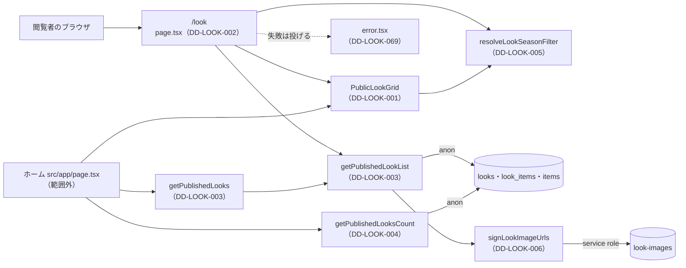

# 1.6 ルック一覧ページ（LOOK LIST）詳細設計

> 状態: 推定 | 確認日: 2026-10-26 | 対象: LOOK 一覧 `/look`、ホームの LOOK の区画の部品、公開の LOOK の取り出し、シーズンの決まり、LOOK の画像の署名 | 基準コミット: `4facf63b`（作業ツリーに別の作業の未コミットの差分あり）

## 概要

LOOK 一覧 `/look` を作るコードの単位ごとに、入出力・正常と異常の流れ・状態・認可・単体テストの観点を、追跡できる項目（`### <ID> <題>` と属性の表）で書く。
中身は 2026-10-24 の作業ツリーのコードを読んで起こした今の動きで、ユーザーの確認を受けていないので全部「推定」にした。要件・構造設計と食い違う所は決めずに今のコードの動きを書き、食い違いは `docs/05_Quality/reports/trace-matrix.md` の「食い違い」節に載せた。

| ID | 単位 | 中身 | 旧番号 |
| --- | --- | --- | --- |
| `DD-LOOK-001` | `src/features/look/components/PublicLookGrid.tsx` | 一覧とホームの区画の格子・カード・シーズンの絞り込み・空の表示 | `IMPL-LOOK-LIST-002`・`003`・`004`・`006` |
| `DD-LOOK-002` | `src/app/look/page.tsx` | 一覧のページ。URL の `season` を直し、公開の LOOK を 100 件まで取って格子に渡す。取り出しの失敗は投げる。メタを出す | `IMPL-LOOK-LIST-001`・`005` |
| `DD-LOOK-003` | `getPublishedLookList`・`getPublishedLooks`・`LookFetchError`（`src/lib/look/server.ts`） | 公開の LOOK を新しい順に説明文なしで取り、関連商品と署名つきの画像を付ける。`/look` は 100 件まで・失敗は投げる。ホームは件数を丸めて失敗は空の配列 | なし |
| `DD-LOOK-004` | `getPublishedLooksCount`（`src/lib/look/server.ts`） | ホームの VIEW ALL の判断に使う公開の LOOK の総数 | なし |
| `DD-LOOK-005` | `resolveLookSeasonFilter`・`normalizeLookSeasonSelection`・`toLookSeasonValues`・`filterLooksBySeason`（`src/lib/look/public.ts`） | シーズンの選択を ALL・SS・AW の1つに直し、LOOK を絞る | なし |
| `DD-LOOK-006` | `extractLookImageObjectPath`・`signLookImageUrl`・`signLookImageUrls`（`src/lib/storage/look-images.ts`） | 置き場の道筋を取り出し、期限1時間の署名つき URL にする | なし |
| `DD-LOOK-069` | `src/app/look/error.tsx` | `/look`・`/look/[id]` の取り出しの失敗を受ける誤りの画面 | なし |

- 結論: 一覧はページのサーバーの中で公開の LOOK を新しい順に 100 件まで、説明文なしで取り（ADR-0159）、部品は渡された LOOK を画面の上でシーズンで絞るだけ。取り出しの失敗は投げて、`error.tsx` の誤りの画面になる（2026-10-26。ホームの区画は空の配列のまま）
- 画像は表示のたびに service role で署名する。道筋にできない値と署名の失敗では、元の値をそのまま返す（推定）
- 番号は `DD-LOOK-001`〜`029` をこの頁で使う。今は `001`〜`006` を使い、`007` 以降は空けておく。詳細の頁は `030`〜`059`、管理の頁（[16-3_admin_look.md](16-3_admin_look.md)）は `060`〜`089`。`069` だけは管理の頁の範囲の空きを、一覧と詳細の誤りの画面（`error.tsx`）に使った（詳細の頁の `068` も同じ。2026-10-26）

## 範囲と根拠

| 項目 | 内容 |
| --- | --- |
| 範囲 | `scripts/trace/scope.json` の LOOK のうち、一覧のページとホームの区画の部品、公開の取り出し、シーズンの決まり、画像の署名 |
| 上位の文書 | [LOOK の構造設計](../../03_BasicDesign/areas/look.md)（`ARC-`・`SCR-`・`FLOW-`・`STATE-`・`DATA-`）、[LOOK の要件](../../02_Requirements/areas/look.md)（`FR-LOOK-ALL-`・`FREQ-`・`SEC-LOOK-`・`DRV-LOOK-`） |
| 対象のコード | `src/app/look/page.tsx`、`src/app/look/error.tsx`、`src/features/look/components/PublicLookGrid.tsx`、`src/lib/look/server.ts` の `getPublishedLookList`・`getPublishedLooks`・`LookFetchError`・`getPublishedLooksCount`、`src/lib/look/public.ts` の4つの関数、`src/lib/storage/look-images.ts` の3つの関数 |
| 関連文書 | [ルック詳細の詳細設計](07_look_detail.md)、[管理のルックの詳細設計](16-3_admin_look.md)、`docs/03_BasicDesign/ui/screen-list.md` |
| 旧版のこの頁 | 機能要件対応表（`IMPL-LOOK-LIST-001`〜`006`）。対象に挙げた `LookCard.tsx`・`PublicLookCatalogGrid.tsx`・`src/lib/look/look-view.ts` は無い（`LookCard` は `PublicLookGrid.tsx` の中の関数）。「最大6件」「VIEW LOOKBOOK」は今の形と違う |
| 調べた時点 | 2026-10-24 の作業ツリー（コードは読んだだけで、動かしての確かめはしていない）。2026-10-26 に `DD-LOOK-002`・`003`・`069` を直した（単体・結合テストで確かめた） |

範囲外の共有部品は ID を持たないので、項目の本文にファイルの道で書く。

| 共有部品 | 道 | 一覧での使われ方 |
| --- | --- | --- |
| Supabase の client | `src/lib/supabase/server.ts` の `createPublicClient`・`createServiceRoleClient` | LOOK・関連・商品は anon の鍵・session なしで読み、service role は画像の署名だけに使う |
| 商品の画像の署名 | `src/lib/storage/item-images.ts` の `signItemImageUrl` | 関連商品の `image_url` を署名する |
| 画面の部品 | `src/components/ui/`（`Button`・`SectionTitle`・`Drawer`・`MultiSelect`）、`src/components/animations/ScrollReveal.tsx`、`src/features/home/components/HomeSectionViewAll.tsx`（HOME） | 絞り込み・引き出し・見出し・カードの出方・ホームの VIEW ALL |
| ホームのページ | `src/app/page.tsx`（HOME） | `getPublishedLooks(8)` と `getPublishedLooksCount` を呼び、`PublicLookGrid` の home の形に渡す |
| 検索 | `src/features/search/services/search.service.ts`（SEARCH） | 検索の結果の画像を `signLookImageUrl` で署名する |

矢印は呼び出しの向き。ラベルは使う Supabase の client。部品（DD-LOOK-001）は利用者の端末で動き、DB を読まない。

## 詳細設計

### DD-LOOK-001 一覧とホームの区画の格子 PublicLookGrid

| 属性 | 値 |
| --- | --- |
| 上位 | SCR-LOOK-001、SCR-LOOK-002、SCR-LOOK-003、STATE-LOOK-002、FLOW-LOOK-001、SEC-LOOK-017 |
| 根拠 | シーズンの選択は利用者の操作に合わせてすぐ描き直す必要があるので、利用者の端末で動く部品に置く（SCR-LOOK-001、STATE-LOOK-002）。選んだシーズンを URL に書き戻せば、共有・戻る・再読み込みで同じ絞り込みを開ける（STATE-LOOK-002）。一覧とホームでカードの見え方をそろえるため、1つの部品を2つの形で使う（SCR-LOOK-002・003）。カードの詳細へのリンクの中に商品へのリンクを入れ子にしないよう、重ねた関連商品はリンクの役を持つ行にする（FLOW-LOOK-001）。テーマと商品名は React の文字として出し、管理で書いた文字を HTML として解釈させない（SEC-LOOK-017） |
| 状態 | 推定 |
| 確かめ方 | 単体テスト |
| 出どころ | 実装から推定（`src/features/look/components/PublicLookGrid.tsx`）、この頁の旧版の機能要件対応表 |
| 旧番号 | IMPL-LOOK-LIST-002、IMPL-LOOK-LIST-003、IMPL-LOOK-LIST-004、IMPL-LOOK-LIST-006 |

#### 対応要件

FR-LOOK-ALL-001・002・004・006、FREQ-50〜56・127〜145・150・151・277・279・337〜339、FREQ-148（範囲外、HOME）、DRV-LOOK-002・003・004・007。

#### 入出力

| 項目 | 内容 |
| --- | --- |
| 入力（catalog） | `variant:"catalog"`、`looks`（`PublicLook[]`）、`initialSeason?`（ALL・SS・AW）、`className?` |
| 入力（home） | `variant:"home"`、`looks`、`totalCount?`（公開の総数）、`className?` |
| 読む外の値 | URL の `season`（`useSearchParams`）、`usePathname` |
| 出力 | JSX。catalog は引き出し・左のサイドバー・FILTER のバー（見えない置き物と固定の2つ）・カードの格子か空の表示。home は `section#look`・見出し「LOOK」・カードの格子か空の表示・VIEW ALL |
| 副作用 | シーズンを変えると `router.push(<URL>, {scroll:false})`。重ねた関連商品を押すか Enter で `router.push('/item/<id>')` |

#### 正常フロー

1. 形の分かれ: home なら区画を描く。それ以外は `PublicLookCatalog` に `initialSeason ?? "ALL"` を渡す
2. home: `looks` を先頭から8件に切る。`totalCount` が数なら、6件より多い時に `flex`・以下で `hidden`、8件より多い時に `2xl:flex`・以下で `2xl:hidden` を VIEW ALL に付ける。7件目と8件目のカードに `hidden 2xl:block` を付ける。VIEW ALL の行き先は `/look`、読み上げの名前は VIEW ALL LOOKS
3. catalog の初めの選択: URL の `season` を `resolveLookSeasonFilter(season, initialSeason)` で直す（DD-LOOK-005）
4. URL が変わった時: URL から選択を読み直し、今の選択と同じなら状態を変えない
5. 選択の操作（`handleSeasonSelection`）: `MultiSelect` の値を `normalizeLookSeasonSelection` で1つにする。選択も URL も既に同じなら何もしない。違えば状態を変え、URL に書き戻す
6. URL への書き戻し（`syncSeasonQuery`）: ほかのクエリは残す。ALL なら `season` を消し、SS・AW なら入れる。クエリが空なら `pathname` だけ
7. 画面の絞り: `filterLooksBySeason(looks, 選択)`。年は見ない
8. 絞り込みの見た目: lg 以上は左のサイドバーの `MultiSelect`（大きさ 3xs）、lg 未満は FILTER のバーと左の引き出し（大きさ xs・押せる範囲を広げる）。FILTER のバーは見えない置き物（`aria-hidden`・押せない・`tabIndex=-1`）と、ヘッダーの真下に付く固定の物の2つ
9. カード（`LookCard`）: 写真の1枚目（無ければ `/placeholder.png`）と、2枚目があれば乗った時に重ねる写真。lg 以上の重ねた文字はシーズン「2026AW」の形とテーマ。関連商品があれば乗った時に名前と価格（円、モジュールで1度だけ作った書式）に入れ替える。lg 未満の情報パネルはシーズン「2026 AW」の形・テーマ（同じ行き先の2つ目のリンク）・罫線・関連商品のリンク
10. 関連商品の行: `role="link"`・`tabIndex=0`。押すと既定の動きと伝わりを止めて `/item/<id>` へ。Enter でも同じ。Space では移らない

#### 異常フロー

| 場合 | 動き | 道 |
| --- | --- | --- |
| catalog で `looks` が0件（取り出しの失敗を含む） | 「公開中のLOOKがありません」 | `PublicLookGrid.tsx` |
| catalog で絞った結果が0件 | 「該当シーズンのLOOKがありません」と「すべて見る」。押すと ALL を選んだのと同じ | `PublicLookGrid.tsx` |
| home で `looks` が0件 | 「公開中のLOOKがありません」。VIEW ALL は `totalCount` の決まりのまま | `PublicLookGrid.tsx` |
| home で `totalCount` が渡されない | VIEW ALL に class を付けず、常に見える | `PublicLookGrid.tsx` |
| URL の `season` が無い・空・正しくない | `initialSeason`（ページは URL から作った値を渡す）。DD-LOOK-005 | `PublicLookGrid.tsx` |
| 写真が1枚も無い | `/placeholder.png` | `PublicLookGrid.tsx` |
| 関連商品が無い | 重ねた文字の入れ替えをせず、罫線と並びを出さない | `PublicLookGrid.tsx` |

- `PublicLookCatalog` の `initialSeason = "ALL"` の既定は、呼び元が必ず値を渡すので届かない（推定）
- `renderSeasonFilter` の `size` の既定は、2つの呼び元が必ず渡すので届かない（推定）

#### 状態・永続化

- 部品の中の状態: `selectedSeason`・`isFilterDrawerOpen`。選択の決まりは STATE-LOOK-002
- 永続化はしない。選択を残す所は URL の `season` だけで、ブラウザの履歴に1件ずつ足す（`router.push`）。保存もストレージも使わない
- home の形は選択を持たない

#### 認証認可

- 認可なし（公開）。非公開の LOOK と商品を出さない守りは渡す側（DD-LOOK-003 と RLS）にあり、この部品は確かめない
- テーマ・シーズン・商品名・価格は全部 JSX の文字として出し、`dangerouslySetInnerHTML` を使わない（SEC-LOOK-017）
- 写真は受け取った署名つき URL を `next/image` に渡す。URL の形は確かめない

#### テスト観点

分岐の網羅 100% に要る単体テスト（React Testing Library。`next/navigation`・`next/link`・`next/image` と `ScrollReveal`・`HomeSectionViewAll` は差し替える）。

| # | 観点 | 入力 | 期待 |
| --- | --- | --- | --- |
| 1 | home で8件に切る | home、LOOK 9件 | カードが8件。7件目と8件目に `hidden 2xl:block` |
| 2 | home の VIEW ALL（総数なし） | home、`totalCount` なし | VIEW ALL に class が無い |
| 3 | home の VIEW ALL（総数 6） | `totalCount:6` | `hidden 2xl:hidden` |
| 4 | home の VIEW ALL（総数 7） | `totalCount:7` | `flex 2xl:hidden` |
| 5 | home の VIEW ALL（総数 9） | `totalCount:9` | `flex 2xl:flex` |
| 6 | home の0件 | home、LOOK 0件 | 「公開中のLOOKがありません」 |
| 7 | home の格子の class | home、`className` あり・なし | あれば渡した class、無ければ既定の格子の class |
| 8 | catalog の初めの値（URL なし・`initialSeason` なし） | catalog、`season` なし | ALL が選ばれ全部が出る（部品を呼ぶ側の `initialSeason` が既定の ALL の時） |
| 9 | catalog の初めの値（URL あり） | `season=aw` | AW だけが出る |
| 10 | URL が変わった時に合わせる | 描いた後に `season` を SS に変えて描き直す | SS が選ばれる |
| 11 | URL が変わっても同じなら状態を変えない | 同じ `season` で描き直す | 選択が同じ |
| 12 | 選択を SS に変える | `MultiSelect` の値を `["ALL","SS"]` | `router.push('/look?season=SS',{scroll:false})` |
| 13 | ALL に戻す・ほかのクエリを残す | URL `?season=SS&x=1` で `["ALL"]` | `router.push('/look?x=1',…)` |
| 14 | ALL に戻してクエリが空 | URL `?season=SS` で `[]` | `router.push('/look',…)` |
| 15 | 同じ選択では何もしない | URL `?season=SS`、選択 SS で `["SS"]` | `router.push` を呼ばない |
| 16 | 選択は同じだが URL が違う | URL なしで `["SS"]` を2回（`router.push` は差し替えで URL が変わらない） | 2回目も `router.push('/look?season=SS',…)` |
| 17 | catalog の0件 | catalog、LOOK 0件 | 「公開中のLOOKがありません」 |
| 18 | 絞った結果0件と「すべて見る」 | AW だけの LOOK、`season=SS` | 「該当シーズンのLOOKがありません」。押すと `router.push('/look',…)` |
| 19 | 引き出しの開け閉め | FILTER を押す・閉じるボタン・`Drawer` の `onClose` | 開いて `aria-expanded=true`、閉じる |
| 20 | 置き物の FILTER | 見えない置き物のバー | `data-filter-bar="placeholder"`・`aria-hidden`・`tabIndex=-1`、押しても開かない |
| 21 | カードの写真 | 写真0枚・1枚・2枚 | 0枚は `/placeholder.png`、2枚の時だけ重ねる写真が出る |
| 22 | 関連商品のあるカード | 関連1件 | 重ねた文字に入れ替えの class、重ねた関連の行、罫線と下のリンクが出る |
| 23 | 関連商品の無いカード | 関連0件 | 入れ替えの class・重ねた関連・罫線が無い |
| 24 | 重ねた関連の行を押す | クリック | 既定の動きを止め、`router.push('/item/<id>')` |
| 25 | 重ねた関連の行のキー | Enter・Space | Enter だけ `router.push`。Space は何もしない |
| 26 | カードの class | 格子の `cardClassName` なし（catalog） | カードの class は既定の枠線だけ |
| 27 | 文字のエスケープ | テーマに `<b>x</b>` | タグが文字のまま出る |

### DD-LOOK-002 一覧のページ page.tsx

| 属性 | 値 |
| --- | --- |
| 上位 | SCR-LOOK-001、STATE-LOOK-002、ARC-LOOK-001、SEC-LOOK-001 |
| 根拠 | ページを作るサーバーの中で取り出せば、LOOK を入れた HTML をそのまま返せる（ARC-LOOK-001）。URL の `season` をサーバーで直して部品に渡し、初めの描画から絞った形で出す（STATE-LOOK-002）。取り出しは公開済みだけを返す関数に任せ、ページで非公開を扱わない（SEC-LOOK-001）。見出しを置かず、メタだけで一覧の題を伝える（SCR-LOOK-001）。取り出しの失敗は握らず誤りの画面に任せ、障害を「LOOK が無い」に見せない（SEC-LOOK-022） |
| 状態 | 推定 |
| 確かめ方 | 単体テスト |
| 出どころ | 実装から推定（`src/app/look/page.tsx`）、この頁の旧版の機能要件対応表 |
| 旧番号 | IMPL-LOOK-LIST-001、IMPL-LOOK-LIST-005 |

#### 対応要件

FR-LOOK-ALL-001・005・006、FREQ-50、NFR-SEO-003（範囲外）。

#### 入出力

| 項目 | 内容 |
| --- | --- |
| 入力 | `searchParams?`（Promise。`season?` を持つ） |
| 出力（メタ） | title「LOOK BOOK \| Le Fil des Heures」、description は固定の文、OG の title・description と画像 `/mainphoto.png` |
| 出力（本体） | `
` の中の `PublicLookGrid`（catalog、`looks`・`initialSeason`） |
| 副作用 | なし |

#### 正常フロー

1. `searchParams` があれば待って値を取り、無ければ `undefined`
2. `season` を `resolveLookSeasonFilter` で ALL・SS・AW に直す（DD-LOOK-005）
3. `getPublishedLookList` を引数なしで呼ぶ（DD-LOOK-003。100 件まで・説明文なし）
4. 部品に渡す。絞るのは部品の側

#### 異常フロー

| 場合 | 動き | 道 |
| --- | --- | --- |
| `searchParams` が無い | `season` 無しとして ALL | `src/app/look/page.tsx` |
| `season` が正しくない | ALL | `src/app/look/page.tsx` |
| 取り出しの失敗 | 関数が `LookFetchError` を投げ、ページも投げて `error.tsx` の誤りの画面（DD-LOOK-069）になる。部品は呼ばれない（SEC-LOOK-022） | `src/app/look/page.tsx`、`src/lib/look/server.ts` |

- `revalidate`・`dynamic` の指定は無い（キャッシュの方針は未確認）

#### 状態・永続化

なし。読むだけ。

#### 認証認可

- 認可なし（公開）。session を読まない
- メタの文は固定で、利用者の値を入れない

#### テスト観点

| # | 観点 | 入力 | 期待 |
| --- | --- | --- | --- |
| 1 | メタ | `generateMetadata` | title・description・OG の画像 `/mainphoto.png` |
| 2 | `searchParams` なし | 引数なし | `getPublishedLookList` を引数なしで呼び、部品に `initialSeason:"ALL"` |
| 3 | `season` あり | `searchParams` に `{season:"ss"}` | 部品に `initialSeason:"SS"` |
| 4 | `season` なしの `searchParams` | `{}` | `initialSeason:"ALL"` |
| 5 | LOOK を渡す | 取り出しが2件 | 部品に catalog と2件 |
| 6 | 取り出しの失敗 | `getPublishedLookList` が `LookFetchError` で reject | ページも reject し、部品を呼ばない |

### DD-LOOK-003 公開の LOOK の一覧の取り出し getPublishedLookList・getPublishedLooks・LookFetchError

| 属性 | 値 |
| --- | --- |
| 上位 | ARC-LOOK-001、ARC-LOOK-003、DATA-LOOK-001、DATA-LOOK-002、DATA-LOOK-003、SEC-LOOK-001、SEC-LOOK-009、SEC-LOOK-022 |
| 根拠 | DB を匿名の client で読めば、取り出しの条件を書き損じても RLS が公開済みだけに絞る（ARC-LOOK-001、DATA-LOOK-003）。アプリの側でも `status='published'` を付け、片方が崩れても非公開の LOOK を出さない（SEC-LOOK-001）。関連商品は公開中の物だけを付ける（ARC-LOOK-001、DATA-LOOK-002）。並びは作った日時の新しい順で、同じ時刻は `id` の大きい順（DATA-LOOK-001）。画像は置き場が非公開なので service role で署名する（ARC-LOOK-003）。一覧は説明文を取らず 100 件で切り（SEC-LOOK-009、ADR-0159）、取り出しの失敗は「0 件」にせず投げる（SEC-LOOK-022）。ホームは LOOK の失敗でホーム全体を落とさないので握る |
| 状態 | 推定 |
| 確かめ方 | 単体テスト |
| 出どころ | 実装から推定（`src/lib/look/server.ts`）、ユーザーの決定（2026-10-26。ADR-0159） |

#### 対応要件

FR-LOOK-ALL-001・002、FR-LOOK-DETAIL-002・003、DRV-LOOK-001・004・005、SEC-LOOK-009・022。

#### 入出力

| 項目 | 内容 |
| --- | --- |
| 入力 | `getPublishedLookList()` は無し。`getPublishedLooks(limit?)` の `limit` は数。1〜100 に丸め、未指定・不正・0・負・NaN は 100 |
| 出力 | `PublicLookListItem[]`（`id`・`seasonYear`・`seasonType`・`theme`・`imageUrls`（署名つき）・`createdAt`・`linkedItems`（`category`・`id`・`name`・`price`・`imageUrl`（署名つき）））。**説明文のキーは持たない**。`getPublishedLooks` の失敗は空の配列 |
| 読む表 | `looks`（`id,season_year,season_type,theme,image_urls,created_at`、`status='published'`、`created_at` の降順の次に `id` の降順、`limit`）、`look_items`（`look_id`・`item_id`）、`items`（5列、`status='published'`） |
| 副作用 | 失敗の時の `console.error`（第 2 引数は `{ name, code }`。`message` は残さない） |
| 投げる誤り | `LookFetchError`（`code` は DB の符号か `null`。`Error` を継承し、DB の文は持たない） |

#### 正常フロー

1. 匿名の client で `looks` を取る。`limit` は `getPublishedLookList` が 100、`getPublishedLooks` が丸めた値
2. 行を `hydrateLooks` に渡す。0件なら空の配列
3. 匿名の client と service role の client を作り、LOOK の id の全部で `look_items` を取る
4. 商品の id を重ねずに集め、1つ以上あれば `items` を公開中だけで取り、商品の画像を `signItemImageUrl` で署名して表に入れる
5. 関連の行ごとに、表にある商品だけを LOOK ごとの並びに足す。並びは `look_items` の返る順（推定）
6. LOOK ごとに `image_urls`（配列でなければ空）を `signLookImageUrls` で署名する（DD-LOOK-006）
7. 行を `PublicLookListItem` に写し、署名した画像と関連商品を入れる

#### 異常フロー

| 場合 | 動き | 道 |
| --- | --- | --- |
| `looks` の取り出しの失敗・`data` が空 | `{ name, code }` を記録して `LookFetchError` を投げる。関連は読まない。`getPublishedLooks` はこれを握って空の配列 | `src/lib/look/server.ts` |
| `look_items` の取り出しの失敗・`data` が空 | 同じく記録して `LookFetchError`。署名していない元の道筋を返さない（部分的に返さない） | `src/lib/look/server.ts` |
| 関連の商品が0件 | `items` を読まず、全部の LOOK が関連0件 | `src/lib/look/server.ts` |
| `items` の取り出しの失敗 | 同じく記録して `LookFetchError` | `src/lib/look/server.ts` |
| `items` の `data` が空 | 空として扱う | `src/lib/look/server.ts` |
| 関連の商品が非公開・消えた | その関連を飛ばす | `src/lib/look/server.ts` |
| `image_urls` が配列でない | 空として署名する | `src/lib/look/server.ts` |

- `signedImageUrlsMap.get(row.id) ?? []`の右側は、全部の行を先に入れるので届かない（推定）
- 取り出しは 100 件まで、署名も 100 件分までに収まる（SEC-LOOK-009）。`LookFetchError` 以外の例外（client の作成の失敗など）は握らず、そのまま投げる

#### 状態・永続化

なし。DB と置き場を読むだけ。署名つき URL の期限は 3600 秒（DD-LOOK-006）。

#### 認証認可

- DB は `createPublicClient`（anon の鍵、session なし）で読み、RLS の anon の方針（DATA-LOOK-003）に従う。加えてアプリで `status='published'` を付ける（SEC-LOOK-001）
- service role は画像の署名だけに使い、DB の読み出しには使わない
- `look_items` の anon の読み出しは親の LOOK の公開だけを見る（SEC-LOOK-002 は満たさない）。この関数は公開中の商品だけを付けるので、画面には出ない

#### テスト観点

`@/lib/supabase/server`・`@/lib/storage/item-images`・`@/lib/storage/look-images` を差し替える。

| # | 観点 | 入力 | 期待 |
| --- | --- | --- | --- |
| 1 | 件数の丸め | `getPublishedLooks` に 8・1000・0・-1・NaN・未指定 | 問い合わせの `limit` が 8・100・100・100・100・100 |
| 2 | 一覧の問い合わせ | `getPublishedLookList()` | `select` が説明文なしの 6 列ちょうど、`eq('status','published')`、`order` が `created_at` 降順の次に `id` 降順、`limit(100)` |
| 3 | 説明文を持たない | 結果の各要素 | `themeDescription` のキーが無い。関連商品の価格・名前・画像は残る |
| 4 | LOOK の取り出しの失敗 | `looks` が `{ code:'42501', message:'permission denied…' }` | `getPublishedLookList` は `LookFetchError`（`code:'42501'`）で reject。`console.error` の第 2 引数は `{ name, code }` で `message` を含まない。`getPublishedLooks` は空の配列 |
| 5 | LOOK の `data` が空 | `data:null`・`error:null` | 失敗として扱う |
| 6 | LOOK が0件 | `data:[]` | 空の配列。関連を読まない |
| 7 | 関連の取り出しの失敗 | `look_items` が `error` | `getPublishedLookList` は reject。`getPublishedLooks` は空の配列。署名しない |
| 8 | 関連の `data` が空 | `look_items` が `data:null` | 7 と同じ |
| 9 | 関連の商品が0件 | `look_items` が `[]` | `items` を読まない。関連0件 |
| 10 | 商品の取り出しの失敗 | `items` が `error` | reject（部分的に空で返さない） |
| 11 | 商品の `data` が空 | `items` が `data:null` | 関連0件 |
| 12 | 公開の商品だけ付ける | 関連2件、商品は1件だけ返る | 返った1件だけが付く |
| 13 | 2つの LOOK に関連を分ける | 2つの LOOK にそれぞれ関連 | LOOK ごとの並び |
| 14 | `image_urls` が配列でない | `image_urls:null` | `imageUrls` が空 |
| 15 | 署名した画像に置き換える | 道筋2つ | `signLookImageUrls` の結果が入る |

### DD-LOOK-004 公開の LOOK の総数 getPublishedLooksCount

| 属性 | 値 |
| --- | --- |
| 上位 | SCR-LOOK-003、ARC-LOOK-001、SEC-LOOK-001 |
| 根拠 | ホームの区画は8件までしか取らないので、それより多いかを知るには総数が要る（SCR-LOOK-003）。行を取らずに数だけを数え、公開済みだけを数えて非公開の有無を数に混ぜない（SEC-LOOK-001、ARC-LOOK-001） |
| 状態 | 推定 |
| 確かめ方 | 単体テスト |
| 出どころ | 実装から推定（`src/lib/look/server.ts`） |

#### 対応要件

FREQ-148（範囲外、HOME）、FREQ-277。

#### 入出力

| 項目 | 内容 |
| --- | --- |
| 入力 | なし |
| 出力 | 数。失敗は 0 |
| 読む表 | `looks`（`count:"exact"`・`head:true`、`status='published'`） |
| 副作用 | 失敗の時の `console.error` |

#### 正常フロー

1. 匿名の client で、行を返さずに公開の LOOK を数える
2. `count` を返す。空なら 0

#### 異常フロー

| 場合 | 動き | 道 |
| --- | --- | --- |
| 数えるのに失敗 | 記録して 0。ホームの VIEW ALL が消える（推定） | `src/lib/look/server.ts` |
| `count` が空 | 0 | `src/lib/look/server.ts` |

#### 状態・永続化

なし。

#### 認証認可

anon の client で RLS に従い、アプリでも `status='published'` を付ける。

#### テスト観点

| # | 観点 | 入力 | 期待 |
| --- | --- | --- | --- |
| 1 | 数を返す | `count:7` | 7、条件に `status='published'` |
| 2 | 失敗 | `error` あり | 0、記録あり |
| 3 | `count` が空 | `count:null` | 0 |

### DD-LOOK-005 シーズンの選択の決まり

| 属性 | 値 |
| --- | --- |
| 上位 | STATE-LOOK-002 |
| 根拠 | 選択肢が ALL・SS・AW の3つで、SS と AW を両方選ぶと ALL と同じになるので、選べるのは1つにする（STATE-LOOK-002）。URL の値は人が書き換えられるので、決まった3つ以外を ALL として扱い、壊れた値で画面を壊さない。ページと部品が同じ決まりを使うよう、決まりを1か所に置く |
| 状態 | 推定 |
| 確かめ方 | 単体テスト |
| 出どころ | 実装から推定（`src/lib/look/public.ts`） |

#### 対応要件

FR-LOOK-ALL-006、FREQ-51、DRV-LOOK-002。

#### 入出力

| 関数 | 入力 | 出力 |
| --- | --- | --- |
| `resolveLookSeasonFilter` | `value`（文字・null・undefined）、`fallback`（既定 ALL） | ALL・SS・AW |
| `normalizeLookSeasonSelection` | `values`（文字の配列） | ALL・SS・AW |
| `toLookSeasonValues` | ALL・SS・AW | 1つだけの配列 |
| `filterLooksBySeason` | `looks`（`seasonType` を持つ配列）、選択 | 絞った配列（ALL はそのままの配列） |

#### 正常フロー

1. `resolveLookSeasonFilter`: 前後の空白を除いて大文字にし、ALL・SS・AW のどれかならそれ、違えば `fallback`
2. `normalizeLookSeasonSelection`: 各値を空白を除いて大文字にし、ALL・SS・AW だけを残し、最後の1つを返す
3. `toLookSeasonValues`: 選択を1つだけの配列にする（ALL も SS・AW も同じ形）
4. `filterLooksBySeason`: ALL なら受けた配列をそのまま、SS・AW なら `seasonType` が同じ物だけ。年は見ない

#### 異常フロー

| 場合 | 動き | 道 |
| --- | --- | --- |
| `value` が null・undefined | `fallback` | `src/lib/look/public.ts` |
| `value` が空・空白だけ | `fallback` | `src/lib/look/public.ts` |
| `value` が3つ以外 | `fallback` | `src/lib/look/public.ts` |
| 選択の値に正しい物が無い・空の配列 | ALL | `src/lib/look/public.ts` |

- `normalizeLookSeasonSelection` の `lastValue ?? 'ALL'` の右側は、0件を先に返すので届かない（推定）
- `toLookSeasonValues` の ALL とそれ以外の分かれは、どちらも `[season]` と同じ値を返す

#### 状態・永続化

なし。純粋な関数。

#### 認証認可

なし。

#### テスト観点

| # | 観点 | 入力 | 期待 |
| --- | --- | --- | --- |
| 1 | 大文字にして空白を除く | `" aw "` | AW |
| 2 | null・undefined | `null`、`undefined` | ALL（既定の `fallback`） |
| 3 | 空白だけ | `"  "`、`fallback:"SS"` | SS |
| 4 | 正しくない値 | `"FW"` | ALL |
| 5 | 最後の1つを残す | `["ALL","SS"]`、`["SS","AW"]` | SS、AW |
| 6 | 正しい値が無い | `[]`、`["X"]` | ALL |
| 7 | MultiSelect の値 | ALL、SS | `["ALL"]`、`["SS"]` |
| 8 | ALL で絞らない | LOOK 2件、ALL | 同じ配列 |
| 9 | 季節で絞る | 2026 SS・2027 SS・2026 AW、SS | 2件（年は見ない） |

### DD-LOOK-006 LOOK の画像の署名

| 属性 | 値 |
| --- | --- |
| 上位 | ARC-LOOK-003、DATA-LOOK-005 |
| 根拠 | 置き場を非公開にしたので、画像を出すたびに service role で期限つきの URL を作る必要がある（ARC-LOOK-003、DATA-LOOK-005）。期限を1時間にして、非公開にした LOOK の URL が漏れても開ける時間を短くする。非公開化の前に入れた公開の URL と、後に入れた素の道筋の両方を受け、移り変わりを呼び元に意識させない |
| 状態 | 推定 |
| 確かめ方 | 単体テスト |
| 出どころ | 実装から推定（`src/lib/storage/look-images.ts`） |

#### 対応要件

DRV-LOOK-005、FREQ-185（範囲外、SEARCH）。

#### 入出力

| 関数 | 入力 | 出力 |
| --- | --- | --- |
| `extractLookImageObjectPath` | 文字・null・undefined | 置き場の中の道筋か null |
| `signLookImageUrl` | client、`rawUrl`、`expiresIn`（既定 3600 秒） | 署名つき URL、元の値、null のどれか |
| `signLookImageUrls` | client、`rawUrls` の配列、`expiresIn` | null を除いた URL の配列 |

- 置き場の名前は `look-images`。署名は `storage.from('look-images').createSignedUrl(道筋, 期限)`

#### 正常フロー

1. 道筋の取り出し: 空白を除き、`http://`・`https://` で始まらなければ先頭の `/` を外した値を道筋とする。始まれば URL として読み、`/storage/v1/object/` の public・sign・authenticated の `look-images/` の印の後ろを、`decodeURIComponent` して道筋とする
2. 1つの署名: 値が空なら null。道筋が取れれば署名し、署名つき URL を返す
3. 配列の署名: 全部を同時に署名し、null を除く

#### 異常フロー

| 場合 | 動き | 道 |
| --- | --- | --- |
| 文字でない・空白だけ | 道筋は null | `src/lib/storage/look-images.ts` |
| URL の道に印が無い | 道筋は null | `src/lib/storage/look-images.ts` |
| 印の後ろが空 | 道筋は null | `src/lib/storage/look-images.ts` |
| URL として読めない（例: `http://` だけ） | 道筋は null | `src/lib/storage/look-images.ts` |
| 署名する値が空 | null（配列では除かれる） | `src/lib/storage/look-images.ts` |
| 道筋が取れない | 元の値をそのまま返す（SEC-LOOK-008 は満たさない） | `src/lib/storage/look-images.ts` |
| 署名の失敗・`signedUrl` が空 | 元の値をそのまま返し、記録しない（SEC-LOOK-008 は満たさない） | `src/lib/storage/look-images.ts` |

- 素の道筋は `..` や `looks/` の外の道でも、そのまま署名する（SEC-LOOK-007 は満たさない）
- `signLookImageUrls` の説明の文は「値が空のものは結果から除く」と書き、null を除く動きと合う（推定）
- 食い違い（ユーザーの判断待ち）: `signLookImageUrl` の `@remarks` は「呼び元に壊れた参照を渡さない」と書くが、道筋が取れない値と署名の失敗では元の値を返す。非公開の置き場では元の値は開けない参照になり得るので、SEC-LOOK-008 の「満たさない」と食い違う。どちらに合わせるかは決めていない

#### 状態・永続化

なし。置き場を読むだけ（署名の発行）。

#### 認証認可

- 呼び元が service role の client を渡す（公開の取り出し・管理の窓口・検索）。この関数は client の種類を確かめない
- 期限は既定で 3600 秒。呼び元はどこも期限を渡さない（推定）

#### テスト観点

| # | 観点 | 入力 | 期待 |
| --- | --- | --- | --- |
| 1 | 文字でない・空白 | `null`、`"  "` | null |
| 2 | 素の道筋 | `"/looks/a.png"` | `looks/a.png` |
| 3 | 旧い公開の URL | `https://x/storage/v1/object/public/look-images/looks/a%20b.png` | `looks/a b.png` |
| 4 | sign・authenticated の URL | 2つの形 | 印の後ろの道筋 |
| 5 | 印の後ろが空 | `https://x/storage/v1/object/public/look-images/` | null |
| 6 | 印の無い URL | `https://x/other.png` | null |
| 7 | 読めない URL | `"http://"` | null |
| 8 | 署名の成功 | 道筋、client が `signedUrl` を返す | 署名つき URL、期限 3600 |
| 9 | 期限を渡す | `expiresIn:60` | `createSignedUrl(道筋,60)` |
| 10 | 空の値 | `""`、`null` | null |
| 11 | 道筋が取れない | `https://x/other.png` | 元の値 |
| 12 | 署名の失敗 | client が `error` | 元の値 |
| 13 | `signedUrl` が空 | `data:{}` | 元の値 |
| 14 | 配列 | `["looks/a.png", null, ""]` | 署名つき URL 1つだけの配列 |
| 15 | 配列の期限 | `expiresIn` あり・なし | 渡した期限・3600 で署名 |

### DD-LOOK-069 LOOK の誤りの画面 error.tsx

| 属性 | 値 |
| --- | --- |
| 上位 | SCR-LOOK-001、SCR-LOOK-004、ARC-LOOK-001、SEC-LOOK-022 |
| 根拠 | 公開の取り出しの失敗を「0 件」「見つからない」と同じ見た目にせず、利用者に失敗を知らせて再試行の手段を渡すため（SEC-LOOK-022）。`error.message`・`stack` は DB の文を含みうるので画面にも記録にも出さず、突き合わせ用の `digest` だけを記録に残す |
| 状態 | 推定 |
| 確かめ方 | 単体テスト |
| 出どころ | ユーザーの決定（2026-10-26。波 1-C）、実装（`src/app/look/error.tsx`）。同じ形の既存の誤りの画面は `src/app/checkout/error.tsx` |

#### 対応要件

SEC-LOOK-022。

#### 入出力

| 項目 | 内容 |
| --- | --- |
| 入力 | `error`（`digest?` を持つ）、`retry`（再描画の関数） |
| 出力 | 見出し「LOOK を読み込めませんでした」、「一時的なエラーのため表示できません。しばらくしてからもう一度お試しください。」、`retry` を呼ぶボタン。`/look` に留まる（一覧へ移らない） |
| 副作用 | `console.error("[look] render error", { digest })` |

#### 正常フロー

1. `/look` または `/look/[id]` の描画で例外が投げられると、この画面が代わりに出る
2. 表示と同時に `digest` だけを記録する
3. ボタンを押すと `retry` を呼び、同じ頁をもう一度描く

#### 異常フロー

| 場合 | 動き | 道 |
| --- | --- | --- |
| `error.message` に DB の文が入っている | 画面にも記録にも出さない | `src/app/look/error.tsx` |
| `digest` が無い | `{ digest: undefined }` を記録する | `src/app/look/error.tsx` |

- HTTP の状態は、この画面を足しても 500 のままの見込みだが未実測（`loading.tsx` と `<Suspense>` を足していないため）。controller が本番ビルドで確かめる

#### 状態・永続化

なし。

#### 認証認可

- 認可なし（公開）。session を読まない

#### テスト観点

| # | 観点 | 入力 | 期待 |
| --- | --- | --- | --- |
| 1 | 文言 | 通常の `error` | 見出しと「エラー」を含む文 |
| 2 | 本文を出さない | `error.message='SECRET_DB_DETAIL'` | DOM にその文字が無い |
| 3 | 再試行 | ボタンを押す | `retry` が 1 回 |
| 4 | 記録 | `error.digest='digest-1'` | `console.error` の引数は `{ digest }` だけで `message`・`stack` を含まない |

## 実装の単位

コードの TSDoc に `@design` を書く時はこの表に従う（`@impl` の番号はその時に振る）。単位の数え方は `scripts/trace/parse-code.ts` の `parseCodeUnits`（2026-10-24 に実行）。

| ファイル | 単位（symbol） | 詳細設計 |
| --- | --- | --- |
| `src/features/look/components/PublicLookGrid.tsx` | `<file>` | DD-LOOK-001 |
| `src/app/look/page.tsx` | `<file>` | DD-LOOK-002 |
| `src/lib/look/server.ts` | `getPublishedLooks` | DD-LOOK-003 |
| `src/lib/look/server.ts` | `getPublishedLookList` | DD-LOOK-003 |
| `src/lib/look/server.ts` | `LookFetchError` | DD-LOOK-003 |
| `src/app/look/error.tsx` | `<file>` | DD-LOOK-069 |
| `src/lib/look/server.ts` | `getPublishedLooksCount` | DD-LOOK-004 |
| `src/lib/look/public.ts` | `resolveLookSeasonFilter` | DD-LOOK-005 |
| `src/lib/look/public.ts` | `normalizeLookSeasonSelection` | DD-LOOK-005 |
| `src/lib/look/public.ts` | `toLookSeasonValues` | DD-LOOK-005 |
| `src/lib/look/public.ts` | `filterLooksBySeason` | DD-LOOK-005 |
| `src/lib/storage/look-images.ts` | `extractLookImageObjectPath` | DD-LOOK-006 |
| `src/lib/storage/look-images.ts` | `signLookImageUrl` | DD-LOOK-006 |
| `src/lib/storage/look-images.ts` | `signLookImageUrls` | DD-LOOK-006 |

- 同じファイルの `getPublishedLookById`・`getAdjacentPublishedLooks`（`server.ts`）と `formatLookSeason`・`parseLookId`（`public.ts`）は詳細の頁（[07_look_detail.md](07_look_detail.md)）が扱う
- `src/lib/look/server.ts` の `hydrateLooks`・`mapLookRowToPublicLook`、`src/lib/storage/look-images.ts` の `createSignedUrlByPath`、`src/lib/look/public.ts` の `isLookSeasonFilter` は export されず、単位にならない（呼ぶ単位の項目に含めた）

## 未確認事項

- 一覧のページが要求ごとに描かれるか、キャッシュされるかを本番のビルドで確かめていない
- 公開の LOOK が 100 件を超えた時の一覧（100 件で切るのでそれより古い LOOK は並ばない。頁分けか季節ごとの取り出しに替える時期。ADR-0159）
- 関連商品の並びの順（`look_items` に並びの列が無く、DB の返す順に任せる）
- 届かない分岐（`PublicLookGrid.tsx`、`server.ts`、`public.ts`）を `test-gaps.md` の「届かない分岐」に書くか、コードから除くか
- この頁の項目は全部「推定」。ユーザーの確認を受けたら「現行」にする
