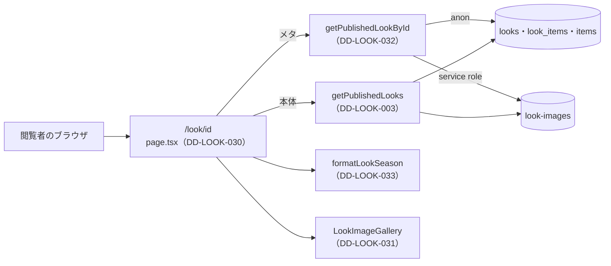

# 1.7 ルック詳細ページ（LOOK DETAIL）詳細設計

> 状態: 推定 | 確認日: 2026-10-24 | 対象: LOOK 詳細 `/look/[id]`、詳細の画像のギャラリー、1件の LOOK の取り出し、シーズンの表記 | 基準コミット: `4facf63b`（作業ツリーに別の作業の未コミットの差分あり）

## 概要

LOOK 詳細 `/look/[id]` を作るコードの単位ごとに、入出力・正常と異常の流れ・状態・認可・単体テストの観点を、追跡できる項目（`### <ID> <題>` と属性の表）で書く。
中身は 2026-10-24 の作業ツリーのコードを読んで起こした今の動きで、ユーザーの確認を受けていないので全部「推定」にした。要件・構造設計と食い違う所は決めずに今のコードの動きを書き、食い違いは `docs/05_Quality/reports/trace-matrix.md` の「食い違い」節に載せた。

| ID | 単位 | 中身 | 旧番号 |
| --- | --- | --- | --- |
| `DD-LOOK-030` | `src/app/look/[id]/page.tsx` | 詳細のページ。公開の LOOK を全部取って位置を探し、情報・関連商品・前後のナビを出す。メタは1件を別に取る | `IMPL-LOOK-DETAIL-001`・`002`・`003`・`004`・`006` |
| `DD-LOOK-031` | `src/features/look/components/LookImageGallery.tsx` | 詳細の画像。mobile はカルーセル、tablet は送りのボタン付き、desktop はサムネイルとメインの画像 | `IMPL-LOOK-DETAIL-005` |
| `DD-LOOK-032` | `getPublishedLookById`（`src/lib/look/server.ts`） | 1件の公開の LOOK を、公開中の関連商品と署名つきの画像付きで返す | なし |
| `DD-LOOK-033` | `formatLookSeason`（`src/lib/look/public.ts`） | シーズンを「2026 AW」の形の文字にする | なし |

- 結論: 詳細の本体は `getPublishedLooks`（[一覧の頁](06_look_list.md) の DD-LOOK-003）で公開の LOOK を全部取り、道の `id` を `Number` にして位置を探す。メタだけは `getPublishedLookById` で1件を別に取るので、1回の表示で同じ LOOK の画像を2回署名する（推定）
- 無い・非公開・数でない id は、同じ URL で見出し「Look not found」だけを状態 200 で返す。`/look` への戻りのリンクは無い（推定）
- 番号は `DD-LOOK-030`〜`059` をこの頁で使う。今は `030`〜`033` を使い、`034` 以降は空けておく
- 旧版の `FR-LOOK-DETAIL-007`（関連の推薦、WONT）の行は実装の ID が「—」で、コードの単位が無い。項目を作らない

## 範囲と根拠

| 項目 | 内容 |
| --- | --- |
| 範囲 | `scripts/trace/scope.json` の LOOK のうち、詳細のページにかかわる単位 |
| 上位の文書 | [LOOK の構造設計](../../03_BasicDesign/areas/look.md)（`ARC-`・`SCR-`・`FLOW-`・`DATA-`）、[LOOK の要件](../../02_Requirements/areas/look.md)（`FR-LOOK-DETAIL-`・`FREQ-`・`SEC-LOOK-`・`DRV-LOOK-`） |
| 対象のコード | `src/app/look/[id]/page.tsx`、`src/features/look/components/LookImageGallery.tsx`、`src/lib/look/server.ts` の `getPublishedLookById`、`src/lib/look/public.ts` の `formatLookSeason` |
| 単位の無いファイル | `src/app/look/[id]/look-detail.css`（`.css` は単位にならない。固定のナビがフッターを覆わないよう、フッターに下の余白を足す） |
| 関連文書 | [ルック一覧の詳細設計](06_look_list.md)、`docs/03_BasicDesign/ui/screen-list.md` |
| 旧版のこの頁 | 機能要件対応表（`IMPL-LOOK-DETAIL-001`〜`006`）。対象の `src/components/ui/List.tsx` は今 `src/components/ui/List/List.tsx`。not found の「Back to Lookbook」リンクと、通常の表示の「Back to Lookbook」はコードに無い |
| 調べた時点 | 2026-10-24 の作業ツリー（コードは読んだだけで、動かしての確かめはしていない） |

範囲外の共有部品は ID を持たないので、項目の本文にファイルの道で書く。

| 共有部品 | 道 | 詳細での使われ方 |
| --- | --- | --- |
| 関連商品の並び | `src/components/ui/List/List.tsx` の `List`（showcase） | STYLING ITEMS の名前・分類・価格・画像と商品へのリンク |
| 画面の下の固定のナビ | `src/components/ui/BottomNavigation/BottomNavigation.tsx` | md 未満の PREV LOOK・LOOK LIST・NEXT LOOK |
| 画像のカルーセル | `src/features/items/components/ItemImageCarousel.tsx`（ITEM）の `CarouselArrowButton`・`CarouselSegmentIndicator`・`carouselIndexFromScroll`・`scrollCarouselTo` | 送りのボタン・線のインジケータ・スクロールの位置から添字を出す計算・添字へのスクロール |
| Supabase の client・商品の画像の署名 | `src/lib/supabase/server.ts`、`src/lib/storage/item-images.ts` の `signItemImageUrl` | 1件の取り出しと署名 |

矢印は呼び出しの向き。ギャラリー（DD-LOOK-031）は利用者の端末で動き、受け取った URL を描くだけ。

## 詳細設計

### DD-LOOK-030 詳細のページ page.tsx

| 属性 | 値 |
| --- | --- |
| 上位 | SCR-LOOK-004、FLOW-LOOK-001、ARC-LOOK-001、SEC-LOOK-001、SEC-LOOK-017 |
| 根拠 | 1つの着こなしを写真と言葉で伝え、使った商品と前後の LOOK へその場で移れるようにする（SCR-LOOK-004、FLOW-LOOK-001）。前後は一覧と同じ並びで決めるので、公開の LOOK の全部の並びの中の位置で前後を選ぶ（FLOW-LOOK-001）。取り出しは公開済みだけを返す関数に任せ、非公開と無い LOOK は同じ知らせにして有無を出さない（SEC-LOOK-001、ARC-LOOK-001）。テーマと説明文は React の文字として出す（SEC-LOOK-017） |
| 状態 | 推定 |
| 確かめ方 | 単体テスト |
| 出どころ | 実装から推定（`src/app/look/[id]/page.tsx`）、この頁の旧版の機能要件対応表 |
| 旧番号 | IMPL-LOOK-DETAIL-001、IMPL-LOOK-DETAIL-002、IMPL-LOOK-DETAIL-003、IMPL-LOOK-DETAIL-004、IMPL-LOOK-DETAIL-006 |

#### 対応要件

FR-LOOK-DETAIL-001・002・003・006、FREQ-176・177・180〜183・288・343・344、NFR-SEO-003（範囲外）、DRV-LOOK-001・004・006。FR-LOOK-DETAIL-004・FREQ-178-REQ-01（not found の戻りのリンク）は満たさない。

#### 入出力

| 項目 | 内容 |
| --- | --- |
| 入力 | `params`（Promise。`id` の文字） |
| 出力（メタ） | 見つかれば title「<テーマ> \| LOOK \| Le Fil des Heures」、description は説明文（空ならテーマから作った文）、OG の画像は1枚目の署名つき URL（無ければ空の配列）。無ければ title「Look not found \| Le Fil des Heures」と固定の説明 |
| 出力（本体） | 見つかれば2列の格子（ギャラリーと情報）・md 以上の3等分のナビ・md 未満の固定のナビ。無ければ見出し「Look not found」だけ |
| 副作用 | なし |

#### 正常フロー

1. メタ: `id` を `Number` にし、数でなければ取り出さずに「無い」。数なら `getPublishedLookById` で1件を取る（DD-LOOK-032）
2. 本体: `id` を `Number` にし、`getPublishedLooks` で公開の LOOK を全部取り、同じ `id` の位置を探す（数でない id は見つからない）
3. 前後: 位置が先頭でなければ1つ前、末尾でなければ1つ後。並びは作った日時の新しい順（DD-LOOK-003）
4. 情報: シーズンを `formatLookSeason` で「2026 AW」の形にし（DD-LOOK-033）、テーマを h1、説明文を段落で出す。価格の書式は表示のたびに作る
5. 関連商品: `List`（showcase）に名前・分類・円の価格・画像・`/item/<id>` を渡す。並びは DD-LOOK-003 の付けた順
6. md 以上のナビ: `aria-label="Look navigation"`。前があれば「Previous look: <テーマ>」の名前で `/look/<前の id>` へのリンク、無ければ薄い非リンク（`aria-hidden`）。真ん中は「Look list」の名前で `/look`。後も前と同じ形
7. md 未満のナビ: `BottomNavigation`（固定・filled・md）に3項目。前後が無い側は `href` を渡さず `disabled`
8. アイコン（`NavIcon`）: 線幅1のインラインの SVG。大きさの既定は `--lk-size-7xl`、固定のナビは `--bottom-nav-icon-size` を渡す。`className` が無ければ空の文字を足す

#### 異常フロー

| 場合 | 動き | 道 |
| --- | --- | --- |
| id が数でない（メタ） | 取り出さず「Look not found」のメタ | `src/app/look/[id]/page.tsx` |
| 1件の取り出しで見つからない・非公開・失敗（メタ） | 「Look not found」のメタ | `src/app/look/[id]/page.tsx` |
| 全件の中に無い・非公開・数でない・取り出しの失敗（本体） | 見出し「Look not found」だけを状態 200 で返す。戻りのリンクは無い（SEC-LOOK-022 は満たさない） | `src/app/look/[id]/page.tsx` |
| 説明文が空（メタ） | 「<テーマ> のスタイリング詳細ページ」 | `src/app/look/[id]/page.tsx` |
| 説明文が空（本体） | 空白1文字の段落を出す | `src/app/look/[id]/page.tsx` |
| 画像が0枚（メタ） | OG の画像を空の配列 | `src/app/look/[id]/page.tsx` |
| 関連商品が0件 | 「紐づけ商品はありません」 | `src/app/look/[id]/page.tsx` |
| 先頭・末尾の LOOK | 無い側を薄い非リンク（md 以上）・`disabled`（md 未満） | `src/app/look/[id]/page.tsx` |

- `id` は `Number` だけで形を確かめず、`1.0` なども数として探す（SEC-LOOK-016 は満たさない）
- OG の画像は1時間で切れる署名つき URL（SEC-LOOK-006 は満たさない）

#### 状態・永続化

なし。読むだけ。前後の位置は表示のたびに全件から計算する。

#### 認証認可

- 認可なし（公開）。session を読まない
- 公開済みだけを返す取り出しの関数（DD-LOOK-003・032）に任せ、ページで状態を確かめない
- テーマ・説明文・商品名は JSX の文字として出す（SEC-LOOK-017）

#### テスト観点

`@/lib/look/server` と `List`・`BottomNavigation`・`LookImageGallery` を差し替え、ページの関数を呼んで描いた結果を見る。

| # | 観点 | 入力 | 期待 |
| --- | --- | --- | --- |
| 1 | メタ（数でない id） | `id:"abc"` | `getPublishedLookById` を呼ばず「Look not found」のメタ |
| 2 | メタ（見つからない） | 1件の取り出しが null | 「Look not found」のメタ |
| 3 | メタ（見つかる・説明あり・画像あり） | 説明文と画像1枚 | title・description・OG の画像 `[{url}]` |
| 4 | メタ（説明なし・画像なし） | 説明文が空、画像0枚 | テーマから作った description、OG の画像が空 |
| 5 | 本体（見つからない） | 全件の中に同じ id が無い | 見出し「Look not found」だけ |
| 6 | 本体（真ん中の LOOK） | 3件の2件目 | 前後の両方が `/look/<id>` のリンク、名前に前後のテーマ。固定のナビは両方 `disabled` でない |
| 7 | 本体（先頭の LOOK） | 3件の1件目 | 前は薄い非リンク（`aria-hidden`）、固定のナビの前は `disabled` で `href` なし |
| 8 | 本体（末尾の LOOK） | 3件の3件目 | 後は薄い非リンク、固定のナビの後は `disabled` |
| 9 | シーズンと題 | 2026・AW、テーマ | 「2026 AW」と h1 のテーマ |
| 10 | 説明文が空 | `themeDescription:""` | 空白1文字の段落 |
| 11 | 関連商品が0件 | `linkedItems:[]` | 「紐づけ商品はありません」、`List` を描かない |
| 12 | 関連商品あり | 1件（価格 12000） | `List` に名前・分類・「￥12,000」・画像・`/item/<id>` |
| 13 | LOOK LIST | どの LOOK でも | `/look` へのリンク（名前「Look list」）と固定のナビの `/look` |
| 14 | アイコンの大きさと class | 3列のナビと固定のナビ | 3列は既定の大きさと渡した class、固定は渡した大きさと class なし |
| 15 | 文字のエスケープ | テーマに `<b>x</b>` | タグが文字のまま出る |

### DD-LOOK-031 詳細の画像のギャラリー LookImageGallery

| 属性 | 値 |
| --- | --- |
| 上位 | SCR-LOOK-005 |
| 根拠 | 1つの着こなしを複数の角度や寄りで見せ、mobile・tablet・desktop で ITEM 詳細と同じ見方にするため、ITEM のカルーセルの部品を使い回す（SCR-LOOK-005）。添字の選択は操作に合わせてすぐ変わるので、利用者の端末で動く部品に置く。画像が無い LOOK でも枠を崩さないよう、代わりの画像を1枚出す |
| 状態 | 推定 |
| 確かめ方 | 単体テスト |
| 出どころ | 実装から推定（`src/features/look/components/LookImageGallery.tsx`）、この頁の旧版の機能要件対応表 |
| 旧番号 | IMPL-LOOK-DETAIL-005 |

#### 対応要件

FR-LOOK-DETAIL-005、FREQ-179・288・289・344、DRV-LOOK-005。

#### 入出力

| 項目 | 内容 |
| --- | --- |
| 入力 | `theme`（代わりの文と読み上げの名前に使う）、`imageUrls`（署名つき URL の配列） |
| 出力 | JSX。md 未満のカルーセルとインジケータ、md〜lg 未満のカルーセル・送りのボタン・インジケータ、lg 以上のサムネイルの列（2枚以上の時）・メインの画像・送りのボタン・インジケータ |
| 副作用 | 送りのボタンとインジケータで、カルーセルを添字へスクロールする（`scrollCarouselTo`） |

#### 正常フロー

1. 画像の並び: 0枚なら `/placeholder.png` の1枚、あれば受けた並び
2. 選択の添字: 初めは0。メインの画像は添字の画像（無ければ先頭）
3. スクロール: カルーセルがスクロールすると、位置から添字を出し、出せた時だけ選択を変える
4. mobile: 全部の画像を `unoptimized` で並べ、先頭だけ `priority`。インジケータを押すとその添字へスクロールする
5. tablet: 同じカルーセル。添字が0より大きい時に前送り、末尾より前の時に次送り。押すと選択を変えてスクロールする
6. desktop: メインの画像と前送り・次送り（選択を変えるだけ）。2枚以上なら左にサムネイルの列。選んだサムネイルは `aria-pressed=true` と黒の枠、ほかは薄く出す。読み上げの名前は「<テーマ> の N枚目を表示」

#### 異常フロー

| 場合 | 動き | 道 |
| --- | --- | --- |
| 画像が0枚 | `/placeholder.png` の1枚。サムネイルの列と送りのボタンを出さない | `src/features/look/components/LookImageGallery.tsx` |
| 画像が1枚 | サムネイルの列を出さない。送りのボタンも出ない | `src/features/look/components/LookImageGallery.tsx` |
| スクロールの位置から添字が出せない | 選択を変えない | `src/features/look/components/LookImageGallery.tsx` |
| 選択の添字が並びの外（描き直しで画像が減った時） | メインの画像は先頭 | `src/features/look/components/LookImageGallery.tsx` |
| 署名に失敗した元の値 | そのまま読み込む（SEC-LOOK-008 は満たさない） | `src/features/look/components/LookImageGallery.tsx` |

#### 状態・永続化

- 部品の中の状態: `selectedIndex`。mobile と tablet のカルーセルの参照
- 永続化はしない。画像が変わっても `selectedIndex` は戻さない（推定）

#### 認証認可

なし。受けた URL を `next/image` の `unoptimized` で直接読み込む（最適化の道を通さない）。

#### テスト観点

`next/image` と `ItemImageCarousel` の4つを差し替える。

| # | 観点 | 入力 | 期待 |
| --- | --- | --- | --- |
| 1 | 画像なし | `imageUrls:[]` | `/placeholder.png` だけ。サムネイルの列・送りのボタンが無い |
| 2 | 画像1枚 | 1枚 | サムネイルの列が無い、送りのボタンが無い |
| 3 | 画像3枚の初め | 3枚 | サムネイル3つ、1つ目が `aria-pressed=true`、次送りだけ出る。mobile と tablet の先頭の画像が `priority` |
| 4 | サムネイルを押す | 2つ目 | 選択が2枚目、メインの画像が2枚目、前送りと次送りが出る |
| 5 | desktop の送り | 次送り・前送り | 選択が1つずつ動く。末尾で次送りが消える |
| 6 | tablet の送り | 次送り・前送り | 選択が動き、`scrollCarouselTo` を tablet の参照で呼ぶ |
| 7 | mobile のインジケータ | 2つ目を押す | 選択が2枚目、`scrollCarouselTo` を mobile の参照で呼ぶ |
| 8 | スクロールで添字が出る | `carouselIndexFromScroll` が 2 | 選択が3枚目 |
| 9 | スクロールで添字が出ない | `carouselIndexFromScroll` が null | 選択が変わらない |
| 10 | 描き直しで画像が減る | 3枚で3枚目を選び、1枚にして描き直す | メインの画像が先頭 |

### DD-LOOK-032 1件の公開の LOOK の取り出し getPublishedLookById

| 属性 | 値 |
| --- | --- |
| 上位 | SCR-LOOK-004、ARC-LOOK-001、ARC-LOOK-003、DATA-LOOK-001、DATA-LOOK-002、DATA-LOOK-003、SEC-LOOK-001 |
| 根拠 | 詳細のメタに要るのは1件だけなので、全件を取らずに id と公開の条件で1件を取る（SCR-LOOK-004）。DB は匿名の client で RLS に従わせ、アプリでも `status='published'` を付けて非公開を出さない（SEC-LOOK-001、ARC-LOOK-001、DATA-LOOK-003）。関連商品は公開中の物だけを付け（DATA-LOOK-002）、画像は service role で署名する（ARC-LOOK-003） |
| 状態 | 推定 |
| 確かめ方 | 単体テスト |
| 出どころ | 実装から推定（`src/lib/look/server.ts`） |

#### 対応要件

FR-LOOK-DETAIL-001・006、NFR-SEO-003（範囲外）、DRV-LOOK-004・005。

#### 入出力

| 項目 | 内容 |
| --- | --- |
| 入力 | `id`（数） |
| 出力 | `PublicLook`（DD-LOOK-003 と同じ形）か null |
| 読む表 | `looks`（7列、`status='published'`・`id`、`maybeSingle`）、`look_items`（`look_id`）、`items`（公開中） |
| 副作用 | `console.error` の記録 |

#### 正常フロー

1. 匿名の client と service role の client を作る
2. 公開の LOOK を1件取る
3. 関連の行を取り、商品の id を重ねずに集める
4. 1つ以上あれば公開中の商品を取り、画像を署名して表に入れる
5. 関連の行の順に、表にある商品だけを並べる
6. `image_urls`（配列でなければ空）を署名し（DD-LOOK-006）、行を `PublicLook` に写して返す

#### 異常フロー

| 場合 | 動き | 道 |
| --- | --- | --- |
| LOOK の取り出しの失敗・無い・非公開 | 記録して null（失敗と「無い」を分けない） | `src/lib/look/server.ts` |
| 関連の取り出しの失敗・`data` が空 | 記録して、関連0件として続ける（画像は署名する） | `src/lib/look/server.ts` |
| 関連の商品が0件 | `items` を読まない | `src/lib/look/server.ts` |
| 商品の取り出しの失敗 | 記録して関連0件 | `src/lib/look/server.ts` |
| 商品の `data` が空 | 空として扱う | `src/lib/look/server.ts` |
| 関連の商品が非公開・消えた | その関連を飛ばす | `src/lib/look/server.ts` |
| `image_urls` が配列でない | 空として署名する | `src/lib/look/server.ts` |

- 一覧の関数（DD-LOOK-003）は関連の失敗で署名せずに返すが、この関数は署名する。2つの関数で失敗の扱いがそろっていない（推定）
- 今の呼び元は詳細のメタだけ（`src/app/look/[id]/page.tsx`）

#### 状態・永続化

なし。

#### 認証認可

DD-LOOK-003 と同じ。DB は anon の client、署名だけ service role。

#### テスト観点

| # | 観点 | 入力 | 期待 |
| --- | --- | --- | --- |
| 1 | LOOK の取り出しの失敗 | `error` あり | null、記録あり |
| 2 | 無い | `data:null`・`error:null` | null |
| 3 | 関連の取り出しの失敗 | `look_items` が `error` | 関連0件の LOOK、画像は署名する |
| 4 | 関連の `data` が空 | `look_items` が `data:null` | 3 と同じ（記録あり） |
| 5 | 関連が0件 | `look_items` が `[]` | `items` を読まない |
| 6 | 商品の取り出しの失敗 | `items` が `error` | 関連0件 |
| 7 | 商品の `data` が空 | `items` が `data:null` | 関連0件 |
| 8 | 公開の商品だけ付ける | 関連2件、商品1件 | 1件だけが付く。商品の画像は署名つき |
| 9 | `image_urls` が配列でない | `image_urls:null` | `imageUrls` が空 |
| 10 | 条件 | どの場合も | `status='published'` と `id` で絞る |

### DD-LOOK-033 シーズンの表記 formatLookSeason

| 属性 | 値 |
| --- | --- |
| 上位 | SCR-LOOK-004 |
| 根拠 | 詳細の情報の列のシーズンを「年 シーズン」の形でそろえて出すため、表記を1つの関数にまとめる（SCR-LOOK-004）。一覧のカードは lg 以上で空白なしの形を使うので、カードは自分で組み立てる（DD-LOOK-001） |
| 状態 | 推定 |
| 確かめ方 | 単体テスト |
| 出どころ | 実装から推定（`src/lib/look/public.ts`） |

#### 対応要件

FR-LOOK-DETAIL-001、FREQ-138（lg 未満のカードと同じ形）。

#### 入出力

| 項目 | 内容 |
| --- | --- |
| 入力 | `seasonYear`（数）、`seasonType`（SS・AW） |
| 出力 | 「<年> <シーズン>」の文字（例: 2026 AW） |

#### 正常フロー

1. 年とシーズンを空白1つでつなぐ

#### 異常フロー

分岐なし。値の形は確かめない。

#### 状態・永続化

なし。

#### 認証認可

なし。

#### テスト観点

| # | 観点 | 入力 | 期待 |
| --- | --- | --- | --- |
| 1 | 表記 | 2026・AW | `2026 AW` |

## 実装の単位

コードの TSDoc に `@design` を書く時はこの表に従う（`@impl` の番号はその時に振る）。単位の数え方は `scripts/trace/parse-code.ts` の `parseCodeUnits`（2026-10-24 に実行）。

| ファイル | 単位（symbol） | 詳細設計 |
| --- | --- | --- |
| `src/app/look/[id]/page.tsx` | `<file>` | DD-LOOK-030 |
| `src/features/look/components/LookImageGallery.tsx` | `<file>` | DD-LOOK-031 |
| `src/lib/look/server.ts` | `getPublishedLookById` | DD-LOOK-032 |
| `src/lib/look/public.ts` | `formatLookSeason` | DD-LOOK-033 |

- 同じファイルの `getPublishedLooks`・`getPublishedLooksCount`（`server.ts`）とシーズンの4つの関数（`public.ts`）は一覧の頁（[06_look_list.md](06_look_list.md)）が扱う

## 未確認事項

- 詳細のページが要求ごとに描かれるか、キャッシュされるかを本番のビルドで確かめていない
- 無い LOOK を状態 200 で返す形と、戻りのリンクが無い形（FR-LOOK-DETAIL-004・FREQ-178-AC-02 と合わない。E2E FR-LOOK-DETAIL-004・010 が赤）をどちらに合わせるか
- 本体とメタで取り出しを2回行う形（本体を `getPublishedLookById` に寄せるか）
- 画像が変わった時にギャラリーの選択を先頭へ戻すか
- この頁の項目は全部「推定」。ユーザーの確認を受けたら「現行」にする
