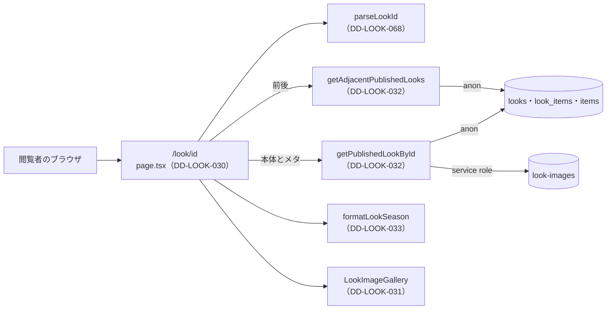

# 1.7 ルック詳細ページ（LOOK DETAIL）詳細設計

> 状態: 推定 | 確認日: 2026-11-07 | 対象: LOOK 詳細 `/look/[id]`、詳細の画像のギャラリー、1件の LOOK の取り出し、シーズンの表記 | 基準コミット: `4facf63b`（作業ツリーに別の作業の未コミットの差分あり）

## 概要

LOOK 詳細 `/look/[id]` を作るコードの単位ごとに、入出力・正常と異常の流れ・状態・認可・単体テストの観点を、追跡できる項目（`### <ID> <題>` と属性の表）で書く。
中身は 2026-10-24 の作業ツリーのコードを読んで起こした今の動きで、ユーザーの確認を受けていないので全部「推定」にした。要件・構造設計と食い違う所は決めずに今のコードの動きを書き、食い違いは `docs/05_Quality/reports/trace-matrix.md` の「食い違い」節に載せた。

| ID | 単位 | 中身 | 旧番号 |
| --- | --- | --- | --- |
| `DD-LOOK-030` | `src/app/look/[id]/page.tsx` | 詳細のページ。id を確かめ、現在の LOOK を 1 件で取り、前後は 1 件ずつ取って、情報・関連商品・前後のナビを出す。メタも 1 件を別に取る | `IMPL-LOOK-DETAIL-001`・`002`・`003`・`004`・`006` |
| `DD-LOOK-031` | `src/features/look/components/LookImageGallery.tsx` | 詳細の画像。mobile はカルーセル、tablet は送りのボタン付き、desktop はサムネイルとメインの画像 | `IMPL-LOOK-DETAIL-005` |
| `DD-LOOK-032` | `getPublishedLookById`・`getAdjacentPublishedLooks`（`src/lib/look/server.ts`） | 1件の公開の LOOK を、公開中の関連商品と署名つきの画像付きで返す。前後の LOOK を 1 件ずつ id と題だけ返す。失敗は前者が投げ、後者は握る | なし |
| `DD-LOOK-033` | `formatLookSeason`（`src/lib/look/public.ts`） | シーズンを「2026 AW」の形の文字にする | なし |
| `DD-LOOK-068` | `parseLookId`（`src/lib/look/public.ts`） | 詳細の URL の id を正の整数にする。合わなければ null | なし |
| `DD-LOOK-071` | `GET`（`src/app/look/[id]/og/route.ts`）、`getPublishedLookCoverRaw`（`src/lib/look/server.ts`） | `og:image` の窓口。公開の LOOK の先頭の画像を、検証した道筋のバイトで返す。署名しない | なし |

- 結論: 詳細の本体は道の `id` を `parseLookId` で確かめ、`getPublishedLookById` で現在の LOOK を 1 件取り（説明文あり）、前後は `getAdjacentPublishedLooks` で並びの境目から 1 件ずつ取る（ADR-0159）。一覧の 100 件の写しに頼らないので、101 番目より古い LOOK も開き、説明文が出る。メタも `getPublishedLookById` で 1 件を別に取るので、1回の表示で同じ LOOK の画像を2回署名する（推定）
- 無い・非公開・形の合わない id は、同じ URL で見出し「Look not found」だけを状態 200 で返す。見出しの下に `/look` への「Back to Lookbook」のリンクを置く（FR-LOOK-DETAIL-004。2026-11-07 に戻した）。DB の取り出しの失敗は「Look not found」にせず、頁が投げて `src/app/look/error.tsx`（[一覧の頁](06_look_list.md) の DD-LOOK-069）の誤りの画面になる
- 番号は `DD-LOOK-030`〜`059` をこの頁で使う。今は `030`〜`033` を使い、`034` 以降は空けておく。`068` は管理の頁の範囲の空きを `parseLookId` に使った（`069` の誤りの画面は一覧の頁。2026-10-26）。`071` は `og:image` の窓口（2026-10-28。`070` は管理の画像の頁）
- 旧版の `FR-LOOK-DETAIL-007`（関連の推薦、WONT）の行は実装の ID が「—」で、コードの単位が無い。項目を作らない

## 範囲と根拠

| 項目 | 内容 |
| --- | --- |
| 範囲 | `scripts/trace/scope.json` の LOOK のうち、詳細のページにかかわる単位 |
| 上位の文書 | [LOOK の構造設計](../../03_BasicDesign/areas/look.md)（`ARC-`・`SCR-`・`FLOW-`・`DATA-`）、[LOOK の要件](../../02_Requirements/areas/look.md)（`FR-LOOK-DETAIL-`・`FREQ-`・`SEC-LOOK-`・`DRV-LOOK-`） |
| 対象のコード | `src/app/look/[id]/page.tsx`、`src/features/look/components/LookImageGallery.tsx`、`src/lib/look/server.ts` の `getPublishedLookById`・`getAdjacentPublishedLooks`・`getPublishedLookCoverRaw`、`src/lib/look/public.ts` の `formatLookSeason`・`parseLookId`、`src/app/look/[id]/og/route.ts` |
| 単位の無いファイル | `src/app/look/[id]/look-detail.css`（`.css` は単位にならない。固定のナビがフッターを覆わないよう、フッターに下の余白を足す） |
| 関連文書 | [ルック一覧の詳細設計](06_look_list.md)、`docs/03_BasicDesign/ui/screen-list.md` |
| 旧版のこの頁 | 機能要件対応表（`IMPL-LOOK-DETAIL-001`〜`006`）。対象の `src/components/ui/List.tsx` は今 `src/components/ui/List/List.tsx`。not found の「Back to Lookbook」リンクは 2026-11-07 にコードへ戻した。通常の表示の「Back to Lookbook」は FREQ-178 で外したのでコードに無い |
| 調べた時点 | 2026-10-24 の作業ツリー（コードは読んだだけで、動かしての確かめはしていない）。2026-10-26 に `DD-LOOK-030`・`032`・`068` を直した（単体・結合テストで確かめた） |

範囲外の共有部品は ID を持たないので、項目の本文にファイルの道で書く。

| 共有部品 | 道 | 詳細での使われ方 |
| --- | --- | --- |
| 関連商品の並び | `src/components/ui/List/List.tsx` の `List`（showcase） | STYLING ITEMS の名前・分類・価格・画像と商品へのリンク |
| 画面の下の固定のナビ | `src/components/ui/BottomNavigation/BottomNavigation.tsx` | md 未満の PREV LOOK・LOOK LIST・NEXT LOOK |
| 画像のカルーセル | `src/features/items/components/ItemImageCarousel.tsx`（ITEM）の `CarouselArrowButton`・`CarouselSegmentIndicator`・`carouselIndexFromScroll`・`scrollCarouselTo` | 送りのボタン・線のインジケータ・スクロールの位置から添字を出す計算・添字へのスクロール |
| Supabase の client・商品の画像の署名 | `src/lib/supabase/server.ts`、`src/lib/storage/item-images.ts` の `signItemImageUrl` | 1件の取り出しと署名 |

矢印は呼び出しの向き。ギャラリー（DD-LOOK-031）は利用者の端末で動き、受け取った URL を描くだけ。

## 詳細設計

### DD-LOOK-030 詳細のページ page.tsx

| 属性 | 値 |
| --- | --- |
| 上位 | SCR-LOOK-004、FLOW-LOOK-001、ARC-LOOK-001、SEC-LOOK-001、SEC-LOOK-017 |
| 根拠 | 1つの着こなしを写真と言葉で伝え、使った商品と前後の LOOK へその場で移れるようにする（SCR-LOOK-004、FLOW-LOOK-001）。前後は一覧と同じ並び（作った日時の新しい順・同じ時刻は `id` の大きい順）の境目から 1 件ずつ取る。一覧の 100 件に頼ると、101 番目より古い LOOK が開かず説明文も出ない（FLOW-LOOK-001、ADR-0159）。`id` は URL から来るので入口で確かめる（SEC-LOOK-016）。取り出しは公開済みだけを返す関数に任せ、非公開と無い LOOK は同じ知らせにして有無を出さない（SEC-LOOK-001、ARC-LOOK-001）。テーマと説明文は React の文字として出す（SEC-LOOK-017）。DB の取り出しの失敗は握らず誤りの画面に任せる（SEC-LOOK-022） |
| 状態 | 推定 |
| 確かめ方 | 単体テスト |
| 出どころ | 実装から推定（`src/app/look/[id]/page.tsx`）、この頁の旧版の機能要件対応表、ユーザーの決定（2026-10-26。ADR-0159） |
| 旧番号 | IMPL-LOOK-DETAIL-001、IMPL-LOOK-DETAIL-002、IMPL-LOOK-DETAIL-003、IMPL-LOOK-DETAIL-004、IMPL-LOOK-DETAIL-006 |

#### 対応要件

FR-LOOK-DETAIL-001・002・003・006、FREQ-176・177・180〜183・288・343・344、NFR-SEO-003（範囲外）、DRV-LOOK-001・004・006。FR-LOOK-DETAIL-004・FREQ-178-REQ-01（not found の戻りのリンク）は 2026-11-07 に戻して満たす。

#### 入出力

| 項目 | 内容 |
| --- | --- |
| 入力 | `params`（Promise。`id` の文字） |
| 出力（メタ） | 見つかれば title「<テーマ> \| LOOK \| Le Fil des Heures」、description は説明文（空ならテーマから作った文）、OG の画像は、署名できる画像が 1 枚以上ある時 `[{ url: "/look/<id>/og" }]`（署名を含まない同一オリジンの窓口。DD-LOOK-071）、無ければ空の配列。無ければ title「Look not found \| Le Fil des Heures」と固定の説明 |
| 出力（本体） | 見つかれば2列の格子（ギャラリーと情報）・md 以上の3等分のナビ・md 未満の固定のナビ。無ければ見出し「Look not found」だけ |
| 副作用 | なし |

#### 正常フロー

1. メタ: `id` を `parseLookId` で確かめ（DD-LOOK-068）、null なら取り出さずに「無い」。正の整数なら `getPublishedLookById` で1件を取る（DD-LOOK-032）。取り出しが失敗してもメタは投げず、固定の題と説明を返す
2. 本体: `id` を `parseLookId` で確かめ、null なら取り出さずに「Look not found」。正の整数なら `getPublishedLookById` で現在の LOOK を 1 件取る。無い・非公開（null）も「Look not found」で前後は取らない。DB の失敗は投げる
3. 前後: `getAdjacentPublishedLooks` に現在の `id` と `createdAt` を渡し、1 つ新しい LOOK を「前」、1 つ古い LOOK を「後」にする（DD-LOOK-032）。どちらかが null でも頁は開く
4. 情報: シーズンを `formatLookSeason` で「2026 AW」の形にし（DD-LOOK-033）、テーマを h1、説明文を段落で出す。価格の書式は表示のたびに作る
5. 関連商品: `List`（showcase）に名前・分類・円の価格・画像・`/item/<id>` を渡す。並びは DD-LOOK-003 の付けた順
6. md 以上のナビ: `aria-label="Look navigation"`。前があれば「Previous look: <テーマ>」の名前で `/look/<前の id>` へのリンク、無ければ薄い非リンク（`aria-hidden`）。真ん中は「Look list」の名前で `/look`。後も前と同じ形
7. md 未満のナビ: `BottomNavigation`（固定・filled・md）に3項目。前後が無い側は `href` を渡さず `disabled`
8. アイコン（`NavIcon`）: 線幅1のインラインの SVG。大きさの既定は `--lk-size-7xl`、固定のナビは `--bottom-nav-icon-size` を渡す。`className` が無ければ空の文字を足す

#### 異常フロー

| 場合 | 動き | 道 |
| --- | --- | --- |
| id が正の整数でない（メタ） | 取り出さず「Look not found」のメタ | `src/app/look/[id]/page.tsx` |
| 1件の取り出しで見つからない・非公開・失敗（メタ） | 「Look not found」のメタ（失敗でも投げない） | `src/app/look/[id]/page.tsx` |
| 無い・非公開・id が正の整数でない（本体） | 見出し「Look not found」だけを状態 200 で返す。見出しの下に `/look` への「Back to Lookbook」のリンクを置く。id が合わない時は DB を呼ばず、無い・非公開の時は前後を取らない | `src/app/look/[id]/page.tsx` |
| 取り出しの失敗（本体） | `LookFetchError` が投げられ、`error.tsx` の誤りの画面になる（SEC-LOOK-022） | `src/app/look/[id]/page.tsx`、`src/lib/look/server.ts` |
| 前後の取り出しの失敗 | 記録だけで、その側を無効の表示にして頁は開く | `src/lib/look/server.ts` |
| 説明文が空（メタ） | 「<テーマ> のスタイリング詳細ページ」 | `src/app/look/[id]/page.tsx` |
| 説明文が空（本体） | 空白1文字の段落を出す | `src/app/look/[id]/page.tsx` |
| 画像が0枚（メタ） | OG の画像を空の配列 | `src/app/look/[id]/page.tsx` |
| 関連商品が0件 | 「紐づけ商品はありません」 | `src/app/look/[id]/page.tsx` |
| 先頭・末尾の LOOK | 無い側を薄い非リンク（md 以上）・`disabled`（md 未満） | `src/app/look/[id]/page.tsx` |

- `id` は `parseLookId` で確かめる。`1e3`・`1.5`・`0`・`01`・前後の空白・17 桁以上は DB を呼ばずに見つからない扱い（SEC-LOOK-016）
- OG の画像は署名つき URL でなく `/look/<id>/og`（SEC-LOOK-006。2026-10-28。ADR-0165）。署名が全部外れた LOOK（`imageUrls` が空）は窓口も画像を返せないので、空の配列にする

#### 状態・永続化

なし。読むだけ。前後は表示のたびに DB に聞いて 1 件ずつ取る。

#### 認証認可

- 認可なし（公開）。session を読まない
- 公開済みだけを返す取り出しの関数（DD-LOOK-003・032）に任せ、ページで状態を確かめない
- テーマ・説明文・商品名は JSX の文字として出す（SEC-LOOK-017）

#### テスト観点

`@/lib/look/server` と `List`・`BottomNavigation`・`LookImageGallery` を差し替え、ページの関数を呼んで描いた結果を見る。

| # | 観点 | 入力 | 期待 |
| --- | --- | --- | --- |
| 1 | メタ（正の整数でない id） | `id:"abc"`・`1e3`・`0`・`-1`・`1.5` | `getPublishedLookById` を呼ばず「Look not found」のメタ。取り出しが reject しても投げず固定の題と説明 |
| 2 | メタ（見つからない） | 1件の取り出しが null | 「Look not found」のメタ |
| 3 | メタ（見つかる・説明あり・画像あり） | 説明文と画像2枚 | title・description・OG の画像 `[{url:"/look/<id>/og"}]`（署名つき URL は出ない） |
| 4 | メタ（説明なし・画像なし） | 説明文が空、画像0枚 | テーマから作った description、OG の画像が空 |
| 5 | 本体（見つからない） | `getPublishedLookById` が null、または id が正の整数でない | 見出し「Look not found」だけ。前後を取らない。id が合わない時は 1 件も取らない |
| 6 | 本体（真ん中の LOOK） | 前後の両方を返す | 前後の両方が `/look/<id>` のリンク、名前に前後のテーマ。固定のナビは両方 `disabled` でない |
| 7 | 本体（先頭の LOOK） | 前が null | 前は薄い非リンク（`aria-hidden`）、固定のナビの前は `disabled` で `href` なし |
| 8 | 本体（末尾の LOOK） | 後が null | 後は薄い非リンク、固定のナビの後は `disabled` |
| 9 | シーズンと題 | 2026・AW、テーマ | 「2026 AW」と h1 のテーマ |
| 10 | 説明文が空 | `themeDescription:""` | 空白1文字の段落 |
| 11 | 関連商品が0件 | `linkedItems:[]` | 「紐づけ商品はありません」、`List` を描かない |
| 12 | 関連商品あり | 1件（価格 12000） | `List` に名前・分類・「￥12,000」・画像・`/item/<id>` |
| 13 | LOOK LIST | どの LOOK でも | `/look` へのリンク（名前「Look list」）と固定のナビの `/look` |
| 14 | アイコンの大きさと class | 3列のナビと固定のナビ | 3列は既定の大きさと渡した class、固定は渡した大きさと class なし |
| 15 | 文字のエスケープ | テーマに `<b>x</b>` | タグが文字のまま出る |
| 16 | 取り出しの方法 | 通常の表示 | 現在の LOOK は `getPublishedLookById` を 1 回、前後は `getAdjacentPublishedLooks` を `{ id, createdAt }` で 1 回。一覧の取り出し（`getPublishedLooks`）は呼ばない。説明文はこの 1 件から出る |
| 17 | 前後が両方 null | `{ prev:null, next:null }` | 頁は開き、前後とも無効の表示 |
| 18 | 取り出しの失敗 | `getPublishedLookById` が reject | ページも reject し、前後を取らない |

### DD-LOOK-031 詳細の画像のギャラリー LookImageGallery

| 属性 | 値 |
| --- | --- |
| 上位 | SCR-LOOK-005 |
| 根拠 | 1つの着こなしを複数の角度や寄りで見せ、mobile・tablet・desktop で ITEM 詳細と同じ見方にするため、ITEM のカルーセルの部品を使い回す（SCR-LOOK-005）。添字の選択は操作に合わせてすぐ変わるので、利用者の端末で動く部品に置く。画像が無い LOOK でも枠を崩さないよう、代わりの画像を1枚出す |
| 状態 | 推定 |
| 確かめ方 | 単体テスト |
| 出どころ | 実装から推定（`src/features/look/components/LookImageGallery.tsx`）、この頁の旧版の機能要件対応表 |
| 旧番号 | IMPL-LOOK-DETAIL-005 |

#### 対応要件

FR-LOOK-DETAIL-005、FREQ-179・288・289・344、DRV-LOOK-005。

#### 入出力

| 項目 | 内容 |
| --- | --- |
| 入力 | `theme`（代わりの文と読み上げの名前に使う）、`imageUrls`（署名つき URL の配列） |
| 出力 | JSX。md 未満のカルーセルとインジケータ、md〜lg 未満のカルーセル・送りのボタン・インジケータ、lg 以上のサムネイルの列（2枚以上の時）・メインの画像・送りのボタン・インジケータ |
| 副作用 | 送りのボタンとインジケータで、カルーセルを添字へスクロールする（`scrollCarouselTo`） |

#### 正常フロー

1. 画像の並び: 0枚なら `/placeholder.png` の1枚、あれば受けた並び
2. 選択の添字: 初めは0。メインの画像は添字の画像（無ければ先頭）
3. スクロール: カルーセルがスクロールすると、位置から添字を出し、出せた時だけ選択を変える
4. mobile: 全部の画像を `unoptimized` で並べ、先頭だけ `priority`。インジケータを押すとその添字へスクロールする
5. tablet: 同じカルーセル。添字が0より大きい時に前送り、末尾より前の時に次送り。押すと選択を変えてスクロールする
6. desktop: メインの画像と前送り・次送り（選択を変えるだけ）。2枚以上なら左にサムネイルの列。選んだサムネイルは `aria-pressed=true` と黒の枠、ほかは薄く出す。読み上げの名前は「<テーマ> の N枚目を表示」

#### 異常フロー

| 場合 | 動き | 道 |
| --- | --- | --- |
| 画像が0枚 | `/placeholder.png` の1枚。サムネイルの列と送りのボタンを出さない | `src/features/look/components/LookImageGallery.tsx` |
| 画像が1枚 | サムネイルの列を出さない。送りのボタンも出ない | `src/features/look/components/LookImageGallery.tsx` |
| スクロールの位置から添字が出せない | 選択を変えない | `src/features/look/components/LookImageGallery.tsx` |
| 選択の添字が並びの外（描き直しで画像が減った時） | メインの画像は先頭 | `src/features/look/components/LookImageGallery.tsx` |
| 署名に失敗した画像・道筋にできない画像 | 署名の側が外す（`imageUrls` に入らない。元の値は読み込まない。SEC-LOOK-008。2026-10-28）。全部外れたら 0 枚の表示 | `src/lib/storage/look-images.ts` |

#### 状態・永続化

- 部品の中の状態: `selectedIndex`。mobile と tablet のカルーセルの参照
- 永続化はしない。画像が変わっても `selectedIndex` は戻さない（推定）

#### 認証認可

なし。受けた URL を `next/image` の `unoptimized` で直接読み込む（最適化の道を通さない）。

#### テスト観点

`next/image` と `ItemImageCarousel` の4つを差し替える。

| # | 観点 | 入力 | 期待 |
| --- | --- | --- | --- |
| 1 | 画像なし | `imageUrls:[]` | `/placeholder.png` だけ。サムネイルの列・送りのボタンが無い |
| 2 | 画像1枚 | 1枚 | サムネイルの列が無い、送りのボタンが無い |
| 3 | 画像3枚の初め | 3枚 | サムネイル3つ、1つ目が `aria-pressed=true`、次送りだけ出る。mobile と tablet の先頭の画像が `priority` |
| 4 | サムネイルを押す | 2つ目 | 選択が2枚目、メインの画像が2枚目、前送りと次送りが出る |
| 5 | desktop の送り | 次送り・前送り | 選択が1つずつ動く。末尾で次送りが消える |
| 6 | tablet の送り | 次送り・前送り | 選択が動き、`scrollCarouselTo` を tablet の参照で呼ぶ |
| 7 | mobile のインジケータ | 2つ目を押す | 選択が2枚目、`scrollCarouselTo` を mobile の参照で呼ぶ |
| 8 | スクロールで添字が出る | `carouselIndexFromScroll` が 2 | 選択が3枚目 |
| 9 | スクロールで添字が出ない | `carouselIndexFromScroll` が null | 選択が変わらない |
| 10 | 描き直しで画像が減る | 3枚で3枚目を選び、1枚にして描き直す | メインの画像が先頭 |

### DD-LOOK-032 1件の公開の LOOK と前後の取り出し getPublishedLookById・getAdjacentPublishedLooks

| 属性 | 値 |
| --- | --- |
| 上位 | SCR-LOOK-004、ARC-LOOK-001、ARC-LOOK-003、DATA-LOOK-001、DATA-LOOK-002、DATA-LOOK-003、SEC-LOOK-001、SEC-LOOK-022 |
| 根拠 | 詳細の頁とメタに要るのは1件だけなので、全件を取らずに id と公開の条件で1件を取る（SCR-LOOK-004、ADR-0159）。前後の LOOK は一覧の並びの境目から 1 件ずつだけ取り、一覧の 100 件の外の LOOK も前後を持てるようにする。DB は匿名の client で RLS に従わせ、アプリでも `status='published'` を付けて非公開を出さない（SEC-LOOK-001、ARC-LOOK-001、DATA-LOOK-003）。関連商品は公開中の物だけを付け（DATA-LOOK-002）、画像は service role で署名する（ARC-LOOK-003）。DB の失敗は「無い」と分けて投げる（SEC-LOOK-022）。前後は添え物で、記事本体を隠さないよう失敗を握る |
| 状態 | 推定 |
| 確かめ方 | 単体テスト |
| 出どころ | 実装から推定（`src/lib/look/server.ts`）、ユーザーの決定（2026-10-26。ADR-0159） |

#### 対応要件

FR-LOOK-DETAIL-001・003・006、NFR-SEO-003（範囲外）、DRV-LOOK-001・004・005、SEC-LOOK-022。

#### 入出力

| 項目 | 内容 |
| --- | --- |
| 入力 | `getPublishedLookById(id)` は `id`（数）。`getAdjacentPublishedLooks({ id, createdAt })` は現在の LOOK の `id` と作成時刻（DB から読んだ値） |
| 出力 | `getPublishedLookById` は `PublicLook`（`PublicLookListItem` に `themeDescription` を足した形）か null。`getAdjacentPublishedLooks` は `{ prev, next }`（それぞれ `{ id, theme }` か null） |
| 読む表 | `looks`（7列、`status='published'`・`id`、`maybeSingle`）、`look_items`（`look_id`）、`items`（公開中）。前後は `looks`（`id,theme`、`status='published'`） |
| 副作用 | `console.error` の記録（第 2 引数は `{ name, code }`） |
| 投げる誤り | `getPublishedLookById` は DB の失敗で `LookFetchError`。`getAdjacentPublishedLooks` は投げない |

#### 正常フロー

1. 匿名の client と service role の client を作る
2. 公開の LOOK を1件取る
3. 関連の行を取り、商品の id を重ねずに集める
4. 1つ以上あれば公開中の商品を取り、画像を署名して表に入れる
5. 関連の行の順に、表にある商品だけを並べる
6. `image_urls`（配列でなければ空）を署名し（DD-LOOK-006）、行を `PublicLook` に写して返す

前後（`getAdjacentPublishedLooks`）:

1. 匿名の client で、公開済みだけから 2 本を同時に取る。「前」（1 つ新しい）は `.or('created_at.gt."<時刻>",and(created_at.eq."<時刻>",id.gt.<id>)')` を `created_at` と `id` の昇順で `limit(1)`、「後」（1 つ古い）は `.or('created_at.lt."<時刻>",and(created_at.eq."<時刻>",id.lt.<id>)')` を降順で `limit(1)`。どちらも `maybeSingle`
2. 時刻は PostgREST の予約文字（`.` `:`）を含むので二重引用符で囲む。値は DB から読んだ `created_at` と数の `id` だけで、外から来た文字を入れない
3. 取れた行は `id` と `theme` だけで返す

#### 異常フロー

| 場合 | 動き | 道 |
| --- | --- | --- |
| LOOK の取り出しの失敗 | `{ name, code }` を記録して `LookFetchError`（「無い」と分ける。SEC-LOOK-022） | `src/lib/look/server.ts` |
| LOOK が無い・非公開 | null（記録しない） | `src/lib/look/server.ts` |
| 関連の取り出しの失敗・`data` が空 | 記録して `LookFetchError`（関連なしで返さない） | `src/lib/look/server.ts` |
| 関連の商品が0件 | `items` を読まない | `src/lib/look/server.ts` |
| 商品の取り出しの失敗 | 記録して `LookFetchError` | `src/lib/look/server.ts` |
| 前後の片方の取り出しの失敗 | `{ name, code }` を 1 回記録して、その側を null にする。投げない | `src/lib/look/server.ts` |
| 前後の行が無い | その側が null（記録しない） | `src/lib/look/server.ts` |
| 商品の `data` が空 | 空として扱う | `src/lib/look/server.ts` |
| 関連の商品が非公開・消えた | その関連を飛ばす | `src/lib/look/server.ts` |
| `image_urls` が配列でない | 空として署名する | `src/lib/look/server.ts` |

- 一覧の関数（DD-LOOK-003）とこの関数は、どちらも DB の失敗を `LookFetchError` で投げる（2026-10-26 にそろえた）
- 呼び元は詳細の頁とメタ（`src/app/look/[id]/page.tsx`）。前後の関数は頁だけが呼ぶ

#### 状態・永続化

なし。

#### 認証認可

DD-LOOK-003 と同じ。DB は anon の client、署名だけ service role。

#### テスト観点

| # | 観点 | 入力 | 期待 |
| --- | --- | --- | --- |
| 1 | LOOK の取り出しの失敗 | `{ code:'42501', message:'permission denied…' }` | `LookFetchError`（`code:'42501'`）で reject。記録は `{ name, code }` で `message` を含まない |
| 2 | 無い | `data:null`・`error:null` | null |
| 3 | 関連の取り出しの失敗 | `look_items` が `error` | `LookFetchError` で reject |
| 4 | 関連の `data` が空 | `look_items` が `data:null` | 3 と同じ |
| 5 | 関連が0件 | `look_items` が `[]` | `items` を読まない |
| 6 | 商品の取り出しの失敗 | `items` が `error` | `LookFetchError` で reject |
| 7 | 商品の `data` が空 | `items` が `data:null` | 関連0件 |
| 8 | 公開の商品だけ付ける | 関連2件、商品1件 | 1件だけが付く。商品の画像は署名つき |
| 9 | `image_urls` が配列でない | `image_urls:null` | `imageUrls` が空 |
| 10 | 条件 | どの場合も | `status='published'` と `id` で絞る。成功の結果は `themeDescription` を含む |
| 11 | 前後の問い合わせ（`getAdjacentPublishedLooks({ id:5, createdAt:'2026-06-05T12:00:00+00:00' })`） | 通常 | 2 本の `.or()` の文字が上の形ちょうど（時刻が `"` で囲まれる）、`eq('status','published')`、`select('id,theme')`、`order` と `limit(1)` が上のとおり |
| 12 | 前後の片方の失敗 | 前だけ `error` | `{ prev:null, next:<行> }` で reject しない。記録は `{ name, code }` で 1 回 |
| 13 | 前後が両方 null | 両方 `data:null` | `{ prev:null, next:null }` |

### DD-LOOK-033 シーズンの表記 formatLookSeason

| 属性 | 値 |
| --- | --- |
| 上位 | SCR-LOOK-004 |
| 根拠 | 詳細の情報の列のシーズンを「年 シーズン」の形でそろえて出すため、表記を1つの関数にまとめる（SCR-LOOK-004）。一覧のカードは lg 以上で空白なしの形を使うので、カードは自分で組み立てる（DD-LOOK-001） |
| 状態 | 推定 |
| 確かめ方 | 単体テスト |
| 出どころ | 実装から推定（`src/lib/look/public.ts`） |

#### 対応要件

FR-LOOK-DETAIL-001、FREQ-138（lg 未満のカードと同じ形）。

#### 入出力

| 項目 | 内容 |
| --- | --- |
| 入力 | `seasonYear`（数）、`seasonType`（SS・AW） |
| 出力 | 「<年> <シーズン>」の文字（例: 2026 AW） |

#### 正常フロー

1. 年とシーズンを空白1つでつなぐ

#### 異常フロー

分岐なし。値の形は確かめない。

#### 状態・永続化

なし。

#### 認証認可

なし。

#### テスト観点

| # | 観点 | 入力 | 期待 |
| --- | --- | --- | --- |
| 1 | 表記 | 2026・AW | `2026 AW` |

### DD-LOOK-068 詳細の id の確かめ parseLookId

| 属性 | 値 |
| --- | --- |
| 上位 | SCR-LOOK-004、SEC-LOOK-016 |
| 根拠 | 詳細の `id` は URL から来る。`Number()` に任せると `1e3`・`1.5`・` 1`・`0x10` が通って取り出しに渡るので、10 進の正の整数の文字だけを数にし、他は DB を呼ばずに見つからない扱いにする（SEC-LOOK-016）。桁を 16 に切って安全な整数でなければ弾く |
| 状態 | 推定 |
| 確かめ方 | 単体テスト |
| 出どころ | ユーザーの決定（2026-10-26。波 1-C）、実装（`src/lib/look/public.ts`） |

#### 対応要件

SEC-LOOK-016。

#### 入出力

| 項目 | 内容 |
| --- | --- |
| 入力 | `value`（文字） |
| 出力 | 数か null |

#### 正常フロー

1. `/^[1-9]\d{0,15}$/` に合うか確かめる
2. 合えば `Number` にし、`Number.isSafeInteger` なら返す。そうでなければ null

#### 異常フロー

| 場合 | 動き | 道 |
| --- | --- | --- |
| `0`・`01`・`1.5`・`1e3`・`-1`・` 1`・`1 `・空・`abc`・17 桁以上 | null | `src/lib/look/public.ts` |

#### 状態・永続化

なし。

#### 認証認可

なし。

#### テスト観点

| # | 観点 | 入力 | 期待 |
| --- | --- | --- | --- |
| 1 | 正の整数 | `'1'`・`'1234567890123456'`（16 桁） | その数 |
| 2 | 形の合わない値 | `'0'`・`'01'`・`'1.5'`・`'1e3'`・`'-1'`・`' 1'`・`'1 '`・`''`・`'abc'`・`'0x10'`・`'12345678901234567'`（17 桁） | null |

### DD-LOOK-071 og:image の窓口 GET /look/[id]/og と getPublishedLookCoverRaw

| 属性 | 値 |
| --- | --- |
| 上位 | API-LOOK-007、SEC-LOOK-006 |
| 根拠 | `og:image` に期限つきの署名つき URL を入れると 1 時間で切れ、クローラーにも残る。署名を含まない同一オリジンの URL にし、公開の LOOK の先頭の画像だけを、検証した道筋のバイトで短く共有キャッシュさせて返す（SEC-LOOK-006、ADR-0165）。種類は置き場の申告でなく先頭の印で決め、非画像を画像として配らない |
| 状態 | 推定 |
| 確かめ方 | 単体テスト・E2E |
| 出どころ | ユーザーの決定（Q10。推奨で進めた。2026-10-28）、実装（`src/app/look/[id]/og/route.ts`、`src/lib/look/server.ts`） |

#### 対応要件

SEC-LOOK-006（-AC-02、-AC-03）。

#### 入出力

| 項目 | 内容 |
| --- | --- |
| 入力（窓口） | 道の `id`（文字）。`Request` は使わない |
| 入力（取り出し） | `id`（正の整数） |
| 出力（取り出し） | 公開の LOOK の `image_urls` のうち、道筋の確かめに通る最初の生の値。無ければ null |
| 出力（窓口） | 200 のバイト（`Content-Type` は検出した種類、`Cache-Control: public, max-age=300, s-maxage=300`、`X-Content-Type-Options: nosniff`）か、404（本文は固定の `Not Found`、`Cache-Control: no-store`、`nosniff`） |

#### 正常フロー

1. `parseLookId(id)` で正の整数に確かめる
2. `getPublishedLookCoverRaw(id)` が匿名の client で `looks.image_urls` を `status='published'` と `id` で 1 件読み、`parseOwnObjectPath(raw, { bucket: 'look-images', prefix: 'looks' })` に通る最初の生の値を返す
3. 窓口がもう一度同じ関数を通して道筋を取り、service role で `look-images` から `download` する
4. バイトの先頭の印（`detectImageType`）で種類を決め、バイトを返す

#### 異常フロー

| 場合 | 動き | 道 |
| --- | --- | --- |
| id が正の整数でない | LOOK を取りに行かず 404 | `src/app/look/[id]/og/route.ts` |
| 非公開・無い・`image_urls` が配列でない・通る画像が無い | 取り出しが null で 404。置き場を読まない | `src/lib/look/server.ts` |
| 取り出しの DB の失敗 | 名前と符号だけ記録して null（窓口は 404）。投げない | `src/lib/look/server.ts` |
| 取り出した値がもう一度の確かめに通らない | 404。置き場を読まない | `src/app/look/[id]/og/route.ts` |
| `download` が誤りを返す・投げる | 404、記録は `download_failed` だけ | `src/app/look/[id]/og/route.ts` |
| 先頭の印が画像でない | 404、記録は `not_image` だけ（置き場の `Content-Type` は信じない） | `src/app/look/[id]/og/route.ts` |

- 404 の本文・記録に、道筋・URL・置き場の誤りの文を出さない

#### 状態・永続化

なし。読むだけ。

#### 認証認可

- 認可なし（公開）。session を読まず、`Set-Cookie` を付けない（`session_id` は許可リストの道だけで発行する。ADR-0355）
- 公開の印は匿名の鍵（RLS）と `status='published'` の両方で絞る。置き場は service role で読むので、道筋の確かめが境界になる（SEC-LOOK-007）
- 回数の制限は付けない（公開の LOOK の数に限られ、`s-maxage=300` で CDN が受ける。波 4 で見直す）

#### テスト観点

窓口は `getPublishedLookCoverRaw` と `createServiceRoleClient` を差し替えて呼ぶ（`tests/unit/app/look-og-route.test.ts`）。取り出しは匿名の client の連鎖を差し替える（`tests/unit/lib/look-server.test.ts`）。

| # | 観点 | 入力 | 期待 |
| --- | --- | --- | --- |
| 1 | 公開の LOOK（PNG） | 取り出しが `looks/…png`、`download` が PNG のバイト | 200、`image/png`、`Cache-Control` がちょうど `public, max-age=300, s-maxage=300`、`nosniff`、バイト一致、`Set-Cookie` なし |
| 2 | 種類 | JPEG・WebP・GIF の先頭の印 | それぞれの種類 |
| 3 | 非画像 | 置き場の `Content-Type` が `image/png` でも本文が HTML | 404 |
| 4 | 不正な id | `abc`・`0`・`-1`・`1.5`・20 桁 | 404。取り出しも `download` も呼ばない |
| 5 | 非公開・無い | 取り出しが null | 404。`download` を呼ばない |
| 6 | 確かめに通らない値 | 外の host の URL・`../x.png`・`other/x.png` | 404。`download` を呼ばない |
| 7 | 置き場の失敗 | `download` が `{ error }`・投げる | 404。本文にも記録にも誤りの文・道筋が出ない |
| 8 | 404 の見出し | どの 404 でも | `Cache-Control: no-store`、`Set-Cookie` なし |
| 9 | 取り出しの絞り | 匿名の client | `select('image_urls')`・`eq('status','published')`・`eq('id', id)`・`maybeSingle`。service role と署名を使わない |
| 10 | 最初の有効な値 | `image_urls` の先頭 3 つが確かめに通らず 4 つ目が通る | 4 つ目の生の値 |
| 11 | 無効 | 全部確かめに通らない・配列でない・空・DB の失敗 | null（DB の失敗は符号だけ記録） |

## 実装の単位

コードの TSDoc に `@design` を書く時はこの表に従う（`@impl` の番号はその時に振る）。単位の数え方は `scripts/trace/parse-code.ts` の `parseCodeUnits`（2026-10-24 に実行）。

| ファイル | 単位（symbol） | 詳細設計 |
| --- | --- | --- |
| `src/app/look/[id]/page.tsx` | `<file>` | DD-LOOK-030 |
| `src/features/look/components/LookImageGallery.tsx` | `<file>` | DD-LOOK-031 |
| `src/lib/look/server.ts` | `getPublishedLookById` | DD-LOOK-032 |
| `src/lib/look/server.ts` | `getAdjacentPublishedLooks` | DD-LOOK-032 |
| `src/lib/look/public.ts` | `formatLookSeason` | DD-LOOK-033 |
| `src/lib/look/public.ts` | `parseLookId` | DD-LOOK-068 |
| `src/lib/look/server.ts` | `getPublishedLookCoverRaw` | DD-LOOK-071 |
| `src/app/look/[id]/og/route.ts` | `<file>` | DD-LOOK-071 |

- 同じファイルの `getPublishedLookList`・`getPublishedLooks`・`LookFetchError`・`getPublishedLooksCount`（`server.ts`）とシーズンの4つの関数（`public.ts`）は一覧の頁（[06_look_list.md](06_look_list.md)）が扱う

## 未確認事項

- 詳細のページが要求ごとに描かれるか、キャッシュされるかを本番のビルドで確かめていない
- 本体とメタで同じ LOOK の取り出しを2回行う形（1 回にまとめるか）
- `.or()` の時刻の引用が本物の PostgREST で意図どおりに通るか（単体・結合のモックでは文字しか確かめられない。E2E `FR-LOOK-DETAIL-003`・`013`・`017`・`019`・`020` で確かめる）
- 画像が変わった時にギャラリーの選択を先頭へ戻すか
- この頁の項目は全部「推定」。ユーザーの確認を受けたら「現行」にする
