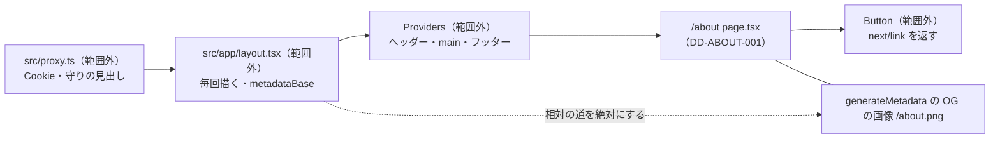

# 1.8 アバウトページ（ABOUT）詳細設計

> 状態: 推定 | 確認日: 2026-11-01 | 対象: アバウトページ `/about`（`src/app/about/page.tsx`） | 基準コミット: `a03beaff`

## 概要

アバウトページ `/about` を作るコードの単位について、入出力・正常と異常の流れ・状態・認可・単体テストの観点を、追跡できる項目（`### <ID> <題>` と属性の表）で書く。
中身は 2026-10-24 の作業ツリーのコードを読んで起こした今の動きで、ユーザーの確認を受けていないので全部「推定」にした。要件・構造設計と食い違う所は決めずに今のコードの動きを書き、食い違いは `docs/05_Quality/reports/trace-matrix.md` の「食い違い」節（`TM-ABOUT-`）に載せた。

| ID | 単位 | 中身 | 旧番号 |
| --- | --- | --- | --- |
| `DD-ABOUT-001` | `src/app/about/page.tsx`（ファイル全体） | 題・説明・OG を返す関数と、5つの区画と CTA 2つを描くページの本体 | `IMPL-ABOUT-001`〜`008` |
| `DD-ABOUT-002` | `src/lib/build-env-guard.ts` の `assertBuildEnv`（共有の `next.config.ts` が先頭で呼ぶ。2026-10-28） | 本番ビルドで必須の環境変数が無い・2 つの Supabase の URL が別の origin ならビルドを落とす | なし |

- 結論: ページのコードの単位は `src/app/about/page.tsx` の1つだけ（`.tsx` はファイル全体で1つの単位）なので、ページの詳細設計は `DD-ABOUT-001` の1つにまとめた。この単位は文をコードに直に持ち、DB・外のサービス・API を呼ばない。`DD-ABOUT-002` はページの外（ビルドの設定）の確かめで、単位は `assertBuildEnv` の1つ
- ページの中の分岐は1つだけ（最後の原則にだけ下の罫線を引く）。単体テストは `tests/unit/about/about-page.test.tsx` の8件で、この分岐の両方を通す
- 旧版のこの頁の表（`IMPL-ABOUT-001`〜`008`）は、画像・`Explore More` の節・`/contact` の CTA・アイコンなど今のコードに無い物を「済」としていた。今の動きに書き直し、元の番号は `DD-ABOUT-001` の「旧番号」に移した
- 番号は `DD-ABOUT-001`〜`029` をこの頁で使う。今は `001`・`002` を使い、`003` 以降は空けておく

## 範囲と根拠

| 項目 | 内容 |
| --- | --- |
| 範囲 | `scripts/trace/scope.json` の ABOUT（src は `src/app/about/**/*.{ts,tsx}`） |
| 上位の文書 | [ABOUT の構造設計](../../03_BasicDesign/areas/about.md)（`ARC-ABOUT-`・`SCR-ABOUT-`・`FLOW-ABOUT-`）、[ABOUT の要件](../../02_Requirements/areas/about.md)（`FR-ABOUT-`・`SEC-ABOUT-`・`DRV-ABOUT-`） |
| 対象のコード | `src/app/about/page.tsx`（`src/app/about/` にはほかのファイルが無い）、`src/lib/build-env-guard.ts`（`DD-ABOUT-002`。2026-10-28 に ABOUT の範囲へ足した） |
| 単位の数え方 | `scripts/trace/parse-code.ts` の `parseCodeUnits` を 2026-10-24 に実行し、結果は `<file>` の1件だけ。中の `generateMetadata`・`StoryPage` は単位に数えない |
| 関連文書 | `docs/03_BasicDesign/ui/screen-list.md`、`docs/03_BasicDesign/ui/design-guide.md`（どちらも別の作業が書き換え中なので触らない） |
| 調べた時点 | 2026-10-24 の作業ツリー（コードは読んだだけで、動かしての確かめはしていない） |

範囲外の共有部品は ID を持たないので、項目の本文にファイルの道で書く。

| 共有部品 | 道 | ABOUT での使われ方 |
| --- | --- | --- |
| ボタンの部品 | `src/components/ui/Button/Button.tsx` | `href` を渡すと `next/link` のリンクを返す。締めの CTA 2つに使う |
| 全体の layout | `src/app/layout.tsx` | 毎回サーバーで描く設定（CSP の nonce のため）と、サイトの題の既定と起点（`metadataBase`） |
| サイトの URL | `src/lib/redirect.ts` の `getSiteUrl` | 環境変数からサイトの起点を作る。無ければ `http://localhost:3000`（`src/lib/redirect.ts`） |
| 包みの部品 | `src/contexts/Providers.tsx` | ヘッダー・`<main>`（`/about` には上下の余白と左右の `px-4`）・フッター、カートとログインの文脈 |
| proxy | `src/proxy.ts` | 全部の道で、セッションの Cookie の発行と守りの見出しを付ける |
| 全体の CSS | `src/styles/globals.css` | `.about-main-text`・`.about-main-space`・`.about-secondary-title` の行の間と余白（HOME の ABOUT の区画と共有） |

実線は描く時の包み（外から内）と呼び出し。点線は、ページの metadata の関数が返す相対の道を、共有の layout の起点で絶対の URL に直す関係。DB・Supabase・外の API への矢印は無い。

## 詳細設計

### DD-ABOUT-001 アバウトページ page.tsx（題・説明・OG と、5つの区画と CTA）

| 属性 | 値 |
| --- | --- |
| 上位 | ARC-ABOUT-001、ARC-ABOUT-002、ARC-ABOUT-003、SCR-ABOUT-001、FLOW-ABOUT-001、SEC-ABOUT-001、SEC-ABOUT-005、SEC-ABOUT-006 |
| 根拠 | 「ページは見出しもキャッシュの指定も書かず、共有の proxy と Next の既定に任せる」ことがこの単位の約束で、ARC-ABOUT-002 の上位はこの約束の分だけつなぐ（ページの側に仕組みは無い）。ブランドの思想の文は滅多に変わらないので、ページの1ファイルの中に字で持ち、DB や外のサービスを読まずに描く（ARC-ABOUT-001、SEC-ABOUT-006）。守りの見出しと Cookie は共有の proxy に任せ、ページの側では見出しもキャッシュの指定も重ねない（ARC-ABOUT-002）。題・説明・OG は固定の値で返し、OG の画像は `public/` の相対の道だけを渡して、絶対の URL は共有の layout の設定の起点に任せる（ARC-ABOUT-003、SEC-ABOUT-001、SEC-ABOUT-005）。5つの区画の順と並び、締めの CTA 2つの行き先は画面と画面遷移の構造設計どおりに描く（SCR-ABOUT-001、FLOW-ABOUT-001） |
| 状態 | 推定 |
| 確かめ方 | 単体テスト |
| 出どころ | 実装から推定（`src/app/about/page.tsx`）、この頁の旧版（基準コミット `a03beaff` 時点）の機能要件対応表（`git show a03beaff:docs/04_DetailDesign/pages/08_about.md`） |
| 旧番号 | IMPL-ABOUT-001、IMPL-ABOUT-002、IMPL-ABOUT-003、IMPL-ABOUT-004、IMPL-ABOUT-005、IMPL-ABOUT-006、IMPL-ABOUT-007、IMPL-ABOUT-008 |

#### 対応要件

| 要件 | この単位での扱い |
| --- | --- |
| FR-ABOUT-001・002・003・004 | 満たす（区画1〜4と CTA） |
| FR-ABOUT-005 | 題と説明は満たす。h1 は無い（最初の見出しが h2） |
| FR-ABOUT-006 | 満たさない（CONTACT への CTA が無い） |
| FR-ABOUT-007 | 対象が無い（アイコン・画像を持たない） |
| FR-ABOUT-008 | 本文の画像は無く、OG の画像は `public/` の物 |
| DRV-ABOUT-001〜005 | 締めの一文、OG、画像とアイコンを置かない、節の2列と縦積み、原則の罫線 |
| SEC-ABOUT-001・005・006 | 同じオリジンの OG の画像、相対の道だけを渡す、DB と外のサービスを読まない |
| SEC-ABOUT-002・004 | ページの側には仕組みが無い（共有の proxy と Next の既定の動き。ARC-ABOUT-002） |
| SEC-ABOUT-003 | ページの側には仕組みが無い（CSP は共有の proxy が全部の頁に同じ方針で付ける。満たすかは SEC-ABOUT-003 を見る） |
| NFR-SEO-003（範囲外）・NFR-A11Y-001（範囲外） | canonical と h1 は無い |

#### 入出力

| 項目 | 内容 |
| --- | --- |
| 入力 | なし。metadata の関数 `generateMetadata` も、既定の書き出しのページの関数 `StoryPage` も引数を取らない。URL の値・Cookie・見出しを読まない |
| 出力（metadata） | `title`・`description`・`openGraph`（`title`・`description`・`images:["/about.png"]`）の固定の値を、Promise で返す |
| 出力（本体） | JSX。外側の `div`（`max-w-6xl`・`px-1 sm:px-4 lg:px-8`）の中に、区画5つ（h2 4つ・h3 3つ・CTA のリンク 2つ） |
| 読む外の値 | なし（DB・Supabase・`fetch`・環境変数・ファイルを読まない） |
| 副作用 | なし（書き込み・記録・Cookie の発行をしない） |
| 使う部品 | 共有の `Button` だけ。`href` を渡すので `next/link` のリンクになる |

| metadata の値 | 中身 | 道 |
| --- | --- | --- |
| title | `ABOUT \| Le Fil des Heures`（layout の題 `Le Fil des Heures` を上書き） | `generateMetadata` の `title`、`layout.tsx` の題の既定 |
| description | ブランドの哲学と「天然繊維100%・国内生産・受注生産・タイムレス・ユニセックス」 | `generateMetadata` の `description` |
| OG の title | title と同じ | `generateMetadata` の `openGraph.title` |
| OG の description | description より短いブランドの一文 | `generateMetadata` の `openGraph.description` |
| OG の画像 | `/about.png`（相対の道。絶対の URL にするのは layout の `metadataBase`） | `generateMetadata` の `openGraph.images`、`layout.tsx` の `metadataBase` |

#### 正常フロー

1. 題・説明・OG（ARC-ABOUT-003）: 呼ばれると固定の値をそのまま返す。待つ処理は無い。OG の画像の相対の道は、共有の layout の `metadataBase` で `getSiteUrl` の起点に足されて絶対の URL になる（SEC-ABOUT-005）
2. 文字の大きさ: 7つの `style` の値（締めの一文・h2・h3・英語のラベル・本文・引用・番号）を作る。どれも共有の大きさのトークン（`--lk-size-*`）を指す。h2 は `--lk-size-2xl`、本文は `--lk-size-xs`
3. 3つの原則: 番号 `01`〜`03`、英語のラベル、日本語の見出し、説明の固定の3件の配列を作る
4. 外側: 幅の上限 `max-w-6xl` で中央に寄せ、左右の余白を幅ごとに3段にする。共有の `Providers` の `<main>` の `px-4` がその外に重なる
5. 区画1 ブランドの思想（FR-ABOUT-001）: 上の罫線と余白。h2 `Brand Philosophy / ブランドの思想` と3段落。1024px 以上は見出しと本文を 1:2 の2列、未満は縦に積む（DRV-ABOUT-004）
6. 区画2 なぜ、つくるのか（FR-ABOUT-002）: h2 `WHY WE MAKE / なぜ、つくるのか`、問題提起の1段落、表示用の書体の引用2つ、`— Founder, Le Fil des Heures`
7. 区画3 取り組み（FR-ABOUT-003）: h2 `OUR COMMITMENTS / 取り組み` を上に置き、原則の行を字下げする。原則ごとに、番号（640px 以上は左の列 64px・1024px 以上は 88px で右寄せ、未満は上）、上の罫線、英語のラベル、h3 の日本語の見出し、説明を出す。最後の原則だけ下の罫線を足す（DRV-ABOUT-005）
8. 区画4 商品設計の考え方（FR-ABOUT-004）: h2 `COLLECTION / 商品設計思想` と1段落。並びは区画1と同じ
9. 区画5 締め（DRV-ABOUT-001、FLOW-ABOUT-001）: 見出しの無い中央の一文 `時を超えて価値の続く服を。` と CTA 2つ。`VIEW COLLECTION`（主のボタン）→ `/item`、`VIEW LOOKBOOK`（2つ目のボタン）→ `/look`。640px 未満は縦に並べて幅いっぱい、640px 以上は横に並べて最小の幅 `min-w-65` を持たせる
10. 描く時（ARC-ABOUT-001・002）: データを読まないが、共有の layout の「毎回サーバーで描く」設定で要求ごとにサーバーで描く。応答の見出しと Cookie は共有の proxy が付ける（`src/proxy.ts`）

#### 分岐

| 道 | 条件 | 真の時 | 偽の時 |
| --- | --- | --- | --- |
| `StoryPage` の原則の並びの回し方（`principles.map`） | 最後の原則だけ（3件の並びの3つ目） | 中身の枠の class に `border-b` を足す（3つ目の原則） | 足さない（空の字。1つ目・2つ目の原則） |

- ページのファイルの中の分岐はこの1つだけ。`principles.map` は固定の3件を回すので、0件・1件の場合は起きない
- `Button` の `href` の有無の分岐（`Button.tsx`）は範囲外の共有部品の中にあり、ABOUT はいつも `href` を渡す

#### 異常フロー

| 場合 | 動き | 道 |
| --- | --- | --- |
| DB・Supabase・外の API が止まっている | ページは読まないので影響を受けず、同じ中身を出す（SEC-ABOUT-006） | `page.tsx` 全体（読み出しが無い） |
| サイトの URL の環境変数が1つも無い | 本番のビルド（`VERCEL_ENV=production`）は `assertBuildEnv` が落とす（SEC-ABOUT-007、`DD-ABOUT-002`）。それ以外（手元・preview・E2E の本番ビルド）は従来どおり、警告なく `http://localhost:3000` を起点に OG の画像の絶対の URL を作る | `src/lib/build-env-guard.ts`、`src/lib/redirect.ts`（範囲外）、`layout.tsx` の `metadataBase` |
| `X-Forwarded-Host` などを偽った要求 | OG の起点は環境変数だけから作るので変わらない | `src/lib/redirect.ts`（範囲外） |
| 取り出しの失敗・空 | 起きない（読み出しが無く、原則は固定の3件） | `principles` |

- ページの関数の中に例外を投げる処理は無い。ルートの `error.tsx` は `src/app/` に無いので、仮に描画で例外が起きた時は Next の既定のエラーの画面になる（推定。起こす道は無い）

#### 状態・永続化

- 状態なし。利用者の端末で動かす指定・サーバーの操作の指定・状態の hook が無く、ページは Server Component のまま描く
- 永続化なし。DB・ストレージ・ブラウザの保存を使わない。文はコードの中の字で、変えるにはコードを直す（ADR-0204）
- 包みの `CartProvider`・`LoginProvider` は `/about` でも動くが、ページは使わない
- `/about` を開いても共有の proxy は `session_id` の Cookie を発行しない（発行は `/cart`・`/checkout`・`/api/checkout` だけ。`src/lib/session-cookie-policy.ts`、DD-PRIVACY-004、ADR-0355。2026-10-28）。ページは `Cache-Control` を指定しない（SEC-ABOUT-004 は共有キャッシュに載らない形を `Cache-Control` だけで見る。E2E は未実測）

#### 認証認可

- 認可なし（公開）。ログインの有無で中身は変わらない
- 入力を受けないので、入力の検査・差し込みの守りの対象が無い。文は全部 JSX の字として出し、HTML を文字列のまま差し込む書き方を使わない
- 外へ出るのは同じサイトの `/item`・`/look` へのリンクだけで、外のオリジンへのリンク・画像・スクリプトを持たない（SEC-ABOUT-001）
- 文字の大きさを `style` の属性で付けているので、共有の CSP の `style-src` の `'unsafe-inline'`（`src/proxy.ts`、範囲外）の理由の1つになっている。CSP を絞る時はこの書き方も効く（SEC-ABOUT-003）

#### テスト観点

分岐の網羅 100% と各区画の中身に要る単体テスト（React Testing Library。置き場は `tests/unit/about/` の下、例 `tests/unit/about/about-page.test.tsx`。名前の先頭は `DD-ABOUT-001`）。今は8件。

| # | 観点 | 入力 | 期待 |
| --- | --- | --- | --- |
| 1 | 最後の原則だけ下の罫線（分岐の真） | ページの関数を描く | `国内受注生産` の h3 を含む枠の class に `border-b` がある |
| 2 | 最後でない原則は下の罫線なし（分岐の偽） | 同上 | `タイムレス・ユニセックス`・`天然繊維` の h3 を含む枠の class に `border-b` が無い（`border-t` はある） |
| 3 | 3つの原則の番号と見出し | 同上 | `01`・`02`・`03`、英語のラベル3つ、h3 が3つでこの順 |
| 4 | 3つの区画の本文 | 同上 | ブランドの思想・なぜつくるか・商品設計思想の本文が出る |
| 5 | 創業者の言葉と締めの一文 | 同上 | `— Founder, Le Fil des Heures` と `時を超えて価値の続く服を。` が出る |
| 6 | 題・説明・OG の固定の値 | metadata の関数を待つ | title が `ABOUT \| Le Fil des Heures`、description が空でない、OG の title が title と同じ、OG の画像が `["/about.png"]` |
| 7 | OG の画像が相対の道 | 同上 | OG の画像の値が `/` で始まり、`http` で始まらない（外のオリジンを指さない。SEC-ABOUT-001） |
| 8 | 読み出しをしない | `fetch` を見張って、metadata の関数とページの関数を呼ぶ | `fetch` が一度も呼ばれない（SEC-ABOUT-006） |

- 分岐の網羅に要るのは 1 と 2（1回の描画で両方を通る）。3〜8 は区画の中身と守りの確かめ。単体テストの 8 件は `tests/unit/about/about-page.test.tsx` の `it` の順と同じ
- 次の観点は単体では試さず、結合テストが見る。h2 が4つで `Brand Philosophy / ブランドの思想`・`WHY WE MAKE / なぜ、つくるのか`・`OUR COMMITMENTS / 取り組み`・`COLLECTION / 商品設計思想` の順（h1 は試さない。TM-ABOUT-01 の判断待ち）、CTA の行き先（`VIEW COLLECTION` が `/item`、`VIEW LOOKBOOK` が `/look`、`/contact` へのリンクは無い）、画像とアイコンを持たない（`img`・`svg`・`picture`・`video`・`i` の要素が0。DRV-ABOUT-003）は SCR-ABOUT-001（`tests/integration/ui/about-screen.test.tsx`）と FLOW-ABOUT-001（`tests/integration/ui/about-flow.test.tsx`）のテストが見る
- 応答の見出し・Cookie・CSP・`Cache-Control`（SEC-ABOUT-002・003・004）と、OG の絶対の URL（SEC-ABOUT-005）は共有の proxy と layout の動きなので、この単位の単体テストでは試さない（E2E の受け入れ条件で試す）

### DD-ABOUT-002 本番ビルドで必須の環境変数の確かめ assertBuildEnv（next.config.ts の先頭）

| 属性 | 値 |
| --- | --- |
| 上位 | ARC-ABOUT-003、SEC-ABOUT-007 |
| 根拠 | 本番で環境変数の設定が漏れても、共有のカードの画像・メールの住所が手元の URL やデプロイごとの URL を指したまま公開されないよう、`NEXT_PUBLIC_*` の値が埋まるビルドの時に止める（SEC-ABOUT-007、ARC-ABOUT-003）。判定は `VERCEL_ENV` で行い、`NODE_ENV=production` になる E2E の本番ビルドを止めない。2 つの Supabase の URL が別の origin だと、署名つき URL（`SUPABASE_URL` 優先）と CSP・`remotePatterns`（`NEXT_PUBLIC_SUPABASE_URL` の 1 つ）の許す host が食い違うので、これも落とす（ADR-0206、ADR-0316） |
| 状態 | 推定 |
| 確かめ方 | 単体テスト |
| 出どころ | 実装から推定（`src/lib/build-env-guard.ts`）。`docs/superpowers/plans/2026-10-28-wave3-csp-images-session.md` の Task 13 |

#### 入出力

| 項目 | 内容 |
| --- | --- |
| 入力 | 環境変数の読み取り専用の対応表 `env`（`next.config.ts` は `process.env` を渡す）。読むのは `VERCEL_ENV`・`NEXT_PUBLIC_SITE_URL`・`NEXT_PUBLIC_SUPABASE_URL`・`APP_ALLOWED_ORIGINS`・`SUPABASE_URL` |
| 出力 | 戻り値なし。問題が無ければ何もせず、あれば `Error` を投げてビルド（設定の読み込み）を落とす |
| 副作用 | なし（記録・書き込み・外への通信をしない） |
| 呼ぶ所 | `next.config.ts` の先頭の 1 回（`import { assertBuildEnv } from "./src/lib/build-env-guard"`）。`@/` の別名は設定の読み込みで使えないので相対の道で読む。ライブラリは増やさない |

#### 正常フローと分岐

1. `env.VERCEL_ENV === 'production'` なら、`NEXT_PUBLIC_SITE_URL`、`NEXT_PUBLIC_SUPABASE_URL`、`APP_ALLOWED_ORIGINS` の順に、値が無い・空白だけでないかを見る。最初に見つかった方の変数名を名指しして投げる。そのあと `APP_ALLOWED_ORIGINS` をカンマで分け（前後の空白は除く）、各項目が空でない・`new URL()` で読める・`protocol` が `https:`・`new URL(項目).origin` が項目と一致する（末尾の `/` もパスも無い）ことを見る。外れた項目が 1 つでもあれば `APP_ALLOWED_ORIGINS` の書式を名指しして投げる（値は載せない。2026-11-01、最終レビュー指摘 7）
2. `NEXT_PUBLIC_SUPABASE_URL` と `SUPABASE_URL` を `new URL` で読み、両方読めた時だけ `origin` を比べる。違えば両方の変数名を名指しして投げる（`VERCEL_ENV` に依らない）
3. それ以外は何もしない

| 道 | 条件 | 真の時 | 偽の時 |
| --- | --- | --- | --- |
| 必須の確かめ | `VERCEL_ENV` が `production` | 3 変数を順に見て、無ければ投げる | 見ない（`preview`・未設定・`NODE_ENV=production` だけ） |
| 必須の変数ごと | 値が無い・空白だけ | 変数名を名指しして投げる | 次へ |
| origin の確かめ | 両方の URL が読めて origin が違う | 両方の変数名を名指しして投げる | 通る（同じ origin、片方だけ、読めない値） |

#### 異常フロー

| 場合 | 動き |
| --- | --- |
| 本番のビルドで `NEXT_PUBLIC_SITE_URL`・`NEXT_PUBLIC_SUPABASE_URL`・`APP_ALLOWED_ORIGINS` のどれかが無い | 変数名を名指しした文で投げ、ビルドが落ちる。配備の前に Vercel の Production に設定する（`docs/06_Operations/secrets.md`）。`APP_ALLOWED_ORIGINS` は Origin の確かめの許可の一覧（www と apex など複数のオリジンを含む）を本番で明示させるユーザーの決定（2026-10-31）で必須にした（SEC-ABOUT-007-AC-02）。`NEXT_PUBLIC_SITE_URL` が必須なので proxy の退避は本番では起きない |
| 本番のビルドで `APP_ALLOWED_ORIGINS` の項目が書式に外れる（scheme 無し・空の項目・`http:`・末尾の `/`・パス・読めない値） | `APP_ALLOWED_ORIGINS` の書式を名指しした文で投げ、ビルドが落ちる。値は載せない。preview・手元・`NODE_ENV=production` だけの E2E の本番ビルドでは見ない。本番に載せる例は `https://www.example.com,https://example.com`（`docs/06_Operations/secrets.md`） |
| 2 つの Supabase の URL が別の origin | 両方の変数名を名指しした文で投げる。手元・E2E は同じ host（`scripts/e2e/environment.ts`）なので落ちない |
| URL として読めない値 | この確かめでは何もしない（読めない値の扱いは既存の動きに任せる） |
| 例外の文 | 変数名だけを書き、URL の値・host を載せない |

#### 状態・永続化・認証認可

- 状態・永続化なし。ビルドの時に 1 回だけ走る。認可の対象が無い
- `getSiteUrl`（`src/lib/redirect.ts`）は変えない。投げない（ADR-0206）

#### テスト観点

置き場は `tests/unit/lib/build-env-guard.test.ts`（名前の先頭は `DD-ABOUT-002`）。設定の読み込みの配線は `tests/unit/next-config.test.ts` の 4 件が見る。

| # | 観点 | 入力 | 期待 |
| --- | --- | --- | --- |
| 1 | 本番で 2 つとも在る | `VERCEL_ENV=production` と 2 変数 | 通る |
| 2 | 本番でサイトの URL が無い・空白だけ | 同上から `NEXT_PUBLIC_SITE_URL` を外す／空白にする | `NEXT_PUBLIC_SITE_URL` を名指しして投げる |
| 3 | 本番で Supabase の URL が無い | 同上から `NEXT_PUBLIC_SUPABASE_URL` を外す | `NEXT_PUBLIC_SUPABASE_URL` を名指しして投げる |
| 4 | 文に値を載せない | 本番でサイトの URL だけ無い | 文が `NEXT_PUBLIC_SITE_URL` を含み、Supabase の URL の host を含まない |
| 5 | 本番でない | `VERCEL_ENV` が `preview`・未設定・空、`NODE_ENV=production` だけ | 2 変数が無くても通る |
| 6 | 別の origin | 2 つの Supabase の URL が別の host、`VERCEL_ENV` 無し | 両方の変数名を名指しして投げる。文に host を載せない |
| 7 | `APP_ALLOWED_ORIGINS` の書式 | 本番で www と apex の 2 項目は通る。scheme 無し・`,` だけ・末尾が `,`・途中の空の項目・`http:`・末尾の `/`・パス・読めない項目が混じる値は投げる。preview・手元は書き間違いでも通る | `APP_ALLOWED_ORIGINS` を名指しして投げる。文に host を載せない（SEC-ABOUT-007-AC-02） |
| 7 | 同じ origin・別のポート | 末尾の `/`・パスだけが違う／ポートが違う | 前者は通る。後者は投げる |
| 8 | 手元・片方だけ・読めない値 | `http://127.0.0.1:54321` が両方／片方だけ／`not a url` | どれも通る |

## 実装の単位

コードの TSDoc に `@design` を書く時はこの表に従う（`@impl` の番号はそこで振る。ABOUT の旧番号の最大は `IMPL-ABOUT-008` なので、新しい番号は `IMPL-ABOUT-101` から。`101` は `page.tsx`、`102` は `build-env-guard.ts`）。単位の数え方は `scripts/trace/parse-code.ts` の `parseCodeUnits`（2026-10-24 に実行。`build-env-guard.ts` は 2026-10-28 に足した）。

| ファイル | 単位（symbol） | 詳細設計 |
| --- | --- | --- |
| `src/app/about/page.tsx` | `<file>` | DD-ABOUT-001 |
| `src/lib/build-env-guard.ts` | `assertBuildEnv` | DD-ABOUT-002 |

- `src/app/about/` にほかのファイルは無い（layout・loading・error・OG の画像の生成も無い）
- `.tsx` はファイル全体が1つの単位なので、`generateMetadata` と `StoryPage` を別の詳細設計に分けても、コードからつながるのは1つだけになる。そのため1つにまとめた

## 未確認事項

- `/about` の応答に付く `Cache-Control` の実際の値（SEC-ABOUT-004。本番ビルドで測っていない）
- 本番のサイトの URL の環境変数の設定（設定が漏れればビルドが落ちる。`DD-ABOUT-002`）と、本番で `/about.png` が取得できるか（本番は未デプロイ）
- h1 を足すか、FR-ABOUT-005 の h1 の部分を外すか。CONTACT の CTA（FR-ABOUT-006）とアイコン・画像（FR-ABOUT-007・008）を残すか（要件の文書の未確認事項と同じ）
- CTA が横に並ぶ境目（コードは 640px、FR-ABOUT-004 の文は 768px）をどちらに合わせるか
- 「天然繊維100%」（description）と「生地は天然繊維を中心に」（本文）のどちらが正か
- この頁の項目は全部「推定」。ユーザーの確認を受けたら「現行」にする
