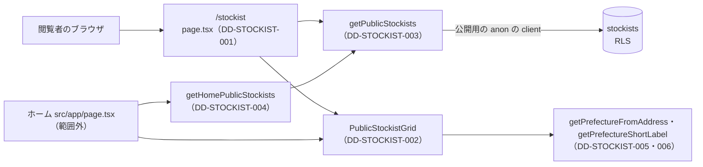

# 1.10 商品扱い店舗ページ（STOCKIST）詳細設計

> 状態: 推定 | 確認日: 2026-10-26 | 対象: 取扱店の一覧 `/stockist`、取扱店の部品（一覧の形とホームの形）、公開の取り出し、住所からの都道府県の判定 | 基準コミット: `4facf63b`

## 概要

取扱店の一覧 `/stockist` とホームの取扱店の節を作るコードの単位ごとに、入出力・正常と異常の流れ・状態・認可・単体テストの観点を、追跡できる項目（`### <ID> <題>` と属性の表）で書く。
中身は 2026-10-24 の作業ツリーのコードを読んで起こした今の動きで、ユーザーの確認を受けていないので全部「推定」にした。要件・構造設計と食い違う所は決めずに今のコードの動きを書き、食い違いは `docs/05_Quality/reports/trace-matrix.md` の「食い違い」節（TM-STOCKIST-NN）に載せた。

| ID | 単位 | 中身 | 旧番号 |
| --- | --- | --- | --- |
| `DD-STOCKIST-001` | `src/app/stockist/page.tsx` | 一覧のページ。メタ情報を返し、公開の店を全部取って部品に渡す | `IMPL-STOCKIST-001`・`005` |
| `DD-STOCKIST-002` | `src/features/stockist/components/PublicStockistGrid.tsx` | 店のカード、ホームの形の格子、一覧の形の地方・都道府県の絞り込みと格子 | `IMPL-STOCKIST-001`・`002`・`004`・`006` |
| `DD-STOCKIST-003` | `getPublicStockists`（`src/features/stockist/services/public.ts`） | 公開の店を id の順に取り、6つの列に詰め直す | `IMPL-STOCKIST-003`・`006` |
| `DD-STOCKIST-004` | `getHomePublicStockists`（同上） | ホーム用に6件まで取る | `IMPL-STOCKIST-004` |
| `DD-STOCKIST-005` | `getPrefectureFromAddress`（`src/features/stockist/region.ts`） | 住所の先頭の都道府県名を返す | なし |
| `DD-STOCKIST-006` | `getPrefectureShortLabel`（同上） | 都道府県の短い表示名を返す | なし |

- 結論: 公開の店はページのサーバーの中で `getPublicStockists` を直接呼んで1回で全部取り、絞り込みは利用者の端末で動く部品が URL の `pref` と住所の先頭の県名を突き合わせて行う。公開の API の窓口は無い
- 取り出しの失敗は空の配列にするので、画面では「店が0件」と見分けが付かない。どの単位にも単体テストが無い（今ある取扱店の単体テストは管理の窓口の1本だけ）
- 番号は `DD-STOCKIST-001`〜`029` をこの頁で使う。今は `001`〜`006` を使い、`007` 以降は空けておく。管理の取扱店は [1.16-4 管理画面の取扱店](16-4_admin_stockist.md) の `DD-STOCKIST-030` から

## 範囲と根拠

| 項目 | 内容 |
| --- | --- |
| 範囲 | `scripts/trace/scope.json` の STOCKIST のうち、公開の側の単位 |
| 上位の文書 | [STOCKIST の構造設計](../../03_BasicDesign/areas/stockist.md)（`ARC-`・`SCR-`・`FLOW-`・`STATE-`・`DATA-STOCKIST-`）、[STOCKIST の要件](../../02_Requirements/areas/stockist.md)（`FR-STOCKIST-`・`SEC-STOCKIST-`・`DRV-STOCKIST-`） |
| 対象のコード | `src/app/stockist/page.tsx`、`src/features/stockist/components/PublicStockistGrid.tsx`、`src/features/stockist/services/public.ts`、`src/features/stockist/region.ts` |
| 単位の無いファイル | `src/features/stockist/types.ts`（型だけ） |
| 引き継いだ文書 | この頁の旧版の「機能要件対応表」（FR-STOCKIST-001〜008 の行と `IMPL-STOCKIST-001`〜`006`）。中身はこの版の各項目に移し、表は消した |
| 関連文書 | [1.16-4 管理画面の取扱店](16-4_admin_stockist.md)、`docs/03_BasicDesign/ui/screen-list.md`（読むだけ） |
| 調べた時点 | 2026-10-24 の作業ツリー（コードは読んだだけで、動かしての確かめはしていない） |

範囲外の共有部品は ID を持たないので、項目の本文にファイルの道で書く。

| 共有部品 | 道 | 公開の側での使われ方 |
| --- | --- | --- |
| Supabase の client | `src/lib/supabase/server.ts` の `createPublicClient`（ログインの Cookie を引き継がない anon の client） | 公開の店の読み出し |
| 画面の部品 | `src/components/ui/`（`Card`・`Button`・`Checkbox`・`Drawer`・`SectionTitle`） | カード・空の時のボタン・絞り込み・引き出し・ホームの見出し |
| class の結合 | `src/lib/utils.ts` の `cn` | FILTER のバーの見えない置き台 |
| 全体の CSS | `src/styles/globals.css` | カードの余白・区切り線・行の間 |
| ホームの節の置き場 | `src/app/page.tsx`（HOME） | `getHomePublicStockists` を呼び、部品のホームの形を置く |

矢印は呼び出しの向き。ページとホームはサーバーで店を取って部品に渡し、部品は渡された店を画面の上で絞るだけで、自分では取り出さない。

## 実装の単位

`scripts/trace/parse-code.ts` の `parseCodeUnits`（2026-10-24 に実行）で数えた単位と、つなぐ詳細設計。1つの単位は1つの `DD-` にだけつなぐ。`@impl`・`@design` のコメントはこの表から付ける。

| ファイル | 単位（symbol） | DD |
| --- | --- | --- |
| `src/app/stockist/page.tsx` | `<file>` | DD-STOCKIST-001 |
| `src/features/stockist/components/PublicStockistGrid.tsx` | `<file>` | DD-STOCKIST-002 |
| `src/features/stockist/services/public.ts` | `getPublicStockists` | DD-STOCKIST-003 |
| `src/features/stockist/services/public.ts` | `getHomePublicStockists` | DD-STOCKIST-004 |
| `src/features/stockist/region.ts` | `getPrefectureFromAddress` | DD-STOCKIST-005 |
| `src/features/stockist/region.ts` | `getPrefectureShortLabel` | DD-STOCKIST-006 |

- 単位にならない物: `src/features/stockist/types.ts`（型だけ）、`public.ts` の `STOCKIST_MAP_EMBED_URL`（文字の const。未使用（削除の判断待ち）で、どこからも読まれない）と export しない `toPublicStockists`（DD-STOCKIST-003 に含める）、`region.ts` の `STOCKIST_REGIONS`（配列の const）・`StockistRegion`（型。未使用（削除の判断待ち）で、どこからも使われない）・`ALL_PREFECTURES`（export しない）
- 管理の側の単位（`src/app/admin/stockist/`・`src/app/api/admin/stockists/`・`src/components/StockistSection.tsx`・`src/features/stockist/services/admin-security.ts`）は [1.16-4 管理画面の取扱店](16-4_admin_stockist.md) で扱う

## 詳細設計

### DD-STOCKIST-001 取扱店の一覧のページとメタ情報

| 属性 | 値 |
| --- | --- |
| 上位 | SCR-STOCKIST-001、ARC-STOCKIST-001 |
| 根拠 | 店の数が少ない前提で、ページを作るサーバーの中で公開の店を1回で全部取り、店を入れた HTML を返す（ARC-STOCKIST-001）。絞り込みの部品が URL を読むので、要求ごとに描くよう `searchParams` を待つ。検索の結果と共有のカードで取扱店の頁だと分かるよう、題・説明・OGP を固定の値で返す（SCR-STOCKIST-001） |
| 状態 | 推定 |
| 確かめ方 | 単体テスト |
| 出どころ | 実装から推定（`src/app/stockist/page.tsx`）、この頁の旧版の機能要件対応表 |
| 旧番号 | IMPL-STOCKIST-001、IMPL-STOCKIST-005 |
| 旧所在 | この頁の旧版の「機能要件対応表」の FR-STOCKIST-001（ページの分）と FR-STOCKIST-005 の行 |

#### 対応要件

FR-STOCKIST-001・005・006、FREQ-13-REQ-01、DRV-STOCKIST-013。

#### 入出力

| 単位の中の関数 | 入力 | 出力 |
| --- | --- | --- |
| `generateMetadata` | なし | 題 `STOCKIST \| Le Fil des Heures`、説明（取扱店舗の一覧である旨の文）、OGP の題と説明（同じ値）と画像 `/mainphoto.png`（`page.tsx`） |
| 既定の export のページ | `searchParams?`（Promise。中身は使わない） | `div.w-full` の中に `PublicStockistGrid`（`variant="catalog"`、`stockists`）（`page.tsx`） |

#### 正常フロー

1. `searchParams` を待つ（`page.tsx`）。値は使わず、要求ごとに描く（動的に描く）ための印にする
2. `getPublicStockists()` を引数なしで呼び、公開の店を上限の 200 件まで取る（`page.tsx`、DD-STOCKIST-003）
3. 取れた配列をそのまま部品の一覧の形に渡す（`page.tsx`、DD-STOCKIST-002）

#### 異常フロー

| 場合 | 動き | 道 |
| --- | --- | --- |
| `searchParams` が渡されない | `undefined` を待つだけで続ける | `page.tsx` |
| 取り出しが DB の誤りを返す | 取り出しが空の配列を返すので、部品が「該当する取扱店舗がございません。」を出す（0件と同じ） | `public.ts`、`PublicStockistGrid.tsx` |
| 取り出しが例外を投げる（client を作れない時など） | ページは受け止めず、Next の誤りの画面になる。`src/app/stockist/` にも `src/app/` にも `error.tsx` が無い（推定） | `page.tsx` |

- 分岐は無い。`canonical`・`og:url` は返さない
- 見出しの h1 を持たない（最初の見出しはカードの店舗名の h3）

#### 状態・永続化

状態は持たない。`revalidate`・`use cache` の指定は無く、要求ごとにサーバーで描く。

#### 認証認可

認可なし（公開）。非公開の店を出さない守りは取り出し（DD-STOCKIST-003）と DB の RLS にあり、このページは確かめない。

#### テスト観点

分岐の網羅 100% に要る単体テスト（`getPublicStockists` と `PublicStockistGrid` を差し替える）。

| # | 観点 | 入力 | 期待 |
| --- | --- | --- | --- |
| 1 | メタ情報の値 | `generateMetadata()` | 題・説明・OGP の題・説明・画像が上の表のとおり |
| 2 | 取り出しの呼び方 | `searchParams` に空の Promise | `getPublicStockists` を引数なしで1回呼ぶ |
| 3 | 部品への渡し方 | 取り出しが2件を返す | 部品が `variant="catalog"` とその2件で描かれる |
| 4 | `searchParams` が無い | 引数の物に `searchParams` なし | 例外にならず部品が描かれる |
| 5 | 取り出しが空 | 取り出しが空の配列 | 部品に空の配列が渡る |

### DD-STOCKIST-002 店のカードと、ホームの格子・一覧の絞り込みと格子 PublicStockistGrid

| 属性 | 値 |
| --- | --- |
| 上位 | SCR-STOCKIST-001、SCR-STOCKIST-002、SCR-STOCKIST-003、FLOW-STOCKIST-001、STATE-STOCKIST-002、DATA-STOCKIST-003、SEC-STOCKIST-016、SEC-STOCKIST-017 |
| 根拠 | 一覧とホームでカードの中身をそろえるため、1つの部品を2つの形で使う（SCR-STOCKIST-002・003）。絞り込みは押すたびにすぐ描き直すので利用者の端末で動く部品に置き、選んだ県を URL の `pref` に書き戻して、共有した URL と戻るで同じ絞り込みを開けるようにする（STATE-STOCKIST-002）。URL の値は47都道府県の許可の一覧で絞り、細工した URL で画面を乱させない（SEC-STOCKIST-017）。店舗の値は React の文字として出し、住所と電話のリンクは決まった形でだけ作る（SEC-STOCKIST-016、FLOW-STOCKIST-001）。地方と県の対応はコードに固定で持つ表を使う（DATA-STOCKIST-003） |
| 状態 | 推定 |
| 確かめ方 | 単体テスト |
| 出どころ | 実装から推定（`src/features/stockist/components/PublicStockistGrid.tsx`）、この頁の旧版の機能要件対応表 |
| 旧番号 | IMPL-STOCKIST-001、IMPL-STOCKIST-002、IMPL-STOCKIST-004、IMPL-STOCKIST-006 |
| 旧所在 | この頁の旧版の「機能要件対応表」の FR-STOCKIST-001・002・004・008 の行 |

#### 対応要件

FR-STOCKIST-001・002・004・006・008・010、FREQ-57-REQ-01、FREQ-118-REQ-01（範囲外）、FREQ-119-REQ-01（範囲外）、DRV-STOCKIST-002〜012。

#### 入出力

| 項目 | 内容 |
| --- | --- |
| 入力（home） | `variant:"home"`、`stockists`（公開の店の配列）、`className?` |
| 入力（catalog） | `variant:"catalog"`、`stockists` |
| 読む外の値 | catalog だけ、URL の `pref`（`useSearchParams`）と `usePathname` |
| 出力（home） | `section#stockist` に見出し `STOCKIST` とカードの格子、または空の文と「VIEW COLLECTION」 |
| 出力（catalog） | 1024px 以上の左の列、1024px 未満の FILTER のバー（見えない置き台と画面に留める物の2つ）、カードの格子か空の文と「すべて見る」、左の引き出し |
| 副作用 | 絞り込みの操作で `router.push(<道と残りのクエリ>, {scroll:false})`。取り出しはしない |

#### 正常フロー

1. 形の振り分け: `variant` が catalog なら一覧の形、それ以外はホームの形に `className` を渡す
2. カード（`StockistCard`、SCR-STOCKIST-002）: `Card`（`size="sm"`・`hoverable`）に `stockist-card` と受けた class を付け、店舗名の h3、区切り線、住所、電話、営業時間、定休日を並べる。電話・営業時間・定休日の行は 640px 未満で隠す（`hidden sm:flex`、DRV-STOCKIST-004）。行のアイコンは `aria-hidden`
3. 住所のリンク（DRV-STOCKIST-002）: `https://www.google.com/maps/search/?api=1&query=` に `encodeURIComponent(住所)` を付け、`target="_blank"`・`rel="noopener noreferrer"`
4. 電話のリンク（DRV-STOCKIST-003）: 数字と `+` 以外を消して `tel:` に付ける。文字は元の電話番号のまま出す
5. ホームの格子（`HomeGrid`、SCR-STOCKIST-003）: 件数で格子の class を決める（DRV-STOCKIST-005）。カードの key は店の id（FR-STOCKIST-008）。4件目から（index が3以上）カードに `hidden md:block` を付ける（FR-STOCKIST-004）
6. URL の `pref` の読み（`parsePrefList`、DRV-STOCKIST-008）: カンマで分け、前後の空白を除き、空を捨て、47都道府県の正式な名前にある物だけを残す
7. 開け閉めの初め（`expandedRegions` の初期値、DRV-STOCKIST-009）: 最初に描く時だけ、県が2つ以上の地方のうち、選ばれた県を含む地方を開く
8. 選択肢（`availablePrefectures`・`visibleRegions`、FR-STOCKIST-010-AC-01 の形）: 店ごとに住所から県を決め（DD-STOCKIST-005）、店のある県だけを地方の定義の順に残し、県が0の地方を除く。県が1つだけの地方（北海道）に印を付ける
9. 絞り込みの木（`renderAreaTree`）: `ALL`（選択が0の時に印）、北海道は1つの箱、ほかの地方は地方の箱（配下の店のある県が全部選ばれている時に印）と開け閉めのボタン、開いている時は県の箱（表示は DD-STOCKIST-006 の短い名）。群に「エリア（地方・都道府県）で絞り込む」の名を付ける
10. 選択の操作: 県の箱は足すか外す。地方の箱は全部選ばれていれば配下を全部外し、そうでなければ全部足す。`ALL` と「すべて見る」は全部外す
11. URL への書き戻し（`setPrefectures`）: ほかのクエリを残し、選んだ県を47の定義の順に並べてカンマでつなぎ `pref` に入れる。空なら `pref` を消す。クエリが空なら道だけで移る
12. 出す店: 選択が0なら全部。選択があれば住所の県が選択にある店だけ
13. 一覧の格子: `grid-cols-1 sm:grid-cols-2 xl:grid-cols-3 2xl:grid-cols-4`、key は店の id
14. 置き場: 1024px 以上は左の列（ヘッダーの真下に留める、DRV-STOCKIST-011）に木を `3xs` で出す。1024px 未満は FILTER のバーを2つ置く（場所取りの見えない物と、ヘッダーの真下に留める物、DRV-STOCKIST-010）
15. 引き出し: FILTER のボタンで開き、閉じるボタン（`Close filter drawer`）と引き出しの閉じる操作で閉じる。中身は木を `xs` で出す。選んでも閉じない

#### 異常フロー

| 場合 | 動き | 道 |
| --- | --- | --- |
| ホームで店が0件 | 「現在、取扱店舗はございません。オンラインストアにて販売中です。」と `/item` への「VIEW COLLECTION」（DRV-STOCKIST-006） | `PublicStockistGrid.tsx` |
| ホームで店が1件 | 1列・狭い幅で中央 | `HomeGrid` |
| ホームで店が2件 | 640px 以上で2列・中ほどの幅で中央 | `HomeGrid` |
| ホームで店が3件以上 | 640px 以上で2列、1024px 以上で3列 | `HomeGrid` |
| ホームで `className` を渡さない | 格子に足さない | `HomeGrid` |
| カードに `className` が無い（一覧・ホームの3件目まで） | `stockist-card` だけ | `StockistCard` |
| 電話が空の文字 | 電話の行を出さない（DRV-STOCKIST-003） | `StockistCard` |
| URL に `pref` が無い・空 | 選択なし（ALL） | `parsePrefList` |
| `pref` に許可の外の値（例: `Tokyo`・`東京`）がある | その値を捨てる。全部が外なら ALL（SEC-STOCKIST-017） | `parsePrefList` |
| `pref` の値に空白・空の切れがある | 前後の空白を除き、空の切れを捨てる | `parsePrefList` |
| 住所が県名で始まらない店 | 県なしとして選択肢に数えず、県を選んでいる間は出ない。ALL では出る | `CatalogGrid` の `stockistPrefectures`・`displayStockists` |
| 選んだ県に店が1つも無い（URL で直に指定した時など） | 「該当する取扱店舗がございません。」と「すべて見る」（DRV-STOCKIST-007）。その県は選択肢に出ないので箱から外せない | `CatalogGrid` の `renderGrid`・`visibleRegions` |
| 公開の店が0件（取り出しの失敗を含む） | 選択肢は `ALL` だけ、格子の代わりに上と同じ空の表示 | `CatalogGrid` の `availablePrefectures`・`renderGrid` |
| 地方の箱を押した時に一部だけ選ばれている | 配下の全部を足す | `toggleRegion` |
| 開いている地方の開け閉めを押す | 閉じる（ボタンの名は「…を展開」に戻る） | `toggleExpand` |
| 最初に描いた後に URL の `pref` が変わる | 選択は URL に合わせて変わるが、開け閉めは前のまま | `CatalogGrid` の `selectedPrefectures`・`expandedRegions` |

- `renderAreaTree` の引数の初めの値 `"xs"`は、呼ぶ所が `"3xs"`と `"xs"`を必ず渡すので届かない（推定）
- FILTER のバーの置き台（`interactive` が偽）は押せず読み上げにも出ない。ボタンに押した時の動きを付けず、`tabIndex=-1`

#### 状態・永続化

- 部品の中の状態: `isFilterDrawerOpen`（引き出し）、`expandedRegions`（地方の開け閉め）。選択の状態は持たず、URL の `pref` から毎回作る（STATE-STOCKIST-002）
- 永続化はしない。選択を残す所は URL の `pref` だけで、操作ごとにブラウザの履歴に1件足す。ストレージは使わない

#### 認証認可

- 認可なし（公開）。渡された店をそのまま出し、公開かどうかを確かめない（守りは DD-STOCKIST-003 と RLS）
- 店舗名・住所・電話・営業時間・定休日は JSX の文字として出し、`dangerouslySetInnerHTML` を使わない（SEC-STOCKIST-016）
- 住所は `encodeURIComponent` で URL の値にだけ入れ、リンクの先は Google Maps の検索に固定。電話は数字と `+` だけを `tel:` に付ける（SEC-STOCKIST-016）

#### テスト観点

分岐の網羅 100% に要る単体テスト（React Testing Library。`next/navigation` の `useRouter`・`usePathname`・`useSearchParams` を差し替える）。

| # | 観点 | 入力 | 期待 |
| --- | --- | --- | --- |
| 1 | 形の振り分け | `variant="catalog"` と `variant="home"` | catalog は FILTER のボタンと ALL の箱、home は `section#stockist` と見出し STOCKIST |
| 2 | カードの中身 | 店1件（電話あり） | h3 の店舗名、住所・電話・営業時間・定休日の文字、行のアイコンが `aria-hidden` |
| 3 | 住所のリンク | 住所 `東京都渋谷区 1-2 #3` | `href` が Maps の検索の頭に `encodeURIComponent` した住所、`target="_blank"`、`rel="noopener noreferrer"` |
| 4 | 電話のリンク | 電話 `03-1234-5678`・`+81 (3) 1234` | `href` が `tel:0312345678`・`tel:+8131234`、文字は元のまま |
| 5 | 電話が空 | 電話 `""` | 電話の行が無い。営業時間と定休日の行はある |
| 6 | 店舗の値が文字として出る | 店舗名 `` | 文字として出て、img の要素が作られない |
| 7 | ホームの0件 | home、空の配列 | 案内の文と `/item` への VIEW COLLECTION。格子が無い |
| 8 | ホームの1件 | home、1件 | 格子に `grid-cols-1 max-w-sm mx-auto` |
| 9 | ホームの2件 | home、2件 | 格子に `sm:grid-cols-2 max-w-3xl` |
| 10 | ホームの4件 | home、4件 | 格子に `lg:grid-cols-3`。4件目のカードだけに `hidden md:block` |
| 11 | ホームの `className` | home、`className="x"` と無し | ある時だけ格子の class に `x` が付く |
| 12 | `pref` なし | catalog、クエリなし | ALL に印、全部の店が出る |
| 13 | `pref` の読み | `pref=" 東京都 ,,Tokyo,大阪府"` | 東京都と大阪府だけが選ばれ、その2県の店だけが出る |
| 14 | `pref` が許可の外だけ | `pref=Tokyo` | ALL に印、全部の店が出る |
| 15 | 選択肢の作り | 東京都・神奈川県・北海道・県名で始まらない住所の店 | 地方は北海道と関東だけ（定義の順）。関東の下は東京と神奈川（短い名）。県名で始まらない店は選択肢に数えない |
| 16 | 開け閉めの初め | `pref=東京都` で描く | 関東が開いて県の箱が見える。北海道は開け閉めのボタンを持たない |
| 17 | 開け閉めの操作 | 閉じた地方のボタンを押し、もう一度押す | 開いて `aria-expanded=true`・名が「…を折りたたむ」、閉じて元に戻る |
| 18 | 県の箱で足す・外す | 選択なしで東京を押す／`pref=東京都` で東京を押す | `pref` に東京都（URL の符号化つき）を入れた道へ `{scroll:false}` で移る／`push('/stockist', {scroll:false})` |
| 19 | 地方の箱で全部足す | 関東の一部だけが選ばれた状態で関東を押す | 関東の店のある県が全部、定義の順で `pref` に入る |
| 20 | 地方の箱で全部外す | 関東の店のある県が全部選ばれた状態で関東を押す | 関東の県が `pref` から外れる。地方の箱に印が付いている |
| 21 | 北海道の箱 | 北海道を押す | `pref=北海道` が入る |
| 22 | ほかのクエリを残す | `?x=1&pref=東京都` で ALL を押す | `push('/stockist?x=1', …)` |
| 23 | ALL・すべて見る | 選択ありで ALL を押す／選んだ県に店が無い状態で「すべて見る」を押す | どちらも `pref` を消した道へ移る |
| 24 | 絞った結果が0件 | 住所が県名で始まらない店だけ、`pref=東京都` | 「該当する取扱店舗がございません。」と「すべて見る」 |
| 25 | 一覧の格子 | catalog、2件 | 格子に `sm:grid-cols-2 xl:grid-cols-3 2xl:grid-cols-4` |
| 26 | 引き出しの開閉 | 留める方の FILTER を押し、閉じるボタンを押す／引き出しの `onClose` を呼ぶ | 開いてボタンが `aria-expanded=true`、閉じる |
| 27 | 置き台の FILTER | 置き台のボタン | `aria-hidden` の親の中にあり、`tabIndex=-1`、押しても開かない |

### DD-STOCKIST-003 公開の店を取り出す getPublicStockists

| 属性 | 値 |
| --- | --- |
| 上位 | ARC-STOCKIST-001、DATA-STOCKIST-001、DATA-STOCKIST-002、SEC-STOCKIST-001、SEC-STOCKIST-002、SEC-STOCKIST-018 |
| 根拠 | 取り出しの条件で `status='published'` に絞り、DB の RLS と2段にして、片方が崩れても非公開の店を外へ出さない（SEC-STOCKIST-001、DATA-STOCKIST-002）。返す前に6つの列に詰め直し、状態などの内部の列を画面へ渡さない（ARC-STOCKIST-001）。並びの要件が無いので、取るたびに並びが変わらないよう id の順にする（DATA-STOCKIST-001）。DB が一時的に落ちても頁全体を誤りにしないよう、誤りは空の配列にする（ARC-STOCKIST-001）。ログインの Cookie を引き継がない公開用の client で読み、閲覧者の権限で公開の画面の中身が変わらないようにする（SEC-STOCKIST-002）。件数は必ず 200 件で止め、店が増えても 1 回の取り出しの量に天井を持たせる（SEC-STOCKIST-018） |
| 状態 | 推定 |
| 確かめ方 | 単体テスト |
| 出どころ | 実装から推定（`src/features/stockist/services/public.ts`）、この頁の旧版の機能要件対応表 |
| 旧番号 | IMPL-STOCKIST-003、IMPL-STOCKIST-006 |
| 旧所在 | この頁の旧版の「機能要件対応表」の FR-STOCKIST-003 と FR-STOCKIST-008（取り出しの分）の行 |

#### 対応要件

FR-STOCKIST-003、FREQ-13-REQ-01、DRV-STOCKIST-001、SEC-STOCKIST-001・002・018。

#### 入出力

| 項目 | 内容 |
| --- | --- |
| 入力 | `options?`（`{limit?: number}`） |
| 出力 | 公開の店の配列（id・店舗名・住所・電話・営業時間・定休日の6つ） |
| 読む外の値 | 表 `stockists`。列 `id, name, address, phone, time, holiday, status` を選ぶ |

#### 正常フロー

1. `createPublicClient()` を引数なしで呼ぶ。ログインの Cookie を引き継がない anon の client になる
2. `limit` を決める。数で、有限で、切り捨てて 1 以上の時はその数と 200 の小さい方、それ以外（無い・`NaN`・無限・0 以下）は 200（定数 `PUBLIC_STOCKIST_FETCH_LIMIT`）
3. `stockists` から7つの列を選び、`status='published'` で絞り、id の昇順に並べ、`limit` で件数を限る
4. 結果の行を6つの列に詰め直して返す

#### 異常フロー

| 場合 | 動き | 道 |
| --- | --- | --- |
| `options` が無い・`limit` が無い | 上限の 200 件で限る | `public.ts` |
| `limit` が数でない・`NaN`・`Infinity`・0 以下・1 未満の小数 | 上限の 200 件で限る（外さない） | `public.ts` |
| `limit` が小数（例: 2.7） | 切り捨てた数（2）で限る | `public.ts` |
| `limit` が 200 より大きい（例: 500） | 200 件に切り詰める | `public.ts` |
| DB の誤り | `console.error` に誤りを丸ごと書き、空の配列を返す | `public.ts` |
| `data` が `null` | 空の配列を返す | `public.ts` |
| client を作れない・問い合わせが例外を投げる | 受け止めず、呼んだ側へ出す（推定） | `public.ts` |

#### 状態・永続化

読むだけで何も変えない。キャッシュは持たない。

#### 認証認可

- 認可なし（公開）。`status='published'` の条件と、anon・authenticated に公開の行だけを見せる RLS（DATA-STOCKIST-002）の2段で非公開の店を出さない（SEC-STOCKIST-001）
- client は閲覧者の Cookie の session を引き継がない（`createPublicClient`。SEC-STOCKIST-002。2026-10-26）。管理の権限を持つ人がログインしたまま開いても、DB は anon として働き、取り出しの条件と RLS の 2 段で非公開の店は出ない
- 一覧の頁も上限の 200 件で止める（SEC-STOCKIST-018。2026-10-26）。PostgREST の `max_rows` の本番の設定は確かめていない

#### テスト観点

分岐の網羅 100% に要る単体テスト（`@/lib/supabase/server` の `createPublicClient` を差し替え、問い合わせの鎖を記録する。`createClient` は呼ばれないことも確かめる）。

| # | 観点 | 入力 | 期待 |
| --- | --- | --- | --- |
| 1 | 絞りと並び | 引数なし | `from('stockists')`、`select('id, name, address, phone, time, holiday, status')`、`eq('status','published')`、`order('id',{ascending:true})`、`limit(200)` を呼び、`createClient` は呼ばない |
| 2 | 件数の限り | `{limit:6}` | `limit(6)` |
| 3 | 小数の切り捨て | `{limit:2.7}` | `limit(2)` |
| 4 | 不正な件数 | `{limit:0}`・`{limit:-1}`・`{limit:NaN}`・`{limit:Infinity}`・`{limit:0.5}`・`{}` | どれも `limit(200)` を呼ぶ（外さない） |
| 4a | 上限の切り詰め | `{limit:500}` | `limit(200)` |
| 5 | 詰め直し | 行に `status`・`type` などが付いている | 返す物が6つの列だけ |
| 6 | DB の誤り | `{data:null, error:{…}}` | 空の配列、`console.error` が1回 |
| 7 | `data` が `null` | `{data:null, error:null}` | 空の配列 |

### DD-STOCKIST-004 ホーム用に6件まで取る getHomePublicStockists

| 属性 | 値 |
| --- | --- |
| 上位 | SCR-STOCKIST-003、ARC-STOCKIST-001 |
| 根拠 | ホームでは取扱店があることを短く知らせるので、取り出しを6件に限り、幅ごとの出し分け（モバイルは3件）は部品の CSS に任せる（SCR-STOCKIST-003）。取り出しの条件と並びは一覧と同じ関数を通してそろえる（ARC-STOCKIST-001） |
| 状態 | 推定 |
| 確かめ方 | 単体テスト |
| 出どころ | 実装から推定（`src/features/stockist/services/public.ts`、`src/app/page.tsx`）、この頁の旧版の機能要件対応表 |
| 旧番号 | IMPL-STOCKIST-004 |
| 旧所在 | この頁の旧版の「機能要件対応表」の FR-STOCKIST-004 の行（取り出しの分。部品の分は DD-STOCKIST-002） |

#### 対応要件

FR-STOCKIST-004、FR-HOME-005（範囲外）。

#### 入出力・フロー

- 入力なし。`getPublicStockists({limit: 6})` の結果をそのまま返す（`public.ts`）
- 分岐は無い。誤りの時の動き（空の配列）と例外は DD-STOCKIST-003 と同じ
- 呼ぶ所はホーム（`src/app/page.tsx`、範囲外）だけ

#### 状態・永続化・認証認可

DD-STOCKIST-003 と同じ（読むだけ、公開、公開の店だけ）。

#### テスト観点

同じファイルの中の呼び出しは差し替えにくいので、`createPublicClient` を差し替えて確かめる。

| # | 観点 | 入力 | 期待 |
| --- | --- | --- | --- |
| 1 | 6件に限る | なし | 問い合わせの鎖で `limit(6)` を呼び、`eq('status','published')` も呼ぶ |
| 2 | 結果の受け渡し | 行が3件 | 6つの列に詰め直した3件を返す |

### DD-STOCKIST-005 住所の先頭の都道府県名を返す getPrefectureFromAddress

| 属性 | 値 |
| --- | --- |
| 上位 | DATA-STOCKIST-003、STATE-STOCKIST-002 |
| 根拠 | 店の表に県の列を足さず、日本の住所が県名から始まる慣習を使って、住所の先頭から県を決める（DATA-STOCKIST-003）。決めた県で、一覧の選択肢と出す店を決める（STATE-STOCKIST-002） |
| 状態 | 推定 |
| 確かめ方 | 単体テスト |
| 出どころ | 実装から推定（`src/features/stockist/region.ts`） |

#### 対応要件

FREQ-57-REQ-01、FR-STOCKIST-010。

#### 入出力・フロー

- 入力: 住所の文字。出力: 47都道府県の正式な名前のどれか、または `null`
- 住所の前後の空白を除き、8つの地方の定義の順に並べた47の名前のうち、住所がその名前で始まる最初の物を返す
- どれでも始まらない時は `null`（`?? null` で受ける）。空の文字・英字の住所・県を略した住所（例: `東京`・`渋谷区…`）も `null`
- 状態は持たず、何も変えない。認可は無い

#### テスト観点

| # | 観点 | 入力 | 期待 |
| --- | --- | --- | --- |
| 1 | 県名で始まる | `東京都渋谷区神宮前1-1` | `東京都` |
| 2 | 前の空白 | 前に空白2つを付けた `大阪府大阪市` | `大阪府` |
| 3 | 北海道 | `北海道札幌市` | `北海道` |
| 4 | 似た名前 | `京都府京都市` | `京都府`（`東京都` にならない） |
| 5 | 始まらない | `Tokyo`・`渋谷区`・`""` | `null` |

### DD-STOCKIST-006 都道府県の短い表示名を返す getPrefectureShortLabel

| 属性 | 値 |
| --- | --- |
| 上位 | DATA-STOCKIST-003、STATE-STOCKIST-002 |
| 根拠 | 絞り込みの県の箱を狭い左の列に収めるため、県名の末尾の「都・府・県」を落とした短い名で出す。北海道は「道」を落とすと意味が変わるので、そのまま出す（DATA-STOCKIST-003、STATE-STOCKIST-002） |
| 状態 | 推定 |
| 確かめ方 | 単体テスト |
| 出どころ | 実装から推定（`src/features/stockist/region.ts`） |

#### 対応要件

FR-STOCKIST-010。

#### 入出力・フロー

- 入力: 県名。出力: 表示用の名
- `北海道` ならそのまま返す
- ほかは末尾の1字が `都`・`府`・`県` ならその1字を消す。末尾が3つのどれでもない値はそのまま返す
- 状態は持たず、何も変えない。認可は無い

#### テスト観点

| # | 観点 | 入力 | 期待 |
| --- | --- | --- | --- |
| 1 | 北海道 | `北海道` | `北海道` |
| 2 | 都・府・県 | `東京都`・`大阪府`・`京都府`・`青森県` | `東京`・`大阪`・`京都`・`青森` |
| 3 | 末尾が違う | `ABC` | `ABC` |

## 未確認事項

- `/stockist` に h1 を足すか（UI/UX のレビュー S-1 の「対応済」と今のコードが合わない）
- 取り出しの失敗を空の配列にして「0件」と同じ表示にすることを残すか（FR-STOCKIST-003-AC-02）
- 640px 未満のカードで電話・営業時間・定休日を隠すことを残すか（FR-STOCKIST-002 と DRV-STOCKIST-004）
- 各項目の「テスト観点」のテストはまだ無い。分岐を全部通せるかは、書いて `npm run test:trace-coverage` で確かめていない
- この頁の項目は全部「推定」。ユーザーの確認を受けたら「現行」にする
