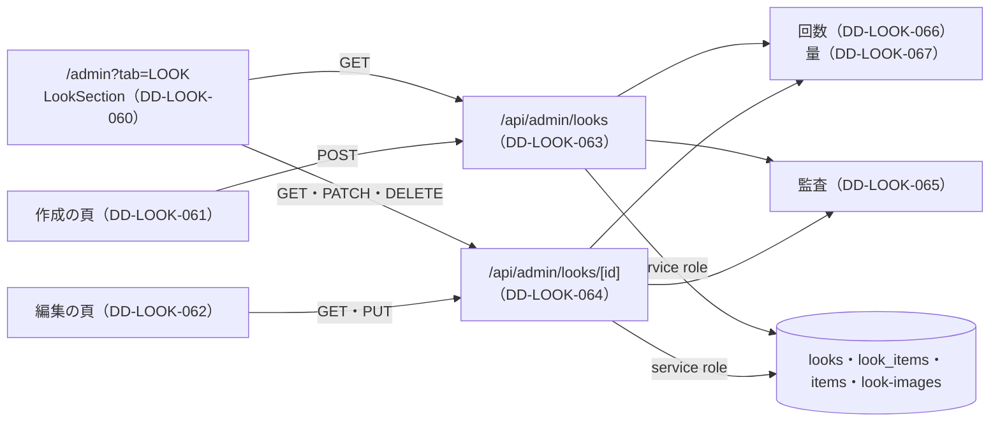

# 1.16-3 管理画面の LOOK（ADMIN LOOK）詳細設計

> 状態: 推定 | 確認日: 2026-10-26 | 対象: 管理画面の LOOK タブの一覧、LOOK の作成・編集の頁、`/api/admin/looks` と `/api/admin/looks/[id]`、管理の監査と回数・量の上限 | 基準コミット: `4facf63b`（作業ツリーに別の作業の未コミットの差分あり）

## 概要

管理画面の LOOK を作るコードの単位ごとに、入出力・正常と異常の流れ・状態・認可・単体テストの観点を、追跡できる項目（`### <ID> <題>` と属性の表）で書く。
中身は 2026-10-24 の作業ツリーのコードを読んで起こした今の動きで、ユーザーの確認を受けていないので全部「推定」にした。要件・構造設計と食い違う所は決めずに今のコードの動きを書き、食い違いは `docs/05_Quality/reports/trace-matrix.md` の「食い違い」節に載せた。
管理の詳細設計の元の頁 `16_admin.md` は別の作業が書き換え中で触れないので、LOOK の分をこの頁に分けた（NEWS の `16-1_admin_news.md` と同じ形）。

| ID | 単位 | 中身 | 旧番号 |
| --- | --- | --- | --- |
| `DD-LOOK-060` | `src/components/LookSection.tsx` | LOOK タブの一覧。公開の切り替え・編集へ・削除 | `IMPL-ADMIN-005`（`16_admin.md` に残る） |
| `DD-LOOK-061` | `src/app/admin/look/create/page.tsx` | 作成の頁。入力のフォームを作成の窓口で包む | なし |
| `DD-LOOK-062` | `src/app/admin/look/edit/[id]/page.tsx` | 編集の頁。1件を取り出して初めの値を入れ、更新の窓口で包む | なし |
| `DD-LOOK-063` | `src/app/api/admin/looks/route.ts` | 管理の一覧の取り出しと作成の窓口 | `IMPL-ADMIN-LOOK-01`（`16_admin.md` に残る） |
| `DD-LOOK-064` | `src/app/api/admin/looks/[id]/route.ts` | 1件の取り出し・全体の更新・公開の状態の切り替え・削除の窓口 | なし |
| `DD-LOOK-065` | `logAdminLookAudit`（`src/features/look/services/admin-audit.ts`） | 管理の LOOK の操作を監査に残す | なし |
| `DD-LOOK-066` | `enforceAdminLookMutationRateLimit`（`src/features/look/services/admin-rate-limit.ts`） | 変更の種類ごとに送り元と操作者の2段で回数を数える | なし |
| `DD-LOOK-067` | `validateLookImageBatch`・`consumeAdminLookUploadQuota`（`src/features/look/services/admin-rate-limit.ts`） | 1回の画像の枚数と合計、操作者の1時間の画像の量 | なし |
| `DD-LOOK-070` | `prepareLookImage`・`buildLookImagePath`・`isOwnLookImagePath`・`removeLookImages`・`listRemovableLookImagePaths`（`src/features/look/services/admin-images.ts`） | 画像の中身の確かめ・保存名・置き場の後始末 | なし |

- 結論: 画面は利用者の端末で動き、守りを持たない。窓口ごとに `authorizeAdminPermission` で session・権限・aal2 を確かめ、変更には2段の回数の制限をかけ、DB と置き場は service role で操作する（RLS は効かない）
- 変更は、回数と1時間の量の制限で断った時のほかは、成功も失敗も監査に残す。読み出しは監査も回数の制限も無い
- 番号は `DD-LOOK-060`〜`089` をこの頁で使う。今は `060`〜`067` と `070` を使う（`068`・`069` は公開の頁が使う）

## 範囲と根拠

| 項目 | 内容 |
| --- | --- |
| 範囲 | `scripts/trace/scope.json` の LOOK のうち、管理の画面と窓口とその部品 |
| 上位の文書 | [LOOK の構造設計](../../03_BasicDesign/areas/look.md)（`ARC-LOOK-002`・`003`、`SCR-LOOK-006`〜`008`、`FLOW-LOOK-002`、`STATE-LOOK-001`、`API-LOOK-001`〜`006`、`DATA-`）、[LOOK の要件](../../02_Requirements/areas/look.md)（`FR-ADMIN-005`・`FREQ-17`・`SEC-LOOK-`・`DRV-LOOK-`） |
| 対象のコード | `src/components/LookSection.tsx`、`src/app/admin/look/create/page.tsx`、`src/app/admin/look/edit/[id]/page.tsx`、`src/app/api/admin/looks/route.ts`、`src/app/api/admin/looks/[id]/route.ts`、`src/features/look/services/admin-audit.ts`、`src/features/look/services/admin-rate-limit.ts`、`src/features/look/services/admin-images.ts` |
| 単位の無いファイル | `src/app/admin/look/types.ts`（型だけ。`LookFormValues`・`LookDetailResponse` など） |
| 範囲外のファイル | `src/app/admin/look/LookForm.tsx`（別の作業が触る。入力の欄と送信の後の移り先を持つ）、`src/app/admin/page.tsx` の LOOK タブ（別の作業が書き換え中） |
| 関連文書 | `docs/04_DetailDesign/pages/16_admin.md`（旧番号の行。別の作業が書き換え中で直さない）、`docs/03_BasicDesign/api/api-spec.md`（別の作業が書き換え中） |
| 文字として読む試験 | `tests/unit/docs/delivery-status-traceability.test.ts`・`order-status-traceability.test.ts` が `src/app/api` の全部の `route.ts` を文字として読み、処理の関数の数を数える。DD-LOOK-063・064 の単位のコメントに処理の関数の宣言に似た字を書かない |
| 調べた時点 | 2026-10-24 の作業ツリー（コードは読んだだけで、動かしての確かめはしていない） |

範囲外の共有部品は ID を持たないので、項目の本文にファイルの道で書く。

| 共有部品 | 道 | 管理の LOOK での使われ方 |
| --- | --- | --- |
| 管理の認可 | `src/lib/auth/admin-rbac.ts` の `authorizeAdminPermission` | 窓口ごとに `admin.looks.read`・`admin.looks.manage` を確かめ、`{ok, userId, actorEmail}` か断りの応答を返す |
| CSRF の Origin の検査 | `src/proxy.ts` | `/api` の書き換えの Origin・Referer を照らす。窓口は自分では確かめない |
| 書き換えの送り方 | `src/lib/client-fetch.ts` の `clientFetch` | 画面から窓口へ送る |
| 回数の制限 | `src/features/auth/middleware/rateLimit.ts` の `enforceRateLimit`、`src/features/auth/ratelimit` の `incrementCounterBy` | 変更の回数と1時間の画像の量を数える |
| 監査 | `src/lib/audit.ts` の `logAudit` | `audit_logs` に残す |
| Supabase の client | `src/lib/supabase/server.ts` の `createServiceRoleClient` | 窓口の DB と置き場の操作 |
| 画像の署名 | `src/lib/storage/look-images.ts` の `signLookImageUrls`（[一覧の頁](06_look_list.md) の DD-LOOK-006） | 管理の一覧と1件の画像 |
| 画面の部品 | `src/components/ui/`（`Button`・`Card`・`TagLabel`） | 一覧のカードとボタン |

矢印は呼び出しの向き。画面から窓口の矢印は `clientFetch` の送信。作成と編集の頁の送信は範囲外の `LookForm` が行う。

## 詳細設計

### DD-LOOK-060 LOOK タブの一覧 LookSection

| 属性 | 値 |
| --- | --- |
| 上位 | SCR-LOOK-006、FLOW-LOOK-002、STATE-LOOK-001、SEC-LOOK-019 |
| 根拠 | 店長が LOOK の一覧から公開の切り替え・編集・削除へ1か所で届くようにする（SCR-LOOK-006、FLOW-LOOK-002）。作った LOOK を直さずに出し入れできるよう、状態だけを反転するボタンを置く（STATE-LOOK-001）。消した LOOK は戻せないので、押し間違いで消さないよう確かめを挟む（FLOW-LOOK-002）。変更の後は一覧を取り直し、窓口の結果を画面に映す |
| 状態 | 推定 |
| 確かめ方 | 単体テスト |
| 出どころ | 実装から推定（`src/components/LookSection.tsx`）、`docs/04_DetailDesign/pages/16_admin.md` |
| 旧番号 | IMPL-ADMIN-005 |

#### 対応要件

FR-ADMIN-005、FREQ-17、DRV-LOOK-008・011・012、SEC-LOOK-019-AC-05。

#### 入出力

| 項目 | 内容 |
| --- | --- |
| 入力 | props なし。`GET /api/admin/looks` の `{data, meta}` |
| 出力 | 読み込み中・0件・カードの格子（2列、md 3列、lg 4列）。カードは1枚目の画像・状態の札・シーズン・テーマと、`meta.canManage` が真の時だけ3つのボタン |
| 副作用 | `PATCH /api/admin/looks/<id>`（JSON `{status}`）、`DELETE /api/admin/looks/<id>`、`confirm`・`alert`、`console.error` |

#### 正常フロー

1. 描いた時に一覧を取る。成功なら `data` を状態に入れ、`meta.canManage === true` の時だけ操作ボタンを出す印を立てる（取り直すたびに入れ直す）。終われば読み込み中を外す
2. カード: 画像は1枚目（無ければ `/placeholder.png`、`unoptimized`）。札は公開中なら「公開中」（solid）、非公開なら「非公開」（outline）。シーズンは「<年> <シーズン>」
3. 切り替え（`canManage` が真の時だけ出る）: 今の状態の反対を送る（公開中なら private、非公開なら published）。ボタンの文字は公開中なら「非公開」、非公開なら「公開」。成功なら取り直す
4. 編集: `/admin/look/edit/<id>` へのリンクのボタン
5. 削除: 「このLOOKを削除してもよろしいですか？」に同意した時だけ送る。成功なら取り直す

#### 異常フロー

| 場合 | 動き | 道 |
| --- | --- | --- |
| 一覧の応答が `ok` でない・例外 | 記録して状態を変えない（「LOOKがありません」になる。SEC-LOOK-022 は満たさない） | `src/components/LookSection.tsx` |
| 一覧の `data` が空 | 空の配列 | `src/components/LookSection.tsx` |
| 切り替えの応答が `ok` でない・例外 | 記録して「ステータスの更新に失敗しました」 | `src/components/LookSection.tsx` |
| 削除の確かめで断る | 何もしない | `src/components/LookSection.tsx` |
| 削除の応答が `ok` でない・例外 | 記録して「LOOKの削除に失敗しました」 | `src/components/LookSection.tsx` |
| `image_urls` が無い・空 | `/placeholder.png` | `src/components/LookSection.tsx` |

- `meta` が無い・`canManage` が真でない（偽・文字・数）時と、読み込み中・取り出しの失敗の時は、3つのボタンを出さない（fail-closed）。LOOK の札・シーズン・テーマ・画像は見える。押された時の守りは窓口の 403 で、画面の出し分けは案内（SEC-LOOK-019-AC-05、ADR-0161）

#### 状態・永続化

- 部品の中の状態: `lookItems`・`loading`・`canManage`。取り直しの最中も読み込み中には戻さない
- 永続化は窓口（DD-LOOK-063・064）が行う

#### 認証認可

- 画面は守りを持たない。タブを出すかは親（`src/app/admin/page.tsx`、範囲外）が役で決める
- 送信は `clientFetch`（範囲外）。CSRF の守りは proxy の Origin の検査と `clientFetch` の見出しに任せる
- テーマは JSX の文字として出す

#### テスト観点

`clientFetch`・`next/image`・`confirm`・`alert` を差し替える。

| # | 観点 | 入力 | 期待 |
| --- | --- | --- | --- |
| 1 | 読み込み中 | 応答を待たせる | 「読み込み中...」 |
| 2 | 一覧を出す | `{data:[公開1件・非公開1件]}` | 札「公開中」「非公開」、ボタン「非公開」「公開」、編集のリンク `/admin/look/edit/<id>` |
| 3 | `data` が空 | `{}` | 「LOOKがありません」 |
| 4 | 応答が `ok` でない | `ok:false` | 「LOOKがありません」、記録あり |
| 5 | 例外 | `clientFetch` が投げる | 「LOOKがありません」、記録あり |
| 6 | 画像なし | `image_urls:[]`、`image_urls` なし | `/placeholder.png` |
| 7 | 公開中を切り替え | 公開中のボタン | `PATCH` に `{status:"private"}`、成功で取り直す |
| 8 | 非公開を切り替え | 非公開のボタン | `{status:"published"}` |
| 9 | 切り替えの失敗 | `ok:false`、例外 | 「ステータスの更新に失敗しました」 |
| 10 | 削除を断る | `confirm` が偽 | `DELETE` を送らない |
| 11 | 削除の成功 | `confirm` が真、`ok:true` | `DELETE` を送り、取り直す |
| 12 | 削除の失敗 | `ok:false`、例外 | 「LOOKの削除に失敗しました」 |
| 13 | 操作ボタンの出し分け（出す） | `meta:{canManage:true}` | 各カードに公開（または非公開）・編集・削除 |
| 14 | 操作ボタンの出し分け（出さない） | `canManage:false`・`meta:{}`・`meta` なし・`canManage:'true'`（文字）・`1` | 3つとも出ない。札・シーズン・テーマ・画像は見える |
| 15 | 読み込み中・取り出しの失敗 | 応答を待たせる、`ok:false` | ボタンを出さない |
| 16 | 取り直しで権限が外れた | 2回目の応答が `canManage:false` | ボタンが消える |

### DD-LOOK-061 作成の頁 create/page.tsx

| 属性 | 値 |
| --- | --- |
| 上位 | SCR-LOOK-007、FLOW-LOOK-002 |
| 根拠 | 作成と編集で同じ入力のフォームを使い回し、欄の決まりを1つにするため、頁は送り先と送り方だけを渡す（SCR-LOOK-007）。保存かキャンセルの後は一覧へ戻す（FLOW-LOOK-002。移り先は範囲外の `LookForm` が持つ） |
| 状態 | 推定 |
| 確かめ方 | 単体テスト |
| 出どころ | 実装から推定（`src/app/admin/look/create/page.tsx`） |

#### 対応要件

FR-ADMIN-005、FREQ-17、DRV-LOOK-009・013。

#### 入出力

| 項目 | 内容 |
| --- | --- |
| 入力 | なし |
| 出力 | `LookForm`（送り先 `/api/admin/looks`、送り方 POST、初めの値なし） |

#### 正常フロー

1. `LookForm` を描くだけ

#### 異常フロー

分岐なし。送った後の失敗の表示は `LookForm`（範囲外）が持つ。

#### 状態・永続化

なし。

#### 認証認可

頁は守りを持たず、権限の無い人にもフォームが出る。送った時に作成の窓口（DD-LOOK-063）が断る（推定）。

#### テスト観点

| # | 観点 | 入力 | 期待 |
| --- | --- | --- | --- |
| 1 | フォームに渡す値 | 描く（`LookForm` を差し替え） | 送り先 `/api/admin/looks`、送り方 POST、初めの値なし |

### DD-LOOK-062 編集の頁 edit/[id]/page.tsx

| 属性 | 値 |
| --- | --- |
| 上位 | SCR-LOOK-008、FLOW-LOOK-002 |
| 根拠 | 今の値と画像を入れて始め、直す欄だけを触ればよいようにするため、頁が1件を取り出して `LookForm` の初めの値に詰める（SCR-LOOK-008）。取り出しに失敗した時は頁に文を出し、移らない（FLOW-LOOK-002） |
| 状態 | 推定 |
| 確かめ方 | 単体テスト |
| 出どころ | 実装から推定（`src/app/admin/look/edit/[id]/page.tsx`、`src/app/admin/look/types.ts`） |

#### 対応要件

FR-ADMIN-005、FREQ-17、DRV-LOOK-010・013。

#### 入出力

| 項目 | 内容 |
| --- | --- |
| 入力 | `useParams` の `id`、`GET /api/admin/looks/<id>` の `{data}` か `{error}` |
| 出力 | 読み込み中・誤りの文（赤）・`LookForm`（送り先 `/api/admin/looks/<id>`、送り方 PUT、初めの値） |
| 初めの値 | `seasonYear`・`seasonType`・`theme`・`themeDescription`（無ければ空）・`status`・`linkedItemIds`（無ければ空）・`previewUrls`（`image_urls` が配列でなければ空） |
| 副作用 | `console.error` の記録 |

#### 正常フロー

1. `id` があれば1件を取る
2. 応答が `ok` で `data` があれば初めの値に詰め、読み込み中を外す
3. `LookForm` を PUT で描く

#### 異常フロー

| 場合 | 動き | 道 |
| --- | --- | --- |
| `id` が無い | 「LOOK IDの取得に失敗しました」（動的ルートでは起きない、推定） | `src/app/admin/look/edit/[id]/page.tsx` |
| 応答の JSON が読めない | `json` を null にして続ける | `src/app/admin/look/edit/[id]/page.tsx` |
| 応答が `ok` でない | サーバーの `error` の文か「LOOKの取得に失敗しました」 | `src/app/admin/look/edit/[id]/page.tsx` |
| `data` が無い | 「LOOKの取得に失敗しました」 | `src/app/admin/look/edit/[id]/page.tsx` |
| 例外 | 記録して「LOOKの取得に失敗しました」 | `src/app/admin/look/edit/[id]/page.tsx` |
| 読み込みが終わって値も誤りも無い | 何も描かない（届かない、推定） | `src/app/admin/look/edit/[id]/page.tsx` |

- `useParams` が null を返す道（`?.` の右側）は、App Router の動的ルートでは起きない（推定）

#### 状態・永続化

- 部品の中の状態: `initialValues`・`isLoading`・`fetchError`
- 永続化は更新の窓口（DD-LOOK-064）が行う

#### 認証認可

頁は守りを持たない。取り出しの窓口が `admin.looks.read` で断り、その `error` の文を出す。

#### テスト観点

`useParams`・`clientFetch`・`LookForm` を差し替える。

| # | 観点 | 入力 | 期待 |
| --- | --- | --- | --- |
| 1 | 読み込み中 | 応答を待たせる | 「読み込み中...」 |
| 2 | id が無い | `useParams` が `{}`、null | 「LOOK IDの取得に失敗しました」、取り出さない |
| 3 | 取り出しの成功 | 全部の欄のある `data` | `LookForm` に PUT・`/api/admin/looks/<id>`・詰めた初めの値 |
| 4 | 欄の欠け | `theme_description`・`linkedItemIds` なし、`image_urls` が配列でない | 空の文字・空の配列 |
| 5 | `ok` でない（文あり） | `ok:false`、`{error:"Look not found"}` | 「Look not found」 |
| 6 | `ok` でない（文なし・JSON が読めない） | `ok:false`、`json` が投げる | 「LOOKの取得に失敗しました」 |
| 7 | `data` が無い | `ok:true`、`{}` | 「LOOKの取得に失敗しました」 |
| 8 | 例外 | `clientFetch` が投げる | 「LOOKの取得に失敗しました」、記録あり |

### DD-LOOK-063 管理の一覧と作成の窓口 /api/admin/looks

| 属性 | 値 |
| --- | --- |
| 上位 | API-LOOK-001、API-LOOK-002、ARC-LOOK-002、ARC-LOOK-003、STATE-LOOK-001、DATA-LOOK-001、DATA-LOOK-002、DATA-LOOK-005、DATA-LOOK-006、SEC-LOOK-011、SEC-LOOK-013、SEC-LOOK-014、SEC-LOOK-019、SEC-LOOK-021 |
| 根拠 | 非公開を含む一覧は `admin.looks.read`、LOOK を作る操作は `admin.looks.manage` と、操作ごとの権限と aal2 を窓口で確かめる（API-LOOK-001・002、DATA-LOOK-006、SEC-LOOK-019）。作成は表と置き場の両方を変えるので、送り元と操作者の2段の回数と画像の量に上限をかけ（SEC-LOOK-011、ARC-LOOK-002）、入口で形を決めて断る（API-LOOK-002）。画像は非公開の置き場に上げ、表には置き場の中の道筋だけを入れる（ARC-LOOK-003、DATA-LOOK-005）。関連の保存に失敗したら作った LOOK の行を消し、関連の無い LOOK を残さない（DATA-LOOK-001・002）。状態は private・published の2つ（STATE-LOOK-001） |
| 状態 | 推定 |
| 確かめ方 | 単体テスト |
| 出どころ | 実装から推定（`src/app/api/admin/looks/route.ts`）、`docs/04_DetailDesign/pages/16_admin.md` |
| 旧番号 | IMPL-ADMIN-LOOK-01 |

#### 対応要件

FR-ADMIN-005、FREQ-17、FREQ-316・327（範囲外、AUTH）、DRV-LOOK-009・012。

#### 入出力

| 処理 | 入力 | 成功 | 失敗 |
| --- | --- | --- | --- |
| 一覧（GET） | なし | 200 `{data, meta:{canManage}}`（`looks` の8つの欄と `look_items(item_id)`、作った日時の新しい順、`image_urls` は署名つき。`canManage` は `admin.looks.manage` の認可をもう一度行った結果） | 認可の応答（`canManage` を決める確かめが 401・503 ならその応答）、500 `Failed to fetch looks`、500 `Internal server error` |
| 作成（POST） | multipart: `seasonYear`・`seasonType`・`theme`・`themeDescription`・`status`・`linkedItemIds`（JSON の数の配列）・`images`（1枚以上） | 201 `{success:true, id}` | 下の異常フローの表 |

入力の形（`createLookSchema`）: `seasonYear` は数に直して 2000〜2100 の整数、`seasonType` は SS・AW、`theme` は前後の空白を除いて1〜200字、`themeDescription` は前後の空白を除いて4000字まで（無ければ空）、`status` は private・published、`linkedItemIds` は正の整数の配列で1つ以上。画像は JPEG・PNG・WebP・GIF（申告の種類と中身の先頭の印が合うこと）、1枚 5MB。

#### 正常フロー

作成:

1. `admin.looks.manage` で認可し、操作者の id と mail を控える
2. 作成の回数を数える（DD-LOOK-066）
3. multipart を読み、`linkedItemIds` を JSON として読み（`parseJsonField`）、形を確かめる
4. `images` のうちファイルだけを集め、1枚以上かを見る
5. 枚数と合計を確かめる（DD-LOOK-067）。1枚ずつ申告の種類と大きさを見て、`prepareLookImage`（DD-LOOK-070）で中身の先頭の印が申告と合うかを確かめる。合わなければ 400（置き場にも量の枠にも触れる前）
6. service role の client で、紐づける商品が全部 `items` にあるかを数で照らす（公開かは見ない）
7. 操作者の1時間の作成の画像の量を数える（DD-LOOK-067）
8. 1枚ずつ `look-images` に `buildLookImagePath` が作った `looks/<YYYY-MM-DD>/<uuid>.<検出した種類の拡張子>` で上げる（検出した種類・`cacheControl:'3600'`・上書きしない）。送られたファイル名は使わない
9. `looks` に入れて id を受け取る。`look_items` に入れる。途中の失敗では、行がもう指さなくなった時（`looks` への入れの失敗、または `look_items` の失敗の後に行を消せた時）だけ、上げ終えた画像を `removeLookImages` で置き場から消す
10. 監査 `admin.look.create`（success、LOOK の id と状態・関連・枚数・シーズン）を残して 201

一覧:

1. `admin.looks.read` で認可する。続けて `admin.looks.manage` で認可をもう一度行う（何も書かない）。権限が無いための 403 だけ `canManage:false` にし、401・503 はその応答を返す
2. service role の client で全部を取り、作った日時の新しい順
3. LOOK ごとに `image_urls`（無ければ空）を署名して 200 `{data, meta:{canManage}}`

#### 異常フロー

| 場合 | 応答 | 監査（failure の detail） | 道 |
| --- | --- | --- | --- |
| 認可の失敗（作成・一覧） | 認可の部品の応答（401・403・503） | なし | `route.ts` |
| 作成の回数の超過・数え場所の失敗 | 429・503 | なし | `route.ts` |
| `linkedItemIds` が文字でない・JSON が読めない・数の配列でない | 400 `Invalid request`（`details` 付き） | `Invalid create payload`（catch で） | `route.ts` |
| 欄の形の誤り | 400 `Invalid request`（`details` 付き） | `Invalid create payload` と誤りの欄の名前 | `route.ts` |
| 画像が0枚 | 400 `At least one image is required` | `No image files provided` | `route.ts` |
| 7枚以上・合計 20MB 超 | 400（DD-LOOK-067 の文） | その文 | `route.ts` |
| 申告の種類が4つ以外 | 400 `Unsupported image type` | `Unsupported image type` | `route.ts` |
| 申告と中身の先頭の印が合わない | 400 `Unsupported image type`（置き場にも量の枠にも触れない） | `Unsupported image type`（申告の種類と枚数だけ。ファイル名も中身も残さない） | `route.ts` |
| 1枚が 5MB 超 | 400 `Image size must be 5MB or less` | `Image size limit exceeded` | `route.ts` |
| 商品の照らしの失敗 | 500 `Failed to validate linked items` | 同じ文 | `route.ts` |
| 商品の数が合わない（無い・重ね・`data` が空） | 400 `Some linked items do not exist` | 同じ文 | `route.ts` |
| 1時間の量の超過・数え場所の失敗 | 429・503 | なし | `route.ts` |
| 置き場の失敗 | 500 `Failed to upload image`（置き場の文は入れない）。それまでに上げた画像を置き場から消す | `Failed to upload look image` | `route.ts` |
| `looks` の保存の失敗・id が返らない | 500 `Failed to save look`。上げた全部の画像を置き場から消す | `Failed to insert look` | `route.ts` |
| `look_items` の保存の失敗 | 作った LOOK の行を消し、消せた時だけ上げた画像を置き場から消して 500 `Failed to save linked items`。行の削除も失敗したら行が残るので画像は消さない | `Failed to create look-item links`（LOOK の id 付き。行の削除が失敗した時は `metadata` に `row_cleanup:'failed'`） | `route.ts` |
| ほかの例外（multipart でない要求を含む、推定） | 500 `Internal server error` | 操作者が分かれば `Unexpected create error` | `route.ts` |
| 一覧の DB の失敗 | 500 `Failed to fetch looks` | なし | `route.ts` |
| 一覧の `data` が空・`image_urls` が空 | 空として扱う | なし | `route.ts` |
| 一覧の例外 | 500 `Internal server error` | なし | `route.ts` |

- 途中で失敗した時は、上げ終えた画像を置き場から消す（SEC-LOOK-014）。置き場の削除の失敗は応答を変えず、失敗した監査の `metadata` に `image_cleanup:'failed'` と `orphaned_count` を足す。操作者が分かった後の例外でも、まだ行が指していない画像を消す
- 種類は申告と中身の先頭の印の両方で確かめ、ファイル名は保存の道筋に入れない（SEC-LOOK-013）。記録は `describeErrorForLog` で名前と符号だけにする（SEC-LOOK-021）
- 例外の時の監査は、認可の前の例外（操作者が分からない）では残さない
- `themeDescription` の `?? ''`は、`formData.get` が欄の無い時に null を返すので届く

#### 状態・永続化

- 作成: `looks` に1行、`look_items` に関連の数だけ行、置き場に画像。途中の失敗の時は、行（関連の失敗の時だけ）と上げた画像を消して戻す
- 状態の初めの値は送られた `status`（STATE-LOOK-001）
- 監査は `audit_logs`（DD-LOOK-065）。回数と量は回数の表（共有部品）

#### 認証認可

- 一覧は `admin.looks.read`（応答の `meta.canManage` のために `admin.looks.manage` もう一度確かめる。暫定。ADR-0161）、作成は `admin.looks.manage`。`authorizeAdminPermission`（範囲外）が token・session・DB の ACL・aal2 を確かめる（SEC-LOOK-019）。読み出しだけの人の一覧では、共有の認可が `[RBAC] Permission denied` の警告を1行足す
- 作成の回数は送り元と操作者の2段（SEC-LOOK-011、DD-LOOK-066）。一覧は回数の制限が無い
- CSRF は proxy の Origin の検査（範囲外）に任せる
- DB と置き場は service role で操作し、RLS の管理の方針（DATA-LOOK-003）は通らない

#### テスト観点

`authorizeAdminPermission`・`createServiceRoleClient`・`logAdminLookAudit`・回数の3つの関数・`signLookImageUrls` を差し替える（`tests/unit/api/admin/looks-audit.test.ts` と同じ形）。

| # | 観点 | 入力 | 期待 |
| --- | --- | --- | --- |
| 1 | 作成の認可の失敗 | 認可が `ok:false` | 認可の応答、監査なし |
| 2 | 作成の回数の超過 | 回数が 429 | 429、監査なし |
| 3 | `linkedItemIds` が無い | 欄なし | 400 `Invalid request`、監査 `Invalid create payload` |
| 4 | `linkedItemIds` が JSON でない | `"[1,"` | 400、同じ監査 |
| 5 | `linkedItemIds` が数でない | `'["a"]'` | 400、同じ監査 |
| 6 | 欄の形の誤り | `seasonType:"FW"`、`themeDescription` なしの成功の形と並べる | 400 と誤りの欄の名前。欄なしは空として通る |
| 7 | 画像が0枚 | `images` なし | 400 `At least one image is required` |
| 8 | 枚数の超過 | 7枚 | 400、監査にその文 |
| 9 | 種類の誤り | `text/plain` | 400 `Unsupported image type` |
| 9a | 中身の誤り | 文字のファイルを `image/png` と申告、PNG を `image/jpeg` と申告 | 400 `Unsupported image type`、`upload` も量の枠も呼ばれず、監査にファイル名も中身も無い |
| 10 | 大きさの超過 | 5MB+1 | 400 `Image size must be 5MB or less` |
| 11 | 商品の照らしの失敗 | `items` が `error` | 500 `Failed to validate linked items` |
| 12 | 商品の数が合わない | 2つ送って1件、`data:null` | 400 `Some linked items do not exist` |
| 13 | 1時間の量の超過 | 量が 429 | 429、監査なし |
| 14 | 置き場の失敗 | `upload` が `error`（文に `SECRET`） | 500 `Failed to upload image` ちょうど、`SECRET` を応答にも記録にも含まない、監査 `Failed to upload look image`。2枚目の失敗は1枚目だけを `remove` |
| 15 | 保存名 | 名前 `a/b.html` の PNG、`noext` の GIF | 道筋が `looks/<日付>/<uuid>.png`、`….gif`（送られた名前を使わない） |
| 16 | `looks` の保存の失敗 | `insert` が `error`、`data:null` | 500 `Failed to save look`、上げた全部の道筋で `remove` |
| 17 | `look_items` の保存の失敗 | 関連の `insert` が `error` | `looks` の行を消し、上げた画像を `remove`、500 `Failed to save linked items` |
| 17a | 置き場の削除の失敗 | `remove` が `error`・例外 | 応答は同じ。監査に `image_cleanup:'failed'`・`orphaned_count`、記録に置き場の文なし |
| 18 | 作成の成功 | 正しい欄と画像1枚 | 201 `{success:true,id}`、監査 success |
| 19 | 例外（操作者あり） | 回数の関数が投げる | 500 `Internal server error`、監査 `Unexpected create error` |
| 20 | 例外（操作者なし） | 認可が投げる | 500、監査なし |
| 21 | 一覧の認可の失敗 | 認可が `ok:false` | 認可の応答 |
| 21a | 一覧の `canManage` | 2回目の認可が ok・403・401・503 | `meta.canManage` が true・false、401・503 はその応答 |
| 22 | 一覧の DB の失敗 | `error` あり | 500 `Failed to fetch looks` |
| 23 | 一覧の成功 | 2件（片方の `image_urls` が null） | 200、署名つきの画像、null は空として署名 |
| 24 | 一覧の `data` が空 | `data:null` | 200 `{data:[], meta:{canManage}}` |
| 25 | 一覧の例外 | client が投げる | 500 `Internal server error` |

### DD-LOOK-064 1件の取り出し・更新・切り替え・削除の窓口 /api/admin/looks/[id]

| 属性 | 値 |
| --- | --- |
| 上位 | API-LOOK-003、API-LOOK-004、API-LOOK-005、API-LOOK-006、ARC-LOOK-002、ARC-LOOK-003、STATE-LOOK-001、DATA-LOOK-001、DATA-LOOK-002、DATA-LOOK-005、DATA-LOOK-006、SEC-LOOK-011、SEC-LOOK-013、SEC-LOOK-014、SEC-LOOK-016、SEC-LOOK-019、SEC-LOOK-021、SEC-LOOK-022 |
| 根拠 | 編集の頁に非公開の LOOK の中身を渡す取り出しは `admin.looks.read`、表を変える3つの操作は `admin.looks.manage` と aal2 を窓口で確かめる（API-LOOK-003〜006、DATA-LOOK-006、SEC-LOOK-019）。変更は種類ごとに2段の回数を数える（SEC-LOOK-011、ARC-LOOK-002）。更新は作成と同じ入力の決まりを当て、画像を付けた時だけ全部を差し替え、文字だけの直しで画像を上げ直させない（API-LOOK-004、ARC-LOOK-003、DATA-LOOK-005）。状態だけの切り替えはフォームを送らずに状態の列だけを変え（API-LOOK-005、STATE-LOOK-001）、削除は行を消して関連を外部キーで消す（API-LOOK-006、DATA-LOOK-001・002） |
| 状態 | 推定 |
| 確かめ方 | 単体テスト |
| 出どころ | 実装から推定（`src/app/api/admin/looks/[id]/route.ts`） |

#### 対応要件

FR-ADMIN-005、FREQ-17、FREQ-316・327（範囲外、AUTH）、DRV-LOOK-008・009・010・011・013。

#### 入出力

| 処理 | 入力 | 成功 | 監査の操作 |
| --- | --- | --- | --- |
| 1件（GET） | 道の `id` | 200 `{data}`（`looks` の全部の欄、署名つきの `image_urls`、`linkedItemIds`） | なし |
| 全体の更新（PUT） | 道の `id`、multipart（作成と同じ欄。`images` は任意） | 200 `{success:true}` | `admin.look.update` |
| 状態の切り替え（PATCH） | 道の `id`、JSON `{status}`（private・published） | 200 `{success:true}` | `admin.look.status_update` |
| 削除（DELETE） | 道の `id` | 200 `{success:true}` | `admin.look.delete` |

- 道の `id` は、4つとも権限と回数（変更の3つ）の確かめの後・DB に触れる前に `parseLookId`（公開の頁と同じ関数。`src/lib/look/public.ts`）で確かめる。合わなければ 400 `Invalid look id`。監査（変更の3つ）には id の生の値でなく長さ（`metadata.id_length`）だけを残す（SEC-LOOK-016）
- 入力の形（`updateLookSchema`）は作成と同じ。状態の形（`patchStatusSchema`）

#### 正常フロー

1件:

1. `admin.looks.read` で認可する。`id` を確かめる
2. service role の client で `looks` の1行を `maybeSingle` で取る
3. `look_items` の商品の id を取る
4. `image_urls`（配列でなければ空）を署名して返す

全体の更新:

1. `admin.looks.manage` で認可し、操作者を控える。更新の回数を数える。`id` を確かめる
2. multipart を読み、形を確かめる
3. 画像の枚数と合計、1枚ずつ申告の種類と大きさ、中身の先頭の印を見る（`prepareLookImage`。DD-LOOK-070）。0枚なら通る
4. 今の LOOK の有無と `image_urls` を `maybeSingle` で取る（無ければ 404。ここまで何も上げない）。紐づける商品の数を照らす
5. 操作者の1時間の更新の画像の量を数える（作成と別に数える）
6. 画像があれば全部を `buildLookImagePath` の道筋で上げ、並びを差し替える。無ければ今の並びのまま
7. `looks` を更新→ 画像を差し替えたなら古い道筋（`listRemovableLookImagePaths`）を置き場から消す→ `look_items` を全部消す→ 入れ直す
8. 監査（success、前の状態と次の状態・関連・枚数・シーズン）を残して 200

状態の切り替え:

1. 認可・状態の変更の回数。`id` を確かめる
2. JSON を読み（壊れていれば 400 `Invalid request`・監査 `Invalid JSON`）、形を確かめる
3. 有無を `maybeSingle` で取り、`status` だけを更新する
4. 監査（success、前の状態と次の状態）を残して 200。前と同じ状態でも成功として残す

削除:

1. 認可・削除の回数。`id` を確かめる
2. 有無と `image_urls` を `maybeSingle` で取り、`looks` の行を消す。関連の行は外部キーで消える
3. 行の削除が成功した後に、`image_urls` のうち自分の道筋だけを置き場から消す
4. 監査（success、消した LOOK の状態。置き場の削除が失敗したら `image_cleanup`・`orphaned_count`）を残して 200

#### 異常フロー

| 処理 | 場合 | 応答 | 監査（failure の detail） | 道 |
| --- | --- | --- | --- | --- |
| 全部 | 認可の失敗 | 認可の部品の応答 | なし | `[id]/route.ts` |
| 変更 | 回数の超過・数え場所の失敗 | 429・503 | なし | `[id]/route.ts` |
| 全部 | 数でない id（認可・変更の回数の後） | 400 `Invalid look id` | 変更の3つは `Invalid look id`（`metadata.id_length`）。1件はなし | `[id]/route.ts` |
| 全部 | 存在確認の DB の失敗 | 500 `Failed to fetch look` | 変更の3つは同じ文。1件はなし | `[id]/route.ts` |
| 1件 | 行が無い | 404 `Look not found` | なし | `[id]/route.ts` |
| 1件 | 関連の取り出しの失敗 | 500 `Failed to fetch look items` | なし | `[id]/route.ts` |
| 1件 | 関連の `data` が空・`image_urls` が配列でない | 空として扱う | なし | `[id]/route.ts` |
| 1件 | 例外 | 500 `Internal server error` | なし | `[id]/route.ts` |
| 更新 | `linkedItemIds` が無い・JSON でない・数でない | 400 `Invalid request` | `Invalid update payload`（catch で。LOOK の id なし） | `[id]/route.ts` |
| 更新 | 欄の形の誤り | 400 `Invalid request` | `Invalid update payload` と誤りの欄の名前 | `[id]/route.ts` |
| 更新 | 7枚以上・合計 20MB 超 | 400（DD-LOOK-067 の文） | その文 | `[id]/route.ts` |
| 更新 | 申告の種類が4つ以外、申告と中身の先頭の印が合わない | 400 `Unsupported image type`（置き場にも量の枠にも触れない） | 同じ文（申告の種類だけ。ファイル名も中身も残さない） | `[id]/route.ts` |
| 更新 | 1枚が 5MB 超 | 400 `Image size must be 5MB or less` | `Image size limit exceeded` | `[id]/route.ts` |
| 更新 | 今の LOOK が無い | 404 `Look not found` | 同じ文 | `[id]/route.ts` |
| 更新 | 商品の照らしの失敗 | 500 `Failed to validate linked items` | 同じ文 | `[id]/route.ts` |
| 更新 | 商品の数が合わない | 400 `Some linked items do not exist` | 同じ文 | `[id]/route.ts` |
| 更新 | 1時間の量の超過・数え場所の失敗 | 429・503 | なし | `[id]/route.ts` |
| 更新 | 置き場の失敗 | 500 `Failed to upload image`（置き場の文は入れない）。それまでに上げた画像を置き場から消す | `Failed to upload look image` | `[id]/route.ts` |
| 更新 | `looks` の更新の失敗 | 500 `Failed to update look`。この要求で上げた新しい画像を置き場から消す（古い画像は消さない） | 同じ文 | `[id]/route.ts` |
| 更新 | 関連の削除の失敗 | 500 `Failed to update linked items`（古い画像は更新の成功の後に消し済み。新しい画像は消さない） | `Failed to replace look-item links` | `[id]/route.ts` |
| 更新 | 関連の追加の失敗 | 500 `Failed to update linked items`。LOOK は関連0件のまま残る（SEC-LOOK-015 は波 2） | `Failed to update look-item links` | `[id]/route.ts` |
| 更新 | 今の `image_urls` が配列でない | 空として扱う | — | `[id]/route.ts` |
| 更新 | 前の状態が空 | 監査の前の状態を null | — | `[id]/route.ts` |
| 更新 | ほかの例外 | 500 `Internal server error` | 操作者が分かれば `Unexpected update error` | `[id]/route.ts` |
| 切り替え | 状態の形の誤り | 400 `Invalid request` | `Invalid status payload` | `[id]/route.ts` |
| 切り替え | 本文が JSON でない | 400 `Invalid request`（作成・更新の 400 とそろえた。SEC-LOOK-016） | `Invalid JSON`（LOOK の id 付き） | `[id]/route.ts` |
| 切り替え | 無い LOOK | 404 `Look not found` | 同じ文 | `[id]/route.ts` |
| 切り替え | 更新の失敗 | 500 `Failed to update status` | `Failed to update look status` | `[id]/route.ts` |
| 削除 | 無い LOOK | 404 `Look not found` | 同じ文 | `[id]/route.ts` |
| 削除 | 削除の失敗 | 500 `Failed to delete look`（画像は消さない） | 同じ文 | `[id]/route.ts` |
| 削除 | 置き場の削除の失敗・例外 | 200 のまま | success（`metadata` に `image_cleanup:'failed'`・`orphaned_count`） | `[id]/route.ts` |
| 削除 | 例外 | 500 `Internal server error` | 操作者が分かれば `Unexpected delete error` | `[id]/route.ts` |

- 切り替えの例外の監査で ZodError を分ける所は、形を `safeParse`で確かめるので例外にならず届かない（推定）
- 差し替え前の画像と、消した LOOK の画像は、行を変えた後に置き場から消す（SEC-LOOK-014、ADR-0160）。消す道筋は `looks/` の下の安全な文字だけ（古い見本の道筋・外の URL・`..` は渡さない）。置き場の削除は同じ service role の client で行い、利用者の session の client は使わない
- 記録は全部 `describeErrorForLog`（名前と符号だけ。SEC-LOOK-021）

#### 状態・永続化

- 更新: `looks` の1行を書き換え、`look_items` を消して入れ直す（3つの書き込みは別々で、途中の失敗を戻さない。SEC-LOOK-015 は波 2）。画像を付けた時は新しい画像を置き場に足し、行を書き換えた後に古い画像を消す
- 切り替え: `looks.status` だけ（STATE-LOOK-001）
- 削除: `looks` の1行を消し、`look_items` は `ON DELETE CASCADE` で消える。行を消した後に画像を置き場から消す
- 監査は `audit_logs`（DD-LOOK-065）

#### 認証認可

- 1件は `admin.looks.read`、更新・切り替え・削除は `admin.looks.manage`（SEC-LOOK-019）。認可は `params` を待った後、最初に行う
- 変更の回数は送り元と操作者の2段（SEC-LOOK-011）。更新は 15回、切り替えと削除は 30回（10分）
- CSRF は proxy の Origin の検査（範囲外）に任せる
- DB と置き場は service role で操作する

#### テスト観点

DD-LOOK-063 と同じ差し替え。`params` は `Promise.resolve({id:"1"})`。

| # | 観点 | 入力 | 期待 |
| --- | --- | --- | --- |
| 1 | 1件の認可の失敗 | 認可が `ok:false` | 認可の応答 |
| 2 | 1件が無い | `maybeSingle` が `data:null` | 404 `Look not found` |
| 2a | 1件の DB の失敗 | `maybeSingle` が `error` | 500 `Failed to fetch look`、記録は名前と符号だけ |
| 2b | 不正な id | `abc`・`1e3`・`0`・`-1`・`1.5` | 認可の後で 400 `Invalid look id`、DB を呼ばない。認可が通らなければ今までの 401・403 |
| 3 | 1件の関連の失敗 | `look_items` が `error` | 500 `Failed to fetch look items` |
| 4 | 1件の成功 | 関連2件、`image_urls` 配列 | 200、`linkedItemIds`、署名つきの画像 |
| 5 | 1件の欠け | 関連 `data:null`、`image_urls` が配列でない | `linkedItemIds:[]`、空として署名 |
| 6 | 1件の例外 | client が投げる | 500 |
| 7 | 更新の認可・回数 | `ok:false`、回数 429 | 認可の応答、429、監査なし |
| 8 | 更新の `linkedItemIds` の誤り | 欄なし・JSON でない | 400、監査 `Invalid update payload` |
| 9 | 更新の欄の誤り | `theme:""`、`themeDescription` なしの成功の形と並べる | 400 と欄の名前。欄なしは空として通る |
| 10 | 更新の画像の誤り | 7枚、`text/plain`、5MB+1 | 400 とそれぞれの文 |
| 11 | 更新の今の LOOK が無い・取り出しの失敗 | `maybeSingle` が `data:null`、`error` | 404、監査 `Look not found`・500、監査 `Failed to fetch look`。何も上げない |
| 12 | 更新の商品の誤り | `items` が `error`、数が合わない | 500、400 |
| 13 | 更新の量の超過 | 量が 429 | 429、監査なし |
| 14 | 更新（画像なし） | `images` なし、今の `image_urls` が配列・null | 今の並び・空のまま更新 |
| 15 | 更新（画像あり） | 画像2枚（名前 `a/b.html` の PNG・`noext` の WebP） | 置き場に上げ、並びを差し替える。拡張子 `.png`・`.webp`（検出した種類） |
| 15a | 更新の画像の中身 | 文字のファイルを `image/png`、PNG を `image/webp` と申告 | 400、`upload` も量の枠も呼ばれない |
| 15b | 更新の後始末 | 画像つきの成功、`looks` の更新の失敗、関連の保存の失敗、2枚目の上げの失敗、`remove` の失敗・例外 | 成功は古い道筋だけ `remove`。更新の失敗は新しい道筋だけ。関連の保存の失敗は古い道筋だけ。2枚目の失敗は1枚目だけ。`remove` の失敗は 200 のまま監査に件数。古い見本の道筋は渡さない |
| 16 | 更新の置き場の失敗 | `upload` が `error` | 500 `Failed to upload image`、監査 `Failed to upload look image` |
| 17 | 更新の3つの書き込みの失敗 | 更新・関連の削除・関連の追加のそれぞれが `error` | 500 とそれぞれの監査 |
| 18 | 更新の成功 | 正しい欄、前の状態あり・null | 200、監査 success の前の状態・null |
| 19 | 更新の例外 | 操作者あり（回数の関数が投げる）・なし（認可が投げる） | 500、監査 `Unexpected update error`・なし |
| 20 | 切り替えの認可・回数 | `ok:false`、回数 429 | 認可の応答、429 |
| 21 | 切り替えの形の誤り | `{status:"draft"}` | 400、監査 `Invalid status payload` |
| 22 | 切り替えの JSON の誤り | `request.json()` が reject | 400 `Invalid request`、監査 `Invalid JSON`、更新しない |
| 23 | 切り替えの無い LOOK・取り出しの失敗 | `maybeSingle` が `data:null`、`error` | 404、500 `Failed to fetch look` |
| 24 | 切り替えの更新の失敗 | `update` が `error` | 500 `Failed to update status` |
| 25 | 切り替えの成功 | `{status:"published"}` | 200、監査 success の前と次の状態 |
| 26 | 切り替えの例外（操作者なし） | 認可が投げる | 500、監査なし |
| 27 | 削除の認可・回数 | `ok:false`、回数 429 | 認可の応答、429 |
| 28 | 削除の無い LOOK・取り出しの失敗 | `maybeSingle` が `data:null`、`error` | 404、監査 `Look not found`・500、監査 `Failed to fetch look`。何も消さない |
| 29 | 削除の失敗 | `delete` が `error` | 500 `Failed to delete look`。画像は消さない |
| 30 | 削除の成功 | 有る LOOK（`image_urls` に自分の道筋・古い見本・外の URL） | 200、自分の道筋だけ `remove`、監査 success と消した状態 |
| 30a | 削除の後始末の失敗 | `remove` が `error`・例外 | 200 のまま。監査に `image_cleanup:'failed'`・`orphaned_count` |
| 31 | 削除の例外 | 操作者あり・なし | 500、監査 `Unexpected delete error`・なし |

### DD-LOOK-065 管理の LOOK の監査 logAdminLookAudit

| 属性 | 値 |
| --- | --- |
| 上位 | ARC-LOOK-002 |
| 根拠 | 管理の変更を誰がいつ何にしたかを後から追えるよう、成功も失敗も1つの関数で同じ形に残す（ARC-LOOK-002）。resource を `look` に決め、窓口ごとに書き方がずれないようにする |
| 状態 | 推定 |
| 確かめ方 | 単体テスト |
| 出どころ | 実装から推定（`src/features/look/services/admin-audit.ts`） |

#### 対応要件

FR-ADMIN-005。SEC-LOOK-020（送り元を残す）は満たさない。

#### 入出力

| 項目 | 内容 |
| --- | --- |
| 入力 | `request`、`actorId`、`actorEmail`、`action`、`outcome`（success・failure）、`detail`、`resourceId?`（文字・数・null）、`metadata?` |
| 出力 | `logAudit`（範囲外）の戻り値 |
| 書く値 | `action`・`actor_id`・`actor_email`・`resource:'look'`・`resource_id`（文字に直す。無ければ null）・`outcome`・`detail`・`user_agent`（要求の見出し。無ければ null）・`metadata`（無ければ null） |

#### 正常フロー

1. 要求の `user-agent` の見出しを読む
2. `resourceId` を文字に直し、`logAudit` に渡す

#### 異常フロー

| 場合 | 動き | 道 |
| --- | --- | --- |
| `user-agent` が無い・空 | null | `src/features/look/services/admin-audit.ts` |
| `resourceId` が無い・null | null | `src/features/look/services/admin-audit.ts` |
| `metadata` が無い | null | `src/features/look/services/admin-audit.ts` |

- 送り元の IP は残さない。`logAudit` の失敗の扱いは共有部品に任せる

#### 状態・永続化

`audit_logs` に1行（共有の `logAudit` が書く）。

#### 認証認可

なし。呼び元が認可の後に呼ぶ。

#### テスト観点

`@/lib/audit` を差し替える。

| # | 観点 | 入力 | 期待 |
| --- | --- | --- | --- |
| 1 | 全部の値 | `resourceId:5`、`metadata`、`user-agent` あり | `resource:'look'`・`resource_id:'5'`・`user_agent`・`metadata` |
| 2 | 欠け | `resourceId` なし、`metadata` なし、`user-agent` なし | `resource_id`・`user_agent`・`metadata` が null |
| 3 | null の id | `resourceId:null` | `resource_id:null` |

### DD-LOOK-066 管理の変更の回数の制限 enforceAdminLookMutationRateLimit

| 属性 | 値 |
| --- | --- |
| 上位 | ARC-LOOK-002、SEC-LOOK-011 |
| 根拠 | 盗まれた session や誤った繰り返しで LOOK を大量に作る・消すのを止めるため、変更の種類ごとに送り元と操作者の2段で数える（ARC-LOOK-002、SEC-LOOK-011）。操作者の段を必ず持てば、送り元の見出しを変えても同じ操作者は止まる（SEC-LOOK-011）。作成は重いので少なく、状態の切り替えと削除は軽いので多くする |
| 状態 | 推定 |
| 確かめ方 | 単体テスト |
| 出どころ | 実装から推定（`src/features/look/services/admin-rate-limit.ts`） |

#### 対応要件

FR-ADMIN-005。

#### 入出力

| 項目 | 内容 |
| --- | --- |
| 入力 | `request`、`actorId`、`kind`（create・update・status・delete） |
| 出力 | 断りの応答（429・503、共有の `enforceRateLimit` が作る）か `undefined` |
| 上限 | 10分の窓で create 10回・update 15回・status 30回・delete 30回 |

#### 正常フロー

1. 種類の上限を選ぶ
2. `admin:looks:<種類>` で送り元の段を数える
3. 通れば同じ鍵に操作者の id を付けて操作者の段を数え、その結果を返す

#### 異常フロー

| 場合 | 動き | 道 |
| --- | --- | --- |
| 送り元の段で断られる | その応答を返し、操作者の段を数えない | `src/features/look/services/admin-rate-limit.ts` |
| 操作者の段で断られる | その応答を返す | `src/features/look/services/admin-rate-limit.ts` |

- 送り元の取り方と数え場所の失敗（503）は共有の `enforceRateLimit` に任せる

#### 状態・永続化

回数の表（共有部品）に送り元と操作者の数を足す。

#### 認証認可

なし。呼び元が認可の後に操作者の id を渡す。

#### テスト観点

`enforceRateLimit` を差し替える。

| # | 観点 | 入力 | 期待 |
| --- | --- | --- | --- |
| 1 | 送り元の段で断る | 1回目が 429 | 429。2回目を呼ばない |
| 2 | 操作者の段で断る | 1回目 `undefined`、2回目 429 | 429。2回目に `subject` 付き |
| 3 | 通る | 両方 `undefined` | `undefined` |
| 4 | 種類ごとの上限 | create・update・status・delete | 10・15・30・30、窓 600 秒、鍵 `admin:looks:<種類>` |

### DD-LOOK-067 管理の画像の枚数・合計・1時間の量の上限

| 属性 | 値 |
| --- | --- |
| 上位 | API-LOOK-002、API-LOOK-004 |
| 根拠 | 作成と更新で大きな画像を何度も上げて置き場と処理を使い切るのを止めるため、1回の枚数と合計、操作者の1時間の量に上限をかける（API-LOOK-002・004）。1時間の量は時間の区切りの印で数え、数え場所が使えない時は通さずに断る |
| 状態 | 推定 |
| 確かめ方 | 単体テスト |
| 出どころ | 実装から推定（`src/features/look/services/admin-rate-limit.ts`） |

#### 対応要件

FR-ADMIN-005、DRV-LOOK-009。SEC-LOOK-012（作成と更新を合わせた1時間の量）は満たさない。

#### 入出力

| 関数 | 入力 | 出力 |
| --- | --- | --- |
| `validateLookImageBatch` | `imageFiles`（`File[]`） | 誤りの文か null |
| `consumeAdminLookUploadQuota` | `actorId`、`kind`（create・update）、`totalBytes` | 断りの応答（429・503、`Retry-After: 3600`）か `undefined` |

- 上限: 1回6枚、1回の合計 20MiB、1時間 60MiB

#### 正常フロー

1. `validateLookImageBatch`: 枚数が6枚以下で、合計が 20MiB 以下なら null
2. `consumeAdminLookUploadQuota`: 0 より大きい量なら、1時間の区切りの印（今の時刻を1時間で切り下げた ISO の文字）で `admin:looks:<種類>:upload-bytes` に操作者ごとに足し、60MiB 以下なら `undefined`

#### 異常フロー

| 場合 | 動き | 道 |
| --- | --- | --- |
| 7枚以上 | 「A maximum of 6 images is allowed per request」 | `src/features/look/services/admin-rate-limit.ts` |
| 合計が 20MiB 超 | 「Total image payload must be 20MB or less per request」 | `src/features/look/services/admin-rate-limit.ts` |
| 量が 0 以下（画像なしの更新） | 数えずに `undefined` | `src/features/look/services/admin-rate-limit.ts` |
| 1時間の量が 60MiB 超 | 429 `Upload quota exceeded` | `src/features/look/services/admin-rate-limit.ts` |
| 数え場所の失敗 | 記録して 503 `Rate limiter unavailable` | `src/features/look/services/admin-rate-limit.ts` |

- 作成と更新を別の鍵で数えるので、合わせると1時間に 120MiB まで上げられる（SEC-LOOK-012 は満たさない）
- 量を数えるのは置き場に上げる前なので、後で上げるのに失敗しても数は戻らない（推定）

#### 状態・永続化

回数の表（共有部品）に操作者ごとの1時間の量を足す。

#### 認証認可

なし。呼び元が認可の後に操作者の id を渡す。

#### テスト観点

`incrementCounterBy` を差し替え、時刻を固定する。

| # | 観点 | 入力 | 期待 |
| --- | --- | --- | --- |
| 1 | 枚数の超過 | 7枚 | 枚数の文 |
| 2 | 合計の超過 | 6枚で合計 20MiB+1 | 合計の文 |
| 3 | 通る | 6枚で合計 20MiB | null |
| 4 | 量が0 | `totalBytes:0` | `undefined`、数えない |
| 5 | 1時間の量の超過 | 足した結果が 60MiB+1 | 429、`Retry-After: 3600` |
| 6 | 通る | 足した結果が 60MiB | `undefined`。鍵 `admin:looks:create:upload-bytes`、区切りの印は1時間の切り下げ |
| 7 | 数え場所の失敗 | `incrementCounterBy` が投げる | 503 `Rate limiter unavailable`、記録あり |

### DD-LOOK-070 管理の LOOK の画像の確かめ・保存名・後始末 admin-images

| 属性 | 値 |
| --- | --- |
| 上位 | API-LOOK-002、API-LOOK-004、API-LOOK-006、ARC-LOOK-003、SEC-LOOK-013、SEC-LOOK-014 |
| 根拠 | 置き場は service role で書くので、申告の種類を鵜呑みにせず、保存名も送られた名前から作らず、後始末で消す道筋は自分の置き場の自分の接頭辞の下だけにする（SEC-LOOK-013・014）。作成・更新・削除の3つの窓口で同じ決まりにそろえるため、窓口の外の1か所にまとめる |
| 状態 | 推定 |
| 確かめ方 | 単体テスト |
| 出どころ | 実装（`src/features/look/services/admin-images.ts`）。波 1-C の計画（Task 5） |

#### 対応要件

SEC-LOOK-013・014、DRV-LOOK-009・010・011。

#### 入出力

| 関数 | 入力 | 出力 |
| --- | --- | --- |
| `prepareLookImage` | `File` | `{buffer, contentType, extension}`。申告の type と中身の先頭の印が同じ時だけ。違えば `null` |
| `buildLookImagePath` | 拡張子、時刻（試験用） | `looks/<UTC の日付>/<uuid>.<拡張子>` |
| `isOwnLookImagePath` | 道筋の文字 | `looks/` の下の安全な文字（先頭は英数字、続きは英数字と `._-`、区切りは1つの `/`）だけなら true |
| `listRemovableLookImagePaths` | 行の `image_urls`（unknown）、残す道筋 | 消してよい道筋（重複なし、`keep` を除く） |
| `removeLookImages` | service role の client、道筋 | `'ok'` か `'failed'`。空なら置き場を呼ばず `'ok'`。投げない |

- 先頭の印の判定は共有の `src/lib/storage/image-signature.ts`（JPEG・PNG・GIF・WebP）。置き場の名前は `look-images`
- 古い公開 URL の形の値は `extractLookImageObjectPath`（`src/lib/storage/look-images.ts`。呼ぶだけ）で置き場の中の道筋に直してから確かめる

#### 正常フロー

1. 窓口が `prepareLookImage` で偽の画像を弾く（置き場に書く前・量の枠を使う前）
2. 窓口が `buildLookImagePath(prepared.extension)` で保存名を作って上げる
3. 行を変えた後に、窓口が `listRemovableLookImagePaths` で消す道筋を選び、`removeLookImages` で消す

#### 異常フロー

| 場合 | 動き | 道 |
| --- | --- | --- |
| 申告と検出が違う・印が無い | `prepareLookImage` が `null`（窓口が 400） | `admin-images.ts` |
| `..`・先頭の `/`・`//`・別の接頭辞・URL・空白・`%` を含む道筋 | 消す対象にしない | `admin-images.ts` |
| 古い見本の道筋（`e2e/look-1-1.png` など。接頭辞が違う） | 消さない側に倒れる | `admin-images.ts` |
| 置き場の削除が `error`・例外 | 名前と符号だけ記録して `'failed'`。投げない | `admin-images.ts` |

- 署名の共有ライブラリが共有の確かめ（`isOwnLookImagePath` 相当）を持つようになったら、その関数に差し替える（波 3。判断は ADR-0160）

#### 状態・永続化

なし（置き場の削除は呼び手の窓口が行う）。

#### 認証認可

なし。呼び元の窓口が認可の後に使う。

#### テスト観点

| # | 観点 | 入力 | 期待 |
| --- | --- | --- | --- |
| 1 | 本物の PNG | 名前 `a/b.html`、`image/png` | `png`、名前を使わない |
| 2 | 偽の画像 | 文字を `image/png`、PNG を `image/jpeg` | `null` |
| 3 | 保存名 | 固定の時刻 | `looks/2026-10-26/<uuid>.png`。呼ぶ度に違う |
| 4 | 自分の道筋 | `looks/…` の形、`../`・`//`・`news/`・URL・`e2e/…`・`%2e%2e`・空文字 | 真は `looks/` の下だけ |
| 5 | 消す道筋の選び方 | 重複・見本・URL・null・数・`keep`・古い公開 URL・別の置き場の URL | 自分の道筋だけ、重複なし、`keep` なし、古い URL は置き場の中の道筋に直る |
| 6 | 置き場の削除 | 空・成功・`error`・例外 | 空は呼ばず `'ok'`、失敗は `'failed'` で投げず、記録は名前と符号だけ |

## 実装の単位

コードの TSDoc に `@design` を書く時はこの表に従う（`@impl` の番号はその時に振る）。単位の数え方は `scripts/trace/parse-code.ts` の `parseCodeUnits`（2026-10-24 に実行）。

| ファイル | 単位（symbol） | 詳細設計 |
| --- | --- | --- |
| `src/components/LookSection.tsx` | `<file>` | DD-LOOK-060 |
| `src/app/admin/look/create/page.tsx` | `<file>` | DD-LOOK-061 |
| `src/app/admin/look/edit/[id]/page.tsx` | `<file>` | DD-LOOK-062 |
| `src/app/api/admin/looks/route.ts` | `<file>` | DD-LOOK-063 |
| `src/app/api/admin/looks/[id]/route.ts` | `<file>` | DD-LOOK-064 |
| `src/features/look/services/admin-audit.ts` | `logAdminLookAudit` | DD-LOOK-065 |
| `src/features/look/services/admin-rate-limit.ts` | `enforceAdminLookMutationRateLimit` | DD-LOOK-066 |
| `src/features/look/services/admin-rate-limit.ts` | `validateLookImageBatch` | DD-LOOK-067 |
| `src/features/look/services/admin-rate-limit.ts` | `consumeAdminLookUploadQuota` | DD-LOOK-067 |
| `src/features/look/services/admin-images.ts` | `prepareLookImage`・`buildLookImagePath`・`isOwnLookImagePath`・`listRemovableLookImagePaths`・`removeLookImages` | DD-LOOK-070 |

- `src/app/admin/look/types.ts` は `parseCodeUnits` の結果が空で、単位が無い
- `admin-audit.ts` の `getRequestUserAgent`、`admin-rate-limit.ts` の `buildHourlyBucketIso`・`buildRateLimitErrorResponse`、2つの `route.ts` の `parseJsonField` は export されず、単位にならない（呼ぶ単位の項目に含めた）
- `route.ts` のファイルの単位のコメントは、処理の関数の宣言より前（`import` より前）に置き、処理の関数の宣言に似た字を書かない（範囲と根拠の「文字として読む試験」）

## 未確認事項

- 管理の窓口の DB の操作を service role のままにするか、利用者の JWT で RLS に通すか（構造設計の未確認事項と同じ）
- 作成・編集の頁を開けるのは誰か。サーバーの守りが無い殻の扱い
- 更新の3つの書き込みを1つのまとまりにするか（波 2）。置き場の画像の後始末は 2026-10-26 に入れた（DD-LOOK-070）
- 動かしている時には届かない分岐（編集の頁の `useParams` が空の分岐は単体テストの差し替えで届く。編集の頁の読み込み後に値も誤りも無い形と、`[id]/route.ts` の PATCH の例外での ZodError の分けは届かない）を `test-gaps.md` の「届かない分岐」に書くか、コードから除くか
- この頁の項目は全部「推定」。ユーザーの確認を受けたら「現行」にする
