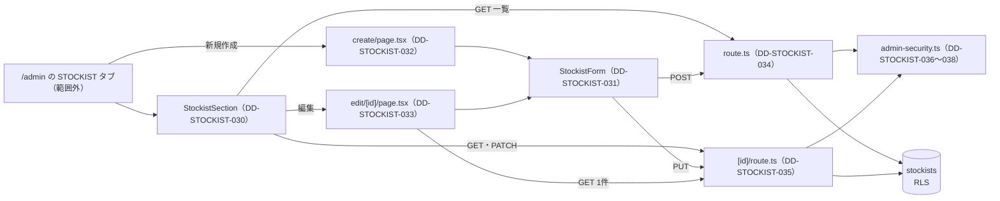

# 1.16-4 管理画面の取扱店（ADMIN STOCKIST）詳細設計

> 状態: 推定 | 確認日: 2026-10-28 | 対象: 管理画面の STOCKIST タブの一覧、取扱店の作成と編集の画面、管理の取扱店の窓口、窓口の守りの部品（回数の制限・CSRF の token） | 基準コミット: `4facf63b`

## 概要

管理画面で取扱店を一覧・作成・編集・公開の切り替え・削除する部品と窓口、窓口が使う回数の制限と CSRF の token の確かめの部品、認可で断った要求を監査に残す共有の部品を、詳細設計の項目（`DD-STOCKIST-030`〜`040`）で書く。
中身は 2026-10-24 の作業ツリーのコードを読んで起こした今の動きで、ユーザーの確認を受けていないので全部「推定」にした。文書・要件とコードが食い違う所は決めずに今のコードの動きを書き、食い違いは `docs/05_Quality/reports/trace-matrix.md` の「食い違い」節（TM-STOCKIST-NN）に載せた。

| ID | 題 | 単位 |
| --- | --- | --- |
| `DD-STOCKIST-030` | 管理の STOCKIST タブの一覧・公開の切り替え・削除 | `src/components/StockistSection.tsx` |
| `DD-STOCKIST-031` | 取扱店の作成・編集のフォーム | `src/app/admin/stockist/StockistForm.tsx` |
| `DD-STOCKIST-032` | 取扱店の作成のページ（入口で `access` を呼んでからフォームを出す） | `src/app/admin/stockist/create/page.tsx` |
| `DD-STOCKIST-033` | 取扱店の編集のページ | `src/app/admin/stockist/edit/[id]/page.tsx` |
| `DD-STOCKIST-034` | 管理の取扱店の一覧と作成の窓口 | `src/app/api/admin/stockists/route.ts` |
| `DD-STOCKIST-035` | 管理の取扱店1件の読み・更新・切り替え・削除の窓口 | `src/app/api/admin/stockists/[id]/route.ts` |
| `DD-STOCKIST-036` | CSRF の token の確かめと拒否の応答への変換 | `admin-security.ts` の `hasRotatedCsrfToken`・`requireAdminStockistCsrf`・`toCsrfDenyResponse` |
| `DD-STOCKIST-037` | 回した CSRF の token を Cookie に付け直す | `admin-security.ts` の `applyRotatedCsrfCookie` |
| `DD-STOCKIST-038` | 読みと変更の回数の制限（送り元の枠と操作者の枠） | `admin-security.ts` の `enforceAdminStockistIpRateLimit`・`enforceAdminStockistActorRateLimit` |
| `DD-STOCKIST-039` | 認可で断った要求の監査（`denial` と `auditAuthzDenial`）と、取扱店の窓口の順序 | `src/lib/auth/audit-authz-denial.ts` の `auditAuthzDenial` |
| `DD-STOCKIST-040` | 作成の頁の入口の確かめの窓口（`GET /api/admin/stockists/access`） | `src/app/api/admin/stockists/access/route.ts` |

- 結論: 管理の画面は全部が利用者の端末で動く部品で、画面では権限を確かめない。守りは窓口（`DD-STOCKIST-034`・`035`）の `authorizeAdminPermission`（token・session・DB の ACL の権限・aal2）、回数の制限（`038`）、変更の CSRF の token（`036`）、共有の proxy の Origin の確かめに置く。DB の読みは利用者の JWT で RLS に通し、書き込みは認可の後に service role で行う（ADR-0267）
- 作成の窓口は DB の必須の列 `type` を入れないので、表が今の写しの形なら作成はいつも 500 になる（推定）。存在しない店への PUT・PATCH・DELETE は 200 の成功として監査に残る
- 単体テストは窓口の守りの順を試す1本（`tests/unit/api/admin/stockists-security.test.ts`）だけ。分岐を全部通すのに要るテストを各項目の「テスト観点」に挙げた
- 番号は `DD-STOCKIST-030`〜`059` をこの頁で使う。今は `030`〜`040` を使い、`041` 以降は空けておく

## 範囲と根拠

| 項目 | 内容 |
| --- | --- |
| 範囲 | `scripts/trace/scope.json` の STOCKIST のうち、管理の側の単位 |
| 上位の文書 | [STOCKIST の構造設計](../../03_BasicDesign/areas/stockist.md)（`ARC-`・`SCR-`・`FLOW-`・`STATE-`・`API-`・`DATA-STOCKIST-`）、[STOCKIST の要件](../../02_Requirements/areas/stockist.md)（`FR-ADMIN-006`・`SEC-STOCKIST-`・`DRV-STOCKIST-`） |
| 対象のコード | 「実装の単位」の表の15単位 |
| 単位の無いファイル | `src/app/admin/stockist/types.ts`（型だけ） |
| 引き継いだ文書 | [1.16 管理画面（ADMIN）詳細設計](16_admin.md) の `IMPL-ADMIN-006`（機能要件対応表の FR-ADMIN-006 の行）と `IMPL-ADMIN-STOCKIST-01`（実装タスク管理の ADMIN-01-005 の行）。元の文書は別の作業が書き換え中なので変えていない |
| 関連文書 | [1.10 商品扱い店舗ページ](10_stockist.md)、`docs/03_BasicDesign/api/api-spec.md`（読むだけ） |
| 調べた時点 | 2026-10-24 の作業ツリー。コードは読んだだけで、動かしての確かめはしていない |

範囲外の共有部品は ID を持たないので、上位に書かず本文にファイルの道で書く。

| 共有部品 | 道 | ここでの使われ方 |
| --- | --- | --- |
| 管理の認可 | `src/lib/auth/admin-rbac.ts` の `authorizeAdminPermission` | 窓口ごとに token・session・DB の ACL の権限・aal2 を確かめる |
| CSRF の token の確かめ | `src/lib/csrfMiddleware.ts` の `requireCsrfOrDeny` | 変更の窓口で `x-csrf-token` を session の印と比べる |
| Origin の確かめ | `src/proxy.ts` | `/api` の変更の要求の Origin・Referer を窓口の前で照合する（ARC-STOCKIST-004） |
| 回数の制限 | `src/features/auth/middleware/rateLimit.ts` の `enforceRateLimit` | 送り元と操作者の数え。超えると 429、数えの DB が使えないと 503 |
| CSRF の Cookie | `src/lib/cookie.ts` の `csrfCookieName`・`cookieOptionsForCsrf` | 回した token を付け直す時の Cookie の名前と設定 |
| 監査 | `src/lib/audit.ts` の `logAudit` | 変更の成功・入力の誤り・DB の誤りを `audit_logs` に残す |
| Supabase の client | `src/lib/supabase/server.ts` の `createClient(request)`・`createServiceRoleClient()` | 読みは要求の JWT を付けた client、書き込みは認可の後に service role の client で表を扱う（ADR-0267） |
| 書き換えの送り方 | `src/lib/client-fetch.ts` の `clientFetch` | 画面から窓口へ送る。変更に `x-csrf-token` を付ける |
| 管理画面の親 | `src/app/admin/page.tsx` | STOCKIST タブの「新規作成」のボタンと、一覧の部品の置き場 |
| 画面の部品 | `src/components/ui/`（`Button`・`Card`・`StatusBadge`・`SingleSelect`・`TextField`） | カード・札・ボタン・フォームの欄 |

矢印は呼び出しと移り先。画面から窓口への矢印は全部 `clientFetch` を通り、変更の要求は窓口に届く前に共有の proxy が Origin を確かめる（図には入れていない）。監査の `audit_logs` への矢印も省いた。

## 実装の単位

`scripts/trace/parse-code.ts` の `parseCodeUnits`（2026-10-24 に実行）で数えた範囲内の単位と、つなぐ詳細設計。1つの単位は1つの `DD-` にだけつなぐ。`@impl`・`@design` のコメントはこの表から付ける。

| ファイル | 単位（symbol） | DD |
| --- | --- | --- |
| `src/components/StockistSection.tsx` | `<file>` | DD-STOCKIST-030 |
| `src/app/admin/stockist/StockistForm.tsx` | `<file>` | DD-STOCKIST-031 |
| `src/app/admin/stockist/create/page.tsx` | `<file>` | DD-STOCKIST-032 |
| `src/app/admin/stockist/edit/[id]/page.tsx` | `<file>` | DD-STOCKIST-033 |
| `src/app/api/admin/stockists/route.ts` | `<file>` | DD-STOCKIST-034 |
| `src/app/api/admin/stockists/[id]/route.ts` | `<file>` | DD-STOCKIST-035 |
| `src/features/stockist/schemas.ts` | `toInvalidStockistResponse` | DD-STOCKIST-034 |
| `src/features/stockist/services/admin-security.ts` | `hasRotatedCsrfToken` | DD-STOCKIST-036 |
| `src/features/stockist/services/admin-security.ts` | `requireAdminStockistCsrf` | DD-STOCKIST-036 |
| `src/features/stockist/services/admin-security.ts` | `toCsrfDenyResponse` | DD-STOCKIST-036 |
| `src/features/stockist/services/admin-security.ts` | `applyRotatedCsrfCookie` | DD-STOCKIST-037 |
| `src/features/stockist/services/admin-security.ts` | `enforceAdminStockistIpRateLimit` | DD-STOCKIST-038 |
| `src/features/stockist/services/admin-security.ts` | `enforceAdminStockistActorRateLimit` | DD-STOCKIST-038 |
| `src/lib/auth/audit-authz-denial.ts` | `auditAuthzDenial` | DD-STOCKIST-039 |
| `src/app/api/admin/stockists/access/route.ts` | `<file>` | DD-STOCKIST-040 |

- 窓口のファイルは、中の方法（GET・POST など）が別々の契約でも、単位がファイルなので1つの `DD-` にまとめた。項目の本文で方法ごとに分けて書く
- `schemas.ts`（2026-10-26 に足した）の単位は `toInvalidStockistResponse`（`IMPL-STOCKIST-149`）だけ。`ADMIN_STOCKIST_COLUMNS`・`stockistStatusSchema`・`stockistWriteSchema`（定数）は単位にならず、両方の窓口（DD-STOCKIST-034・035）の入力の形と応答の列を決める
- 単位にならない物: `src/app/admin/stockist/types.ts`（型だけ）、`StockistForm.tsx` の `STOCKIST_STATUS_OPTIONS`（ファイルの単位に含む）、`[id]/route.ts` の `parseStockistId`（ファイルの単位に含む）、`admin-security.ts` の export しない `hasMockCsrfBody`（DD-STOCKIST-036 に含める）と export しない `STOCKIST_ADMIN_RATE_LIMITS`（枠の名前と限度の表。DD-STOCKIST-038 に含める）
- 公開の側の単位（`src/app/stockist/page.tsx`・`src/features/stockist/components/`・`services/public.ts`・`region.ts`）は [1.10 商品扱い店舗ページ](10_stockist.md) で扱う

## 管理の窓口に共通の動き

`DD-STOCKIST-034`・`035`・`040` の全部の方法が `authorizeAdminPermission(<権限>, request)` を呼び、`ok` でなければ、操作者が分かる拒否を `auditAuthzDenial` で監査に残してから（DD-STOCKIST-039）その応答をそのまま返す。その前に、全部の方法が送り元の枠を数える（DD-STOCKIST-038）。`[id]` の窓口の道の id の形の確かめは、送り元の枠の次、認可の前に置く（DD-STOCKIST-035）。

| 条件 | 応答 | 出どころ |
| --- | --- | --- |
| token の検証に失敗 | 401 `{error:'Unauthorized'}` | `src/lib/auth/admin-rbac.ts` |
| session の生存を確かめられない | 503 `{error:'Service temporarily unavailable'}`、`Retry-After: 30` | `admin-rbac.ts` |
| session が有効でない | 401 `{error:'Unauthorized'}` | `admin-rbac.ts` |
| DB の ACL に権限が無い | 403 `{error:'Forbidden', permission, role}` | `admin-rbac.ts` |
| `aal` が `aal2` でない | 403 `{error:'Forbidden', reason:'MFA required', permission, role}` | `admin-rbac.ts` |
| 認可の中の例外 | 500 `{error:'Internal server error'}` | `admin-rbac.ts` |

- 権限: 読む方法（GET）は `admin.stockists.read`、変える方法（POST・PUT・PATCH・DELETE）は `admin.stockists.manage`（DATA-STOCKIST-004）
- 順番: 送り元の枠（読みは読みの枠、変更は変更の枠。DD-STOCKIST-038）→ （`[id]` だけ道の id の形）→ 認可（断られたら操作者が分かる拒否を監査に残す。DD-STOCKIST-039）→ 操作者の枠（同じ種類の枠。DD-STOCKIST-038）→ 変更だけ CSRF の token（DD-STOCKIST-036）→ 入力の確かめ → DB → 監査。送り元の枠を認可の前に置くので、未ログインの 401・権限の無い 403 も送り元の枠に数える（SEC-STOCKIST-020）
- 監査: 変更の方法は `logAudit` を呼ぶ。`resource` は `stockists`、`ip` は共有の `getClientIp`（Vercel の見出し `x-vercel-forwarded-for`→`x-real-ip` だけ。取れなければ `null`。ADR-0416）、`user_agent` は見出し `user-agent`（無ければ `null`）。GET は監査しない。送り元を信頼できる値から取ること（SEC-STOCKIST-012）は 2026-10-28（波 4）に満たした。店名の制御文字は共有の `maskAuditEvent` が `detail`・`metadata` から除く（DD-STOCKIST-039）
- 送り元の見出しの読み: 共有の `getClientIp` が `x-real-ip`（Vercel 上は `x-vercel-forwarded-for` が先）を前後の空白を除いて読み、IP の形でなければ `null`。`x-forwarded-for` は読まない
- 失敗の記録: 窓口の中の DB の `error` は `{ code }` だけを渡す。各方法の外側の `catch` は `describeErrorForLog(error)`（`src/lib/logging/safe-error.ts`）で `{ name, code }` だけを渡す（SEC-STOCKIST-014。2026-10-26）
- 応答の `Cache-Control` は全部の戻りで `private, no-store`。各方法を内側の関数（`listStockists`・`createStockist`・`getStockist`・`putStockist`・`patchStockist`・`deleteStockist`）にし、`export` が共有の `withNoStore(await …)` で返す。認可の 401・403・503、CSRF の拒否、回数の 429・503、400、404、外側の `catch` の 500 も同じ。`proxy.ts` が窓口の前に返す Origin の 403 には付かない（SEC-STOCKIST-010、ADR-0266。2026-10-26）。応答の列は `ADMIN_STOCKIST_COLUMNS` の 8 列（SEC-STOCKIST-009。2026-10-26）

## 詳細設計

### DD-STOCKIST-030 管理の STOCKIST タブの一覧・公開の切り替え・削除

| 属性 | 値 |
| --- | --- |
| 上位 | SCR-STOCKIST-004、FLOW-STOCKIST-002、STATE-STOCKIST-001、ARC-STOCKIST-002 |
| 根拠 | 店長が非公開の店も含めた全部の店を状態の札つきで見て、その場で公開の切り替えと削除まで終えられるよう、一覧・切り替え・削除を1つの部品に置く（SCR-STOCKIST-004）。消した店は戻せないので、送る前に確かめの窓を挟む（STATE-STOCKIST-001）。編集は別の頁へ移す（FLOW-STOCKIST-002）。画面は利用者の端末で動くので守りを持たず、変更は窓口に送る（ARC-STOCKIST-002） |
| 状態 | 推定 |
| 確かめ方 | 単体テスト |
| 出どころ | 実装から推定（`src/components/StockistSection.tsx`）、`docs/04_DetailDesign/pages/16_admin.md` |
| 旧番号 | IMPL-ADMIN-006 |
| 旧所在 | `docs/04_DetailDesign/pages/16_admin.md` の「機能要件対応表」の FR-ADMIN-006 の行（一覧・切り替え・削除の分） |

#### 対応要件

SCR-STOCKIST-004、FLOW-STOCKIST-002、STATE-STOCKIST-001、ARC-STOCKIST-002（その上は FR-ADMIN-006、FREQ-18-REQ-01、DRV-STOCKIST-014）

#### 入出力

| 向き | 中身 |
| --- | --- |
| 入力 | props なし。`GET /api/admin/stockists` の応答 `{data: 店の配列}`（DD-STOCKIST-034） |
| 出力 | 画面。`PATCH /api/admin/stockists/<id>` に JSON `{status}`、`DELETE /api/admin/stockists/<id>`（DD-STOCKIST-035） |

#### 正常フロー

1. 初めは「読み込み中...」を出し、描いた後に `clientFetch('/api/admin/stockists')` で一覧を取る（`StockistSection.tsx`）
2. 1件以上あれば、1列・640px 以上で2列・1280px 以上で3列の格子にカードを並べる。カード: 店舗名の h3、札（`published` は「公開中」の positive、ほかは「非公開」の warning）、区切り線、住所・電話・営業時間・定休日の4行（電話が空でも行を出す）、ボタン（公開中なら「非公開」、ほかは「公開」）・「編集」（`/admin/stockist/edit/<id>`）・「削除」。公開の店は背景を薄い緑にする
3. 切り替え: 今が `published` なら `private`、ほかは `published` を JSON で PATCH し、成功したら一覧を全部読み直す
4. 削除: `confirm('このSTOCKISTを削除してもよろしいですか？')` に同意した時だけ DELETE し、成功したら一覧を読み直す（DRV-STOCKIST-014）

#### 異常フロー

| 条件 | 動き |
| --- | --- |
| 一覧の応答が OK でない | 本文を読み始め（読み終わりは待たない。回数の制限の 429 は `no-store` で、本文を読まずに捨てるとブラウザが要求を開いたまま残し、E2E の `networkidle` が止まるため。波 4 Task 1b。PATCH・DELETE の OK でない応答も同じ）、例外にして catch で記録し、一覧は前のまま（初めは空）。「STOCKISTがありません」を出す（取得の失敗と0件を分けない） |
| 一覧の取り出しで例外（通信・JSON の解析） | 同上 |
| 応答に `data` が無い | 空の配列にする |
| PATCH が OK でない・例外 | 記録して `alert('ステータスの更新に失敗しました')`。読み直さない |
| 削除の確かめで取り消す | 何も送らない |
| DELETE が OK でない・例外 | 記録して `alert('STOCKISTの削除に失敗しました')`。読み直さない |
| 切り替え・削除の後の読み直しに失敗 | 読み直しの catch が握りつぶし、前の一覧のまま残る（変えたのに表示が変わらない、推定）。知らせの窓は出ない |

- 読み直しの間は「読み込み中...」に戻さない（`loading` を真に戻す所が無い）
- 行のアイコンに `aria-hidden` が無い

#### 状態・永続化

部品の state（`stockists`・`loading`）だけを持つ。保存は窓口が行い、部品は先に表示を変えない（成功の後に読み直す）。

#### 認証認可

部品は権限を確かめず、親（`src/app/admin/page.tsx`、範囲外）がタブの中身として描く。窓口が `admin.stockists.read`・`admin.stockists.manage` と aal2 を確かめる。読みの権限だけの人にも切り替えと削除のボタンが出て、押すと窓口の 403 で `alert` になる（推定）。`clientFetch` が変更に `x-csrf-token` を付ける。

#### テスト観点

（`tests/unit/components/stockist-section.test.tsx` の名前を想定。範囲のテストの型 `*stockist*` に合わせる。`clientFetch`・`confirm`・`alert` を差し替える）

- 取り出しの間は「読み込み中...」が出る
- 公開中の店と非公開の店で、札の文字・tone、ボタンの文字（「非公開」「公開」）、背景の class が変わる
- 応答が OK でない時は「STOCKISTがありません」が出て、`console.error` を呼ぶ
- `clientFetch` が例外を投げた時も「STOCKISTがありません」が出る
- 応答に `data` が無い時は「STOCKISTがありません」が出る
- 公開中の店の切り替えで `{status:'private'}`、非公開の店で `{status:'published'}` を PATCH し、成功で一覧を読み直す（`clientFetch` の呼び出しが2回目の GET を含む）
- PATCH が OK でない時と例外の時に「ステータスの更新に失敗しました」の `alert` が出る
- 削除の確かめを取り消すと DELETE を送らない
- 削除に同意すると DELETE を送り、成功で一覧を読み直す
- DELETE が OK でない時と例外の時に「STOCKISTの削除に失敗しました」の `alert` が出る
- 「編集」の行き先が `/admin/stockist/edit/<id>`
- 一覧の取得・PATCH・DELETE が 429（`arrayBuffer` を持つ差し替え）で断られても、`arrayBuffer` が 1 回呼ばれ、失敗の表示は今までと同じ（波 4 Task 1b）

### DD-STOCKIST-031 取扱店の作成・編集のフォーム

| 属性 | 値 |
| --- | --- |
| 上位 | SCR-STOCKIST-005、SCR-STOCKIST-006、FLOW-STOCKIST-002、STATE-STOCKIST-001 |
| 根拠 | 作成と編集で同じ欄・同じ確かめを使い、決まりを1つにするため、送り先と方法を受け取る1つのフォームにする（SCR-STOCKIST-005・006）。作ったばかりの店が確かめる前に公開されないよう、状態の初めを非公開にする（STATE-STOCKIST-001）。カードの5つの情報が欠けた店を送らないよう、前後の空白を除いて空の欄があれば送らない（SCR-STOCKIST-005）。保存できたら STOCKIST タブの一覧へ戻して結果を確かめられるようにする（FLOW-STOCKIST-002） |
| 状態 | 推定 |
| 確かめ方 | 単体テスト |
| 出どころ | 実装から推定（`src/app/admin/stockist/StockistForm.tsx`） |
| 旧番号 | IMPL-ADMIN-STOCKIST-01 |
| 旧所在 | `docs/04_DetailDesign/pages/16_admin.md` の「実装タスク管理 (ADMIN-01)」の ADMIN-01-005 の行（画面の分） |

#### 対応要件

SCR-STOCKIST-005、SCR-STOCKIST-006、FLOW-STOCKIST-002、STATE-STOCKIST-001（その上は FR-ADMIN-006、DRV-STOCKIST-015、NFR-A11Y-005（範囲外））

#### 入出力

| 向き | 中身 |
| --- | --- |
| 入力 | `submitUrl`、`submitMethod`（`POST` か `PUT`）、`initialValues?`（6つの値）、`isLoading?`（初めは偽） |
| 出力 | 画面（公開状態の選択、店舗名・住所・電話番号・営業時間・定休日の欄、誤りか成功の文、送るボタン）。送り先に JSON `{name, address, phone, time, holiday, status}`。成功で `router.push('/admin?tab=STOCKIST')` |

#### 正常フロー

1. 欄の初めの値は `initialValues` の各値、無ければ空の文字。状態は無ければ `private`
2. `initialValues` が変わった時は、6つの値を全部入れ直す
3. 公開状態は `SingleSelect`（dropdown、ラベル「公開状態」、選択肢は「非公開」「公開」）の `onValueChange` で受ける
4. 送る時: 前の誤りと成功の文を消し、5つの欄の前後の空白を除く。全部が空でなければボタンを「保存中...」にして押せなくし、`clientFetch(submitUrl, {method: submitMethod, …})` で JSON を送る
5. 応答が OK なら、PUT は「STOCKISTを更新しました」、POST は「STOCKISTを保存しました」を出し、`/admin?tab=STOCKIST` へ移る
6. 終わったら、成功でも失敗でもボタンを戻す

#### 異常フロー

| 条件 | 動き |
| --- | --- |
| 5つの欄のどれかが空か空白だけ | 「必須項目を入力してください」を出して送らない |
| 応答が OK でなく、本文に `error` がある | その文を赤で出す。移らない |
| 応答が OK でなく、本文が JSON でない・`error` が無い | 「STOCKISTの保存に失敗しました」 |
| 応答が OK で本文が JSON でない | 本文を読めなくても成功として扱う |
| 送る時の例外（通信の失敗） | 記録して「通信エラーが発生しました。時間をおいて再度お試しください」 |
| `isLoading` が真 | フォームの代わりに「読み込み中...」 |

- `isLoading` を渡す呼び元は無い（`create/page.tsx`、`edit/[id]/page.tsx`）ので、「読み込み中...」の道は今の画面からは通らない（推定）
- 種別（`type`）の欄は無い。画面の確かめは空かどうかだけで、長さの上限は窓口が見る
- キャンセル・戻るのボタンは無い

#### 状態・永続化

部品の state（6つの欄・`isSubmitting`・`submitError`・`submitSuccess`）だけを持つ。保存は窓口が行う。

#### 認証認可

部品は権限を確かめない。窓口（DD-STOCKIST-034・035）が `admin.stockists.manage` と aal2 を確かめ、`clientFetch` が `x-csrf-token` を付ける。誤りの文は窓口の `error` をそのまま出す（React の文字として出す）。

#### テスト観点

（`tests/unit/app/admin/stockist-form.test.tsx` の名前を想定。`next/navigation` の `useRouter` と `clientFetch` を差し替える）

- `initialValues` なしで、欄が空、公開状態が「非公開」、ボタンが「保存」
- `initialValues` ありで、6つの値が欄に入り、`submitMethod="PUT"` のボタンが「更新」
- 描いた後に `initialValues` を変えると欄が入れ替わる
- 公開状態を「公開」に変えて送ると、本文の `status` が `published`
- 5つの欄のそれぞれを空白だけにした時に「必須項目を入力してください」が出て、`clientFetch` を呼ばない（各欄で1つずつ）
- 送る本文が前後の空白を除いた値で、方法が `submitMethod`、見出しに `Content-Type: application/json`
- 送る間はボタンが「保存中...」で押せない
- POST の成功で「STOCKISTを保存しました」、PUT の成功で「STOCKISTを更新しました」、どちらも `push('/admin?tab=STOCKIST')`
- 応答が OK でなく `{error:'X'}` の時に `X`、本文が JSON でない時に「STOCKISTの保存に失敗しました」
- 応答が OK で本文が JSON でない時も成功の文と移動
- `clientFetch` が例外を投げた時に通信の誤りの文、ボタンが戻る
- `isLoading` を真で渡すと「読み込み中...」だけが出る

### DD-STOCKIST-032 取扱店の作成のページ

| 属性 | 値 |
| --- | --- |
| 上位 | SCR-STOCKIST-005、FLOW-STOCKIST-002 |
| 根拠 | 作成は一覧とは別の頁にし、共通のフォームに作成の窓口と POST を渡すだけにして、作成と編集の決まりを1つにする（SCR-STOCKIST-005）。管理のタブの「新規作成」から入る（FLOW-STOCKIST-002） |
| 状態 | 推定 |
| 確かめ方 | 単体テスト |
| 出どころ | 実装から推定（`src/app/admin/stockist/create/page.tsx`） |
| 旧番号 | IMPL-ADMIN-STOCKIST-01 |
| 旧所在 | `docs/04_DetailDesign/pages/16_admin.md` の「実装タスク管理 (ADMIN-01)」の ADMIN-01-005 の行（作成の頁の分） |

#### 対応要件

SCR-STOCKIST-005、FLOW-STOCKIST-002（その上は FR-ADMIN-006）

#### 入出力・フロー

入力なし。開いた時に `clientFetch('/api/admin/stockists/access')` を 1 回呼び（DD-STOCKIST-040）、結果で次を返す（`create/page.tsx`）。

1. 応答を待つ間は「読み込み中...」だけ
2. 2xx（204）なら `StockistForm` に `submitUrl="/api/admin/stockists"`・`submitMethod="POST"` を渡して返す
3. 401 なら「ログインが必要です」、403 なら「STOCKISTを作成する権限がありません」、ほかの状態（429・500・503 など）と通信の失敗は「権限の確認に失敗しました」を、`text-red-600` の 1 行で出す。フォームは出さない
4. 2xx 以外の応答は本文を `arrayBuffer()` で読み切ってから文を出す（`no-store` の応答を読まずに捨てると、ブラウザが要求を開いたまま残し、E2E の `networkidle` が止まる。波 3 の学び）

#### 状態・永続化

持たない。

#### 認証認可

頁の入口で `GET /api/admin/stockists/access`（`admin.stockists.manage`・aal2）を呼び、通るまでフォームを出さない（SEC-STOCKIST-019、ADR-0269）。頁は `'use client'` で、サーバーの守りを置けない形なので、これは画面の入口を閉じるためのもの。書き込みの時にも窓口が権限を確かめる。

#### テスト観点

（`StockistForm` と `clientFetch` を差し替える）

- 入口の確かめ `/api/admin/stockists/access` を 1 回だけ呼ぶ
- 応答を待つ間は「読み込み中...」だけを出し、フォームを出さない
- 通れば（204）フォームが `submitUrl="/api/admin/stockists"`・`submitMethod="POST"`・`initialValues` なしで描かれる
- 401・403 は固定の文を `text-red-600` で出し、フォームを出さない。429・500・503 と通信の失敗は「権限の確認に失敗しました」
- 401・403・429・503 の本文は `arrayBuffer()` を 1 回呼んで読み切る。通った時（204）は読まない

### DD-STOCKIST-033 取扱店の編集のページ

| 属性 | 値 |
| --- | --- |
| 上位 | SCR-STOCKIST-006、FLOW-STOCKIST-002 |
| 根拠 | 作成と同じフォームを、今の値を入れた状態で開けるよう、URL の id で1件を取ってからフォームを描く（SCR-STOCKIST-006）。取れない時は同じ頁に誤りの文を出して留まる（FLOW-STOCKIST-002） |
| 状態 | 推定 |
| 確かめ方 | 単体テスト |
| 出どころ | 実装から推定（`src/app/admin/stockist/edit/[id]/page.tsx`） |
| 旧番号 | IMPL-ADMIN-STOCKIST-01 |
| 旧所在 | `docs/04_DetailDesign/pages/16_admin.md` の「実装タスク管理 (ADMIN-01)」の ADMIN-01-005 の行（編集の頁の分） |

#### 対応要件

SCR-STOCKIST-006、FLOW-STOCKIST-002（その上は FR-ADMIN-006）

#### 入出力

| 向き | 中身 |
| --- | --- |
| 入力 | `useParams` の `id`。`GET /api/admin/stockists/<id>` の応答 `{data}`（DD-STOCKIST-035） |
| 出力 | 「読み込み中...」、誤りの文、または `StockistForm`（`submitUrl` は `/api/admin/stockists/<id>`、`submitMethod="PUT"`、`initialValues` は取れた6つの値） |

#### 正常フロー

1. 描いた後、`id` があれば `clientFetch('/api/admin/stockists/<id>')` で1件を取る
2. 応答が OK で `data` があれば、店舗名・住所・電話・営業時間・定休日・状態の6つを初めの値にする
3. 終わったら読み込み中を外し、フォームを描く

#### 異常フロー

| 条件 | 動き |
| --- | --- |
| `useParams` が `null`・`id` が無い | 「STOCKIST IDの取得に失敗しました」を出す。取り出さない |
| 応答が OK でなく、本文に `error` がある | その文を赤で出す（例: 404 の `Stockist not found`、403 の `Forbidden`） |
| 応答が OK でなく、本文が JSON でない・`error` が無い | 「STOCKISTの取得に失敗しました」 |
| 応答が OK で `data` が無い・本文が JSON でない | 「STOCKISTの取得に失敗しました」 |
| 取り出しの例外 | 記録して「STOCKISTの取得に失敗しました」 |
| 読み込みが終わり、誤りも初めの値も無い | 何も描かない |

- 最後の「何も描かない」道は、応答が OK でなく本文の `error` が空の文字（`false`・`0` も同じ）の時に届く。`??` は空の文字を空とみなさないので `fetchError` が空になり、誤りの文を出す `if` を素通りして初めの値の無いまま描く。白い頁になる（推定。食い違いの候補）
- URL の id を確かめずに API の道に入れる。正の整数かを先に確かめること（SEC-STOCKIST-015）は満たさないので上位にしない。数でない id は窓口が 400 `Invalid stockist id` を返し、その文が出る

#### 状態・永続化

部品の state（`initialValues`・`isLoading`・`fetchError`）だけを持つ。

#### 認証認可

頁の入口では `manage` の権限を確かめない。1 件の取得（`admin.stockists.read` と aal2 の窓口）が通るとフォームを出すので、`read` だけを持つ人にも編集のフォームが出る。書き込みは窓口が `manage` で断る（SEC-STOCKIST-019 は作成の頁だけ満たした。波 4 の決定 Q20）。

#### テスト観点

（`next/navigation` の `useParams`・`clientFetch`・`StockistForm` を差し替える）

- 取り出しの間は「読み込み中...」
- `useParams` が `{}` と `null` の時に「STOCKIST IDの取得に失敗しました」、`clientFetch` を呼ばない
- 成功で `StockistForm` が `submitUrl="/api/admin/stockists/5"`・`submitMethod="PUT"`・6つの値の `initialValues` で描かれる（応答の `type`・`created_at` などは渡さない）
- 応答が OK でなく `{error:'Stockist not found'}` の時にその文、本文が JSON でない時に「STOCKISTの取得に失敗しました」
- 応答が OK で `data` が無い時と `data:null` の時に「STOCKISTの取得に失敗しました」
- `clientFetch` が例外を投げた時に「STOCKISTの取得に失敗しました」

### DD-STOCKIST-034 管理の取扱店の一覧と作成の窓口

| 属性 | 値 |
| --- | --- |
| 上位 | API-STOCKIST-001、API-STOCKIST-002、ARC-STOCKIST-002、ARC-STOCKIST-004、DATA-STOCKIST-001、DATA-STOCKIST-002、DATA-STOCKIST-004、STATE-STOCKIST-001、SEC-STOCKIST-006、SEC-STOCKIST-009、SEC-STOCKIST-010、SEC-STOCKIST-011、SEC-STOCKIST-014 |
| 根拠 | 非公開を含む一覧と店の作成は、窓口で `admin.stockists.read`・`admin.stockists.manage` と aal2 を確かめ（SEC-STOCKIST-006、DATA-STOCKIST-004）、一覧の読みは利用者の JWT で RLS に通し、書き込みは認可・回数の制限・CSRF の後に service role で行う（ARC-STOCKIST-002、DATA-STOCKIST-002、ADR-0267）。変更の送り元は、窓口に届く前に proxy の Origin の確かめが見る（ARC-STOCKIST-004）。表に長さの制約が無いので入口で6つの値の必須と上限と字の種類を確かめ（API-STOCKIST-002、DATA-STOCKIST-001、SEC-STOCKIST-011）、状態は2つの値に限る（STATE-STOCKIST-001）。誤りの応答は項目の名前だけの固定の本文にして制約の中身を出さず、壊れた JSON は 400 にする（SEC-STOCKIST-014）。一覧は id の順で、画面で使う 8 列だけを返す（API-STOCKIST-001、SEC-STOCKIST-009） |
| 状態 | 推定 |
| 確かめ方 | 単体テスト |
| 出どころ | 実装から推定（`src/app/api/admin/stockists/route.ts`）、`docs/03_BasicDesign/api/api-spec.md` |
| 旧番号 | IMPL-ADMIN-006、IMPL-ADMIN-STOCKIST-01 |
| 旧所在 | `docs/04_DetailDesign/pages/16_admin.md` の「機能要件対応表」の FR-ADMIN-006 の行と、「実装タスク管理 (ADMIN-01)」の ADMIN-01-005 の行 |

#### 対応要件

API-STOCKIST-001、API-STOCKIST-002、ARC-STOCKIST-002、ARC-STOCKIST-004、DATA-STOCKIST-001・002・004、STATE-STOCKIST-001、SEC-STOCKIST-006・009・010・011・014

#### 入出力

| 方法 | 入力 | 出力 |
| --- | --- | --- |
| `GET /api/admin/stockists` | なし | 200 `{data}`。全部の店を id の昇順、8 列（`id`・`name`・`address`・`phone`・`time`・`holiday`・`status`・`updated_at`。`type`・`created_at` は返さない）。件数の上限とページ分けは無い |
| `POST /api/admin/stockists` | JSON。`name`（前後の空白を除いて1〜255字）・`address`（1〜500字）・`phone`（1〜50字）・`time`（1〜120字）・`holiday`（1〜120字）・`status`（`private`・`published`）。`phone` 以外は制御文字・書式文字・行区切り・段落区切りを含む字を拒み、`phone` は数字・`+`・`-`・括弧・空白（半角と全角）だけを許す | 201 `{success:true, id}` |

#### 正常フロー（GET）

1. 読みの送り元の枠を数える（DD-STOCKIST-038）。止まれば 429 か 503 を返す
2. `admin.stockists.read` で認可する（`route.ts`）。断られたら `auditAuthzDenial` を呼んでからその応答を返す（DD-STOCKIST-039）
3. 読みの操作者の枠を数える（DD-STOCKIST-038）
4. `createClient(request)` で要求の JWT の client を作り、`stockists` を `ADMIN_STOCKIST_COLUMNS` の 8 列・id の昇順で読む
5. 200 `{data}` を返す

#### 正常フロー（POST）

1. 変更の送り元の枠を数える（DD-STOCKIST-038）。止まれば 429 か 503 を返す
2. `admin.stockists.manage` で認可する。断られたら `auditAuthzDenial`（action `admin.stockists.create`）を呼んでからその応答を返す（DD-STOCKIST-039）
3. 変更の操作者の枠を数える（DD-STOCKIST-038）
4. CSRF の token を確かめ、拒否の応答があれば返す（DD-STOCKIST-036）
5. 監査の送り元とブラウザの名を見出しから取る
6. 本文を `request.json().catch(() => null)` で読み、`stockistWriteSchema` で6つの値を確かめる（前後の空白は除いた値になる）
7. `createServiceRoleClient()` で service role の client を作り（利用者の JWT の client は作らない。ADR-0267）、6つの値の1行を入れ、新しい `id` を返させる。`type` は入れない
8. 監査 `admin.stockists.create`（success、`resource_id` は新しい id の文字、`detail` は `Created stockist: <店舗名>`）を残す
9. 201 `{success:true, id}` を作り、回した CSRF の token があれば Cookie に付けて返す（DD-STOCKIST-037）

#### 異常フロー

| 方法 | 条件 | 応答と監査 |
| --- | --- | --- |
| 両方 | 認可に失敗 | 「管理の窓口に共通の動き」の 401・403・503・500 |
| 両方 | 回数の制限を超えた・数えの DB が使えない（送り元の枠は認可の前、操作者の枠は認可の後） | 429 か 503（`Retry-After: 600`） |
| 両方 | 認可で断られ、操作者が分かる（403・失効した session の 401） | `auditAuthzDenial` が失敗の監査を 1 行残す。token の無い 401 は残さない |
| GET | 表の読み出しに失敗 | 500 `Failed to fetch stockists`（記録は `{ code }` だけ） |
| GET | 例外 | 500 `Internal server error` |
| POST | CSRF の token が無い・違う・確かめの DB の誤り | 403 `{error:'Forbidden', reason:'CSRF validation failed'}` か 500。監査なし |
| POST | 本文が JSON でない（と JSON の `null`） | 監査 `admin.stockists.create`（failure、`Invalid JSON`、`resource_id` なし）、400 `{error:'Invalid request'}`。表に触れない |
| POST | 値の形が合わない（欄が無い・空白だけ・上限を超える・字の種類が許可の外・状態が2つの外） | 監査 `admin.stockists.create`（failure、`Validation failed`、`resource_id` なし）、400 `{error:'Invalid request', fields:[項目の名前]}`（`toInvalidStockistResponse`。`details`・制約の中身・入力の値は出さない） |
| POST | 表への insert に失敗 | 監査 `admin.stockists.create`（error、`DB insert failed`）、500 `Failed to save stockist`（記録は `{ code }` だけ） |
| POST | 例外 | 500 `Internal server error` |

- 表 `stockists` は `type` を必須・既定値なしで持つ（DATA-STOCKIST-001）。表がこの形なら、insert は必ず DB の誤りになり 500 の道を通る（推定）
- 監査の書き込みが失敗しても、`logAudit` が握りつぶすので応答は変わらない（推定。共有の部品の動き）
- 監査の `detail` の店舗名は、共有の `maskAuditEvent` が制御文字を空白にする（SEC-STOCKIST-012。2026-10-28）。字の種類の許可（SEC-STOCKIST-011）・誤りの応答で制約を出さないこと・壊れた JSON を 400 にすること・DB の誤りの記録を符号だけにすること（SEC-STOCKIST-014）・応答の列を絞ること（SEC-STOCKIST-009）は 2026-10-26 に満たした

#### 状態・永続化

POST は `stockists` に1行を足す（DATA-STOCKIST-001）。状態は送られた値をそのまま入れ、作成で `published` にもできる（STATE-STOCKIST-001）。監査は `audit_logs`。GET は何も変えない。回数の数えは共有の部品の表に増える。

#### 認証認可

GET は `admin.stockists.read`、POST は `admin.stockists.manage`、どちらも有効な session と aal2。GET の表は利用者の JWT の client で RLS（DATA-STOCKIST-002）を通し、POST の表は認可・操作者の枠・CSRF・入力の確かめの後に service role の client で書く（ADR-0267）。CSRF は proxy の Origin の確かめ（ARC-STOCKIST-004）と窓口の token の確かめ。

#### テスト観点

（`tests/unit/api/admin/stockists-security.test.ts` に足すか、`tests/unit/api/admin/stockists/stockists-route.test.ts` の名前を想定。`authorizeAdminPermission`・`createClient`・`createServiceRoleClient`・`logAudit`・`admin-security` の関数を差し替える。書き込みは `createServiceRoleClient` を1回呼び `createClient` を呼ばないこと、認可・回数の制限・CSRF・入力の誤りの時はどちらの client も作らないことを確かめる）

- GET・POST とも、認可が `ok:false` の時はその応答をそのまま返し、表に触らない。求める権限が GET は `admin.stockists.read`、POST は `admin.stockists.manage`
- GET・POST とも、送り元の枠（GET は読み、POST は変更）が応答を返した時はそれを返し、認可も表も呼ばない。送り元の枠 → 認可 → 操作者の枠（`authz.userId`。POST はその次に CSRF）の順に呼ぶ
- GET・POST とも、操作者の枠が応答を返した時はそれを返し、表に触らない（今ある GET の試験を引き継ぐ）
- GET・POST とも、認可が断った時に `auditAuthzDenial` を、その認可の結果と `{ request, action, resource: 'stockists' }`（action は GET が `admin.stockists.list`、POST が `admin.stockists.create`）で呼ぶ。通った時は呼ばない
- GET の成功で `select(ADMIN_STOCKIST_COLUMNS)`（8 列。`*`・`created_at` を含まない）・`order('id',{ascending:true})` を呼び、200 `{data}`
- GET で表の失敗の時に 500 `Failed to fetch stockists`、例外の時に 500 `Internal server error`
- POST で CSRF の確かめが拒否の応答を返した時に、それを返し、本文を読まない（今ある 403 の試験を引き継ぐ）
- POST で本文が JSON でない時に 400 `Invalid request`、表に触らず監査 failure（`Invalid JSON`）
- POST で値が1つでも形に合わない時（例: 店舗名が空白だけ・256字・改行入り、電話が51字・漢字入り、状態が `draft`）に 400 `{error:'Invalid request', fields:[項目の名前]}`（`details`・`fieldErrors`・`formErrors` を含まない）、監査 failure
- `schemas.ts` の単体試験（`tests/unit/features/stockist/stockist-schemas.test.ts`）で、店名の改行・書式文字（ゼロ幅空白）・行区切りを拒み、全角空白入りを通す。電話の `03-1234-5678`・`+81 3 1234 5678`・`（03）1234-5678` を通し、英字・漢字・途中の改行を拒む。`toInvalidStockistResponse` が項目の名前を重複なしで返す
- 失敗時の `console.error` の第 2 引数が `{ code }` だけ（`Error` オブジェクトを渡さない）。外側の `catch` の第 2 引数は `{ name, code }` ちょうどで、投げた `Error` の `message` を含まない
- 戻りの全分岐（GET: 200・401・403・429・503・DB の 500・`catch` の 500。POST: 201・400 の2種・401・403・CSRF の 403・429・503・500 の2種）で `Cache-Control` が正確に `private, no-store`。元の応答が `s-maxage=60` を持っていても置き換わる
- POST の insert の本文が前後の空白を除いた6つの値で、`type` を含まない
- POST で insert の失敗の時に監査 error と 500 `Failed to save stockist`
- POST の成功で監査 success（`resource_id` が新しい id の文字、`detail` に店舗名）と 201 `{success:true, id}`、`applyRotatedCsrfCookie` に応答と CSRF の結果を渡す（今ある Cookie の試験を引き継ぐ）
- 監査の `ip` が `x-real-ip: " 1.2.3.4 "` の時に `1.2.3.4`、見出しが無い時と `x-forwarded-for` だけの時に `null`。`user_agent` がある時はその値、無い時は `null`
- POST で認可の後に例外（例: `createServiceRoleClient` が投げる）の時に 500 `Internal server error`

### DD-STOCKIST-035 管理の取扱店1件の読み・更新・切り替え・削除の窓口

| 属性 | 値 |
| --- | --- |
| 上位 | API-STOCKIST-003、API-STOCKIST-004、API-STOCKIST-005、API-STOCKIST-006、ARC-STOCKIST-002、ARC-STOCKIST-004、DATA-STOCKIST-001、DATA-STOCKIST-002、DATA-STOCKIST-004、STATE-STOCKIST-001、SEC-STOCKIST-006、SEC-STOCKIST-009、SEC-STOCKIST-010、SEC-STOCKIST-011、SEC-STOCKIST-013、SEC-STOCKIST-014 |
| 根拠 | 編集の画面に非公開の店の中身を渡す読みと、店を変える3つの操作は、窓口で権限と aal2 を確かめ（SEC-STOCKIST-006、DATA-STOCKIST-004）、1件の読みは利用者の JWT で RLS に通し、書き込みは認可・回数の制限・CSRF の後に service role で行う（ARC-STOCKIST-002、DATA-STOCKIST-002、ADR-0267）。一覧のボタン1つで公開を切り替えられるよう、状態だけを変える PATCH を全体の更新（PUT）と分ける（API-STOCKIST-005、STATE-STOCKIST-001）。PUT は作成と同じ必須と上限を当てて決まりを1つにする（API-STOCKIST-004、DATA-STOCKIST-001）。削除は行を消して戻さない（API-STOCKIST-006）。道の id は安全に表せる正の整数だけを受け、DB へ変な値を渡さない（API-STOCKIST-003）。更新・切り替え・削除は変えた行を受け取り、0 行は成功にせず 404 にして、削除の監査に消した店の中身を残す（SEC-STOCKIST-013）。誤りの応答は項目の名前だけの固定の本文にし、壊れた JSON は 400 にする（SEC-STOCKIST-014）。変更の送り元は、窓口に届く前に proxy の Origin の確かめが見る（ARC-STOCKIST-004） |
| 状態 | 推定 |
| 確かめ方 | 単体テスト |
| 出どころ | 実装から推定（`src/app/api/admin/stockists/[id]/route.ts`）、`docs/03_BasicDesign/api/api-spec.md` |
| 旧番号 | IMPL-ADMIN-006、IMPL-ADMIN-STOCKIST-01 |
| 旧所在 | `docs/04_DetailDesign/pages/16_admin.md` の「機能要件対応表」の FR-ADMIN-006 の行と、「実装タスク管理 (ADMIN-01)」の ADMIN-01-005 の行 |

#### 対応要件

API-STOCKIST-003〜006、ARC-STOCKIST-002、ARC-STOCKIST-004、DATA-STOCKIST-001・002・004、STATE-STOCKIST-001、SEC-STOCKIST-006・009・010・011・013・014

#### 入出力

| 方法 | 入力 | 出力 |
| --- | --- | --- |
| `GET /api/admin/stockists/[id]` | 道の `id` | 200 `{data}`（8 列。`ADMIN_STOCKIST_COLUMNS`） |
| `PUT /api/admin/stockists/[id]` | 道の `id`、JSON は作成と同じ6つの値で全部必須 | 200 `{success:true}` |
| `PATCH /api/admin/stockists/[id]` | 道の `id`、JSON `{status}`（`private`・`published`） | 200 `{success:true}` |
| `DELETE /api/admin/stockists/[id]` | 道の `id`。本文なし | 200 `{success:true}` |

#### 道の id の読み（`parseStockistId`）

`Number(id)` が安全に表せる整数（`Number.isSafeInteger`）で0より大きい時だけその数、ほかは `null`。`abc`・`0`・`-1`・`1.5`・空の文字・`1e30`・`9007199254740993` は `null`（桁あふれを DB に渡さない）。`Number` の決まりで、前後の空白付き（` 5 `）・`5.0`・`1e3`・`0x10` は数として通る（推定）。

#### 正常フロー（4つに共通）

1. 送り元の枠を数える（DD-STOCKIST-038）。GET は読み、ほかは変更の枠。止まれば 429 か 503。道の id の形の確かめより前なので、形の悪い id の連打も数える
2. 道の id を読み、`null` なら 400 `{error:'Invalid stockist id'}` を返す（GET・PUT・PATCH・DELETE の4つとも）。認可より前
3. 認可する。GET は `admin.stockists.read`、ほかは `admin.stockists.manage`。断られたら `auditAuthzDenial` を呼んでからその応答を返す（action は GET `admin.stockists.get`、PUT `update`、PATCH `patch`、DELETE `delete`。DD-STOCKIST-039）
4. 操作者の枠を数える。GET は読み、ほかは変更の枠
5. 変更の3つは CSRF の token を確かめ、監査の送り元とブラウザの名を取る

#### 正常フロー（方法ごと）

- GET: `stockists` を `ADMIN_STOCKIST_COLUMNS` の 8 列で id に合う1行だけ読み（`.single()`）、200 `{data}`
- PUT: 本文を `request.json().catch(() => null)` で読み、`stockistWriteSchema` で6つの値を確かめ、id の行の6つの値を書き換えて `.select('id')` で変えた行を受け取る。1 行なら監査 `admin.stockists.update`（success、`detail` は `Updated stockist: <店舗名>`）
- PATCH: 本文を同じ形で読み、`status` を確かめ、id の行の `status` だけを書き換えて `.select('id')` で受け取る。1 行なら監査 `admin.stockists.patch`（success、`detail` は `Status changed to: <状態>`）
- DELETE: id の行を消して `.select('id, name, address, status')` で消した行を受け取る。1 行なら監査 `admin.stockists.delete`（success、`detail` は `Deleted stockist id: <id>`、`metadata.deleted` は `{ id, name, address, status }`）
- 変更の3つは、200 `{success:true}` を作り、回した CSRF の token があれば Cookie に付けて返す。監査の `resource_id` は id の文字

#### 異常フロー

| 方法 | 条件 | 応答と監査 |
| --- | --- | --- |
| 全部 | 道の id が正の整数でない | 400 `Invalid stockist id`（未ログインでも返る。送り元の枠は 1 回数える） |
| 全部 | 認可に失敗 | 「管理の窓口に共通の動き」の 401・403・503・500 |
| 全部 | 回数の制限を超えた・数えの DB が使えない（送り元の枠は id の形の確かめより前、操作者の枠は認可の後） | 429 か 503 |
| 全部 | 認可で断られ、操作者が分かる（403・失効した session の 401） | `auditAuthzDenial` が失敗の監査を 1 行残す。token の無い 401 は残さない |
| GET | 行が無い、または DB の誤り | どちらも 404 `Stockist not found` |
| PUT・PATCH・DELETE | CSRF の token が無い・違う・確かめの DB の誤り | 403 か 500。監査なし |
| PUT・PATCH | 本文が JSON でない（と JSON の `null`） | 監査 failure（`Invalid JSON`）、400 `{error:'Invalid request'}`。表に触れない |
| PUT | 値の形が合わない | 監査 `admin.stockists.update`（failure、`Validation failed`）、400 `{error:'Invalid request', fields:[項目の名前]}`（`details` は出さない） |
| PATCH | `status` が2つの外・無い | 監査 `admin.stockists.patch`（failure、`Validation failed`）、400 `{error:'Invalid request', fields:['status']}` |
| PUT・PATCH・DELETE | 変えた（消した）行が 0 件（無い id） | 監査（failure、`Stockist not found`）、404 `{error:'Stockist not found'}`。成功の監査は書かない |
| PUT | 表の更新に失敗 | 監査 error（`DB update failed`）、500 `Failed to update stockist`（記録は `{ code }` だけ） |
| PATCH | 表の更新に失敗 | 監査 error（`DB update failed`）、500 `Failed to update status`（記録は `{ code }` だけ） |
| DELETE | 表の削除に失敗 | 監査 error（`DB delete failed`）、500 `Failed to delete stockist`（記録は `{ code }` だけ） |
| 全部 | 例外 | 500 `Internal server error` |

- 存在しない id への PUT・PATCH・DELETE は 404 になり、成功の監査を書かない（SEC-STOCKIST-013。2026-10-26。以前は 200 と成功の監査だった）。書き込みは service role の client で行い RLS は行を隠さないので、0 行は「その id の店が無い」だけを表す。aal2 でない session は書き込みの前に 403 で止まる（ADR-0267）
- PUT・PATCH は前の状態を読まず、同じ状態への変更も成功として監査に残す（STATE-STOCKIST-001）
- 削除の成功の監査は、消した店の id・名前・住所・状態を `metadata.deleted` に残す。電話・営業時間は残さない。`maskAuditEvent` は `metadata` の最上位の鍵だけを伏せ字にするので、`deleted` は伏せられない
- SEC-STOCKIST-012 は 2026-10-28（波 4）に満たした（送り元は `getClientIp`、店名の制御文字は `maskAuditEvent`）。SEC-STOCKIST-009・011・013・014 は 2026-10-26 に満たした（DD-STOCKIST-034 と同じ `schemas.ts` を使う）

#### 状態・永続化

PUT は6つの値を、PATCH は `status` を書き換え、`updated_at` は DB の引き金が今の時刻にする（DATA-STOCKIST-001）。DELETE は行を消す。監査は `audit_logs`。GET は何も変えない。

#### 認証認可

GET は `admin.stockists.read`、ほかは `admin.stockists.manage`、どれも有効な session と aal2。GET の表は利用者の JWT の client で RLS（DATA-STOCKIST-002）を通し、PUT・PATCH・DELETE の表は認可・操作者の枠・CSRF・入力の確かめの後に service role の client で書く（ADR-0267）。CSRF は proxy の Origin の確かめ（ARC-STOCKIST-004）と窓口の token の確かめ。id の形の確かめが認可より前なので、ログインしていない要求にも 400 を返す（害は小さい、推定）。送り元の枠はその前に数える。

#### テスト観点

（`tests/unit/api/admin/stockists-id-route.test.ts` の名前を想定。DD-STOCKIST-034 と同じ物を差し替える）

- 4つの方法で、id が `abc`・`0`・`-1`・`1.5`・`1e30`・`9007199254740993` の時に、送り元の枠を 1 回だけ数えて 400 `Invalid stockist id`、認可を呼ばない
- 4つの方法で、送り元の枠 → 認可 → 操作者の枠（変更の3つはその次に CSRF）の順に呼ぶ。送り元の枠が止めたら id の形も認可も見ずその応答を返す
- 4つの方法で、認可が断った時に `auditAuthzDenial` をその認可の結果と action（GET `admin.stockists.get`・PUT `update`・PATCH `patch`・DELETE `delete`）で呼ぶ。通った時は呼ばない
- 4つの方法で、認可が `ok:false` の時にその応答を返す。求める権限が GET は `admin.stockists.read`、ほかは `admin.stockists.manage`
- 4つの方法で、操作者の枠が応答を返した時にそれを返す。GET は読みの枠、ほかは変更の枠。変更の3つでは CSRF を呼ばない（今ある PATCH の 429 の試験を引き継ぐ）
- 変更の3つで、CSRF の拒否の応答をそのまま返し、表に触らない
- GET の成功で `select(ADMIN_STOCKIST_COLUMNS)`・`eq('id', <数>)`・`.single()` を呼び 200 `{data}`。`error` がある時と `data` が `null` の時に 404 `Stockist not found`
- PUT・PATCH で本文が JSON でない時に 400 `Invalid request`、表に触らず監査 failure（`Invalid JSON`）
- PUT で値が形に合わない時に監査 failure と 400（`fields` だけ）、PATCH で `status:'draft'` の時に監査 failure と 400
- PUT の更新の本文が6つの値、PATCH が `{status}` だけ。どちらも `eq('id', <数>)` と `.select('id')`
- PUT・PATCH で更新の結果が空の配列・`null` の時に 404 `Stockist not found` と監査 failure（`Stockist not found`）で、success の監査が 0 行。DELETE も同じ（`.select('id, name, address, status')`）
- DELETE の成功の監査の `metadata.deleted` が `{ id, name, address, status }` ちょうど（電話・営業時間を含まない）
- PUT・PATCH・DELETE で表の失敗の時に監査 error と、それぞれの 500 の文。`console.error` の第 2 引数が `{ code }` だけ
- PUT・PATCH・DELETE の成功で監査 success（`resource_id` が id の文字、`detail` がそれぞれの形）と 200 `{success:true}`、`applyRotatedCsrfCookie` を呼ぶ
- 4つの方法で、`params` が例外を投げた時などに 500 `Internal server error`
- 4つの方法の戻りの全分岐（200・400・401・403・503・429・404・500・外側の `catch` の 500・CSRF の 403）で `Cache-Control` が正確に `private, no-store`。外側の `catch` の `console.error` の第 2 引数が `{ name, code }` ちょうど

### DD-STOCKIST-036 CSRF の token の確かめと拒否の応答への変換

| 属性 | 値 |
| --- | --- |
| 上位 | ARC-STOCKIST-003 |
| 根拠 | 2026-04-18 のレビューの P1（CSRF の抜け）を、変更の4つの窓口で同じ形に直すため、確かめの呼び出しと結果の読み方を取扱店の守りの部品の1か所に置く（ARC-STOCKIST-003）。共有の確かめは拒否を `Response` で返すので、それをそのまま窓口の応答にする |
| 状態 | 推定 |
| 確かめ方 | 単体テスト |
| 出どころ | 実装から推定（`src/features/stockist/services/admin-security.ts`）、`docs/05_Quality/reviews/code/2026-04-18-stockist-review.md` |

#### 対応要件

ARC-STOCKIST-003（その上は NFR-SEC-003（範囲外）、ADR-0260）

#### 入出力

| 関数 | 入力 | 出力 |
| --- | --- | --- |
| `requireAdminStockistCsrf` | なし | 共有の `requireCsrfOrDeny()` の結果（`Response`・回した token の形・`undefined`）をそのまま返す |
| `hasRotatedCsrfToken` | 任意の値 | 物で `null` でなく、`rotatedCsrfToken` の鍵を持てば真 |
| `toCsrfDenyResponse` | 確かめの結果 | 返すべき拒否の応答か `null` |

#### 正常フロー（`toCsrfDenyResponse`）

1. 値が偽（`undefined`・`null` など）か、回した token の形なら `null`（通す）
2. `Response` ならそのまま返す。今の共有の確かめが拒否で返すのはこの形（403 か 500）
3. 物で `status` と `_body` の鍵を持つ形（試験の作り物の形）なら、`_body` を JSON の本文、`status` を状態にした応答を作る。`headers` が `Headers` ならその全部を、ただの物ならその全部の組を応答の見出しに写す
4. どれでもない値は `null`（通す）

#### 異常フロー

関数自体は例外を投げない（`requireCsrfOrDeny` の中の例外は、共有の部品が 500 の `Response` に変える）。

- 分からない値を「通す」に倒すので、SEC-STOCKIST-004 の「判定できない時は拒む」はこの部品では満たさない。上位にしない
- 試験の作り物の形を受ける道は、共有の確かめがその形を作らないので、今の本番の道からは通らない（推定）
- `hasRotatedCsrfToken` の export は外から使われない（`docs/05_Quality/reports/unused-code.md` で参照なし）。同じファイルの `toCsrfDenyResponse`・`applyRotatedCsrfCookie` だけが使う。ほかの窓口は自分の写しを持つ

#### 状態・永続化

持たない。

#### 認証認可

確かめの中身（refresh の Cookie があれば `x-csrf-token` を session の印と比べ、Cookie が無ければ確かめない）は共有の `requireCsrfOrDeny`（`src/lib/csrfMiddleware.ts`）が持つ。

#### テスト観点

（`tests/unit/features/stockist/admin-security.test.ts` の名前を想定。`@/lib/csrfMiddleware` を差し替える）

- `requireAdminStockistCsrf` が `requireCsrfOrDeny` の結果（`undefined`・`Response`）をそのまま返す
- `hasRotatedCsrfToken` が `{rotatedCsrfToken:'t'}` で真、`null`・`'x'`・`{}` で偽
- `toCsrfDenyResponse` が `undefined`・`null` で `null`、`{rotatedCsrfToken:'t'}` で `null`
- `toCsrfDenyResponse` が `Response`（403）で同じ物を返す
- `toCsrfDenyResponse` が `{status:403, _body:{error:'Forbidden'}}` で 403 と同じ本文の応答を返す
- 同じ形に `headers: new Headers({'x-a':'1'})` と `headers: {'x-b':'2'}` を付けた時、それぞれの見出しが応答に写る
- `toCsrfDenyResponse` が `{status:403}`（`_body` なし）と `'x'` で `null`

### DD-STOCKIST-037 回した CSRF の token を Cookie に付け直す

| 属性 | 値 |
| --- | --- |
| 上位 | ARC-STOCKIST-003 |
| 根拠 | 確かめの結果が回した token の形の時に、成功の応答で CSRF の Cookie を付け直し、画面が持つ token と session の印をそろえるため、変更の窓口の共通の後片付けを守りの部品に置く（ARC-STOCKIST-003） |
| 状態 | 推定 |
| 確かめ方 | 単体テスト |
| 出どころ | 実装から推定（`src/features/stockist/services/admin-security.ts`） |

#### 対応要件

ARC-STOCKIST-003（その上は ADR-0260）

#### 入出力・フロー

- 入力: 窓口の応答（`NextResponse`）と確かめの結果。出力なし（応答の Cookie を変える）
- 結果が回した token の形でなければ何もしない
- 回した token の形なら、名前 `csrfCookieName`、値に回した token、設定 `cookieOptionsForCsrf(0)` の Cookie を応答に付ける

#### 異常フロー

例外の道は無い。

- 共有の `requireCsrfOrDeny` はもう回した token の形を作らない（`src/lib/csrfMiddleware.ts`）ので、Cookie を付ける道は今の本番の道からは通らない（推定）

#### 状態・永続化

応答の `Set-Cookie` を足すだけ。

#### 認証認可

持たない。

#### テスト観点

- 結果が `undefined` の時に応答の Cookie が増えない
- 結果が `{rotatedCsrfToken:'t'}` の時に、`csrfCookieName` の Cookie が値 `t` で付く（今ある POST の成功の試験を引き継ぐ）

### DD-STOCKIST-038 読みと変更の回数の制限（送り元と操作者の2本）

| 属性 | 値 |
| --- | --- |
| 上位 | ARC-STOCKIST-003、SEC-STOCKIST-007、SEC-STOCKIST-020 |
| 根拠 | 漏れた session で短い時間に大量の列挙・書き換えをさせないため、管理の窓口を読みと変更の2つの枠で数える（SEC-STOCKIST-007）。送り元の枠は認可の前、操作者の枠は認可の後に分けて呼ぶ。認可で断られる要求も DB を往復させるので、送り元の枠を認可の前に置いて量を抑える（SEC-STOCKIST-020、ADR-0259）。6つの窓口と `access` で同じ数え方にするため守りの部品にまとめる（ARC-STOCKIST-003） |
| 状態 | 推定 |
| 確かめ方 | 単体テスト |
| 出どころ | 実装から推定（`src/features/stockist/services/admin-security.ts`）、`docs/05_Quality/reviews/code/2026-04-18-stockist-review.md` |

#### 対応要件

ARC-STOCKIST-003、SEC-STOCKIST-007、SEC-STOCKIST-020（その上は ADR-0259）

#### 入出力

| 関数 | 入力 | 枠の名前 | 回数 | 窓の長さ |
| --- | --- | --- | --- | --- |
| `enforceAdminStockistIpRateLimit` | 要求、種類（`'read'`・`'mutation'`） | 読み `admin:stockists:read`、変更 `admin:stockists:mutation` | 読み 120、変更 20 | 600 秒ごとに区切った固定の窓 |
| `enforceAdminStockistActorRateLimit` | 要求、操作者の id、種類 | 同じ名前 | 同じ回数 | 同じ窓 |

出力: 止める時は応答（429 `Too many requests` か 503 `Rate limiter unavailable`、`Retry-After: 600`）、通す時は `undefined`。

#### 正常フロー

1. 送り元の枠（`enforceAdminStockistIpRateLimit`）: 種類に合う枠の名前・回数・窓で、共有の `enforceRateLimit` を `subject` なしで 1 回呼び、その結果を返す。窓口の最初（認可の前）に呼ぶ
2. 操作者の枠（`enforceAdminStockistActorRateLimit`）: 同じ枠の名前・回数・窓で、`subject` に操作者の id を渡して 1 回呼び、その結果を返す。窓口が認可を通ってから呼ぶ
3. 2 つの関数は互いを呼ばない。送り元の枠で止まった要求は、窓口が操作者の枠を呼ばないので数えない。通った要求は 2 つの枠の両方を 1 つ増やす

#### 異常フロー

- 数えの DB が使えない時は、共有の部品が 503 を返す（閉じる側に倒す。`rateLimit.ts`）
- 送り元は共有の部品が `getClientIp`（Vercel の見出しだけ。`x-forwarded-for` は読まない）で取る（`rateLimit.ts`。2026-10-28、波 4 の Task 2）。取れない時は `null` の 1 つの枠。操作者の枠で補う
- 窓は、時刻を 600 秒で割った境で区切る（`rateLimit.ts` の `bucketTs`）。動く窓ではないので、区切りをまたぐ21回目は 429 にならない（SEC-STOCKIST-007）。受け入れ条件は同じ区切りの中で数える
- 送り元の枠は未ログインの 401・権限の無い 403・CSRF の拒否も数えるので、同じ送り元の店長が巻き添えで 429 になりうる（Vercel では送り元は単一の接続元。SEC-STOCKIST-020）

#### 状態・永続化

共有の部品の数えの表（`increment_rate_limit_counter`）に、窓ごとに数を足す。

#### 認証認可

持たない。送り元の枠は認可の前に呼ぶ。操作者の枠は認可の後に呼ばれ、操作者の id は認可が返した `userId`。

#### テスト観点

（`@/features/auth/middleware/rateLimit` を差し替える）

- 送り元の枠が `enforceRateLimit` を 1 回だけ、読みは `{endpoint:'admin:stockists:read', limit:120, windowSeconds:600}`、変更は `admin:stockists:mutation`・20・600 で `subject` なしで呼ぶ
- 操作者の枠が同じ物を 1 回だけ、`subject` に操作者の id を付けて呼ぶ
- どちらの枠も、止める応答（429・503）をそのまま返し、通す時は `undefined`
- 結合: 送り元の見出しを偽って変えても、操作者の枠が超えていれば 429（SEC-STOCKIST-007）。取扱店の権限を持たない token でも、読みの 121 回目は 403 でなく 429（SEC-STOCKIST-020）

### DD-STOCKIST-039 認可で断った要求の監査（`denial` と `auditAuthzDenial`）

| 属性 | 値 |
| --- | --- |
| 上位 | ARC-STOCKIST-003、SEC-STOCKIST-021 |
| 根拠 | 権限の無い人や aal1 の session による管理の窓口の探りを後から追えるようにする（SEC-STOCKIST-021）。認可は共有の `admin-rbac.ts` にあり窓口は結果の `ok` しか見ないので、拒否の理由を結果に任意の `denial` として持たせ、窓口が共有の部品 `auditAuthzDenial` に渡して監査に残す。洪水の防止は、全体の上限でなく操作者ごとの上限にする（全体だと、ある操作者が自分で断られ続けるだけで他の人の拒否の記録が消える） |
| 状態 | 推定 |
| 確かめ方 | 単体テスト（`tests/unit/lib/auth/audit-authz-denial.test.ts`・`tests/unit/lib/auth/admin-rbac.test.ts`・`tests/unit/lib/audit.masking.test.ts`） |
| 出どころ | 波 4 の決定（Q22）、設計 R11-4・R11-7。2026-10-28 |

#### 対応要件

ARC-STOCKIST-003、SEC-STOCKIST-021（受け入れ条件は SEC-STOCKIST-021-AC-01〜03）

#### 入出力

`admin-rbac.ts`（追加のみ。既存の呼び手の形は変わらない）:

| 型 | 内容 |
| --- | --- |
| `AuthzDenial` | `{ userId, email: string \| null, role, permission, reason: 'permission' \| 'mfa' \| 'session' }` |
| `AuthzFailure` | `{ ok: false, response, denial?: AuthzDenial }`（`AuthzFailure`・`AuthzDenial` を export する） |

`authorizeAdminPermissions` が `denial` を付ける拒否は次の3つだけ。

| 拒否 | 応答 | `reason` | `permission` |
| --- | --- | --- | --- |
| 失効した session | 401 | `session` | 渡された最初の権限 |
| 足りない権限 | 403 | `permission` | 足りない最初の権限 |
| aal2 でない | 403 | `mfa` | 渡された最初の権限 |

`userId` は検証済みの token の `sub`、`email` は token の `email`（無ければ `null`）、`role` は token の `app_metadata.role`（無ければ `user`）。token の無い・通らない 401、失効を確認できない 503、内部の誤りの 500 には付けない（操作者が無い、または拒否ではない）。

`audit-authz-denial.ts`:

| 関数 | 入力 | 出力 |
| --- | --- | --- |
| `auditAuthzDenial` | `AuthzFailure`、`{ request, action, resource }` | なし（`Promise<void>`。投げない） |

- 上限の定数 `AUTHZ_DENIAL_AUDIT_LIMIT` = 20（操作者ごとに 600 秒の区切りで20行）。定数は単位にならない

`audit.ts`（追加のみ）: `maskAuditEvent` が `detail` と `metadata` の文字列（入れ子の物・配列の中も）の制御文字（Unicode の Cc・Cf）を空白に替える。キー・文字以外の値・元の event は変えない。

#### 正常フロー（`auditAuthzDenial`）

1. `denial` が無ければ何もしない
2. 共有の数えの部品の `incrementCounter` を、枠の名前 `admin_authz_denial_audit`、600 秒の区切り、`subject` に操作者の id で呼び、数えを得る
3. 数えが20以下なら `logAudit` で失敗の1行を書く: `outcome: 'failure'`、`detail: "Forbidden: <permission> (<reason>)"`、`metadata: { permission, reason, role }`、`actor_id`・`actor_email`、`action`・`resource`（呼び手が渡す）、`ip`・`user_agent`（共有の `getAuditRequestContext(request)`）
4. 数えが21なら、同じ操作者・同じ `action` で `outcome: 'denied_burst'` のまとめの1行だけを書く
5. 数えが22以上なら何も書かない

#### 異常フロー

- 数えの DB が失敗した時は何も書かず、投げない（`describeErrorForLog` の名前と符号だけを記録に出す）。窓口の応答は変わらない
- `logAudit` が投げても投げない
- `ip` は `getClientIp` の値で、取れなければ `null`（偽の `x-forwarded-for` は入らない。ADR-0416）

#### 取扱店の窓口の順序（Task 8）

取扱店の 6 つの窓口と `access`（DD-STOCKIST-040）は、次の順に確かめる。

| 段 | 窓口の動き | 断る応答 |
| --- | --- | --- |
| 1 | 送り元の枠を数える（DD-STOCKIST-038）。`[id]` の窓口でも道の id の形の確かめより前 | 429・503 |
| 2 | （`[id]` だけ）道の id が正の整数かを確かめる | 400 |
| 3 | `authorizeAdminPermission`。断られたら `auditAuthzDenial(authz, { request, action, resource: 'stockists' })` を呼んでから、その応答を返す | 401・403・503・500 |
| 4 | 操作者の枠を数える（DD-STOCKIST-038） | 429・503 |
| 5 | （変更だけ）CSRF の token の確かめ（DD-STOCKIST-036） | 403・500 |

- `auditAuthzDenial` は拒否の枝で必ず呼び、`denial` が無い拒否（token の無い 401・503・500）は部品の中で何もしない。窓口で分岐しない
- action は一覧 `admin.stockists.list`、作成 `create`、1 件の読み `get`、更新 `update`、公開の切り替え `patch`、削除 `delete`、作成の頁の入口 `access`。resource は `stockists`
- `detail` の `Forbidden: <権限> (<理由>)` は、共有の `maskAuditEvent` が `a.b.c` の形の文字列を JWT と見て伏せるので、権限の符号の部分は `[REDACTED_JWT]` になる。権限の符号は `metadata.permission` で確かめる（SEC-STOCKIST-021-AC-01 の E2E は `detail` と `metadata` を合わせた文字列に権限が含まれることを見る）

#### 状態・永続化

数えは共有の部品の数えの表に、操作者の id のハッシュで足す。監査は `audit_logs` に1行ずつ書く。

#### 認証認可

持たない。窓口が認可で断られた後に呼ぶ。

#### テスト観点

- `admin-rbac`: 失効した session の 401 が `reason: 'session'`、足りない権限の 403 が `reason: 'permission'` と足りない最初の権限、aal1 の 403 が `reason: 'mfa'`、メールの無い token が `email: null`・役割の無い token が `role: 'user'`、token の無い 401・失効を確認できない 503・内部の 500 に `denial` が無い、断った応答の本文と成功の結果の形が変わらない
- `maskAuditEvent`: 制御文字（改行・タブ・NUL・ゼロ幅・向きの制御）を含む `detail`・`metadata`（入れ子・配列の中）が空白になる、制御文字の無い物（日本語・絵文字）と元の event は変わらない、秘匿のキーは `[REDACTED]` のまま
- 窓口（単体）: 7 つの窓口が上の順序で呼ぶこと、送り元の枠が止めたら認可を呼ばないこと、認可が断った時に `auditAuthzDenial` を呼び、通った時は呼ばないこと。結合: 403 の拒否で `audit_logs` に失敗の行がちょうど 1 つ、token の無い 401 では行も操作者の枠も増えないこと（送り元の枠 1 回だけ）
- `auditAuthzDenial`: `denial` が無ければ数えも書きもしない、数えが1・19・20 で失敗の1行（`detail`・`metadata`・操作者・`ip`・`user_agent`）、21 で `denied_burst` の1行、22 以上で書かない、25回で20行とまとめの1行、数えの失敗と `logAudit` の失敗で投げない、数えは操作者の id を `subject` に渡す

### DD-STOCKIST-040 作成の頁の入口の確かめの窓口（`GET /api/admin/stockists/access`）

| 属性 | 値 |
| --- | --- |
| 上位 | API-STOCKIST-007、SCR-STOCKIST-005、ARC-STOCKIST-002、ARC-STOCKIST-003、SEC-STOCKIST-019、SEC-STOCKIST-020、SEC-STOCKIST-021 |
| 根拠 | 作成の頁は、書けない人と未ログインの人にフォームを見せない（SEC-STOCKIST-019）。頁は client の部品で守りを置けないので、フォームを出す前に権限を確かめる窓口を 1 本置く。書き込みの窓口を試しに呼ぶと表を触る恐れがあるので、表に触れず本文も持たない専用の窓口にする（ADR-0269） |
| 状態 | 推定 |
| 確かめ方 | 結合テスト（`tests/integration/api/stockist-admin-access-api.test.ts`）・単体テスト（`tests/unit/app/admin/stockist/stockist-create-page.test.tsx`）・E2E |
| 出どころ | 波 4 の決定（Q20）。2026-10-28 |

#### 対応要件

API-STOCKIST-007、SCR-STOCKIST-005、SEC-STOCKIST-019（受け入れ条件は SEC-STOCKIST-019-AC-01〜03）・020・021

#### 入出力

| 方法 | 入力 | 出力 |
| --- | --- | --- |
| `GET /api/admin/stockists/access` | なし | 204（本文なし）。断る時は 401・403・503・429・500 の JSON |

#### 正常フロー

1. 読みの送り元の枠を数える（DD-STOCKIST-038）
2. `admin.stockists.manage` で認可する。断られたら `auditAuthzDenial`（action `admin.stockists.access`）を呼んでから応答を返す（DD-STOCKIST-039）
3. 読みの操作者の枠を数える（DD-STOCKIST-038）
4. `new Response(null, { status: 204 })` を返す。表を読まず、書かず、監査にも残さない
5. 全部の応答を `withNoStore` に通し、`Cache-Control: private, no-store` にする（SEC-STOCKIST-010）

#### 異常フロー

| 条件 | 応答 |
| --- | --- |
| 送り元の枠を超えた・数えの DB が使えない | 429・503（`Retry-After: 600`）。認可の前 |
| token の検証に失敗 | 401 `{error:'Unauthorized'}`。監査にも操作者の枠にも数えない |
| session が失効 | 401。操作者が分かるので失敗の監査を 1 行残す |
| session の生存を確かめられない | 503 `Retry-After: 30` |
| `manage` の権限が無い | 403 `{error:'Forbidden', permission, role}`。失敗の監査を 1 行残す |
| `aal` が `aal2` でない | 403 `MFA required`。失敗の監査を 1 行残す |
| 操作者の枠を超えた | 429・503 |
| 例外 | 500 `{error:'Internal server error'}`（記録は名前と符号だけ） |

#### 頁の側の動き

`create/page.tsx`（DD-STOCKIST-032）が開いた時にこの窓口を `clientFetch` で 1 回呼ぶ。通らない応答は本文を読み切ってから、401 は「ログインが必要です」、403 は「STOCKISTを作成する権限がありません」、ほかは「権限の確認に失敗しました」を出す。`clientFetch` は 401 で session の更新を 1 回試す。

#### 状態・永続化

持たない。操作者の枠の数えと、断った時の監査だけが残る。

#### 認証認可

`admin.stockists.manage`、有効な session、aal2。サポーターは既定で `manage` を持たないので 403 になる（DATA-STOCKIST-004）。

#### テスト観点

- 店長（`manage` あり）に 204 と `Cache-Control: private, no-store`、本文なし。表にも監査にも触らない
- `read` だけの利用者に 403 と権限の名前、失敗の監査 1 行。aal1 に 403 `MFA required`
- token が無い 401 は `no-store`、監査も操作者の枠も増えない。失効した session は 401 と監査 1 行、確認できない時は 503 `Retry-After: 30`
- 送り元の枠 → 認可 → 操作者の枠の順に呼ぶ。送り元の枠を超えたら認可を呼ばず 429
- 例外は 500
- 頁（単体）: 通るまで「読み込み中...」、204 でフォーム、401・403・429・500・503・通信の失敗で固定の文、本文は 2xx 以外で読み切る

## 未確認事項

- 本番の DB の `stockists.type` が今も必須・既定値なしか。そうなら作成の窓口（DD-STOCKIST-034）はいつも 500 で、FR-ADMIN-006-AC-02・FREQ-18-AC-01 を満たさない
- 存在しない店への PUT・PATCH・DELETE を成功とすること、削除の監査に中身を残さないことを、直すか今の動きとして残すか（SEC-STOCKIST-013）
- 編集の頁（`/admin/stockist/edit/[id]`）も入口で `manage` を確かめるか（SEC-STOCKIST-019。作成の頁は波 4 で直した。編集は `read` だけの人にフォームが出るが、書き込みは窓口が断る）
- 回した CSRF の token と試験の作り物の形を受ける道（DD-STOCKIST-036・037）を残すか。今の本番の道からは通らない
- 各項目の「テスト観点」のテストのファイルの多くはまだ無い。分岐を全部通せるかは、書いて `npm run test:trace-coverage` で確かめていない
- この頁の項目は全部「推定」。ユーザーの確認を受けたら「現行」にする
