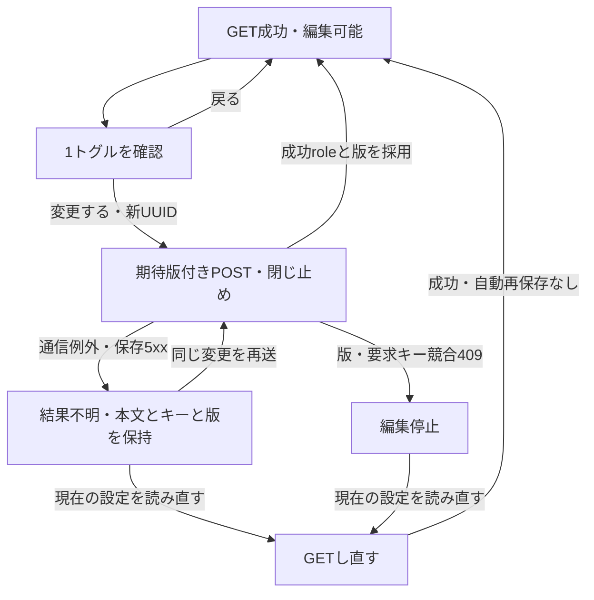

# 1.16 管理画面（ADMIN）詳細設計

> 交換の印を着に結び付ける作業 Task 5 確認日: 2026-11-10。DD-ADMIN-017 の既知の点4つ（`20261108063711` の節）を「直した（移行 C）」に直した。受け取りが値段の計画（`_pricing`）を受けて、返金・交換の結び・割引の扱いを1回の取引で書く。

> 交換の印を着に結び付ける作業 Task 3 確認日: 2026-11-10。DD-ADMIN-021（値段の計画。籠・低い方・手数料・割り振りの式・前の注文から差し引く分）を DD-ADMIN-020 の次に足した。単体のみ実測済み（DB・窓口・画面は後続の作業）。レビューの直し1: 手数料の率の扱い、hold_release の返す額、hold の上限に手数料の累計を引くことを DD-ADMIN-021 に反映した。直し4: 戻しの出来事を率0の段にし（後の返品の率で戻しの分に掛けない）、返品の行が無い枠を1着ずつ段にした。
> 会計の計画 1 確認日: 2026-11-08。権限の表の「30コード」を 38 コードに直した（会計の 6 コード。`ROLE_PERMISSION_CATALOG`）。ACCOUNTING タブの会計の詳細設計は新しい [16-5 ページ](16-5_admin_accounting.md)。会計は `scripts/trace/scope.json` の範囲外なので、このページに会計の `DD-ADMIN-*` は振っていない（会計を範囲に入れる時に 16-5 の見出しを `DD-ADMIN-NNN` と属性の表の形へ直す）。

> 返品の受け取りの数え方の直し 確認日: 2026-11-08。DD-ADMIN-017 に「数え方の直し」（I-1。空きの着を注文の商品ごとに1列で使う）、DD-ADMIN-019 の上限の見込みの文、DD-ADMIN-020 に「相談の点数の直し」（N-1・M-4。`consult_quantity`）を足した。DD-ADMIN-017 に直していない場面を「既知の点」として書いた（交換の印を着そのものに結び付ける別の設計で直す。オーナー決定）。移行 `20261108063711` は手元の DB で確認し、2026-11-08 にオーナーの許可で本番へ当てた。DB 結合の試験は[テスト仕様](../../05_Quality/tests/test-spec.md)参照。

> 返品の品ごとの返金 Task 4 確認日: 2026-11-06。DD-ADMIN-020 に、メールの材料・本文と注文の履歴の実装（Task 4）の段落を足した。単体211/211、メール材料のDB試験6/6と関連E2Eは実測済み（2026-11-06、調整役の手元の実行・ログ保管。[テスト仕様](../../05_Quality/tests/test-spec.md)参照）。メールの実配送は未実行。

> 返品の品ごとの返金 Task 3 確認日: 2026-11-06。DD-ADMIN-017 に見込みの計算（`computePerItemReturnRefundPreview`）、DD-ADMIN-019 に受け取りの画面（Task 3）の実装の段落を足した。単体・画面結合247/247（直し2後）、3幅の E2E は18/18通過（2026-11-06、調整役の手元の実行・ログ保管）。

> 返品の品ごとの返金 Task 2 確認日: 2026-11-06。DD-ADMIN-018 に、窓口・型・store・service の実装（Task 2）の段落を足した。単体1026/1026通過。DB・本物のPostgREST・E2Eの実測は[テスト仕様](../../05_Quality/tests/test-spec.md)に記録（2026-11-06、調整役の手元の実行・ログ保管）。

> 返品の品ごとの返金 Task 1 確認日: 2026-11-06。「返品の品ごとの返金（要求定義・2026-11-06）」の DD-ADMIN-018 の後に、DB の実装（移行 `20261106005536`、手元で確認・本番は 2026-11-06 に適用済み）の段落を足した。

> 波 4 確認日: 2026-10-28。`/admin` に CONTACT タブを足し（店長12・サポーター4）、LOOK の「新規作成」を権限（`meta.canManage`）で一覧が出す形にし、取扱店の作成の頁に入口の権限の確かめを足した。末尾の「CONTACT タブと LOOK の「新規作成」の出し分け（波 4）」に記載。

> G-4 Task 8 確認日: 2026-10-27。荷作り表・発送票の注文番号を注文の詳細への Link にし、履歴の dialog（`OrderHistoryDialog`）を `OrderHistoryPanel` へ改名して dialog の形を畳み、G-1 から 410 だけを返していた旧い発送・仕上がりの窓口 6 ファイル・7 メソッドを削除した。末尾の「入口の整理（G-4 Task 8）」に追加した。単体のみ実測済み（jest・tsc・lint）。DB・ブラウザの3幅・E2Eはcontroller担当。

> G-4 Task 7 確認日: 2026-10-26。注文一覧表（`/admin/orders`）の頁・表・要対応の欄の移設（hook `useOrderAttention`）・ORDER タブの入口化・旧い一覧と各 dialog の撤去を末尾の「注文一覧表と ORDER タブの入口（G-4 Task 7）」に追加した。単体のみ実測済み（jest・tsc・lint）。DB・ブラウザの3幅・E2Eはcontroller担当。

> G-4 Task 6 確認日: 2026-10-26。注文の詳細（`/admin/orders/[id]`）の頁・品物の表・入替dialog・埋め込みの変更履歴を末尾の「注文の詳細（G-4 Task 6）」に追加した。単体のみ実測済み（jest・tsc・lint）。DB・ブラウザの3幅・E2Eはcontroller担当。

> G-4 Task 5 確認日: 2026-10-26。入替store・POST/候補GET・clientと準備中0件の権限カタログを反映。追加PostgRESTケースはcontrollerのDB実行待ち。

> 状態: 既存設計 | 実装状況は項目ごとに要再照合 | G-3 Task 9 確認: 2026-10-26（修正前はfresh reset・12 suite・639/639成功、Fix round 1は再検証対象）

## 概要

本書は「1.16 管理画面（ADMIN）詳細設計」の既存設計を記録する。要件IDと設計意図を保持しているが、表中の実装状況は現在のコードと一括再照合していない。E-3 段2の承認・お断り・写真・キャンセルの申し込み、設定の残りと商品の返品不可、G-0 の権限画面を末尾に記す。

## 機能要件対応表

| 要件ID | 要件内容 | 実装ID | 実装対象ファイル | 実装概要 | 実装ステータス |
|--------|----------|--------|----------------|----------|--------------|
| FR-ADMIN-001 | `/admin` ページは Supabase ACL のロールに基づき表示可能なタブを動的に制御する。`editor` は NEWS / ITEM / LOOK / STOCKIST タブのみ、`admin` は全タブを表示する | IMPL-ADMIN-001 | `src/app/admin/page.tsx`, `src/app/api/admin/acl/route.ts` | `visibleTabs` を `useMemo` で計算し `renderContent` でも二重チェックを実施。`acl_roles` テーブルとのロール照合 | 済 |
| FR-ADMIN-002 | KPI ダッシュボードタブでは期間選択（DateTimePicker）・売上・注文数・新規会員数・商品閲覧数の集計グラフを表示し KPI 目標値の設定機能を提供する | IMPL-ADMIN-002 | `src/components/KpiSection.tsx`, `src/app/api/admin/kpi/route.ts`, `src/app/api/admin/kpi/targets/route.ts` | `KpiSection` + `DateTimePicker` で期間・棒グラフ表示。`/api/admin/kpi/targets` で目標値の GET / PUT を実装 | 済 |
| FR-ADMIN-003 | NEWS 管理タブでは記事一覧・作成・編集・削除・公開ステータス変更を提供しカテゴリ・キーワード・ステータスフィルタを設ける | IMPL-ADMIN-003 | `src/components/NewsSection.tsx`, `src/app/api/admin/news/route.ts`, `src/app/api/admin/news/[id]/route.ts` | 一覧・作成・編集モーダル・削除・公開切替を実装。`admin` ロールのみ新規作成ボタンを表示 | 済 |
| FR-ADMIN-004 | ITEM 管理タブでは商品一覧・作成・編集・削除・在庫/公開ステータス管理を提供する | IMPL-ADMIN-004 | `src/components/ItemSection.tsx`, `src/app/api/admin/items/route.ts`, `src/app/api/admin/items/[id]/route.ts` | 一覧・作成・編集モーダル・削除・公開切替を実装。画像アップロード（`item-images` バケット）対応 | 済 |
| FR-ADMIN-005 | LOOK 管理タブではルック一覧・作成・編集・削除・アイテムタグ付けを提供する | IMPL-ADMIN-005 | `src/components/LookSection.tsx`, `src/app/api/admin/looks/route.ts`, `src/app/api/admin/looks/[id]/route.ts` | 一覧・作成・編集モーダル・削除を実装。`look_items` テーブルでアイテムタグ付け対応 | 済 |
| FR-ADMIN-006 | STOCKIST 管理タブでは店舗一覧・作成・編集・削除・公開ステータス管理を提供する | IMPL-ADMIN-006 | `src/components/StockistSection.tsx`, `src/app/api/admin/stockists/route.ts`, `src/app/api/admin/stockists/[id]/route.ts` | 一覧・作成・編集モーダル・削除・公開切替を実装 | 済 |
| FR-ADMIN-007 | USER 管理タブは `admin` ロール専用とし `roles` テーブルの編集・ACL 付与・ユーザー一覧を提供する | IMPL-ADMIN-007 | `src/components/UserSection.tsx`, `src/app/api/admin/users/route.ts`, `src/app/api/admin/users/[id]/role/route.ts` | ユーザー一覧・ロール変更フォームを実装。`admin` ロールのみ表示（`visibleTabs` で制御） | 済 |
| FR-ADMIN-008 | ORDER 管理タブは注文一覧表（/admin/orders）への入口だけを置く（G-4 Task 7。注文一覧表は品物×ステータスの12列・20行ずつの頁・絞り込み・全行CSV。末尾の「注文一覧表と ORDER タブの入口」）。この行の下の説明は G-4 より前の旧い一覧の記録で、旧い一覧・列・ボタン・CSV 11列は撤去した（移行前: 注文一覧・ステータスフィルタ・キーワード検索・ページネーション（20件ずつ）・CSV エクスポート） | IMPL-ADMIN-008 | `src/app/admin/orders/page.tsx`, `src/components/AdminOrderItemListSection.tsx`, `src/app/api/admin/order-items/route.ts` | 未決済にキャンセル、支払い済みで1つも発送していない注文にキャンセル（返金とあわせて。店長だけ）、発送準備中か受注生産中の数がある入金済みの注文に発送と仕上がりの記録、返せる額がある注文に返金を表示する。列は「支払い」（未入金・支払い済み・一部返金・返金済み・支払いの失敗・支払いなし）と「進み具合」（商品ごとの数から出す言葉。未決済・受注生産中・発送準備中・配送中・キャンセルの手続き中。一部発送済みの印）。返金・キャンセルの後は一覧と要対応・要確認を再取得する。返品（グループ E-3）の列「返品」（返品の状態と小さな印。返品の無い注文は「—」）・絞り込み「返品」・一覧の上の一行（返品の申し込みと返金待ちの件数）・「返品」のボタン（次にすることで名前が変わる）と、CSV の列「返品」・購入商品の交換の品の印を足す（FREQ-468・472） | 済 |

---

## 実装タスク管理 (ADMIN-01)

**タスクID**: ADMIN-01
**ステータス**: 一部未実装
**元ファイル**: `docs/tasks/05_admin_ticket.md`

### 実装完了項目

| 要件ID | 要件内容 | 実装ID | 実装対象ファイル | 実装概要 | 実装ステータス |
|--------|----------|--------|----------------|----------|--------------|
| ADMIN-01-001 | ITEM CRUD（作成/編集/削除/公開切替） | IMPL-ADMIN-ITEM-01 | `src/app/admin/items/`, `src/app/api/admin/items/` | 全 CRUD + 公開切替実装済み | 済 |
| ADMIN-01-002 | カラープリセット DB 永続化、再利用 | IMPL-ADMIN-COLOR-01 | `src/app/api/admin/color-presets/route.ts` | DB 永続化 + 再利用実装済み | 済 |
| ADMIN-01-003 | LOOK CRUD | IMPL-ADMIN-LOOK-01 | `src/app/admin/looks/`, `src/app/api/admin/looks/` | 全 CRUD 実装済み | 済 |
| ADMIN-01-004 | NEWS CRUD | IMPL-ADMIN-NEWS-01 | `src/app/admin/news/`, `src/app/api/admin/news/` | 全 CRUD 実装済み | 済 |
| ADMIN-01-005 | STOCKIST CRUD | IMPL-ADMIN-STOCKIST-01 | `src/app/admin/stockists/`, `src/app/api/admin/stockists/` | 全 CRUD 実装済み | 済 |
| ADMIN-01-006 | USER タブ（権限変更含む） | IMPL-ADMIN-USER-01 | `src/app/admin/users/`, `src/app/api/admin/users/` | ユーザー管理 + 権限変更実装済み | 済 |
| ADMIN-01-007 | ORDER タブ（G-4 Task 7 から注文一覧表への入口だけ。ページング/期間フィルタ/CSV/ステータス変更/返金は注文一覧表と注文の詳細へ移った） | IMPL-ADMIN-ORDER-01 | `src/app/admin/orders/`, `src/app/api/admin/orders/` | ページング/フィルタ/CSV/ステータス/返金 実装済み | 済 |
| ADMIN-01-008 | KPI タブ（実データ集計/目標値編集） | IMPL-ADMIN-KPI-01 | `src/app/admin/kpi/`, `src/app/api/admin/kpi/` | 実データ集計 + 目標値編集実装済み | 済 |
| ADMIN-01-009 | `admin-rbac.ts` ハイブリッド RBAC | IMPL-ADMIN-RBAC-01 | `src/lib/admin-rbac.ts` | ハイブリッド RBAC 実装済み | 済 |

---

## RBAC 権限設計（ADMIN-RBAC）

| 機能 | `admin` | `supporter` |
|---|---|---|
| 商品 CRUD | ✅ | 編集のみ |
| ニュース CRUD | ✅ | ✅ |
| 注文ステータス変更 | ✅ | ✅ |
| 返金処理 | ✅ | ❌ |
| 返品の作成・受け取り（相談か返金なし）・取消・開き直し・検品 | 可 | 可 |
| 返品の返金（受け取りの今返金・額を決めて返金）・手数料の受け取りの記録・支払いを待たずに送る | 可 | お客様の申し込みで返送不要でない返品の計算どおりの今返金だけ可。ほかは不可 |
| クーポン作成 | ✅ | ❌ |
| ユーザー権限変更 | ✅ | ❌ |
| KPI ダッシュボード閲覧 | ✅ | ✅ |
| 監査ログ閲覧 | ✅ | ❌ |

> Supabase RLS で `acl_roles` テーブルのロール列を条件とするポリシーを設定し、テーブルレベルのアクセス制御を実施する。

グループ E-2 から、返金（`admin.orders.refund`）と支払い済みの注文のキャンセル（`admin.orders.manage` と `admin.orders.refund` の両方）、ショップの設定（`admin.settings.manage`）は、店長（`admin`）の役割だけができ、サポートの人（`supporter`）はできない。未入金・失敗の注文の取消は、今のままサポートの人もできる。

グループ E-3 から、返品の窓口は `admin.orders.return`（店長とサポート）で守り、返金に関わる操作（受け取りの今返金（お客様の申し込みで返送不要でない返品の計算どおりの場合を除く）・返金額の指定・送料・交換の選び直し、額を決めて返金する、手数料の受け取りの記録、支払いを待たずに送る）は `admin.orders.refund` も要る（店長だけ）。サポートはこの条件の計算どおりの今返金か相談を選ぶ。店作成・返送不要の今返金と、額・送料・交換の上書きは許さない。権限の一覧は [ハイブリッド RBAC](../../03_BasicDesign/architecture/hybrid-rbac.md) に書く。

---

## 管理者オンボーディング手順（ADMIN-ONBOARDING）

1. **申請**: 管理者アカウント発行はチケット経由で申請する。
2. **身元確認**: 申請者の所属・メールを確認し、担当者が 2FA 設定まで案内する。
3. **最小権限付与**: 初期は `supporter` 相当の限定権限を付与し、業務確認後に `admin` 権限を付与する。
4. **初回ログイン**: 初回ログイン時にパスワード変更と 2FA の有効化を必須化する。
5. **ドキュメント配布**: 管理操作の利用規約・ランブック・オンボーディングチェックリストを配布する。

### 2FA 有効化手順

1. 管理画面で "Enable 2FA" を選択
2. サーバが TOTP シークレットを発行し、QR コードを表示
3. 管理者は Authenticator アプリで QR をスキャンし、初回コードを入力して検証
4. 端末名を登録し、リカバリコード（ワンタイム）を発行・保存することを義務付ける
5. `admin` ロールの全ユーザは 2FA を必須とし、未設定時はアクセスをブロックする

---

## 監査ログ設計（ADMIN-AUDIT）

### ログスキーマ

```json
{
  "id": "uuid",
  "timestamp": "2025-01-01T12:00:00Z",
  "actor_id": "uuid",
  "actor_email": "admin@example.com",
  "action": "items.update",
  "resource": "items",
  "resource_id": "uuid",
  "ip": "203.0.113.1",
  "user_agent": "Mozilla/5.0...",
  "outcome": "success|failure",
  "metadata": { "diff": { "price": { "from": 1000, "to": 1200 } } }
}
```

### 保存期間

| 区分 | 期間 | 用途 |
|---|---|---|
| ホット（即時検索） | 1 年 | 障害調査・コンプライアンス監査 |
| コールド（アーカイブ） | 7 年 | 法規制・会計要件 |

- 監査ログは変更不可なストレージに保存し、整合性検証（ハッシュ）を定期実行する。
- 重要操作（権限変更・払い戻し・高額割引）は即時アラート対象とし、オンコール担当に通知する。

---

## API 仕様（ADMIN-API）

| エンドポイント | メソッド | 概要 | ロール要件 |
|---|---|---|---|
| `/api/admin/items/import` | POST | CSV バルクインポート（必須カラム/型チェック/重複 SKU 検出） | `admin` |
| `/api/admin/orders` | GET | G-4 Task 7 で削除（一覧は `/api/admin/order-items`、詳細は `/api/admin/orders/[id]`）。以下は削除前の記録: 注文一覧（ページネーション・ステータスフィルタ。放棄は既定で出さない。`review=only` で要確認だけ）。各行に要確認・発送止めの理由・取消の可否・払込期限を付け、商品ごとの数から出した注文の言葉と一部発送済みの印、商品の行ごとの数を付ける（FREQ-441）。支払いの言葉・返金の印・返金額・取消の種類も付け、返金のボタンの判定は Stripe を読まずに行う（FREQ-458）。返品の要約（returnSummary）・一覧の上の一行の件数（returnAttention）・問い `return=`（返品の状態で絞る）を足し、商品の行に lineKind（order・exchange）を付ける。商品数は交換の品の行を数えない（グループ E-3。FREQ-468・472） | `admin`, `supporter` |
| `/api/admin/orders/:id/status` | POST | 支払い手続き中・未決済・決済失敗の取消（理由は必須、メモ・お客様へのお知らせ）。Stripe が払込票の期限切れを確定するまでの取消は409と払込期限、Stripe・DBの一時的な失敗は503。支払い済みで1つも発送していない注文のキャンセルは、返金とあわせて行い（二重防止の番号 requestKey と「在庫に戻す」を足す。FREQ-449）、権限 admin.orders.manage と admin.orders.refund の両方が要る | `admin`, `supporter`（支払い済みの注文は `admin` のみ） |
| `/api/admin/orders/:id/refund` | GET | 返金の画面の材料（注文の金額・返せる額・商品ごとの数と割り振った割引・返事待ちの返金）（FREQ-448） | `admin.orders.refund` |
| `/api/admin/orders/:id/refund` | POST | 返金を1件の記録にして Stripe に頼む（二重防止の番号・商品と数・送料・額・理由・知らせるか）。返せる額・数の超過は409、Stripe の断りは422、答えが分からない時は502（FREQ-447・448） | `admin.orders.refund` |
| `/api/admin/orders/:id/refund/confirm` | POST | 返事待ちの返金を、記録の番号で確かめ直す（FREQ-448） | `admin.orders.refund` |
| `/api/admin/orders/:id/fulfillments` | GET | G-4 Task 8 で削除（窓口ごと撤去。発送は発送票の窓口）。以下は削除前の記録: 発送の画面と仕上がりの画面の材料（商品ごとの数・発送の一覧・発送できない理由）（FREQ-439・440）。返品の交換の品の行には lineKind と、手数料のお支払い待ちで送れない数 exchangeOnHold を付ける（グループ E-3。FREQ-465） | `admin.orders.manage` |
| `/api/admin/orders/:id/fulfillments` | POST | G-4 Task 8 で削除（窓口ごと撤去。発送は発送票の窓口）。以下は削除前の記録: 発送を1回分記録する（重複防止キー・配送業者・追跡番号・知らせるか・商品と数）。発送準備中の数を超えると409（FREQ-439）。手数料のお支払いを待っている交換の品を含むと409（窓口の記号 `fulfillment_exchange_on_hold`。DB の `FULFILLMENT_EXCHANGE_ON_HOLD`。グループ E-3。FREQ-465） | `admin.orders.manage` |
| `/api/admin/orders/:id/fulfillments/:fulfillmentId/cancel` | POST | G-4 Task 8 で削除（窓口ごと撤去。発送の取消は発送票の窓口）。以下は削除前の記録: 発送の取消。送る前のその発送のメールを取りやめる（FREQ-443）。申し込み・受付中・完了の返品が指す発送は409（窓口の記号 `fulfillment_has_return`。DB の `FULFILLMENT_HAS_RETURN`。取消の返品しか指さない発送は取り消せる。グループ E-3。FREQ-471） | `admin.orders.manage` |
| `/api/admin/orders/:id/completions` | POST | G-4 Task 8 で削除（窓口ごと撤去。手動の仕上がりは G-1 で終了）。以下は削除前の記録: 受注生産の品の仕上がりを記録する（FREQ-440） | `admin.orders.manage` |
| `/api/admin/orders/:id/completions/:completionId/cancel` | POST | G-4 Task 8 で削除（窓口ごと撤去。手動の仕上がりは G-1 で終了）。以下は削除前の記録: 仕上がりの取消。もう発送した数を下回る取消は409（FREQ-440） | `admin.orders.manage` |
| `/api/admin/orders/:id/returns` | GET | 返品の画面の材料（返品の一覧と行ごとの進み具合・返金待ちの額の見込み・手数料・返せる額と送料・返品できる数の合計・要検品の設定）。取消・お断りの返品も返すが、画面は出さない（グループ E-3。FREQ-462・463） | `admin.orders.return` |
| `/api/admin/orders/:id/returns/materials` | GET | 返品を作る画面の材料（発送ごとの品・返品できる数と期限・交換の色とサイズと在庫・理由ごとの設定・返送先の有無・使う手数料の設定）（FREQ-462） | `admin.orders.return` |
| `/api/admin/orders/:id/returns` | POST | 返品を作る（二重防止の番号・品と数と理由と解決・返送・手数料・メモ・知らせるか）。返品できる数の超過・返送先なし・返品を作れない注文は409。知らせるを入れた時だけ、受付のお知らせの予定を書く（FREQ-462・469） | `admin.orders.return` |
| `/api/admin/returns/:returnId/receive` | POST | 受け取る（品ごとの扱い・交換の選び直し・返金の選び方（今返金／相談／なし）・額・送料・メモ・知らせるか・お返しのメッセージ）。返金があれば Stripe に頼む。Stripe の断りは422、答えが分からない時は502（受け取りの番号つき）（FREQ-463〜467） | `admin.orders.return`（今返金（お客様の申し込みで返送不要でない返品の計算どおりの場合を除く）・額の指定・送料・交換の選び直しは `admin.orders.refund` も） |
| `/api/admin/returns/:returnId/refund` | POST | 返金待ちの品を、額を決めて返す。額0は返金しないで終える（FREQ-464） | `admin.orders.return` と `admin.orders.refund` |
| `/api/admin/returns/:returnId/cancel` | POST | 何も受け取る前の返品を取り消す（FREQ-463） | `admin.orders.return` |
| `/api/admin/returns/:returnId/reopen` | POST | 「届かない」として終えた返品を開き直す（FREQ-463） | `admin.orders.return` |
| `/api/admin/returns/:returnId/close-missing` | POST | 残りを「届かない」として返品を終える（FREQ-463） | `admin.orders.return` |
| `/api/admin/returns/:returnId/inspect` | POST | 検品待ちの品を、戻す・戻さないに決める（FREQ-463） | `admin.orders.return` |
| `/api/admin/returns/:returnId/fee-payment` | POST | 手数料の受け取りを記録する。`waive: true` はいただかないで終える（FREQ-467） | `admin.orders.return` と `admin.orders.refund` |
| `/api/admin/returns/:returnId/release-exchange` | POST | 手数料のお支払いを待たずに、交換の品を送れるようにする（FREQ-465・467） | `admin.orders.return` と `admin.orders.refund` |
| `/api/admin/items/:id/variants` | GET | 色 × サイズの一覧（すぐ出せる数・引き当て済み・手元の数・受注生産）と、動かした人・注文・変わった後の数つきの台帳の履歴（FREQ-399・445）。返品で動いた行（理由 `return`・`exchange`）には、返品の番号 returnId と、{注文番号}-R{n} の returnNumber を付ける（グループ E-3。FREQ-474） | `admin.stock.read`（G-2 から。FREQ-540-AC-06） |
| `/api/admin/items/:id/variants` | POST | 在庫台帳への追記（入荷 / 棚卸調整） | `admin.stock.manage` と `admin.stock.read` の両方（G-2 から。FREQ-540-AC-06） |
| `/api/admin/order-attention` | GET | 未処理の要対応・要確認の一覧と件数（お客様の個人情報は返さない）。返金の失敗の行には「もう一度返金する」を出せるか（canRetryRefund）と細目（refundFailure）を付ける（FREQ-457）。細目には、失敗した返金が返品の返金の時だけ、その返品の番号 returnId を付ける（「もう一度返金する」は返品の画面を開く。グループ E-3） | `admin.orders.read` |
| `/api/admin/orders/:id/review` | POST | 要確認を確認済みにする | `admin.orders.manage` |
| `/api/admin/payment-exceptions/:id/resolve` | POST | 要対応を解決済みにする。未入金の注文が付いていれば取り消して解決もできる。先に解決されていれば409 | `admin.orders.manage` |
| `/api/admin/settings/shop` | GET | ショップの設定（自動の返金①②）を読む（FREQ-461）。返品の設定（returns。返送・受付の期限・理由ごとの設定・手数料・受け取りと、まとまりごとの最後に変えた人）も返す（グループ E-3。FREQ-470） | `admin.settings.manage` |
| `/api/admin/settings/shop` | PUT | ショップの設定を保存する。変えた人と時刻を残す（FREQ-461）。返品の欄は returns を付けて、段1の欄を全部1回で保存する（FREQ-470） | `admin.settings.manage` |
| `/api/admin/items/:id` | DELETE | 商品の削除。注文の明細・在庫の記録・決済中のある商品は理由付きの409で断り、非公開を促す | `admin.items.manage` |

> CSV インポート時は必須カラムチェック・型チェック・重複 SKU 検出を行い、エラー行は一覧で返す。

## 注文のキャンセル・返金（ADMIN-ORDER / FREQ-404）

注文状態は画面の推測で変更せず、返金の記録（`order_refunds`。Stripeの返金1件が1行）とDBの条件付き更新を正本にする（グループE-2）。

| 現在状態 | 操作 | 遷移・応答 |
|---|---|---|
| `payment_in_progress` | キャンセル（理由は必須） | 開いている Checkout Session を失効させてから、照合関数が Stripe の現在値で取り消し、確保した分だけ在庫を戻す（`release_stock_for_unpaid_order`）。先に支払いが完了していれば409 |
| `pending` | キャンセル（理由は必須） | Stripe が払込票の期限切れを確定するまで取り消さず、409と払込期限（`cancelBlockedUntil`）を返す（払込期限を過ぎても、確定するまでは409）。確定の後は照合関数が取り消し、確保した分だけ在庫を戻す（`release_stock_for_unpaid_order`）。Stripe を一時的に読めなければ503 |
| `failed` | キャンセル（理由は必須。お知らせは出さない） | `admin_cancel_failed_order`が`failed`を条件に理由・メモ付きで更新する。競合で0件なら409 |
| `abandoned` | キャンセル | 409（放棄された注文は取り消さない） |
| `paid` | 発送（商品と数を選ぶ） | `admin_create_fulfillment`が、`paid`・配送先必須項目充足・支払額の違いの要対応が開いていない・各商品が発送準備中の数以内を条件に、発送を1回分記録する。満たさない時は決まった言葉で止め、窓口が404/409/400と画面の言葉に直す（FREQ-439）。この発送で未発送が0になる時だけ`shipped`へ更新する。DBトリガーも直接更新を拒否する。「お客様に発送のメールを送る」（最初は入っている）を外すと、その発送のメールの行を書かない（FREQ-438・442）。 |
| `paid` | 仕上がりの記録 | `admin_record_completion`が、`paid`の注文の受注生産の品の、受注生産中の数まで記録する。状態は変えず、お客様にメールは送らない（FREQ-440） |
| `paid` / `shipped` | 発送の取消・仕上がりの取消 | `admin_cancel_fulfillment`が取消の時刻と人を書き、`shipped`なら`paid`へ戻して出荷日時・配送情報を空にし、送る前のその発送のメールを取りやめる。`admin_cancel_completion`は、もう発送した数を下回る取消を断る（仕上がりの取消は`paid`の注文だけ。`shipped`の注文は`ORDER_NOT_IN_PRODUCTION`で断る。FREQ-440・443） |
| `paid` | キャンセル（1つも発送していない注文。理由は必須） | 支払い済みのキャンセル。店長（`admin.orders.manage` と `admin.orders.refund`）だけ。残りの商品全部と、送料（返せる送料と返せる額の小さい方）を返金1件（`order_cancel`）で返し、返金が成功した時に`cancelled`へ更新する。コンビニ払いで口座の入力を待つ間（保留）は`paid`のまま、進み具合に「キャンセルの手続き中」を出す（FREQ-449） |
| `paid`（一部を発送した後）/ `shipped` | キャンセル | 409。`paid` は「発送した商品がある注文はキャンセルできません。返金の画面を使ってください。」と案内し（`order_not_cancellable`）、`shipped` は「発送済みの注文はキャンセルできません。」と案内する |
| `paid` / `shipped` | 返金（商品と数・送料を選ぶ） | 返金の画面から。返金を「返事待ち」の記録として作ってからStripeに頼み、受け付けた返金の分だけ、未発送の数・在庫・引き当て済みを動かす。部分の返金では状態を維持し、成功した返金の額だけを注文の返金済みの額に入れる（FREQ-447・448・453） |
| `paid` / `shipped` | 成功した返金の合計が全額（受け取った額。0か空なら注文の合計）以上 | 結果を書く関数（`record_order_refund_result`・`record_external_order_refund`）が`cancelled`へ更新する。この時、未発送の商品を全部その返金の発送前の行に入れて在庫に戻す（FREQ-447・453） |
| `paid` | 返金を受け付けて未発送が0になり、発送した商品がある | `shipped`へ更新する（発送日・配送業者・追跡番号は取り消していない最後の発送の値）。その返金が失敗して未発送が戻ったら（返事待ちの返金がエラーになって未発送が戻った時も同じ）`paid`へ戻し、発送日などを空にする（FREQ-454） |
| 返金由来の`cancelled` | 返金が失敗して、成功した返金の合計が全額（受け取った額。0か空なら注文の合計）未満 | 未発送が0で発送した数が1以上なら`shipped`、ほかは`paid`へ戻す。未決済から取り消した注文（改訂の理由が返金でない）は戻さない |
| 未決済由来の`cancelled` | 入金が届いた（取り消した注文への入金） | `cancelled`を維持する。自動の返金①がオンなら全額を返金し、オフなら管理画面の「返金」から返金する（FREQ-451） |

返金は、どの道（管理画面の返金・支払い済みのキャンセル・Stripeの画面からの返金・自動の返金・前からの写し）も1件ずつの記録（`order_refunds`）になり、結果を書くDBの関数が、記録・在庫・メールの予定・要対応・注文の返金済みの額と状態を1回の取引で書く（グループE-2）。Stripeの返金の知らせ（`refund.created`、`refund.updated`、`refund.failed`、`charge.refunded`）は合図にだけ使い、その支払いの返金をStripeから全ページ読み直して1件ずつ記録に合わせる。書いた後にもう一度読み、返金の番号と状態の組が変わっていれば最大3回やり直し、そろわなければ例外を返し、workerがイベントをfailedとして永続キューから再試行する。毎時の見回りは15分より前の返事待ちを、毎晩の照合は前の48時間に作られた返金と保留の返金の支払いを、同じ取り込みで合わせる。未決済由来の既存`cancelled`への返金も記録し、注文の返金済みの額に入れる。流れは[注文管理のシーケンス](../sequence/order-administration.md)のSQ-ADMIN-03・06・07・08。

管理画面は、返金・キャンセルを受け付けた後に、一覧と要対応・要確認を再取得する（返金で自動で解決する要対応があるため）。保留は一覧の上に「返金を受け付けました。お金が戻ると、注文の状態が変わります。」、成功は「返金しました。」を`role="status"`、`aria-live="polite"`で通知する。窓口の断り（400・404・409）とStripeの断り（422）は、窓口の日本語の文を画面の中に出す。答えが分からない時（通信が切れた・500番台・502）は、入力を止めて同じ二重防止の番号で確かめ直させ、内部障害の文は出さない（下の「返金の画面と、支払い済みの注文のキャンセルの画面」）。

DB変更は次の2段階で適用する。第1段階は本番適用済み、第2段階は対応アプリの本番動作確認後に適用する。

1. [20260925000218_add_order_state_transition_rpcs.sql](../../../supabase/migrations/20260925000218_add_order_state_transition_rpcs.sql): 3つのservice-role専用RPCと監査主体のGUC連携を追加する。既存権限は維持する。
2. [harden_order_state_transitions.sql](../../../supabase/pending/harden_order_state_transitions.sql): アプリ切替確認後に`anon` / `authenticated`の`orders` UPDATE、広範なUPDATE policyを削除し、不変条件トリガーを追加する。

3つのRPCは`SECURITY DEFINER`、`search_path=''`、完全修飾名を使い、`PUBLIC` / `anon` / `authenticated`から実行権限を剥奪する。人間の操作はサーバーが認証済みセッションから得た利用者IDを渡し、`order_revisions.changed_by`へ記録する。クライアント本文の利用者IDは受け付けない。返金を投影する`apply_order_refund_projection`は、グループE-2の[移行C](../../../supabase/migrations/20261011223453_order_refund_results.sql)で消し、結果を書く関数に置き換えた。

## ORDER タブの要対応・要確認と取消の画面（ADMIN-ORDER-ATTENTION / FREQ-411〜413・415・435）

| 部品 | 内容 |
| --- | --- |
| 送信の一時停止の帯（FREQ-435、E2E FR-ADMIN-067） | ORDER タブの上、要対応・要確認の欄より前に、`GET /api/admin/order-attention` の `data.emailSending.paused` が true の時だけ「お客様への注文のメールの送信を止めています」を出す（`BannerAlert`、`role="alert"`）。原因は `reasonLabel`（null なら「不明」）。「原因: {原因名}。原因を直すと、15分ごとに1件ずつ試して自動で再開します（1日の送信の上限の時は日本時間 9時から）。手順は「注文のメールの手順書」の「送信の一時停止」にあります。」と案内する。停止の知らせのメールも同じ鍵・送信元・上限を使うため届かず、この帯が店主の気づく道になる。止めていない時、項目が null・無い時は出さない。mobile（390px）・tablet（768px）・desktop（1280px）で確かめる |
| 要対応・要確認の欄（`src/components/AttentionInbox.tsx`） | 注文一覧の上に件数付きで出す。未処理が0件なら出さない。お客様の氏名・住所・メールは出さない。読み込めなかったときは未処理なしに見せず「要対応・要確認を読み込めませんでした。」を出す。操作が断られたら（払込票が有効・Stripe が一時的に使えないなど）理由を欄のすぐ下に出し、行は残る |
| 件数 | 未処理の件数をサイドナビの ORDER（`src/components/AdminSideNav.tsx` の `badges`）と KPI 画面の上部の1行に出す |
| 状態の絞り込み | 「すべて・支払い手続き中・未決済・発送待ち（受注生産中・発送準備中）・発送済み（配送中・配達済み）・決済失敗・放棄・キャンセル」。DB の状態で絞り（発送待ちは paid、発送済みは shipped）、2つ以上選んだ時は画面が DB の状態（`orderStatus`）で絞る（FREQ-441）。放棄は既定の一覧に出さず、「放棄」で絞り込めば出る。「放棄」は他の状態と一緒に選べない（選ぶと他の状態が外れ、他の状態を選ぶと「放棄」が外れる） |
| 要確認の印 | 要確認の注文に「要確認」の印を出し、「要確認のみ」で絞り込める |
| 発送止め | 支払額の違いの要対応が開いている注文は「発送済みにする」を出さず、理由を出す（`admin_create_fulfillment` も断る） |
| 取消の可否 | 取り消せない未決済の注文には「キャンセル」を出さず理由を出す。Stripe が払込票の期限切れを確定するまでは「払込票の期限切れが確定するまで取り消せません（払込期限 …）」、Stripe の状態を確かめられないときは「支払いの状態を確かめられないため、今は取り消せません」（一覧の GET の `canCancel`・`cancelBlockedUntil`。払込票が有効な間は取消 API も409で断る）。支払い済みで1つも発送していない注文には「キャンセル」を出し、押すと支払い済みのキャンセルの画面を開く（一覧の `cancelKind` が `paid`。下の「返金の画面と、支払い済みの注文のキャンセルの画面」。グループ E-2） |
| 取消の画面（`src/components/OrderCancelDialog.tsx`） | Shopify の取消画面に合わせる。項目は下の表。未入金・失敗の注文の取消の画面で、支払い済みの注文は別の部品（`OrderPaidCancelDialog`）で開く（グループ E-2） |

- 要対応（`payment_exceptions`）: 注文を作れない支払い・支払額の違い・取り消した注文への入金など。理由の表示名は `PAYMENT_EXCEPTION_REASON_LABELS`（`src/lib/orders/order-payment-types.ts`）。「解決済みにする」（メモは返金の失敗の手動解決だけ必須、ほかの理由は任意。最大500文字）で欄から消す。通常返金・返品返金とも理由が `refund_failed` なら「メモ（必須・店内のみ）」と「返金の失敗を解決するときは、確かめた内容をメモに入力してください。」を表示し、空・空白だけでは解決を送信できない（FREQ-507）。ほかの理由は「メモ（任意・店内のみ）」のまま。未入金の注文が付いていれば「注文を取り消して解決」（理由とメモが必須）も選べる。別の管理者が先に解決していたら409で、二重に取り消さない。理由「返金の失敗」（グループ E-2）の行には、返せる額がある時だけ（店長の画面だけ）「もう一度返金する」を出し、押すと返金の画面を開く
- 要確認（`orders.review_reason`）: 在庫を確保できなかった注文（`stock_not_reserved`）と、毎時の見回りが注文の無い支払いから作った注文（`recovered_from_payment`。表示は「支払いから作った注文：お客様へ確認してください」。FREQ-415）。両方に当たる注文は在庫の理由を残す。「確認済みにする」で欄から消す
- どちらも実行者と日時を残す

| 取消の画面の項目 | 内容 |
| --- | --- |
| 理由 | 必須。在庫切れ・お客様の依頼・不正の疑い・その他（`CANCEL_REASONS`） |
| メモ | 店内だけに残る（500文字まで）。「その他」と要対応の解決では必須 |
| お客様へのお知らせ | 「お客様に取消のお知らせを送る」は既定でオン、外せる。失敗の注文の取消では出さない |
| 在庫 | 常に戻すので選択肢を置かない |

### 注文の履歴（FREQ-436・437）

各注文の「履歴」（読み上げの名前は「{注文番号} の履歴」）で「この注文の履歴」のダイアログを開く。

| 表示 | 中身 |
|---|---|
| 上 | 注文番号と状態、宛先（注文のメールアドレス）、送信を止めていれば「メールの送信を一時停止しています（原因）」 |
| 並び | 受付・状態の変化（配送業者と伝票番号、取消の理由、操作した管理者）・発送・発送の取消・仕上がり・仕上がりの取消・返金・返金の失敗の確保し直し・メール（種類・状態・時刻・原因・手で再送の印）を新しい順 |
| メールの状態 | 送信待ち・やり直し待ち・送信済み・配達済み・配達の遅れ・届かなかった・迷惑メールにされた・送信先が止められている・送信サービスで送れなかった・取りやめ・送れなかった。問題のある状態には「注意」 |
| 中身を見る | 送信済みのメールの件名と本文。送ってから45日を過ぎ、毎日の片付けで本文を消した後は「本文の保存期間（45日）を過ぎました」 |
| お客様へ再送 | 送信済み・送れなかったメールで、今の注文の状態で意味のある種類だけ。「{種類}のメールを、お客様（注文のメールアドレス）へもう一度送ります」で確かめ、「再送する」「やめる」。発送のメールは「発送（n回目）のメール」と出し、その発送のメールを再送する（取り消した発送は再送できない）。返金のお知らせは再送できない。キャンセルのお知らせは、注文がキャンセルの間は再送できる。再送は、最後に送った、または送るのをあきらめた（`sent` か `dead`）取消の行のうち返金が失敗・エラーでない行（返金の番号が無い行を含む）の書き分けと返金の番号を写し、写せる行が無ければ断る（グループ E-2） |
| 発送の行 | 「発送（n回目）」。取り消した発送には印「取り消し済み」。「配送業者: {名前} / 伝票番号: {番号}」、「商品: {名前} × {数}」（商品が複数なら「 / 」で区切る）、「お客様へのメール: 送る」か「お客様へのメール: 送らない」、全部を送った発送には「この発送で全部を送りました」、操作した人。取り消せる時は「この発送を取り消す」（FREQ-443） |
| 発送の取消の行 | 「発送（n回目）を取り消しました」、操作した人 |
| 仕上がりの行 | 「受注生産の品が仕上がりました」。取り消した仕上がりには印「取り消し済み」。「商品: {名前} × {数}」、操作した人。取り消せる時は「この仕上がりを取り消す」 |
| 仕上がりの取消の行 | 「仕上がりを取り消しました」、操作した人 |

中身・再送の確かめ・発送と仕上がりの取消の確かめは同じダイアログの中で切り替える。「戻る」「やめる」の後は、開いたメールの行の「中身を見る」「お客様へ再送」のボタンへ焦点を戻す。ボタンが無ければパネルへ移す。再送の受付の知らせは焦点を移した後の描画で `role="status"` に入れる。Escape で閉じ、閉じたら「履歴」のボタンへ戻る。前の要求や別のメールの遅れた応答で今の画面を上書きしない。

注文の状態の表示名は [order-history.ts](../../../src/lib/orders/email/order-history.ts) の `ORDER_STATUS_LABELS` を、履歴の窓口が使う。グループ E-1 から、一覧の言葉は商品ごとの数から出した進み具合の言葉（下の「発送と仕上がりの画面と、注文の言葉」）に替わったので、一覧とは共有しない。履歴の見出し（「{注文番号}（決済完了）」など）と状態の変化の行は、DB の状態の言葉（決済完了・発送済みなど）のまま出す。

返金で状態が変わった行も履歴に含める。全額返金でキャンセルになった行は「理由: 全額返金」、返金が失敗して戻った行は「返金の取り消し」を出す。返金で発送済みになった行は「残りの商品を返金したため発送済み」、返金の失敗で支払い済みに戻った行は「返金の失敗で発送待ちに戻りました」を出す。返金そのものの行（額・商品・状態の移り変わり）と、確保し直しの行は、下の「一覧の支払いの列・履歴・要対応・在庫の履歴・ショップの設定」に書く（グループ E-2）。

### 発送と仕上がりの画面と、注文の言葉（FREQ-439〜443）

G-4撤去: 旧発送・発送取消・伝票訂正・手動配達済み・仕上がりの手動記録と取消の窓口は、G-3の発送票へ移行した後、G-4 Task 8 で route ごと撤去しました。以下のE-4記述は撤去前の契約として保持します。手動の仕上がりの記録・取消は G-1 で終了した（品物は在庫の入荷から FIFO で自動に割り当てる）。止めていた入口（G-4 Task 8 で窓口ごと撤去した。撤去前の答え）は固定の文「旧い発送の操作は終了しました。発送・発送取消・伝票番号の訂正・手動の配達済みは、荷作り表の発送票から行ってください。」と「仕上がりの手動記録・取消は終了しました。在庫の入荷から自動で割り当てます。」で、一覧の canShip・canRecordCompletion は false、注文の履歴は仕上がりの行を作らない。G-1 Task 15 で画面の入口（一覧の「仕上がりを記録する」「発送済みにする」、履歴の「この発送を取り消す」「この仕上がりを取り消す」）と発送の画面・仕上がりの画面（下の表の `OrderShipDialog`・`OrderCompletionDialog`）を削除した。注文一覧の表の上に「発送は荷作り表から行います。」・「荷作り表を開く」（`/admin/packing`）・仕上がりの停止の文を1回ずつ、注文の履歴の一覧の上に「発送・発送取消・伝票番号の訂正・手動の配達済みは、発送票から行います。」を1回出す（どの画面幅でも折り返す。G-3 で置換。下の「荷作り表・発送票」の節）。履歴の発送の行の cancellable は常に false。[fulfillment-client.ts](../../../src/lib/orders/fulfillment/fulfillment-client.ts) の書く道具と発送の材料の読み取りは、窓口を呼ばずに固定の停止の文で断る（商品の見出しと数の入力の部品は返品・返金の画面が使うので残す）。下の表は停止前の契約。

2026-10-10 から、発送は商品と数を選ぶ1回ごとの記録になり、受注生産の品は仕上がりを記録するまで送れない（[グループ E-1 設計書](../../superpowers/specs/2026-10-10-partial-fulfillment-design.md)）。DB の状態の値（`paid`・`shipped` など）は変えず、一覧の言葉は商品ごとの数から出す（[注文・決済の状態](../states/order-payment.md)、[order-progress.ts](../../../src/lib/orders/order-progress.ts)）。

| 部品 | 内容 |
| --- | --- |
| 一覧の言葉 | 未決済・受注生産中・発送準備中・配送中（配達済みは E-4）・決済失敗・キャンセル・支払い手続き中・放棄。いちばん手前の段階の言葉を出し、発送した数が1以上で未発送の数も1以上なら「一部発送済み」の印を足す（FREQ-441） |
| 商品の欄 | 「ブラウス（白 / M）×2（受注生産中 1・発送済み 1）」のように、0でない数だけを括弧の中に出す。行の key は注文の商品の番号 |
| ボタン | 「仕上がりを記録する」: 決済完了で受注生産中の数がある時。「発送済みにする」: 決済完了で発送準備中か受注生産中の数があり、配送先がそろい、支払額の確かめが残っていない時。「配送先要確認」の印は、決済完了の注文で配送先の必須項目が実際に足りない時だけ出す（発送できない理由はほかに、支払額の確かめが残っている時があり、その時は理由の文を出す） |
| 発送の画面（`OrderShipDialog`） | 題「発送済みにする」。開く時に「読み込み中です...」を出して材料（`GET …/fulfillments`）を読み、重複防止キーを作る。商品の一覧（読み上げの名前は「発送する商品」）には、未発送の数が1以上の商品ごとに、印（在庫・受注生産）・発送準備中の数・今回送る数（最初は発送準備中の全部）を並べ、合計「今回送る数の合計: n点」を出す。合計0は「送る数を入れてください。」。受注生産中の品は「受注生産中 n」と「仕上がった数」の入力と「仕上がりを記録」を持つ。仕上がりの記録は商品ごとに行い（その商品の「仕上がりを記録」を押すか、入力欄で Enter を押す。Enter は発送の送信にならない）、その商品の「仕上がった数」が0なら「仕上がった数を入れてください。」を出す。記録できたら材料を読み直し、記録した数をその商品の今回送る数に足す（発送準備中の数まで）。この時、材料の読み直しの前に仕上がった数の入力を空にして「仕上がりを記録しました。」を出し（読み直しが失敗しても、押し直しが新しい記録にならないようにする）、仕上がり用の重複防止キーは読み直せた後に作り直す（読み直せなかった時は前のキーのまま。同じ数を押し直しても窓口が前の結果を返すので、記録は増えない）。配送業者・追跡番号・「お客様に発送のメールを送る」は今のまま。誤りは画面の中（`role="alert"`）。答えが分からない時は入力を止め、「もう一度確かめる」と「閉じる」だけを出す |
| 仕上がりの画面（`OrderCompletionDialog`） | 題「仕上がりを記録する」。商品の一覧（読み上げの名前は「仕上がりを記録する商品」）には、受注生産中の商品ごとに「仕上がった数」（0〜受注生産中の数）を入れ、「記録する」。受注生産中の商品が無ければ「受注生産中の商品はありません。」を出す。仕上がった数の合計が0なら「仕上がった数を入れてください。」を出す。成功したら「仕上がりを記録しました。」を出し、一覧を読み直す。お客様にメールは送らない |
| 取消 | 注文の履歴の発送・仕上がりの行から。確かめの画面（題「この発送を取り消す」「この仕上がりを取り消す」）に、文（「発送（n回目）を取り消し、その商品を発送準備中に戻します。お客様にメールは送りません。…」「この仕上がりを取り消し、その商品を受注生産中に戻します。」）と「取り消す」「やめる」を出す。取り消せない時は理由を確かめの画面の中に出す。取り消せたら履歴へ戻って「発送（n回目）を取り消しました。」「仕上がりを取り消しました。」を出し、履歴と一覧を読み直す。答えが分からない時（通信が切れた・500番台など）も履歴と一覧を読み直し、「結果を確かめられませんでした。履歴を読み直しました。取り消されたかどうかは、この履歴で確かめてください。」を出す（FREQ-443） |
| 窓口を呼ぶ道具 | 発送・仕上がり・2つの取消の呼び出しは [fulfillment-client.ts](../../../src/lib/orders/fulfillment/fulfillment-client.ts) の1か所にまとめ、答えを3つに分ける。記録できた。断られた（400・404・409 は窓口の日本語の文を出し、401 は「認証が必要です。再ログインしてください。」、403 は「この操作の権限がありません。」、回数の制限などは代わりの文を出す）。分からない（通信が切れた・500番台・成功なのに答えを読めない。記録されたかもしれないので、画面は同じ重複防止キーで確かめ直す） |
| 小さい画面 | 発送の画面と仕上がりの画面は、幅 768px 未満で画面いっぱいに開く（[Dialog](../../../src/components/ui/Dialog/Dialog.tsx) の任意の prop `fullScreenOnMobile`。ほかの画面の `Dialog` は今のまま） |
| 一覧の読み直し | 絞り込みやページを続けて変えて読みが重なった時は、最後に始めた読みの答えだけを使う（遅れて返った古い条件の答えで、新しい条件の一覧を上書きしない）。発送・仕上がり・取消のあとの読み直しも、この決まりを通る |

窓口の答えの誤りの言葉は [fulfillment-messages.ts](../../../src/lib/orders/fulfillment/fulfillment-messages.ts) の1か所で持つ。

#### 受け付け基準と E2E（グループ E-1。FREQ-439〜443・445）

| 受け付け基準 | 確かめること | E2E |
| --- | --- | --- |
| FREQ-439-AC-01 | 荷作り表の行ごとに今回送る数が並び、最初は発送準備中の全部。発送票の「お客様に発送のメールを送る」は最初から入っている | [FR-ADMIN-116](../../../e2e/FR-ADMIN-116-packing-shipment-slips.spec.ts)（③⑩。G-3 Task 12 で FR-ADMIN-068 から移設） |
| FREQ-439-AC-02 | 数を減らして発送票を確定すると、注文は決済完了のまま一部だけの発送ができ、荷作り表に残りが出る | FR-ADMIN-116（③） |
| FREQ-439-AC-03 | 残りを全部発送すると注文が発送済み（一覧の言葉は「配送中」）になり、荷作り表から消える。旧の入口は出ない | FR-ADMIN-116（③）、[FR-ADMIN-050](../../../e2e/FR-ADMIN-050-order-shipping.spec.ts) |
| FREQ-439-AC-04 | 送る数が0や準備中の数を超える時は発送が押せず、先に別の票で送られた時の断りの言葉が画面の中に出る | FR-ADMIN-116（⑥⑩） |
| FREQ-439-AC-05 | 答えが分からない時は入力を止め、同じ要求番号で確かめ直す | FR-ADMIN-116（⑧） |
| FREQ-439-AC-06 | 発送票の確定の関数が数の超過・中身の違う同じ要求番号を断り、同時の発送は片方だけが通る | DB 結合 group_g3_confirm・group_g3_concurrency |
| FREQ-440-AC-01 | 受注生産の品を含む注文は「受注生産中」。発送の最初の数に入らない | [FR-ADMIN-069](../../../e2e/FR-ADMIN-069-made-to-order-completion.spec.ts) |
| FREQ-440-AC-02 | 仕上がりの画面で記録すると「発送準備中」になる | FR-ADMIN-069 |
| FREQ-440-AC-03 | 発送の画面の中でも仕上がりを記録できる | FR-ADMIN-069 |
| FREQ-440-AC-04 | 履歴から仕上がりを取り消せる。送った数を下回る取消は断られる | FR-ADMIN-069 |
| FREQ-440-AC-05 | 受注生産中の品は送れず、記録は決済完了の注文の受注生産の品だけ | FR-ADMIN-069（手元の DB） |
| FREQ-441-AC-01 | 一覧に注文の言葉と「一部発送済み」の印が出る | [FR-ADMIN-070](../../../e2e/FR-ADMIN-070-order-progress-labels.spec.ts) |
| FREQ-441-AC-02 | 絞り込みの名前と、DB の状態での絞り込み | FR-ADMIN-070 |
| FREQ-442-AC-01 | 発送ごとに（発送票では注文ごとに）発送のメールが1通届く | [FR-ADMIN-120](../../../e2e/FR-ADMIN-120-combined-shipment-emails.spec.ts)（①。G-3 Task 12 で FR-ADMIN-071 から移設） |
| FREQ-442-AC-02 | メールに、その発送の商品と数・配送業者・追跡番号が書かれ、値段は書かれない | FR-ADMIN-120（②） |
| FREQ-442-AC-03 | 未発送の品が残る発送のメールにだけ、残りの案内が入る | FR-ADMIN-120（②） |
| FREQ-442-AC-04 | 知らせない発送にはメールが届かない | FR-ADMIN-120（①④）、[FR-ADMIN-116](../../../e2e/FR-ADMIN-116-packing-shipment-slips.spec.ts)（③⑧。FR-ADMIN-066 から移設） |
| FREQ-443-AC-01 | 発送票の取消で票内の全注文の発送が取り消され、取消の行が各注文の履歴に残る。履歴に取消の入口は無い | [FR-ADMIN-117](../../../e2e/FR-ADMIN-117-shipment-slip-actions.spec.ts)（④⑧。G-3 Task 12 で FR-ADMIN-072 から移設） |
| FREQ-443-AC-02 | 「戻る」では取り消さず、断られた理由が取消のダイアログに出る | FR-ADMIN-117（④⑤） |
| FREQ-443-AC-03 | 取消で発送準備中に戻り、決済完了に戻り、2回目は断られる | FR-ADMIN-117（④。手元の DB） |
| FREQ-443-AC-04 | 送る前のメールは取りやめになり、取消のメールは行かない | FR-ADMIN-117（④。手元の DB と Mailpit） |
| FREQ-445-AC-01 | 在庫の欄に4つの数と言葉の説明が出る | [FR-ADMIN-073](../../../e2e/FR-ADMIN-073-inventory-states.spec.ts) |
| FREQ-445-AC-02 | 履歴に動かした人（空なら「自動」）・注文・変わった後の数が出る | FR-ADMIN-073 |
| FREQ-445-AC-03 | 引き当て済み・受注生産の数え方と、履歴の関数の答え | FR-ADMIN-073（手元の DB） |

### 返金の画面と、支払い済みの注文のキャンセルの画面（FREQ-447〜449・453・455）

2026-10-11 から、返金は商品と数・送料を選んで1件ずつ記録し、支払い済みで1つも発送していない注文はキャンセルできる（[グループ E-2 設計書](../../superpowers/specs/2026-10-11-refund-and-cancel-design.md) の 5 章）。DB の状態の値は変えない。画面の文言の `￥{n}` は、全角の `￥` と桁区切り（例 `￥54,800`）で出す。

| 部品 | 内容 |
| --- | --- |
| 開く所 | 一覧の「返金」（返せる額がある注文。取り消した注文に入金が届いた時も出る）と、要対応の「もう一度返金する」。支払い済みで1つも発送していない注文の「キャンセル」は、支払い済みのキャンセルの画面を開く（未入金・失敗の注文の取消は、今の取消の画面のまま） |
| 返金の画面（`OrderRefundDialog`） | 題「返金」。開く時に「読み込み中です...」を出して材料（`GET …/refund`）を読み、二重防止の番号を作る。支払い方法ごとの案内を商品の一覧の前に出す。商品は「発送前の商品」「発送済みの商品」に分け、商品ごとに「返金する数」（0は返金しない）を入れる。ボタン「すべて選ぶ」は残りの商品全部と送料（返せる送料と返せる額の小さい方）を入れる。内訳は「商品」「割引」「送料」「返金額」の4行 |
| 在庫に戻す | 発送前の在庫の品（在庫に戻せる数が1以上の品。確保の記録が無い古い注文などは何も戻らないので出さない）を選んだ時だけ出す1つのチェック。最初から入っていて、説明は「発送前の在庫の品を、すぐ出せる数に戻します。」。受注生産の品を選んだ時は「受注生産の品は在庫を確保していないため、在庫には戻りません。仕上がった品を売る時は、商品の在庫の画面で「入荷」してください。」、発送済みの品には「品物が戻る時は、先に返品を作ってください。」を出す |
| 送料と返金額 | 送料は額を入れる（「返せる送料: ￥{n}」が上限）。返金額は内訳の合計が最初の値で、手で直せる（「返せる額: ￥{n}」が上限）。1つも発送していない注文で残りの商品を全部選んだ時は、送料（返せる送料と返せる額の小さい方）と返金額（返せる額の全部）が自動で入って減らせず、「まだ発送していない注文の商品を全部返すので、送料と返金額も全部返します。」を出す。全額なのに未発送の商品が選ばれていないと窓口が断った時は、その文（「全額を返金する時は、まだ発送していない商品もすべて選んでください。」）を画面の中に出す。取り消した注文に入金が届いた時の返金（①がオフの時など）も、この画面の「すべて選ぶ」で全額を返す（未発送を全部選ぶ決まりは取り消した注文でも同じで、在庫は取消の時に戻し済みなので動かない） |
| 理由と知らせ | 「メモ（お客様には見えません）」と、「Stripe に伝える理由」（「お客様の希望」が最初・「重複した支払い」・「不正の疑い」。「不正の疑い」を選ぶと「「不正の疑い」を選ぶと、Stripe がこのカードとメールアドレスを拒否の一覧に入れます。」を出す）。チェック「お客様に返金のメールを送る」は最初から入っている |
| ボタンと注意 | 「￥{n} を返金する」「キャンセル」。注意書き「返金は取り消せません。」 |
| 支払い方法の案内 | カード・Link「お金はカード会社によって、5〜10営業日ほどで戻ります。」、PayPay「お金は PayPay 残高にすぐ戻ります。」、コンビニ払い「コンビニ払いの返金は、お客様に返金先の口座を入れてもらう必要があります（Stripe からお客様にメールが届きます。45日以内）。」、分からない時「お金が戻るまでの日数は、お支払いの方法によって異なります。」 |
| 二重防止と答えが分からない時 | 二重防止の番号は画面を開いた時に作り、窓口が中身で断った時に作り直す。認可・CSRF・回数の制限で処理に入る前に断られた時は、番号も入力も答えが分からない状態も変えず、断りの文を出す。答えが分からない間の送り直しが処理の前に断られた時は、断りの文の後ろに、答えが分からない時の文を続けて出し、押せるのは「もう一度確かめる」と「閉じる」だけのまま。断りの分け方（HTTP の番号ごと）は、下の「窓口を呼ぶ道具」。確かめ直し・答えが分からない時の送り直しが中身で断られた時は、材料を読み直す（入れた数と送料はそのまま）。送っている間は画面を閉じられない。答えが分からない時（通信が切れた・500番台。502 を含む）は入力を止め、「返金の結果を確かめられませんでした。「もう一度確かめる」を押すと、二重にならずに確かめ直します。」を出し、「もう一度確かめる」（同じ番号で送り直す）と「閉じる」だけを出す。返事待ちの返金がある注文を開いた時は、「確かめ中の返金があります（￥{n}）。」と「もう一度確かめる」「閉じる」だけを出す（「もう一度確かめる」は記録の番号で `POST …/refund/confirm` を呼ぶ） |
| 後の知らせ | 一覧の上に、保留「返金を受け付けました。お金が戻ると、注文の状態が変わります。」、成功「返金しました。」。一覧と、要対応・要確認を読み直す |
| 支払い済みのキャンセルの画面（`OrderPaidCancelDialog`） | 題「注文をキャンセルする」。「返金する額: ￥{n}（全額）」（前に返金がある時は「（残りの全額）」）と内訳「商品 ￥{n}」「送料 ￥{n}」、支払い方法ごとの案内、「取消の理由」（在庫切れ・お客様の依頼・不正の疑い・その他）、「メモ（必須・店内のみ）」（その他の時）か「メモ（任意・店内のみ）」、チェック「在庫に戻す」（在庫に戻せる数が1以上の在庫の品がある時だけ。最初から入っている）と「お客様にキャンセルのお知らせを送る」（最初から入っている）、注意書き「キャンセルと返金は取り消せません。」、ボタン「注文をキャンセルして ￥{n} を返金する」「戻る」。答えが分からない時の扱いは返金の画面と同じ。後の知らせは、保留「キャンセルを受け付けました。返金が済むと、注文がキャンセルになります。」、成功「注文をキャンセルし、返金しました。」 |
| 窓口を呼ぶ道具 | 材料の読み込みと、返金・確かめ直し・支払い済みのキャンセルの呼び出しは [refund-client.ts](../../../src/lib/orders/refund/refund-client.ts) の1か所にまとめ、呼び出しの答えを4つに分ける。記録できた。処理の前に断られた（401・403・429。401・403 は固定の文、429 は固定の文「操作が続いたため受け付けませんでした。しばらく待ってから、もう一度お試しください。」を出し、二重防止の番号も答えが分からない状態も変えない。答えが分からない間なら、断りの文の後ろに、答えが分からない時の文を続けて出す）。窓口が中身で断った（400・404・409・422。窓口の日本語の文を出し、番号を作り直す）。分からない（通信が切れた・500番台・成功なのに答えを読めない。記録されたかもしれないので、画面は同じ二重防止の番号で確かめ直す） |
| 小さい画面 | 返金の画面と支払い済みのキャンセルの画面は、幅 768px 未満で画面いっぱいに開く（`Dialog` の `fullScreenOnMobile`） |

額の見込みを出す式は [refund-allocation.ts](../../../src/lib/orders/refund/refund-allocation.ts) の1か所にあり、画面は割引を割り振った額の見込みだけを出す（記録する額はDBの関数が同じ式で決める）。窓口の誤りの言葉は [refund-messages.ts](../../../src/lib/orders/refund/refund-messages.ts) の1か所で持つ。

### 一覧の支払いの列・履歴・要対応・在庫の履歴・ショップの設定（FREQ-447・452・453・457〜459・461）

| 部品 | 内容 |
| --- | --- |
| 一覧の列（FREQ-458） | 「支払い」（新しい列。未入金・支払い済み・一部返金・返金済み・支払いの失敗・支払いなし）と「進み具合」（今の「決済状況」の名前を改める。今の言葉と「一部発送済み」「要確認」の印に、新しく「キャンセルの手続き中」を足す）。支払いの言葉は [注文・決済の状態](../states/order-payment.md) の順で当てはめる。小さな印「返金の手続き中」（返事待ち・保留の返金がある）と「返金の失敗」（開いている返金の失敗の要対応がある）を支払いの言葉の横に出す。支払いの6つの言葉は、進み具合の言葉・印・ボタンの字と重ならない |
| 一覧のボタン | 「返金」は、受け取った額があり返せる額が0より多い注文に出す（返事待ち・保留の返金の有無は見ない。返事待ちがある時は返金の画面が「確かめ中の返金があります」を出す）。「キャンセル」は、未入金の今の条件、または支払い済みで1つも発送していなくて返せる額がある注文に出す。返金と支払い済みのキャンセルのボタンは、管理画面が店長（役割 `admin`）の時だけ出す（サポートの人の一覧には出さない。`canRefund`・`canCancel` は役割に関係なく窓口が決め、窓口は権限で守る）。一覧の窓口は返金のボタンの判定のために Stripe を読まず、受け取った額と返金の記録で決める。未入金の注文の取消の判定（`cancelBlockedUntil` など）は、今のまま Stripe の払込票の期限を確かめる |
| CSV | 見出しは「注文ID」「顧客名」「顧客メール」「注文日」「購入商品」「商品数」「合計金額」「進み具合」「支払い」「返金額」 |
| 履歴の返金の行（FREQ-447・459） | 題「返金 ￥{n}」。どこから（「管理画面」「注文のキャンセル」「Stripe の画面」「自動の返金（取り消した注文への入金）」「自動の取消（支払額の違い）」「前からの写し」）。状態の移り変わり（「返事待ち」「エラー」「保留」「成功」「失敗」。各状態に時刻を添える）。細目はある物だけ1行ずつ: 「送料 ￥{n}」「商品: {品名 × 数}」「在庫に戻した数: {n}」「照会番号: {番号}」「口座の入力の期限: {日本時間の日時}」「失敗の理由: {言葉}」「取消の理由: {言葉}」「Stripe に伝えた理由: {言葉}」「メモ: {メモ}」「操作: {メール}」 |
| 履歴の確保し直しの行 | 返金の失敗で確保し直した時に「返金の失敗で在庫を確保し直しました」と、確保し直した商品と数、足りなかった時は「足りなかった数: {n}」を出す |
| 履歴のメール | 種類「返金のお知らせ」を足す（再送はできない）。キャンセルのお知らせは今の「取消」のまま（注文がキャンセルの間は再送できる） |
| 要対応の「返金の失敗」（FREQ-457） | 理由の名前「返金の失敗」。その行の細目に「返金 ￥{n}」（額が0なら出さない）・「失敗の理由: {言葉}」・「確保し直せなかった商品: {品名 × 数}」（品名と数を「、」でつなぐ。不足がある時だけ）を出す。ボタン「もう一度返金する」（返せる額がある時だけ。店長の画面だけ。返金の画面を開く）と「解決済みにする」（今のまま）。解決の画面の文は「返金やお客様への連絡を済ませてから、解決済みにしてください。」。確保し直せなかった注文には「要確認」の印が付く |
| 在庫の履歴（FREQ-453） | 返金で動いた行の理由の言葉は、「返金」（今のまま）・「棚卸調整（返金で在庫に戻さない）」・「販売（返金の失敗で確保し直し）」。どの返金かの番号（UUID）は画面に出さない |
| ショップの設定（FREQ-452・461） | 左のメニューに「SETTINGS」（店長の役割だけ。サポートの人には出さない）を足し、押すと題「ショップの設定」の画面を開く。欄の見出し「自動の返金」に、トグルを2つ置く: 「取り消した注文に届いた入金を、自動で全額返金する」（既定オン。説明「主にコンビニ払いで、期限切れで取り消した後に払われた時に動きます。お客様に返金のお知らせが届きます。」）と、「支払額が注文と違う注文を、自動で全額返金して取り消す」（既定オフ。説明「オンにすると、差が小さくても注文は取り消されます。」）。オフからオンにする時は確かめ「オンにすると、支払額が注文と違う注文は、差が小さくても自動で全額返金して取り消されます。オンにしますか？」を出し、ボタンは「オンにする」「やめる」。読み込み中は「読み込み中です...」を出す。各トグルの下に「最後に変えた人: {メール}（{日時}）」（変えていない時は「まだ変えていません」。時刻はあるが変えた人のメールが読めない時、例えばアカウントが消えている時は「最後に変えた人: 不明（{日時}）」）を出し、保存すると「設定を保存しました。」を出す。窓口は権限 `admin.settings.manage` で守り、変えた人と時刻は DB と監査に残す |

#### 受け付け基準と E2E（グループ E-2。FREQ-447〜459・461）

| 受け付け基準 | 確かめること | E2E・試験 |
| --- | --- | --- |
| FREQ-447-AC-01 | 履歴に返金ごとの行（額・状態）が出る | [FR-ADMIN-077](../../../e2e/FR-ADMIN-077-order-history-refunds.spec.ts) |
| FREQ-447-AC-02 | 受け取った額・返せる送料・商品の数を超える返金は DB の関数が断り、画面の日本語の文に直る | [FR-ADMIN-077](../../../e2e/FR-ADMIN-077-order-history-refunds.spec.ts)（手元の DB）、[返金を始めるDB](../../../tests/integration/db/order_refund_requests.integration.test.ts)、単体 refund-messages |
| FREQ-447-AC-03 | 失敗とエラーの返金は、返せる額にも注文の返金済みの額にも数えない | FR-ADMIN-077（手元の DB）、[返金の結果のDB](../../../tests/integration/db/order_refund_results.integration.test.ts) |
| FREQ-447-AC-04 | 同じ二重防止の番号の送り直しは二重に記録せず、Stripe への重複防止キーは記録の番号から作る | 返金を始めるDB、単体 refund-service |
| FREQ-447-AC-05 | 記録の削除・書き換え・許さない状態の移り方をトリガーが断り、前からの返金は「前からの写し」になる | [返金の記録のDB](../../../tests/integration/db/order_refund_records.integration.test.ts) |
| FREQ-448-AC-01 | 返金の画面に「発送前の商品」「発送済みの商品」が分かれて出て、商品ごとに「返金する数」を入れられる | [FR-ADMIN-074](../../../e2e/FR-ADMIN-074-refund-dialog.spec.ts) |
| FREQ-448-AC-02 | 「在庫に戻す」は発送前の在庫の品を選んだ時だけ出て最初から入っている。発送済みの商品には「品物が戻る時は、先に返品を作ってください。」 | FR-ADMIN-074 |
| FREQ-448-AC-03 | 1つも発送していない注文で全部の商品を選ぶと、送料と返金額が全部の額に入って減らせない | FR-ADMIN-074 |
| FREQ-448-AC-04 | ボタンに返金する額が出る | FR-ADMIN-074 |
| FREQ-448-AC-05 | 答えが分からない時は入力を止め、「もう一度確かめる」と「閉じる」だけを出す。確かめ中の返金がある注文では「確かめ中の返金があります（￥X）。」 | FR-ADMIN-074 |
| FREQ-448-AC-06 | 全額なのに未発送の商品が選ばれていないと窓口が断った時、断りの文が画面の中に出る | FR-ADMIN-074 |
| FREQ-449-AC-01 | 支払い済みで1つも発送していない注文に「キャンセル」が出る | [FR-ADMIN-075](../../../e2e/FR-ADMIN-075-paid-order-cancel.spec.ts) |
| FREQ-449-AC-02 | 一部を発送した後の注文には「キャンセル」が出ない | FR-ADMIN-075 |
| FREQ-449-AC-03 | 支払い済みのキャンセルの画面に、全額（「返金する額: ￥X（全額）」と内訳）とお金が戻る時期が出る | FR-ADMIN-075 |
| FREQ-449-AC-04 | コンビニ払いで口座の入力を待つ注文は、一覧の進み具合が「キャンセルの手続き中」になる | FR-ADMIN-075 |
| FREQ-449-AC-05 | 支払い済みのキャンセルの窓口は、`admin.orders.manage` と `admin.orders.refund` の両方が無い人を断り、未入金の注文の取消は今のままサポートの人もできる | [status API の単体](../../../tests/unit/api/admin/order-status-shipped.test.ts) |
| FREQ-450-AC-01 | Stripe で直接返した返金が「Stripe の画面からの返金」として記録される | [FR-ADMIN-080](../../../e2e/FR-ADMIN-080-stripe-dashboard-refund.spec.ts)（Stripe のテストモード・手元の DB・Mailpit） |
| FREQ-450-AC-02 | 全額の返金なら（一部を発送した注文でも）、未発送の商品が全部その返金の発送前の行に入って在庫が戻り、注文が「キャンセル」になる | FR-ADMIN-080 |
| FREQ-450-AC-03 | お客様に返金のお知らせが届く | FR-ADMIN-080 |
| FREQ-450-AC-04 | 切り替えより前の返金は写しになり、在庫もメールも動かない | FR-ADMIN-080（手元の DB）、返金の結果のDB |
| FREQ-450-AC-05 | 支払いの番号の無い返金・支払い手続き中、未入金、失敗、放棄の注文の返金の知らせは、失敗を繰り返さずに終わる | [取り込みの単体](../../../tests/unit/lib/stripe/order-refund-sync.test.ts)、[知らせの受け口の単体](../../../tests/unit/api/webhook/stripe-route.test.ts) |
| FREQ-451-AC-01 | 設定がオンで取り消した注文に入金が届くと、全額が返金される（Stripe の返金は1件） | [FR-CHECKOUT-051](../../../e2e/FR-CHECKOUT-051-auto-refund-cancelled-order.spec.ts)（Stripe のテストモード・手元の DB・Mailpit） |
| FREQ-451-AC-02 | お客様に、①の文を入れた返金のお知らせが届く | FR-CHECKOUT-051 |
| FREQ-451-AC-03 | 店に「自動で全額を返金しました。対応は要りません。」の知らせが届く | FR-CHECKOUT-051 |
| FREQ-451-AC-04 | Stripe が受け付けた時は、店への知らせを送れた後に、要対応が「システムが自動で返金した」と記録されて閉じる（知らせを送れなければ閉じない）。取り消した注文への入金を記録するたびに、①のオン・オフに依らず、受け取った額と支払いの番号を注文に書く（初めてでなくても。空の時だけ）。①がオフの時・初めて見つけたのでない要対応（切り替えの前から記録のある要対応を含む）には自動の返金をせず、断られた・失敗した時は次の照合でやり直さずに要対応を開いたまま店へ知らせる | FR-CHECKOUT-051、[決済照合器の単体](../../../tests/unit/lib/stripe/checkout-payment-reconciler.test.ts)、[照合と本物のDB](../../../tests/integration/db/reconciler_composed.integration.test.ts) |
| FREQ-451-AC-05 | ①がオフの時や、①が始める前に断られた時（注文に支払いの番号が無い）も、照合が取り消した注文への入金の受け取った額（注文に支払いの番号が無ければその番号も）を書き、一覧に「返金」が出て、返金の画面の「すべて選ぶ」で全額を返せる。在庫は動かない | [FR-ADMIN-074](../../../e2e/FR-ADMIN-074-refund-dialog.spec.ts)、[決済照合器の単体](../../../tests/unit/lib/stripe/checkout-payment-reconciler.test.ts)、[返金を始めるDB](../../../tests/integration/db/order_refund_requests.integration.test.ts) |
| FREQ-452-AC-01 | ②の最初の値がオフ | [FR-ADMIN-079](../../../e2e/FR-ADMIN-079-shop-settings.spec.ts) |
| FREQ-452-AC-02 | ②をオンにする時に確かめの画面が出る | FR-ADMIN-079 |
| FREQ-452-AC-03 | 自動で解決した要対応は、解決の記録が「システムが自動で解決した」・解決した人が空になる | FR-ADMIN-079（手元の DB）、[決済照合器の単体](../../../tests/unit/lib/stripe/checkout-payment-reconciler.test.ts) |
| FREQ-452-AC-04 | ②がオンの設定で、支払額が違う支払い済みで1つも発送していない注文を、DB の関数が全額の返金・キャンセル・在庫の戻し・要対応の自動の解決まで行う | 返金を始めるDB、返金の結果のDB |
| FREQ-453-AC-01 | 発送前の在庫の品を「在庫に戻す」で返金すると、すぐ出せる数が増え、引き当て済みが減る（台帳 `refund` の +n） | FR-ADMIN-080、FR-ADMIN-081（手元の DB） |
| FREQ-453-AC-02 | 「戻さない」では、すぐ出せる数は変わらず、引き当て済みと手元の数が減り、履歴に `refund` と `adjustment` の2行が出る | FR-ADMIN-081（手元の DB）、返金の結果のDB |
| FREQ-453-AC-03 | 在庫の画面の履歴に「返金」「棚卸調整（返金で在庫に戻さない）」「販売（返金の失敗で確保し直し）」の言葉が出る | [FR-ADMIN-081](../../../e2e/FR-ADMIN-081-inventory-history-refund.spec.ts) |
| FREQ-453-AC-04 | 返金が失敗した時に、外した数を確保し直し、足りない数は行に残して、注文の要確認の理由が空か確認済みなら「要確認」の印（`stock_not_reserved`）を付け直す（ほかの理由が開いている時は上書きしない） | 返金の結果のDB |
| FREQ-454-AC-01 | 発送前に返金した商品が荷作り表に出ず、窓口を直に呼んでも送らせない | [FR-ADMIN-116](../../../e2e/FR-ADMIN-116-packing-shipment-slips.spec.ts)（①。G-3 Task 12 で FR-ADMIN-082 から移設） |
| FREQ-454-AC-02 | 発送後に返金した商品を含む発送票の取消が断られ、「発送後に返金した注文があるため、発送を取り消せません。」が出る | [FR-ADMIN-117](../../../e2e/FR-ADMIN-117-shipment-slip-actions.spec.ts)（⑤。FR-ADMIN-082 から移設） |
| FREQ-454-AC-03 | 残りを全部返金した注文は、一覧の進み具合が「配送中」（DB の状態は発送済み）になる | FR-ADMIN-082 |
| FREQ-454-AC-04 | まだ作っていない数・発送準備中・引き当て済みが返金した分だけ減り、数の関係を破る書き込みをトリガーが止める | FR-ADMIN-082（手元の DB）、返金を始めるDB、返金の結果のDB |
| FREQ-455-AC-01 | 返金ごとに返金のお知らせが1通届き、件名が「【Le Fil des Heures】ご返金のお知らせ（注文番号）」 | FR-ADMIN-080、FR-CHECKOUT-051 |
| FREQ-455-AC-02 | 本文に返金額・（あれば）うち送料・返金した商品と数・お金が戻る時期が書かれる | FR-ADMIN-080、FR-CHECKOUT-051 |
| FREQ-455-AC-03 | 発送前の商品の返金には「返金した商品はお送りしません。」、①の返金には取り消し済みの注文である旨の文が入る | FR-ADMIN-080、FR-CHECKOUT-051 |
| FREQ-455-AC-04 | 「お客様に返金のメールを送る」を外した返金にはメールの行が書かれず、残高不足の保留の返金は成功するまで書かれない | FR-ADMIN-080（手元の DB と Mailpit）、返金の結果のDB、[メールの中身の単体](../../../tests/unit/lib/orders/email/order-email-compose.test.ts) |
| FREQ-456-AC-01 | キャンセルのお知らせが1通届き、返金のお知らせは届かない | [FR-ADMIN-083](../../../e2e/FR-ADMIN-083-paid-cancel-email.spec.ts)（手元の DB・Mailpit） |
| FREQ-456-AC-02 | 理由の文が、在庫切れとお客様の依頼の時だけ入る | FR-ADMIN-083 |
| FREQ-456-AC-03 | 「お支払いいただいた ￥X（全額）を返金いたします。」（前に一部を返金していた注文では「お支払いいただいた金額のうち、残りの ￥X を返金いたします。」）とお金が戻る時期が入り、「お支払いは発生していません。」が入らない | FR-ADMIN-083、[メールの中身の単体](../../../tests/unit/lib/orders/email/order-email-compose.test.ts)（残りの文） |
| FREQ-456-AC-04 | 取消し直しの時に2通目も届く | FR-ADMIN-083 |
| FREQ-457-AC-01 | 返金が失敗した注文の要対応に「返金の失敗」が出て、その行の細目に「返金 ￥{n}」「失敗の理由: {言葉}」「確保し直せなかった商品: {品名 × 数}」が出る | [FR-ADMIN-078](../../../e2e/FR-ADMIN-078-refund-failure-attention.spec.ts)（「返金の失敗」の行）、[要対応の部品の単体](../../../tests/unit/components/AttentionInbox.test.tsx)（細目） |
| FREQ-457-AC-02 | 要対応の「もう一度返金する」で返金の画面が開き、「解決済みにする」の画面に新しい文が出る | FR-ADMIN-078 |
| FREQ-457-AC-03 | 店へのメールに「Stripe ダッシュボードで返金」の案内が無く、設定に応じた「次にやること」が書かれる | FR-CHECKOUT-051、[店への知らせの単体](../../../tests/unit/lib/orders/order-lifecycle-emails.test.ts) |
| FREQ-457-AC-04 | 返金が失敗すると、注文が支払い済みに戻り、在庫を確保し直し、要対応「返金の失敗」ができ、後始末が1回だけ行われる。エラーにした返金が Stripe で後から見つかると、保留・成功ならエラーの時の要対応が自動で閉じ（発送前の行の商品の数の関係が崩れている時は閉じずに開いたまま残る）、受け付けずに失敗なら要対応が1件のままである。保留・成功の後に失敗したら、新しい要対応ができる | 返金の結果のDB |
| FREQ-458-AC-01 | 「支払い」列に6つのどれかが出る | [FR-ADMIN-076](../../../e2e/FR-ADMIN-076-order-list-payment-column.spec.ts) |
| FREQ-458-AC-02 | 「決済状況」の列が「進み具合」の名前で出る | FR-ADMIN-076 |
| FREQ-458-AC-03 | 返金の手続き中・返金の失敗の印が出る | FR-ADMIN-076 |
| FREQ-458-AC-04 | 返金とキャンセルのボタンが決めた条件の注文にだけ出る | FR-ADMIN-076 |
| FREQ-458-AC-05 | CSV に「支払い」と「返金額」の列が足され、値が入る | FR-ADMIN-076 |
| FREQ-458-AC-06 | 一覧の窓口が、返金のボタンの判定のために Stripe を呼ばない | [旧集計の単体（旧い一覧の窓口は G-4 Task 7 で削除し、期待を移した）](../../../tests/unit/lib/orders/admin-orders/admin-order-summary.test.ts) |
| FREQ-459-AC-01 | 返金の行に額・状態の移り変わり・商品・在庫に戻した数・どこから・照会番号が出る | FR-ADMIN-077 |
| FREQ-459-AC-02 | 支払い済みのキャンセルの行に取消の理由とメモが出る | FR-ADMIN-077 |
| FREQ-459-AC-03 | 返金が失敗して確保し直した行と、足りなかった数が履歴に出る | [履歴の単体](../../../tests/unit/lib/orders/email/order-history.test.ts)、[履歴の画面の単体](../../../tests/unit/components/OrderHistoryPanel.test.tsx) |
| FREQ-461-AC-01 | 店長の左のメニューに SETTINGS が出て、押すと題「ショップの設定」の画面が開く。サポートの人の左のメニューには SETTINGS が出ない | FR-ADMIN-079 |
| FREQ-461-AC-02 | 最初の値が①オン・②オフ | FR-ADMIN-079 |
| FREQ-461-AC-03 | トグルを変えると「設定を保存しました。」と「最後に変えた人」と時刻が出る | FR-ADMIN-079 |

### 返品の画面・受け取り・一覧・履歴・ショップの設定（ADMIN-ORDER-RETURN / FREQ-462〜472・474）

2026-10-13 から、お店が発送済みの品の返品を作り、受け取り・返金・交換の品までを管理画面で扱える（[グループ E-3 設計書](../../superpowers/specs/2026-10-12-returns-design.md) の 5〜8 章。お客様の申し込みは段2）。DB の状態の値は変えず、返品の状態は進み具合とも支払いの言葉とも別に出す（[注文・決済の状態](../states/order-payment.md) の「返品の記録と状態（グループ E-3）」）。画面の文言の `￥{n}` は、全角の `￥` と桁区切り（例 `￥54,800`）で出す。流れは [注文管理のシーケンス](../sequence/order-administration.md) の SQ-ADMIN-09〜11。

| 部品 | 内容 |
| --- | --- |
| 開く所 | 一覧の操作の列の「返品」系のボタン（名前は次にすること）と、要対応「返金の失敗」の「もう一度返金する」（失敗した返金が返品の返金の時。ふつうの返金の画面では返金待ちの品を選べないため）。どちらも返品の画面を開く。返金に関わるボタンは、管理画面が店長（役割 `admin`）の時だけ出す |
| 一覧（FREQ-468・472） | 列「返品」を進み具合と操作の間に足す。返品の状態の言葉（返品の申し込み・返品中・返金待ち・返品済み）と小さな印（受け取り待ち・一部受け取り・検品待ち・お支払い待ち）を出し、返品の無い注文は「—」。この8つの言葉は、進み具合・支払い・ほかの印・ボタンの字と重ならない。ボタン「返品」は、返品がある注文か返品できる品がある注文だけに出し、名前は次にすることで変わる（返金待ち＝「額を決めて返金する」（店長だけ。サポートには、受け取る品が残っていれば「受け取る」、無ければ「返品」）・受け取り待ち＝「受け取る」・申し込み＝「申し込みを確かめる」（段2）・ほか＝「返品」）。絞り込みの欄「返品」（すべて・返品の申し込み・返品中・返金待ち・返品済み）は窓口の問い `return=` で絞る |
| 一覧の上の一行 | 「返品の申し込み {n}件」「返金待ち {n}件」「キャンセルの申し込み {n}件」を「・」でつなぎ、0件は出さず、すべて0件なら行ごと出さない（data-testid="return-attention"）。数は注文の数。キャンセルの件数を押すと cancelRequest=open にし、ほかの絞り込みを外す。再度押すか件数が0になれば外す。返品の絞り込みとの併用はしない |
| 購入商品・CSV | 交換の品は `{品名}（{色} / {サイズ}） × {n}（交換の品・{数の言葉}）`（例 「… × 1（交換の品・発送準備中 1）」。ふつうの行は今の書き方のまま）。商品数は交換の品の行を数えない。CSV は最後の列「返品」（返品の状態の言葉）を足した11列で、購入商品の交換の品の行の末尾に「（交換の品）」を付ける |
| 返品の画面（`OrderReturnsDialog`） | 題「返品（{注文番号}）」。開く時に「読み込み中です...」を出して `GET …/returns` を読む。読めなかった時は、誤りの文（「返品の情報を読み込めませんでした。」）と「閉じる」だけを出す。操作の後の読み直しが失敗した時も、前の返品・ボタン・返品できる数を消して、同じく「閉じる」だけにする。取消・お断りの返品は出さない。返品ごとに group（名前は返品の番号 `{注文番号}-R{n}`）を置き、状態の言葉と小さな印、品の行（`{品名}（{色} / {サイズ}） × {n}`・`理由: {理由}`・`返金`か`交換: {色} / {サイズ}（在庫から）`・`交換: {色} / {サイズ}（作って送る）`）、処理の数（`受け取り済み {n}点`・`届かない {n}点`・`お返し {n}点`・`検品待ち {n}点`。0点は出さない）、`返金 ￥{n}（{状態}）`、`お支払い待ち ￥{n}` を並べる。ボタンは、受け取る・検品を終える・額を決めて返金する・手数料の受け取りを記録する・支払いを待たずに送る・返品を取り消す・開き直す の順で、出す条件は DB の状態に合わせる（額を決めて返金する・手数料の受け取りの記録・支払いを待たずに送るは店長だけ）。返金が失敗した後の返品は、完了のままでも「返金待ち」になり、「額を決めて返金する」で返し直せる。下に「返品できる品: あと{n}点」と「閉じる」「返品を作る」（0点なら押せない）を出す。受け取りなどの操作の画面か作る画面を開いている間は、この画面は消える（ダイアログは常に1つ） |
| 作る画面（`OrderReturnCreateForm`） | 題「返品を作る（{注文番号}）」。開く時に材料（`GET …/returns/materials`）を読み、二重防止の番号を作る。発送ごとに見出し「{n}回目の発送（{M月D日}発送）」と受付の期限（「受付の期限: {M月D日}まで」「期限を過ぎています（{M月D日}まで）」「受付の期限: なし」。過ぎていても作れる）を出し、返品できる数が1以上の品を並べる。品ごとに「返品する数」「理由」（最初は「不明」。「その他」は「理由のメモ」が必須）「解決の方法」（返金・交換）を入れる。交換なら「交換の色・サイズ」（同じ商品の使える物だけ）と「在庫: {n}」と「送り方」（在庫から・作って送る。選んだ色・サイズの在庫が足りる時だけ在庫から始まる）が出る。返す数が2点以上なら「交換にする数」が出て、返す数より少なくすると、同じ発送の行を返金の行と交換の行の2つに分けて1つの返品に作る（0にした間は作れない）。返送は「返送の方法」（お客様が送る・お店の送り状で送る（返送料を差し引く）・返送不要）「返送料の負担」「返送の配送業者（任意）」「返送の伝票番号（任意）」（返送不要の間は、この2つの欄を出さず、送らず、形も確かめない。出している伝票番号の欄が英数字とハイフンの1〜64文字でない時だけ、欄の下に「伝票番号は英数字とハイフンで入力してください。」を出して作れない）、手数料は設定で使う物だけ「返送料（円）」「返品の手数料（%）」「交換の手数料（円）」「交換の送料（円）」を出す。円の欄は 1000000 まで。超えた数は収めずに残し、欄の下に「0から1000000までの整数（半角）で入れてください。」を出して、直るまで作れない。返品の手数料（%）は0〜100の整数だけを通し、外れた入力（範囲外・小数など）も残して、欄の下に「0から100までの整数（半角）で入れてください。」を出し、直るまで作れない。そのほかに「メモ（お客様には見えません）」と、チェック「お客様に返品の受付のお知らせを送る」（最初は入っている）。返送先がショップの設定に無い間は「返送先が設定されていません。ショップの設定で返送先を入れてから作ってください。」を出して作れない。作れたら返品の画面に戻って「返品を作りました。」を出し、返送不要で作った返品は、すぐ受け取りの画面を開く |
| 受け取りの画面（`OrderReturnReceiveDialog`） | 題「受け取る（{注文番号}-R{n}）」。進み具合「{合計}点中{n}点を確認」。品を1点ずつ1行に並べ（前の受け取りで処理した点は固定の行）、届いた点にチェックを入れて「品の状態」（在庫に戻す・戻さない・条件に合わないのでお返しする。要検品がオンなら検品待ちも）を選ぶ。お返しを選んだ点があると「お客様へのメッセージ（必須・お客様に届きます）」「送り返しの配送業者（任意）」「送り返しの伝票番号（任意）」を出し、押す前に「お客様にメッセージが届きます。取り消せません。」で確かめる。交換の品があれば「交換の品」の欄に、交換の行を「在庫から（在庫 {n}）」「作って送る（お届けの目安 {n}日）」で出す。在庫が足りない行は、理由の設定が「作って送る」なら「在庫が足りないため、作ってお送りします。」（店長は「返金に変える」も選べる）、「受けない」なら店長が「作って送る」か「返金に変える」を選ぶ（サポートは「在庫が足りません。この品は店長が受け取ります。」でチェックできない）。返金になる各品の状態の下に radiogroup「返金」を置き、「今すぐ返金」（最初の値）と「額を相談」を選ぶ。店長の「今すぐ返金（n点）」には内訳（商品・返送料・返品の手数料・交換の手数料・交換の送料・送料・返金額）と、入力「返金額」・「送料（返せる送料: ￥{n}）」を出す。返金額は「上限 ￥X」（今すぐ返金にした品の額＋送料と注文の返せる額の小さい方）を示し、超過額を丸めず文を出して送信を止める。「額を相談（m点）」には品名と返金待ちになる文を出す（DD-ADMIN-019）。手数料が引けない分があるか、返金の品が無い受け取りで手数料が付く時は、押す前に「お支払い待ち ￥{n}（交換の品は、お支払いを確かめてから送ります）」を出す。お店が作った返品・返送不要の返品のサポートには、文「返金は店長が行います（受け取ると「返金待ち」になります）。」だけを出す。チェック「お客様に知らせる」（お返しを含む時は外せない）。確定のボタンの言葉は、中身で変わる（例「すべて受け取って ￥X を返金する」「2点を受け取り、交換の品を発送待ちにする」「受け取りだけ記録する（返金は額を決めてから）」。返金額が0円になる時は「…、返金なしで記録する」）。一部しか届いていない時は、確定を押すと「まだ届いていない商品が {n} 点あります。届いた分だけ記録し、残りは受付中のまま残ります。」で確かめる。何もチェックしていない間だけ「残りは届かないものとして返品を終える」が出る。窓口へ送る返金の選び方は、返金の品が無い受け取りは `none`、サポートで返金の品がある受け取り（お客様の申し込みで返送不要でない返品を除く）は `consult`、選べる人は品ごとの選びから `now`・`consult`・`mixed` を導く。返金になる品の `units[].refundChoice` を付け、返金にならない品は省く。今すぐと相談が混ざる時のボタンは「受け取る（n点を ￥X 返金・m点は相談）」になる。先にふつうの返金で返した品があり、覆いで返金する品が減る受け取りでは、額・送料を入れると断られる（`RETURN_STATE_CONFLICT`）。計算どおりか相談で受け取る。返金の見込みは覆い（ふつうの返金で先に返した品など）を見ないので、覆われた品だけを受け取る時は返金ありの見込みが出るが、DB は返金の記録を作らず、記録の選び方も `none` になる（記録は DB が正）。受け取りの後の知らせは、押す前の選び方でなく DB の答え（返金の番号が空か）で選ぶ。お客様の申し込みで返送不要でない返品（P9）は、返金権限の無い人にも品ごとの「今すぐ返金」（計算どおり）と「額を相談」を出し、額・送料・交換の上書きは出さない（文言は下の「文言」の受け取りの画面の項） |
| 額を決めて返金の画面（`OrderReturnRefundDialog`） | 題「額を決めて返金する（{注文番号}-R{n}）」。その返品の返金待ちの品全部の一覧と内訳、入力「返金額（返せる額: ￥{n}）」「送料（返せる送料: ￥{n}）」を出す。上限は注文の返せる額のままで、受け取りの今回上限は使わない。メモ、チェック「お客様に返金のメールを送る」、注意「返金は取り消せません。」、ボタン「￥{n} を返金する」「戻る」。返金額を0にすると、ボタンが「返金しないで終える」、注意が「返金しないで終えます。お客様に返金のメールは送りません。」になり、メールの選びは消える |
| 検品・取消・開き直し・手数料・支払いを待たずに送る | 検品「検品を終える（{注文番号}-R{n}）」（検品待ちの点ごとに「在庫に戻す」「戻さない」。全部決めるまで押せない）。取消「返品を取り消す」（「この返品を取り消します。品はまた返品できるようになります。お客様にメールは送りません。」）。開き直し「返品を開き直す」（「「届かない」として終えた {n} 点を、また受け取れるようにします。」）。手数料「手数料の受け取りを記録する」（「いただく額: ￥{n}」「受け取りの方法のメモ（お客様には見えません）」。ボタン「受け取りを記録する」と「いただかないで終える」。後者の知らせは「手数料をいただかないことにしました。」）。支払いを待たずに送る「手数料のお支払いを待たずに、交換の品を送れるようにします。手数料はお支払い待ちのまま残ります。」 |
| 二重防止と答えが分からない時 | 受け取り・額を決めて返金・検品・開き直し・届かないで終える・作るは、画面を開いた時に二重防止の番号を作り、窓口が中身で断った時に作り直す。処理に入る前の断り（401・403・429）は、番号も入力も答えが分からない状態も変えない。答えが分からない時（通信が切れた・500番台・502・成功なのに答えを読めない）は入力を止め、「受け取りの結果を確かめられませんでした。「もう一度確かめる」を押すと、二重にならずに確かめ直します。」（作る画面は「返品を作れたか確かめられませんでした。…」、額を決めて返金は「返金の結果を確かめられませんでした。…」、検品・取消・開き直し・手数料・支払いを待たずに送るは「操作の結果を確かめられませんでした。…」）を出して、「もう一度確かめる」（同じ番号・同じ中身で送り直す）と「閉じる」だけにする。受け取りを記録できたのに返金だけ断られた時（422）は、受け取りは記録済みなので入力を止めて「閉じる」だけにする。送っている間は閉じられない |
| 窓口を呼ぶ道具 | 返品の窓口の呼び出しは [return-client.ts](../../../src/lib/orders/returns/return-client.ts) の1か所にまとめる。読む `fetchReturnData`、書く `callReturnApi`（E-2 と同じ4分類: 記録できた・処理の前に断られた・中身で断られた・分からない。断りの記号と受け取りの番号も保つ）。誤りの言葉は [return-messages.ts](../../../src/lib/orders/returns/return-messages.ts) の1か所で持つ |
| 履歴（FREQ-474） | 注文の履歴に返品の行を足す。題（返品を作った・返品の受け取り・「届かない」として返品を終えた・検品を終えた・返品を取り消した・返品を開き直した・交換の品を足した・手数料の受け取りを記録した・手数料をいただかないことにした・支払いを待たずに送れるようにした・返金しないで終えた。各題に返品の番号などを括弧で添える）、細目（受け取りだけ。在庫に戻す／戻さない／お返し／検品待ちの点数）、「操作: {メール}」（した人が分かる行だけ。取消・手数料の受け取り・いただかないことにした・支払いを待たずに送る・交換の品を足した行にも、窓口が引いた人が入る）。返金の行の「どこから」は「返品（{番号}）」。手数料の行（「手数料の受け取りを記録した（￥{n}）」「手数料をいただかないことにした（￥{n}）」）の額は決着した額（`fee_settled_amount`）で、言葉は最後の `fee_waived` で決まる（限界は下の「限界」）。メールの行の種類の名前は「返品の受付のお知らせ」「返品の受け取りのお知らせ」「品物のお返しのお知らせ」「店への知らせ（返金待ち）」（返品のメールは再送できない） |
| 在庫の履歴（FREQ-474） | 理由の言葉に「返品の受け取り」「交換の品の確保」を足し、この2つの行の注文の欄には返品の番号（{注文番号}-R{n}）を出す。返品の番号（UUID）は画面に出さない |
| 発送の画面（FREQ-465） | 交換の品の行に印「交換の品」を付ける。手数料のお支払いを待っている交換の品があれば、商品の一覧の前に「手数料のお支払いを待っている交換の品があります（{n}点）。送るには、返品の画面で受け取りを記録するか「支払いを待たずに送る」を押してください。」を出し、その品は送る数に入れない。ふつうの返金の画面にも、交換の品の行の印を付ける |
| ショップの設定の「返品」の欄（FREQ-470） | 見出し「返品」の下に、6つのまとまり（申し込み・返送・受付の期限・理由ごとの設定・手数料・受け取り）を並べ、各まとまりの下に「最後に変えた人」を出す。返送は返送先（名前・郵便番号・住所・電話番号。4つとも空の間は返品を作れない）、お客様の負担の時の送り方、返送料の定額（円）、「「返送不要」を選べるようにする」。受付の期限は日数（「無制限」のチェック）、数え始め（品ごとの届いた日・最後の品の届いた日）、届いた日がわからない時の目安（日）。理由ごとの設定は10の理由の返送料の負担（お店・お客様）と在庫の無い交換（作って送る・受けない）。手数料は「返品の手数料を使う」「交換の手数料と送料を使う」をオンにした時だけ入力が出る。受け取りは「要検品を使う」。トグルを切り替えただけでは保存せず、「保存する」で段1の欄を全部1回で保存する（保存の直前に自動の返金のトグルを読み直す）。入力の誤りは窓口を呼ばず、欄の下の言葉の文（日数 1〜365・目安 0〜14・手数料 0〜100%・金額 0〜1000000 の整数、返送先の長さと形と一部だけの入力）とボタンの上の「入力を確かめてください。」で止め、最初の誤りの欄へフォーカスを移す。保存の最中に押し直しても何も送らず、「保存の最中です。済んでから、もう一度「保存する」を押してください。」を出す |
| 小さい画面 | 返品の画面・作る画面・操作の画面は、幅 768px 未満で画面いっぱいに開く（`Dialog` の `fullScreenOnMobile`）。ショップの設定の画面は、3つの画面幅で保存の結果の文が画面の中に見える位置に出る（自動の返金のトグルの保存の結果は自動の返金の欄の直後に、返品の欄の保存の結果は返品の欄の直後に出す。結果の入れ物は1つずつのままで、見える位置だけを CSS の `order` で動かす） |

#### 限界（グループ E-3 段1。全体のレビューで直すかを決めるまで）

| 限界 | 内容 |
| --- | --- |
| 履歴の手数料の行 | 決着の記録は最後の1回分だけを持つ。決着の後に次の手数料が付くと、受け取りの列（`fee_received_at` など）が空に戻るので、次の手数料が付いている間は前の決着の行は履歴に出ず、次に決着すると合計額（`fee_settled_amount`）の1行が後の時刻・後の人で出る。種類の違う決着（受け取りといただかない）が混ざっても、言葉は最後の `fee_waived` で決まり、額は合計になる。決着ごとに残すには、決着ごとの記録の表が要る |
| 作る画面の行ごとの上限 | 同じ商品が2つの発送に分かれ、ふつうの返金などで商品ごとの返品できる数が減っていると、作る画面の行ごとの上限（発送の行ごとの数）の合計が、商品ごとの数を超えうる。超えた入力は DB が `RETURN_QUANTITY_EXCEEDS` で断る（断りの文は「画面を開き直してください」だが、開き直しでは直らず、数を減らせば作れる） |
| 一覧・CSV の購入商品 | 手数料のお支払い待ちの交換の品も「発送準備中」として載せる（一覧と CSV は、手数料待ちの数を引かない）。発送の画面は、その品の送る数を0にして止める |
| 返品の取消と受付のお知らせ | 返品を取り消すと、まだ送っていない受付のお知らせは取りやめるが、取消と同時に送っている途中（`sending`）のお知らせは取りやめない（まれな重なり。worker は返品の状態を見ない） |

#### 試験の名前（受け付け基準の表の「確かめ方」）

| 名前 | ファイル |
| --- | --- |
| E2E FR-ADMIN-084〜093 | [084 作る](../../../e2e/FR-ADMIN-084-return-create.spec.ts)、[085 受け取りと返金](../../../e2e/FR-ADMIN-085-return-receive-refund.spec.ts)、[086 一部・届かない・取消](../../../e2e/FR-ADMIN-086-return-partial-missing-cancel.spec.ts)、[087 相談と額を決めて返金](../../../e2e/FR-ADMIN-087-return-consult-refund.spec.ts)、[088 交換](../../../e2e/FR-ADMIN-088-return-exchange.spec.ts)、[089 お返し](../../../e2e/FR-ADMIN-089-return-sent-back.spec.ts)、[090 サポートの受け取り](../../../e2e/FR-ADMIN-090-return-support-receive.spec.ts)、[091 一覧](../../../e2e/FR-ADMIN-091-order-list-returns.spec.ts)、[092 ショップの設定](../../../e2e/FR-ADMIN-092-shop-return-settings.spec.ts)、[093 守りと履歴](../../../e2e/FR-ADMIN-093-return-guards-history.spec.ts) |
| DB 結合 | [order_return_records](../../../tests/integration/db/order_return_records.integration.test.ts)（移行 A）、[order_return_actions](../../../tests/integration/db/order_return_actions.integration.test.ts)（移行 B）、[order_return_receipts](../../../tests/integration/db/order_return_receipts.integration.test.ts)（移行 C）、[return_postgrest](../../../tests/integration/db/return_postgrest.integration.test.ts)（返品の窓口を実際の PostgREST に通す）、[order_email_material_postgrest](../../../tests/integration/db/order_email_material_postgrest.integration.test.ts)・[order_email_outbox](../../../tests/integration/db/order_email_outbox.integration.test.ts)（メールの材料と予定） |
| 単体（返品の部品と窓口） | [return-calc](../../../tests/unit/lib/orders/returns/return-calc.test.ts)、[return-service](../../../tests/unit/lib/orders/returns/return-service.test.ts)、return-routes＝[order-returns-routes](../../../tests/unit/api/admin/order-returns-routes.test.ts)・[order-return-money-routes](../../../tests/unit/api/admin/order-return-money-routes.test.ts)・[order-return-update-routes](../../../tests/unit/api/admin/order-return-update-routes.test.ts)、[shop-settings-route](../../../tests/unit/api/admin/shop-settings-route.test.ts) |
| 単体（一覧・履歴・在庫の履歴・返金の材料） | [admin-order-summary](../../../tests/unit/lib/orders/admin-orders/admin-order-summary.test.ts)、[order-attention-route](../../../tests/unit/api/admin/order-attention-route.test.ts)、[item-variants-route](../../../tests/unit/api/admin/item-variants-route.test.ts)、[order-history](../../../tests/unit/lib/orders/email/order-history.test.ts)、[refund-allocation](../../../tests/unit/lib/orders/refund/refund-allocation.test.ts)、[refund-materials](../../../tests/unit/lib/orders/refund/refund-materials.test.ts) |
| 単体（画面） | [OrderReturnReceiveDialog](../../../tests/unit/components/OrderReturnReceiveDialog.test.tsx)、[AdminOrderDetailSection](../../../tests/unit/components/AdminOrderDetailSection.test.tsx)、[AttentionInbox](../../../tests/unit/components/AttentionInbox.test.tsx)、[ShopReturnSettingsSection](../../../tests/unit/components/ShopReturnSettingsSection.test.tsx)、[ShopSettingsSection](../../../tests/unit/components/ShopSettingsSection.test.tsx) |
| 単体（メール） | [order-email-compose-returns](../../../tests/unit/lib/orders/email/order-email-compose-returns.test.ts)、[order-email-return-material](../../../tests/unit/lib/orders/email/order-email-return-material.test.ts)、[order-email-worker](../../../tests/unit/lib/orders/email/order-email-worker.test.ts)、[order-email-worker-recipient](../../../tests/unit/lib/orders/email/order-email-worker-recipient.test.ts)、[order-email-types](../../../tests/unit/lib/orders/email/order-email-types.test.ts) |
| 単体（集計の除外） | [kpi-exchange-lines](../../../tests/unit/api/admin/kpi-exchange-lines.test.ts)、[export-query](../../../tests/unit/lib/legal-archive/export-query.test.ts) |

E2E は、管理画面の窓口を差し替えて画面を確かめ、DB の動き（作る・受け取り・在庫の台帳・返金の記録・メールの予定）は窓口が呼ぶのと同じ DB の関数を手元の DB に直に呼んで確かめる。受け取りで今返金する道の Stripe への頼み方は、Stripe を差し替えた単体の試験と DB 結合の試験で確かめ、E2E では Stripe を呼ばない。

#### 受け付け基準と E2E（グループ E-3。FREQ-462〜472・474）

| 受け付け基準 | 確かめること | E2E・試験 |
| --- | --- | --- |
| FREQ-462-AC-01 | 一覧の「返品」から返品の画面が開き、返品が無い注文に空の文・「返品できる品: あと{n}点」・「返品を作る」が出る | E2E FR-ADMIN-084 |
| FREQ-462-AC-02 | 作る画面に発送ごとの見出しと受付の期限が出る。期限を過ぎた発送の品も作れる（警告だけ） | E2E FR-ADMIN-084 |
| FREQ-462-AC-03 | 解決が「交換」の行で、同じ商品の色・サイズだけが選べ、「在庫: {n}」と「送り方」が出る | E2E FR-ADMIN-084 |
| FREQ-462-AC-04 | 返送先が設定されていない時は、画面に文が出て作れない。DB も `RETURN_ADDRESS_REQUIRED` で断る | E2E FR-ADMIN-084（画面）、DB 結合 order_return_actions・return_postgrest |
| FREQ-462-AC-05 | 作ると、品・数・理由・解決・返送・手数料・メモ・知らせ・二重防止の番号が窓口へ届き、「返品を作りました。」が出て読み直す | E2E FR-ADMIN-084 |
| FREQ-462-AC-06 | 窓口が断った時は文が画面の中に出て、入力が残り、送り直しは新しい二重防止の番号になる | E2E FR-ADMIN-084 |
| FREQ-462-AC-07 | 作る DB の関数が返品（R1・受付中）と行を記録し、二重防止・返品できる数・交換の色・サイズ・理由「その他」のメモを確かめ、2件目は R2 になる | E2E FR-ADMIN-084（手元の DB）、DB 結合 order_return_actions・return_postgrest（窓口を通した作る） |
| FREQ-462-AC-08 | 窓口が権限 `admin.orders.return`（サポートも作れる）・CSRF・回数の制限・形の誤りを守る | 単体 return-routes |
| FREQ-462-AC-09 | 返す数が2点以上で解決が「交換」の品に「交換にする数」が出て（返す数が1点の品と、返金のままの品には出ない）、返す数より少なくすると、同じ発送の行が返金の行と交換の行の2つに分かれて窓口へ届き、1つの返品に記録される。送り方は交換にする数で決まり、0にした間は作れない。DB は同じ発送・同じ商品の2行を合計で確かめる | E2E FR-ADMIN-084（画面と手元の DB）、DB 結合 order_return_actions |
| FREQ-462-AC-10 | 円の欄（返送料・交換の手数料・交換の送料）に上限（1,000,000円）を超えた数を入れると、欄の下に「0から1000000までの整数（半角）で入れてください。」が出て、直るまで作れない。返品の手数料（%）も、0〜100の整数でない入力（範囲外・小数）を入れると、欄の下に「0から100までの整数（半角）で入れてください。」が出て、直るまで作れない。上限ちょうどの額と、割合の0と100は作れ、欄を出していない間は止めない。窓口は範囲を外れた額と割合を形の誤り（400 `invalid_request`）で断り、DB の関数も `RETURN_FEE_INVALID` で断る | E2E FR-ADMIN-084（画面）、単体 return-routes、DB 結合 order_return_actions |
| FREQ-463-AC-01 | 受け取りの画面が品を1点ずつ1行に出し、状態を選ぶと進み具合「{合計}点中{n}点を確認」と確定のボタンの言葉が変わる | E2E FR-ADMIN-085 |
| FREQ-463-AC-02 | 在庫に戻した品だけ台帳 `return` の +n が返品の番号つきで入り、戻さない・お返しは在庫を動かさない。品ごとの扱いが受け取りの行に残る | E2E FR-ADMIN-085（手元の DB）、E2E FR-ADMIN-088・FR-ADMIN-089（戻さない・お返しの在庫）、DB 結合 order_return_receipts |
| FREQ-463-AC-03 | 一部だけ届いた時は、押す前に確かめが出て、届いた分だけ窓口へ届く | E2E FR-ADMIN-086 |
| FREQ-463-AC-04 | 「残りは届かないものとして返品を終える」が、確かめの後に窓口へ届く | E2E FR-ADMIN-086 |
| FREQ-463-AC-05 | 届かない品がある完了した返品だけ「開き直す」が出て、確かめの後に窓口へ届く | E2E FR-ADMIN-086 |
| FREQ-463-AC-06 | 何も受け取っていない返品だけ「返品を取り消す」が出る。DB は受け取り後の取消を断り、取り消した品はまた返品できる | E2E FR-ADMIN-086（画面と手元の DB） |
| FREQ-463-AC-07 | 検品待ちの品がある返品に「検品を終える」が出て、戻す・戻さないが窓口へ届く | E2E FR-ADMIN-086 |
| FREQ-463-AC-08 | 一部の受け取り → 届かないで終える → 開き直し → 残りの受け取りで、数・状態・台帳が合う | E2E FR-ADMIN-086（手元の DB） |
| FREQ-463-AC-09 | 検品待ちの受け取りを検品で決めると、戻す分だけ在庫が増え、返品が返金待ちになる | E2E FR-ADMIN-086（手元の DB） |
| FREQ-463-AC-10 | 完了の条件、返品できる数（注文の商品ごと・発送の行ごとの2段）、受付の期限（日本時間・目安・最後の品・無制限）を DB が数える | DB 結合 order_return_records・return_postgrest（窓口を通した商品ごとの返品の数）、単体 return-calc |
| FREQ-464-AC-01 | 受け取りの画面で各品の「今すぐ返金」が最初に選ばれ、ボタンに額が出て、窓口へ今返金（`now`）が届き、結果の知らせが出る | E2E FR-ADMIN-085 |
| FREQ-464-AC-02 | 返金額を店長が直せて、その額が窓口へ届く | E2E FR-ADMIN-085 |
| FREQ-464-AC-03 | 答えが分からない時（通信の切れ・500・502）は入力を止め、「もう一度確かめる」と「閉じる」だけを出し、同じ二重防止の番号・同じ中身で確かめ直す | E2E FR-ADMIN-085、単体 OrderReturnReceiveDialog（500・502 の答え） |
| FREQ-464-AC-04 | 今返金の受け取りが、返金の記録（道 `return`・返品の番号つき・行の戻し方 `return`）・台帳・受け取りの行を1回の取引で書き、品が全部処理されると返品が完了する。Stripe の結果を書いても在庫は動かず、返品は完了したままである | E2E FR-ADMIN-085（手元の DB）、DB 結合 order_return_receipts |
| FREQ-464-AC-05 | 同じ二重防止の番号の送り直しは受け取り・在庫・返金の記録を増やさず、違う中身は断る | E2E FR-ADMIN-085（手元の DB） |
| FREQ-464-AC-06 | 受け取りで返金になる品をすべて「額を相談」にすると、確定のボタンが「受け取りだけ記録する（返金は額を決めてから）」になり、窓口へ相談（`consult`）が届く | E2E FR-ADMIN-087 |
| FREQ-464-AC-07 | 返金待ちの返品（失敗の後に返金待ちへ戻った完了の返品を含む）の欄に、店長だけ「額を決めて返金する」が出る | E2E FR-ADMIN-087 |
| FREQ-464-AC-08 | 「額を決めて返金する」の画面に内訳・返せる額・送料・メモ・知らせ・注意が出て、ボタンの額と窓口へ届く額が一致する | E2E FR-ADMIN-087 |
| FREQ-464-AC-09 | 窓口の断り（返金額が返せる額を超える）が画面の中に出る | E2E FR-ADMIN-087 |
| FREQ-464-AC-10 | 相談の受け取り → 返金待ち → 額を決めて返金すると、返金は返品の返金として記録され、返金の品が覆われて返品が完了する（Stripe の結果を書いても完了のまま） | E2E FR-ADMIN-087（手元の DB）、DB 結合 order_return_receipts・return_postgrest |
| FREQ-464-AC-11 | お店が作った返品のサポートの受け取りの画面は、返金の欄が文だけで、窓口へ相談（`consult`）が届く | E2E FR-ADMIN-090 |
| FREQ-464-AC-12 | お店が作った返品のサポートの受け取りは今返金を断り、返金待ちになり、店への知らせが1通できる | E2E FR-ADMIN-090（手元の DB） |
| FREQ-464-AC-13 | 店長が額を直して返金すると、お客様に返金のお知らせ（返品の書き分け）が1通届く | E2E FR-ADMIN-090（手元の DB・Mailpit） |
| FREQ-464-AC-14 | 今返金の受け取りと額を決めて返金は、DB の返金の記録の額・理由 `requested_by_customer`・重複防止キー `order-refund-{記録の番号}` で Stripe に頼み、受け付けたら結果を書く。Stripe が断れば記録をエラーにして 422 `stripe_rejected`、答えが分からなければ記録を返事待ちのまま 502 `unknown_outcome` を返し（どちらも `refundId`、受け取りは `receiptId` も）、同じ二重防止の番号の送り直しは同じ記録・同じ重複防止キーで頼み直す | 単体 return-service・return-routes、DB 結合 order_return_receipts・return_postgrest（窓口の形を PostgREST に通す） |
| FREQ-464-AC-15 | 受け取りで今返金の額が0円になる時（手数料が商品の額以上）は、ボタンが「…、返金なしで記録する」になる。DB は返金の記録を作らず `waived` で答え、引けなかった手数料が `fee_due_amount` に残る | E2E FR-ADMIN-085（画面と手元の DB） |
| FREQ-464-AC-16 | 額を決めて返金で返金額を0にすると、ボタンが「返金しないで終える」・注意文になり、窓口へ金額0が届き、「返金しないで終えました。」が出る。DB は返金の記録を作らず、Stripe にも頼まず、返金のメールを送らず（額を決めて返金で0円にした時は、お客様へのメールを出さない。相談の中でお店が伝える）、返金待ちを減らして返品を完了する | E2E FR-ADMIN-087（画面と手元の DB）、DB 結合 order_return_receipts・return_postgrest |
| FREQ-464-AC-17 | 返品の返金が失敗した後は、完了した返品でも返金待ちの品があれば返品の状態が「返金待ち」になり、返品の画面の「額を決めて返金する」で返し直せる（道は `return` のまま）。要対応の「もう一度返金する」は返品の画面を開く | E2E FR-ADMIN-087（画面と手元の DB）、単体 order-attention-route・AdminOrderReturnWiring・AttentionInbox |
| FREQ-465-AC-01 | 受け取りの画面の「交換の品」の欄に、交換の色・サイズ・数と「在庫から（在庫 {n}）」「作って送る（お届けの目安 {n}日）」が出る | E2E FR-ADMIN-088 |
| FREQ-465-AC-02 | 在庫が足りない時、設定が「作って送る」なら理由の文と作って送るの行になり（店長は「返金に変える」も選べて、選ぶとその品が返金の品になる）、「受けない」なら店長が「作って送る」「返金に変える」を選び（窓口へ `exchangeOverrides`）、サポートは「受けない」の品を受け取れず、「作って送る」になる品は文だけで受け取れる | E2E FR-ADMIN-088（店長）・FR-ADMIN-090（サポート） |
| FREQ-465-AC-03 | 発送の画面で交換の品に「交換の品」の印と手数料待ちの知らせが出て、手数料待ちの発送の断りの文が確かめの中に出る | E2E FR-ADMIN-088 |
| FREQ-465-AC-04 | 在庫から交換する受け取りが、交換の品の行（値段0・元の支払額を持つ）を足し、台帳 `exchange` の −n で確保し、注文を支払い済みに戻す。送ると発送済みに進み、発送のお知らせに交換の一文が入る | E2E FR-ADMIN-088（手元の DB・Mailpit） |
| FREQ-465-AC-05 | 作って送る交換は台帳を動かさず、仕上がりを記録するまで送れない。在庫不足で設定が「作って送る」なら自動で作って送るに変わり、「受けない」なら店長の選択が無いと `RETURN_EXCHANGE_OUT_OF_STOCK` で断る | E2E FR-ADMIN-088（手元の DB） |
| FREQ-465-AC-06 | 「手数料の受け取りを記録する」の画面と「支払いを待たずに送る」の画面が出て、窓口へ届く | E2E FR-ADMIN-088 |
| FREQ-465-AC-07 | 手数料待ちの交換の品は `FULFILLMENT_EXCHANGE_ON_HOLD` で送れず、手数料の受け取りの記録か支払いを待たずに送るで送れる | E2E FR-ADMIN-088（手元の DB） |
| FREQ-465-AC-08 | 交換の品の最後の1点を受け取りと同時に別のお客様が買っても、在庫が0より小さくならず、設定どおり作って送るか断る | DB 結合 order_return_receipts |
| FREQ-465-AC-09 | 交換の品の行の発送前の返金の額は、元の支払額を数で累積に割り振った額になり、割引の割り振りは交換の品の行を外す | DB 結合 order_return_receipts |
| FREQ-465-AC-10 | ふつうの返金の画面で発送前の交換の品の行を返す時の見込みは、元の支払額を数で累積に割り振った額になる（0円にならない） | 単体 refund-allocation・refund-materials、DB 結合 order_return_receipts |
| FREQ-466-AC-01 | 「条件に合わないのでお返しする」を選ぶとお返しの欄（メッセージ必須・配送業者・伝票番号）が出て、押す前に「お客様にメッセージが届きます。取り消せません。」の確かめが出て、確かめの後に窓口へ届く | E2E FR-ADMIN-089 |
| FREQ-466-AC-02 | お返しを含む時は「お客様に知らせる」が入ったまま外せない | E2E FR-ADMIN-089 |
| FREQ-466-AC-03 | お返しは返金も交換もせず在庫を動かさない。メッセージが無いと `RETURN_SENT_BACK_MESSAGE_REQUIRED` で断る | E2E FR-ADMIN-089（手元の DB） |
| FREQ-466-AC-04 | お返しした品は、同じ品でもう一度返品できない | E2E FR-ADMIN-089（手元の DB） |
| FREQ-466-AC-05 | 一部をお返しして残りを返金した時、返金のお知らせにお返しの節が入り、メールは1通だけ届く | E2E FR-ADMIN-089（手元の DB・Mailpit） |
| FREQ-467-AC-01 | 見込みの内訳に返送料（最初の受け取りだけ）と返品の手数料が出て、ボタンの額と一致する | E2E FR-ADMIN-085 |
| FREQ-467-AC-02 | 今返金は返金額から手数料を引く（返金額＝商品の額−手数料）。返送料は最初の受け取りだけ引く | E2E FR-ADMIN-085（手元の DB） |
| FREQ-467-AC-03 | 相談の受け取りの手数料は `fee_pending_deduction` に残り、額を決めて返金する時に引いて0に戻る。返品の返金がエラーか失敗になると、その返金で引いた手数料は戻り、返し直しの「計算どおり」でもう一度引く（引き忘れも二重に引くことも無い） | E2E FR-ADMIN-087（手元の DB） |
| FREQ-467-AC-04 | 受け取りの画面は、手数料が付く交換だけの受け取りで、押す前に「お支払い待ち ￥{n}（交換の品は、お支払いを確かめてから送ります）」を出す。交換だけの受け取りの手数料は `fee_due_amount` に足され、交換の品はお支払い待ちになり、返品は完了しない | E2E FR-ADMIN-088（画面と手元の DB） |
| FREQ-467-AC-05 | 手数料の受け取りの記録で、決着した手数料の額が `fee_settled_amount` に移って `fee_due_amount` は0になり、返品が完了する。支払いを待たずに送るでは手数料が残り返品は完了しない。「いただかないで終える」（手数料の受け取りの記録の画面のもう1つのボタン。窓口へ `waive: true` が届き、「手数料をいただかないことにしました。」が出る）でも返品が完了して交換の品を送れ、決着した手数料の額は `fee_settled_amount` に移って `fee_due_amount` は0になり、いただかないことにした印（`fee_waived`）が付く | E2E FR-ADMIN-088（画面と手元の DB） |
| FREQ-467-AC-06 | 手数料の式が TS（見込み）と SQL で同じ値になる | 単体 return-calc、DB 結合 order_return_receipts |
| FREQ-468-AC-01 | 一覧に「返品」の列（進み具合と操作の間）が出て、返品の状態の言葉・小さな印・「—」が出る。言葉は他の列の言葉と重ならない | E2E FR-ADMIN-091 |
| FREQ-468-AC-02 | 「返品」のボタンの名前が次にすること（申し込みを確かめる・額を決めて返金する・受け取る・返品）で変わり、サポートには「額を決めて返金する」が出ない | E2E FR-ADMIN-091 |
| FREQ-468-AC-03 | 絞り込みの欄「返品」を選ぶと窓口へ `return=<値>` が届き、一覧が絞られる（「すべて」では頼まない） | E2E FR-ADMIN-091、単体 orders-search-route |
| FREQ-468-AC-04 | 一覧の上の一行が件数を出し（0件は出さない・両方0件なら行ごと出さない）、押すとその絞り込みだけの一覧になり（状態・要確認のみ・取引先・注文・決済ID・金額の下限と上限・期間は全部外れる）、もう一度押すと返品の絞り込みだけが外れる | E2E FR-ADMIN-091 |
| FREQ-468-AC-05 | CSV の見出しの最後に「返品」が足され、値と購入商品の交換の品の印が入る | E2E FR-ADMIN-091 |
| FREQ-468-AC-06 | 返品の表示の状態と小さな印（受け取り待ち・一部受け取り・検品待ち・お支払い待ち・返金待ち・返品済み）と次にすることが、決まりどおりに出る | E2E FR-ADMIN-091（手元の DB）、DB 結合 order_return_actions・return_postgrest（窓口を通した要約・数・絞り込み） |
| FREQ-468-AC-07 | 返品が2つ以上ある注文はいちばん手前の状態を出し、取消の返品しかない注文には出さない。絞り込みの番号と一行の数が合う | E2E FR-ADMIN-091（手元の DB） |
| FREQ-468-AC-08 | 一覧の窓口が `returnSummary`・`returnAttention`・`return=` の絞り込みを返す | 単体 orders-search-route |
| FREQ-469-AC-01 | 返品を作ると（知らせるを入れた時だけ）受付のお知らせが1通届き、本文に返品番号・返送する品・返送のしかた・返送先が入る | E2E FR-ADMIN-084（手元の DB・Mailpit） |
| FREQ-469-AC-02 | 受け取りと一緒に返金した返金のお知らせに「ご返品いただいた商品をお受け取りしました（返品番号 …）。」が入り、「返金した商品はお送りしません。」は入らない | E2E FR-ADMIN-085（手元の DB・Mailpit） |
| FREQ-469-AC-03 | 返金のお知らせが出ない受け取り（交換・相談・返金が0円・今返金が Stripe に受け付けられずエラーか失敗になった時）に「返品をお受け取りしました」が1通届き、交換の品・作って送る（お届けの目安）・お支払い待ち・相談・「今回のご返品では、ご返金の額が0円のため、ご返金はございません。」の文が、それぞれの時に入る | E2E FR-ADMIN-085・FR-ADMIN-087・FR-ADMIN-088（手元の DB・Mailpit） |
| FREQ-469-AC-04 | 全部をお返しすると「品物をお返しします」が1通届き、お店のメッセージと伝票番号が入る | E2E FR-ADMIN-089（手元の DB・Mailpit） |
| FREQ-469-AC-05 | 交換の品を発送した発送のお知らせに、交換の一文と、交換の品の行の末尾の「（交換の品）」が入る | E2E FR-ADMIN-088（手元の DB・Mailpit） |
| FREQ-469-AC-06 | サポートの受け取りで店へ「【要対応】返金待ちの返品があります」が1通届き、同じ番号で送り直しても2通にならない | E2E FR-ADMIN-090（手元の DB・Mailpit） |
| FREQ-469-AC-07 | 額を決めて後で返した返金のお知らせに「ご返品いただいた商品のご返金です（返品番号 …）。」が入る | E2E FR-ADMIN-087（手元の DB・Mailpit） |
| FREQ-469-AC-08 | 履歴のメールの欄に返品のメールの種類の名前が出て、再送のボタンが無い | 単体 order-history・order-email-types（名前の表と再送できない決まり）、E2E FR-ADMIN-093（名前の描画・再送のボタンが無い・DB が再送を断る） |
| FREQ-469-AC-09 | 返品の4種類のメールと、返金のお知らせ・発送のお知らせの返品の書き分けが、件名（例「【Le Fil des Heures】返品をお受け取りしました（{注文番号}）」）と、本文の分かれ道（返送のしかた・手数料の行・交換の節・お返しの節・相談・返金が0円・お支払い待ち）ごとの決まった文で組み立てられる。店への知らせは環境変数 `SHOP_ALERT_EMAIL` に送り（無ければ取りやめ `no_recipient`）、ほかはお客様の宛先に送る。材料は予定の行の `return_id`・`return_receipt_id` から読み、メールの種類は移行の CHECK と同じ16種類（段1の10種類に、段2の申し込みのメール6種類を足した）になる | 単体 order-email-compose-returns・order-email-return-material・order-email-worker・order-email-worker-recipient・order-email-types、DB 結合 order_email_material_postgrest・order_email_outbox |
| FREQ-470-AC-01 | ショップの設定に見出し「返品」の欄が出て、6つのまとまり（申し込み・返送・受付の期限・理由ごとの設定・手数料・受け取り）が見出しつきで並ぶ | E2E FR-ADMIN-092、単体 ShopReturnSettingsSection |
| FREQ-470-AC-02 | 返送のまとまりに「返送先」の4つの入力（名前・郵便番号・住所・電話番号）が出て、4つとも空の間は「返品の受付のお知らせに載せます。空の間は、返品を作れません。」の説明が出る | E2E FR-ADMIN-092 |
| FREQ-470-AC-03 | 「お客様の負担の時の送り方」（ご自身で送っていただく／お店の送り状で送っていただき、返送料を差し引く）と「返送料の定額（円）」が出る | E2E FR-ADMIN-092 |
| FREQ-470-AC-04 | トグル「「返送不要」を選べるようにする」と説明が出て、切り替えただけでは窓口が呼ばれない | E2E FR-ADMIN-092 |
| FREQ-470-AC-05 | 受付の期限のまとまりに「日数」と「無制限」のチェックが出て、チェックすると日数は入力できず、保存では無制限（日数 null）が窓口へ届く | E2E FR-ADMIN-092 |
| FREQ-470-AC-06 | 「数え始め」（品ごとの届いた日／最後の品の届いた日）が出て、選んだ値が保存で窓口へ届く | E2E FR-ADMIN-092 |
| FREQ-470-AC-07 | 「届いた日がわからない時の目安（日）」が出て、説明「配達の記録ができるまでは、発送の日にこの日数を足した日を届いた日とみなします。」が付く | E2E FR-ADMIN-092 |
| FREQ-470-AC-08 | 理由ごとの設定に10の理由が決まった順に並び、理由ごとに「返送料の負担」（お店／お客様）と「在庫の無い交換」（作って送る／受けない）が出る | E2E FR-ADMIN-092 |
| FREQ-470-AC-09 | 手数料のトグル（返品の手数料を使う／交換の手数料と送料を使う）をオンにした時だけ入力（返品の手数料（%）／交換の手数料（円）・交換の送料（円））が出て、「手で受け取った手数料は、帳簿に自動では入りません。」の注意が出る | E2E FR-ADMIN-092 |
| FREQ-470-AC-10 | 受け取りのまとまりにトグル「要検品を使う」と説明が出る | E2E FR-ADMIN-092 |
| FREQ-470-AC-11 | 「保存する」を押すと窓口へ段1の欄が全部届き、「設定を保存しました。」が出る。窓口が失敗した時は「ショップの設定を保存できませんでした。」が出て入力が残る | E2E FR-ADMIN-092、単体 ShopSettingsSection |
| FREQ-470-AC-12 | 「最後に変えた人」がまとまりごとに、変えた人と日時（変えていなければ「まだ変えていません」）で出る | E2E FR-ADMIN-092 |
| FREQ-470-AC-13 | 入力の誤り（日数・届いた日の目安・手数料の割合と金額・返送料の定額・返送先の長さ、形、一部だけの入力）は窓口を呼ばず、欄の下に決まった言葉の文が出て、誤りの欄が不正の印（aria-invalid）になり、画面の上にある最初の誤りの欄へフォーカスが移る。ボタンの上には「入力を確かめてください。」が出る。「保存する」を押す前は誤りを出さず、直すと消える。誤りで止めた時は、前の保存の知らせ（保存できた・保存できなかった）が消える | E2E FR-ADMIN-092、単体 ShopReturnSettingsSection |
| FREQ-470-AC-14 | 最初の値（受付の期限の日数7・数え始め「品ごとの届いた日」・目安3日、理由ごと10行の返送料の負担と在庫の無い交換）が仕様書どおり | E2E FR-ADMIN-092（手元の DB）、DB 結合 order_return_records・return_postgrest（設定の読み書きを PostgREST に通す） |
| FREQ-470-AC-15 | 設定の窓口が権限 `admin.settings.manage`・CSRF・回数の制限を守る | 単体 shop-settings-route |
| FREQ-470-AC-16 | 保存の最中に「保存する」（または入力欄の Enter）をもう一度押すと、何も送らず、ボタンの上に「保存の最中です。済んでから、もう一度「保存する」を押してください。」が出て、保存が済むと消える。ボタンは保存の間も押せる見た目のままである | E2E FR-ADMIN-092、単体 ShopReturnSettingsSection・ShopSettingsSection |
| FREQ-470-AC-17 | 保存の結果の文（「設定を保存しました。」「ショップの設定を保存できませんでした。」）が、返品の欄を保存した時にも、自動の返金のトグルの保存に窓口が失敗した時にも、画面の中に見える位置に出る | E2E FR-ADMIN-092、単体 ShopSettingsSection（位置の印） |
| FREQ-471-AC-01 | 申し込み・受付中・完了の返品が指す発送を含む票は `GROUP_G_SLIP_HAS_RETURN` で取り消せず、取消の返品しか指さない票は取り消せる | E2E FR-ADMIN-117 ⑤（手元の DB。G-3 Task 12 で FR-ADMIN-093 から移設） |
| FREQ-471-AC-02 | 発送票の取消が断られると、断りの文が取消のダイアログの中に出て、発送は残る。履歴に取消の入口は無い | E2E FR-ADMIN-117 ⑤⑧ |
| FREQ-471-AC-03 | ふつうの返金で選べる発送済みの数は、返品中・返金待ち・交換にした品を除く。DB も `REFUND_QUANTITY_EXCEEDS_SHIPPED` で断る | E2E FR-ADMIN-093（手元の DB） |
| FREQ-471-AC-04 | ふつうの返金の画面の発送済みの数の上限が、材料の数（返品中の品を除いた数）になる | E2E FR-ADMIN-093 |
| FREQ-471-AC-05 | 「届かない」で閉じた後にふつうの返金で返し、そのあと品が届いても、開き直して受け取った時に返金待ちにならない | E2E FR-ADMIN-093（手元の DB） |
| FREQ-471-AC-06 | サポートの画面には、額を決めて返金する・手数料の受け取りの記録・支払いを待たずに送るが出ない（受け取り・取消は出る）。サポートの受け取りは、お店が作った返品・返送不要の返品の今返金と額の直しを DB も `RETURN_FORBIDDEN` で断り、相談なら受け取れる | E2E FR-ADMIN-090（画面と手元の DB） |
| FREQ-471-AC-07 | 窓口が権限の組合せ（`admin.orders.return`。返金を伴う操作は `admin.orders.refund` も）を守る | 単体 return-routes |
| FREQ-472-AC-01 | 一覧の購入商品の交換の品が「{品名}（{色} / {サイズ}） × {n}（交換の品・{数の言葉}）」（例 「… × 1（交換の品・発送準備中 1）」）で出て、ふつうの行は今の書き方のまま（印が付かない）になる。CSV の購入商品は、交換の品の行の末尾に「（交換の品）」が付く | E2E FR-ADMIN-091 |
| FREQ-472-AC-02 | 一覧・CSV の商品数が交換の品の行を数えない | 単体 orders-search-route |
| FREQ-472-AC-03 | KPI の品の数・セット注文の判定が交換の品の行を数えない | 単体 kpi-exchange-lines |
| FREQ-472-AC-04 | 人気の商品が交換の品の行を数えない | DB 結合 order_return_receipts |
| FREQ-472-AC-05 | 法定の写しの明細に交換の品の行を入れない（DB のダンプには残る） | 単体 export-query |
| FREQ-472-AC-06 | 割引の割り振りが交換の品の行を外す | DB 結合 order_return_receipts |
| FREQ-474-AC-01 | 注文の履歴に返品の行（作った・受け取り（細目）・届かない・検品・取消・開き直し・交換の品を足した・手数料の受け取り・手数料をいただかないことにした・支払いを待たずに送る・返金しないで終えた）が出る | E2E FR-ADMIN-093 |
| FREQ-474-AC-02 | 履歴の返金の行の「どこから」が「返品（{番号}）」になる | E2E FR-ADMIN-093 |
| FREQ-474-AC-03 | 在庫の履歴の理由が「返品の受け取り」「交換の品の確保」になり、その行の注文の欄には返品の番号（{注文番号}-R{n}）が出る。返品の UUID は画面に出ない | E2E FR-ADMIN-093 |
| FREQ-474-AC-04 | 在庫の履歴の関数が、返品の番号つきの行を返す | E2E FR-ADMIN-093（手元の DB）、DB 結合 order_return_records |
| FREQ-474-AC-05 | 履歴の窓口が、返品の行（`type: 'return'`・題・細目・した人のメール）と、返金の行の「どこから」`返品（{注文番号}-R{n}）` を返す。在庫の履歴の窓口が、理由 `return`・`exchange` の行だけに `returnId`（返品の UUID）と `returnNumber`（`{注文番号}-R{n}`）を返し、ほかの行はどちらも null | 単体 order-history・item-variants-route |

## ITEM タブの非公開と削除（ADMIN-ITEM-GUARD / FREQ-414）

- 商品一覧の削除ボタンは、削除できない商品にも常に出す（無効化・非表示にしない。R-44）
- 注文の明細・在庫の記録・決済中のある商品は、押した時点で削除を送らず、理由と非公開への案内を出す（`buildItemDeleteGuidance`。一覧の GET が `canDelete`・`deleteBlockedReasons` を返す）
- 一覧を読んだ後に削除できなくなった商品は、DELETE API が理由付きの409で断る（外部キーで断られた競合も409）。画面はサーバーの案内を出し、商品は残る
- 商品を非公開にしたら、その商品を含み受付の済んでいない開いている決済（24時間以内）を Stripe で失効させる。失効に失敗しても商品の変更は止めない（受付 RPC が非公開の商品を断る）。削除できたときも同じく失効させる

## 在庫の入力（ADMIN-STOCK / FREQ-399・445）

在庫の単位は色 × サイズ（`item_variants`）。商品編集画面の「在庫」欄から入れる。

- **在庫は台帳（`stock_movements`）への追記でしか動かさない。** 画面は数量と理由を送るだけで、`item_variants` は直接書き換えない（DB 側もトリガーで追記以外を拒む）
- 管理画面から打てる理由は **入荷（`restock`）と棚卸調整（`adjustment`）だけ**。注文の処理が書く `purchase` / `cancel` / `refund` は API が 400 で断る。打てると「注文に紐づかない販売」が台帳に混ざり、受注数と突合の意味が壊れる
- 読み出しの前に `backfill_item_variants(item_id)` を呼ぶ。商品の色・サイズを足した直後でも入れる先が並ぶ（この関数は冪等）
- 在庫が 0 を下回る追記は `item_variants.stock_quantity >= 0` の CHECK で弾かれる。API は 409 と「在庫が足りない」旨を返し、画面に出す
- 他の商品のバリアントに入れられないよう、`variant_id` は `item_id` と合わせて引く（BOLA 対策）
- 追記は成否どちらも監査ログ（`admin.items.stock.move`）に残し、`created_by` に実行者を入れる
- **権限（グループ G-2 / FREQ-540-AC-06）**: 在庫の読取は `admin.stock.read`、入荷・棚卸は `admin.stock.manage` と `admin.stock.read` の両方（以前の `admin.items.read` / `admin.items.manage` では通らない）。窓口と DB の関数 `admin_record_stock_movement` の両方で確かめ、持つ権限は有効な全ての役割の和集合で数える。権限が無い時、この欄は英語の Forbidden でなく、読み込みで「在庫を見る権限がありません。」、記録で「在庫を変更する権限がありません。」を出す（記録の403も本文の `reason` を先に見る。CSRF の失敗は「セキュリティ確認に失敗しました。ページを再読み込みして、もう一度記録してください。」、MFA なしは「2要素認証が必要です」で、権限の文にしない）

在庫数は「すぐ出せる数」であって「売れる数」ではない。0 でも受注生産として注文は通る（ブランドの前提）。

在庫の欄には、色 × サイズごとに4つの数を並べる（FREQ-445）。

| 数 | 求め方 |
| --- | --- |
| すぐ出せる数 | `item_variants.stock_quantity`（今のまま。今すぐ売れる数） |
| 引き当て済み | その色・サイズの注文の商品ごとに、max(0, 確保中の数 − 発送した数) を足した数（注文のために取ってある数。支払い手続き中の注文も、棚の品を確保しているので入る）。確保中の数は `purchase`・`cancel`・`refund` を数えるので、返金で外した分は入らない（グループ E-2） |
| 手元の数 | すぐ出せる数 ＋ 引き当て済み（棚に実際にある数） |
| 受注生産 | 未入金（`pending`）と入金済み（`paid`）の注文の、受注生産の商品のまだ仕上がっていない数の合計（これから作る数。取り消した注文と、仕上がった数は入れない） |

数の説明は画面に1回だけ書く。数は `public.list_variant_stock_states` が返す（旧ビュー `variant_backorder_summary` は消した）。この関数は、発送した数と受注生産中の数を数える `private.order_line_fulfillment` と、確保中の数を数える `private.order_line_reservations` の上に組んであり、数え方は1か所にある。履歴は `public.list_item_stock_history` が新しい順に、日時・理由・増減・変わった後の数・備考・動かした人（空なら「自動」）・注文番号を返す。変わった後の数は、今の在庫数から、その行より後の動きの合計を引いて出す。発送は在庫の台帳を動かさない（注文の時に確保済み）ので、履歴に発送は出ない。返金で動いた行は「返金」「棚卸調整（返金で在庫に戻さない）」「販売（返金の失敗で確保し直し）」と出る（グループ E-2。`list_item_stock_history` が返金の番号 `refund_id` を返す）。
| ADMIN-01-010 | Migration 023: roles/permissions/role_permissions/user_roles + `has_permission()` | IMPL-ADMIN-MIG-023 | `migrations/023_add_acl_rbac_tables_and_policies.sql` | ACL/RBAC テーブル + RLS ポリシー作成済み | 済 |
| ADMIN-01-011 | CSV インポートジョブ実装 | IMPL-ADMIN-CSV-01 | `src/app/api/admin/import/route.ts` | 未実装 | 未 |
| ADMIN-01-012 | 監査ログ出力追加（部分未実装） | IMPL-ADMIN-AUDIT-01 | `src/lib/audit.ts` | 一部未実装 | 未 |

### 依存関係

- 監査ログ基盤: `audit_logs` テーブル（済み）
- 認証（管理者向け 2FA）: 未実装

## お客様の申し込みを扱う画面（E-3 段2 / FREQ-478・479・481〜483・485）

### 返品の確認と写真

一覧の「申し込みを確かめる」は OrderReturnsDialog を開き、最初の読み込みで requested の先頭の返品を自動で確認する。requested の返品にはこの操作だけを出す。承認は全行の解決を一度に送り、行や数を増減しない。返送・手数料・メモは今の値を最初に入れる。承認後は親で「承認しました。」を出し、返送不要なら受け取りの画面を開く。お断りは理由・メッセージ・確かめを1つの画面に置き、共通の prefillDeclineMessage を使い、直した文を理由変更で消さない。状態の競合は読み直す。

写真のリンクは GET /api/admin/returns/[returnId]/photos を開く時に読み、10分有効。img で表示し、消した写真は枠と所定の文を残す。署名つきリンクをメール・ログ・監査へ入れない。CSP の img-src は Supabase の origin を許す。

### キャンセルの申し込みと解決

一覧の cancelRequestOpen が真の注文だけに「キャンセルの申し込み」を出す。上の一行は cancelRequestAttention を全体の件数として使い、押すと cancelRequest=open、0件になれば外す。GET /api/admin/orders/[id]/cancel-requests の cancelRequests・orderStatus・shippedUnits・unshippedUnits で画面を作り、返金の材料の窓口を余計に読まない。

| mode | 条件 | 「品を外す」の行き先 |
| --- | --- | --- |
| unpaid_cancel | pending | 今の未入金の取消の画面。申し込みが一部でも注文全体を取り消す |
| paid_cancel | paid、shippedUnits が0、申し込みの数量合計が unshippedUnits と同じ | 支払い済みのキャンセルの画面。店長だけ |
| refund | ほか | 返金の画面。prefillBeforeShipment に申し込みの品と数を入れる。店長だけ |

返金・取消が記録された後に resolve を呼ぶ。失敗しても返金・取消をもう一度行わず、申し込みを開いたまま所定の文を出す。お断りはメッセージとメール、解決済みにするは注文もメールも変えない。canRefund が偽の人は支払い済みの「品を外す」を使えない。過去の行は状態・時刻を見られる。

### 申し込み・理由の設定と商品編集

まとまりは region の名前が「申し込み」「返送」「受付の期限」「理由ごとの設定」「手数料」「受け取り」の順。申し込みの最後に updated.requests の「最後に変えた人」を出し、誰も変えていなければ「まだ変えていません」。理由は defective・wrong_item・size_too_small・size_too_large・color・style・not_as_described・unwanted・other・unknown の10行を group で区切る。行内に別の group は作らない。unknown の出すは disabled・false、説明を aria-describedby で結ぶ。

| 保存する17欄 | 形 |
| --- | --- |
| requestsEnabled | boolean |
| requestTypes | returns_and_cancellations / returns_only / cancellations_only |
| noticeText | 前後の空白を外して2000字まで |
| returnAddress | null または name・postalCode・address・phone |
| customerPaidMethod | customer_ships / shop_label |
| shopLabelFee | 0〜1000000の整数 |
| noReturnNeededEnabled | boolean |
| windowDays | null または1〜365の整数 |
| windowStart | each_item / last_item |
| deliveryBufferDays | 0〜14の整数 |
| reasons | 下の7欄の10行 |
| restockingFeeEnabled | boolean |
| restockingFeePercent | 0〜100の整数 |
| exchangeFeesEnabled | boolean |
| exchangeFee | 0〜1000000の整数 |
| exchangeShippingFee | 0〜1000000の整数 |
| inspectionEnabled | boolean |

| 理由の7欄 | 形 |
| --- | --- |
| reason | 上の10理由 |
| shown | boolean。unknown は false |
| resolutions | refund_and_exchange / exchange_only / refund_only |
| photo | none / optional / required |
| photoInstructions | 前後の空白を外して500字まで |
| shippingPayer | shop / customer |
| outOfStockExchange | make / decline |

ShopReturnSettingsUpdate の段2欄は任意のままで、画面は必ず17欄・7欄×10行を全部作って送る。段1の下書き・保存中の再送防止・保存の知らせの位置は保つ。読み込んだ段2欄の欠け・形違いは「ショップの設定を読み込めませんでした。」。注意書きから画面順で最初の誤りへフォーカスする。

商品作成・編集は h2「返品」を商品仕様と公開設定の間に置く。チェックの id・data-testid は item-return-ineligible。作成は false、編集は管理 GET の data.return_ineligible（無ければ false）。ItemFormValues.returnIneligible? と ItemResponse.return_ineligible? を使い、POST・PUT とも FormData の return_ineligible に文字 'true'・'false' を毎回1つ入れる。保存の権限は admin.items.manage。DB は items.return_ineligible boolean NOT NULL DEFAULT false。

### 履歴の行

| kind | title | 時刻とした人 |
| --- | --- | --- |
| request | 返品の申し込み（{番号}） | requestedAt、actorEmail: null |
| approve | 返品の申し込みを承認した（{番号}） | approvedAt、approvedByEmail |
| decline | 返品の申し込みをお断りした（{番号}） | declinedAt、返品の表の declined_by から読むメール |
| cancel_request | キャンセルの申し込み | requestedAt、actorEmail: null |
| cancel_request_decline | キャンセルの申し込みをお断りした | declinedAt、declinedByEmail |
| cancel_request_close | キャンセルの申し込みを解決済みにした | closedAt、closedByEmail |
| cancel_request_resolve | キャンセルの申し込みを解決した（返金） | resolvedAt、resolvedByEmail、resolvedRefundId がある |
| cancel_request_resolve | キャンセルの申し込みを解決した（キャンセル） | resolvedAt、resolvedByEmail、resolvedRefundId がない |

番号は {注文番号}-R{n}。キャンセルの行の returnId は null、details は空の配列で、ご連絡事項・お断りのメッセージを履歴の細目へ出さない。

### 文言

- 管理画面の返品の画面（段1に足す）: 申し込みの返品のボタン `申し込みを確かめる`（`requested` の時だけ。ほかの操作のボタンは出さない）、申し込みの返品の行のご希望 `ご希望: 返金`／`ご希望: 交換（{色} / {サイズ}）`、写真の数 `写真 {n}枚`、お断りの返品は出さない（段1のまま）
- 申し込みを確かめる画面: 題 `返品の申し込みを確かめる（{注文番号}-R{n}）`、`申し込み: {日時}`、行 `{品名}（{色} / {サイズ}） × {n}`・`理由: {理由}`・`詳しい内容: {文}`・`ご希望: 返金`／`ご希望: 交換（{色} / {サイズ}）`・`返品不可の品です`（`returnIneligible` の時）、写真 `写真 {n}枚`・`写真を大きく見る`・消した写真 `写真は消しました（返品が終わってから90日を過ぎたため）`・読み込めない `写真を読み込めませんでした。`、承認の欄の見出し `承認する時の内容`、行ごと `解決の方法`（`返金`・`交換`）・`交換の色・サイズ`・`送り方`（`在庫から`・`作って送る`）・`在庫: {n}`、返品ごとの欄は段1の作る画面と同じ言葉（`返送の方法`・`返送料の負担`・`返送の配送業者（任意）`・`返送の伝票番号（任意）`・手数料の欄・`メモ（お客様には見えません）`・`お客様に返品の受付のお知らせを送る`・返送先が空の文）、ボタン `承認する`・`お断りする`・`閉じる`、承認の後 `承認しました。`、交換先が選べない品がある時 `交換できる色・サイズがありません。解決の方法を返金にするか、お断りしてください。`
- お断りの画面（1つの画面で、理由・メッセージ・確かめの文・ボタンを並べる。返品とキャンセルの申し込みで同じ作り）: 題 `お断りする（{注文番号}-R{n}）`、`お断りの理由（お客様には見えません）`（最初は `選んでください`、`期間切れ`・`返品不可`・`その他`）、`お客様へのメッセージ（必須・お客様に届きます）`、理由を選んだ時に入る最初の文（`window_passed` `受付の期限を過ぎているため、今回のお申し込みはお受けできませんでした。`、`final_sale` `この商品は返品不可の商品のため、お客様のご都合による返品・交換はお受けできませんでした。`、`other` 空）、確かめ `お客様にメッセージが届きます。取り消せません。`、ボタン `お断りする`・`戻る`、お断りの後 `お断りしました。`
- 写真を大きく見る画面: 題 `写真（{n}／{合計}）`、ボタン `前の写真`・`次の写真`・`閉じる`
- 管理画面の受け取りの画面（段1に足す）: 返金権限の無い人が申し込みの返品（返送不要でない。P9）を受け取る時も、各品の状態の下に「今すぐ返金」（最初の値）・「額を相談」を出す。「今すぐ返金（n点）」の文は `受け取ると、計算どおり ￥{n} を自動で返金します（額は変えられません）。`、返金額・送料の入力は出さない。今すぐ分の見込みが注文の返せる額を超える時は、選びを残して送信を止め、「今すぐ返金の額が注文の返せる額（￥X）を超えます。一部を「額を相談」にしてください。」を出す。返金権限の無い人でP9外は、品ごとの選びも額・送料入力も出さず、文「返金は店長が行います（受け取ると「返金待ち」になります）。」とし、返金になる品をすべて相談で送る（DD-ADMIN-019）
- 返品を作る画面（段1に足す）: 返品不可の品の行 `返品不可の品です`
- 管理画面のキャンセルの申し込み: 一覧の操作のボタン `キャンセルの申し込み`、一覧の上の一行に `キャンセルの申し込み {n}件`（段1の一行と `・` でつなぐ。0件は出さない）、画面の題 `キャンセルの申し込み（{注文番号}）`、`申し込み: {日時}`、行 `{品名}（{色} / {サイズ}） × {n}（未発送 {m}）`、`ご連絡事項: {文}`、ボタン `品を外す（返金・キャンセルの画面を開く）`・`お断りする`・`解決済みにする`・`閉じる`、解決済みにするの確かめ `注文を変えず、メールも送らずに閉じます。`（ボタン `解決済みにする`・`戻る`）、お断りの画面は返品のお断りと同じ言葉（題 `お断りする（{注文番号}）`）、後の知らせ `お断りしました。`・`解決済みにしました。`・`キャンセルの申し込みを解決しました。`、解決に失敗 `返金・キャンセルは記録しましたが、申し込みを解決済みにできませんでした。キャンセルの申し込みの画面で「解決済みにする」を押してください。`、過去の申し込みの状態 `解決（返金）`・`解決（キャンセル）`・`お断り`・`解決済み`、読み込めない `キャンセルの申し込みを読み込めませんでした。`、結果を確かめられない `結果を確かめられませんでした。申し込みの状態を読み直しました。`、解決済みにするの確かめの題 `解決済みにする（{注文番号}）`、窓口が文を返さない断り `操作に失敗しました。一覧を更新してください。`（今の管理画面の文）、店長でない人の支払い済みの注文の「品を外す」 `この操作は店長だけができます。`（段1の `RETURN_FORBIDDEN` の文）
- ショップの設定の「返品」の欄（段1に足す）: まとまり `申し込み`（段1のまとまりの前）、トグル `お客様からの申し込みを受け付ける`、`申し込みの種類`（`返品とキャンセル`・`返品だけ`・`キャンセルだけ`）、`申し込みの画面の注意書き`（説明 `申し込みの画面のいちばん上に出します（2000字まで）。`）、注意書きの誤り `2000字までで入れてください。`、理由ごとの設定の列 `出す`・`ご希望`（`返金と交換`・`交換だけ`・`返金だけ`）・`写真`（`なし`・`任意`・`必須`）・`写真の案内の文`（誤り `500字までで入れてください。`）、`不明` の行の `出す` の説明 `「不明」はお客様に出しません。`
- 商品の編集の画面: 節の見出し `返品`（`商品仕様` と `公開設定` の間）、チェック `返品不可（お客様のご都合による返品・交換を受けない）`
- 商品のページ: `この商品は、初期不良・誤送を除き、返品・交換をお受けしていません`
- 履歴: 履歴の行の言葉。メールの種類の名前（履歴は `{名前}のメール`）`返品のお申し込みの受付のお知らせ`・`返品のお申し込みについてのお知らせ`・`店への知らせ（返品の申し込み）`・`キャンセルのお申し込みの受付のお知らせ`・`キャンセルのお申し込みについてのお知らせ`・`店への知らせ（キャンセルの申し込み）`

### 受け付け基準と検証

E2E は e2e/ の同名の spec、DB 結合は tests/integration/db/ の同名、単体は tests/unit/ 以下の同名のファイルで確かめる。管理画面の E2E は窓口を差し替え、本物の窓口は単体、本物の DB は結合と E2E 内の関数呼び出しで確かめる。Stripe のテスト環境での実際の返金を確認したとは書かない。

| 受け付け基準 | 確かめること | 確かめ方 |
| --- | --- | --- |
| FREQ-478-AC-01 | 「申し込みを確かめる」で requested の返品を開き、詳しい内容・ご希望・写真の数・返品不可の警告を出し、交換先が選べない品があれば『交換できる色・サイズがありません。解決の方法を返金にするか、お断りしてください。』を出すこと | E2E FR-ADMIN-094、単体 OrderReturnReviewDialog・OrderReturnsDialogReview |
| FREQ-478-AC-02 | 全部の行の resolution・exchange_variant_id・exchange_method だけを承認で決め、ご希望・数・理由・詳しい内容を保持すること | E2E FR-ADMIN-094（DB 関数）、DB 結合 order_return_request_reviews |
| FREQ-478-AC-03 | 返送・手数料・メモ・知らせを承認の1回で保存し、open に進めて approved_at・approved_by を残すこと | E2E FR-ADMIN-094、DB 結合 order_return_request_reviews、単体 order-return-review-routes |
| FREQ-478-AC-04 | 返送先なし・未許可の返送不要・欠けた行・重複行・無効な交換先・範囲外の手数料を断ること | DB 結合 order_return_request_reviews、単体 order-return-review-routes |
| FREQ-478-AC-05 | 知らせる時だけ return_accepted を1行予定し、返送不要の承認後は受け取りの画面を開くこと | E2E FR-ADMIN-094（返送不要の承認後に受け取りの画面が開くこと）、DB 結合 order_return_request_reviews（知らせる時だけ予定すること）、単体 OrderReturnsDialogReview |
| FREQ-478-AC-06 | 承認・お断りの2回目は RETURN_STATE_CONFLICT、画面は中身を読み直すこと | E2E FR-ADMIN-094、DB 結合 order_return_request_reviews、単体 OrderReturnReviewDialog |
| FREQ-479-AC-01 | 1つの画面に理由・メッセージ・「お客様にメッセージが届きます。取り消せません。」とボタンを出すこと | E2E FR-ADMIN-095、単体 OrderReturnReviewDialog |
| FREQ-479-AC-02 | 理由 window_passed・final_sale・other、最初は「選んでください」、初期文を入れ、直した文は理由を替えても残すこと | E2E FR-ADMIN-095、単体 return-messages・OrderReturnReviewDialog |
| FREQ-479-AC-03 | メッセージは前後の空白を外して1〜1000字を必須とし、理由の記号はお客様へ出さないこと | E2E FR-ADMIN-095、DB 結合 order_return_request_reviews、単体 order-return-review-routes |
| FREQ-479-AC-04 | declined・時刻・した人・理由・メッセージを記録し、return_declined をいつも1行予定すること | E2E FR-ADMIN-095（DB 関数・Mailpit）、DB 結合 order_return_request_reviews |
| FREQ-479-AC-05 | 管理画面の返品一覧から外し、お客様には「お受けできませんでした」「当店より:」とメッセージを出すこと | E2E FR-ACCOUNT-038（お客様側の文とメッセージ）、単体 OrderReturnsDialogReview（管理画面の返品一覧から外れること）・OrderReturnsSection |
| FREQ-479-AC-06 | お断り（declined）にした返品の品は数に入れず、同じお客様が同じ品・同じ数で新しい番号の申し込みをもう一度でき、品の状態が selectable に戻り、受付と店への予定が新しい返品に1組できること | DB 結合 order_return_customer_requests（お断りした返品の品の再申し込み） |
| FREQ-481-AC-01 | 受付オン・返品とキャンセルかキャンセルだけ・pending か paid・未発送あり・開いた申し込みなしの時だけキャンセルを申し込めること | E2E FR-ACCOUNT-039、DB 結合 order_return_customer_requests |
| FREQ-481-AC-02 | 欄内で品・未発送までの数・任意300字のご連絡事項を入れ、受付の文と状態を出すこと | E2E FR-ACCOUNT-039、単体 CancelRequestForm・customer-cancel-request-client |
| FREQ-481-AC-03 | 申し込み・行・cancel_request_received・cancel_request_shop を同じ取引で作り、開いた申し込みは注文に1つだけにすること | E2E FR-ACCOUNT-039（DB・Mailpit）、DB 結合 order_return_customer_requests・order_return_request_records |
| FREQ-481-AC-04 | 一覧のボタンと「キャンセルの申し込み {n}件」を出し、0件は隠し、cancelRequest=open で絞り、0件になれば絞り込みを外すこと | E2E FR-ADMIN-097、単体 OrderSection.actions・AdminOrderCancelRequestWiring・cancel-request-reads（G-4 Task 7 で一覧と、この2つの単体を削除。申し込みの一行は注文一覧表へ移した） |
| FREQ-481-AC-05 | 品・数・未発送・ご連絡事項を出し、pending なら今の取消、paid で発送が無く未発送を全部外すなら支払い済みのキャンセル、ほかは返金の画面（発送前の商品に申し込みの品と数を入れる）を開くこと | E2E FR-ADMIN-097、単体 OrderCancelRequestDialog・OrderRefundDialog.prefill |
| FREQ-481-AC-06 | 返金・取消の記録後だけ resolve を呼び、返金は同じ注文・申し込み後の時刻・awaiting_response／pending／succeeded、取消は注文が cancelled であることを DB が確認して resolved にすること | E2E FR-ADMIN-097（DB 関数）、DB 結合 order_return_request_reviews、単体 AdminOrderCancelRequestWiring |
| FREQ-481-AC-07 | 解決失敗で返金・取消を重ねず、『返金・キャンセルは記録しましたが、申し込みを解決済みにできませんでした。…』を出し、開いた申し込みを「解決済みにする」で閉じられること | E2E FR-ADMIN-097、単体 AdminOrderCancelRequestWiring |
| FREQ-481-AC-08 | お断りは返品と同じ理由・初期文・必須メッセージで declined とメールを記録し、closed は注文を変えずメールも送らず、お断り・解決済み・解決の2回目は CANCEL_REQUEST_STATE_CONFLICT で画面が読み直すこと | E2E FR-ADMIN-097、DB 結合 order_return_request_reviews、単体 OrderCancelRequestDialog・cancel-request-routes |
| FREQ-481-AC-09 | 履歴に『返品の申し込み』『返品の申し込みを承認した』『返品の申し込みをお断りした』『キャンセルの申し込み』『キャンセルの申し込みをお断りした』『キャンセルの申し込みを解決済みにした』『キャンセルの申し込みを解決した（返金／キャンセル）』の題を出し、お客様の行は actorEmail: null、キャンセルの行は returnId: null にすること | 単体 order-history-requests・OrderHistoryPanel |
| FREQ-482-AC-01 | 商品仕様と公開設定の間に見出し「返品」と所定のチェックを置き、作成はオフ、編集は読み込んだ値で始めること | E2E FR-ADMIN-099、単体 ItemFormReturnIneligible |
| FREQ-482-AC-02 | POST・PUT の FormData に return_ineligible を文字 'true'・'false' で毎回1つ送り、未指定は false、管理 GET の data.return_ineligible は boolean にすること | E2E FR-ADMIN-099、単体 ItemFormReturnIneligible・items-return-ineligible-route |
| FREQ-482-AC-03 | items.return_ineligible は boolean NOT NULL DEFAULT false、保存は admin.items.manage（店長だけ）で守ること | DB 結合 order_return_request_records、単体 items-return-ineligible-route |
| FREQ-482-AC-04 | 公開 API は returnIneligible: boolean、Item.returnIneligible?・ItemFormValues.returnIneligible?・ItemResponse.return_ineligible? の欠けた値はオフにすること | 単体 item-return-ineligible・ItemFormReturnIneligible・ItemDetailReturnIneligible |
| FREQ-482-AC-05 | item-detail-identity の次に、真の時だけ「この商品は、初期不良・誤送を除き、返品・交換をお受けしていません」を出すこと | E2E FR-ITEM-DETAIL-066、単体 ItemDetailReturnIneligible |
| FREQ-482-AC-06 | 申し込みは初期不良・誤送だけに絞り、店の作成・確認画面は「返品不可の品です」を出して操作を止めないこと | E2E FR-ACCOUNT-037・FR-ADMIN-099、DB 結合 order_return_customer_requests、単体 OrderReturnCreateFormIneligible・OrderReturnReviewDialog |
| FREQ-483-AC-01 | サポートは customer_request かつ返送不要でない返品だけ、計算どおりの今返金と相談を選べること | E2E FR-ADMIN-096、DB 結合 order_return_request_reviews、単体 OrderReturnReceiveDialogSupport |
| FREQ-483-AC-02 | 額は DB が計算し、refundAmount・refundShippingAmount・exchangeOverrides は窓口でも403にすること | E2E FR-ADMIN-096（DB が計算する額）、DB 結合 order_return_request_reviews、単体 order-return-money-routes（窓口の403） |
| FREQ-483-AC-03 | 店が作った返品・返送不要のサポートの今返金を RETURN_FORBIDDEN で断り、店長の動きは段1のままにすること | E2E FR-ADMIN-096（DB 関数）、DB 結合 order_return_request_reviews |
| FREQ-483-AC-04 | 確かめ中の返金がある今返金は E-2 の誤りで受け取りごと取り消し、相談なら記録と返金待ちの店への予定1行を作ること | E2E FR-ADMIN-096（確かめ中の返金がある今返金）、DB 結合 order_return_request_reviews、単体 order-return-money-routes・OrderReturnReceiveDialogSupport |
| FREQ-483-AC-05 | 今返金・0円・返金の品0点では店への返金待ちを予定せず、0円は Stripe を呼ばず、不明の返金は E-2 の同じ番号で確かめ直すこと | DB 結合 order_return_request_reviews、単体 order-return-money-routes |
| FREQ-485-AC-01 | 返品の先頭に region「申し込み」を足し、申し込み・返送・受付の期限・理由ごとの設定・手数料・受け取りの6つを並べること | E2E FR-ADMIN-098、単体 ShopReturnSettingsSection |
| FREQ-485-AC-02 | 受付 switch と returns_and_cancellations・returns_only・cancellations_only を『返品とキャンセル』『返品だけ』『キャンセルだけ』の順で出し、切り替えだけで保存しないこと | 単体 ShopReturnSettingsSection（選択肢の言葉と順、切り替えだけでは保存しないこと） |
| FREQ-485-AC-03 | noticeText は空白を外して2000字、photoInstructions は空白を外して500字までの複数行、超えた欄に『2000字までで入れてください。』『500字までで入れてください。』を出すこと | E2E FR-ADMIN-098、単体 ShopReturnSettingsSection・shop-settings-route |
| FREQ-485-AC-04 | 理由10行に shown・resolutions・photo・photoInstructions を足し、group 内で欄を特定し、unknown は無効のオフと aria-describedby の説明にすること | E2E FR-ADMIN-098、単体 ShopReturnSettingsSection |
| FREQ-485-AC-05 | 段1の14欄に requestsEnabled・requestTypes・noticeText を足す17欄を1回の PUT、reasons は7欄×10行、updated.requests の最後に変えた人を出すこと | E2E FR-ADMIN-098、DB 結合 return_postgrest・order_return_records、単体 ShopReturnSettingsSection・ShopSettingsSection |
| FREQ-485-AC-06 | strict の PUT で段2欄は任意、未指定は DB の現値を保ち、未知の欄・形・長さは400にすること | 単体 shop-settings-route、DB 結合 return_postgrest |
| FREQ-485-AC-07 | 読み込みの段2欄の欠け・形違いは「ショップの設定を読み込めませんでした。」にして壊れた入力を出さないこと | 単体 ShopSettingsSection |
| FREQ-485-AC-08 | 段1の下書き・保存中の再送防止・フォーカス・結果の位置を保ち、FR-ADMIN-092 を6つのまとまり・17欄に合わせること | E2E FR-ADMIN-098・FR-ADMIN-092、単体 ShopReturnSettingsSection・ShopSettingsSection |

## 配送の状況（E-4 / FREQ-488〜497）

[配送の詳細設計](../../superpowers/specs/2026-10-21-delivery-status-design.md)・[実装計画](../../superpowers/plans/2026-10-21-delivery-status.md)を参照。以下は実装後の契約であり、既存の決定の本文は履歴として残す。

G-4撤去: 旧発送・発送取消・伝票訂正・手動配達済み・仕上がりの手動記録と取消の窓口は、G-3の発送票へ移行した後、G-4 Task 8 で route ごと撤去しました。以下のE-4記述は撤去前の契約として保持します。伝票番号の訂正と手動の配達済みの窓口は撤去した（撤去前は、認可・CSRF・回数制限の後に固定の文「旧い発送の操作は終了しました。発送・発送取消・伝票番号の訂正・手動の配達済みは、荷作り表の発送票から行ってください。」の 410 を返していた）。一覧の配送の印・要対応・ショップの設定（追跡のオン・オフ）は今のまま。G-1 Task 15 で履歴の「伝票番号を直す」「配達済みにする」と2つの画面（`OrderTrackingEditDialog`・`OrderDeliveredDialog`）を削除し、[delivery-client.ts](../../../src/lib/orders/tracking/delivery-client.ts) の2つの道具は窓口を呼ばずに固定の停止の文で断る。下の表の2つのボタンと文言は停止前の契約。

### 履歴と操作（設計6-1の実装後の表示）

| 出す物 | 追跡オフ | 追跡オン |
| --- | --- | --- |
| 届いた日・出どころ「追跡」または「手で」 | 配達済みなら出す | 同じ |
| 伝票番号の直し（前→後・した人・メール状態） | 出す | 出す |
| 今の状況と最後の更新 | 出さない | 取り消していない発送だけ |
| 配送の移り変わり（状況・時刻・細かい記号） | 記録があれば出す | 出す |
| 登録待ち・追跡中・止めた・登録できない | 出さない | 取り消していない発送だけ |
| 「伝票番号を直す」「配達済みにする」 | 権限と発送の状態で出す | 同じ |

読む権限は `admin.orders.read`、3書込は `admin.orders.manage`。取消済みには両ボタンを出さず、配達済みには「配達済みにする」を出さない。配達済みの番号も警告して直せる。直すと版+1・受付済み・届いた時刻NULL、新版の期限は直した時刻から30日、返品の期限は目安へ戻る。業者も番号も同じならチェックだけを変えても拒否する。確認用のキーは画面を開いた時に生成し、結果不明では本文とキーを固定して「もう一度確かめる」で同じ内容を再送する。閉じる時も一覧を読み直す。

| 操作 | 文言 |
| --- | --- |
| 番号の直し | 「伝票番号を直す」「配送業者」「伝票番号」「お客様に発送の更新のメールを送る」「戻る」「保存しています…」「伝票番号を直しました。」 |
| 直し・オン | 「直すと配送の状況は受付済みに戻り、新しい伝票番号で追跡します。チェックを外すと、この先の配達中・配達済みのメールも送りません」 |
| 直し・オフ | 「チェックを外すと、この先の配達済みのメールも送りません」 |
| 配達済みの番号の警告 | 「配達済みの記録が消え、返品の期限は新しい届いた日から数え直します」 |
| 配達済み | 「配達済みにする」「届いた日」「お客様に配達済みのメールを送る」「配達済みにしました。」 |
| 配達済み・オフ | 「お客様に届いたことが分かった時に使います。返品の期限は、この日から数えます」 |
| 配達済み・オン | 「追跡で配達済みにならない時に使います。この後、この伝票番号の追跡は止まります」 |
| 結果不明 | 「結果を確かめられませんでした。「もう一度確かめる」を押すと、二重にならずに確かめ直します。」 |

手の配達済みは発送の日〜今日の実在日付、日本時間の正午を発送時刻と今で挟む。メールのチェックは発送のnotifyがオンの時だけ表示し初期オン、両方オンの時だけ送る。番号を直す時のnotifyはこの先の配達中・配達済みにも効く。

### 一覧と配送の要対応

一覧の印は「問題あり」→「不在で持ち帰り」→「追跡できない」。DB状態の絞り込みは「発送済み（配送中・配達済み）」のまま。`AttentionInbox` の「配送」は行がある時だけ出し、注文番号・何回目の発送・種類・開いた時刻・今の状況を並べる。「履歴を開く」「対応済みにする」、成功「対応済みにしました。」。種類は問題あり・不在で持ち帰り・伝票番号で荷物が見つからない・追跡の登録ができない・配達済みにならない。

横の印と上の帯の要対応の合計に `counts.deliveries` を足し、帯は「・配送 {n}件」を含める。手で閉じた要対応は同じ条件で開き直さず、いったん解消した後の新しい条件で再発を開く。登録成功では登録失敗とnot_foundを自動で閉じ、設定オフ・番号の直し・取消・配達済みでも対象の開いた要対応を閉じる。

### ショップの設定

「自動の返金」と「返品」の間に「配送の追跡」。店長だけが「配送の追跡（17TRACK）を使う」を切り替える。初期オフ。「鍵：設定済み」または「鍵：未設定」だけを示し、鍵なしは押せず「17TRACK の鍵を設定してください」。最後の変更は日時・人（空なら「不明」、時刻がなければ行なし）。

| 場面 | 文言・保存 |
| --- | --- |
| 説明 | 「オンにすると、発送した荷物の配送状況（配達中・配達済みなど）を 17TRACK から受け取り、お客様の注文の画面に出し、配達中・配達済みのメールを送ります。17TRACK には配送業者と伝票番号だけを渡します」 |
| 費用と制約 | 「17TRACK の利用料がかかります（最初の200件は無料。その後は年払い）。佐川急便の荷物は、佐川急便の追跡が止まっている間は追えません」 |
| オフの説明 | 「オフの間も、伝票番号の訂正と手動の配達済みは、発送票から行えます。」（G-3 から。G-1 Task 15 の間は「伝票番号の訂正と手動の配達済みは、発送票の公開まで利用できません。」、その前は「オフの間も、伝票番号の直しと、手で配達済みにすることはできます」） |
| オン確認 | 「配送の追跡を使う」「30日以内に発送した配達済みでない発送（N件）も 17TRACK に登録します。1件ごとに 17TRACK の件数を使います」「オンにする」「戻る」 |
| オフ確認 | 「配送の追跡を止める」「追跡を止め、配送の要対応を閉じます。記録した配送状況は残ります」「オフにする」「戻る」 |
| 件数の再取得中 | 「件数を確かめています…」 |
| 保存失敗 | 「設定を保存できませんでした。現在の設定を読み直しました。」 |

確認のN件はGET時点の正確な対象数、保存した実数はPUTのbackfilledCount。取消・配達済み・期限切れを除き、現版の起点から30日以内の対象だけを取り込む。再オンでは期限内のdisabledを同じ行で再開する。「オンにする」を押した後、保存の直前に設定をGETし、その時点の既存2トグルを送る。読取失敗や鍵が消えた時はPUTしない。既存トグル・returnsの省略と部分保存はAPIの契約を維持する。オフは登録をdisabled・要対応をautoにし、外へのstopは呼ばず、記録と配達済みは残す。

## 権限画面（G-0 / FREQ-519・FREQ-540 の G-0 部分）

SETTINGS のショップ設定の前に `nav aria-label="設定メニュー"` と「権限」リンクを置く。リンク先は `/admin/settings/permissions`、戻るリンク「管理画面に戻る」は `/admin?tab=SETTINGS`。独立ページは Server Component、[RolePermissionsSection](../../../src/components/RolePermissionsSection.tsx) は Client Component。直URLでも `GET /api/admin/permissions` の成功前に表を出さない。店長が固定2コード以外を全解除しても、この画面と戻るリンクを使える。既存管理メニューは役割名で表示を決め、サポーターは ORDER だけ。画面に「管理メニューの表示は、権限の設定ではなく役割名で決まります。」を表示する。

表は列「操作」「店長」「サポーター」、共有 [ROLE_PERMISSION_CATALOG](../../../src/lib/auth/role-permission-catalog.ts) の38コード（会計の6コードを足した。分野「会計」の行が 2 → 8 になる）を分野ごとにまとめる。`user` は編集対象外。`table` と列・行の `th`、分野ごとの `tbody` と `scope="rowgroup"` を使う。見出し「権限の表」で名付けた、キーボードで焦点を当てられるスクロール領域に表を入れる。390/768px は表内だけ横スクロール、1280px は全列が収まる幅とする（実表示の検証は Task 4）。

| 行・表示 | 契約 |
| --- | --- |
| 固定2行 | `admin.users.manage`・`admin.permissions.manage` は両役割欄をまたぐ「店長のみ・変更不可」。switch は置かない。DB関数と行トリガーでも解除・他役割への付与を拒否する |
| その他36行 | 役割ごとに switch。名前は `${roleLabel}：${operationLabel}`。操作ラベルは行見出しにだけ出し、共通 SwitchToggle の `ariaLabel` を使う |
| 準備中の行 | G-4 Task 5（確認日: 2026-10-26）で割り当ての入れ替え（`admin.orders.allocate`）を公開したため、`ROLE_PERMISSION_CATALOG` の `upcoming` は全38行でfalse。準備中の権限は無く、「この権限は、対応する画面の公開後に使われます。」の印は0件（FREQ-540-AC-06）。権限の依存・固定・初期値は維持する |
| 依存不足 | 役割別に「操作に必要な権限が不足しています：{不足コードの操作ラベルを「、」で結合}。」。共有関数で重複除去・コード辞書順。権限を自動追加せず、保存も禁止しない |

切替では値を変えず「権限を変更する」を開き、「{役割}の「{操作}」を許可/解除します。変更しますか？」を表示する。「戻る」は送信しない。「変更する」で UUID を1回生成し、その役割の取得済み一覧に1コードだけ差分を加えた `RolePermissionChange`（`roleCode`・`permissionCodes`・文字列の `expectedVersion`・`requestKey`）を `POST /api/admin/role-permissions` へ送る。38コード外は扱わない。CSRF は既存 `clientFetch` に任せる。

`Dialog fullScreenOnMobile` の children に確認・戻るボタンを置き、組込み `onConfirm` の自動closeを使わない。保存中は全switch・確認・戻るを disabled にし、共通 `onClose` は何もしないため Esc・モバイル×・backdrop でも閉じない。応答の role と版を採用してから閉じ、「権限を保存しました。」を `role="status"` に表示し、元の switch へ焦点を戻す。



結果不明では「保存結果を確認できませんでした。同じ変更を再送するか、現在の設定を読み直してください。」と再送・再読込を出す。再送は本文全体を保持し、新UUIDを作らない。版/要求キー競合409と未知の409は再読込まで編集を止め、新しい変更には取得し直した版と新UUIDで再確認が要る。再読込に失敗した時は表を出さず「再読み込み」を出す。再読込より遅れた応答やアンマウント後の応答は採用しない。

拒否の表示は GET/POST 共通で、既知の `code` →既知の `reason`（MFA/CSRF）→status の固定文の順。`ROLE_PERMISSION_FIXED` と MFA が同時でも code の文を使う。未知の code/reason や `body.error` は表示しない。plain 403 は「アクセス権限がありません」、読込5xxは「権限を読み込めませんでした。」。読み書きの認可は DB ACL・active session・aal2 の `admin.permissions.manage` で毎回確認する。

検証: 単体 [画面](../../../tests/unit/components/RolePermissionsSection.test.tsx)・[独立ページ](../../../tests/unit/components/RolePermissionsPage.test.tsx)・[メニュー](../../../tests/unit/components/AdminSettingsMenu.test.tsx)・[SwitchToggle](../../../tests/unit/components/SwitchToggle.test.tsx) は Task 3。DB [権限](../../../tests/integration/db/role_permissions.integration.test.ts)・[別接続競合](../../../tests/integration/db/role_permissions_concurrency.integration.test.ts) は Task 1 / controller。E2E [FR-ADMIN-109](../../../e2e/FR-ADMIN-109-permission-settings.spec.ts)・[FR-ADMIN-123](../../../e2e/FR-ADMIN-123-group-g-permissions.spec.ts) は Task 4（予定・本Task時点で未作成/未実行）。G-0 は発送2コードを保存・再読込するところまでで、旧発送/在庫APIの新権限への切替は G-1〜G-3 に残る。

## 在庫一覧表・発注（G-2 / FREQ-525〜530）

G-2 の画面は、管理メニューの INVENTORY から入る。この節は Task 3 で作った在庫一覧表と、Task 4 で足した発注（入力 → 確認 → 確定）と、Task 5 で足した発注一覧表・発注書の詳細（読むだけ）と、Task 6 で足した発注書の頁の操作（数量の確定・訂正、残りの打切り、発注の取消、発注先・メモの訂正）と、Task 7 で足した受け取りとその取消・数量訂正と、Task 8 で足した取引書類の原本（添付・訂正・差し替え・無効化・閲覧・検索・続きから保存）を記す。

### INVENTORY タブ

店長（`admin`）とサポーター（`supporter`）の両方のメニューに `INVENTORY` を出す（店長は `ORDER` の次、`PACKING` の前。サポーターは `ORDER` の次、`PACKING` の前）。印は細線の箱（`ri-archive-line`）。中身は役割で出し分けず、`nav aria-label="在庫・発注メニュー"` に「在庫一覧表」（`/admin/inventory`）と「発注一覧表」（`/admin/purchase-orders`。Task 5 で作った）のリンクを置く。権限の無い人が開いた先は各頁の権限の文で、窓口と DB が守る。`/admin?tab=INVENTORY` で直接開ける（サポーターも）。サポーターのタブは以前 ORDER だけだったので表に出なかったが、先頭以外のタブを `tab` で指すと、最初の描画で「見えないタブなら先頭へ戻す」処理が URL の `tab` を上書きして ORDER に戻っていた。この処理を、直前に積まれた `tab` を上書きしない形（関数で渡す更新）に直した。

### 在庫一覧表（`/admin/inventory` / FREQ-525）

独立ページ [page.tsx](../../../src/app/admin/inventory/page.tsx) は `<main className="mx-auto w-full min-w-0 max-w-6xl px-4 py-8 md:px-8">` に [AdminInventorySection](../../../src/components/AdminInventorySection.tsx)（Client Component）を置くだけ。`GET /api/admin/inventory`（`admin.stock.read`。`cache: 'no-store'`）の返事で表示を決め、ページ側の表示ガードは持たない。

| 要素 | 内容 |
| --- | --- |
| 見出し・戻る | h1「在庫一覧表」。リンク「管理画面に戻る」（`/admin`） |
| 読込中 | 「読み込み中...」（`role="status"`） |
| 失敗の文 | 共有の `adminLoadFailureMessage`（[admin-load-failure.ts](../../../src/lib/admin/admin-load-failure.ts)）で決める。順は、本文の `reason` が `MFA required` なら「2要素認証が必要です」、401 は「ログインし直してください。」、403 は「在庫一覧を見る権限がありません。」、それ以外と応答の形が崩れた時は「在庫一覧を読み込めませんでした。時間をおいて再度お試しください。」。`role="alert"` で出し、表とボタンは出さない（MFA なしの 403 を「権限がありません」と誤って出さない）。商品の在庫欄（ItemStockSection）の読込失敗も同じ関数を使う |
| 空 | 「表示する商品がありません。」 |
| 表 | 列見出しは「商品名」「色」「サイズ」「注文数」「在庫」「発注済み」「発注必要数」の7つをこの順（数の列は右寄せ）。色・サイズが無ければ「—」。止めた variant も他の行と同じ形で出し、特別な印は付けない |
| 在庫の内訳 | 各行の「在庫」の欄に「在庫の内訳」ボタン。押すとその行の下に「空き ○・入金済みの割当 ○・支払い前の仮確保 ○」を開閉（`aria-expanded`・開いた時だけ `aria-controls`）。行そのものは押しても何も起きない |
| 画面幅 | 表は `role="region"`（見出しで名付け、キーボードで焦点を当てられる）の `max-h-[70vh] overflow-auto` に入れ、見出し行は `sticky top-0`。390/768/1280px で頁全体が横にはみ出さない（表の最小幅 44rem より狭い時は領域の中だけ横スクロール）。実表示の検証は Task 10 の E2E |

数の意味（DB の `list_admin_inventory(_actor_id)`。1つの snapshot）: 在庫は空き＋入金済みの割当＋支払い前の仮確保（G-1 の `on_hand` と同じ）。注文数は G-1 の投影で「受注生産中」と「発送準備中」の数（未払い・取消申請中・返品申請中・取消済みは含めない）。発注済みは数量確定済みの発注の未納（`outstanding_quantity`）だけで、仮数量は数えない。発注必要数は `max(0, 注文数 − 在庫 − 発注済み)`。止めた variant は在庫・未納・注文数のどれかがある間だけ出る。並びは商品・色の位置・サイズの位置・variant の番号。

検証: 単体 [式と読取](../../../tests/unit/lib/inventory/inventory-list.test.ts)・[窓口](../../../tests/unit/api/admin/inventory-route.test.ts)・[画面](../../../tests/unit/components/AdminInventorySection.test.tsx)・[管理メニュー](../../../tests/unit/components/AdminSettingsMenu.test.tsx)・[読込失敗の文](../../../tests/unit/lib/admin/admin-load-failure.test.ts)・[在庫の欄](../../../tests/unit/components/ItemStockSection.test.tsx)。DB [在庫一覧](../../../tests/integration/db/group_g2_inventory_list.integration.test.ts)。E2E [FR-ADMIN-029](../../../e2e/FR-ADMIN-029-accounting-tab.spec.ts)（管理メニューの並び）。3つの画面幅の頁全体の確認は Task 10。

### 発注（入力 → 確認 → 確定 / FREQ-526）

同じ [AdminInventorySection](../../../src/components/AdminInventorySection.tsx) の中の3つの段。**通信するのは確定の1回だけ**で、入力と確認は画面の状態（`view`／`input`／`confirm`）。行がある時だけ、見出しの下にボタン「発注」を出す（読込中・失敗・権限なし・空では出さない）。

| 段 | 内容 |
| --- | --- |
| 入力 | 「発注」で発注モードに入る。表の末尾に列「発注数量」を足し、各行に数値の入力（`aria-label` は「商品名 色 サイズ の発注数量」。色・サイズが無ければその部分を省く。**空欄で始まる**。発注必要数の列は見えたまま）。「発注書確認」は、1〜99999 の整数を入れた行が1つ以上ある時だけ押せる。「キャンセル」で抜け、入力は捨てる。入れた数量は、在庫の内訳の開閉などほかの列の操作で消えない |
| 確認 | 見出し h2「発注書の確認」。正の整数を入れた行だけを表（商品名・色・サイズ・発注数量）に並べ、発注先（必須・100字）とメモ（任意・500字）を入れる。**納期の欄は無い**。「発注確定」と「戻る」（戻っても入れた数量は残る）。発注先が空（空白だけを含む）は「発注先を入力してください。」を `role="alert"` で出し、通信しない |
| 確定 | 「発注確定」で `POST /api/admin/purchase-orders`（本文は発注先・メモ〔空なら項目ごと送らない〕・明細〔画面の並びの variantId と quantity〕・requestKey）。送信中は「発注確定」と「戻る」を押せない。同じ確認の再押下・通信の再送（通信の失敗・5xx・読めない 201）は**同じ requestKey と本文**を使い、内容（発注先・メモ・数量）を変えるか、確定した応答（4xx）を受けた後は新しい requestKey にする。成功すると入力を片付け、目印つきの `/admin/purchase-orders/[id]?created=1` へ移る（通知はこの部品には出さない。この部品は移動で消えるので、通知は移動先の頁が出す。下の「発注書の頁への引き継ぎ」） |

失敗の文は共有の `adminLoadFailureMessage` を使う関数（[purchaseOrderCreateFailureMessage](../../../src/lib/purchase-orders/purchase-order-types.ts)）で決め、順は、DB エラー表にある `code` ならその本文（入力の誤り「入力を確かめてください。」・権限「発注を扱う権限がありません。」・同じ要求番号で別の内容「同じ要求番号で異なる操作は実行できません。」）、MFA なしの 403「2要素認証が必要です」、401「ログインし直してください。」、403「発注を扱う権限がありません。」、400「入力を確かめてください。」、それ以外「発注の記録に失敗しました」。窓口の本文の `error`（英語の検証の文や生の文）は画面へ流さない。

権限は窓口と DB の関数の両方が `admin.purchase_orders.manage` ＋ `admin.purchase_orders.read` を確かめるので、権限の無い人が確定すると 403 の文が出る（ボタンは役割では隠さない）。流れの全体は[発注書の作成の流れ](../sequence/purchasing.md)、保存する段階は[発注書の状態](../states/purchasing.md)。

#### 発注書の頁への引き継ぎ（Task 4 から引き継いだ義務。Task 5 で実装済み）

移動先の `/admin/purchase-orders/[id]` は Task 5 が作った。確定に成功した画面は `/admin/purchase-orders/<id>?created=1` へ移る（目印は[共通の定義](../../../src/lib/purchase-orders/purchase-order-types.ts)の `PURCHASE_ORDER_CREATED_QUERY`）。**発注書の頁は、クエリに `created=1` がある時、読み込んだ発注書の番号で通知「発注書 ○○ を作成しました。数量が確定するまで受け取りはできません。」を `role="status"` で出す**（文は同じ定義の `formatPurchaseOrderCreatedNotice(number)` で作る。番号は URL に載せず、頁が読んだ発注書の番号を使う）。発注書が読めない（404・403・401・読込失敗）時と、目印が無い・別の値・同じ名前の複数指定の時は通知を出さない。実装は頁（[page.tsx](../../../src/app/admin/purchase-orders/%5Bid%5D/page.tsx)）が `searchParams` を `isPurchaseOrderCreatedQuery` で見て部品の `created` に渡し、部品（[PurchaseOrderDetailSection](../../../src/components/PurchaseOrderDetailSection.tsx)）が読み込んだ発注書の番号で通知を作る。

検証: 単体 [画面](../../../tests/unit/components/AdminInventorySection.test.tsx)・[共通の定義](../../../tests/unit/lib/purchase-orders/purchase-order-types.test.ts)・[store](../../../tests/unit/lib/purchase-orders/purchase-order-store.test.ts)・[窓口](../../../tests/unit/api/admin/purchase-orders-route.test.ts)。DB [発注の作成](../../../tests/integration/db/group_g2_purchase_create.integration.test.ts)。3つの画面幅の確認は Task 10 の E2E。通知の引き継ぎの検証は[発注書の頁](../../../tests/unit/components/PurchaseOrderDetailPage.test.tsx)・[発注書の部品](../../../tests/unit/components/PurchaseOrderDetailSection.test.tsx)。

### 発注一覧表（`/admin/purchase-orders` / FREQ-526）

独立ページ [page.tsx](../../../src/app/admin/purchase-orders/page.tsx) は `<main className="mx-auto w-full min-w-0 max-w-6xl px-4 py-8 md:px-8">` に [PurchaseOrderListSection](../../../src/components/PurchaseOrderListSection.tsx)（Client Component）を置くだけ。`GET /api/admin/purchase-orders?limit=20&page=N`（`admin.purchase_orders.read`。`cache: 'no-store'`）の返事で表示を決め、ページ側の表示ガードは持たない。

| 要素 | 内容 |
| --- | --- |
| 見出し・リンク | h1「発注一覧表」。リンク「管理画面に戻る」（`/admin`）・「在庫一覧表」（`/admin/inventory`）・「取引書類を検索」（`/admin/purchase-orders/documents`。Task 8 で作った。下の「取引書類の原本」） |
| 読込中 | 「読み込み中...」（`role="status"`） |
| 失敗の文 | 共有の `adminLoadFailureMessage` で決める。順は、本文の `reason` が `MFA required` なら「2要素認証が必要です」、401 は「ログインし直してください。」、403 は「発注一覧を見る権限がありません。」、それ以外と応答の形が崩れた時は「発注一覧を読み込めませんでした。時間をおいて再度お試しください。」。`role="alert"` で出し、表と頁送りは出さない |
| 空 | 「発注書はまだありません。」 |
| 表 | 列見出しは「発注書番号」「商品名」「色」「サイズ」「発注数量」「納品済み」「未納」の7つだけをこの順（**「打切り」の列は無い**。数の列は右寄せ）。1行が発注書の1明細で、並びは窓口（DB）の順（発注書番号の降順・同じ発注書内は明細番号順）。発注書番号は発注書の頁（`/admin/purchase-orders/[id]`）へのリンク。色・サイズが無ければ「—」。数量確定前の行は「発注数量」と「未納」が「数量未確定」（納品済みは 0 のまま） |
| 頁送り | 20行ごと。「前へ」「次へ」と「${from}〜${to} / ${total}」（total は全明細の数）。最初の頁では「前へ」、最後の頁では「次へ」を押せない。頁を替えると読み直し、読込に失敗すれば失敗の文を出す |
| 画面幅 | 表は `role="region"`（見出しで名付け、キーボードで焦点を当てられる）の `max-h-[70vh] overflow-auto` に入れ、見出し行は `sticky top-0`。390/768/1280px で頁全体が横にはみ出さない（表の最小幅 44rem より狭い時は領域の中だけ横スクロール）。実表示の検証は Task 10 の E2E |

窓口の仕様は[API仕様](../../03_BasicDesign/api/api-spec.md)の `GET /api/admin/purchase-orders`。`limit` は 1〜100（既定 20）、`page` は 1〜100000（既定 1）で、外は 400。表示段階（`displayStage`）は一覧の画面には出さない（詳細の頁が使う）。

検証: 単体 [画面](../../../tests/unit/components/PurchaseOrderListSection.test.tsx)・[頁](../../../tests/unit/components/PurchaseOrderListPage.test.tsx)・[窓口](../../../tests/unit/api/admin/purchase-orders-route.test.ts)・[store](../../../tests/unit/lib/purchase-orders/purchase-order-store.test.ts)・[共通の定義](../../../tests/unit/lib/purchase-orders/purchase-order-types.test.ts)。DB [発注の読取](../../../tests/integration/db/group_g2_purchase_reads.integration.test.ts)。3つの画面幅の確認は Task 10 の E2E。

### 発注書の詳細（`/admin/purchase-orders/[id]` / FREQ-526）

独立ページ [page.tsx](../../../src/app/admin/purchase-orders/%5Bid%5D/page.tsx)（Server Component。Next.js 16 の `params`・`searchParams` は Promise なので `await` する）が、`<main className="mx-auto w-full min-w-0 max-w-6xl px-4 py-8 md:px-8">` に [PurchaseOrderDetailSection](../../../src/components/PurchaseOrderDetailSection.tsx)（Client Component）を置く。部品は `GET /api/admin/purchase-orders/[id]`（`admin.purchase_orders.read`。`cache: 'no-store'`）を1回読み、応答は共通の定義の `parsePurchaseOrderDetail` で検査する（崩れた応答・頼んだ id と違う発注書は読込失敗として扱う）。

| 要素 | 内容 |
| --- | --- |
| 見出し・リンク | リンク「発注一覧表に戻る」（`/admin/purchase-orders`）。h1「発注書 ${番号}」（読み込むまでは「発注書」） |
| 読込中・失敗 | 「読み込み中...」（`role="status"`）。失敗は `role="alert"`: 404「発注書が見つかりません。」、本文の `reason` が `MFA required` なら「2要素認証が必要です」、401「ログインし直してください。」、403「発注書を見る権限がありません。」、それ以外と応答の崩れ「発注書を読み込めませんでした。時間をおいて再度お試しください。」。失敗では表も履歴も作成の通知も出さない |
| 作成の通知 | `?created=1` がある時だけ、読み込んだ発注書の番号で「発注書 ○○ を作成しました。数量が確定するまで受け取りはできません。」を `role="status"` で出す（上の「発注書の頁への引き継ぎ」） |
| 概要 | 発注先・メモ（無ければ「—」）・発注日（日本時間 `YYYY/MM/DD`）・段階（表示段階の日本語。数量確定待ち／数量確定済み・受け取り待ち／一部受け取り済み／受け取り完了／完了（残りを打ち切り）） |
| 旗と見込額 | **数量確定後（保存する段階が `quantity_confirmed`）だけ**、`flags.unitPriceMissing` が真なら「単価未登録」、`flags.documentMissing` が真なら「証憑未添付」のバッジ。単価がある行があれば「発注見込額 ¥6,000」の形（単価 × 確定数量の合計。単価のない行は含めない）と、隣に「税の扱いは書類に従います」。見込額が無い（全行が単価未登録）時は出さない。数量確定前は旗も見込額も出さない |
| 明細の表 | `aria-label="明細"`。列は「商品名」「色」「サイズ」「仮数量」「発注数量」「納品済み」「未納」「単価（円）」の8つで、`line_no` 順（窓口の順）。数量確定前の行は「発注数量」と「未納」が「数量未確定」、単価が無ければ「未登録」、あれば3桁区切り（`1,200`） |
| 数量の履歴 | h2「数量の履歴」。列は「版」「日時（日本時間 `YYYY/MM/DD HH:mm`）」「種類（発注／発注先・メモの訂正／数量の確定・訂正／打切り）」「対象（発注書／商品名 色 サイズ）」「変更（`数量 4 → 3`・`単価`・`発注先`・`メモ`を「・」でつなぐ。変更前が無ければ変更後だけ。**前後の値が同じ項目は出さない**: 単価だけの訂正の履歴は前後の数量が同じなので `単価 500 → 650` だけ、発注先が同じ訂正は `メモ …` だけ）」「理由」。窓口の順（版 → 発注書全体の行 → 明細番号 → 種類） |
| 受け取りの履歴 | h2「受け取りの履歴」。受け取りごとに「${日付} 受け取り」または「${日付} 受け取りの取消」、メモ、理由、「実行者 ${メールアドレス}」（詳細の読取の関数が受取ごとに返す `actorEmail`。在庫の履歴と同じ見せ方で、アカウントが無ければ「実行者 —」。相殺の受取にも出す）、受取行（商品名 色 サイズ と `+2`／`-1` の数量）。無ければ「受け取りの記録はありません。」。取り消せる数（`reversibleQuantity`）が残る受取には、Task 7 が「この受け取りを取り消す」「数量を訂正」を足した（下の「受け取りと、その取消・数量訂正」） |
| 取引書類 | h2「取引書類」。中身は Task 8 の [PurchaseOrderDocumentsSection](../../../src/components/PurchaseOrderDocumentsSection.tsx) が出す（下の「取引書類の原本」） |

受け取りのボタンは Task 7、書類のボタンは Task 8 が足した（下の「受け取りと、その取消・数量訂正」「取引書類の原本」）。窓口の仕様は[API仕様](../../03_BasicDesign/api/api-spec.md)の `GET /api/admin/purchase-orders/[id]`、表示段階の導き方は[発注書の状態](../states/purchasing.md)。

#### 発注書の頁の操作（Task 6 / FREQ-527・528）

ボタンは概要の下に並べる（権限の有無では出し分けず、権限が無ければ 403 の文を示す）。成功したら通知を `role="status"` で出して発注書を読み直す（作成の通知が出ていれば入れ替わる。`role="status"` は常に1つ）。読み直しに失敗しても、いま見ている発注書と開いているダイアログは消さない。ダイアログは [Dialog](../../../src/components/ui/Dialog/Dialog.tsx)（768px 未満は画面いっぱい）で、送る流れ（二重送信の防止・同じ内容の再送は同じ requestKey・確定した 4xx の後は新しい requestKey・版の競合）は [usePurchaseOrderWrite](../../../src/hooks/usePurchaseOrderWrite.ts) が3つで共通に持つ。

| 要素 | 内容 |
| --- | --- |
| ボタン | 数量確定待ち: 「数量確定」「発注を取り消す」。数量確定後: 「数量を訂正」。どちらも「発注先・メモを訂正」。数量確定後に未納のある行があれば「未納のある行をすべて選ぶ」、行を1つ以上選んだ時だけ「残りを打ち切る」 |
| 行の選び | 数量確定後、未納のある行の「商品名」のセルの中にだけチェック欄（名前は `${商品名 色 サイズ} を選ぶ`）。列は増やさず、セルの文字は商品名のまま。未納0の行には出さない。読み直しで未納が無くなった行の選びは外す。「未納のある行をすべて選ぶ」が全体の取消に当たる |
| 数量の確定／訂正（[PurchaseOrderQuantityDialog](../../../src/components/PurchaseOrderQuantityDialog.tsx)） | 見出し「数量の確定」（段階が数量確定待ち。訂正は「数量の訂正」）。説明「未入力は「単価未登録」、0 は 0 円として保存します。」。行ごとに商品名と「数量」（初期値は仮数量／確定数量。0〜99999）・「単価（円）」（初期値は登録済みの単価、無ければ空欄。0〜9999999。空欄は null、0 は 0 円）。「理由」は訂正で必須（確定は「理由（任意）」）。納品済み未満の数量はその行の下に「納品済みの数より少ない数量には訂正できません。」を出して送れない。範囲外・空の数量や単価、訂正の理由が空の間は「確定する」を押せない。ボタン「確定する」「戻る」。通知「数量を確定しました。」「数量を訂正しました。」。窓口は `POST /api/admin/purchase-orders/[id]/quantities` |
| 残りを打ち切る（[PurchaseOrderShortCloseDialog](../../../src/components/PurchaseOrderShortCloseDialog.tsx)） | 見出し「残りを打ち切る」。説明「入庫は起こりません。打ち切った数は発注数量から引かれ、発注必要数が増えることがあります。」。選んだ行（発注書の行の並び）ごとに「未納 ${n} → 0」。「理由」必須。ボタン「打ち切る」「戻る」。通知「残りを打ち切りました。」。窓口は `POST /api/admin/purchase-orders/[id]/short-closures` |
| 発注の取消（同じ部品の取消モード） | 数量確定待ちの「発注を取り消す」で開く。見出し「発注の取消」。説明「数量は確定していないため、全ての行を 0 にして完了にします。入庫は起こりません。」。行の一覧は出さず、同じ窓口に**発注書の全行**を渡す。「理由」必須。ボタン「取り消す」「戻る」。通知「発注を取り消しました。」 |
| 発注先・メモの訂正（PurchaseOrderDetailSection の中のダイアログ） | 見出し「発注先・メモの訂正」。「発注先」（現在の値。必須・100字）・「メモ」（現在の値。500字。空にするとメモを空にする）・「理由」（必須・200字）。ボタン「訂正する」「戻る」。通知「発注先・メモを訂正しました。」。窓口は `PATCH /api/admin/purchase-orders/[id]` |
| 送信中・失敗 | 送信中は入力・「確定する」などの実行ボタン・「戻る」を押せず、背景のクリックや Escape でも閉じない。失敗は `role="alert"` で表の本文（理由が要る・納品済み未満・打ち切る未納がありません・権限・版の競合など）か固定の失敗の文「発注の記録に失敗しました」（生の文は出さない）。通信の失敗・5xx・読めない成功の応答の後の再押下は、最初の本文（最初の版と requestKey）で送る。内容（数量・単価・理由・選んだ行）を変えるか、確定した 4xx を受けた後は新しい requestKey |
| 版の競合 | 409 は表の本文「発注書が更新されました。内容を確認して、もう一度送ってください。」を出し、親が発注書を読み直す。ダイアログは開いたまま入力を保ち、次の送信は読み直した版で送る |

検証: 単体 [画面](../../../tests/unit/components/PurchaseOrderDetailSection.test.tsx)・[頁](../../../tests/unit/components/PurchaseOrderDetailPage.test.tsx)・[数量のダイアログ](../../../tests/unit/components/PurchaseOrderQuantityDialog.test.tsx)・[打切りのダイアログ](../../../tests/unit/components/PurchaseOrderShortCloseDialog.test.tsx)・[窓口](../../../tests/unit/api/admin/purchase-order-detail-route.test.ts)・[発注先・メモの窓口](../../../tests/unit/api/admin/purchase-order-header-route.test.ts)・[数量の窓口](../../../tests/unit/api/admin/purchase-order-quantities-route.test.ts)・[打切りの窓口](../../../tests/unit/api/admin/purchase-order-short-closures-route.test.ts)・[store](../../../tests/unit/lib/purchase-orders/purchase-order-store.test.ts)・[共通の定義](../../../tests/unit/lib/purchase-orders/purchase-order-types.test.ts)。DB [発注の読取](../../../tests/integration/db/group_g2_purchase_reads.integration.test.ts)・[数量・打切り](../../../tests/integration/db/group_g2_purchase_quantities.integration.test.ts)。3つの画面幅の確認は Task 10 の E2E。

#### 受け取りと、その取消・数量訂正（Task 7 / FREQ-529）

受け取りの部品は2つ。送る流れは Task 6 と同じ [usePurchaseOrderWrite](../../../src/hooks/usePurchaseOrderWrite.ts) が持ち、受け取り用に `surface: 'receipt'`（権限の拒否の文が「受け取りを記録する権限がありません。」になる）と、外す割当の確認の409を失敗にせず点数を `submit` の戻りで返す `confirmsRelease` を足した。CSRF の確かめで断られた403は、発注の画面も含めて「セキュリティ確認に失敗しました。ページを再読み込みして、もう一度送ってください。」を出す（権限の不足とは言わない）。

| 要素 | 内容 |
| --- | --- |
| ボタン（頁の上） | 数量確定後で**未納のある行がある時だけ**「全部受け取る」「一部を受け取る」。数量確定前・未納が全て0の時は出さない |
| 受取ごとのボタン | 受け取りの履歴の、**種類が受け取りで取り消せる数が残る行のある受取**にだけ「この受け取りを取り消す」「数量を訂正」。相殺の受取と、取り消せる数が全て0の受取には出さない。頁の「数量を訂正」（数量の訂正）と区別するため、ボタンの名前（`aria-label`）は受取の日付つきの「この受け取りを取り消す（2026/10/26）」「数量を訂正（2026/10/26）」で、見える文字は計画どおり。読み直しで取り消せる数が無くなった受取のダイアログは閉じる |
| 受け取り（[PurchaseOrderReceiveDialog](../../../src/components/PurchaseOrderReceiveDialog.tsx)） | 見出し「全部を受け取る」／「一部を受け取る」。説明「検品で不良だった分は入力せず、未納のまま待つか、あとで打ち切ってください。」。表（`aria-label="受け取る行"`、見出しを保った縦横にスクロールする領域）は「商品名」「色」「サイズ」「発注数量」「納品済み」「未納」「今回受け取った数」の7列で、**未納のある行だけ**を発注書の行の並びで並べる。「今回受け取った数」は、全部は未納が初期値で変えられない（読み取り専用）、一部は空欄で始まり各行の良品数（1〜未納。空欄の行は受け取らない。未納を超える数は行の下に「未納の数を超えて受け取ることはできません。先に数量を訂正してください。」、0・負・小数は「入力を確かめてください。」を出す）。「受取日」（日付の入力。初期値は今日・日本時間。最小は発注日、最大は今日。範囲外は「受取日は発注日から今日までの日付にしてください。」を出して送れない）と「メモ」（任意・200字）。ボタン「受け取りを確定」「戻る」。範囲内の行が1つ以上あり、不正な行が無い間だけ押せる。通知「受け取りを記録しました。」。窓口は `POST /api/admin/purchase-orders/[id]/receipts` |
| 取消・数量訂正（[PurchaseOrderReceiptReverseDialog](../../../src/components/PurchaseOrderReceiptReverseDialog.tsx)） | 見出し「受け取りの取消」／「受け取り数量の訂正」。説明「受け取りで入った在庫を、まず空き在庫から減らします。足りない時は、支払い済みの注文の割当を新しい注文から外します。」。取り消せる数が残る行ごとに商品名と「取り消せる数 ${n}」と「取り消す数」（取消は取り消せる数ぜんぶで変えられない、訂正は空欄で始まり1〜取り消せる数。超える数は「取り消せる数を超えています。」）。「理由」必須（空・空白だけの間は押せない）。ボタンは取消「取り消す」・訂正「訂正する」と「戻る」。通知「受け取りを取り消しました。」／「受け取り数量を訂正しました。」。窓口は `POST /api/admin/purchase-orders/[id]/receipts/[receiptId]/reversals` |
| 確認の段 | 外す割当があると最初の送信は409（書込み0件・`releasedQuantity` つき）になる。ダイアログは**見出しをそのまま**、`role="status"` の本文「割り当て済みの品を${n}点外し、受注生産中に戻します。」を出し、行の数は変えられなくなる（確認した数と送る数をずらさない）。ボタンは同じ名前（「取り消す」／「訂正する」）で、押すと**新しい requestKey** と `expectedReleaseQuantity` = n で送り直す（通信の失敗・5xx の後の再押下だけが同じ requestKey と本文）。送り直しで外す点数が変わっていれば再び409になり、本文を新しい n で出し直す。外す点数が 0 になっていた時（空き在庫が増えた等）は確認が要らないので確認の段を出さず（「0点外し」とは見せない）、確認の数なしの新しい要求で自動で送り直す。この段の「戻る」は入力の段に戻る（入力は保ち、次の送信は確認の数なしの新しい要求）。この段で理由が空になっていたら送らずに「理由を入力してください。」を出す。保存中は閉じない。複数の variant の取消では n は variant ごとの合計 |
| 失敗 | 取り消す数が空き在庫と外せる割当の合計を超えると「在庫が足りないため取り消せません。取り消す数が、空き在庫と外せる割当の合計を超えています。」、取り消せる数の超過、数量確定前・未納超過・受取日の誤り、版の競合は表の本文を出し、**入力と確認の段は保つ**。版の競合は親が読み直す |

検証: 単体 [受け取りのダイアログ](../../../tests/unit/components/PurchaseOrderReceiveDialog.test.tsx)・[取消・訂正のダイアログ](../../../tests/unit/components/PurchaseOrderReceiptReverseDialog.test.tsx)・[発注書の画面](../../../tests/unit/components/PurchaseOrderDetailSection.test.tsx)・[受け取りの窓口](../../../tests/unit/api/admin/purchase-order-receipts-route.test.ts)・[取消の窓口](../../../tests/unit/api/admin/purchase-order-receipt-reversals-route.test.ts)・[store](../../../tests/unit/lib/purchase-orders/purchase-order-store.test.ts)・[共通の定義](../../../tests/unit/lib/purchase-orders/purchase-order-types.test.ts)。DB [受け取り](../../../tests/integration/db/group_g2_purchase_receipts.integration.test.ts)・[受け取りの取消](../../../tests/integration/db/group_g2_purchase_receipt_reversals.integration.test.ts)。3つの画面幅の確認は Task 10 の E2E。

#### 取引書類の原本（Task 8 / FREQ-530）

発注書の頁の節 [PurchaseOrderDocumentsSection](../../../src/components/PurchaseOrderDocumentsSection.tsx) と、書類検索の頁 `/admin/purchase-orders/documents`（[PurchaseOrderDocumentSearchSection](../../../src/components/PurchaseOrderDocumentSearchSection.tsx)）。置き場への送り方はブラウザの道具 [purchase-order-documents-client](../../../src/lib/purchase-orders/purchase-order-documents-client.ts) が持つ（順は ファイルの確かめ（拡張子・種類・先頭のバイト・大きさ）→ SHA-256 → 予約 → 署名つきの送り先へ PUT → 確定）。保存・訂正の送り方の共通部分は [usePurchaseOrderWrite](../../../src/hooks/usePurchaseOrderWrite.ts)（成功の形の確かめだけ `isSaved` で替えられる）。詳しい順は[取引書類の保存と再開の図](../sequence/purchasing.md)、窓口は[API仕様](../../03_BasicDesign/api/api-spec.md)、運用は[取引書類の運用](../../06_Operations/purchase-order-documents.md)。

| 要素 | 内容 |
| --- | --- |
| 見出し・追加 | h2「取引書類」。ボタン「書類を追加」でダイアログ「書類を追加」を開く |
| 書類の一覧 | 書類ごとに 種類（見積書／請求書）・ファイル名・「取引日 ${YYYY/MM/DD} 金額（円） ¥${金額} 取引先 ${取引先}」・（あれば）理由。無効な最新の版にはバッジ「無効」。確定前のファイルは出さない。無ければ「取引書類はまだありません。」。操作のボタンは書類名の group（`aria-label` は「${ファイル名} の操作」）の中に「表示」「ダウンロード」「印刷」「情報を訂正」「差し替える」「無効にする」を並べる（無効の書類に「無効にする」は無い） |
| 追加・差し替えのダイアログ | 見出し「書類を追加」／「書類を差し替える」。入力は 種類（見積書・請求書）・取引日（日付）・金額（円）・取引先・ファイル（PDF・JPEG・PNG）。差し替えは元の書類の種類・取引日・金額・取引先を初期値にし、元の書類を差し替え元として予約の時に送る（予約に残り、確定は本文で受けない）。「保存する」で送る。ファイルは送る前に 拡張子（pdf・jpg・jpeg・png）・ブラウザの種類・先頭のバイト（PDF・JPEG・PNG の印）・20 MiB を確かめ、合わなければ「PDF・JPEG・PNG のファイルを選んでください。」「ファイルは 20 MiB までです。」を出して送らない。取引日（2000-01-01 以降の実在の日付）・金額（円）（11桁までの数字）・取引先（1〜100字）が合わなければ「取引日・金額・取引先を入力してください。」、ファイルが無ければ「ファイルを選んでください。」を出して送らない。送信中は二重に送れず閉じない。成功は通知「書類を保存しました。」を出して親が発注書を読み直す。送れなかった（error）時は文を `role="alert"` で出して開いたままにする。確定が種類の検査で断られた（rejected）時は、選んだファイルを捨てて「このファイルは保存できませんでした。PDF・JPEG・PNG の正しいファイルを選び直して、新しく保存してください。」を出し、発注書を読み直して、開いたまま新しいファイル（新しい予約）で保存し直せる |
| 保存の途中で止まった時 | 置き場への PUT か確定が失敗（pending）した時は、ダイアログを閉じて発注書を読み直させ、`role="alert"` で「書類の保存が終わっていません。内容を確認して、続きから保存してください。」と失敗の文を出す。送れなかったファイルと入力はこの画面で覚えておき、読み直した後の「続きから保存」で引き継ぐ（頁を読み直すと忘れる） |
| 保存が終わっていないファイル | 予約があって添付に結ばれていない物（`pendingUploads`）。見出し h3「保存が終わっていないファイル」の下に 種類・ファイル名・作成日・（期限を過ぎていれば）「期限を過ぎています。内容を確認してください。」と、ボタン「続きから保存」を並べる。期限を過ぎた予約も確認済みにして消す操作は無く、確定されるまで残り続ける |
| 続きから保存 | ダイアログ「続きから保存」。予約の種類・ファイル名を示し、取引日・金額（円）・取引先を入れ直す（この画面で覚えていれば初期値に入れ、ファイルも引き継ぐ）。置き場に保存済みならファイルは要らず（確定にはブラウザのハッシュを付けず、サーバーが読み戻した本文のハッシュを記録する）、置き場に無ければ「ファイルを選び直してください。」を出してファイルの欄を出し、選び直して再び「保存する」。選び直したファイルは、予約の種類（保存キーの拡張子）の中身でなければ「予約したファイルと同じ種類のファイルを選んでください。」で置き場に置く前に断る。差し替えの関係は予約に残っているので、読み直した後の再開でも保たれ、画面は確定に差し替え元を載せない。断られた後（すでに登録済みなど）は発注書を読み直す。置き場のファイルが種類の検査に通らず確定が断られた（rejected）時は、続きから保存を繰り返しても通らないので、同じダイアログでファイルの欄を出して選び直させ、新しい予約で保存する（種類と差し替え元は止まった予約から引き継ぐ。止まった予約は一覧に残る） |
| 情報を訂正・無効にする | ダイアログ「書類の情報を訂正」（取引日・金額（円）・取引先を今の値で出し、理由が必須。「訂正する」）と「書類を無効にする」（理由だけ。情報はそのまま `voided: true`。「無効にする」）。訂正は今の無効かどうかを変えない。理由が空なら「理由を入力してください。」。成功は通知「書類の情報を訂正しました。」「書類を無効にしました。」。同じ内容の再押下・通信の失敗後の再押下は同じ requestKey で送る |
| 表示・ダウンロード・印刷 | 窓口 `GET …/attachments/[attachmentId]/url`（共通の道具 `fetchPurchaseOrderDocumentUrl`。書類検索の「原本を見る」も同じ）から60秒の署名つきリンクをもらう。「表示」「印刷」は新しいタブで開く（印刷はそのタブのブラウザの印刷で行う）。タブはリンクを待つ前にクリックの中で空で開き（`openBlankDocumentTab`。`window.open('', '_blank')` の後に `opener` を切る）、リンクが取れてからそのタブの `location.href` を替える（待った後の `window.open` は Safari、特に iOS が止めることがあるため。最終レビュー M4）。ブラウザが新しいタブを止めた時は「新しいタブがブラウザに止められました。このサイトのポップアップを許可して、もう一度押してください。」を `role="alert"` で出し、リンクは取りに行かない。「ダウンロード」は `?download=1` のリンクを保存として開く（タブは開かない）。リンクは画面にも記録にも出さない。もらえない時は `role="alert"` で表の本文（置き場に無い「原本を取得できません。」・置き場の不調・権限・2要素認証・ログイン）を出し、先に開いた空のタブは閉じる |
| 書類検索 | h1「取引書類の検索」。条件は 取引日（から・まで）・金額（円）（から・まで）・取引先・発注書番号・種類（すべて／見積書／請求書）・「訂正前の情報も探す」。ボタン「検索」（押した時に条件を確定して1頁目を読む。金額に数字以外があれば読まずに「入力を確かめてください。」）・「条件をクリア」・「印刷」（`window.print()`。条件欄・ボタン・頁送りは `print:hidden`）。結果の表は 発注書番号（発注書の頁へのリンク）・種類・ファイル名・取引日・金額（円）・取引先・状態（有効／無効／訂正前）の7列と、最後の列「原本」（各行の「原本を見る」。印刷しない）で、画面では見出しを保った高さの上限つきスクロール領域。「原本を見る」は発注書の頁の「表示」と同じ窓口 `GET …/attachments/[attachmentId]/url`（行の発注書・添付の id。60秒の署名つきリンク）をもらって新しいタブで開く。タブは発注書の頁の「表示」と同じく、リンクを待つ前にクリックの中で空で開いて（`openBlankDocumentTab`）、リンクが取れてから移す。ブラウザが止めた時は発注書の頁と同じ「新しいタブがブラウザに止められました。…」を出してリンクは取りに行かない。もらえない時は発注書の頁と同じ文（置き場に無い「原本を取得できません。」・置き場の不調・権限・2要素認証・ログイン・想定外）を `role="alert"` で出して、先に開いた空のタブは閉じる（共通の道具 `fetchPurchaseOrderDocumentUrl`）。開く間は全行のボタンを押せず、新しく検索するか頁を送ると文は消える。リンクは画面にも記録にも出さない。印刷では上限・スクロール・表の最小幅を外し（`print:max-h-none`・`print:overflow-visible`・`print:min-w-0`）、表を丸ごと出す。50件ごとの頁送り。空は「該当する書類はありません。」、403 は「取引書類を見る権限がありません。」、MFA・401 は共有の `adminLoadFailureMessage`、他は「取引書類を読み込めませんでした。時間をおいて再度お試しください。」 |
| 証憑未添付 | 無効でない添付が無い時のバッジ「証憑未添付」は Task 5 のまま（数量確定後、詳細の `flags.documentMissing`）。書類を無効にして読み直すと出る |

検証: 単体 [取引書類の節](../../../tests/unit/components/PurchaseOrderDocumentsSection.test.tsx)・[書類検索](../../../tests/unit/components/PurchaseOrderDocumentSearchSection.test.tsx)・[発注書の画面](../../../tests/unit/components/PurchaseOrderDetailSection.test.tsx)・[原本の store](../../../tests/unit/lib/purchase-orders/purchase-order-documents.test.ts)・[ブラウザの道具](../../../tests/unit/lib/purchase-orders/purchase-order-documents-client.test.ts)・[窓口](../../../tests/unit/api/admin/purchase-order-attachments-route.test.ts)・[検索の窓口](../../../tests/unit/api/admin/purchase-order-documents-route.test.ts)・[共通の定義](../../../tests/unit/lib/purchase-orders/purchase-order-types.test.ts)。DB [原本](../../../tests/integration/db/group_g2_purchase_documents.integration.test.ts)・[PostgREST を通る道](../../../tests/integration/db/group_g2_postgrest_paths.integration.test.ts)（store から手元の Supabase の API を通して1回ずつ）。3つの画面幅と置き場への PUT が CSP に遮られないことの確認は Task 10 の E2E。

## 荷作り表・発送票（G-3 / FREQ-531〜535）

G-3 の画面は、管理メニューの PACKING から入る。この節は荷作り表（Task 3 で読むだけで作り、Task 4 で品物を選ぶ操作と「発送」を足した）、発送票の頁（`/admin/shipment-slips/[id]`。Task 4 は下書きの表示と編集だけ）と、旧い発送の案内の置換を記す。発送票確認・荷物の情報・発送確定は下のTask 5の節に、発送の取消は下のTask 6の節に記す。確定後の伝票番号・配達済みはTask 7、出荷日の訂正はTask 9で実装済み で足す。

### PACKING タブ

店長（`admin`）とサポーター（`supporter`）の両方のメニューに `PACKING` を出す（店長は `INVENTORY` の次、`CONTACT` の前。サポーターは `INVENTORY` の次、`CONTACT` の前。波 4 から `CONTACT` が次に付く）。印は細線の箱（`ri-box-3-line`）。中身は役割で出し分けず、`nav aria-label="荷作りメニュー"` に「荷作り表」（`/admin/packing`）のリンクを置く。権限の有無は各頁・窓口・DB が決める。`/admin?tab=PACKING` で直接開ける（サポーターも）。

### 荷作り表（`/admin/packing` / FREQ-531）

部品 [PackingSection](../../../src/components/PackingSection.tsx)。窓口 `GET /api/admin/packing` を50件ずつ読み、選んだ行から `POST /api/admin/shipment-slips` で発送票の下書きを作る（[API仕様](../../03_BasicDesign/api/api-spec.md)）。ブラウザから票の窓口を呼ぶのは [shipment-slip-client](../../../src/lib/orders/shipment-slips/shipment-slip-client.ts) だけ。

| 要素 | 内容 |
| --- | --- |
| 見出し・説明 | h1「荷作り表」、説明「発送準備中の品物だけを表示します。品物を選んで「発送」を押すと、発送票の下書きを作ります。」。リンク「管理画面に戻る」は `/admin?tab=PACKING` |
| 表 | 左から 選択欄（見出しは視覚的に隠す「選択」。操作の権限が無い人には出さない。窓口の答えの `canManage` が false なら最初の描画から出さず、答えの後で「発送」の返事が権限の不足の 403 だった時にも片付ける）・注文ID・注文日・顧客名・メールアドレス・商品名・色・サイズ・数量・単価。古い注文から。注文IDは注文番号（`toOrderNumber`）の文字の Link で、押すと注文の詳細（`/admin/orders/{orderId}`）へ移る（G-4 Task 8。以前の履歴のダイアログを開くボタンと「ORD-… の履歴を開く」の `aria-label` は撤去した）。注文日は日本時間の日付、数量は発送準備中の数、単価は全角の `￥` と桁区切り。交換の品の行は商品名の横に「交換の品」。名前・メール・色・サイズが無い行は「—」 |
| 行の下の文 | 選べない行は阻害理由の文を理由ごとに1行（支払額の確認が済むまで選べません／交換手数料のお支払いを待っているため選べません／色・サイズが確定していないため選べません／配送先の情報が足りないため選べません／入金日時が記録されていないため選べません）。別の下書きにも選ばれている行は「別の発送票（番号）にも選ばれています」（複数なら読点で並べる）。どちらも無い行には下の行を足さない |
| 選ぶ・送る数 | 選択欄の `aria-label` は「${商品名} ${色} ${サイズ} を選ぶ」（色・サイズが無ければ省く）。選んだ行は数量の下に「今回送る数」の入力（`aria-label` は「… の送る数」。1〜準備中の数、初期値は準備中の数）を出す。**1行目を選ぶと、`bundleKey` が違う行・`bundleKey` が無い行の選択欄を無効にし、行の下に「同じお客様・同じ配送先の注文だけ同梱できます」を出す**（選択を全部外すと戻る。サーバーは画面を通さなくても断る）。阻害理由のある行（`blockedReasons`）も選択欄は無効。選んだ行は頁をまたいで残る |
| 頁送り | 前の頁・次の頁（50行ごと）。頁を変えても下の発送票の一覧は読み直さない。他の人の発送などで全件が減り、2頁目以降が範囲外で空になった時は、1頁目へ戻って読み直す（「品物はありません」で行き止まりにしない）。2頁目以降の読み込みが失敗した時は「前の頁」を出す |
| 状態 | 読み込み中は status。空は「発送準備中の品物はありません。」。読む権限が無い（403）は「荷作り表を見る権限がありません。」、ログイン切れ（401）は「ログインし直してください。」、2要素認証が無い時は「2要素認証が必要です」だけを出し、下の一覧は読まない。それ以外の失敗（`canManage` が真偽でない応答など、形が崩れた応答を含む）は「荷作り表を読み込めませんでした。」（下の一覧は出す）。読む権限はあるが操作（manage）の権限が無い人（`canManage` が false）は、表は見えて選択欄と「発送」が無く、「発送票を作る権限がありません。」を1回出す。「発送」の返事の 403 は、権限の不足（`permission` か `GROUP_G_FORBIDDEN`）の時だけ同じ形に片付け、CSRF の失敗は「セキュリティ確認に失敗しました。ページを再読み込みして、もう一度送ってください。」、2要素認証が必要な時は「2要素認証が必要です」を出して操作を残す |
| 画面幅 | 表は見出しを保った高さの上限つきスクロール領域（`role="region"`・`tabindex=0`）に入れ、頁全体を横にはみ出させない。390/768/1280px で同じ項目 |

#### 荷作り表の下の発送票の一覧

荷作り表を読めた後（権限が無い時は読まない）、窓口 `GET /api/admin/shipment-slips` を段階ごとに最新20件で読み、次の2つの節を出す。

| 節 | 内容 |
| --- | --- |
| 発送票の下書き | 票番号・更新日時（日本時間）・注文数・数量・「開く」（`/admin/shipment-slips/` + 票の ID。`aria-label` は「発送票 ${番号} を開く」）。期限切れの下書きは票番号の横に「期限切れ」 |
| 確定済みの発送票 | 票番号・出荷日・運送会社と伝票番号（無ければ「伝票番号なし」）・注文数・「開く」。発送済みと取消済みを更新の新しい順に合わせて最新20件。取消済みは票番号の横に「取消済み」 |

空は「該当する発送票はありません。」、読めない時は節ごとに「発送票の一覧を読み込めませんでした。」、権限の文は「発送票を見る権限がありません。」。

### 発送票の頁（`/admin/shipment-slips/[id]` / FREQ-531〜533。G-3 Task 4 は下書きの表示と編集）

部品 [ShipmentSlipSection](../../../src/components/ShipmentSlipSection.tsx)。窓口 `GET /api/admin/shipment-slips/[id]`（応答は `{ slip }`）で票を読む。荷作り表の「発送」の後（通知「下書きを保存しました。」を1回出す）か、荷作り表の下の「開く」から入る。リンク「荷作り表に戻る」は `/admin/packing`。見出しは「発送票 SL-…」、状態の文字は 下書き／発送済み／取消済み／破棄済み（期限切れの下書きは「期限切れ」を足す）。順序と確かめの詳細は[荷作り表から発送票の下書きまでの流れ](../sequence/shipping.md)、段階は[発送票の状態](../states/shipping.md)。

| 要素 | 内容 |
| --- | --- |
| 同梱する品物 | 表の見出しは 注文ID・顧客名・商品名・色・サイズ・送る数・今の準備中の数（下書きは視覚的に隠す「操作」を足す）。顧客名は送り先の氏名（同梱の判定で全行が同じお客様）。行ごとの `issues` の文は行の下の1行（同じ文は1回）、票全体の `issues`（期限切れ・同梱できない）は表の上。文は DB のエラー表の本文と阻害理由の文（期限切れ「下書きの期限が切れました。品物を選び直してください。」、準備中の数の超過「発送準備中の数を超えています。荷作り表を読み直してください。」など）。表は見出しを保ったスクロール領域 |
| この行を外す | ボタン「この行を外す」。残る行の全部（送る数は今の数）を `expectedVersion` と `requestKey` つきで `POST /api/admin/shipment-slips/[id]/draft` へ送り、丸ごと入れ替える。最後の1行を外そうとした時は窓口へ送らず、「品物を選んでください。」を `role="alert"` で出す（行は残る。次に送ると消える。他の経路で空にされた場合は DB が同じ文で断る） |
| 品物を追加 | 見出し「品物を追加」。窓口 `GET /api/admin/packing?slipId=`（100件ずつ頁を送って全部）の行のうち、同梱できる（`bundleOk`）・まだ選んでいない・選べる（阻害理由なし）行だけを表（選択欄・注文ID・商品名・色・サイズ・数量）に出す。選んで「追加」を押すと、今の行に選んだ行（送る数は準備中の数）を足して同じ窓口へ送る。候補が無ければ「追加できる品物はありません。」、読めなければ荷作り表の失敗の文 |
| 送り先 | 見出し「送り先」。氏名・郵便番号・都道府県＋市区町村＋住所・建物（あれば）・電話 |
| 下書きを破棄 | ボタン「下書きを破棄」。確かめのダイアログ（見出し「この下書きを破棄しますか。」、ボタン「破棄する」「戻る」）の後、`POST /api/admin/shipment-slips/[id]/discard` を呼ぶ。成功すると票を読み直して「破棄済み」の表示（編集の操作・候補の節は出さない）。断られた時は閉じて文を出し、票を読み直す |
| 送信の扱い | 送っている間は外す・追加・破棄を止め、二重に押しても窓口は1回。同じ内容の再押下・通信の再送は同じ `requestKey`、内容を変えたら新しい `requestKey`。処理の中の断り（400・404・409）は表の文を `role="alert"` で出し、票を読み直すが、追加で選んだ候補はそのまま保つ（版が違った時は、読み直した新しい版でそのまま押し直せる）。処理の前の断り（401・403・429）は文だけを出す（403 は CSRF の失敗なら再読み込みを促す文、MFA なら2要素認証の文、権限の不足なら「発送を扱う権限がありません。」。権限が無いことの片付けは荷作り表だけ）。結果が分からない時は入力を止めて「結果を確かめられませんでした。「もう一度確かめる」を押すと、二重にならずに確かめ直します。」と「もう一度確かめる」「戻る」を出す（「戻る」は取ってある送信を捨てて票を読み直す） |
| 状態 | 読み込み中は status。権限が無い（403）は「発送票を見る権限がありません。」、ログイン切れ（401）は「ログインし直してください。」、2要素認証が無い時は「2要素認証が必要です」、票が無い（404）は「発送票が見つかりません。」、それ以外（形が崩れた応答を含む）は「発送票を読み込めませんでした。」。いずれも「荷作り表に戻る」だけを添える。取消済み・破棄済みの票は品物の表と送り先だけを出す。発送済みは下記Task 5の発送の記録も出す（外す・追加・破棄は出さず、候補も読まない） |
| この段階で出さない物 | 確定済みの操作のうち、伝票番号を直す・配達済みにする・出荷日を訂正するは後続 Task。「発送票確認」・荷物の情報・「発送確定」は下のTask 5の節に、「発送を取り消す」は下のTask 6の節に記す |

### 旧い発送の案内の置換（FREQ-524-AC-03 / FREQ-533-AC-01）

G-1 で止めた旧い発送の入口の案内を、G-3 の発送票へ向ける文に置き換えた。旧入口の HTTP 410（コード `LEGACY_FULFILLMENT_DISABLED`）は変えず、本文だけを「旧い発送の操作は終了しました。発送・発送取消・伝票番号の訂正・手動の配達済みは、荷作り表の発送票から行ってください。」にした。

| 場所 | 内容 |
| --- | --- |
| 注文一覧（`OrderSection`。G-4 Task 7 で撤去した。荷作り表の案内は荷作り表へ移り、仕上がりの停止の文は定数と単体の確かめだけに残る〔410 の窓口は Task 8 で撤去〕。以下は撤去前の記録）の表の上 | 「発送は荷作り表から行います。」、ボタン「荷作り表を開く」（`/admin/packing`）、仕上がりの停止の文（`MANUAL_COMPLETION_DISABLED_TEXT`。再開しない）を1回ずつ。どの画面幅でも折り返す |
| 注文の変更履歴（`OrderHistoryPanel`。G-4 Task 8 で `OrderHistoryDialog` から改名）の上 | 「発送・発送取消・伝票番号の訂正・手動の配達済みは、発送票から行います。」を1回。票に属する発送の行には「発送票 ${番号} を開く」（`/admin/shipment-slips/` + 票の ID）を出す（窓口 `GET /api/admin/orders/[id]/history` が `list_admin_order_shipment_slips` で `slipId`・`slipNumber` を付ける。票へのリンクは補助の情報なので、読み込みに失敗した時は（発送の権限 `admin.shipping.read` が無く DB が断った時も、他の失敗も）付けず、履歴は返す。権限の拒否以外はログに例外名と code だけを出す） |
| ショップの設定（`ShopSettingsSection`）の追跡の説明 | 第三の文を「オフの間も、伝票番号の訂正と手動の配達済みは、発送票から行えます。」に置換 |

検証: 単体 [窓口](../../../tests/unit/api/admin/packing-route.test.ts)・[票の一覧の窓口](../../../tests/unit/api/admin/shipment-slips-route.test.ts)・[票の詳細の窓口](../../../tests/unit/api/admin/shipment-slip-detail-route.test.ts)・[履歴の窓口](../../../tests/unit/api/admin/order-email-routes.test.ts)・[store](../../../tests/unit/lib/orders/shipment-slips/shipment-slip-store.test.ts)・[型と言葉](../../../tests/unit/lib/orders/shipment-slips/shipment-slip-types.test.ts)・[同梱の判定](../../../tests/unit/lib/orders/shipment-slips/bundling.test.ts)・[荷作り表](../../../tests/unit/components/PackingSection.test.tsx)・[管理メニュー](../../../tests/unit/components/AdminSettingsMenu.test.tsx)・[旧い案内の置換](../../../tests/unit/components/AdminGroupG1LegacyStop.test.tsx)。G-3 Task 4 で足した単体は [票の頁](../../../tests/unit/components/ShipmentSlipSection.test.tsx)・[client](../../../tests/unit/lib/orders/shipment-slips/shipment-slip-client.test.ts)・[作成の窓口](../../../tests/unit/api/admin/shipment-slips-route.test.ts)・[入れ替えと破棄の窓口](../../../tests/unit/api/admin/shipment-slip-draft-route.test.ts)。3つの画面幅の確認は後続 Task の E2E。
## 発送票の確認と確定（G-3 Task 5）

下書きに「荷物の情報」を表示する。運送会社（未定・ヤマト運輸・佐川急便・日本郵便）・伝票番号・出荷日（JSTの今日）・「お客様に発送のメールを送る」（初期オン）を入力し「発送票確認」で確認へ進む。issuesがある間は確認不可。「発送票の確認」は注文ごとの品物と数、送り先、荷物の情報を並べ、「発送確定」・「戻る」を出す。戻っても入力を保つ。

確定は `POST /api/admin/shipment-slips/[id]/confirm`。二重押下は通信1回。同じ内容の再押下・通信不明の「もう一度確かめる」は同じ要求番号と本文、内容変更は新しい要求番号。確定を断られたら確認画面を閉じて票を読み直し、表と問題を表示する。問題がある間は確認・確定へ進めない。版競合でも入力を保つ。成功は「発送を確定しました。」を出して票を読み直す。確定済みは出荷日・発送した時刻・伝票（なければ「伝票番号は未入力です」）・注文ごとの発送と配達状況・「出荷日の履歴」・「荷物の履歴」を表示する。発送した時刻と両履歴の時刻は、発注書の管理画面と同じ日本時間のYYYY/MM/DD HH:mmで出す。後続操作のボタンはまだ追加しない。

[画面単体](../../../tests/unit/components/ShipmentSlipSection.test.tsx)と[確定窓口単体](../../../tests/unit/api/admin/shipment-slip-confirm-route.test.ts)で検証する。DB・実ブラウザ・3幅の確認はcontrollerの担当。

## 発送の取消（G-3 Task 6）

確定済みの票（状態「発送済み」）の「発送の記録」の下に、ボタン「発送を取り消す」を出す（下書き・取消済み・破棄済みには出さない）。部品は[ShipmentSlipCancelDialog](../../../src/components/ShipmentSlipCancelDialog.tsx)で、票の頁（[ShipmentSlipSection](../../../src/components/ShipmentSlipSection.tsx)）が開閉する。

| 場所 | 内容 |
| --- | --- |
| ダイアログ | 見出し「発送を取り消す」、説明「票に含まれるすべての注文の発送を取り消し、品物を発送準備中に戻します。」、ボタン「取り消す」「戻る」。`cancelBlockers` を持つ票は、ボタンの上の一覧に「注文 ○○ は返品の対象です」「注文 ○○ は発送後に返金済みです」「注文 ○○ は取り消せない状態です」を注文番号つきで先に出す（ボタンは押せ、DB が最終の判断をする） |
| 送信 | `POST /api/admin/shipment-slips/[id]/cancel`（本文は `expectedVersion` と `requestKey`）。送信中は「取り消す」も「戻る」も押せず、Escape でも閉じない。二重に押しても通信は1回。同じ内容の再押下は同じ `requestKey`、読み直して版が変わったら新しい `requestKey` |
| 断り | 表の本文（返品・発送後の返金・取り消せない状態・取消済み・版の競合など）を `role="alert"` でダイアログの中に出し、開いたまま票を読み直す（`cancelBlockers` が最新になる）。票は変わらない。権限の不足（403）は「発送を扱う権限がありません。」だけを出し、読み直さない |
| 結果不明 | 「結果を確かめられませんでした。「もう一度確かめる」を押すと、二重にならずに確かめ直します。」と「もう一度確かめる」を出し、入力を止めて同じ本文・同じ `requestKey` を送り直す。「戻る」は取ってある送信を捨て、票を読み直して閉じる |
| 成功 | 「発送を取り消しました。」を出してダイアログを閉じ、票を読み直す。状態は「取消済み」になり、「発送の記録」と「発送を取り消す」は出なくなる |

検証: 単体 [取消のダイアログ](../../../tests/unit/components/ShipmentSlipCancelDialog.test.tsx)・[票の頁](../../../tests/unit/components/ShipmentSlipSection.test.tsx)・[取消の窓口](../../../tests/unit/api/admin/shipment-slip-cancel-route.test.ts)・[store](../../../tests/unit/lib/orders/shipment-slips/shipment-slip-store.test.ts)・[client](../../../tests/unit/lib/orders/shipment-slips/shipment-slip-client.test.ts)。DB は[発送の取消](../../../tests/integration/db/group_g3_cancel.integration.test.ts)（controller の reset 後に21 suite・1,287/1,287成功。2026-10-25）。3つの画面幅の確認は後続 Task の E2E。

## 伝票番号の入力・訂正と手動の配達済み（G-3 Task 7）

確定済みの票（状態「発送済み」）の「発送の記録」の下に、ボタン「伝票番号を直す」（伝票番号が無い票は「伝票番号を入れる」）と「配達済みにする」を出す（下書き・取消済み・破棄済みには出さない。「配達済みにする」は、有効な発送のどれかがすでに配達済みの票にも出さない）。部品は[ShipmentSlipTrackingDialog](../../../src/components/ShipmentSlipTrackingDialog.tsx)と[ShipmentSlipDeliveredDialog](../../../src/components/ShipmentSlipDeliveredDialog.tsx)で、票の頁（[ShipmentSlipSection](../../../src/components/ShipmentSlipSection.tsx)）が開閉する。2つとも `useDeliverySubmission`（二重防止の番号・結果不明の再確認）に、`shipment-slip-client.ts` の `submitSlipTrackingEdit`・`submitSlipDelivered` を渡して窓口を呼ぶ。

| 場所 | 内容 |
| --- | --- |
| 伝票番号のダイアログ | 見出し・ボタンは番号がある票が「伝票番号を直す」「直す」、無い票が「伝票番号を入れる」「入れる」。運送会社（ヤマト運輸・佐川急便・日本郵便。今の値で始まる。運送会社がまだ無い票は何も選ばれておらず、先頭に「選んでください」を置いて、選ぶまで送れない）・伝票番号（今の値）・「お客様に更新のメールを送る」（初期オン）、説明「票に含まれるすべての注文に反映します。」、ボタン「戻る」。運送会社と伝票番号は両方必須で、空では送れず「運送会社と伝票番号は、両方入れるか両方空にしてください。」、書式（英数字とハイフン64文字まで）に合わなければ「入力を確かめてください。」を窓口へ送る前に出す |
| 配達済みのダイアログ | 見出し・ボタン「配達済みにする」、説明「票に含まれるすべての注文を配達済みにします。」、「届いた日」（初期値は日本時間の今日。今日より後は選べない）・「お客様に配達済みのメールを送る」（初期オン）、ボタン「戻る」 |
| 送信 | `POST /api/admin/shipment-slips/[id]/tracking`（本文は `expectedVersion`・`carrier`・`trackingNumber`・`notifyCustomer`・`requestKey`）、`POST /api/admin/shipment-slips/[id]/delivered`（本文は `expectedVersion`・`deliveredOn`・`notifyCustomer`・`requestKey`）。送信中はボタンも入力も押せず、Escape でも閉じない。二重に押しても通信は1回。処理の前の断り（429 など）の後の再押下は同じ `requestKey`・同じ本文 |
| 断り | 表の本文（同じ値・すでに配達済み・届いた日の範囲・取消済み・版の競合など）を `role="alert"` でダイアログの中に出し、**入力を保ったまま開いたまま**票を読み直す（次に押すと読み直した新しい版・新しい `requestKey` で送る）。権限の不足（403）は「発送を扱う権限がありません。」だけを出し、読み直さない。読み直した票が取消済みになっていたら、ダイアログを閉じて「取消済み」の表示だけにする |
| 結果不明 | 「結果を確かめられませんでした。「もう一度確かめる」を押すと、二重にならずに確かめ直します。」と「もう一度確かめる」を出し、入力を止めて同じ本文・同じ `requestKey` を送り直す。「戻る」は記録されたかもしれないので票を読み直して閉じる |
| 成功 | 「伝票番号を更新しました。」「配達済みにしました。」を出してダイアログを閉じ、票を読み直す |

票の画面の注意書き2点（利用者への案内。画面の文ではなく、この画面を使う時の決まり）:

1. 伝票番号は入れた後は訂正できるが、空には戻せない。運送会社と伝票番号は両方必須で、誤って入れた番号は正しい番号へ直す。番号を消す操作は無い（DB も `GROUP_G_SLIP_TRACKING_INCOMPLETE` で断る）。
2. 配送の要対応（追跡の失敗・配達の問題）は、同梱の票では**代表の注文にだけ**出る。参加する他の注文には出ないので、票の画面の追跡の登録の要約（`registration`。追跡がオンかどうか・状態・一度でも登録できたか・代表の注文）で確かめる。伝票番号の訂正と手動の配達済みは、代表の登録を止め、代表の要対応を閉じる（参加の注文の要対応は扱わない）。

検証: 単体 [伝票番号のダイアログ](../../../tests/unit/components/ShipmentSlipTrackingDialog.test.tsx)・[配達済みのダイアログ](../../../tests/unit/components/ShipmentSlipDeliveredDialog.test.tsx)・[票の頁](../../../tests/unit/components/ShipmentSlipSection.test.tsx)・[伝票番号の窓口](../../../tests/unit/api/admin/shipment-slip-tracking-route.test.ts)・[配達済みの窓口](../../../tests/unit/api/admin/shipment-slip-delivered-route.test.ts)・[store](../../../tests/unit/lib/orders/shipment-slips/shipment-slip-store.test.ts)・[client](../../../tests/unit/lib/orders/shipment-slips/shipment-slip-client.test.ts)・[型と言葉](../../../tests/unit/lib/orders/shipment-slips/shipment-slip-types.test.ts)・[旧い呼び出しの道具の整理](../../../tests/unit/lib/orders/tracking/delivery-client.test.ts)。DB は[伝票番号・配達済み](../../../tests/integration/db/group_g3_tracking.integration.test.ts)（controller が fresh reset して19 suite・1,079/1,079成功を確認。2026-10-25）。3つの画面幅の確認は後続 Task の E2E。

## 出荷日の訂正（G-3 Task 9）

確認日: 2026-10-26。FREQ-535 AC-03・04、FREQ-540 AC-10。確定済みの発送票が対象。

| 場所 | 表示と動き |
| --- | --- |
| 権限 | 詳細GETのcanCorrectDate。認証・読取認可を1回行った後、storeが有効・期限内の全役割からadmin.shipping.correct_date + admin.shipping.read + admin.orders.readを確認。不足のログは出さない。照会失敗は固定500、訂正POSTとDBで再認可。クライアントの役割名判定なし。権限なしはボタンの代わりに「出荷日の訂正は店長だけができます。」 |
| ダイアログ | 見出し「出荷日を訂正する」、説明「お客様の返品期限は変わりません。」。「新しい出荷日」は今の出荷日、「理由」は必須。ボタン「訂正する」「戻る」 |
| 送信 | POST /api/admin/shipment-slips/[id]/shipment-date。理由trim後1〜200字、二重押下防止。結果不明は入力を止め「もう一度確かめる」で同じ本文とキー。版競合は入力を保ち再読込、次回は新しい版とキー。権限を失う・取消済みに変わるとdialogを閉じる |
| 履歴・通知 | 「出荷日の履歴」に初回／訂正・前後日付・理由・日時。成功は「出荷日を訂正しました。」の後に再読込 |

全注文の最遅入金日JST以上・今日JST以下、配達日JST以下。発送時刻・返品期限・メール・品物状態は不変。390/768/1280pxとブラウザの実測はcontroller担当（未実行）。

## 注文の詳細（`/admin/orders/[id]` / FREQ-539・FREQ-523-AC-05。G-4 Task 6）

確認日: 2026-10-26。旧 `/admin?tab=ORDER` の一覧・dialog・handler は、詳細の頁の部品へ**同じ挙動のまま**コピーして移した（旧い側は Task 7 で撤去した）。戻るリンクの移動先の注文一覧表（`/admin/orders`）は Task 7 で追加した。

| 場所 | 表示と動き |
| --- | --- |
| 頁（`src/app/admin/orders/[id]/page.tsx`） | `ShipmentSlipPage` と同じ形。`params: Promise<{ id: string }>` を読み、`<main className="mx-auto w-full min-w-0 max-w-6xl px-4 py-8 md:px-8">` に `AdminOrderDetailSection orderId` を置く |
| `AdminOrderDetailSection({ orderId })`（client） | `Suspense`（`useSearchParams`）の中で `GET /api/admin/orders/${orderId}`（`cache: 'no-store'`、`fetchAdminOrderDetail`）を読む。状態は loading・ready・forbidden（403）・notFound（404）・error。最後に始めた読みだけを使う（番号つきの ref。古い読みの答えは捨てる）。h1「注文 ORD-…」と戻る Button「注文一覧表へ戻る」 |
| 欄 | h2 を `注文情報`・`支払いと返金`・`品物`・`発送`・`返品とキャンセルの申し込み`・`要対応`・`変更履歴` の順に並べる。各欄は `<section aria-labelledby>` で region の名前が見出しの文字になる（E2E の `detailSection(page, 名前)` が `getByRole('region', { name })` で引く）。品物の表のスクロール領域の名前は欄名を含まない「ORD-… 明細の表」にして、部分一致で欄と重ならない |
| 操作の入口 | 返事の `summary` と `permissions` の旗だけで決める。`返金`＝refund かつ canRefund、`キャンセル`＝cancelKind が unpaid なら manage、paid なら refund、返品のボタン＝returnSummary があり hasReturnsToShow の時 `returnButtonLabel(returnSummary, permissions.refund)`、`キャンセルの申し込み`＝manage かつ cancelRequestOpen、`確認済みにする`＝manage、`割り当てを入れ替える`＝allocate。サポーターの旗（refund=false）では返金・支払い済みのキャンセル・「額を決めて返金する」が出ない |
| 移した handler | 旧 `admin/page.tsx` の `handleRefundOrder`・`handleCancelOrder`・`submitCancelOrder`・`handleRefunded`・`handlePaidCancelled`・`handleRefundUncertain`・`handleReturnsChanged`・`handleReturnsClosed`・`handleCancelRequestChanged`・`handleRemoveItems`・`resolveCancelRequest`・`resolveAfterRefund`・`closeRefundDialog`・`closePaidCancelDialog`・`closeCancelDialog`・`handleReviewOrder`（`runAttentionAction` の分岐込み）を、窓口・本文・分岐・文言を変えずに移した。違いは次の3つだけ。(1) 一覧と要対応の欄ではなく**この注文の詳細と履歴を読み直す**こと（断り・結果不明・dialog を閉じた後にも読み直す）。読み直しの先頭で前の知らせと誤りの文を消す（旧頁の `fetchOrders` と同じ）ので、呼び手は読み直しを始めた後に誤りの文を入れる。(2) `readSafeOrderActionError` は 400・409 の短い日本語（制御文字なし、200字以下）だけを通す（旧頁は200字以下なら何でも通した）。(3) 取消の画面は旧頁と同じく、送信が成功したら解決・読み直しを待たずに閉じる（待つと遅い読込の間「処理中」のまま閉じられないので、閉じるのを止める守りは入れない）。定数と型（`REFUND_NOTICES`・`PAID_CANCEL_NOTICES`・`STRIPE_UNAVAILABLE_MESSAGE`・`CANCEL_REQUEST_RESOLVED_NOTICE`・`CANCEL_REQUEST_RESOLVE_FAILED_MESSAGE`・`ATTENTION_NETWORK_ERROR_MESSAGE`・`PendingCancelResolve`）と `readSafeOrderActionError`（400・409 の短い日本語だけを通す）は `admin-order-client.ts` に置いた |
| dialog | `OrderRefundDialog`（`prefillBeforeShipment` は申し込みの品を外した返金の時のその行）・`OrderPaidCancelDialog`・`OrderCancelDialog`（見出し「注文を取り消す（注文 ORD-…）」、名前は出さない。`showNotifyOption` は決済失敗以外、`noteRequired={false}`。送信は `POST /api/admin/orders/${id}/status` に `{ status:'cancelled', reason, note?, notifyCustomer }`）・`OrderReturnsDialog`・`OrderCancelRequestDialog` は props も文言も旧頁のまま。J-12 の見出しの注文番号と 390px の画面いっぱい・右上の×は各 dialog が持つ |
| 読み直し | `reload()` は各操作の成功・結果不明・dialog を閉じた時に呼ぶ。履歴の欄も読み直す。失敗した時は前の詳細を残したまま `stale` にして、`最新の状態を読み込めませんでした。`（`role="alert"`）・`この画面の内容は最新ではありません。`・Button「読み込み直す」を出し、操作の成功の知らせは出さない。成功すれば `stale` を外す。最初の読込が失敗した時は古い詳細がないので、固定の失敗の文と「読み込み直す」を出す |
| `?open=` | `refund`・`returns`・`cancel-request` は最初の読込が済んだ時に、その操作を出せる注文（refund の旗かつ canRefund／返品を出せる／manage かつ申し込みが開いている）なら対応する dialog を開き、すぐ `router.replace('/admin/orders/${orderId}')` で query を消す。出せない注文・知らない値は何もしない（query も消さない） |
| 品物（`AdminOrderItemsTable`） | 列 `商品名`・`色`・`サイズ`・`ステータス`・`数量`・`単価`・`合計金額`・`返金額`・`補足`（`ITEM_BLOCKED_REASON_LABELS`）。同じ明細は状態ごとに行が分かれ、交換の行は商品名に「（交換品）」。受注生産中で補足が「在庫の入荷待ちです」だけの行に、`canSwap`（allocate）の時だけ `割り当てを入れ替える`（`aria-label="${商品名} ${色} ${サイズ} の割り当てを入れ替える"`）。表は見出しを保つスクロール領域の中で横に動き、頁全体は横にはみ出さない |
| 入替 dialog（`AllocationSwapDialog`） | 見出し「割り当てを入れ替える（注文 ORD-…）」。開いた時に `GET …/allocations/swap-candidates` を読む（読込中・空・失敗の文あり）。割当元の注文は `${注文番号}（${注文日}）発送準備中 ${n}`、数量の既定と上限は受け手の受注生産中の数と出し手の数の小さい方、理由は必須（200字まで。両方の注文の履歴に残る）。送信は `useDeliverySubmission` で `POST …/allocations/swap`（二重押下は通信1回、結果不明は入力を止めて「もう一度確かめる」＝同じ本文と要求番号）。DB に断られた時は固定の本文を dialog の中に出して入力を残し、送り直しは新しい要求番号。成功で閉じ、詳細が「割当を入れ替えました。」を出して読み直す。`fullScreenOnMobile` |
| 要対応 | 開いている物を並べる。`要確認`（理由の文）と `確認済みにする`（manage。`POST /api/admin/orders/${id}/review`、成功で「確認済みにしました。」）、支払いの要対応（言葉と検知の回数）、配送の要対応（`DELIVERY_ATTENTION_LABELS`）、解決は一覧の欄で行うので Link「要対応の一覧で対応する」（`/admin/orders#attention`）。空は「要対応はありません。」 |
| 変更履歴（`OrderHistoryPanel`） | `src/components/OrderHistoryPanel.tsx` の default export `OrderHistoryPanel({ orderId })`（G-4 Task 8 で `OrderHistoryDialog.tsx` から改名し、dialog の default export と `inline` の分岐を畳んだ）。Dialog と「閉じる」は持たず、いつも `<section id="order-history" aria-labelledby>` に中身を出す。従来の履歴（状態・メール・発送・返金・返品・申し込み）の上に「品物の状態の変化」の見出しで itemStates を新しい順に出す: 時刻・商品名（色 / サイズ）・数量・変更前→変更後（null の側は「（なし）」）・理由の言葉（`itemStateReasonLabel`）・人のメールまたは「自動」（人の変更でメールを引けない時は「不明な管理者」。「自動」は自動の行だけ）、参照があれば「発送票 ○○」「発注 ○○」の Link、入替は「相手の注文 ORD-…」と理由。最初から空は「品物の状態の変化はまだありません。」、省略は「古い変化は省略しています。」、失敗は「品物の状態の変化を読み込めませんでした。」。メールの中身の表示・再送は変えない。荷作り表から開いていた履歴の dialog は Task 8 で撤去した（旧 ORDER タブは Task 7 で撤去済み） |
| 発送 | 注文別の発送（n回目の発送・発送日時・運送会社と伝票番号か「伝票番号なし」・配達済み/取消済み）と、発送が属する発送票への Link（「発送票 ○○」→ `/admin/shipment-slips/[id]`）。`slips` が null の人には「発送票を見る権限がありません。」だけ。確定済みの票があれば同梱の注意文。Button「荷作り表を開く」は shippingRead の旗がある時だけ。発送の操作は置かない |

390/768/1280pxの実ブラウザ確認・E2E・実DBはcontroller担当で、この Task では未実行。単体は [詳細頁の部品](../../../tests/unit/components/AdminOrderDetailSection.test.tsx)・[品物の表](../../../tests/unit/components/AdminOrderItemsTable.test.tsx)・[入替dialog](../../../tests/unit/components/AllocationSwapDialog.test.tsx)・[履歴](../../../tests/unit/components/OrderHistoryPanel.test.tsx)・[client](../../../tests/unit/lib/orders/admin-orders/admin-order-client.test.ts)。

## 注文一覧表と ORDER タブの入口（`/admin/orders` / FREQ-536・538・539-AC-05。G-4 Task 7）

確認日: 2026-10-26。旧 ORDER タブの一覧・各 dialog・旧CSV・ORDER の検索欄を撤去し、ORDER タブは注文一覧表への入口だけにした。要対応の欄・メール停止の帯・要対応の一行は一覧の頁へ移した。旧い一覧の窓口（`GET /api/admin/orders`）も削除した。

| 場所 | 表示と動き |
| --- | --- |
| ORDER タブ（`src/app/admin/page.tsx`） | `<nav aria-label="注文メニュー">` に Button（`variant="secondary"`）「注文一覧表」（`href="/admin/orders"`）だけ。店長とサポーターに同じ中身。サイドナビのバッジ（要対応・要確認・配送の合計）と KPI の「（ORDER で確認）」の帯は残り、件数は `useOrderAttention({ enabled })` の `attention` から読む。旧い一覧の state・`fetchOrders`・`ORDER_STATUS_FILTERS`・`RETURN_FILTER_OPTIONS`・各 `handle*`・`OrderSection`・各 dialog・`AttentionInbox` の描画・ORDER の検索欄は削除した。要対応の件数は、頁を開いた時と、タブを移るたび（`activeTab` の変化。最初のタブの値では読まない）に hook の `reload` で読み直す |
| 頁（`src/app/admin/orders/page.tsx`） | `PackingPage` と同じ形で `<main className="mx-auto w-full min-w-0 max-w-6xl px-4 py-8 md:px-8">` に `AdminOrderItemListSection` を置く |
| 上部 | Button「管理画面に戻る」（`/admin?tab=ORDER`）・h1「注文一覧表」・説明。メール停止の帯（旧頁の文のまま）・`AttentionInbox`（`id="attention"` の中。下に失敗の文 `role="alert"` と知らせ `role="status"`）・要対応の一行（`data-testid="return-attention"`） |
| hook（`src/hooks/useOrderAttention.ts`） | 旧 `admin/page.tsx` の `fetchAttention`・`runAttentionAction`・`handleReviewOrder`・`handleResolveException`・`handleCancelAndResolve`・`handleResolveDelivery` を窓口・本文・分岐・文言を変えずに移した。戻り値は `attention`・`errorMessage`（操作が断られた理由）・`errorBanner`（欄を読めなかった旨）・`noticeMessage`・`processingIds`・`reload`・`onReview`・`onResolve`・`onCancelAndResolve`・`onResolveDelivery`。2つの失敗は同時に1つしか持たず、画面の見え方は旧頁の1つの欄と同じ。成功したら欄を読み直し、渡された `onChanged`（一覧の読み直し。返事の後は最新の関数を呼ぶ）も呼ぶ。旧頁との違いは `readSafeOrderActionError` が詳細頁と同じ共有版（短い日本語だけを通す）になったこと |
| 要対応の入口 | `AttentionInbox` の `onRetryRefund`・`onRetryReturnRefund` は `useLogin()` の `userRole === 'admin'` の時だけ渡し、`/admin/orders/{id}?open=refund`・`?open=returns` へ `router.push`。`onOpenDeliveryHistory` は `/admin/orders/{id}#order-history`。`onResolveDelivery` は admin／supporter。見せる・見せないの目安にすぎず、押した先の詳細頁が DB の旗で改めて出し分け、窓口と DB が確認する |
| 要対応の一行 | 件数は `GET /api/admin/order-items` の応答の `returnAttention`（返品の申し込み N件・返金待ち N件。言葉は `RETURN_DISPLAY_STATUS_LABELS`）と `cancelRequestAttention`（キャンセルの申し込み N件）。0件は出さない。押すと状態を `return_requested`・`refund_waiting`・`cancel_requested` の1つだけにして、ほかの絞り込み（入力・要対応のみを含む）を外し、1頁目から読む。もう一度押すと状態の絞り込みだけを外す（`aria-pressed`） |
| 絞り込み | `<form aria-label="注文の絞り込み">`。入力 `注文日（から）`・`注文日（まで）`（`DateTimePicker mode="date"`）・`注文ID`（placeholder「ORD-… または pi_…」）・`顧客名`・`メールアドレス`・`商品名`・`色`・`サイズ`（`SearchField`）・ステータスの12のトグル・`要対応のみ`。入力中の `draft` と読んだ条件 `applied` を分け、「絞り込む」の submit で `applied` を更新して1頁目を読む。初めて開いた時は全期間（`注文日（から）` は空）。日付が逆なら「期間指定が不正です。開始日は終了日以前にしてください。」を出して読まない。「条件をクリア」は draft と applied を空にして読み直す |
| 読み | `GET /api/admin/order-items?${toSearchParams(applied, page)}`（`cache: 'no-store'`）。最後に始めた読みの答えだけを使う（番号つきの ref）。403 は「注文一覧を見る権限がありません。」、422 は窓口の本文、形の違う答えを含むその他は「注文一覧を読み込めませんでした。」。返金・取消などの操作の返事の後は今の条件と頁で読み直す。読み直しの間は前の頁の表・件数・注記・頁送りを出したまま（`aria-busy`、薄く表示。「注文一覧を読み込み中です...」は上に出す）にし、答えが来たら置き換える。押した「次の頁」のフォーカスが落ちない（R-49）。失敗は失敗の文に置き換える |
| 件数・上限 | 件数の行は「N行（M件の注文）」。`data.ordersCapped` が真の間は「N行（新しいM件の注文の中で）」にし、`orderItemCapNote(data.ordersCap)` の注記（`data-testid="cap-note"`・`role="status"`）を出す（行が0件でも出し、頁を送っても消えない）。上限に達していない時は注記を出さない。頁は「前の頁」「次の頁」と「{頁} / {総頁}ページ」 |
| 表（`AdminOrderItemTable`） | 見出しを保つスクロール領域（`role="region"`・`overflow-auto`・sticky の見出し行）の12列。注文IDは Link。`<tr tabIndex={0} aria-label="${注文番号} ${商品名} の詳細を開く">`。行にフォーカスがある時の Enter/Space と行の押下で `/admin/orders/${id}` へ移る（`a`・`button`・`input` の上の押下では呼ばず、Link で二重に移らない）。ステータスは `StatusBadge` ＋ 要対応の注文に `TagLabel`「要対応」。React の key は `${orderItemId}-${status}` |
| 条件と頁の保存 | `applied` と `page` が変わるたびに、このタブの `sessionStorage`（キー `admin-order-list-state`）へ `{ filters, page }` を書く。頁を開いた時に読めれば窓口と同じ検査（`parseOrderItemQuery`）を通して復元し、その条件で読む（`draft` は復元した条件から作る）。読み書きは try/catch で包み、使えない・壊れていても全期間で動く。URL には載せない |
| CSV | 「CSV出力」（説明「現在の絞り込みに合う全行を出力します。」）は `GET /api/admin/order-items/export?${toSearchParams(applied)}`（頁を含まない）を呼び、`response.blob()` を一時の `<a download>` で保存する。ファイル名は `Content-Disposition` の名前（英数字と `. _ -` の `.csv` だけ）、無ければ `orderItemCsvFilename(new Date())`。ブラウザの取得済みの行から作らず、一覧の5000件の上限を受けない。作成中は「CSVを作成しています...」を出してボタンを無効にし、失敗は窓口の本文（422 は期間を絞る案内）、429 は「しばらくしてから、もう一度お試しください。」（窓口の本文は英語）、それ以外は「CSVを出力できませんでした。」を `role="alert"` で出す |
| 旧い入口の撤去 | `OrderSection`・`handleExportOrdersCsv`・`ORDER_CSV_HEADERS`・`formatOrderItems`・`/api/admin/orders?` の呼出し・`ORDER_STATUS_FILTERS`・`RETURN_FILTER_OPTIONS` が `src` に0件（単体で走査）。旧い一覧の窓口 `src/app/api/admin/orders/route.ts` も削除した（`OrderItem`・`OrderLineItem`・`OrderStatus` の型は `admin-order-types.ts` から import する） |

390/768/1280pxの実ブラウザ確認・E2E・実DBはcontroller担当で、この Task では未実行。単体は [一覧の頁](../../../tests/unit/components/AdminOrderItemListSection.test.tsx)・[表](../../../tests/unit/components/AdminOrderItemTable.test.tsx)・[hook](../../../tests/unit/hooks/useOrderAttention.test.tsx)・[ORDER タブの入口](../../../tests/unit/components/AdminGroupG1LegacyStop.test.tsx)・[メニュー](../../../tests/unit/components/AdminSettingsMenu.test.tsx)・[絞り込みの付け替え](../../../tests/unit/components/AdminOrderSearch.test.tsx)・[問合せ](../../../tests/unit/lib/orders/admin-orders/admin-order-query.test.ts)・[旧入口の撤去](../../../tests/unit/lib/orders/admin-orders/old-order-entries-removed.test.ts)。

## 入口の整理（荷作り表・発送票から詳細へ、旧い履歴 dialog と旧い 410 の窓口の撤去 / FREQ-539-AC-05・FREQ-540-AC-15。G-4 Task 8）

確認日: 2026-10-27。注文の履歴を荷作り表から dialog で開く入口と、G-1 から 410 だけを返していた旧い発送・仕上がりの窓口を撤去し、注文番号は注文の詳細への Link に統一した。

| 場所 | 表示と動き |
| --- | --- |
| 荷作り表の注文ID（`PackingSection`） | 注文番号の文字の Link（`/admin/orders/${orderId}`）。`historyOrderId` の state と履歴の dialog は無い。押しても dialog は開かず、詳細の頁へ移る |
| 発送票の注文番号（`ShipmentSlipSection`） | 同梱する品物の表の注文ID・追加の候補の注文ID・発送票の確認の見出し「注文 ORD-…」・確定済みの票の「注文 ORD-… 発送（n回目） …」の4か所の注文番号が、注文の詳細への Link（`/admin/orders/${orderId}`）。票の操作（発送確定・発送の取消・伝票番号・手動の配達済み・出荷日の訂正）は変えない |
| 変更履歴（`OrderHistoryPanel`） | `OrderHistoryDialog` を `OrderHistoryPanel` に改名し、default export にした。dialog の形と `inline` の分岐は無く、詳細の頁の「変更履歴」の欄だけが使う。履歴の窓口・再送・中身の表示・画面の切り替えのフォーカスは変えない |
| 撤去した窓口 | `GET`・`POST /api/admin/orders/[id]/fulfillments`、`POST …/fulfillments/[fulfillmentId]/cancel`・`/tracking`・`/delivered`、`POST …/completions`・`…/completions/[completionId]/cancel` の6ファイル・7メソッド。Next は 404 を返す。DB の旧い関数は `LEGACY_FULFILLMENT_DISABLED` / `MANUAL_COMPLETION_DISABLED` で拒否したまま。DB を呼ばずに投げる store と 410 の本文の定義（`legacy-fulfillment-disabled.ts`）は src に残り、消せるかは Task 12 の最後に決める |
| 配送の書き込みの共通部品 | `delivery-route-support.ts` の `tracking`・`delivered` の規則と操作名を削除した。残る窓口は配送の要対応の解決（`resolve`）だけ |
| 単体 | [荷作り表](../../../tests/unit/components/PackingSection.test.tsx)・[発送票](../../../tests/unit/components/ShipmentSlipSection.test.tsx)・[履歴](../../../tests/unit/components/OrderHistoryPanel.test.tsx)・[撤去した窓口が無いこと](../../../tests/unit/api/admin/legacy-fulfillment-routes-removed.test.ts)・[配送の要対応の解決](../../../tests/unit/api/admin/order-delivery-routes.test.ts) |

## CONTACT タブと LOOK の「新規作成」の出し分け（波 4 / 2026-10-28）

確認日: 2026-10-28。`src/app/admin/page.tsx` の表示するタブの並びと、LOOK の「新規作成」の置き場の変更。詳細は領域の頁（[16-2_admin_misc.md](16-2_admin_misc.md)・[16-3_admin_look.md](16-3_admin_look.md)）の DD-LOOK-060・DD-LOOK-063 と、要件 FR-ADMIN-009（[admin.md](../../02_Requirements/areas/admin.md)）・SEC-LOOK-019（[look.md](../../02_Requirements/areas/look.md)）。

| 項目 | 内容 |
| --- | --- |
| タブの並び | 店長（`admin`）は KPI・ACCOUNTING・NEWS・ITEM・LOOK・STOCKIST・USER・ORDER・INVENTORY・PACKING・CONTACT・SETTINGS の12個。サポーター（`supporter`）は ORDER・INVENTORY・PACKING・CONTACT の4個。`allAdminTabs`・`supporterTabs` に `CONTACT` を PACKING の次、SETTINGS の前に足した |
| CONTACT の中身 | `renderContent` の `case 'CONTACT'` が管理のお問い合わせ（`ContactSection`）を開く。役割で出し分けず、店長とサポーターに同じ中身。窓口側の権限（`admin.contact.read` など）は変わらない。メニューの出し分けは見た目の入口で、守りは窓口の RBAC |
| LOOK の「新規作成」 | `tabRightContent` の `case 'LOOK'`（役で出していた右上の「新規作成」）を削除した。`LookSection` が `GET /api/admin/looks` の `meta.canManage`（成功した認可の権限の集合に `admin.looks.manage` が入るか）が true の時だけ、一覧の上（0件の表示の上も）に「新規作成」（`/admin/look/create`）を出す。窓口は認可を1回に減らした（`AuthzSuccess.permissions` を使う） |
| 取扱店の作成の頁 | `/admin/stockist/create` は開いた時に `GET /api/admin/stockists/access`（権限 `admin.stockists.manage`）を呼び、通るまで「読み込み中...」、204でフォームを出す。401・403・それ以外は固定の1行を出してフォームは出さない（DD-STOCKIST-040、[16-4_admin_stockist.md](16-4_admin_stockist.md)）。取扱店の編集の頁は同じ確かめを持たない（残り。ruling 10） |
| 試験 | 単体 [AdminSettingsMenu](../../../tests/unit/components/AdminSettingsMenu.test.tsx)（CONTACT のタブ）・[look-section](../../../tests/unit/components/look-section.test.tsx)・[looks-get-route](../../../tests/unit/api/admin/looks/looks-get-route.test.ts)、結合 [look-admin-list-screen](../../../tests/integration/ui/look-admin-list-screen.test.tsx)、E2E `FR-ADMIN-029`（店長のメニューに CONTACT）・`FR-ADMIN-MISC-006`（FR-ADMIN-009-AC-01・AC-05）・`FR-LOOK-SEC-003`（SEC-LOOK-019-AC-04）。本番ビルドの E2E は controller の実行待ち |

## 割引の管理画面（H Task 5 / FREQ-547・FREQ-543-AC-03）

確認日: 2026-10-29。DISCOUNT タブと、一覧・詳細・作成・編集・会員の選択。窓口は Task 4（`/api/admin/discounts/**`）。権限は `admin.discounts.read`（見る）と `admin.discounts.manage`（作る・変える・止める・割り当てる）で、画面は応答の `permissions.manage` で操作を出し分けるが、守りは窓口とDB。

| 項目 | 内容 |
| --- | --- |
| タブの並び | 店長は KPI・ACCOUNTING（会計期間・設定・期間などの詳細は [16-5 ページ](16-5_admin_accounting.md)）・NEWS・ITEM・LOOK・STOCKIST・USER・ORDER・INVENTORY・PACKING・CONTACT・DISCOUNT・SETTINGS の13個。サポーターは ORDER・INVENTORY・PACKING・CONTACT・DISCOUNT の5個。`allAdminTabs`・`supporterTabs` の CONTACT の次に足した。印は `ri-price-tag-3-line`。役割名でH権限を補わず、未付与のサポーターは一覧が「割引を見る権限がありません。」を出す |
| 一覧（`DiscountList`） | 7列（割引名・種類・効き方・状態・期間・使った回数・上限）を20件ずつ。状態（予定・有効・期限切れ・止めた）・種類・効き方の絞り込みと、名前とコードの検索（「探す」）。空は「割引はありません。」、失敗は「割引を読み込めませんでした。」＋「読み直す」、403は「割引を見る権限がありません。」。計算の要対応は「割引の計算を確認してください。（N件）」をread権限にも出す。読みは最後に始めた物の答えだけを使い、非okの本文は読み切る |
| 詳細（`DiscountDetail`） | 設定の要約。manage権限の人だけ「止める」「再開する」（期待版と要求番号。連打・再試行は同じ番号）、「複製」（停止中の新しい詳細へ移動。新しいコードを設定してから再開。複製はコードを写さないので編集にコード欄が出る。「誰でも」の束の複製も画面からは共有コードを付ける形になる）、「編集」、「割り当てを足す」（使い捨ての束は先頭の文字と会員、共有コードがあれば割り当て0件でも会員だけ（codesのsingleUse=falseとcodeIdで判断））、「確認済みにする」。変更後に読み直せない時は「変更しましたが、最新の情報を読み込めませんでした。」を出して操作を止め、「読み直す」で戻す |
| 割り当ての表（`DiscountAssignments`） | コード・割り当てた人・状態・使った日・注文。状態は 未使用／使用済み（入金待ち）／使用済み。「外す」は未使用の行だけ。guestは伏せたメールのみ。注文は `/admin/orders/[id]` のLink。20行ずつ |
| フォーム（`DiscountForm`） | 種類5つ・コード／自動・率／円・対象の服（全部／除く／選ぶ）・最低条件・使える人・ログインしていない人・初回・全体の回数・1人1回・開始／終了（日本時間）・併用2つ・リピートA／B・前もって知らせる／案内文。既定は会員だけ・併用なし・広告なし・セットは自動。使用後は名前・期間・回数の上限・前もって知らせる・案内文だけ（C12）。セットの組数を選ぶ欄は作らない（C22）。誤りは欄ごとに結び、保存の失敗は live region に出す |
| 会員の選択（`DiscountMemberPicker`） | 2文字から、入力が止まって300msで探す。20人まで・選べるのは100人まで。`AbortController` で前の検索を止め、古い応答は捨てる |
| 試験 | 単体 [DiscountSection](../../../tests/unit/components/DiscountSection.test.tsx)・[DiscountList](../../../tests/unit/features/discounts/DiscountList.test.tsx)・[DiscountDetail](../../../tests/unit/features/discounts/DiscountDetail.test.tsx)・[DiscountForm](../../../tests/unit/features/discounts/DiscountForm.test.tsx)・[DiscountAssignments](../../../tests/unit/features/discounts/DiscountAssignments.test.tsx)・[DiscountMemberPicker](../../../tests/unit/features/discounts/DiscountMemberPicker.test.tsx)。幅・キーボード・実認可はTask 11 |

Task 5 fix round 1（2026-10-29）: 一覧は「使った回数」と「上限」を2列に分け、合計7列とする（controller受け入れ）。詳細のcodesは割り当て表の頁に関わらず返し、編集で現在の共有コードを表示する。新規の束は使える人と会員の組を送信前に検査し、initialBatch（prefix・userIds・count）を割引と同じPOST・同じDBトランザクションで保存する。生成失敗なら割引も残さず、同じ要求番号・同じ入力で再試行する。新規画面も一覧GETのpermissions.manageを確認する。

割り当て表は取得成功時だけ頁と行を更新する。取得中はaria-busyと状態の文、失敗は「割り当てを読み込めませんでした。」と「読み直す」を出す。使用済みの409は表を読み直す。409後の読取失敗は「最新の情報を読み込めませんでした。」とし、成功後の文と分ける。窓のTabを閉じ込め、閉じると入口へ、入口が消えた時は詳細の見出しへフォーカスを戻す。日時は瞬間で比べ、表示の分を変えなければDBの秒・秒未満を保つ。

対象の服の選択には現状admin.items.readも必要。admin.discounts.manageを付与する際に併せて確認する。割引専用の服一覧APIへの変更は本修正の対象外。

## 返品の品ごとの返金（要求定義・2026-11-06）

以下はTask 1〜5で実装した契約。DB・PostgREST・単体・画面結合・3幅E2Eの実測は[テスト仕様](../../05_Quality/tests/test-spec.md)に記録し、本番適用・実サービス・メールの実配送とは分ける。根拠は[設計書](../../superpowers/specs/2026-11-06-return-receive-per-item-design.md)3〜6・8章と[要求](../../02_Requirements/requirements.md)FREQ-641。返品はADMINのadmin-misc限定の追跡範囲に含めず、DD-ADMIN-016は欠番のままとする。

### DD-ADMIN-017 受取の今すぐ分と相談分の金額

| 属性 | 値 |
| --- | --- |
| 上位 | FREQ-641-REQ-01（範囲外） |
| 根拠 | 今すぐ返す品以外の額を受け取りで返さず、Hの着と旧注文の端数をDB・見込みで一致させる（設計4章） |
| 状態 | 現行 |
| 確かめ方 | 単体テスト、FREQ-641-AC-07・08・10のDB結合（2026-11-06実測、テスト仕様参照） |
| 出どころ | 2026-11-06 オーナー承認設計4章、Task 1 Interfaces・数え方の表 |

入力は品ごとの選択数・状態・now/consult、Hの`receiveRefundAmountsByCount`（DBは`receive_refund_amounts_by_count`）、旧注文の共通累計、費用、注文残額、送料S。出力は今すぐ/相談の点数、G今/G相、各群の手数料、計算額、`amountCap`・`amountCapLabel`、pending/due。今すぐ額は`max(G今−F今,0)+S`、上限は`min(注文残額,G今+S)`。Sは送料残額以下かつ返金額以下。各群の率手数料は別々にfloorし、固定費用は今すぐへ先に引き、不足は同じ受取に相談があればpending、なければdue。全相談なら固定費用もpending。返金失敗による控除戻しは別に扱う。

Hはその行の確保から安い着をnowへ当て、過去の受取・別active claimを除く。旧注文と交換行の新見込み配列はNULLで既存共通配列へ戻す。旧注文は注文商品ごとにN/Cを合算し、G今=A[N−1]、G相=A[N+C−1]−A[N−1]（0点は0）として行ごとに丸めない。Hの空きは注文商品内の共通キューで一度だけ使い、全返品行の結合数≤数量を守る。案イの芯の印は変更しない。計算不可の材料を黙って0円にしない。

数え方の直し（I-1、2026-11-08、移行 [20261108063711_return_receive_unit_dedup.sql](../../../supabase/migrations/20261108063711_return_receive_unit_dedup.sql)。手元で確認・本番適用済み（2026-11-08、MCP の apply_migration。版 20261108063711））: 受け取りの上限（`private.group_h_receiving_amount`。`v_goods`・`v_goods_consult`）、受け取りの記録がある返金の行の値段（`private.group_h_return_refund_amount`）、交換の品の値段（`admin_receive_return` の `exchange_paid_amount`）、画面の見込み（`private.return_receive_amounts`）は、前は行ごとに `group_h_return_line_amount` で空きの着を最初から数えたので、同じ注文の商品の2つの行が同じ空きの着を数えた（上限が低く出て、実際に取る着と食い違い `GROUP_H_REFUND_UNIT_MISMATCH` で断られた。相談の手数料の控えも少なく出た）。直した後は、注文の商品ごとに空きの着を安い順に1列に並べ、行の id の順に「その行の自分の着（W0 などの飛ばす数の後）→ 残りの空きの着」を取り、前の行が使った空きの着は次の行で使わない。実際に着を取る `group_h_return_refund_slices`→`group_h_claim_refund_units` と同じ順番。今すぐと相談を同じ受け取りで分ける時は、相談の額を「今すぐと相談を続けて数えた額 − 今すぐの額」で出し、今すぐで使った空きの着の次から相談を数える（今すぐの行は、覆いで抑えた今すぐの点数までに行の順で切り詰める）。交換の行どうしは同じ列を使う。交換の行と返金の行は空きの着の列を分けていない（下の既知の点の1つ目を参照）。

既知の点（`20261108063711` の節の4項目。**直した（移行 C、FREQ-642、2026-11-10）**。元の記述は当時の判断として残す。直し方: 交換の印を行の着の位置ではなく着そのもの（`order_unit_slots` の枠）に結び付け、返金の額を手元に残る服の正しい値段から決める。注文の時の写しがある注文だけ。写しの無い注文は今までのまま）:

- 1つ目（交換の品の値段が返金と同じ着を指す）: **直した（移行 C）**。受け取りは交換の品の着ごとに `order_unit_exchange_links` を足して枠の持ち主を交換の品の着にし、`exchange_paid_amount` に結んだ枠の今の値段の和を書く（表示だけで、返金の計算には使わない）。交換の品の返金は結びをたどった元の着に付く。試験: `FREQ-642-AC-04`（交換の品の返品が 20000円・合計 37000円）・`FREQ-642-AC-12`。
- 2つ目（画面の見込みが DB の上限・額とずれる）: **DB の側は直した（移行 C）**。受け取りの額・上限・返金の記録は、サーバーが渡す値段の計画（`_pricing`）が決め、相談と今すぐの行の id の順で変わらない。画面の見込みを同じ計画から出すのは Task 7・10。写しの無い注文の `private.return_receive_amounts` は今までのまま。試験: `FREQ-642-AC-03`。
- 3つ目（相談で2回に分けた時の手数料の控え）: **直した（移行 C）**。手数料の率の分は E の中（計画の `feeAmount`）に入り、出来事ごとに残る。10% で1着ずつ2回相談すると控えは 1700円と 2000円。試験: `FREQ-642-AC-06`。
- 4つ目（error の後の返金のやり直しで返し過ぎ）: **直した（移行 C）**。`record_group_g_refund_result` は、出来事に結んだ返金が error から pending / succeeded に直る時、結んだ出来事の返した着（部分が同じ物）の取り押さえをそのまま付け直す。位置では選ばず、枠の状態も交換の結びも動かさない。failed は取り押さえを外すだけ。試験: `FREQ-642-AC-05`・`FREQ-642-AC-17`。

- 残る既知の点（Task 6 で直す）: 前の注文に戻す返金（`release_refund_ids`。受け取りは今は常に空の列を返す）、相談後の返金・注文の返金・発送前の取り消しの計画、取り消しの戻し。

画面の見込みの実装（Task 3、2026-11-06）: [return-calc.ts](../../../src/lib/orders/returns/return-calc.ts) の `computePerItemReturnRefundPreview` が受け取りの画面の見込みを出す（`@design DD-ADMIN-017`）。入力は返品の行ごとの `ReceivePreviewLine`（`returnLineId`・`orderItemId`・`refundAmountsByCount`・`receiveRefundAmountsByCount`・`nowCount`・`consultCount`）と、従来の見込みと同じ費用・送料に `refundableAmount` を足した物。`receiveRefundAmountsByCount` が配列の行（H）は行ごとの累計で G今=R[N−1]、G相=R[N+C−1]−G今（他の行の安い着へ替えない）。null の行（旧注文・交換を返金に変えた行）は注文商品ごとに N・C を足して共通の累計から引く。出力は `nowItemsAmount`・`consultItemsAmount`・`nowFees`（返送料・floor(G今×p/100)・交換の手数料・交換の送料）・`consultRestockingFee`（floor(G相×p/100)）・`refundAmount`（max(G今−F今,0)+S）・`refundCap`（min(注文の返せる額, G今+S)）・`feePendingDeduction`（相談の手数料＋相談がある時の不足）・`feeDue`（相談が無い時の不足）。従来の `computeReturnRefundPreview` と呼び出しの契約は残した。単体は [return-calc.test.ts](../../../tests/unit/lib/orders/returns/return-calc.test.ts) の `DD-ADMIN-017` の試験。

### DD-ADMIN-018 品ごとの本文と窓口・store・service

| 属性 | 値 |
| --- | --- |
| 上位 | FREQ-641-REQ-01（範囲外） |
| 根拠 | 品の選びを二重防止の本文に含め、窓口の認可とDBの確定で権限外の今すぐ返金を防ぐ（設計5章） |
| 状態 | 現行 |
| 確かめ方 | 単体テスト、FREQ-641-AC-09・10のDB・PostgREST（2026-11-06実測、テスト仕様参照） |
| 出どころ | 2026-11-06 オーナー承認設計3-3・5-3、Task 1・2 Interfaces |

品は`ReceiveUnitRefundChoice='now'|'consult'`、親は`ReceiptRefundChoice='now'|'consult'|'mixed'|'none'`、旧`RefundChoice`は維持。本文`units[].refundChoice`をRPCの`_units[].refund_choice`へ写す。全返金明細の実効選びから親を導出し、非返金はNULLへ正規化する。旧本文の省略/NULLは親now/consultで補うが、mixedの返金明細の欠落/NULLと親の不一致は`RETURN_ARGUMENT_INVALID/22023`。同じ行・状態でも選びが違えば2要素を許し、同じ選びの重複は拒否する。

窓口の`admin.orders.refund`の結果を`canRefund`へ渡し、役割名で判断しない。返金権限なしはP9だけ計算どおりのnowを許し、指定額（0も含む）・正の送料・exchangeOverridesを拒む。DBも同じ検査を行う。public/privateの14引数・既定値なし・9列の単一結果を保ち、publicのOID・ACLを変えない。上限超過は`RETURN_RECEIVE_REFUND_CAP_EXCEEDED/22023`で、両上限超過も同じ記号とし、形・負数・S>額・送料残額の既存検査を先に行う。now対象減少時の指定額は`RETURN_STATE_CONFLICT`。親を監査のまとめにも使い、生の明細・メモを追加しない。

保存先は親1行・明細now/consult（旧NULLを保持）、6列`UNIQUE NULLS NOT DISTINCT`。受取・在庫・交換・返金開始は同じ取引で行い、今すぐ分のcore呼出し直後にHのreleaseを1回追加する。読取helperを77本の書き手へ加えない。同一キーは明細の順序が変わっても再送、選び変更は`RETURN_REQUEST_MISMATCH`、旧省略本文の既存指紋と行は変えない。providerはconsult/none/0円では呼ばない。

DB の実装（Task 1 Step 3、2026-11-06）: 上の DD-ADMIN-017 と DD-ADMIN-018 の DB の部分は、移行 [20261106005536_return_receive_per_item.sql](../../../supabase/migrations/20261106005536_return_receive_per_item.sql) で作った（手元の DB だけで確認。本番は 2026-11-06 に適用済み）。作り直したのは private の11本（`admin_receive_return`・`return_detail_json`・`group_h_return_unit_dispositions`・`group_h_release_return_units`・`group_h_release_completed_return_claims`・`group_h_return_refund_slices`・`group_h_receiving_amount`・`group_h_return_amounts`・`group_h_claim_refund_units`・`record_group_g_refund_result`・`group_h_return_refund_amount`）で、新しく足したのは読み出しの `private.return_receive_amounts`。Hの数え方: 受け取りの前は行ごとに W0=max(自分の残りの単位−未処理,0) を飛ばし、今返す品はそこから安い順、相談の品はさらに今返す数を飛ばす。受け取りの記録があれば `slices` と `claim` は W0=max(B−N−C,0) で同じ単位を取る。受け取りの記録の無い相談の返金は、印が逆の行を先にし、自分の返せる単位、次に行の数までの空きを共通の列から1度だけ使う。0円の今返す品は、その受け取りの now の明細の位置に結んで解き（前の受け取りの相談の単位は動かさない）、ほかの0円・お返し・届かないは H5 どおり後ろから解く（直し1）。error の返金に成功が遅れて届き、行の数量の中で単位を取り直せない時は、関数を落とさず成功を記録し、単位の食い違いを要対応の例外に残す（直し1）。窓口・store・service は Task 2、画面は Task 3 で実装済み。証跡は[テスト仕様](../../05_Quality/tests/test-spec.md)に記録。

窓口・型・store・service の実装（Task 2、2026-11-06）: 型は [return-types.ts](../../../src/lib/orders/returns/return-types.ts) に `ReceiveUnitRefundChoice` と `ReceiptRefundChoice` を足し、`OrderReturnDetail.receipts[].refundChoice` を後者にした。行に `receiveRefundAmountsByCount?: number[] | null` を足し、[return-store.ts](../../../src/lib/orders/returns/return-store.ts) は配列ならそのまま、キーが無い・null・配列でない値は null に直す。`ReceiveUnitInput.refundChoice` は省けて、store は値がある時だけ `refund_choice` を足す（省いた旧い本文の指紋を変えない）。窓口 [receive/route.ts](../../../src/app/api/admin/returns/%5BreturnId%5D/receive/route.ts) の zod は、親に `mixed` を受け、品は `now`・`consult` だけを受ける。重複は「返品の行・状態・補った選び」で断り、親 `mixed` で品の選びに `now` と `consult` の両方が無い本文も 400 にする（どの品が返金の品かは DB が決めるので、窓口はそれ以上を推し量らない）。認可 → CSRF → 回数の制限 → 本文 → 返金の権限 → DB → 監査の順は変えず、権限の無い人の指定額（0 を含む）・正の送料・交換の選び直しは窓口で 403。監査の `refund_choice` は受け取った本文の親の値（`now`・`consult`・`mixed`・`none`）。DB が実際に数えた結果の親の値は受け取りの記録に残すで、生の品の行・メモは足さない。[return-service.ts](../../../src/lib/orders/returns/return-service.ts) は入力を作り直さずに渡し、受け取り1件・返金は最大1件の答えのまま。上限超過 `RETURN_RECEIVE_REFUND_CAP_EXCEEDED` は [return-messages.ts](../../../src/lib/orders/returns/return-messages.ts) で 400・「返金できる額を超えています。」（額を入れた画面の文は Task 3 で見込みから作る実装にした）。メールの組み立て（`order-email-compose.ts` の `refundChoice`）は Task 4 で `ReceiptRefundChoice` に広げた。

### DD-ADMIN-019 品ごとの選びと送信・再送の画面

| 属性 | 値 |
| --- | --- |
| 上位 | FREQ-641-REQ-01（範囲外） |
| 根拠 | 箱を1回受け取る操作で各品の返金を決め、上限誤りと結果不明時の重複を防ぐ（設計3章） |
| 状態 | 現行 |
| 確かめ方 | 単体、FREQ-641-AC-11画面結合、AC-01〜06の3幅E2E（2026-11-06実測、テスト仕様参照） |
| 出どころ | 2026-11-06 オーナー承認設計3章、Task 3・5 |

入力は受取可能な各1点の行・状態・選択、認可結果、見込み材料。選択した返金品（交換→返金も含む）の状態直下に「返金: 今すぐ返金 / 額を相談」を置き、初期now。同じ行の2点も別々に選べる。未選択・交換・お返しには出さない。返金権限ありは選びと額/送料入力、P9は選びだけ、P9外は選びも入力もなく全相談。ラジオのgroup/nameを品ごとに分ける。

「今すぐ返金（n点）」に内訳と「上限 ￥X」、「額を相談（m点）」に品名と「返金待ちになります。額はあとで「額を決めて返金する」で決めます。」を出す。超過時は、注文の返せる額が今すぐの品の額＋送料より小さければ「この注文で返せる額（￥X）を超えて入れられません。」、それ以外は「この受け取りの商品の額と送料（￥X）を超えて入れられません。ほかの受け取りの分は、返品の画面の「額を決めて返金する」で返してください。」を欄に関連付け、額を丸めず送信を止める。窓口の `RETURN_RECEIVE_REFUND_CAP_EXCEEDED` は「返金できる額を超えています。」。混在ボタンは「受け取る（n点を ￥X 返金・m点は相談）」、片方だけは既存の言葉を保つ。画面の上限の見込みは、DB の上限（`admin_receive_return` の `v_goods`）と同じ数え方で、注文の商品ごとに空きの着を1列に並べ、行の id の順に前の行が使った空きの着を次の行で使わない（`private.return_receive_amounts`）。2つの行が同じ空きの着を要る時も、上限・返金の値段・実際に取る着が同じ着を指し、受け取りは断られない（2026-11-06 のレビュー I-1。2026-11-08 に移行 `20261108063711` で直し、[再現の試験](../../../tests/integration/db/return-receive-per-item-repro.integration.test.ts) で確かめた。DD-ADMIN-017 の「数え方の直し」）。

1POSTで単一結果を受け、再読込する。結果不明では送った本文・requestKeyを固定して再送する。S>額・注文残額による上限も止め、混在0円でも相談を残す。相談後の返金画面は案イの待ち額17000円を使う。390/768/1280px、横はみ出し・名前・キーボード・focus・警告関連付けはTask 5の試験で確かめ、18/18通過（2026-11-06、調整役の手元の実行・ログ保管）。

画面の実装（Task 3、2026-11-06）: [OrderReturnReceiveDialog.tsx](../../../src/components/OrderReturnReceiveDialog.tsx) は1点ごとの状態に `refundChoice`（最初は `now`）を持ち、チェックして状態を選んだ返金の品（返金の行・「返金に変える」にした交換の行。お返しは除く）の「品の状態」の直下に radiogroup「返金」（「今すぐ返金」「額を相談」。name は品ごと）を出す。選びを出すのは `canRefund`、または `canRefund` が偽で `source='customer_request'` かつ `returnMethod<>'not_required'`（P9）の時で、今の選びに関わらず出したままにする（押す順で画面が変わらない。直し1、2026-11-06）。P9 で今すぐの分の見込みが注文の返せる額を超える時は、選びを残したまま押せなくし、`role="alert"` の「今すぐ返金の額が注文の返せる額（￥X）を超えます。一部を「額を相談」にしてください。」を出す。「届いた」を外した品は状態と選びを最初（今すぐ返金）に戻し、送らない。それ以外は選びを出さず、全部の返金の品を `consult` として送る（役割の名前では分けない）。本文の `units` は返品の行・状態・選びごとにまとめ、返金の品には `refundChoice` を必ず付け、返金にならない品はキーを省く（null は送らない）。親の `refundChoice` は now/consult/mixed/none を導く。`refundAmount` は今すぐの品があり `canRefund` で、見込みと違う額の時だけ送り、送料も今すぐの品がある時だけ送る（P9 は null・0）。返金の欄は「今すぐ返金（n点）」（`canRefund` は [ReturnDialogParts.tsx](../../../src/components/ReturnDialogParts.tsx) の `ReturnRefundFields` に `amountCap=refundCap`・`amountCapLabel='上限 ￥X'`・`preserveAmountOverMax`・`amountError` を渡す。P9 は自動の返金の文）と「額を相談（m点）」（品名の list「額を相談の品」と設計3-2の文）。上限を超えた額は丸めずに保ち、誤りの文を `aria-invalid`・`aria-describedby` で欄に結び、`role="alert"` で読み上げて押せなくする。`ReturnRefundFields` の新しい属性を省いた時（相談後の返金の画面）は、従来の「返金額（返せる額: X）」と max=返せる額のまま。相談後の返金の画面（[OrderReturnRefundDialog.tsx](../../../src/components/OrderReturnRefundDialog.tsx)）の商品の額は、返金待ちの印の行だけでなく全部の行の `refundWaitingAmount`（DB の `refund_waiting_amount`）を足す。H の注文の待ち額は仮の割り当てで決まり、案イの印で返金済みに見える行が持つことがあるため（直し2、2026-11-06。`admin_refund_return` も返品の待ちの品の全部を返す）。返金する品の一覧は印の `refundWaiting` の数のまま。ボタンは [return-calc.ts](../../../src/lib/orders/returns/return-calc.ts) の `buildReceiveButtonLabel` が、mixed の時だけ「受け取る（n点を ￥X 返金・m点は相談）」にする（`@design DD-ADMIN-019`）。結果不明の送り直しは `useReturnOperation` が保存した本文をそのまま送る。単体は受け取りの画面・サポートの受け取り・返金の欄の部品・相談後の返金の画面の `DD-ADMIN-019` の試験、画面結合は [admin-return-receive.test.tsx](../../../tests/integration/ui/admin-return-receive.test.tsx)（`FREQ-641-AC-11`）。

既存 E2E の接続（Task 5 Step 3、2026-11-06）: FR-ADMIN-085 は「受け取る品」の状態を選べる listitem の中の radio を確かめ、返金額「返金額」と「上限 ￥10,000」で従来の7,000円入力を行う。FR-ADMIN-087 は全品を「額を相談」にし、相談後の返金は従来の注文上限（20,000円）・5,000円の見込みを保つ。FR-ADMIN-088 の交換から返金への変更も同じ行内の選びを使う。FR-ADMIN-090 はP9外の両ラジオ・両金額入力が無いこと、FR-ADMIN-096 はP9の行内の選びと両金額入力が無いことを確かめる。既存の画面の期待を品ごとの選びに合わせ、既存の返品とFR-ADMIN-164を本番ビルド・手元のSupabase・3幅で337/337通過（2026-11-06、調整役の手元の実行・ログ保管）。前に通って後で落ちたもの0件・新しい失敗0件。メールの実配送は未実行。

### DD-ADMIN-020 単一の受取のメール材料と履歴

| 属性 | 値 |
| --- | --- |
| 上位 | FREQ-641-REQ-01（範囲外） |
| 根拠 | 届いた事実は1つとして伝え、相談品まで返金済みと誤認させない（設計5-1・6章） |
| 状態 | 現行 |
| 確かめ方 | メール材料・compose・履歴の単体、メール材料のDB試験、AC-01・05のE2E（2026-11-06実測、テスト仕様参照） |
| 出どころ | 2026-11-06 オーナー承認設計6章、Task 4 |

入力は親と明細の選び・点数・返金結果。正額のnowは既存の返金メールへ受取内容を含め、consultの品を「額を相談する商品:」にまとめ、その後に「ご返金の額は、確かめてから改めてご連絡いたします。」を1通に1回だけ添える。0円・失敗は既存の受取メールに今すぐと相談の品を分ける。mixedで今すぐの返金が受け付けられなかった時だけは、案内の1文を両方の品のまとまりの後に独立した段落で1回出す。お客様outboxは受取1回につき1通相当、権限なしで相談を含む場合は店へ`return_refund_pending_shop`を1件。再送で増やさない。

履歴の「返品の受け取り」は1行で、細目に「今すぐ返金 n点・相談 m点」を足す。今すぐは親now/mixedだけを対象にし、明細のnow合計を、この受け取りのrefund_idが指す返金明細の点数と同じ受け取りのrefund_waivedの合計までに抑える。親consult/noneのnow明細は今すぐに数えない。相談は親がconsult/mixedの時だけ、相談を選んだ明細の点数を数え、受け取りの記録の`consult_quantity`（DB がこの受け取りで返金待ちにした点数。2026-11-08 から）が数ならそこまでに抑える。NULL（それより前の受け取り）は明細の点数のまま。親now/noneでは明細がconsultでも相談に数えない。旧NULL明細は親now/consultで読む。mixedの返金明細NULLは材料生成を拒否する。過去の追記済み記録・outbox key・送信回数を更新しない。メールの実配送は未確認であり、材料や本文の単体成功と分けて報告する。

メールと履歴の実装（Task 4、2026-11-06）: [order-email-compose.ts](../../../src/lib/orders/email/order-email-compose.ts) は受け取りの行の `refund_choice` も読み、`OrderEmailReturnReceipt` に `refundNowItems`・`refundConsultItems`（受け取った返金の品だけ。同じ品でも選びが違えば別のまとまりで、まとまりの中は数を足す）を足し、`refundChoice` の型を `ReceiptRefundChoice`（`mixed` を含む）にした。旧い行の NULL は親の `now`・`consult` で補い、交換・お返しの品には印を付けない。親が `mixed` で返金の品の選びが NULL なら材料を null（送れない）にする。本文は、`mixed` と一緒の返金のお知らせで「返金した商品」の次に「額を相談する商品:」の節を足し、相談の品を並べた後に「ご返金の額は、確かめてから改めてご連絡いたします。」を1回だけ添える。0円・受け付けられなかった `mixed` の受け取りのお知らせは、交換の品の次に「今すぐ返金する商品:」（0円なら「今すぐ返金する商品は、ご返金の額が0円のため、ご返金はございません。」を添える）と「額を相談する商品:」を書き、全体の0円の一文は書かない。mixedで今すぐの返金が受け付けられなかった時だけは、今すぐと相談の両方の品のまとまりの後に「ご返金の額は、確かめてから改めてご連絡いたします。」を独立した段落で1回出し、両方の品に掛かる案内にする。`mixed` なのにどちらかの品が無い材料からは作らない。`now`・`consult`・`none` の受け取りと、相談の後の返金（受け取りの番号を持たない）の本文は変えていない。お客様のメールの通数は DB の予定（Task 1）で決まり、本文の側で足さない。[order-history.ts](../../../src/lib/orders/email/order-history.ts) の `OrderHistoryReturnReceiptLine` に `resolution`・`refundChoice` を足し、[履歴の窓口](../../../src/app/api/admin/orders/%5Bid%5D/history/route.ts) が `order_return_receipt_lines` から `resolution, refund_choice` と受け取りの `refund_id` も読み、既存の返金一覧で同じ返金の明細点数を照合して渡す。「返品の受け取り」の行は1行のまま、状態ごとの細目の後に「今すぐ返金 n点・相談 m点」（0点の側は書かない。返金の品が無ければ足さない）を足す。今すぐは親now/mixedだけを対象にし、明細のnow合計を、この受け取りの返金明細と同じ受け取りの0円で終えた点数の合計までに抑える。相談は親consult/mixedの時だけ数え、親now/noneでは明細がconsultでも数えない。数えるのは在庫に戻す・戻さない・検品待ちの返金の行だけで、`refund_waived` の数は重ねない（「返金しないで終えた」は今までどおり別の行）。旧い行の NULL は親で補い、親 `mixed` の返金の行の NULL は推測せずに投げる（窓口は 500）。単体は [order-email-return-material.test.ts](../../../tests/unit/lib/orders/email/order-email-return-material.test.ts)・[order-email-compose-returns.test.ts](../../../tests/unit/lib/orders/email/order-email-compose-returns.test.ts)・[order-history.test.ts](../../../tests/unit/lib/orders/email/order-history.test.ts)・[order-history-route.test.ts](../../../tests/unit/api/admin/order-history-route.test.ts) の `DD-ADMIN-020` の試験。

相談の点数の直し（N-1・M-4、2026-11-08）: DB は相談の点数を、覆い（ふつうの返金で先に返した品）で抑えた後の数で返金待ちにするが、前は抑えた数をどこにも残さず、履歴は受け取りの行の相談の合計を出していた（例: 相談2点で受け取り、返金待ちになったのは1点でも「相談 2点」）。移行 `20261108063711` で `order_return_receipts.consult_quantity` に抑えた後の数を書き、履歴の窓口は `receipt:order_return_receipts!receipt_id(refund_id, consult_quantity)` を読む。受け取り1件ごとの値（返金明細の点数 `refundQuantity`・相談の点数 `consultQuantity`）は品の行（`OrderHistoryReturnReceiptLine`）に重ねず、`BuildOrderHistoryInput.returnReceipts`（受け取りの番号から `OrderHistoryReturnReceipt` を引く表）で渡す。表に無い受け取りは返金明細0点・相談の点数 null として扱う。窓口の答えの形は変わらない。


### DD-ADMIN-021 値段の計画（手元に残る服の正しい値段と1着ごとの割り振り）

| 属性 | 値 |
| --- | --- |
| 上位 | FREQ-642-REQ-01（範囲外） |
| 根拠 | 返す額を手元に残る服の正しい値段から決め、割引の計算を2つ持たない（設計書2・3・5・7章、J-1・J-12〜J-15） |
| 状態 | 現行（純関数。DB の記録・窓口・画面は後続の作業） |
| 確かめ方 | `kept-price.test.ts`・`unit-event-plan.test.ts` の `DD-ADMIN-021` の単体（設計書3章の例1〜例17の額）。DB・窓口・E2E は後続の作業で確かめる |
| 出どころ | 2026-11-10 オーナー承認設計、交換の印を着に結び付ける作業 Task 3 |

[unit-pricing-types.ts](../../../src/lib/orders/unit-pricing/unit-pricing-types.ts)・[kept-price.ts](../../../src/lib/orders/unit-pricing/kept-price.ts)・[unit-event-plan.ts](../../../src/lib/orders/unit-pricing/unit-event-plan.ts) の3ファイルで、サーバーが出来事（受け取り・発送前の取り消し）ごとに計画を出す。DB はこの計画の JSON を検証して記録する。`'server-only'` は付けず、DB にも時刻にも触らない。

籠と低い方（`kept-price.ts`）: `priceSlots` は注文の時の割引の写し（定義・コード・事実）で `calculateDiscounts` を呼び、含める枠を写しの行ごとの数量にして出し直す。事実は `phase: 'acceptance'`、`at`・買い手・初回の事実は写しの値、使った数・予約・本人の回数・コードの回数は0（期間・回数・初回は注文の時に満たした物として扱う）。「前の注文の着数」は `options.priorUnitsByItem`、無ければ写しの値。含める小計が0なら全部0円、0より大きく最低の合計（50円）未満なら割引なしの単価で、計算の例外にしない。計算が返す着の額は、商品ごとに額の安い順に、枠の今の値段の安い順（同じなら `unit_index`）へ当てる。`correctKeptPrice` は手元にある枠が0なら0円、お店の側で返した枠が無ければ手元にある枠だけで出し直す。有れば、籠（手元にある＋お店の側で返した）で出し、商品ごとに籠の中の額の安い着からお店の側で返した数を引いた残り（A）と、手元にある枠だけで出し直した値段（B）の低い方を使う（同額は B）。

E と返す額（`unit-event-plan.ts` の `planUnitEvent`）: E′ ＝ 払った合計 − `correctKeptPrice` の合計 − この注文が `heldOrderId` の holds の和。E′不備 ＝ 払った合計 − お客様のご都合で返した枠を手元にあるとみなした値段（holds は付けない）。手数料の元の額 ＝ E′ − E′不備。元の額の増えは、お客様のご都合の返品だけが生む。この出来事のご都合の返品を返品の行の id の順に1着ずつ足し、足すごとの増え（お店の側の返品は最初から足した状態で数える）にその返品の率を `floor(増え × 率 / 100)` で掛けて足す。お店の側の返品は率を持たない（不良の率が0%でも30%でも手数料は変わらない）。前の出来事の返品も、出来事の時と同じ段取り（1つの処理）で数え直す。枠は `returnedFeePercent`（返した返品の手数料の率）・`returnedEventSeq`（返した出来事の全体の出来事の数。`UnitHold.seq` と同じ数え方で、注文をまたいで比べられる）・`returnedReturnLineId`（返した返品の行の id）を持つ（ご都合で返した枠だけ、ほかは null）。段は出来事の seq の順、出来事の中は返品の行の id の順に、返品の枠を足していく（返品の行が無い枠は1着ずつ段にし、枠の順に並べる）。足した後の元の額 ＝ (holds を引く前の E′ − E′不備) − 効いている holds の正味。holds の行は、同じ出来事の中で同じ商品の枠を返した最後の段から効き（無ければその出来事の最後の段）、返品の段が無い出来事の行（戻し）はその出来事の seq に置いた率0の段で効く（戻しで増えた元の額に手数料は掛けず、後の返品の率でも掛けない）。記録済みの出来事だけから出し直した累計は `pastFeeTotal` で、取った累計 `feeTotal` と合う。足すごとの増え（負にもなる）に返品の率を `floor` で掛けた合計が手数料の累計で、この出来事の手数料 ＝ `max(出し直した累計 − これまでの累計, 0)`。前の出来事は掛けた額と同じに数え直すので、差は今の出来事の分だけに出る。これで例11 はどの順でも合計 35,000円、お店の側の返品が入らなければ出来事を分けても1回の受け取りと同じ、前の注文から差し引いた分には手数料が掛からない。

返す枠と行: 返す枠は同じ商品の空きの枠のうち、今の値段がその枠に当てる額（安い順で見当を付けた返す額 ÷ 返す着数）にいちばん近い枠、同じなら安い順・`unit_index` の順（J-12）。返品の行に結び付いた枠（`claimedReturnLineId`）は先に使い、別の行の枠・`excludedSlots` は使わない。発送後の返品は出荷済みの枠から、発送前の取り消しは出荷前の枠から選び、足りなければ `UnitPricingError('unit_not_available')`。交換の品の返品は `holderOrderItemId` がその行の枠。返す行（`returned`）の割り振り ＝ min(今の値段, 払った額 − それまでの割り振り)、直し ＝ 割り振り − 今の値段、`priceAfter` ＝ 割り振り。手元にある枠で値段が変わった枠は `kept` の行（割り振り0、直し ＝ 新しい値段 − 今の値段）。式 `Σ割り振り − Σ直し − 手数料 ＝ E − 前の E` が成り立たなければ `snapshot_invalid` を投げる。計画は返品の行の id の順に決めるので、行の並びを入れ替えても同じ。

前の注文から差し引く分: お客様のご都合の返品で、同じ会員の後の注文 L（写しの「前の注文の着数」が1以上で、定義に `repeatPrevious` の2着目割引がある物）の着数を「写しの値 − L より前の注文で L の受け付けの後にお客様のご都合で返された枠の数（下限0）」に直して出し直し、`correctKeptPrice(L, 今の状態, {priorUnitsByItem: 直した数}) − correctKeptPrice(L, 今の状態)` を商品ごとの外れた分にする。今の holds の和より増えた分は、対象の注文の E（手数料の累計を引いた後）が0円より少なくならない範囲で対象の注文の holds に正で足し、L の手元にある枠（無ければ商品の枠）に `hold` の行（直し ＝ 増えた分、割り振り0、値段は変えない）を付ける。減った分（L 自身の着が返った時など）は holds の新しい順に負で戻し、戻す注文ごとに `kind: 'hold_release'` の計画を `releases` に入れる（E を戻した分だけ上げ、返す額 ＝ `max(新しい E − その注文の E の最高, 0)`。E が一度下がった注文では0円になり、その注文から返す合計が払った額を超えない。手数料は掛けない）。お店の側の返品では足さない。

単体は [kept-price.test.ts](../../../tests/unit/lib/orders/unit-pricing/kept-price.test.ts)・[unit-event-plan.test.ts](../../../tests/unit/lib/orders/unit-pricing/unit-event-plan.test.ts)（道具は [fixtures.ts](../../../tests/unit/lib/orders/unit-pricing/fixtures.ts)。設計書3章の注文を本物の割引の計算で組み立てる）。

## 注文の詳細の割引の内訳（H Task 10 / FREQ-552）

確認日: 2026-10-29。`AdminOrderDetailSection`の「支払いと返金」に、既存の合計の行（「割引」）とは別に、注文時に固定した割引の内訳を出す。読み出しは既存の`GET /api/admin/orders/[id]`の`discounts`で、権限は`admin.orders.read`のまま（設定管理の`admin.discounts.read`は要らない）。

| 項目 | 内容 |
| --- | --- |
| 欄 | 割引が1件以上ある時だけ、見出し「割引の内訳」（`aria-label="割引の内訳"`）。0円・内訳のない古い答えでは欄ごと出さない |
| 1件の行 | `割引（名前）`＋コード（あれば等幅）と額（`-￥1,500`）。旧注文（`discountId`が`null`）は名前の印を「割引」に変えた合計1行で、行別の配分もコードもない |
| 行別の配分 | その割引が効いた商品の行を`品名（色 / サイズ）`と額で並べる（`aria-label="行別の割引額"`）。詳細の行に無い商品は「品物」。配分の合計は割引の額と一致し、`amounts.discount`は内訳の合計と一致する（食い違う材料は窓口が500にする） |
| 表示の安全 | 名前とコードは文字として出し、HTMLは実行しない。折り返しは`break-words`で長い名前に耐える |
| 試験 | 単体 [AdminOrderDetailSection](../../../tests/unit/components/AdminOrderDetailSection.test.tsx)・[admin-order-store](../../../tests/unit/lib/orders/admin-orders/admin-order-store.test.ts)。3幅（390/768/1280px）の表示・実DB・E2EはTask 11 |
