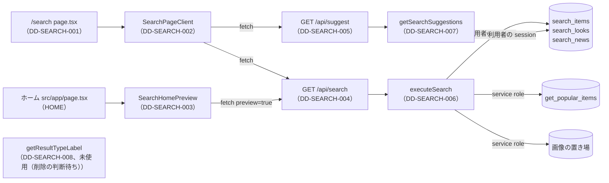

# 1.19 検索ページ（SEARCH）詳細設計

> 状態: 推定 | 確認日: 2026-10-28 | 対象: 検索のページ `/search`、ホームの `/?q=` のプレビュー、`GET /api/search`・`GET /api/suggest`、取り出しの関数（`search.service.ts`） | 基準コミット: `4facf63b`（作業ツリー）

## 概要

SEARCH の範囲のコードの単位ごとに、入出力・正常と異常の流れ・状態・認可・単体テストの観点を、追跡できる項目（`### <ID> <題>` と属性の表）で書く。
中身は 2026-10-24 の作業ツリーのコードを読んで起こした今の動きで、ユーザーの確認を受けていないので全部「推定」にした。要件・構造設計と食い違う所は決めずに今のコードの動きを書き、食い違いは [trace-matrix.md](../../05_Quality/reports/trace-matrix.md) の「食い違い」節に載せた。

| ID | 単位 | 中身 | 旧番号 |
| --- | --- | --- | --- |
| `DD-SEARCH-001` | `src/app/search/page.tsx` | 検索のページの入口。メタと `Suspense` の殻 | なし |
| `DD-SEARCH-002` | `src/features/search/components/SearchPageClient.tsx` | 検索の画面の全部（入力・候補・タブ・結果・人気商品・LOAD MORE） | `IMPL-SEARCH-001`・`004`・`005` |
| `DD-SEARCH-003` | `src/features/search/components/SearchHomePreview.tsx` | ホームの `/?q=` のプレビュー | `IMPL-SEARCH-002` |
| `DD-SEARCH-004` | `src/app/api/search/route.ts` | `GET /api/search`。外のサイトからの要求を断る・入力の確かめ（共通の決まり）・回数の制限・件数の切り替え・全部の応答に no-store | `IMPL-SEARCH-API-01` |
| `DD-SEARCH-005` | `src/app/api/suggest/route.ts` | `GET /api/suggest`。外のサイトからの要求を断る・制御文字を断る入力の確かめ（共通の決まり）・回数の制限・全部の応答に no-store | `IMPL-SEARCH-SUGGEST-01` |
| `DD-SEARCH-006` | `executeSearch`・`SearchBackendError`（`search.service.ts`） | 人気商品と3種の検索・点数・説明の切り出し・画像の署名。3種の関数のどれかが失敗したら全体を失敗にする | `IMPL-SEARCH-003` |
| `DD-SEARCH-007` | `getSearchSuggestions`（`search.service.ts`） | ラベルに語を含む候補を作り、重なりを除いて点の順に返す | なし |
| `DD-SEARCH-008` | `getResultTypeLabel`（`search.service.ts`） | 種別の表示名。未使用（削除の判断待ち）で、どこからも使われない | なし |
| `DD-SEARCH-009` | `searchQuerySchema`（`src/features/search/lib/query-schema.ts`） | 検索と候補の窓口が共有する語の入口の決まり | なし |
| `DD-SEARCH-010` | `rejectCrossSiteFetch`（`src/features/search/lib/cross-site.ts`） | 外のサイトの頁から読み込まれた要求を 403 で断る | なし |
| `DD-SEARCH-011` | `parseOwnObjectPath`・`isSafeObjectPath`（`src/lib/storage/safe-object-path.ts`、共有） | 画像の値から、自分のプロジェクトの置き場の接頭辞の下の安全な道筋だけを取り出す。署名の前の確かめ | なし |

- 結論: 検索の画面とホームのプレビューは利用者の端末で動く部品で、2つの窓口を呼ぶ。窓口は入力を確かめ、共有の回数の制限を通してから取り出しの関数を呼ぶ。取り出しの関数は利用者の session の client で DB の検索の関数を、service role の client で人気商品の関数と画像の署名を呼ぶ
- 失敗の扱いが層ごとに違う。検索は DB の関数が1つでも失敗したら取り出しの関数が `SearchBackendError` を投げて窓口が 500 にし（0件と区別できる）、サジェストは失敗した種別を記録して飛ばし、画面は 200 以外を「検索結果を読み込めませんでした」にする。記録は名前と符号だけ
- 単体テストは今は1本も無い（E2E だけ）。各項目のテスト観点は、分岐の網羅 100% に要る単体テストの案
- 旧版の頁の「検索アーキテクチャ」「夜次の照合」「P95 < 200ms」「filters・sort・page」は今のコードに無いので、項目に写さず「旧版から引き継がなかった節」に理由を書いた

## 範囲と根拠

| 項目 | 内容 |
| --- | --- |
| 範囲 | `scripts/trace/scope.json` の SEARCH |
| 上位の文書 | [SEARCH の構造設計](../../03_BasicDesign/areas/search.md)（`ARC-`・`SCR-`・`FLOW-`・`STATE-`・`API-`・`DATA-SEARCH-`）、[SEARCH の要件](../../02_Requirements/areas/search.md)（`SEC-SEARCH-`・`DRV-SEARCH-`・要件） |
| 関連文書 | [SEARCH の脅威](../../05_Quality/security/threats/search.md)、[ADR-0300](../../03_BasicDesign/decisions/ADR-0300-search-query-as-rpc-argument.md)〜[ADR-0310](../../03_BasicDesign/decisions/ADR-0310-search-page-client-fetch-url-replace.md)・ADR-0311〜0313、`docs/03_BasicDesign/api/api-spec.md`（別の作業が書き換え中なので触らない） |
| 対象のコード | 「実装の単位」の表の13単位。`src/features/search/types/search.types.ts` は型だけで単位が無い |
| 引き継いだ文書 | この頁の旧版（「機能要件対応表」「実装タスク管理」「API 仕様」の表）の `IMPL-SEARCH-001`〜`005`・`IMPL-SEARCH-API-01`・`IMPL-SEARCH-SUGGEST-01`。旧版の頁を読む試験は無い（`tests/` を `19_search` で検索して0件）ので、この頁をそのまま書き直した |
| 調べた時点 | 2026-10-24 の作業ツリー。コードは読んだだけで、動かしての確かめはしていない |

範囲外の共有部品とほかの領域の部品は ID を持たないので、項目の本文にファイルの道で書く。

| 部品 | 道 | ここでの使われ方 |
| --- | --- | --- |
| 回数の制限 | `src/features/auth/middleware/rateLimit.ts` の `enforceRateLimit` | 送り元は共有の `getClientIp`（Vercel の見出し `x-vercel-forwarded-for`→`x-real-ip` だけ。`x-forwarded-for` は読まない）で、取れなければ `null` の 1 つの枠（ADR-0416）。超えると 429 と `Retry-After`、数え場所の失敗は 503 と `Retry-After`（どちらも `Cache-Control: private, no-store`）。超えなければ `undefined` |
| Supabase の client | `src/lib/supabase/server.ts` の `createClient`・`createServiceRoleClient` | 検索の関数は利用者の session、人気商品の関数と署名は service role |
| 画像の署名 | `src/lib/storage/item-images.ts`（ITEM、範囲外）・`look-images.ts`（LOOK）・`news-images.ts`（NEWS） | 値が無ければ null、道にできなければ null、署名に失敗すれば null を返す（元の値は返さない。2026-10-28。ADR-0316） |
| 読み上げの文 | `src/components/ui/LiveMessage/LiveMessage.tsx` | 結果の取り出しの失敗の文 |
| ヘッダーの入口 | `src/components/Header.tsx`（AUTH） | 検索のアイコンが `/search` へ移る |
| ホームの頁 | `src/app/page.tsx`（HOME） | ヒーローの直後に `SearchHomePreview` を描く |

矢印は呼び出しの向き。ラベルは使う Supabase の client か呼び方。`getResultTypeLabel` は未使用（削除の判断待ち）で、どこからも呼ばれないので矢印が無い（画面は自分の中の同じ名前の写しを使う）。

## 実装の単位

`scripts/trace/parse-code.ts` の `parseCodeUnits` で数えた範囲内の単位（2026-10-24 に実行）と、つなぐ詳細設計。1つの単位は1つの `DD-` にだけつなぐ。`@impl`・`@design` のコメントはこの表から付ける。

| ファイル | 単位（symbol） | DD |
| --- | --- | --- |
| `src/app/search/page.tsx` | `<file>` | DD-SEARCH-001 |
| `src/features/search/components/SearchPageClient.tsx` | `<file>` | DD-SEARCH-002 |
| `src/features/search/components/SearchHomePreview.tsx` | `<file>` | DD-SEARCH-003 |
| `src/app/api/search/route.ts` | `<file>` | DD-SEARCH-004 |
| `src/app/api/suggest/route.ts` | `<file>` | DD-SEARCH-005 |
| `src/features/search/services/search.service.ts` | `executeSearch` | DD-SEARCH-006 |
| `src/features/search/services/search.service.ts` | `getSearchSuggestions` | DD-SEARCH-007 |
| `src/features/search/services/search.service.ts` | `getResultTypeLabel` | DD-SEARCH-008 |
| `src/features/search/services/search.service.ts` | `SearchBackendError` | DD-SEARCH-006 |
| `src/features/search/lib/query-schema.ts` | `searchQuerySchema` | DD-SEARCH-009 |
| `src/features/search/lib/cross-site.ts` | `rejectCrossSiteFetch` | DD-SEARCH-010 |
| `src/lib/storage/safe-object-path.ts` | `isSafeObjectPath` | DD-SEARCH-011 |
| `src/lib/storage/safe-object-path.ts` | `parseOwnObjectPath` | DD-SEARCH-011 |

- `DD-SEARCH-011` の `src/lib/storage/safe-object-path.ts` は LOOK・NEWS・ITEM の署名も通す共有部品だが、`look-images.ts`（`DD-LOOK-006`）・`news-images.ts` と同じく最初の利用者の領域の範囲に入れ、`scripts/trace/scope.json` の SEARCH の `src` と、試験 `tests/unit/lib/storage/safe-object-path.test.ts` を `tests` に足した。DD の「コードの単位」「単体テスト」の検査（`rules.ts`）が範囲内の単位と試験を要るため。`@impl` は `IMPL-SEARCH-129`（`isSafeObjectPath`）・`130`（`parseOwnObjectPath`）
- `search.types.ts` は `parseCodeUnits` の結果が空で、単位が無い
- `.tsx` と `route.ts` はファイル全体で1つの単位なので、中の関数（`SearchPageClient.tsx` の `StrokeIcon`・`normalizeTab`・`renderHighlightedText` など、`page.tsx` の metadata の関数）はその単位に含める
- `search.service.ts` の export しない関数（`normalizeText`・`tokenizeQuery`・`buildSnippet`・`rankText`・`formatLookSeason`・`formatItemPrice`・`mapPopularItem`・`signResultImages`・`getPopularItems`・`labelContainsQuery`）は単位にならない。使う側の項目（DD-SEARCH-006・007）の中で書く
- 新しい `@impl` は `IMPL-SEARCH-101` から振る（旧版の `IMPL-SEARCH-NNN` の最大が `005` のため）。今は8単位とも `@impl`・`@design` が無い（`missing-impl`・`bad-design-link`）
- コメントを足す時の条件: `tests/unit/docs/delivery-status-traceability.test.ts`・`order-status-traceability.test.ts` が `src/app/api` の全部の route を文字として読み、GET などの書き出しの関数の宣言を数えるので、TSDoc に関数の宣言の形の字を書かない。`e2e/FR-UI-003-lk-text-scale.spec.ts` は src の全部の行（コメントを含む）から Tailwind の数字の字の大きさのクラスと px の直書きを探すので、TSDoc にその形の字を書かない

## 詳細設計

### DD-SEARCH-001 検索のページの入口 page.tsx

| 属性 | 値 |
| --- | --- |
| 上位 | SCR-SEARCH-001、ARC-SEARCH-001 |
| 根拠 | 画面は URL の検索の引数を読む端末の部品なので、ページのサーバーの側は DB を読まずに殻と固定のメタだけを返す（ARC-SEARCH-001）。端末の部品が URL の引数を読む間に殻が空にならないよう、読み込み中の文を出す区切りで包む（SCR-SEARCH-001）。title・description・OG の画像は検索語に左右されない固定の値にする（SCR-SEARCH-001、DRV-SEARCH-009） |
| 状態 | 推定 |
| 確かめ方 | 単体テスト |
| 出どころ | 実装から推定（`src/app/search/page.tsx`） |

#### 対応要件

FR-SEARCH-001、DRV-SEARCH-009、NFR-SEO-003（範囲外。canonical は出さない）、ADR-0310。

#### 入出力

| 項目 | 内容 |
| --- | --- |
| 入力 | `GET /search`。props も検索の引数も読まない（引数は DD-SEARCH-002 が端末で読む） |
| 出力（メタ） | metadata の関数が `title:'Search \| Le Fil des Heures'`、`description:'Le Fil des Heures の商品・ルック・ニュースを横断検索できるページです。'`、`openGraph:{title, description, images:['/mainphoto.png']}` を返す（`src/app/search/page.tsx`） |
| 出力（本体） | `Suspense` の中に `SearchPageClient`。待つ間は `p` の「読み込み中...」 |

#### 正常フロー

1. metadata の関数は待つ処理も分岐も持たず、固定の値を返す（`src/app/search/page.tsx`）
2. 既定の書き出しの頁の関数は `Suspense` で `SearchPageClient` を包んで返す。`SearchPageClient` が `useSearchParams` を使うので、静的な描画の時に区切りが要る（Next.js 16.3.6 は静的な描画で `useSearchParams` を区切りの外で使うとビルドの誤り `missing-suspense-with-csr-bailout` にする。`node_modules/next` の実行時の中で確かめた）

#### 異常フロー

| 場合 | 動き |
| --- | --- |
| なし | 頁の側に分岐も try/catch も無い。中の部品の失敗は DD-SEARCH-002 が受ける |

- canonical・robots は返さない。`/search?q=` の頁に noindex が無い（NFR-SEO-003・004（範囲外）との食い違いは要件の記録にある）

#### 状態・永続化

- 状態を持たず、書き込みもしない。`revalidate` などのキャッシュの指定は無い

#### 認証認可

- ログインを求めない。守りの見出し（`Referrer-Policy: no-referrer` など）は共有の `src/proxy.ts` が付け、頁は重ねない

#### テスト観点

分岐が無いので、関数の網羅のための単体テストの案（`SearchPageClient` は差し替える）。

| # | 観点 | 入力 | 期待 |
| --- | --- | --- | --- |
| 1 | メタの値 | metadata の関数を呼ぶ | title・description・og の title・description・images が上の固定の値 |
| 2 | 殻 | 頁の関数を描く | 差し替えた `SearchPageClient` が描かれる |
| 3 | 待つ間の文 | `SearchPageClient` の差し替えが Promise を投げて待たせる | 「読み込み中...」が出る |

### DD-SEARCH-002 検索の画面 SearchPageClient

| 属性 | 値 |
| --- | --- |
| 上位 | SCR-SEARCH-001、SCR-SEARCH-002、SCR-SEARCH-003、FLOW-SEARCH-001、FLOW-SEARCH-002、STATE-SEARCH-001、STATE-SEARCH-002、SEC-SEARCH-005、SEC-SEARCH-011、SEC-SEARCH-013 |
| 根拠 | 語とタブを URL に持ち、入力のたびに候補を取り直すので、画面は端末で動く1つの部品にし、URL を置き換えて取り直す（FLOW-SEARCH-002、ADR-0310）。左で語と種別を選び右で結果を見る形、候補のドロップダウン、結果の欄の見せ方の切り替えを1か所で持ち、操作と表示の状態を食い違わせない（SCR-SEARCH-001〜003、STATE-SEARCH-001・002）。結果の行はそのまま詳細へのリンクにする（FLOW-SEARCH-001）。共有の端末に語を残さないよう端末の保存の場所を使わず（SEC-SEARCH-011）、題・候補は React の文字として出し、強調の正規表現は語の記号を逃がしてから作る（SEC-SEARCH-013）。候補は入力が止まって250ミリ秒待ってから取り、新しい入力で前の要求を打ち切り、検索はタブだけが変わった時は取り直さない（SEC-SEARCH-005、ADR-0313）。失敗の記録に誤りの中身を渡さない（SEC-SEARCH-018） |
| 状態 | 推定 |
| 確かめ方 | 単体テスト |
| 出どころ | 実装から推定（`src/features/search/components/SearchPageClient.tsx`）、この頁の旧版の機能要件対応表 |
| 旧番号 | IMPL-SEARCH-001、IMPL-SEARCH-004、IMPL-SEARCH-005 |

#### 対応要件

FR-SEARCH-001・003・004、FREQ-184-REQ-01〜03、FREQ-186-REQ-03、FREQ-188-REQ-01・02、FREQ-189-REQ-01、FREQ-190-REQ-01・02、FREQ-191-REQ-01、FREQ-192-REQ-01・02、FREQ-193-REQ-01、FREQ-195-REQ-01、FREQ-196-REQ-01、FREQ-197-REQ-01、FREQ-198-REQ-01、FREQ-199-REQ-01〜03、FREQ-200-REQ-01・02、FREQ-201-REQ-01、DRV-SEARCH-004・006・007、NFR-A11Y-002（範囲外）、ADR-0308〜0310・0313。

- 旧番号の `IMPL-SEARCH-005`（`localStorage` の履歴）は FREQ-189 で撤去済みで、今の部品に履歴の処理は無い。引き継いだのは「履歴を持たない」ことだけ（FR-SEARCH-005 は廃止）

#### 入出力

| 項目 | 内容 |
| --- | --- |
| 入力（props） | なし |
| 読む外の値 | URL の `q`（無ければ空、前後の空白は除かない）と `tab`（`useSearchParams`）、`usePathname` |
| 呼ぶ窓口 | `GET /api/search?q=<符号化した q>&tab=<符号化した最新の tab>`（`cache:"no-store"`）。`GET /api/suggest?q=<符号化した入力欄の値>`（`cache:"no-store"`、`signal`。前後の空白を除かずに送る） |
| 出力 | JSX。左のカラム（h1・入力欄と送信のボタン・候補のリスト・件数の読み上げ・種別のタブ）と右のカラム（失敗の文・人気商品／読み込み中の枠／0件／結果の一覧と LOAD MORE） |
| 副作用 | `router.replace(<URL>, {scroll:false})`。外を押したかを見る `mousedown` の聞き手を `document` に付け外しする。候補の待ちの `setTimeout` と要求の `AbortController`。失敗を固定の文だけ `console.error` に書く |

#### 正常フロー

1. 初めの値: `query` は URL の `q`、無ければ空。`activeTab` は `normalizeTab`で `item`・`look`・`news` のどれかなら、その値、ほかは `all`。入力欄の値は `query`、表示の数は8（`RESULTS_PAGE_SIZE`）
2. URL が変わった時: `query` が変われば入力欄を詰め直し、`query` か `activeTab` が変われば表示の数を8に戻す（FREQ-184-REQ-03）
3. 結果の取り出し（FREQ-186-REQ-03）: 効果の依存は `query` だけ（タブだけが変わっても取り直さない。URL に載せる `tab` は `activeTabRef` から最新を読む。SEC-SEARCH-005）。`query` が空でも呼ぶ。始めに読み込み中にし、応答が `ok` なら結果を入れて失敗の文を消し、最後に読み込み中を外す。後から前の応答が届いても、取り消しの印（`cancelled`）で捨てる
4. 候補の取り出し（FREQ-190-REQ-01）: 入力欄の値が前後の空白を除いて空なら、待たずに候補を消して取らない。空でなければ、入力が止まって250ミリ秒（`SUGGEST_DEBOUNCE_MS`）たってから `/api/suggest` を呼び、`payload.suggestions` を入れる（無ければ空）。入力が変わる・アンマウントのたびに待ちを取り消し、呼んだ要求を `AbortController` で打ち切る。最小の字数は置かない
5. 確定（`commitSearch`、FLOW-SEARCH-002・DRV-SEARCH-004）: 語の前後の空白を除き、空でなければ `q` に入れ、空なら `q` を消す。今の URL のほかの引数は残し、`tab` は毎回入れる。`router.replace` でスクロールを保って URL を置き換える
6. 確定の入口: フォームの送信は入力欄の値と今のタブで確定し、触れている印を外す。タブは URL の今の `q` と押したタブで確定する。候補（`selectSuggestion`、DRV-SEARCH-006）は入力欄を候補の名前にして、名前と種別で確定し、触れている印と選択を外す
7. 候補のリストを開くか（STATE-SEARCH-002）: 入力欄に触れている・入力欄の値が前後の空白を除いて空でない・候補が1件以上（最大8件に切る）の3つがそろう時だけ開く。入力欄の値か触れている印が変わると選択を -1 に戻す
8. 外を押した時: リストが開いている間だけ `mousedown` を聞き、検索の箱の外なら触れている印を外す
9. キー操作（FREQ-190-REQ-02）: Escape は開いていなくても触れている印と選択を外す。開いている時、↓ は次（末尾の次は先頭）、↑ は前（未選択か先頭なら末尾）、選択がある Enter はその候補で確定、Tab は触れている印を外す。選択の無い Enter はフォームの送信に任せる
10. 一覧: 結果が無ければ空。`item`・`look`・`news` のタブはその種別の配列、`all` は `interleaveResults`で商品・ルック・ニュースの順に1件ずつ交互に並べる。表示の数で切り、一覧が表示の数より長い時だけ LOAD MORE を出す。押すごとに8足す
11. 結果の行（`SearchResultRow`、SCR-SEARCH-002）: 行全体が `href` へのリンク。3:4 の枠に画像があれば `next/image`（`alt` は空）を出し、種別の名前、題（強調あり）、メタ、右矢印を出す
12. 強調（`renderHighlightedText`、FR-SEARCH-003）: 語の前後の空白を除き、正規表現の記号を逃がして大文字と小文字を区別せずに区切り、語に合う区切りを `mark` で包む。候補のラベル（`renderSuggestionLabel`）は合う区切りを黒の太字、ほかを #474747 にする
13. 右のカラム（STATE-SEARCH-001）: 下の「異常フロー」と「見せ方」の表の順に決める
14. ARIA: 入力欄に `role="combobox"`・`aria-expanded`・`aria-controls`・`aria-autocomplete="list"`、選択がある時だけ `aria-activedescendant`。リストは `role="listbox"`、候補は `role="option"`・`aria-selected`。開いている間は「N 件の検索候補があります」を `aria-live="polite"` で伝える。タブは `role="tablist"`・`role="tab"`・`aria-selected`

| 見せ方 | 条件 | 中身 |
| --- | --- | --- |
| 初めの描画・語なし | 取り出しの前。`isLoading` の初めの値は偽で、真にするのは取り出しの中 | 「POPULAR ITEMS」と案内文「気になる商品名やトピックを入力すると、…」（FREQ-186-REQ-03 の「取得中は案内文を出さない」と一部食い違う、推定） |
| 初めの描画・語あり | 取り出しの前。結果が無く読み込み中でもない | 「0 RESULTS」の見出しの行（一覧は空） |
| 語なし・人気商品あり | `query` が空、人気商品が1件以上 | 「POPULAR ITEMS」と人気商品の行（強調しない） |
| 語なし・取り出し中・人気商品なし | `query` が空、人気商品が0件、読み込み中 | 「POPULAR ITEMS」だけ |
| 語なし・人気商品なし | `query` が空、人気商品が0件か結果が無い、読み込み中でない | 「気になる商品名やトピックを入力すると、…」 |
| 語あり・取り出し中 | `query` が空でない、読み込み中 | 灰色の枠を5行（`aria-hidden`） |
| 0件 | 結果の `empty` が真 | 「「<語>」の検索結果はありません」・案内文・「POPULAR ITEMS」の行 |
| 結果あり（失敗の後を含む） | 上のどれでもない | 「{一覧の長さ} RESULTS」と行、LOAD MORE |

#### 異常フロー

| 場合 | 動き |
| --- | --- |
| 結果の応答が `ok` でない | 本文を読み始め（読み終わりは待たない。回数の制限の 429 は `no-store` で、本文を読まずに捨てるとブラウザが要求を開いたまま残し、E2E の `networkidle` が止まるため。波 4 Task 1b）、例外にして下の行へ |
| 結果の取り出しの例外（通信・JSON の解析） | 固定の文だけ `console.error` に書き、取り消されていなければ結果を消して「検索結果を読み込めませんでした」を `LiveMessage` に出す |
| 失敗の時に `query` がある | 失敗の文の下に「0 RESULTS」の見出しの行も出る（結果を消した後の一覧が空のため、推定） |
| 失敗の時に `query` が無い | 失敗の文と案内文が並ぶ |
| 取り出しの最中に `query` が変わる | 前の取り出しは取り消しの印で結果・失敗・読み込み中を書かない（`tab` だけが変わる時は取り直さない） |
| 検索の関数が失敗して窓口が 500 を返す | 結果の応答が `ok` でない行と同じになり、失敗の文が出る（0件の見せ方にならない。SEC-SEARCH-017） |
| 空白だけの `q` を直接開く | `query` は空でないので語ありの側に進み、窓口は語なしとして `empty` を偽で返すので「0 RESULTS」になる（推定） |
| 候補の応答が `ok` でない・例外 | `ok` でない時は本文を読み始め（読み終わりは待たない。上の結果の応答と同じ理由）、固定の文だけ `console.error` に書き、取り消されていなければ候補を消す |
| 候補の要求が打ち切られて失敗する | 取り消し済みなので記録も候補の書き換えもしない |
| 候補の応答に `suggestions` が無い | 空の候補 |
| 候補の取り出しの最中に入力が変わる | 前の要求を打ち切り、前の応答は取り消しの印で捨てる |

- 届かない分岐（推定）: 種別の名前の `default`（型の上で3種のどれか）、`renderSuggestionLabel` の空の語（リストは入力欄の値が空でない時だけ開く）、`commitSearch` の `nextTab` の既定の値（呼ぶ所が全部タブを渡す）、`pathname` だけの URL（`tab` を必ず入れる）、検索の箱の参照が無い時（聞き手は描いた後にだけ付く）
- 結果の窓口は `tab` で絞らないので、タブを切り替えても取り直さず、取ってある結果から出し分ける（SEC-SEARCH-005）

#### 状態・永続化

- 部品の中の状態: `inputValue`・`results`・`suggestions`・`isLoading`・`errorMessage`・`isInputFocused`・`activeSuggestionIndex`・`visibleCount`と検索の箱の参照。候補の開閉と選択の決まりは STATE-SEARCH-002、右のカラムの見せ方は STATE-SEARCH-001
- 永続化はしない。語とタブを残す所は URL の `q`・`tab` だけで、`router.replace` なので履歴を積まない。`localStorage`・`sessionStorage`・Cookie を使わない（SEC-SEARCH-011、FREQ-189-REQ-01）

#### 認証認可

- 認可なし（公開）。下書きを出さない守りは窓口と DB の関数（DD-SEARCH-006・007）にあり、部品は確かめない
- 題・メタ・候補・語は JSX の文字として出し、`dangerouslySetInnerHTML` を使わない。強調の正規表現は `escapeRegExp` で語の記号を逃がしてから作る（SEC-SEARCH-013）
- 画像の `src` は窓口が返した署名つき URL をそのまま使う。失敗の文は固定で、窓口の誤りの中身を出さない

#### テスト観点

分岐の網羅 100% に要る単体テスト（React Testing Library。`next/navigation`・`next/link`・`next/image`・`fetch` を差し替える。置き場は範囲の型に合う `tests/unit/features/search/search-page-client.test.tsx`）。

| # | 観点 | 入力 | 期待 |
| --- | --- | --- | --- |
| 1 | タブの正規化 | URL `tab` が `item`・`look`・`news`・`foo`・無し | それぞれ ITEM・LOOK・NEWS・ALL・ALL が `aria-selected="true"` |
| 2 | 語なしで取り出す | URL `q` 無し | `/api/search?q=&tab=all` を `no-store` で呼ぶ。入力欄が空 |
| 2a | タブだけの変更 | ALL から ITEM に替える。続けて語を替える | `/api/search` は増えない。語を替えると1回増え、URL の `tab` が最新のタブ |
| 3 | 語なし・人気商品あり | 応答の `popularItems` が2件 | 「POPULAR ITEMS」と2行。`mark` が無い |
| 4 | 語なし・取り出し中 | 応答を待たせる | 「POPULAR ITEMS」だけで案内文が無い |
| 5 | 語なし・人気商品なし | `popularItems` が空 | 案内文が出る |
| 6 | 語ありの取り出し中 | URL `q=coat`、応答を待たせる | `aria-hidden` の枠が5行 |
| 7 | 0件 | `empty:true` | 「「coat」の検索結果はありません」と人気商品の行 |
| 8 | 結果あり（ALL の交互） | items 2・looks 1・news 0 | 行の順が item・look・item。「3 RESULTS」 |
| 9 | 種別のタブの一覧 | `tab=item`・`look`・`news` | それぞれの配列だけ |
| 10 | 行の中身 | 画像あり・画像なしの行 | 画像ありは `img`（`alt` 空）、なしは枠だけ。種別の名前・題・メタ・`href` |
| 11 | 強調 | `q=Co`、題 `coat COAT` | 2つの `mark`。ほかは文字のまま |
| 12 | 強調の記号 | `q=a.(b`、題 `xa.(by` | 例外にならず `mark` が `a.(b` |
| 13 | 題の HTML | 題 `` | 文字として出て `img` 要素が増えない |
| 14 | LOAD MORE | ALL で9行 | 8行と LOAD MORE。押すと9行で LOAD MORE が消える |
| 15 | LOAD MORE なし | 8行 | LOAD MORE が無い |
| 16 | 表示の数を戻す | 押して16にした後、`tab` を変えて描き直す | 8行に戻る |
| 17 | 結果の応答が ok でない | `ok:false`、URL `q=coat`。もう1件は `status:429` で `arrayBuffer` を差し替え | 「検索結果を読み込めませんでした」と「0 RESULTS」。`console.error`。429 の件は `arrayBuffer` が1回呼ばれる |
| 18 | 結果の取り出しの例外 | fetch が reject、URL `q` 無し | 失敗の文と案内文 |
| 19 | 結果の取り消し | 1回目を待たせ、`q` を変えて2回目を先に返し、1回目を後で返す | 2回目の結果のまま。失敗の時も同じ（取り消しの印の両側） |
| 20 | 入力欄の詰め直し | `q` を変えて描き直す | 入力欄が新しい `q` |
| 21 | 候補の取り出し | 入力 `co` | 250ミリ秒後に `/api/suggest?q=co` を `no-store` と `signal` つきで呼ぶ |
| 21a | 候補の待ち | 5文字を20ミリ秒間隔で打つ | 250ミリ秒たつまで呼ばず、止まった後に最後の語で1回だけ |
| 21b | 候補の打ち切り | 入力を替える・アンマウント | 前の要求の `signal` が打ち切られ、遅れて返った前の応答で上書きしない。打ち切りは記録しない。失敗の記録に `Error` を渡さない |
| 22 | 空白だけの入力 | 入力 `"  "` | `/api/suggest` を呼ばず候補が無い |
| 23 | 候補の応答が ok でない・例外・`suggestions` 無し | それぞれ。ok でない件のもう1件は `status:429` で `arrayBuffer` を差し替え | 候補が出ない。前2つは `console.error`。429 の件は `arrayBuffer` が1回呼ばれる |
| 24 | 候補の取り消し | 1回目を待たせ、入力を変えた後に1回目を返す | 1回目の候補を入れない（成功と失敗の両側） |
| 25 | 候補の上限 | 候補10件 | `option` が8つ。「8 件の検索候補があります」 |
| 26 | 開く条件 | 触れていない・空白だけ・候補0件・3つがそろう | 最後だけ `listbox` と `aria-expanded="true"` |
| 27 | 候補のラベルの描き分け | 入力 `co`、ラベル `Coat` | `Co` が黒の太字、`at` が #474747。右に種別の名前 |
| 28 | ↓ の巡回 | 候補3件で ↓ を4回 | 選択が 0・1・2・0。`aria-activedescendant` が合う |
| 29 | ↑ の巡回 | 未選択で ↑、続けて ↑ | 2、1 |
| 30 | ↑ の先頭 | ↓ で0にして ↑ | 2 |
| 31 | 選択ありの Enter | ↓ の後に Enter | 入力欄が候補の名前、`router.replace('/search?q=<名前>&tab=<種別>', {scroll:false})`、リストが閉じる |
| 32 | 選択なしの Enter | 開いた状態で Enter | フォームの送信で今の入力欄の値と今のタブで置き換える |
| 33 | クリックで確定 | 候補をクリック | 31 と同じ |
| 34 | 触れた行 | 候補に `mouseenter` | その行が `aria-selected="true"` と黒の縦線のクラス |
| 35 | Escape | 開いた状態・閉じた状態の両方 | 閉じる。選択が -1 |
| 36 | Tab | 開いた状態で Tab | 閉じる |
| 37 | 閉じた時のほかのキー | 閉じた状態で ↓ | 何も変わらない |
| 38 | 開いた時のほかのキー | 開いた状態で文字のキー | 選択が変わらない |
| 39 | 外を押す | 開いた状態で箱の外・箱の中に `mousedown` | 外は閉じ、中は閉じない |
| 40 | 聞き手の外し | 開いてから閉じる | `removeEventListener` が呼ばれる |
| 41 | 入力が変わると選択を戻す | ↓ の後に1字足す | `aria-activedescendant` が無い |
| 42 | 送信の語 | 入力 `"  coat  "` で送信、ほかの引数 `foo=1` | `/search?foo=1&q=coat&tab=all` |
| 43 | 空の送信 | 入力を空にして送信（URL に `q` あり） | `q` が消え `/search?tab=all` |
| 44 | タブの確定 | URL `q=coat` で NEWS を押す | `/search?q=coat&tab=news` |
| 45 | 端末の保存 | 31・42 の後 | `localStorage`・`sessionStorage` の `setItem` が呼ばれない |
| 46 | 見出し | 描く | h1「SEARCH」が `sr-only` と `md:not-sr-only` のクラスを持つ |
| 47 | 初めの描画 | effect を流す前の最初の描画（URL `q` 無し・`q=coat` の2つ） | `q` 無しは「POPULAR ITEMS」と案内文、`q=coat` は「0 RESULTS」。どちらも灰色の枠は無い |

- 届かない分岐（種別の名前の `default`・候補のラベルの空の語・`nextTab` の既定・`pathname` だけの URL・箱の参照が無い時）は試さず、`docs/05_Quality/reports/test-gaps.md` の「届かない分岐」に理由を書く候補
- 今の試しは E2E（`e2e/FR-SEARCH-001`・`003`〜`006`・`008`・`010`〜`017`）だけで、テスト名に受け入れ条件の ID が無い

### DD-SEARCH-003 ホームのプレビュー SearchHomePreview

| 属性 | 値 |
| --- | --- |
| 上位 | SCR-SEARCH-004、FLOW-SEARCH-001、SEC-SEARCH-013、SEC-SEARCH-021 |
| 根拠 | ホームを離れずに結果の一部を先に見せ、続きは検索のページへ渡す（SCR-SEARCH-004、FLOW-SEARCH-001）。ホームの中で場所を取りすぎないよう、プレビューの枠（1種別3件・別の回数の枠）で呼んで先頭3件だけを出す（DRV-SEARCH-010、FREQ-187-REQ-01）。プレビューはホームの付け足しなので、取り出しに失敗したら区画ごと出さずにホームの本体を邪魔しない（SCR-SEARCH-004）。題・説明・語は文字として出す（SEC-SEARCH-013）。URL から来る語は説明の文に埋めず、語だと分かる別の枠にだけ出す（SEC-SEARCH-021、ADR-0314）。失敗の記録に例外の中身を渡さない（ホームの SEC-HOME-015） |
| 状態 | 推定 |
| 確かめ方 | 単体テスト |
| 出どころ | 実装から推定（`src/features/search/components/SearchHomePreview.tsx`）、この頁の旧版の機能要件対応表 |
| 旧番号 | IMPL-SEARCH-002 |

#### 対応要件

FR-SEARCH-002、FREQ-187-REQ-01、DRV-SEARCH-010。

- 旧番号の `IMPL-SEARCH-002` はヘッダーの導線（`src/components/Header.tsx`、AUTH）も含んでいた。ヘッダーの側は範囲外で、この項目はプレビューだけを持つ

#### 入出力

| 項目 | 内容 |
| --- | --- |
| 入力（props） | なし |
| 読む外の値 | URL の `q`。前後の空白を除き、無ければ空（`useSearchParams`） |
| 呼ぶ窓口 | `GET /api/search?q=<符号化した語>&preview=true`（`cache:'no-store'`） |
| 出力 | 語が空か結果が無ければ何も描かない。結果があれば `section`（「PREVIEW」「Search Preview」固定の説明の文「入力した語に関連する結果をホーム上で即時プレビューしています。」、説明の文の外の「検索した語」の枠（`<dl data-testid="search-preview-term">` の `<dt>検索した語</dt><dd><語></dd>`）、「VIEW ALL RESULTS」） |
| 副作用 | 失敗を固定の文字 `Failed to fetch home search preview` だけで `console.error` に書く（`Error` を渡さない。SEC-HOME-015） |

#### 正常フロー

1. 語が空なら結果を消して呼ばない
2. 語があれば窓口を呼び、応答が `ok` なら、取り消されていなければ結果を入れる
3. 描く: 説明の文は固定で語を含めず、語は「検索した語」の枠の `dd` の文字にだけ出す。商品・ルック・ニュースの順につないだ配列の先頭3件。1件以上なら、カード（メタ・題・説明。カード全体が結果の `href` へのリンク）を並べる。0件なら「プレビュー対象の検索結果は見つかりませんでした。」
4. 「VIEW ALL RESULTS」は `/search?q=<符号化した語>` へのリンク
5. 画像と強調は出さない。説明は窓口が切り出した文（DD-SEARCH-006）

#### 異常フロー

| 場合 | 動き |
| --- | --- |
| URL に `q` が無い | 語を空として扱い、何も描かない |
| 応答が `ok` でない | 本文を読み始め（読み終わりは待たない。回数の制限の 429 は `no-store` で、読まずに捨てるとブラウザが要求を開いたまま残すため。波 4 Task 1b）、例外にして下の行へ |
| 取り出しの例外（通信・JSON の解析） | 固定の文字だけ `console.error` に書き（例外の中身は渡さない）、取り消されていなければ結果を消す。区画を描かない |
| 取り出しの最中に語が変わる・外れる | 前の応答は取り消しの印で捨てる（成功と失敗の両方） |
| 窓口が DB の関数の失敗を0件として返す | 「見つかりませんでした」の文になる |

- 画面の中に `/?q=` へ移る導線は無く、URL を直接開いた時だけ出る（推定）
- `Suspense` で包むのはホームの頁（HOME）の受け持ち

#### 状態・永続化

- 部品の中の状態は `results`だけ。永続化しない。URL の `q` を書き換えない

#### 認証認可

- 認可なし（公開）。下書きを出さない守りは窓口と DB の関数にある
- 語・メタ・題・説明は JSX の文字として出す。リンクの語は `encodeURIComponent` で符号化する
- 語は説明の文に埋めず、説明の文の外の「検索した語」の枠の `dd` にだけ文字として出す（SEC-SEARCH-021。2026-10-26 に直した。文言と枠の見た目は案で、ユーザーが写真で確かめるまで確定しない。ADR-0314）

#### テスト観点

分岐の網羅 100% に要る単体テストの案（置き場は `tests/unit/features/search/search-home-preview.test.tsx`）。

| # | 観点 | 入力 | 期待 |
| --- | --- | --- | --- |
| 1 | `q` が無い | URL に `q` 無し | 何も描かず、`fetch` を呼ばない |
| 2 | 空白だけの `q` | `q="  "` | 同上 |
| 3 | 呼び方 | `q=" a b "` | `/api/search?q=a%20b&preview=true` を `no-store` で呼ぶ |
| 4 | 3件に切る | items 2・looks 2・news 1 | カードが3枚で、商品2件とルック1件の順 |
| 5 | カードの中身 | 1件 | メタ・題・説明が出て、カードの `href` が結果の `href`。`VIEW ALL RESULTS` の `href` が `/search?q=<語>` |
| 6 | 0件 | 3種とも空 | 「プレビュー対象の検索結果は見つかりませんでした。」 |
| 7 | 応答が ok でない | `ok:false`。もう1件は `status:429` で `arrayBuffer` を差し替え | 何も描かない。`console.error`。429 の件は `arrayBuffer` が1回呼ばれる |
| 8 | 例外 | fetch が reject | 同上 |
| 9 | 取り消し（成功） | 1回目を待たせて語を変え、1回目を後で返す | 1回目の結果を描かない |
| 10 | 取り消し（失敗） | 1回目を待たせて語を変え、1回目を reject | 2回目の結果が残る |
| 11 | 語が外れる | 結果を出した後に `q` を消して描き直す | 何も描かない |
| 12 | 題の HTML | 題 `<b>x</b>` | 文字として出る |
| 13 | 説明の文が固定 | `q="coat 本日休業のお知らせ"` | 固定の文の `p` が1つで、どの `p` にも `本日休業` が含まれない。枠の `dt` が「検索した語」、`dd` が `coat 本日休業のお知らせ` |
| 14 | 語の HTML | `q="<b>x</b>"` | 枠の `dd` に文字で出て、要素にならない |
| 15 | 0件でも枠が出る | 3種とも空 | 固定の文と枠が出る |
| 16 | 失敗の記録 | `ok:false`・fetch が reject | `console.error` が引数1つ（固定の文字）で呼ばれる |

### DD-SEARCH-004 横断検索の窓口 GET /api/search

| 属性 | 値 |
| --- | --- |
| 上位 | API-SEARCH-001、ARC-SEARCH-005、SEC-SEARCH-004、SEC-SEARCH-005、SEC-SEARCH-010、SEC-SEARCH-017、SEC-SEARCH-018、SEC-SEARCH-019、SEC-SEARCH-020 |
| 根拠 | 窓口は外から来る値を取り出しの関数へ渡す境目なので、`q`・`tab`・`preview` の形をここで確かめ、外れたら取り出しの前に 400 で断る（API-SEARCH-001）。語の決まりは候補の窓口と同じ物を使う（SEC-SEARCH-004、DD-SEARCH-009）。外のサイトの頁から読み込まれた要求は検査・回数の制限より前に 403 で断り、枠に数えない（SEC-SEARCH-020、DD-SEARCH-010）。全部の応答を共有のキャッシュに残させない（SEC-SEARCH-010）。処理の時間の見出しは付けない（SEC-SEARCH-019）。検索関数の失敗は 500 の固定の文にし、記録は名前と符号だけにする（SEC-SEARCH-017・018）。1回の検索で3つの関数・人気商品・署名を呼ぶので、取り出しの前に送り元ごとの回数の制限を通し、プレビューは別の枠と少ない件数で数える（ARC-SEARCH-005、SEC-SEARCH-005、FREQ-187-REQ-01）。`preview` は文字が 'true' の時だけ真にし、付けない検索がプレビューの枠に落ちる不具合を戻さない（FREQ-187-REQ-01）。例外の中身は応答に出さず固定の文で返す（API-SEARCH-001） |
| 状態 | 推定 |
| 確かめ方 | 単体テスト |
| 出どころ | 実装から推定（`src/app/api/search/route.ts`）、この頁の旧版の「API 仕様」の表、`docs/03_BasicDesign/api/api-spec.md` |
| 旧番号 | IMPL-SEARCH-API-01 |

#### 対応要件

FR-SEARCH-001・003・004、FREQ-186-REQ-03、FREQ-187-REQ-01、FREQ-201-REQ-02、ADR-0306・0311・0312。

#### 入出力

| 項目 | 内容 |
| --- | --- |
| 入力 | 見出し `Sec-Fetch-Site`（DD-SEARCH-010）、検索の引数 `q`（`searchQuerySchema`。前後の空白を落とし100字まで、制御文字を含まない。無ければ空）、`tab`（`all`・`item`・`look`・`news`。無ければ `all`）、`preview`（文字が `'true'` の時だけ真。無いか、ほかの値は偽）（`src/app/api/search/route.ts`） |
| 出力（200） | `executeSearch` の結果の JSON（`query`・`tab`・`items`・`looks`・`news`・`counts`・`popularItems`・`empty`）。処理の時間の見出しは付けない |
| 出力（失敗） | 403 `{ error: 'Forbidden' }`、400 `{ error: 'Invalid search query' }`、共有の回数の制限が返す 429・503 をそのまま、500 `{ error: 'Failed to search content' }`。どの応答にも `Cache-Control: private, no-store` |
| 呼ぶ物 | `rejectCrossSiteFetch`（DD-SEARCH-010）、`enforceRateLimit`（動的に読み込む）、`executeSearch`（DD-SEARCH-006）、`withNoStore`・`describeErrorForLog`（共有の小さな部品） |

#### 正常フロー

1. 外のサイトから読み込まれた要求を 403 で断る（DD-SEARCH-010）。ここで返す時は検査も回数の制限も呼ばない
2. 検索の引数の `q`・`tab`・`preview` を読み、無い物は `''`・`'all'`・`'false'` にして確かめる
3. 回数の制限を呼ぶ。`preview` が真なら `search:preview` で20回、偽なら `search:public` で120回、窓はどちらも600秒
4. 制限の応答が無ければ、`executeSearch` に確かめた語・タブと、1種別の件数（プレビューは3、ほかは8）を渡す
5. 200 で結果を返す。全ての戻りを `withNoStore` で包み、`Cache-Control: private, no-store` にする

#### 異常フロー

| 場合 | 動き |
| --- | --- |
| `Sec-Fetch-Site` が付いていて `same-origin`・`none` 以外 | 403。検査も回数の制限も取り出しもしない |
| `tab` が4つの値に無い | 400。回数を数えず取り出さない |
| `q` が前後の空白を落として101字以上、または制御文字を含む | 400 |
| `preview` が `'true'` 以外（`'1'`・`'TRUE'` など） | 偽として通常の枠と8件 |
| 回数の超過 | 共有部品の 429（`Retry-After: 600`）をそのまま返し、取り出さない |
| 数え場所の失敗 | 共有部品の 503（`Retry-After: 600`）をそのまま返す |
| 取り出しの関数の失敗（`SearchBackendError`）・動的な読み込みの例外 | 誤りの名前と符号だけを `console.error` に書き、500 の固定の文 |

- 例外の `message`・検索語は記録にも応答にも出さない（SEC-SEARCH-018）
- `tab` は取り出しの関数に渡すだけで、結果を絞らない

#### 状態・永続化

- 窓口は状態を持たない。回数の数えは共有部品が DB に書く（`rateLimit.ts`）

#### 認証認可

- ログインを求めない。送り元は共有部品が中継の見出しだけから取り（`getClientIp`。ADR-0416）、`subject` は渡さない（SEC-SEARCH-006 と、偽の送り元の側の SEC-SEARCH-020 は 2026-10-28、波 4 に満たした）
- DB の読み方の守り（公開済みだけ・購入数を出さない）は取り出しの関数（DD-SEARCH-006）にある

#### テスト観点

分岐の網羅 100% に要る単体テスト（`enforceRateLimit` と `executeSearch` を差し替える。置き場は `tests/unit/api/search/search-route.test.ts`）。

| # | 観点 | 入力 | 期待 |
| --- | --- | --- | --- |
| 1 | 引数が全部無い | `/api/search` | `search:public`・120・600 で数え、`executeSearch({query:'', tab:'all', limitPerType:8})`。200 |
| 2 | 引数がある | `q=%20coat%20&tab=item` | `query:'coat'`・`tab:'item'` |
| 3 | プレビュー | `preview=true` | `search:preview`・20、`limitPerType:3` |
| 4 | プレビューでない値 | `preview=false`・`preview=1` | `search:public`・120、`limitPerType:8` |
| 5 | 正しくないタブ | `tab=foo` | 400 `Invalid search query`。数えも取り出しも呼ばない |
| 6 | 長すぎる語 | `q` が101字 | 400 |
| 7 | 100字の語 | `q` が100字 | 200 |
| 8 | 回数の超過 | 制限が 429 の応答を返す | その応答をそのまま返し、`executeSearch` を呼ばない |
| 9 | 取り出しの例外 | `executeSearch` が `SearchBackendError` を投げる | 500 `Failed to search content`。`console.error` は `{ name, code }` だけで検索語・`message` を含まない |
| 10 | 処理の時間の見出し | 成功 | `x-search-duration-ms` が無い |
| 11 | 外のサイトからの要求 | `sec-fetch-site: cross-site`・`same-site`・`Cross-Site`・`foo` | 403 `Forbidden`。数えも取り出しも呼ばない |
| 12 | 同じオリジンと見出しなし | `same-origin`・`none`・見出しなし | 通す |
| 13 | 制御文字 | `q=a%00b`・`a%1Fb`・`a%7Fb`・`a%0Ab` | 400。数えも取り出しも呼ばない |
| 14 | no-store | 200・400・403・429・503・500 | どれも `Cache-Control: private, no-store` |

### DD-SEARCH-005 候補の窓口 GET /api/suggest

| 属性 | 値 |
| --- | --- |
| 上位 | API-SEARCH-002、ARC-SEARCH-005、SEC-SEARCH-004、SEC-SEARCH-005、SEC-SEARCH-010、SEC-SEARCH-018、SEC-SEARCH-020 |
| 根拠 | 窓口は外から来る語を取り出しの関数へ渡す境目なので、ここで長さと制御文字を（検索の窓口と同じ決まりで）確かめ、外れたら取り出しの前に 400 で断る（API-SEARCH-002、SEC-SEARCH-004、DD-SEARCH-009）。外のサイトの頁から読み込まれた要求は検査・回数の制限より前に 403 で断る（SEC-SEARCH-020、DD-SEARCH-010）。全部の応答を共有のキャッシュに残させない（SEC-SEARCH-010）。入力のたびに呼ばれるので、検索より広い枠で送り元ごとに回数を数える（ARC-SEARCH-005、SEC-SEARCH-005、ADR-0306）。候補は最大8件にする（API-SEARCH-002、FREQ-190-REQ-01）。例外の中身は応答に出さず固定の文で返す（API-SEARCH-002） |
| 状態 | 推定 |
| 確かめ方 | 単体テスト |
| 出どころ | 実装から推定（`src/app/api/suggest/route.ts`）、この頁の旧版の「API 仕様」の表、`docs/03_BasicDesign/api/api-spec.md` |
| 旧番号 | IMPL-SEARCH-SUGGEST-01 |

#### 対応要件

FREQ-190-REQ-01・03、DRV-SEARCH-006、ADR-0306・0307・0312。

#### 入出力

| 項目 | 内容 |
| --- | --- |
| 入力 | 見出し `Sec-Fetch-Site`（DD-SEARCH-010）、検索の引数 `q`（`searchQuerySchema`）。前後の空白を落とし100字まで、制御文字（0x00〜0x1F・0x7F）を含まない。無ければ空（`src/app/api/suggest/route.ts`） |
| 出力（200） | `{ suggestions: [{ label, type, href }] }` |
| 出力（失敗） | 403 `{ error: 'Forbidden' }`、400 `{ error: 'Invalid suggest query' }`、共有の回数の制限が返す 429・503 をそのまま、500 `{ error: 'Failed to load suggestions' }`。どの応答にも `Cache-Control: private, no-store` |
| 呼ぶ物 | `rejectCrossSiteFetch`（DD-SEARCH-010）、`enforceRateLimit`（`suggest:public`・200回・600秒）、`getSearchSuggestions(q, 8)`（DD-SEARCH-007）、`withNoStore`・`describeErrorForLog` |

#### 正常フロー

1. 外のサイトから読み込まれた要求を 403 で断る（DD-SEARCH-010）
2. `q` を読み、無ければ `''` にして確かめる
3. 回数の制限を呼ぶ
4. 制限の応答が無ければ、確かめた語と8を取り出しの関数に渡し、200 で返す。全ての戻りを `withNoStore` で包む

#### 異常フロー

| 場合 | 動き |
| --- | --- |
| `Sec-Fetch-Site` が付いていて `same-origin`・`none` 以外 | 403。検査も数えも取り出しもしない |
| `q` に制御文字がある | 400。数えも取り出しもしない |
| `q` が前後の空白を落として101字以上 | 400 |
| 回数の超過・数え場所の失敗 | 共有部品の 429・503 をそのまま返す |
| 取り出しの関数・動的な読み込みの例外 | 誤りの名前と符号だけを `console.error` に書き、500 の固定の文 |

- 決まりは制御文字と長さだけで、`,().` は断らない。コメントも同じ（SEC-SEARCH-004）
- 例外の `message`・検索語は記録にも応答にも出さない（SEC-SEARCH-018）

#### 状態・永続化

- 窓口は状態を持たない。回数の数えは共有部品が DB に書く

#### 認証認可

- ログインを求めない。送り元は共有部品が中継の見出しだけから取る（`getClientIp`。SEC-SEARCH-006 は 2026-10-28、波 4 に満たした。ADR-0416）

#### テスト観点

分岐の網羅 100% に要る単体テスト（`enforceRateLimit` と `getSearchSuggestions` を差し替える。置き場は `tests/unit/api/search/suggest-route.test.ts`）。

| # | 観点 | 入力 | 期待 |
| --- | --- | --- | --- |
| 1 | `q` が無い | `/api/suggest` | `suggest:public`・200・600 で数え、`getSearchSuggestions('', 8)`。200 `{suggestions:[…]}` |
| 2 | 前後の空白 | `q=%20co%20` | `getSearchSuggestions('co', 8)` |
| 3 | 制御文字 | `q=a%00b`・`q=a%1Fb`・`q=a%7Fb` | 400 `Invalid suggest query`。数えも取り出しも呼ばない |
| 4 | 長すぎる語 | `q` が101字 | 400 |
| 5 | `,().` は通る | `q=a,b).or(` | 200（今の動き） |
| 6 | 回数の超過 | 制限が 429 の応答を返す | その応答をそのまま返し、取り出さない |
| 7 | 取り出しの例外 | `getSearchSuggestions` が投げる | 500 `Failed to load suggestions`。`console.error` は `{ name, code }` だけ |
| 8 | 外のサイトからの要求 | `sec-fetch-site: cross-site`・`same-site`・`Cross-Site`・`foo` | 403 `Forbidden`。数えも取り出しも呼ばない |
| 9 | 同じオリジンと見出しなし | `same-origin`・`none`・見出しなし | 通す |
| 10 | no-store | 200・400・403・429・503・500 | どれも `Cache-Control: private, no-store` |

### DD-SEARCH-006 横断検索の取り出し executeSearch

| 属性 | 値 |
| --- | --- |
| 上位 | ARC-SEARCH-001、ARC-SEARCH-002、ARC-SEARCH-003、ARC-SEARCH-004、API-SEARCH-001、DATA-SEARCH-001、DATA-SEARCH-002、DATA-SEARCH-003、SEC-SEARCH-001、SEC-SEARCH-003、SEC-SEARCH-009、SEC-SEARCH-017、SEC-SEARCH-018 |
| 根拠 | 語は DB の関数の引数で渡し、フィルタの文字列に組まないので語で条件を書き換えられない（SEC-SEARCH-003、ADR-0300）。検索の関数は利用者の session の client で呼び、関数の中の公開の絞りに任せて下書きを返さない（SEC-SEARCH-001、DATA-SEARCH-001）。DB は部分一致で新しい順に返すだけなので、題の頭に語がある物を先に出す点と説明の切り出しはここで付ける（ARC-SEARCH-002）。注文の表を数える人気商品の関数は service role の client から呼び、購入数は写さない（ARC-SEARCH-004、DATA-SEARCH-002、SEC-SEARCH-009）。画像の置き場は非公開なので、応答を作るたびに種別ごとの関数で署名つき URL に置き換える（ARC-SEARCH-003）。3つの検索関数のどれかが失敗したら `SearchBackendError` を投げて全体を失敗にし、見つからないのか障害なのかを区別する（SEC-SEARCH-017、ADR-0311）。記録は関数名・誤りの名前・符号だけにする（SEC-SEARCH-018） |
| 状態 | 推定 |
| 確かめ方 | 単体テスト |
| 出どころ | 実装から推定（`src/features/search/services/search.service.ts`）、この頁の旧版の機能要件対応表 |
| 旧番号 | IMPL-SEARCH-003 |

#### 対応要件

FR-SEARCH-001・003・004、FREQ-185-REQ-01（NEWS が持つ）、FREQ-186-REQ-01〜03、FREQ-201-REQ-01・02、DRV-SEARCH-001〜003・005、NFR-SEC-007（範囲外）、ADR-0300〜0305・0311。`search_news` の定義は DATA-SEARCH-003 にある。

- 旧番号の `IMPL-SEARCH-003` は「DB の部分一致検索」と「`mark` の強調」をまとめていた。強調は画面の側（DD-SEARCH-002）が持つ

#### 入出力

| 項目 | 内容 |
| --- | --- |
| 入力 | `{ query: string, tab?: 'all'\|'item'\|'look'\|'news', limitPerType?: number }`（`search.service.ts`） |
| 出力 | `SearchResultsResponse`（`search.types.ts`）: `query`（前後の空白を除いた語）・`tab`・`items`・`looks`・`news`（各要素は `id`・`type`・`title`・`description`・`href`・`imageUrl`・`meta`）・`counts`（`all`・`item`・`look`・`news`）・`popularItems`・`empty` |
| 呼ぶ物 | `createServiceRoleClient()` と `get_popular_items({limit_count:4})`、`createClient()` と `search_items`・`search_looks`・`search_news`（`{search_query, limit_count}`）、`signItemImageUrl`・`signLookImageUrl`・`signNewsImageUrl` |
| 副作用 | 失敗した関数名と誤りの名前・符号を `console.error` に書く。検索関数が失敗したら `SearchBackendError`（`fn`・`code` を持つ。`message` は固定）を投げる |

#### 正常フロー

1. 引数: 語の前後の空白を除く。`tab` が無ければ `'all'`。`limitPerType` が数でなければ6
2. 人気商品（DRV-SEARCH-005）: service role の client を作り、`get_popular_items` を4件で呼ぶ。`mapPopularItem`が id を文字に、名前を題に、説明（無ければカテゴリ）、`/item/<id>`、画像（無ければ null）、価格のメタだけを写し、購入数を落とす。続けて画像を署名する。語の有無にかかわらず先に行う
3. 語が空なら、3種の関数を呼ばず、空の3種・0の数・`empty:false` と人気商品を返す
4. 語があれば、利用者の session の client で3種の関数を同時に、語と `limitPerType` で呼ぶ。どれかが誤りを返したら、失敗した関数ごとに `{ fn, name, code }` を1回記録し、最初の失敗の `SearchBackendError` を投げる（結果は返さない。SEC-SEARCH-017）
5. 点（`rankText`、DRV-SEARCH-001）: 欄を小文字にして空白でつなぎ、語全体（前後の空白を除いて小文字）と、記号と空白で分けた語（分けて何も残らなければ語全体を1語）を探す。語全体も全部の語も無ければ0。語全体があれば40、題が語全体で始まれば80、含めば50を足し、分けた1語ごとに題に含めば18、ほかの欄に含めば8を足す
6. 種別ごとの行: 点が0の行は捨てる。点の高い順に並べ、`limitPerType` で切る。欄と写し方は下の表

7. 説明の切り出し（`buildSnippet`、DRV-SEARCH-002）: 元の文を前後の空白を除いて小文字にした中で、語全体が最初に合う位置を探す。合わなければ決めた値。合えば位置の前28字から語の長さと68字の後までを元の文から切り、前を切ったら頭に、後ろを切ったら末尾に「…」を付ける
8. 数: 種別ごとの数は切った後の数、`all` はその合計
9. 署名（`signResultImages`）: 3種の結果を service role の client で同時に署名する。画像が無い行はそのまま。種別に合う署名の関数の返り値を `imageUrl` に入れる（ARC-SEARCH-003 の表のとおり、3種とも 3600 秒を明示して渡す。道にできない値と署名の失敗は null）
10. 返す: `empty` は `all` が0の時だけ真

| 種別 | 点の欄（先頭が題） | 説明（`buildSnippet` の元・合わない時の値） | `href` | 画像 | メタ |
| --- | --- | --- | --- | --- | --- |
| 商品 | 名前・説明（無ければ空）・カテゴリ | 説明（無ければカテゴリ）・カテゴリ | `/item/<id>` | `image_url`（無ければ null） | 「¥」と `ja-JP` のカンマ区切りの価格 |
| ルック | テーマ・テーマの説明（無ければ空） | テーマの説明（無ければ空）・シーズン | `/look/<id>` | `image_urls` が配列ならその1枚目（無ければ null）、配列でなければ null | 「年 SS」「年 AW」 |
| ニュース | 題・本文・分類 | 本文・分類 | `/news/<id>` | `image_url`（無ければ null） | 公開日の `-` を `.` に変えた字 |

#### 異常フロー

| 場合 | 動き |
| --- | --- |
| 人気商品の関数が誤りを返す | `{ name, code }` だけを `console.error` に書き、空の一覧（人気商品は検索の結果ではないので全体の失敗にしない） |
| 人気商品の関数の `data` が null | 空の一覧 |
| 検索の関数のどれかが誤りを返す | 失敗した関数名と `{ name, code }` を `console.error` に書き、`SearchBackendError` を投げる（窓口が 500 にする。SEC-SEARCH-017、SEC-SEARCH-018） |
| 検索の関数の `data` が null | その種別を空 |
| DB の関数が返した行に語が見当たらない | 点が0になり捨てる（DB は語全体の部分一致で返すので、ほぼ起きないと推定） |
| 署名の関数が道にできない値・署名の失敗 | 元の値が `imageUrl` に入る（SEC-SEARCH-015 は満たさない） |
| service role の URL か鍵が無い | `createServiceRoleClient` の例外がそのまま出る（窓口が 500 にする） |
| 署名の関数・client の作成が投げる | 例外がそのまま出る |

- 届かない分岐（推定）: `tokenizeQuery` の空の語と `rankText` の空の語の早い戻りは、呼ぶ側が前後の空白を除いて空でない語だけを渡すので通らない。`rankText` の題の `?? ''`は、欄の配列が必ず1つ以上なので通らない
- 語を分けた点は並べ直しにしか効かない。DB は語全体の部分一致で絞るので、離れた2語は DB で落ちる（推定）
- 説明の位置は前後の空白を除いた文で探し、切るのは元の文なので、元の文の頭に空白があると切る位置がずれる（推定）

#### 状態・永続化

- 状態を持たず、書き込みもしない。商品の署名つき URL は共有部品がサーバーの記憶に持って使い回す（`item-images.ts`、範囲外）

#### 認証認可

- 検索の関数は `createClient()`（ログインしていなければ anon、していればその人の session）で呼び、公開済みの絞りは関数の中にある（SEC-SEARCH-001、DATA-SEARCH-001）
- service role の client は人気商品の関数と画像の署名だけに使う。公開の窓口の要求ごとに作る（ARC-SEARCH-004）。購入数は `mapPopularItem` が落とし、応答に写さない（SEC-SEARCH-009）
- 語はバインド引数で渡す（SEC-SEARCH-003）。ILIKE の記号を逃がすのは DB の関数の側（DATA-SEARCH-001）。`\` を先に逃がし、語は先頭 100 字だけで比べ、件数は 1〜8 に丸めるのも関数の側（2026-10-26、ADR-0315）。この関数の呼び元の件数は `limitPerType`（既定 6、プレビュー 3、`/api/search` は 8）と候補の 8 で、どれも 8 以下なので欠けない。取り出しの関数（`search_public_*`）は呼ばない（anon・authenticated から EXECUTE を外した）

#### テスト観点

分岐の網羅 100% に要る単体テスト（`@/lib/supabase/server` の2つの client と3つの署名の関数を差し替える。置き場は `tests/unit/features/search/search-service-execute.test.ts`）。

| # | 観点 | 入力 | 期待 |
| --- | --- | --- | --- |
| 1 | 既定の値 | `{query:' '}` | `tab:'all'`、`query:''`、検索の関数を呼ばない、`empty:false`、数が全部0 |
| 2 | 件数の既定 | `{query:'coat'}` | 3種の関数を `limit_count:6` で呼ぶ |
| 3 | 件数とタブを渡す | `{query:'coat', tab:'news', limitPerType:3}` | `limit_count:3`、応答の `tab:'news'`（絞らない） |
| 4 | 人気商品の写し | `get_popular_items` が説明あり・説明なし・画像なしの行と `purchase_count` を返す | 説明が無い行はカテゴリ、画像が無い行は null、メタは `¥1,200` の形、どの要素にも購入数が無い。`limit_count:4` で呼ぶ |
| 5 | 人気商品の誤り | `error` を返す | 空の一覧。`console.error` は `{ name, code }` だけ |
| 6 | 人気商品の data なし | `data:null` | 空の一覧 |
| 7 | 検索の関数の呼び方 | `query:'  coat '` | 3種とも `{search_query:'coat', limit_count}`。検索は `createClient` の client、人気商品と署名は service role の client |
| 8 | 検索の誤り | 1つだけ・3つとも `error` を返す | `SearchBackendError`（1つだけなら `fn` がその関数、3つなら3回記録）。結果は返さない。記録に検索語・誤りの文が無い |
| 9 | 検索の data なし | 3種が `data:null` | 3種とも空、`empty:true` |
| 10 | 点が0の行 | 語を含まない行 | 捨てる |
| 11 | 点の順 | 題が語で始まる行・題が語を含む行・説明だけが語を含む行 | その順に並ぶ |
| 12 | 分けた語だけが合う | `query:'navy coat'`、題 `coat`・説明 `navy` | 点が0でなく残る |
| 13 | 記号だけの語 | `query:'・・'`、題 `a・・b` | 語全体を1語として点が付く |
| 14 | 件数で切る | 1種別に9行、`limitPerType:8` | 8件 |
| 15 | 商品の行 | 説明あり・説明なし、画像あり・なし | 説明なしは説明の元がカテゴリ、画像なしは null、メタは価格 |
| 16 | ルックの行 | `theme_description` が null、`image_urls` が配列・空の配列・null | 説明はシーズン、画像は1枚目・null・null、メタは `2026 SS` |
| 17 | ニュースの行 | 画像あり・なし、公開日 `2026-01-02` | メタ `2026.01.02` |
| 18 | 説明の切り出し | 一致が先頭・中ほど（前に29字以上）・末尾まで68字以上ある | 「…」の有無が前・後ろでそれぞれ合う |
| 19 | 説明が合わない | 説明に語が無い（題にだけある） | 決めた値（商品はカテゴリ） |
| 20 | 署名 | 3種と人気商品に画像あり・なし | 画像ありだけ種別に合う署名の関数を呼び、返り値が入る。なしは呼ばない |
| 21 | 数と empty | 商品2・ルック0・ニュース1 | `counts:{item:2, look:0, news:1, all:3}`、`empty:false` |

- 届かない分岐（`rankText` の題の `?? ''` の右側など）は試さず、`test-gaps.md` の「届かない分岐」に理由を書く候補

### DD-SEARCH-007 候補の取り出し getSearchSuggestions

| 属性 | 値 |
| --- | --- |
| 上位 | API-SEARCH-002、ARC-SEARCH-001、ARC-SEARCH-002、DATA-SEARCH-001、DATA-SEARCH-003、SEC-SEARCH-001、SEC-SEARCH-003、SEC-SEARCH-017、SEC-SEARCH-018 |
| 根拠 | ラベルに語が現れない候補は、なぜ出たのか利用者に分からず強調も当たらないので、点が付いてラベルに語を含む物だけを候補にする（API-SEARCH-002、FREQ-190-REQ-03、ADR-0307）。同じ種別で同じ名前の重なりを除き、点の順に並べて上限で切る（API-SEARCH-002、DRV-SEARCH-006）。点の付け方は検索と同じにする（ARC-SEARCH-002）。語は関数の引数で渡し（SEC-SEARCH-003）、公開済みの絞りは検索の関数に任せる（SEC-SEARCH-001、DATA-SEARCH-001）。候補は添え物なので、失敗した関数は名前と符号だけ記録してその種別を飛ばし、成功した種別で返す（SEC-SEARCH-017・018） |
| 状態 | 推定 |
| 確かめ方 | 単体テスト |
| 出どころ | 実装から推定（`src/features/search/services/search.service.ts`） |

#### 対応要件

FREQ-190-REQ-01・03、DRV-SEARCH-003・006、ADR-0300・0307。

#### 入出力

| 項目 | 内容 |
| --- | --- |
| 入力 | `query: string`、`limit`（既定 8）（`search.service.ts`） |
| 出力 | `SearchSuggestion[]`（`label`・`type`・`href`。点は落とす） |
| 呼ぶ物 | `createClient()` と `search_items`・`search_looks`・`search_news`（`{search_query, limit_count:limit}`） |

#### 正常フロー

1. 語の前後の空白を除き、空なら空の一覧を返し、DB を呼ばない
2. 利用者の session の client で3種の関数を同時に呼ぶ。誤りを返した関数は、関数名と `{ name, code }` を `console.error` に書き、その種別を空にする（投げない）
3. 種別ごとに DD-SEARCH-006 と同じ欄で点を付け、点が0より大きく、ラベル（商品は名前・ルックはテーマ・ニュースは題）が語を含む（小文字にして比べる、`labelContainsQuery`）物を候補にする
4. 候補の `href` は `/search?q=<encodeURIComponent(ラベル)>&tab=<種別>`
5. 点の高い順に並べ、`種別:ラベル` が同じ物は最初の1つだけを残す
6. `limit` で切り、点を落として返す

#### 異常フロー

| 場合 | 動き |
| --- | --- |
| 検索の関数が誤りを返す | 関数名と `{ name, code }` を記録し、その種別を空にして続ける（DRV-SEARCH-003、SEC-SEARCH-017・018） |
| 検索の関数の `data` が null | その種別を空にする。記録しない |
| 点は付くがラベルに語が無い（説明・本文だけに合う） | 候補にしない |
| client の作成・関数の呼び出しが投げる | 例外がそのまま出る（窓口が 500 にする） |

#### 状態・永続化

- 状態を持たず、書き込みもしない

#### 認証認可

- 検索の関数は利用者の session の client で呼ぶ。service role は使わない
- 語はバインド引数で渡す

#### テスト観点

分岐の網羅 100% に要る単体テストの案（`createClient` を差し替える。置き場は DD-SEARCH-006 と同じファイル）。

| # | 観点 | 入力 | 期待 |
| --- | --- | --- | --- |
| 1 | 空の語 | `'  '` | 空。`createClient` を呼ばない |
| 2 | 既定の上限 | `'co'`（`limit` を渡さない） | 3種とも `limit_count:8` |
| 3 | 呼び方 | `' co '`、`limit:5` | 3種とも `{search_query:'co', limit_count:5}` |
| 4 | 3種の候補 | 名前・テーマ・題が語を含む行 | 種別ごとの `href` が `/search?q=<符号化したラベル>&tab=item`・`look`・`news` |
| 5 | ラベルに語が無い | 説明・本文だけに語がある行 | 候補にしない（3種とも） |
| 6 | 点が0 | 語を含まない行 | 候補にしない（3種とも） |
| 7 | 重なり | 同じ種別で同じ名前の2行、別の種別で同じ名前の行 | 同じ種別は1つ、別の種別は残る |
| 8 | 並びと上限 | 点の違う候補10件、`limit:8` | 点の高い順に8件。`score` が無い |
| 9 | 誤り・data なし | 3種が `error` か `data:null` | 空の一覧。`error` の関数だけ `{ fn, name, code }` を記録し、検索語・誤りの文を含まない |
| 10 | 1種だけ失敗 | `search_news` だけ `error` | 他の2種の候補は返り、投げない |

### DD-SEARCH-008 種別の表示名 getResultTypeLabel — 未使用（削除の判断待ち）

| 属性 | 値 |
| --- | --- |
| 上位 | ARC-SEARCH-001 |
| 根拠 | 未使用（削除の判断待ち）の関数。種別の表示名を取り出しの関数の側で1か所に決めるために置かれたと推定するが（置いた理由の記録は無い）、画面の部品は自分の中に同じ写しを持って使い、この関数はどこからも呼ばれない（ARC-SEARCH-001 に書いた今の形）。消すかは未使用（削除の判断待ち）のコードの判断に回すので、今の動きだけを書く |
| 状態 | 推定 |
| 確かめ方 | 単体テスト |
| 出どころ | 実装から推定（`src/features/search/services/search.service.ts`、`src/features/search/components/SearchPageClient.tsx`） |

#### 対応要件

なし（呼ぶ所が無い）。画面の写しは FREQ-184-REQ-02 の行の種別の名前を出す。

#### 入出力

| 項目 | 内容 |
| --- | --- |
| 入力 | `type: 'item' \| 'look' \| 'news'` |
| 出力 | `'ITEM'`・`'LOOK'`・`'NEWS'`、ほかは `''` |

#### 正常フロー

1. `item` は `ITEM`、`look` は `LOOK`、`news` は `NEWS` を返す

#### 異常フロー

| 場合 | 動き |
| --- | --- |
| 型の外の値（型を外して渡した時だけ） | 空の文字 |

- `src` の中に呼ぶ所が無い（`getResultTypeLabel` で検索すると、この関数と画面の部品の中の写しだけ）。`docs/05_Quality/reports/unused-code.md` に載せる候補

#### 状態・永続化

- なし

#### 認証認可

- なし

#### テスト観点

| # | 観点 | 入力 | 期待 |
| --- | --- | --- | --- |
| 1 | 3種 | `'item'`・`'look'`・`'news'` | `ITEM`・`LOOK`・`NEWS` |
| 2 | 型の外 | 型を外した `'foo'` | `''`（default の枝。型の上では届かないので、テストで通すか「届かない分岐」に書くかを決める） |

### DD-SEARCH-009 検索語の入口の決まり searchQuerySchema

| 属性 | 値 |
| --- | --- |
| 上位 | API-SEARCH-001、API-SEARCH-002、SEC-SEARCH-004 |
| 根拠 | 検索の窓口と候補の窓口で語の決まりが違うと、制御文字を含む語が片方だけ DB の関数まで届く。決まりを1か所にそろえ、両方の窓口が同じ物を使う（SEC-SEARCH-004） |
| 状態 | 推定 |
| 確かめ方 | 単体テスト |
| 出どころ | 実装（`src/features/search/lib/query-schema.ts`）。`.superpowers/sdd/2026-10-25-security-gap-fixes/wave1c-decisions.md` |

#### 対応要件

SEC-SEARCH-004。

#### 入出力

| 項目 | 内容 |
| --- | --- |
| 入力 | なし（`searchQuerySchema()` を呼ぶと zod の型を返す。窓口の zod の `q` に渡す） |
| 出力 | その型で検査すると、前後の空白を落とした文字列が通る。100字を超える、または制御文字（0x00〜0x1F・0x7F）を含むと検査が失敗する |

#### 正常フロー

1. 前後の空白を落とす
2. 100字を超えたら断る
3. 制御文字が1つでもあれば断る（途中の改行・タブも断る。前後の改行は空白として先に落ちる）

#### 異常フロー

| 場合 | 動き |
| --- | --- |
| 101字以上 | 検査の失敗（窓口が 400 にする） |
| 制御文字を含む | 検査の失敗（窓口が 400 にする） |

- `,().` と全角空白・絵文字・日本語は断らない

#### 状態・永続化

- なし

#### 認証認可

- なし。窓口が検査の失敗を 400 にする

#### テスト観点

置き場は `tests/unit/features/search/query-schema.test.ts`。

| # | 観点 | 入力 | 期待 |
| --- | --- | --- | --- |
| 1 | 通常の語 | `coat` | 通る |
| 2 | 前後の空白 | `  coat \t` | `coat` |
| 3 | 長さ | 100字・101字 | 通る・断る |
| 4 | 制御文字 | NUL・0x1F・0x7F・途中の改行 | 断る |
| 5 | 前後の改行 | `\ncoat\n` | `coat`（空白として落ちる） |
| 6 | 記号と全角 | 全角空白・絵文字・日本語・`a,b).or(` | 通る |

### DD-SEARCH-010 外のサイトからの要求を断る rejectCrossSiteFetch

| 属性 | 値 |
| --- | --- |
| 上位 | API-SEARCH-001、API-SEARCH-002、ARC-SEARCH-005、SEC-SEARCH-020 |
| 根拠 | 外のサイトの頁が閲覧者の端末から窓口を呼ばせ、その人の送り元の回数の枠を使い切らせられる。ブラウザが付ける `Sec-Fetch-Site` が同じオリジンでない要求を、検査・回数の制限より前に 403 で断り、枠に数えない（SEC-SEARCH-020、ADR-0312）。見出しの無い要求（curl・古いブラウザ）は通す |
| 状態 | 推定 |
| 確かめ方 | 単体テスト |
| 出どころ | 実装（`src/features/search/lib/cross-site.ts`）。`.superpowers/sdd/2026-10-25-security-gap-fixes/wave1c-decisions.md`（Q18） |

#### 対応要件

SEC-SEARCH-020（外のサイト側）、ADR-0312。

#### 入出力

| 項目 | 内容 |
| --- | --- |
| 入力 | `Request`（見出し `sec-fetch-site`） |
| 出力 | 通す時は `null`。断る時は 403 `{ error: 'Forbidden' }` の `NextResponse`（`Cache-Control: private, no-store` つき） |

#### 正常フロー

1. 見出しの値を前後の空白を落とし小文字にする（無ければ空）
2. 空・`same-origin`・`none` なら `null`
3. それ以外（`cross-site`・`same-site`・知らない値）は 403 を返す

#### 異常フロー

| 場合 | 動き |
| --- | --- |
| 見出しの大文字違い（`Cross-Site`） | 小文字にそろえて判定し、断る |

- `Sec-Fetch-Site` を偽れるのはブラウザの外の道具だけで、その攻撃（偽の送り元）は SEC-SEARCH-006・020 の別の側（共有部品 `rateLimit.ts` が `getClientIp` を使う形に 2026-10-28、波 4 に直した。ADR-0416）

#### 状態・永続化

- なし

#### 認証認可

- 認証は求めない。公開の窓口の前置き

#### テスト観点

置き場は `tests/unit/features/search/cross-site.test.ts`。

| # | 観点 | 入力 | 期待 |
| --- | --- | --- | --- |
| 1 | 通す | 見出し無し・空・`same-origin`・`none` | `null` |
| 2 | 断る | `cross-site`・`same-site`・`Cross-Site`・`foo` | 403 `{ error: 'Forbidden' }`、`Cache-Control: private, no-store` |

### DD-SEARCH-011 画像の署名の道筋の確かめ parseOwnObjectPath

| 属性 | 値 |
| --- | --- |
| 上位 | ARC-SEARCH-003、SEC-SEARCH-016 |
| 根拠 | 署名の前に、道が決まった場所（`items/`・`looks/`・`news/`）の下かと、URL のホストが自分のプロジェクトかを確かめる。確かめなければ、表に外の URL や `..` を含む道が入った時に、service role で別の物を署名してしまう（SEC-SEARCH-016）。許す origin は 1 つだけにして、署名つき URL の host と CSP の `img-src`・`remotePatterns` がずれないようにする（ADR-0316） |
| 状態 | 推定 |
| 確かめ方 | 単体テスト |
| 出どころ | 実装（`src/lib/storage/safe-object-path.ts`）。`.superpowers/sdd/2026-10-25-security-gap-fixes/wave3-decisions.md`、計画 `docs/superpowers/plans/2026-10-28-wave3-csp-images-session.md` の Task 1 |

#### 対応要件

SEC-SEARCH-016（ほかに LOOK・NEWS の道筋の確かめ SEC-LOOK-007・SEC-NEWS-007 が同じ関数を使う）。

署名する側（`item-images.ts`・`look-images.ts`・`news-images.ts`。3つとも 2026-10-28 に、署名の前にこの関数を通し、取り出せない値と署名の失敗で `null` を返す形にした）が満たす要件で、この関数の外: 公開中の物だけ・署名の期限（SEC-HOME-006・007）、失敗した時に元の値を返さない（SEC-LOOK-008・SEC-NEWS-008）。この関数は取り出せなければ `null` を返すところまで。

#### 入出力

| 項目 | 内容 |
| --- | --- |
| 入力 | `parseOwnObjectPath(raw, { bucket, prefix })`。`raw` は素の道筋 / バケット名つきの道筋 / 自分のプロジェクトの Storage の URL。`isSafeObjectPath(path, prefix)` は道筋の文字だけを確かめる（URL は受けない） |
| 出力 | 取り出せた道筋（`<prefix>/…`）。取り出せなければ `null` |
| 環境変数 | `NEXT_PUBLIC_SUPABASE_URL`、無ければ `SUPABASE_URL`（CSP の `supabaseOrigin` と同じ `||` の順）。呼ぶたびに読む（試験が差し替えやすいため。`NEXT_PUBLIC_*` はビルドの時に値が埋め込まれるので、実行時に変わる保証ではない） |

#### 正常フロー

1. 文字でない・前後の空白を落として空なら `null`
2. `http://`・`https://` で始まる値は URL として扱う。`new URL` が失敗する・origin が上の環境変数の origin 1 つと一致しない・環境変数が無い/壊れているなら `null`
3. URL のパスが `/storage/v1/object/(public|sign|authenticated)/<bucket>/` で**始まる**時だけ、その下を `decodeURIComponent` で戻す（壊れた `%` は `null`）。パスの途中に含むだけの物は拾わない
4. 素の道筋は先頭の `/` を 1 つだけ外す
5. `<bucket>/` で始まる道筋はバケット名を外す
6. `^<prefix>/[A-Za-z0-9][A-Za-z0-9._-]*(/[A-Za-z0-9][A-Za-z0-9._-]*)*$` に合えば返し、合わなければ `null`（`prefix` は正規表現の特殊文字を逃がす）

#### 異常フロー

| 場合 | 動き |
| --- | --- |
| 外の host・別のプロジェクト・userinfo の偽装・プロトコル違い | `null` |
| 別のバケット・`upload` など許さない種類 | `null` |
| `..`・`%2e%2e`・二重の符号・`//`・空白・日本語・先頭が `.` の名前・大文字違いの接頭辞 | `null` |
| `SUPABASE_URL` が `NEXT_PUBLIC_SUPABASE_URL` と別の origin | `SUPABASE_URL` 側の host の URL は `null`（信頼する origin は 1 つ） |
| 環境変数が両方無い | URL の形は全部 `null`。素の道筋は通る |

- 現行の `extract*ImageObjectPath` との差: 現行は host を見ず、道筋の文字も確かめず、先頭の `/` を全部外す。この関数は host を 1 つに絞り、安全な文字だけを通し、先頭の `/` は 1 つだけ外す。本番の値（`/object/public/<bucket>/<prefix>/…` の自分の host と素の道筋）は全部同じ道筋に直る
- この関数は何も呼ばない。署名側は `item-images.ts`（ITEM）・`look-images.ts`（LOOK。DD-LOOK-006）・`news-images.ts`（NEWS。DD-NEWS-068）が 2026-10-28 から使っている。LOOK の管理の後始末の `isOwnLookImagePath` は `isSafeObjectPath(path, 'looks')` に、NEWS の後始末の `isOwnNewsImagePath` は `isSafeObjectPath(path, 'news')` に委譲する

#### 署名する側（ITEM。`src/lib/storage/item-images.ts`）の決まり

`item-images.ts` は範囲外の共有部品で、単位にしない（上の対応要件の SEC-SEARCH-014・015・016 と SEC-HOME-006・007 を満たす側）。試験は `tests/unit/lib/storage/item-images.test.ts`。

| 項目 | 決まり |
| --- | --- |
| 道筋の確かめ | 署名の前に `parseOwnObjectPath(raw, { bucket: 'item-images', prefix: 'items' })` を通す。本番の `/object/public/item-images/items/…` の自分の URL は道筋に直して署名する |
| 失敗の戻り | `signItemImageUrl` は、入力が空・道筋にできない・署名に失敗（誤りの戻り・データが空・例外）の**どれでも** `null`。元の値を返さない |
| 失敗の記録 | `console.warn` に種類 `invalid_path`・`sign_failed` だけ。道筋・URL・Supabase の誤りの文は書かない |
| 位置 | `signItemImageUrls` は入力と同じ長さ・同じ位置の `Array<string \| null>`。`signItemImageFields` は `image_url` を先頭の要素（無効なら `null`）、`image_urls` を残りから `null` を除いたものにする（`image_url` が無効の時に `image_urls` の先頭が繰り上がらない） |
| 期限 | 既定は3600秒（`DEFAULT_ITEM_IMAGE_SIGNED_URL_EXPIRY_SECONDS`）。検索は `SEARCH_IMAGE_URL_TTL_SECONDS = 3600`（`search.service.ts`）を明示して渡す |
| 使い回し | サーバーの記憶にキー `道筋:期限` で持ち、残りが期限の半分以上ある間だけ使い回す（3600秒なら1800秒）。頁に載せた URL が、遅延読み込みで画像を取る前に切れないため。失敗は記憶に入れない |
| 受け手 | 署名の戻りが `null` でも落ちない（カートは `/placeholder.png`、お気に入りは画像の無いカード、ホーム・LOOK の関連商品・検索は画像を出さない。波 3 の Task 2） |

ADR-0316。

#### 状態・永続化

- なし。記録も書かない（道筋・URL を残さない）

#### 認証認可

- なし。純粋な関数

#### テスト観点

置き場は `tests/unit/lib/storage/safe-object-path.test.ts`。

| # | 観点 | 入力 | 期待 |
| --- | --- | --- | --- |
| 1 | 通す | 本番の `object/public` の URL・`object/sign`・`authenticated`・素の道筋・バケット名つき・先頭 `/` 1 つ・`SUPABASE_URL` だけの設定・手元の `http://127.0.0.1:54321` | 道筋 |
| 2 | 別の host | `evil.example`・別プロジェクト・前置きの偽装・userinfo・`http` | `null` |
| 3 | 別のバケット・種類 | `look-images` を `item-images` で・`upload`・パスの途中に含むだけ | `null` |
| 4 | 危ない道筋 | `..`・`%2e%2e`・二重の符号・`//`・空白・日本語・`.hidden`・壊れた `%`・大文字 | `null` |
| 5 | 空と型 | 空・空白だけ・`null`・`undefined`・数・`javascript:`・`data:` | `null` |
| 6 | origin は 1 つ | 2 つの変数が別の origin | `SUPABASE_URL` 側は `null`、`NEXT_PUBLIC_SUPABASE_URL` 側は通る |
| 7 | 環境変数なし/壊れ | 両方無い・URL でない | URL の形は `null`、素の道筋は通る |
| 8 | 特殊文字 | 接頭辞に `.` | 任意の 1 文字にしない |

署名する側の試験は `tests/unit/lib/storage/item-images.test.ts`（既定の期限3600・本番の `object/public` の URL を道筋に直す・外の host や `..` は `null` で署名を呼ばない・署名の失敗は `null`・記録に道筋や URL を含まない・位置を保つ・使い回しの窓の1799秒と1801秒と3540秒）と `tests/integration/api/search-image-signing.test.ts`（検索の商品の期限が3600・外の値は `null`・署名の失敗は `null`）。

## 旧版から引き継がなかった節

旧版のこの頁にあって、今のコードに無い・範囲外の物。項目にせず、ここに理由を残す（[trace-matrix.md](../../05_Quality/reports/trace-matrix.md) の「食い違い」節）。

| 旧版の節・行 | 中身 | 引き継がなかった理由 |
| --- | --- | --- |
| 機能要件対応表・実装タスク管理の FR-SEARCH-002 の「検索モーダル」 | ヘッダーから検索のモーダルか検索のページへ | モーダルは無く、ヘッダーのアイコンは `/search` へ移るだけ。ヘッダーは AUTH の範囲 |
| 同 FR-SEARCH-003 の「フルテキスト検索」 | 全文検索 | 今は DB の関数の ILIKE の部分一致（DATA-SEARCH-001、ADR-0301） |
| 同 FR-SEARCH-005・`IMPL-SEARCH-005`「済」 | `localStorage` の履歴と再訪の時の候補 | FREQ-189 で撤去し、FR-SEARCH-005 は廃止。DD-SEARCH-002 は履歴を持たない |
| 検索アーキテクチャ（SEARCH-ARCH） | `tsvector` と GIN を一次、在庫は参考値、注文では DB で在庫を確かめる | 今の検索は `tsvector` を使わず、在庫を扱わない。在庫は注文・在庫の領域の範囲 |
| API 仕様（SEARCH-API）の `filters`・`sort`・`page`、P95 < 200ms、禁止文字の 400 | 窓口の引数と非機能の目標 | 今の窓口は `q`・`tab`・`preview` だけ（DD-SEARCH-004）。P95 を満たすかの確かめは未了で、試験のファイル（`e2e/SEARCH-01-004-search-api-performance.spec.ts`）は無い。`/api/search` は禁止文字を見なかった（2026-10-26 から共通の決まり DD-SEARCH-009 で制御文字を 400 にする） |
| 夜次の照合（SEARCH-RECONCILE） | 検索の索引と DB の在庫の照合 | 索引の在庫も照合の処理も無い |
| `IMPL-SEARCH-INDEX-01`（`migrations/032_create_search_indexes.sql`） | GIN の索引の移行 | 移行は範囲外。今の検索の関数は索引を前提にしない |
| `IMPL-SEARCH-PERF-01` | 性能の試験（fixme） | 試験のファイルが無い |

## 未確認事項

- 本番のビルドで、検索の窓口の応答の `Cache-Control: private, no-store` が `proxy.ts`・`next.config.ts` や中継に上書きされないか（E2E は値を見るが流していない）と、本番の PostgREST の行数の上限
- ホームの頁が `SearchHomePreview` を `Suspense` で包まずに描く時の描き方（HOME の範囲）
- 窓口・取り出しの関数・画面の単体テストはある（2026-10-26）。範囲の網羅（`npm run test:trace-coverage`）が届かない分岐を除いて 100% になるかは確かめていない
- SEC-SEARCH-018（記録に検索語と誤りの中身を丸ごと書かない）は、2026-10-26 に記録を名前と符号だけにしたので DD-SEARCH-004・005・006・007 の上位に足した。受け入れ条件 SEC-SEARCH-018-AC-01 は E2E が無く、単体・結合の試験が確かめる
- 今のコードが満たさないセキュリティ要件（残りは SEC-SEARCH-007・008・014〜016）を直した時に、どの項目の上位に足すか（004・005・010・017〜019・021・020 の外のサイト側は 2026-10-26 に、006・020 の偽の送り元の側は 2026-10-28 に直した。006 の上位は ARC-SEARCH-005 に足した）
- `getResultTypeLabel` を消すか（`unused-code.md` で判断する）
- この頁の項目は全部「推定」。ユーザーの確認を受けたら「現行」にする
