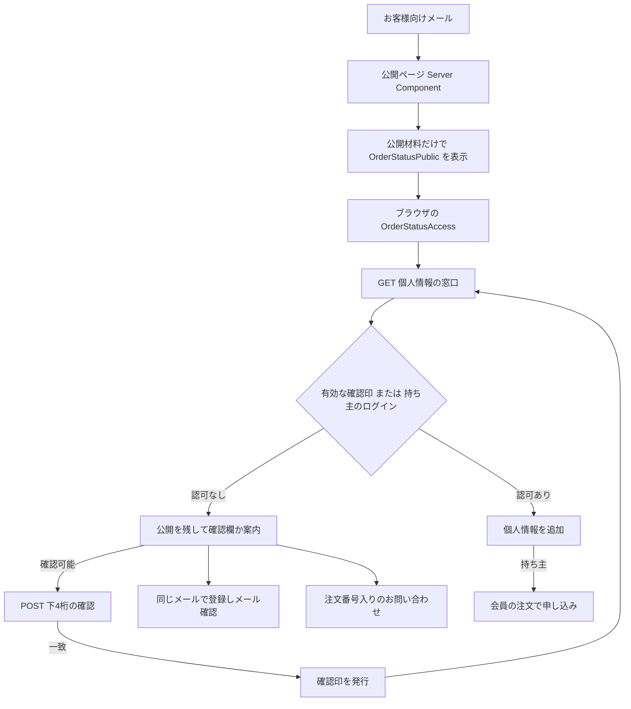

# 注文の状況のページ（E-5 / FREQ-498〜505）

## 概要

メールのリンクからログインせず注文を確認する。公開情報は Server Component が読み、個人情報はブラウザが専用GETで後から取得する。本人確認は注文時の電話番号の下4桁で行う。

[承認済み詳細設計](../../superpowers/specs/2026-10-22-order-status-page-design.md)・[実装計画](../../superpowers/plans/2026-10-22-order-status-page.md)・[要求表](../../02_Requirements/requirements.md)を参照する。設計書は変更せず、X1 は controller の P8・P25 を優先する。

| 項目 | 契約 |
| --- | --- |
| ページ | `/order-status/[token]`。新しい公開APIは作らない |
| 公開 | 注文番号・注文日・品物と数と金額・進み具合・配送・返金・返品とキャンセルの記録 |
| 個人情報 | 持ち主の会員か、有効な確認印がある場合だけ専用GETが返す |
| 期限 | 対象メールの送信成功から21日。確認印は24時間と確認期限の早い方まで |
| 申し込み | 表示だけ。会員の注文か、お問い合わせへ案内する |

## 1. 読み出しと表示範囲

[ページ](../../../src/app/order-status/%5Btoken%5D/page.tsx)は `await params` → 43文字の形検査 → `await connection()` → service_role → link → 公開材料 → 公開返品 → 公開表示の順に読む。形不正はDBを読まない。`cancelled` は表示し、`payment_in_progress`・`abandoned`・存在しない注文は同じ404。返品だけの障害は `returnSection:null`、ほかの障害は固定のエラーで止める。

| 項目 | 公開材料・表示 | 認可後の個人情報 |
| --- | --- | --- |
| 注文 | 注文番号・注文日・進み具合、品名・色・サイズ・数量・金額・交換の品・発送や返金の数 | 公開情報を重複させない |
| 金額・返金 | 小計・送料・値引き・合計、processing/completed の額・日付・状況、2件以上なら合計 | 支払方法 `paymentMethod` |
| 発送・配送 | 取消でない発送の会社・発送日・品物・配達日。追跡ON・鍵あり・現版のregisteredか、登録実績のあるstoppedだけ状況と履歴を表示 | `shipments` の識別ID・回数・伝票番号・追跡URL |
| 返品・キャンセル | 状態・品物と数・解決方法・返金額・店からの文・送り返した品 | `returns` の識別ID・返送先・元の配列indexに対応する送り返し番号 |
| お届け先・連絡先 | 名前・住所・電話・メールのキーも取得しない | `shipping` の fullName/postalCode/address/phone、`contactEmail` |

公開型 `CustomerOrderPublicView` と個人情報型 `CustomerOrderPrivateView` を分ける。[公開材料RPC](../../../supabase/migrations/20261023100000_order_status_links.sql)が列を名指しし、個人情報・支払方法・伝票番号・追跡URL・返送先・返金失敗の詳細・口座期限・内部メモを取得しない。取得後に削除する方式にはしない。

表示計算は [customer-order-view](../../../src/lib/orders/customer-order-view.ts) を会員APIと共有する。金額と日本時間の日時、配列順、取消・現版・配送非表示時のキー省略を維持する。壊れた日付は `-`。返品は `OrderReturnsSection`、品物は `OrderItemRow` の `readOnly:true` を使用し、申し込みボタン・フォーム・受付終了の操作案内を出さない。記録のない返品欄は出さない。返送先は個人情報欄だけで `accepted`・`partially_received` の間だけ表示する。

## 2. 2段の流れ

個人情報GETは `clientFetch`。verify POSTはCSRF Cookieがある時だけ同じヘッダーを付けた `fetch` を `credentials:'same-origin'`・`cache:'no-store'` で1回送る。POSTを自動再送しない。

X1: 設計書5-2の未認可401より P8 を優先し、ログイン印のないゲストは `200 {access:'none',verifiable,reason}`（dataキー無し）。有効な確認印を先に認可する P25 により、古いログイン印が残っていても `access:'verified'` で200。持ち主は `access:'member'` で200、確認期限後も閲覧できる。別会員のログインだけではnone。その注文の有効な確認印があればverified。

ログイン印の検証に失敗した時だけ401で更新の機会を作り、認証サービス不能は503。refreshだけが残る時も401。最終401でも公開を残し、独自の更新ループやログインページへの転送をしない。[API仕様](../../03_BasicDesign/api/api-spec.md)に全HTTPと入力を記録する。

取得は認証確定後、ログイン状態の変化・失効通知・ページの再表示・確認印の期限で行う。期限・ログアウト時は個人情報を外す。世代番号とAbortControllerで古い応答を捨てる。500/503/通信失敗は手動再取得を案内する。

## 3. 確認の期限・回数・印

| 項目 | 値と扱い |
| --- | --- |
| トークン | 32バイトの乱数をbase64urlにした43文字。`^[A-Za-z0-9_-]{43}$`、trimしない。1注文1本で再発行しない |
| 保存 | `private.order_status_links` の token。初めて新しいお客様向け本文を作る時だけ用意する |
| 確認期限 | `complete_order_email` の対象16種類の成功時刻から21日。`verify_until > now()` の間だけ。同時刻は期限切れ |
| 失敗数 | 不一致だけ合計20回。20回目は400 mismatchとlockedの理由、次は423。正解しても戻さない。期限が進んだ時だけ0 |
| 短い枠 | 注文ごと15分に5回（DBで得たUUID）、送信元ごと10分に30回。障害時は503で止める |
| 入力 | 全角数字を半角化し記号を除いた数字4桁ちょうど。文字列は64字まで。注文の電話が4桁未満なら欄を出さない |
| 印 | `sb-order-status`、`base64url(JSON).base64url(HMAC-SHA256)` |
| payload | `purpose='order_status'`・orderId・tokenHashPrefix（SHA-256の16進先頭16文字）・iat・exp。生のtoken・電話を入れない |
| 鍵 | サーバー専用 `ORDER_STATUS_SESSION_SECRET`、空なら `JWT_SECRET`。両方無い時は固定エラー |
| Cookie | `httpOnly`・本番で `secure`・`sameSite='strict'`・`path=/api/order-status/{token}`、Domain無し |
| 印の期限 | `exp=min(iat+86400,floor(verifyUntil/1000))`。24時間とDB期限の早い方。延長メールでも古い印のexpは延ばさない |
| 再照合 | 署名・purpose・注文・tokenHashPrefix・整数時刻・24時間上限・現在のDB期限をGETごとに照合 |

印はAPIのpathだけに送り、公開ページは読まない。描画中と `after()` でCookieを発行しない。Max-Ageは `exp-iat`、応答のexpiresAtはexpそのもの。NextのExpires再計算には1秒程度の丸め差があり、Max-Ageが優先される。改変・別注文・期限切れの印は認可せず公開を残す。

## 4. 固定の文と案内

metadataのtitleは `ご注文の状況 | Le Fil des Heures`。token・注文番号を入れない。[status-messages](../../../src/lib/orders/status/status-messages.ts) の固定文を使う。

| 場所 | 文 |
| --- | --- |
| h1・番号・日付 | ご注文の状況、`注文番号 {orderNumber}`、`ご注文日 {orderDate}` |
| 進み具合・発送 | 配送ステータス、`配送情報（{number}回目）`、発送日、配送業者、お届け日、最後の更新、配送の移り変わり |
| 配送の問題 | 配送に遅れや問題が出ています。詳しくは配送業者のページをご確認ください |
| 未発送・商品 | 発送準備中の商品、受注生産中の商品、ご注文商品、`数量: {quantity}`、交換の品、`返金済み {refundedQuantity}点`、交換の金額は `—` |
| 金額・返金 | 支払金額、小計、送料、クーポン値引き、ご返金、手続き中、完了、ご返金の合計 |
| 確認欄 | お届け先などの確認 |
| 説明 | お届け先・お支払い方法・伝票番号を見るには、ご注文の時の電話番号の下4桁を入れてください。 |
| 入力 | ご注文の時の電話番号の下4桁、数字4桁を入れてください。、例 `1234` |
| 送信 | 確かめる、確認中…、確認できました。 |
| 取得中 | お届け先などを確認しています。 |
| 個人情報見出し | お届け先、ご連絡先、お支払い方法、伝票番号、返品の返送先・送り返しの伝票番号 |
| 個人情報ラベル | お名前、郵便番号、住所、電話番号、メールアドレス。空値は `-` |
| 番号と追跡先 | `追跡番号 {trackingNumber}`、配送状況を確認する。番号のない発送は行を出さない |
| 返送先と送り返し | 返送先:、`〒{postalCode} {address}`、`送り返しの伝票番号: {trackingNumber}` |
| 再取得・404 | もう一度読み込む、トップページへ |

進み具合は既存 `ORDER_PROGRESS_LABELS` と在庫4段／受注生産5段、配送8状態は `DELIVERY_STATUS_LABELS`、会社名は `SHIPPING_CARRIERS`、支払方法は `mapPaymentMethodLabel` と同じ値。返品8状態・キャンセル4状態・返送方法・費用の案内・店の文は共有部品の既存文を保持する。送り返した品名・数・店の文は公開に残し、番号と返送先は個人情報欄だけ。値と店の文章は文字として出しHTMLにしない。

| 対象 | 固定の案内・行き先 |
| --- | --- |
| 持ち主以外の見出し | 返品・キャンセルをご希望の方へ |
| 登録の説明 | ご注文の時と同じメールアドレスで会員登録し、メールの確認を済ませると、このご注文が会員の注文履歴に入り、そこから返品・キャンセルを申し込めます。 |
| 登録 | 会員登録して申し込む → `/login?tab=register` |
| 問い合わせの説明 | 会員登録をせずにお申し込みをご希望の方は、お問い合わせからご連絡ください。注文番号は入力済みで開きます。 |
| 問い合わせ | お問い合わせから申し込む → `/contact?type=order&order={orderNumber}` |
| 持ち主の見出し | 返品・キャンセルのお申し込み |
| 持ち主の説明 | 返品・キャンセルのお申し込みは、会員の注文のページで受け付けています。 |
| 持ち主のリンク | 会員の注文のページへ → `/account/orders/{id}` |
| ログイン | ログインする → `/login` |

## 5. エラーと守り

| code | 固定の画面文 |
| --- | --- |
| `ORDER_STATUS_NOT_FOUND` | このページは見つかりません |
| `ORDER_STATUS_INPUT_INVALID` | 電話番号の下4桁を入れてください。 |
| `ORDER_STATUS_MISMATCH` | 電話番号の下4桁が一致しません。もう一度確かめてください。 |
| `ORDER_STATUS_LOCKED` | 確認できる回数を超えました。ログインするか、お問い合わせください。 |
| `ORDER_STATUS_UNAVAILABLE` | ログインするか、お問い合わせください |
| `ORDER_STATUS_EXPIRED` | 電話番号で確認できる期間が過ぎました。ログインするか、お問い合わせください。 |
| `ORDER_STATUS_RATE_LIMITED` | しばらくしてから、もう一度お試しください。 |
| `ORDER_STATUS_FORBIDDEN` | 画面を開き直して、もう一度お試しください。 |
| `ORDER_STATUS_AUTH_REQUIRED` | ログインするか、電話番号の下4桁で確かめてください。 |
| `ORDER_STATUS_TEMPORARILY_UNAVAILABLE` | ただいま確認できません。時間をおいて、もう一度お試しください。 |
| `ORDER_STATUS_FAILED` | ご注文の状況を読み込めませんでした。時間をおいて、もう一度お試しください。 |

401のAPIのerrorだけは `Unauthorized`、Origin拒否は既存proxyの `Forbidden origin`。DBの元の文・SQLSTATE・error.message/digestを表示も記録もしない。ページのerror境界は `retry` で再取得と再描画を行う。

metadataは `robots: { index: false, follow: false }`（noindex/nofollow）。APIの成功・拒否・例外は全て `Cache-Control: no-store` と `Referrer-Policy:no-referrer`。追跡先は `rel="noopener noreferrer"`。トークン・電話・入力・Cookie・署名・鍵をログ・監査・エラー・URLのクエリへ出さない。入力はDOM内だけに置き永続保存しない。本番のpath記録抑止は [運用](../../06_Operations/webhook-queue-operations.md)で確認する。

## 6. 試験対応

32 AC の単体・DB結合・E2Eと担当 Task は [要求表](../../02_Requirements/requirements.md)の FREQ-498〜505 と下表に記録する。静的試験は文書・コメント・定義の照合であり、30ケースを実行して通した証拠にはしない。Task 11 の予行演習と本番適用は controller の担当で、この文書で実施済みとは扱わない。

| AC | 単体・DB結合 | E2Eの範囲 | 担当 Task |
| --- | --- | --- | --- |
| FREQ-498-AC-01 | [customer-order-view](../../../tests/unit/lib/orders/customer-order-view.test.ts)、[OrderStatusPage](../../../tests/unit/components/OrderStatusPage.test.tsx)、[OrderStatusPublic](../../../tests/unit/features/order-status/OrderStatusPublic.test.tsx)、[status-store](../../../tests/unit/lib/orders/status/status-store.test.ts)、[order_status_links.integration](../../../tests/integration/db/order_status_links.integration.test.ts) | [FR-ORDER-001-public-view](../../../e2e/FR-ORDER-001-public-view.spec.ts)（FR-ORDER-001） | 1/3/4/6 |
| FREQ-498-AC-02 | [customer-order-view](../../../tests/unit/lib/orders/customer-order-view.test.ts)、[OrderStatusPublic](../../../tests/unit/features/order-status/OrderStatusPublic.test.tsx)、[order_status_links.integration](../../../tests/integration/db/order_status_links.integration.test.ts) | [FR-ORDER-008-delivery-refund-visibility](../../../e2e/FR-ORDER-008-delivery-refund-visibility.spec.ts)（FR-ORDER-008） | 1/3/6 |
| FREQ-498-AC-03 | [customer-order-view](../../../tests/unit/lib/orders/customer-order-view.test.ts)、[OrderStatusPublic](../../../tests/unit/features/order-status/OrderStatusPublic.test.tsx)、[OrderReturnsSection](../../../tests/unit/features/account/returns/OrderReturnsSection.test.tsx)、[order_status_links.integration](../../../tests/integration/db/order_status_links.integration.test.ts)、[order_status_returns.integration](../../../tests/integration/db/order_status_returns.integration.test.ts) | [FR-ORDER-005-returns-guidance](../../../e2e/FR-ORDER-005-returns-guidance.spec.ts)、[FR-ORDER-008-delivery-refund-visibility](../../../e2e/FR-ORDER-008-delivery-refund-visibility.spec.ts)（FR-ORDER-005、FR-ORDER-008） | 1/2/3/6 |
| FREQ-498-AC-04 | [OrderStatusPage](../../../tests/unit/components/OrderStatusPage.test.tsx)、[private](../../../tests/unit/api/order-status/private.test.ts)、[order_status_links.integration](../../../tests/integration/db/order_status_links.integration.test.ts) | [FR-ORDER-007-not-found-security](../../../e2e/FR-ORDER-007-not-found-security.spec.ts)（FR-ORDER-007） | 1/5/6 |
| FREQ-499-AC-01 | [status-phone](../../../tests/unit/lib/orders/status/status-phone.test.ts)、[verify](../../../tests/unit/api/order-status/verify.test.ts)、[OrderStatusVerifyForm](../../../tests/unit/features/order-status/OrderStatusVerifyForm.test.tsx)、[order_status_links.integration](../../../tests/integration/db/order_status_links.integration.test.ts) | [FR-ORDER-002-verify-private](../../../e2e/FR-ORDER-002-verify-private.spec.ts)（FR-ORDER-002（短い電話はDB/単体）） | 1/4/5/6 |
| FREQ-499-AC-02 | [customer-order-view](../../../tests/unit/lib/orders/customer-order-view.test.ts)、[private](../../../tests/unit/api/order-status/private.test.ts)、[order_status_returns.integration](../../../tests/integration/db/order_status_returns.integration.test.ts) | [FR-ORDER-002-verify-private](../../../e2e/FR-ORDER-002-verify-private.spec.ts)（FR-ORDER-002） | 2/3/5/6 |
| FREQ-499-AC-03 | [status-session](../../../tests/unit/lib/orders/status/status-session.test.ts) | [FR-ORDER-002-verify-private](../../../e2e/FR-ORDER-002-verify-private.spec.ts)（FR-ORDER-002（属性と2注文。署名異常の全形は単体）） | 4/6 |
| FREQ-499-AC-04 | [status-session](../../../tests/unit/lib/orders/status/status-session.test.ts)、[private](../../../tests/unit/api/order-status/private.test.ts)、[OrderStatusAccess](../../../tests/unit/features/order-status/OrderStatusAccess.test.tsx) | [FR-ORDER-004-expiry](../../../e2e/FR-ORDER-004-expiry.spec.ts)（FR-ORDER-004） | 4/5/6 |
| FREQ-500-AC-01 | [order-email-worker](../../../tests/unit/lib/orders/email/order-email-worker.test.ts)、[order-email-worker-delivery](../../../tests/unit/lib/orders/email/order-email-worker-delivery.test.ts)、[order_status_links.integration](../../../tests/integration/db/order_status_links.integration.test.ts) | [FR-ORDER-006-email-link](../../../e2e/FR-ORDER-006-email-link.spec.ts)（FR-ORDER-006（paidの成功。16種類と競合はDB）） | 1/7 |
| FREQ-500-AC-02 | [verify](../../../tests/unit/api/order-status/verify.test.ts)、[order_status_links.integration](../../../tests/integration/db/order_status_links.integration.test.ts) | [FR-ORDER-003-verify-limits](../../../e2e/FR-ORDER-003-verify-limits.spec.ts)（FR-ORDER-003） | 5/9 |
| FREQ-500-AC-03 | [verify](../../../tests/unit/api/order-status/verify.test.ts)、[OrderStatusAccess](../../../tests/unit/features/order-status/OrderStatusAccess.test.tsx)、[order_status_links.integration](../../../tests/integration/db/order_status_links.integration.test.ts) | [FR-ORDER-003-verify-limits](../../../e2e/FR-ORDER-003-verify-limits.spec.ts)（FR-ORDER-003） | 1/5/6 |
| FREQ-500-AC-04 | [status-store](../../../tests/unit/lib/orders/status/status-store.test.ts)、[OrderStatusAccess](../../../tests/unit/features/order-status/OrderStatusAccess.test.tsx)、[order_status_links.integration](../../../tests/integration/db/order_status_links.integration.test.ts) | [FR-ORDER-004-expiry](../../../e2e/FR-ORDER-004-expiry.spec.ts)（FR-ORDER-004） | 1/4/6 |
| FREQ-501-AC-01 | [private](../../../tests/unit/api/order-status/private.test.ts)、[OrderStatusAccess](../../../tests/unit/features/order-status/OrderStatusAccess.test.tsx) | [FR-ACCOUNT-044-order-status-member-access](../../../e2e/FR-ACCOUNT-044-order-status-member-access.spec.ts)（FR-ACCOUNT-044） | 5/6 |
| FREQ-501-AC-02 | [private](../../../tests/unit/api/order-status/private.test.ts)、[OrderStatusAccess](../../../tests/unit/features/order-status/OrderStatusAccess.test.tsx) | [FR-ACCOUNT-044-order-status-member-access](../../../e2e/FR-ACCOUNT-044-order-status-member-access.spec.ts)（FR-ACCOUNT-044） | 5/6 |
| FREQ-501-AC-03 | [private](../../../tests/unit/api/order-status/private.test.ts)、[OrderStatusAccess](../../../tests/unit/features/order-status/OrderStatusAccess.test.tsx) | [FR-ACCOUNT-044-order-status-member-access](../../../e2e/FR-ACCOUNT-044-order-status-member-access.spec.ts)（FR-ACCOUNT-044） | 5/6 |
| FREQ-501-AC-04 | [private](../../../tests/unit/api/order-status/private.test.ts)、[OrderStatusAccess](../../../tests/unit/features/order-status/OrderStatusAccess.test.tsx) | [FR-ORDER-001-public-view](../../../e2e/FR-ORDER-001-public-view.spec.ts)（FR-ORDER-001） | 5/6 |
| FREQ-502-AC-01 | [customer-order-view](../../../tests/unit/lib/orders/customer-order-view.test.ts)、[order_status_returns.integration](../../../tests/integration/db/order_status_returns.integration.test.ts) | E2E —（DB 結合・単体で検証） | 2/3 |
| FREQ-502-AC-02 | [OrderReturnsSection](../../../tests/unit/features/account/returns/OrderReturnsSection.test.tsx)、[OrderStatusPublic](../../../tests/unit/features/order-status/OrderStatusPublic.test.tsx)、[order_status_returns.integration](../../../tests/integration/db/order_status_returns.integration.test.ts) | [FR-ORDER-005-returns-guidance](../../../e2e/FR-ORDER-005-returns-guidance.spec.ts)（FR-ORDER-005） | 2/6 |
| FREQ-502-AC-03 | [OrderStatusGuidance](../../../tests/unit/features/order-status/OrderStatusGuidance.test.tsx) | [FR-ORDER-005-returns-guidance](../../../e2e/FR-ORDER-005-returns-guidance.spec.ts)（FR-ORDER-005） | 6 |
| FREQ-502-AC-04 | [OrderStatusGuidance](../../../tests/unit/features/order-status/OrderStatusGuidance.test.tsx)、[OrderStatusAccess](../../../tests/unit/features/order-status/OrderStatusAccess.test.tsx) | [FR-ACCOUNT-044-order-status-member-access](../../../e2e/FR-ACCOUNT-044-order-status-member-access.spec.ts)（FR-ACCOUNT-044） | 6 |
| FREQ-503-AC-01 | [order-email-compose](../../../tests/unit/lib/orders/email/order-email-compose.test.ts)、[order-email-compose-returns](../../../tests/unit/lib/orders/email/order-email-compose-returns.test.ts)、[order-email-compose-requests](../../../tests/unit/lib/orders/email/order-email-compose-requests.test.ts)、[order-email-compose-delivery](../../../tests/unit/lib/orders/email/order-email-compose-delivery.test.ts)、[order-email-worker](../../../tests/unit/lib/orders/email/order-email-worker.test.ts)、[order-email-worker-delivery](../../../tests/unit/lib/orders/email/order-email-worker-delivery.test.ts)、[order_status_links.integration](../../../tests/integration/db/order_status_links.integration.test.ts) | [FR-ORDER-006-email-link](../../../e2e/FR-ORDER-006-email-link.spec.ts)、[FR-ADMIN-101-fulfillment-delivered](../../../e2e/FR-ADMIN-101-fulfillment-delivered.spec.ts)（FR-ORDER-006（paidだけ）、既存FR-ADMIN-101（delivered）） | 1/7/9 |
| FREQ-503-AC-02 | [order-email-compose](../../../tests/unit/lib/orders/email/order-email-compose.test.ts)、[order-email-compose-returns](../../../tests/unit/lib/orders/email/order-email-compose-returns.test.ts)、[order-email-compose-requests](../../../tests/unit/lib/orders/email/order-email-compose-requests.test.ts)、[order-email-compose-delivery](../../../tests/unit/lib/orders/email/order-email-compose-delivery.test.ts) | [FR-ORDER-006-email-link](../../../e2e/FR-ORDER-006-email-link.spec.ts)、[FR-CHECKOUT-049-order-email-sent-once](../../../e2e/FR-CHECKOUT-049-order-email-sent-once.spec.ts)（FR-ORDER-006（paidだけ）、既存FR-CHECKOUT-049） | 7/9 |
| FREQ-503-AC-03 | [order-email-compose](../../../tests/unit/lib/orders/email/order-email-compose.test.ts)、[order-email-compose-returns](../../../tests/unit/lib/orders/email/order-email-compose-returns.test.ts)、[order-email-compose-requests](../../../tests/unit/lib/orders/email/order-email-compose-requests.test.ts)、[order-email-compose-delivery](../../../tests/unit/lib/orders/email/order-email-compose-delivery.test.ts)、[order-email-worker](../../../tests/unit/lib/orders/email/order-email-worker.test.ts)、[order-email-worker-delivery](../../../tests/unit/lib/orders/email/order-email-worker-delivery.test.ts) | E2E —（DB 結合・単体で検証） | 7 |
| FREQ-503-AC-04 | [order-email-worker](../../../tests/unit/lib/orders/email/order-email-worker.test.ts)、[order-email-worker-delivery](../../../tests/unit/lib/orders/email/order-email-worker-delivery.test.ts)、[order_status_links.integration](../../../tests/integration/db/order_status_links.integration.test.ts) | E2E —（DB 結合・単体で検証） | 1/7/11 |
| FREQ-504-AC-01 | [contact-prefill](../../../tests/unit/features/contact/contact-prefill.test.ts)、[ContactPage](../../../tests/unit/components/ContactPage.test.tsx)、[OrderStatusGuidance](../../../tests/unit/features/order-status/OrderStatusGuidance.test.tsx) | [FR-CONTACT-014-order-status-prefill](../../../e2e/FR-CONTACT-014-order-status-prefill.spec.ts)（FR-CONTACT-014） | 6/8 |
| FREQ-504-AC-02 | [contact-prefill](../../../tests/unit/features/contact/contact-prefill.test.ts)、[ContactPage](../../../tests/unit/components/ContactPage.test.tsx) | [FR-CONTACT-014-order-status-prefill](../../../e2e/FR-CONTACT-014-order-status-prefill.spec.ts)（FR-CONTACT-014） | 8 |
| FREQ-504-AC-03 | [ContactPage](../../../tests/unit/components/ContactPage.test.tsx) | [FR-CONTACT-014-order-status-prefill](../../../e2e/FR-CONTACT-014-order-status-prefill.spec.ts)（FR-CONTACT-014） | 8 |
| FREQ-504-AC-04 | [OrderStatusGuidance](../../../tests/unit/features/order-status/OrderStatusGuidance.test.tsx)、[route](../../../tests/unit/api/contact/route.test.ts) | [FR-ORDER-005-returns-guidance](../../../e2e/FR-ORDER-005-returns-guidance.spec.ts)（FR-ORDER-005（登録入口だけ）） | 6/8 |
| FREQ-505-AC-01 | [status-store](../../../tests/unit/lib/orders/status/status-store.test.ts)、[order_status_links.integration](../../../tests/integration/db/order_status_links.integration.test.ts)、[order_status_returns.integration](../../../tests/integration/db/order_status_returns.integration.test.ts)、[order_status_postgrest.integration](../../../tests/integration/db/order_status_postgrest.integration.test.ts) | E2E —（DB 結合・単体で検証） | 1/2/4 |
| FREQ-505-AC-02 | [customer-order-view](../../../tests/unit/lib/orders/customer-order-view.test.ts)、[status-store](../../../tests/unit/lib/orders/status/status-store.test.ts)、[verify](../../../tests/unit/api/order-status/verify.test.ts)、[private](../../../tests/unit/api/order-status/private.test.ts)、[proxy-origin](../../../tests/unit/middleware/proxy-origin.test.ts)、[order_status_links.integration](../../../tests/integration/db/order_status_links.integration.test.ts)、[order_status_returns.integration](../../../tests/integration/db/order_status_returns.integration.test.ts)、[order_status_postgrest.integration](../../../tests/integration/db/order_status_postgrest.integration.test.ts) | [FR-ORDER-001-public-view](../../../e2e/FR-ORDER-001-public-view.spec.ts)、[FR-ORDER-007-not-found-security](../../../e2e/FR-ORDER-007-not-found-security.spec.ts)（FR-ORDER-001、FR-ORDER-007（HTTPと表示。ログは単体/静的）） | 1/2/3/4/5/9 |
| FREQ-505-AC-03 | [OrderStatusPage](../../../tests/unit/components/OrderStatusPage.test.tsx)、[private](../../../tests/unit/api/order-status/private.test.ts)、[verify](../../../tests/unit/api/order-status/verify.test.ts) | [FR-ORDER-007-not-found-security](../../../e2e/FR-ORDER-007-not-found-security.spec.ts)（FR-ORDER-007） | 5/6/9 |
| FREQ-505-AC-04 | [OrderStatusPublic](../../../tests/unit/features/order-status/OrderStatusPublic.test.tsx)、[OrderStatusAccess](../../../tests/unit/features/order-status/OrderStatusAccess.test.tsx)、[OrderStatusGuidance](../../../tests/unit/features/order-status/OrderStatusGuidance.test.tsx) | [FR-ACCOUNT-044-order-status-member-access](../../../e2e/FR-ACCOUNT-044-order-status-member-access.spec.ts)、[FR-CONTACT-014-order-status-prefill](../../../e2e/FR-CONTACT-014-order-status-prefill.spec.ts)、[FR-ORDER-001-public-view](../../../e2e/FR-ORDER-001-public-view.spec.ts)、[FR-ORDER-002-verify-private](../../../e2e/FR-ORDER-002-verify-private.spec.ts)、[FR-ORDER-003-verify-limits](../../../e2e/FR-ORDER-003-verify-limits.spec.ts)、[FR-ORDER-004-expiry](../../../e2e/FR-ORDER-004-expiry.spec.ts)、[FR-ORDER-005-returns-guidance](../../../e2e/FR-ORDER-005-returns-guidance.spec.ts)、[FR-ORDER-006-email-link](../../../e2e/FR-ORDER-006-email-link.spec.ts)、[FR-ORDER-007-not-found-security](../../../e2e/FR-ORDER-007-not-found-security.spec.ts)、[FR-ORDER-008-delivery-refund-visibility](../../../e2e/FR-ORDER-008-delivery-refund-visibility.spec.ts)（新10spec全て） | 6/8/9 |
