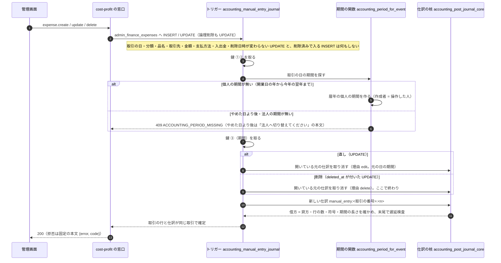
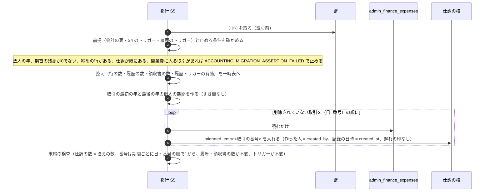

# 会計の仕訳のシーケンス（手入力の取引と移しかえ）

> 状態: 現行のソース（会計の作り直し 計画1 Task 6・9・13。手元の Supabase と使い捨てのコンテナで確かめた分。本番には未適用） | 確認日: 2026-11-08 | 対象: 手入力の取引から仕訳を作る DB トリガー（S4）、仕訳を入れる関数・取り消しの関数（S2）、過去の手入力の取引を移しかえる移行（A8 = S5）

## 概要

手入力の取引（`admin_finance_expenses`）は、書き込みと同じ取引の中で DB のトリガーが仕訳（`accounting_journal_entries` と `accounting_journal_lines`）にする。仕訳は書き換えない（追記のみ）。直しは「元の仕訳の取り消し（反対仕訳）＋正しい仕訳」の2本で残し、削除は取り消しだけを残す。過去の取引は移行 S5（A8）が一度だけ `migrated_entry` として移す。

| 項目 | 内容 |
| --- | --- |
| 仕訳の入口 | `public.admin_post_accounting_journal`・`public.admin_reverse_accounting_journal`（INVOKER の窓口）→ `private.admin_post_accounting_journal` など（DEFINER）→ `private.accounting_post_journal_core`。実行は `service_role` だけ |
| 印（dedupe_key） | 出来事の種類（27種）と要素から作る。手入力は `manual_entry:<取引の番号>:<n>`、移しかえは `migrated_entry:<取引の番号>`。同じ印で内容が同じなら再送（仕訳は増えない）、内容が違えば 409 `ACCOUNTING_DEDUPE_CONTENT_MISMATCH` |
| 鍵の順 | `(190521, 1)` → `(190525, 0)` → `(190525, hashtext(期間))`（`private.accounting_lock_all`）。全入口で同じ順 |
| 借方・貸方 | 取引ごとに、費用なら 借方 = 分類の科目・貸方 = 支払方法の科目、収入ならその逆。分類・支払方法が写し先に無い時は `9999`（元の文字を行の `memo` に残す） |

## 範囲と根拠

| 項目 | 内容 |
| --- | --- |
| 対応要件 | FREQ-554（仕訳の土台）、FREQ-556（手入力の取引が仕訳になる）、FREQ-560（A8 の移しかえ）、FREQ-555（期間の選び方） |
| 実装 | 移行 `supabase/migrations/20261107130200_accounting_p1_journal_foundation.sql`（S2）、`20261107130300_accounting_p1_period_reads.sql`（S3）、`20261107130400_accounting_p1_manual_entry_journal.sql`（S4）、`20261107130500_accounting_p1_a8_migrate_manual.sql`（S5）、[event-key.ts](../../../src/lib/accounting/event-key.ts)、[cost-profit の窓口](../../../src/app/api/admin/kpi/cost-profit/route.ts) |
| 関連 | 期間の状態は[会計の期間の状態](../states/accounting-period.md)、運用の手順は[会計の仕訳の土台の運用](../../06_Operations/accounting-p1-journal-foundation.md) |
| 調査時点 | 2026-11-08 のソース。本番には S0〜S5 とも未適用 |

## 手入力の取引を足す・直す・消す（S4 のトリガー）

開始は管理の会計画面の取引管理（`POST /api/admin/kpi/cost-profit` の `expense.create`・`expense.update`・`expense.delete`）。窓口は取引の行を書き込むだけで、仕訳は書かない。

| 論点 | 内容 |
| --- | --- |
| 版番号 n | その取引の `manual_entry` の仕訳の数。取り消しと `migrated_entry` は数えない。A8 の後の最初の直しは `manual_entry:<id>:0` が `migrated_entry` を取り消す |
| 取り消しの形 | 元の仕訳の借方・貸方を入れ替えた仕訳。説明・`source_table`・`source_id` は元から写す。理由は `edit`／`delete`。1つの元に取り消しは1本（重ねると 409 `ACCOUNTING_ALREADY_REVERSED`） |
| 作った人 | 取り消し: 削除は `coalesce(deleted_by, created_by)`、直しは `coalesce(updated_by, created_by)`。正しい仕訳: INSERT は `created_by`、UPDATE は `coalesce(updated_by, created_by)` |
| 履歴の保護 | `admin_finance_entry_revisions` は変更者の欄を NULL にする更新（利用者の削除に伴う）以外の更新と削除を拒む。S4 は履歴を書く既存の関数 `record_admin_finance_entry_revision` も入れ替え、作成者・更新者・削除者の欄が NULL になるだけの更新（利用者の削除）では履歴を足さない（入れ替え前は、削除する利用者を変更者に名指す行が外部キーの 23503 で利用者の削除を断っていた）。仕訳の表も更新・削除・TRUNCATE を拒む（`ACCOUNTING_HISTORY_IMMUTABLE`、500） |
| 守られること | 取引の行を書く窓口で、期間が無い・範囲外などのトリガーの拒否が出ると、取引の行ごと戻る（取引だけ残らない） |
| 直接の DELETE | `admin_finance_expenses` の DELETE・TRUNCATE はトリガーが拒む（論理削除だけ） |

## 過去の手入力の取引を移す（A8 = 移行 S5）

開始は運用の `db push`。S4 の直後に同じ操作で当てる（途中で管理者が取引を書くと S5 が止まるため。[運用](../../06_Operations/accounting-p1-journal-foundation.md)）。1本の取引（BEGIN〜COMMIT）の中で全部が起き、1つでも崩れたら全部戻る。

| 論点 | 内容 |
| --- | --- |
| 何を移すか | 削除されていない取引だけ。論理削除済みは移さない（仕訳なし） |
| 書き込み | 取引・履歴・領収書の表には書かない（読むだけ）。書くのは期間と仕訳（S2・S3 の道具経由）と控えの一時表だけ。トリガーの無効化や `session_replication_role` は使わない |
| 番号 | 期間ごとに（日, 取引の番号）の昇順で 1 から欠番なし |
| 2回目 | 仕訳が既にあると `acc_s5_counts` で止まる（二重に移さない） |
| 分類の写し | S4 のトリガーと同じ文（本文の字が同じことを単体試験が確かめる）。分類・支払方法が `開業費` になる取引は移さず止める（1810 は計画 1 では使わない） |

## 関連テスト

- DB: `tests/integration/db/accounting_p1_journal.integration.test.ts`（S2）、`accounting_p1_manual_entry.integration.test.ts`（S4）、`accounting_p1_a8_migrate.integration.test.ts`（S5。`ACCOUNTING_COMMIT_SUITE=1`）、`accounting_p1_journal_concurrency.integration.test.ts`（鍵）。
- 窓口: `tests/unit/api/admin/cost-profit-route.test.ts`。E2E: `FR-ADMIN-129`（保存した仕訳と手入力の流れ）。

## 未確認事項

- 本番への適用と、本番の取引の分類の一覧に対する A8 の事前確認は未実施（運用の文書の手順 T16-1）。
- DB の試験の一部は、手元の Supabase が使えない間に使い捨てのコンテナで流した。手元の Supabase での公式の実行は調整役の担当。
