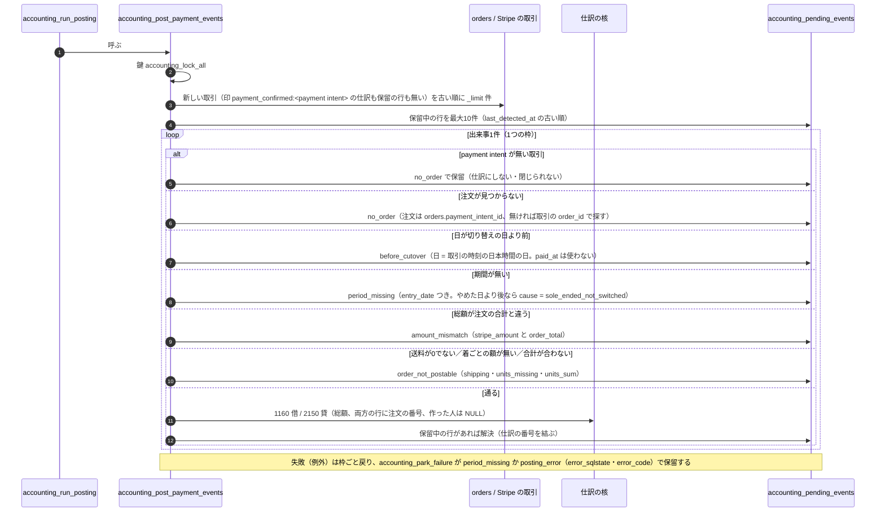
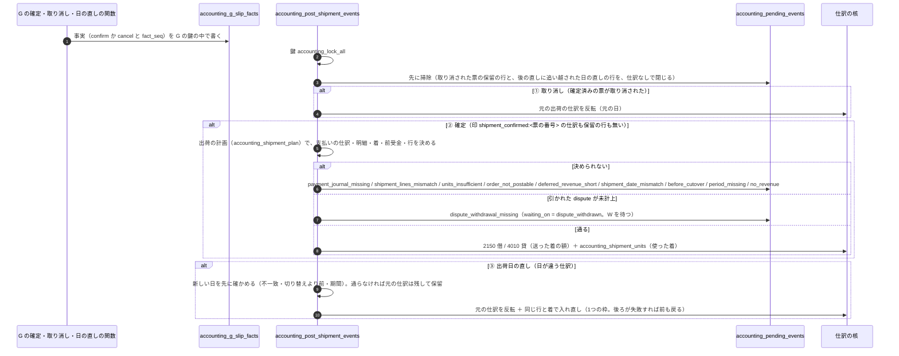
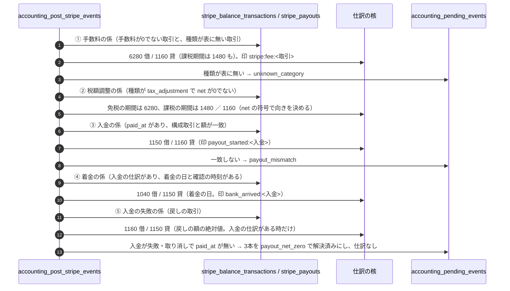
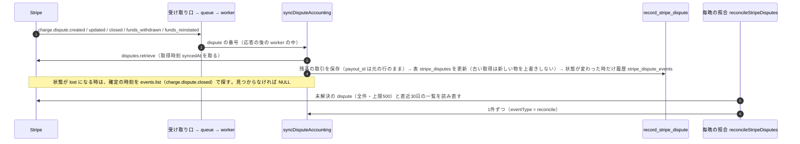
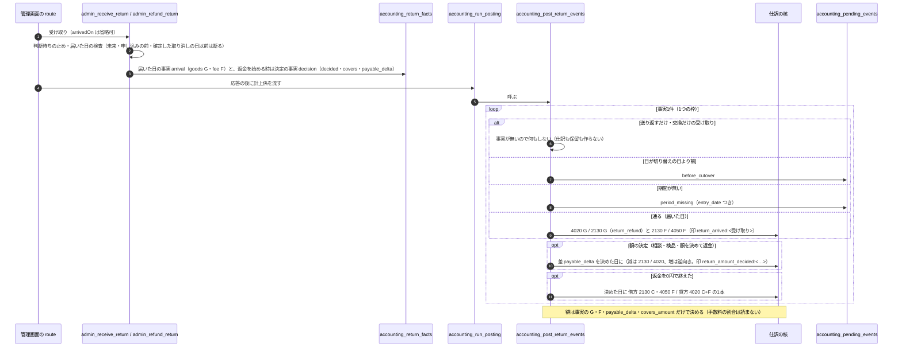
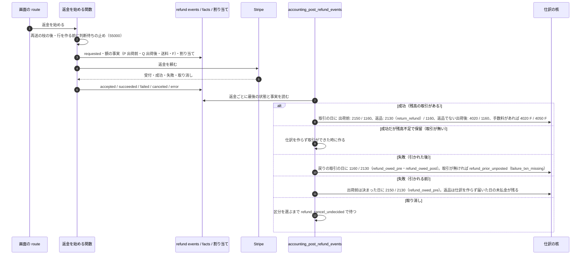
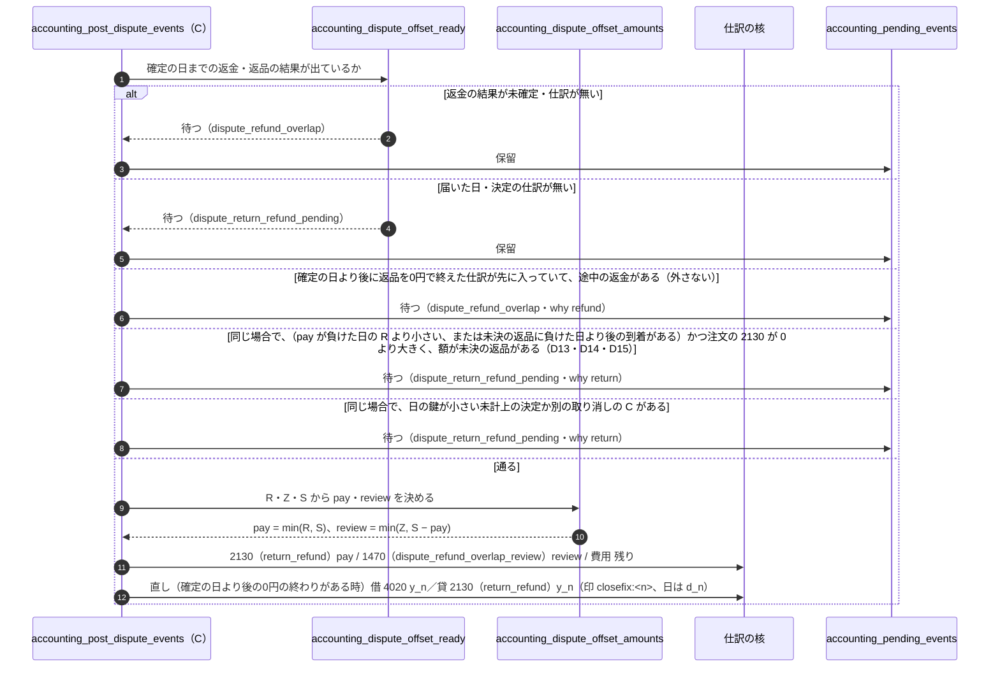

# 会計の計上係のシーケンス（支払い・出荷・Stripe・dispute）

> 状態: 現行のソース（会計の作り直し 計画2 Task 2〜10。手元の Supabase と使い捨てのコンテナで確かめた分。本番には未適用） | 確認日: 2026-11-15（会計の計画3 Task 13: 6〜9 と計画3の対応表を足した。計画3の移行 S15〜S25 は本番未適用）／2026-11-13（出荷の着の選び方を計画3 S17 の決まりに直した） | 対象: 支払いを前受金にする計上（S7）、出荷の日の売上（S8）、Stripe の手数料・入金・着金（S9）、dispute の受け取り（S10）と計上（S11）、計上の入口 `accounting_run_posting`

## 概要

仕訳にする出来事（支払い、発送票の確定・取り消し・出荷日の直し、Stripe の残高の取引、dispute）は、DB の4つの「係」が1つの入口 `public.accounting_run_posting` から順に仕訳にする。係は何回流しても同じ結果（出来事ごとの印で1本）で、出来事1件の失敗は戻して「計上待ち」に残し、ほかは続ける。呼び出し元と鍵の順は[システム構成](../../03_BasicDesign/architecture/system-overview.md)の「会計の計上係の流れ」、運用は[会計の運用](../../06_Operations/accounting-p2-posting-stripe.md)。

| 項目 | 内容 |
| --- | --- |
| 入口 | `public.accounting_run_posting(_limit integer DEFAULT 50)`（INVOKER、`service_role` だけ、1〜200）。戻りは `{payments, shipments, stripe, disputes, parked, resolved, has_more}` |
| 係の順 | 支払い → 出荷 → Stripe（手数料、税額調整、入金、着金、入金の失敗）→ dispute |
| 共通の作り | 最初に `accounting_lock_all(NULL)`。行の鍵は取らない。新しい出来事を古い順に `_limit` 件、続けて保留中の行を `last_detected_at` の古い順に最大10件。出来事1件は1つの `BEGIN … EXCEPTION` の枠で、失敗は `accounting_park_failure` が保留に残す |
| 遅れの印 | 仕訳の「元の記録の時刻」は `LEAST(元の行の時刻, clock_timestamp())`。日付の2か月後より後に記録されると `is_late` が付く |
| 保留の理由 | 18種（[運用の手引き](../../06_Operations/accounting-p2-posting-stripe.md)の 2）。状態は[計上待ちの状態](../states/accounting-pending.md) |

## 範囲と根拠

| 項目 | 内容 |
| --- | --- |
| 対応要件 | FREQ-562（支払い）、FREQ-563・564（出荷・取り消し・出荷日の直し）、FREQ-565・566（Stripe の手数料・入金・照合）、FREQ-567・568（dispute）、FREQ-569（計上待ち）、FREQ-570（保存した仕訳で数える） |
| 実装 | 移行 `supabase/migrations/20261108160000_accounting_p2_payment_posting.sql`（S7）、`…170000_…shipment_posting.sql`（S8）、`…180000_…stripe_posting.sql`（S9）、`…190000_…dispute_intake.sql`（S10）、`…200000_…dispute_posting.sql`（S11）。アプリ: [posting-runner.ts](../../../src/lib/accounting/posting-runner.ts)、[posting-store.ts](../../../src/lib/accounting/posting-store.ts)、[dispute-sync.ts](../../../src/lib/stripe/dispute-sync.ts)、[webhook-worker.ts](../../../src/lib/stripe/webhook-worker.ts) |
| 関連 | 手入力の仕訳は[会計の仕訳のシーケンス](accounting-journal.md)、Stripe の知らせは[Stripe Webhook](stripe-webhooks.md)、勘定の使い方は[財務](../shared/finance.md)の「Stripe決済残高の振替規則」 |
| 調査時点 | 2026-11-09 のソース。本番には S6〜S14 とも未適用 |

## 1. 支払いを前受金にする（S7）

開始は計上係の呼び出し。Stripe の残高の取引（`type` が `charge` か `payment`、`reporting_category` が `charge`）を1件ずつ見る。

## 2. 発送票の確定・取り消し・出荷日の直し（S8）

発送票の確定と取り消しは、G の関数が段を変えた直後に `accounting_g_slip_facts` へ事実（確定の番号 `fact_seq`）を書く。計上係はこの事実と発送票を読んで仕訳にする。新しい出来事は 取り消し → 確定 → 出荷日の直し の順で処理する（取り消しと再出荷が1回の呼び出しに重なっても入るように）。

| 論点 | 内容 |
| --- | --- |
| 着の選び方と額 | `accounting_shipped_units` が、確定の番号の時点で生きている発送票の着の数だけ、確定の順に着を当てる。当てる順は、取り押さえていない着を番号の若い順に先に、足りなければ取り押さえた着（失敗していない出荷前の返金が付いた着と、取りやめていない発送前の取り消しで最後に返した、まだ送っていなかった着）を番号の若い順。返した額では決めない（裁定 P3-6・P3-C1。2026-11-13 計画3 S17 で直した。`order_unit_shipped_slots` も同じ着を名指す）。額は着ごとの `paid_amount` ＋ 確定の番号より前の値段の直し − 確定の番号より前の出荷前の返金の割り当て。選ぶ所は1か所（`accounting_shipment_plan`）で、出荷日の直しは選び直さず元の仕訳の行と着を写す |
| 前受金の確認 | 注文ごとに、2150 の取り消されていない行の合計が、送る額以上であること。足りなければ `deferred_revenue_short` |
| 「0円の出荷」 | 額が0（交換の品だけなど）の票は仕訳を入れず、`no_revenue` で保留して同時に閉じる（`parked_new` と `resolved` の両方に数える） |
| 取り消しと日の直しの時刻 | 元の記録の時刻は、確定が `confirmed_at`、取り消しが `cancelled_at`、日の直しが履歴の `created_at`（いずれも `LEAST(…, clock_timestamp())`） |
| 取り消しが失敗した時 | 種類 `reversal`（出どころ `accounting_journal_entries`）で保留。計画6が作り直す |
| dispute との関係 | 引かれた取引（W）が同じ注文で未計上なら、W の番号より後に確定した票は W を待つ（`dispute_withdrawal_missing`）。W の側は、W の番号以前に確定した票の仕訳を待つ（`dispute_shipment_pending`）。互いに待ち合う形にはならない（[運用](../../06_Operations/accounting-p2-posting-stripe.md)の未確認事項 10） |

## 3. Stripe の手数料・入金・着金（S9）

取引の種類は1つの対応表（`private.accounting_stripe_category_kind(type, reporting_category)`。[stripe-categories.ts](../../../src/lib/accounting/stripe-categories.ts) と同じ。試験が一致を確かめる）で扱いを決める。表に無い種類は `unknown_category` で保留する（捨てない）。

残高の補充は人が入れる（`admin_record_balance_topup`。`1160 借 / 1040 貸`）。請求書の記録は `admin_set_stripe_invoice_record`。照合の読みは `get_stripe_fee_reconciliation(月)` と `get_stripe_balance_reconciliation(日)`（STABLE。[運用](../../06_Operations/accounting-p2-posting-stripe.md)の 5）。

## 4. dispute の受け取り（S10）と計上（S11）

### 受け取り

### 計上

W（引かれた時）・C（確定）・R／L（戻り）・X（科目の振り替え）の順序と待ちは[dispute の状態](../states/accounting-dispute.md)。1件の dispute は、取引の組み（`amount < 0` の `dispute` と `amount > 0` の `dispute_reversal`）に分けて W・R／L になり、確定の時刻で R と L が決まる。

## 5. 失敗した時の見方

| 場面 | 起きること | 人の見方 |
| --- | --- | --- |
| 出来事1件が例外 | その枠が戻り、`accounting_park_failure` が保留に書く。ほかの出来事は続く。保留に書くのも失敗したら、固定の `posting_error`（`XX000`・`unexpected_error`）に落とし、それも失敗したら何も書かない（次の呼び出しで新しい出来事として再び拾う） | 計上待ちの `posting_error`（記号と SQLSTATE） |
| 係の入口が失敗 | アプリは例外を握り、ログ `[accounting.posting]`（入口の名前と記号）だけ残す。定期処理は 502 と heartbeat の失敗 | `ops_job_heartbeats` の `accounting_post`（30分で店へ知らせ） |
| 同時実行 | 鍵で1つずつ。同じ出来事は印で1本 | なし |

## 6. 返品の届いた日と額の決定（計画3 S18・S21）

開始は返品の受け取り（`admin_receive_return`）と額を決めて返金（`admin_refund_return`）、届いた日の直し（`admin_correct_return_arrival_date`）。書き手が事実を残し、返品の係 `accounting_post_return_events` が仕訳にする。**本番未適用**（手元の DB で確認済み）。

| 場面 | 起きること |
| --- | --- |
| 届いた日の直し | 事実は足さず、直しの行を足す。係は古い日の仕訳の取り消し（印 `reversal:<元>`）と直した日の同じ行の仕訳（印 `return_arrival_redated:<直しの番号>`）を入れる。直した日に期間が無ければ `period_missing`（`entry_date` は直した日）で止まり、元の仕訳は取り消されない。2回直しても取り消しは1回ずつ。仕訳から跡は `get_return_journal_trace` で引く（理由・人・前後の日） |
| 相談で額が決まる | 見込みの額で届いた日に立て、決まった日に差を足す（増・減）。写しのある注文で額を変えた返金・失敗した返金でも、`covers_amount` は返金の額から前の分を引いた額で、0を下回らない |
| 手元に残る着の値段の直し | 仕訳にしない。4020 の累計は実際に返した額と手数料の合計 |
| 確定した取り消しのある注文 | 確定の日以前の届いた日の受け取りと、確定の日をまたぐ直しを断る（`RETURN_ARRIVAL_DATE_INVALID`） |
| 品を送り返さない返品（`return_method` が `not_required`。S26） | 届いた日の事実も決定の事実も残さず（`accounting_record_return_arrival`・`accounting_record_return_decision` が何もしない）、仕訳は返金した日の「4020 / 1160」の1本だけ。返金の係はその返金を返品の返金待ち（2130 `return_refund`）を通さない形（`v_plain` が偽）で計上し、引かれる前の失敗の借りは `refund_owed_post` に立てる |
| 失敗 | 書き手が失敗すると事実も残らない。係の失敗は枠ごと戻って保留（`posting_error`） |

## 7. 返金の事実と仕訳（成功・失敗・取り消し・振込・結び）（計画3 S17・S20）

開始は返金を始める関数（管理者・支払い済みのキャンセル・返品の返金・外の返金の記録）と、Stripe の結果を書く関数。事実（状態の履歴・額・割り当て）は同じ取引で残り、返金の係 `accounting_post_refund_events` が、その返金の事実と Stripe の残高の取引だけから仕訳にする（ほかの返金の残高は読まないので、入る順が入れ替わっても同じ額）。

| 場面 | 起きること |
| --- | --- |
| 取り消しの区分（`admin_decide_refund_cancellation`） | Stripe が取り消した返金だけに選べる。「やめた」は引かれた後なら元の仕訳の取り消しだけ、引かれる前なら仕訳を作らず、発送前の取り消しの返金なら交換の印の作業がその着を戻し割り当てを返す。「返すつもり」は失敗と同じ借り。2回目は前の結果、違う内容は `CANCEL_DECIDED` |
| 振込（`admin_record_refund_bank_transfer`） | 振込の日に「返金の未払い／普通預金」（返品の借りは 2130 が減る）。同じ銀行の取引の番号・同じ種類（origin）の2回目は何も足さない。借りの残高を超える額は断る。origin `return` は同じ注文に処理中の返金がある間は断る（S25） |
| 結び（`admin_settle_owed_by_refund`） | 借りの返金と成功したやり直しの返金を結び、借りの結んでいない額とやり直しの返金の額の小さい方だけ戻す。やり直しの返金は1回しか結べない（`accounting_refund_settlements`）。発送前の取り消しの借りは結べない（振込で返す） |
| 発送前の取り消しの値段の直し | 発送済みの残る着の直し d は、その出来事の最初の返金の仕訳で売上へ寄せる（`accounting_refund_first_adjust`）。まだの着の直しは出荷の額に反映する。上限（V_P）を超えた分は 4020 / 1160 |
| 判断待ち | 開始の関数が断るので、事実も行も Stripe の呼び出しも残らない。自動の返金・外の返金の記録は止めない |
| 失敗 | 事実と同じ取引なので、失敗すると何も残らない。係の失敗は枠ごと戻って保留 |

## 8. dispute の確定の相殺（計画3 S22・S24）

計画2の dispute の係（W→R→C→L）から、返金・返品との止め2つ（`dispute_refund_overlap`・`dispute_return_refund_pending`）が外れ、確定（C）が返品の返金待ち R と返金済み Z を相殺する。

| 場面 | 起きること |
| --- | --- |
| 遅れた取り下げ（L） | 費用の科目（または振り替えた科目）→ 分けて調べる補助 → 返金待ち（2130）の順に戻す |
| 確定の後の0円の終わり（S27） | 返金なしの決定が、確定 C の入った取り消しの負けた日以降の日付なら、返品の計上係が自動で扱う。待ち（日の早い物が先 → 途中の返金 `dispute_refund_overlap`（`why` `refund`）→ ほかの返品が未決 `dispute_return_refund_pending`（`why` `return`。P_eff = min(P(D)、P(今)′) が 0 より大きい間だけ））に当たらなければ、P(D)（決定の日までの 2130 の貸方 − 借方）と P(今)′（今までの全部から、途中から外した返金の分を引いた値）の小さい方 P_eff を出し、w = min(c, max(P_eff, 0)) とする。w > 0 なら決定の印 `return_amount_decided:<事実の番号>` で w だけ入れる（借 2130 w・借 4050 f／貸 4020 w + f。見出し・記録の時刻・source は普通の0円の終わりと同じ）。P_eff ≤ 0 なら仕訳は入れず、理由 `no_revenue`（`detail` `{}`・`resolved_entry_id` NULL）で閉じ、返金の係の待ち `return_prior` は済みと数える |
| 入れた後の確かめ（S27） | 入れた後に、その注文の 2130 を決定の日まででも今でも読み直し、どちらかが0未満なら `ACCOUNTING_POSTING_BALANCE_NEGATIVE`（SQLSTATE `23514`）で巻き戻す。計上係の例外の道に入り、`posting_error`（`error_code` にこの名前）で止まる |
| 取り出しの順（S27 で確かめた） | 返金なしの決定を取り出す順は、返品の計上係が `ORDER BY lane, phase`（lane 0 は作った時刻・返品・番号の順、lane 1 は検出の時刻の順）、取り消しの計上係が `ORDER BY j.phase, j.lane`（S22）で、**違う**。同じ流しの中でも、日の遅い新しい決定（lane 0）が、日の早い前に待たせた行（lane 1）より先に評価されうる。そこで返品の計上係は「日の鍵が小さい未計上の物があれば待つ」を持つ |
| 2つ目の取り消し | 手で入れる待ちの `dispute_lost` の決定は待ちの数えに入れない（S24。S27 の後は `dispute_lost` の行が新しく作られないので、S27 の前に作った開いた行のための物） |
| 数える日 | 返金の成功の仕訳（返金の係）は返金を作った日（日本時間）が確定の日以前なら、仕訳の日にかかわらず数える。ほかの仕訳（取り消しを含む）は仕訳の日が確定の日以前の時だけ数える |

## 9. 計上待ちを手で入れた仕訳と結んで閉じる（計画3 S24）

`order_not_postable` の行は、人が手で仕訳を入れてから `admin_link_accounting_pending_entry` で結んで閉じる（権限 `admin.accounting.entries.correct`、メモ必須）。結べるのは、取り消されていない手入力の仕訳（`manual_entry`）。待ちに注文があり、仕訳に注文の付いた行があれば同じ注文の行が要る。どの行にも注文が付かない仕訳は結べる。結ぶと待ちの行に閉じた人・メモ・要求番号・仕訳の番号が残り、同じ仕訳で複数の待ちを閉じられる。route は計上係を流さない（計画2の「確認済みにする」と同じ）。

## 受け入れ条件と設計の対応（計画3）

要求 `FREQ-575`〜`FREQ-584` の受け入れ条件（要件定義書の表）が、どの設計に書かれているかを示す。試験は[テスト仕様](../../05_Quality/tests/test-spec.md)の計画 3 の節。

| 要求 | 設計 |
| --- | --- |
| FREQ-575 返品の届いた日 | 本書の 6、[ER 図](../../03_BasicDesign/data/er.md)（`arrived_on`・直しの表・設定の表）、[運用の手引き](../../06_Operations/accounting-p3-returns-refunds.md)の 6 |
| FREQ-576 返金・返品の事実を同じ取引で残す | 本書の 6・7、[ER 図](../../03_BasicDesign/data/er.md)、[DB 移行](../../06_Operations/db-migrations.md)の計画3の節 |
| FREQ-577 出荷前の返金を前受金から減らす | 本書の 7（発送前の取り消しの値段の直し）、[運用の手引き](../../06_Operations/accounting-p3-returns-refunds.md)の 12 |
| FREQ-578 返品の届いた日・額の決定の仕訳 | 本書の 6 |
| FREQ-579 返金の仕訳・取り消しの区分・振込・結び | 本書の 7、[運用の手引き](../../06_Operations/accounting-p3-returns-refunds.md)の 2・3 |
| FREQ-580 判断待ちの注文の返金・出荷の止め | [システム構成](../../03_BasicDesign/architecture/system-overview.md)の計画3の節、[API 仕様](../../03_BasicDesign/api/api-spec.md)の `DISPUTE_HOLD`、[運用の手引き](../../06_Operations/accounting-p3-returns-refunds.md)の 4 |
| FREQ-581 dispute の確定の相殺 | 本書の 8、[dispute の状態](../states/accounting-dispute.md) |
| FREQ-582 照らし合わせ（受注高・2段・Stripe の残高） | [運用の手引き](../../06_Operations/accounting-p3-returns-refunds.md)の 10・11、計画2の 5 |
| FREQ-583 消費税用の返金の一覧 | [運用の手引き](../../06_Operations/accounting-p3-returns-refunds.md)の 7、[画面一覧](../../03_BasicDesign/ui/screen-list.md)の計画3の節 |
| FREQ-584 画面 | [画面一覧](../../03_BasicDesign/ui/screen-list.md)・[画面遷移](../../03_BasicDesign/ui/screen-flow.md)の計画3の節、[管理の会計のページ](../pages/16-5_admin_accounting.md) |

## 受け入れ条件と設計の対応（計画2）

要求 `FREQ-562`〜`FREQ-574` の受け入れ条件（要件定義書の表）が、どの設計に書かれているかを示す。試験は[テスト仕様](../../05_Quality/tests/test-spec.md)の計画 2 の節。

| 要求 | 受け入れ条件 | 設計 |
| --- | --- | --- |
| FREQ-562 支払いを前受金で残す | `FREQ-562-AC-01`、`FREQ-562-AC-02`、`FREQ-562-AC-03`、`FREQ-562-AC-04`、`FREQ-562-AC-05` | 本書の 1（支払いを前受金にする）、[計上待ちの状態](../states/accounting-pending.md) |
| FREQ-563 出荷した日に送った分だけ売上にする | `FREQ-563-AC-01`、`FREQ-563-AC-02`、`FREQ-563-AC-03`、`FREQ-563-AC-04`、`FREQ-563-AC-05`、`FREQ-563-AC-06` | 本書の 2（発送票の確定・取り消し・出荷日の直し） |
| FREQ-564 出荷の取り消しと出荷日の直し | `FREQ-564-AC-01`、`FREQ-564-AC-02`、`FREQ-564-AC-03`、`FREQ-564-AC-04` | 本書の 2、[管理の会計のページ](../pages/16-5_admin_accounting.md)（出荷の跡・出荷した日と登録した日の列） |
| FREQ-565 Stripe の手数料・入金・着金を1件ずつ残す | `FREQ-565-AC-01`、`FREQ-565-AC-02`、`FREQ-565-AC-03`、`FREQ-565-AC-04`、`FREQ-565-AC-05`、`FREQ-565-AC-06` | 本書の 3（Stripe の手数料・入金・着金）、[財務](../shared/finance.md)の振替規則 |
| FREQ-566 Stripe の残高と手数料を照らし合わせる | `FREQ-566-AC-01`、`FREQ-566-AC-02`、`FREQ-566-AC-03` | 本書の 3、[運用の手引き](../../06_Operations/accounting-p2-posting-stripe.md)の 5 |
| FREQ-567 カード会社からの支払いの取り消しを受け取る | `FREQ-567-AC-01`、`FREQ-567-AC-02`、`FREQ-567-AC-03`、`FREQ-567-AC-04` | 本書の 4（受け取り）、[dispute の状態](../states/accounting-dispute.md) |
| FREQ-568 カード会社からの支払いの取り消しを仕訳にする | `FREQ-568-AC-01`、`FREQ-568-AC-02`、`FREQ-568-AC-03`、`FREQ-568-AC-04`、`FREQ-568-AC-05`、`FREQ-568-AC-06`、`FREQ-568-AC-07` | [dispute の状態](../states/accounting-dispute.md)（W・C・R／L・X の段と待ち合い） |
| FREQ-569 計上待ちと前受金の確認を出す | `FREQ-569-AC-01`、`FREQ-569-AC-02`、`FREQ-569-AC-03`、`FREQ-569-AC-04`、`FREQ-569-AC-05`、`FREQ-569-AC-06` | [計上待ちの状態](../states/accounting-pending.md)、[管理の会計のページ](../pages/16-5_admin_accounting.md)（計上待ち・前受金の確認） |
| FREQ-570 保存した仕訳で数える | `FREQ-570-AC-01`、`FREQ-570-AC-02`、`FREQ-570-AC-03`、`FREQ-570-AC-04` | [管理の会計のページ](../pages/16-5_admin_accounting.md)（期間で数える読み） |
| FREQ-571 受注高・受注残を帳簿と分けて照らす | `FREQ-571-AC-01`、`FREQ-571-AC-02`、`FREQ-571-AC-03`、`FREQ-571-AC-04`、`FREQ-571-AC-05`、`FREQ-571-AC-06` | [運用の手引き](../../06_Operations/accounting-p2-posting-stripe.md)の 5、[画面一覧](../../03_BasicDesign/ui/screen-list.md)の照合 |
| FREQ-572 KPI を受注高の名前と数え方にする | `FREQ-572-AC-01`、`FREQ-572-AC-02`、`FREQ-572-AC-03`、`FREQ-572-AC-04`、`FREQ-572-AC-05` | [画面一覧](../../03_BasicDesign/ui/screen-list.md)の KPI の受注高、[API 仕様](../../03_BasicDesign/api/api-spec.md)の `GET /api/admin/kpi` |
| FREQ-573 月の KPI の表を持つ | `FREQ-573-AC-01`、`FREQ-573-AC-02`、`FREQ-573-AC-03`、`FREQ-573-AC-04` | [データ](../../03_BasicDesign/data/er.md)の `admin_kpi_monthly_records`、[API 仕様](../../03_BasicDesign/api/api-spec.md)の `monthly-record` |
| FREQ-574 出荷の年末の照合と運送会社の受付日 | `FREQ-574-AC-01`、`FREQ-574-AC-02`、`FREQ-574-AC-03`、`FREQ-574-AC-04` | [画面一覧](../../03_BasicDesign/ui/screen-list.md)の年末の出荷の確認、[データ](../../03_BasicDesign/data/er.md)の `accounting_shipment_checks` |

## 関連テスト

- DB: `tests/integration/db/accounting_p2_payment_posting`・`…_shipment_posting`・`…_shipment_corrections`・`…_stripe_posting`・`…_stripe_reconciliation`・`…_dispute_intake`・`…_dispute_posting`・`…_run_posting`（`.integration.test.ts`）と、並行の `…_payment_concurrency`・`…_shipment_concurrency`・`…_stripe_concurrency`・`…_dispute_concurrency`（`ACCOUNTING_COMMIT_SUITE=1`）。PostgREST: `…_run_posting_postgrest`。
- アプリ: `tests/unit/lib/accounting/posting-runner.test.ts`・`posting-store.test.ts`、`tests/unit/lib/stripe/dispute-sync.test.ts`・`webhook-worker.test.ts`・`reconcile-orders.test.ts`、`tests/unit/api/cron/accounting-post-route.test.ts`。
- E2E: `FR-ADMIN-132`（支払い・出荷・取り消し・日の直し・計上待ち）、`FR-ADMIN-133`（手数料・照合・dispute・残高の補充）。

## 未確認事項

- Stripe の実機での dispute の知らせ（`stripe trigger`）と、`tax_fee`・`fee_details` の形、手数料の2段目の符号は、Stripe のテストモードを読んで確かめる（[運用](../../06_Operations/accounting-p2-posting-stripe.md)の未確認事項 1〜3・19）。
- 引かれた後に確定した発送票と W の間の止まりかたと回復（未確認事項 10）。DB の中の止めは計画3。
- 本番への適用は未実施。
