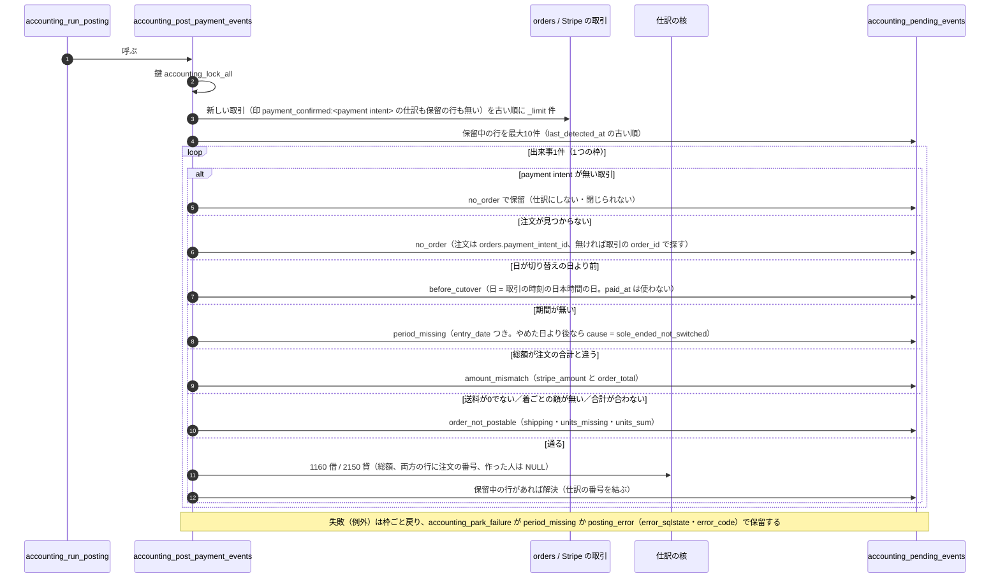
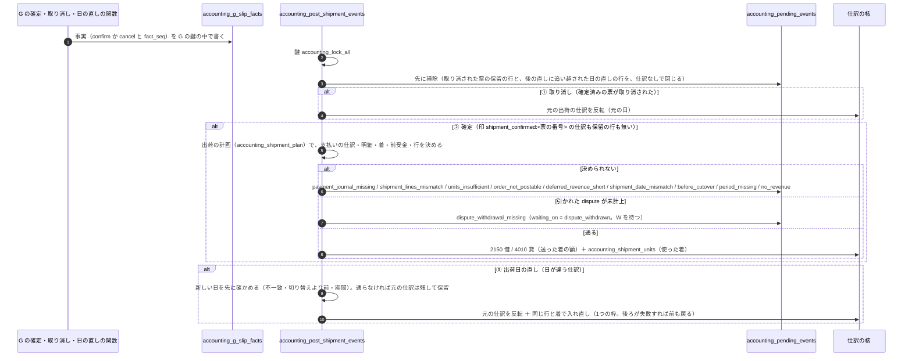
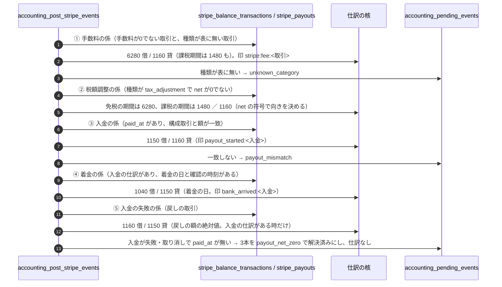
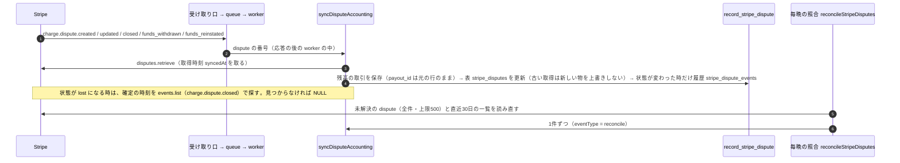

# 会計の計上係のシーケンス（支払い・出荷・Stripe・dispute）

> 状態: 現行のソース（会計の作り直し 計画2 Task 2〜10。手元の Supabase と使い捨てのコンテナで確かめた分。本番には未適用） | 確認日: 2026-11-09 | 対象: 支払いを前受金にする計上（S7）、出荷の日の売上（S8）、Stripe の手数料・入金・着金（S9）、dispute の受け取り（S10）と計上（S11）、計上の入口 `accounting_run_posting`

## 概要

仕訳にする出来事（支払い、発送票の確定・取り消し・出荷日の直し、Stripe の残高の取引、dispute）は、DB の4つの「係」が1つの入口 `public.accounting_run_posting` から順に仕訳にする。係は何回流しても同じ結果（出来事ごとの印で1本）で、出来事1件の失敗は戻して「計上待ち」に残し、ほかは続ける。呼び出し元と鍵の順は[システム構成](../../03_BasicDesign/architecture/system-overview.md)の「会計の計上係の流れ」、運用は[会計の運用](../../06_Operations/accounting-p2-posting-stripe.md)。

| 項目 | 内容 |
| --- | --- |
| 入口 | `public.accounting_run_posting(_limit integer DEFAULT 50)`（INVOKER、`service_role` だけ、1〜200）。戻りは `{payments, shipments, stripe, disputes, parked, resolved, has_more}` |
| 係の順 | 支払い → 出荷 → Stripe（手数料、税額調整、入金、着金、入金の失敗）→ dispute |
| 共通の作り | 最初に `accounting_lock_all(NULL)`。行の鍵は取らない。新しい出来事を古い順に `_limit` 件、続けて保留中の行を `last_detected_at` の古い順に最大10件。出来事1件は1つの `BEGIN … EXCEPTION` の枠で、失敗は `accounting_park_failure` が保留に残す |
| 遅れの印 | 仕訳の「元の記録の時刻」は `LEAST(元の行の時刻, clock_timestamp())`。日付の2か月後より後に記録されると `is_late` が付く |
| 保留の理由 | 18種（[運用の手引き](../../06_Operations/accounting-p2-posting-stripe.md)の 2）。状態は[計上待ちの状態](../states/accounting-pending.md) |

## 範囲と根拠

| 項目 | 内容 |
| --- | --- |
| 対応要件 | FREQ-562（支払い）、FREQ-563・564（出荷・取り消し・出荷日の直し）、FREQ-565・566（Stripe の手数料・入金・照合）、FREQ-567・568（dispute）、FREQ-569（計上待ち）、FREQ-570（保存した仕訳で数える） |
| 実装 | 移行 `supabase/migrations/20261108160000_accounting_p2_payment_posting.sql`（S7）、`…170000_…shipment_posting.sql`（S8）、`…180000_…stripe_posting.sql`（S9）、`…190000_…dispute_intake.sql`（S10）、`…200000_…dispute_posting.sql`（S11）。アプリ: [posting-runner.ts](../../../src/lib/accounting/posting-runner.ts)、[posting-store.ts](../../../src/lib/accounting/posting-store.ts)、[dispute-sync.ts](../../../src/lib/stripe/dispute-sync.ts)、[webhook-worker.ts](../../../src/lib/stripe/webhook-worker.ts) |
| 関連 | 手入力の仕訳は[会計の仕訳のシーケンス](accounting-journal.md)、Stripe の知らせは[Stripe Webhook](stripe-webhooks.md)、勘定の使い方は[財務](../shared/finance.md)の「Stripe決済残高の振替規則」 |
| 調査時点 | 2026-11-09 のソース。本番には S6〜S14 とも未適用 |

## 1. 支払いを前受金にする（S7）

開始は計上係の呼び出し。Stripe の残高の取引（`type` が `charge` か `payment`、`reporting_category` が `charge`）を1件ずつ見る。

## 2. 発送票の確定・取り消し・出荷日の直し（S8）

発送票の確定と取り消しは、G の関数が段を変えた直後に `accounting_g_slip_facts` へ事実（確定の番号 `fact_seq`）を書く。計上係はこの事実と発送票を読んで仕訳にする。新しい出来事は 取り消し → 確定 → 出荷日の直し の順で処理する（取り消しと再出荷が1回の呼び出しに重なっても入るように）。

| 論点 | 内容 |
| --- | --- |
| 着の選び方と額 | `accounting_shipped_units` が、確定の番号の時点で、まだ送っていない最も若い番号の着を選ぶ。額は着ごとの `paid_amount` − 確定の番号より前の出荷前の返金の割り当て。選ぶ所は1か所（`accounting_shipment_plan`）で、出荷日の直しは選び直さず元の仕訳の行と着を写す |
| 前受金の確認 | 注文ごとに、2150 の取り消されていない行の合計が、送る額以上であること。足りなければ `deferred_revenue_short` |
| 「0円の出荷」 | 額が0（交換の品だけなど）の票は仕訳を入れず、`no_revenue` で保留して同時に閉じる（`parked_new` と `resolved` の両方に数える） |
| 取り消しと日の直しの時刻 | 元の記録の時刻は、確定が `confirmed_at`、取り消しが `cancelled_at`、日の直しが履歴の `created_at`（いずれも `LEAST(…, clock_timestamp())`） |
| 取り消しが失敗した時 | 種類 `reversal`（出どころ `accounting_journal_entries`）で保留。計画6が作り直す |
| dispute との関係 | 引かれた取引（W）が同じ注文で未計上なら、W の番号より後に確定した票は W を待つ（`dispute_withdrawal_missing`）。W の側は、W の番号以前に確定した票の仕訳を待つ（`dispute_shipment_pending`）。互いに待ち合う形にはならない（[運用](../../06_Operations/accounting-p2-posting-stripe.md)の未確認事項 10） |

## 3. Stripe の手数料・入金・着金（S9）

取引の種類は1つの対応表（`private.accounting_stripe_category_kind(type, reporting_category)`。[stripe-categories.ts](../../../src/lib/accounting/stripe-categories.ts) と同じ。試験が一致を確かめる）で扱いを決める。表に無い種類は `unknown_category` で保留する（捨てない）。

残高の補充は人が入れる（`admin_record_balance_topup`。`1160 借 / 1040 貸`）。請求書の記録は `admin_set_stripe_invoice_record`。照合の読みは `get_stripe_fee_reconciliation(月)` と `get_stripe_balance_reconciliation(日)`（STABLE。[運用](../../06_Operations/accounting-p2-posting-stripe.md)の 5）。

## 4. dispute の受け取り（S10）と計上（S11）

### 受け取り

### 計上

W（引かれた時）・C（確定）・R／L（戻り）・X（科目の振り替え）の順序と待ちは[dispute の状態](../states/accounting-dispute.md)。1件の dispute は、取引の組み（`amount < 0` の `dispute` と `amount > 0` の `dispute_reversal`）に分けて W・R／L になり、確定の時刻で R と L が決まる。

## 5. 失敗した時の見方

| 場面 | 起きること | 人の見方 |
| --- | --- | --- |
| 出来事1件が例外 | その枠が戻り、`accounting_park_failure` が保留に書く。ほかの出来事は続く。保留に書くのも失敗したら、固定の `posting_error`（`XX000`・`unexpected_error`）に落とし、それも失敗したら何も書かない（次の呼び出しで新しい出来事として再び拾う） | 計上待ちの `posting_error`（記号と SQLSTATE） |
| 係の入口が失敗 | アプリは例外を握り、ログ `[accounting.posting]`（入口の名前と記号）だけ残す。定期処理は 502 と heartbeat の失敗 | `ops_job_heartbeats` の `accounting_post`（30分で店へ知らせ） |
| 同時実行 | 鍵で1つずつ。同じ出来事は印で1本 | なし |

## 受け入れ条件と設計の対応（計画2）

要求 `FREQ-562`〜`FREQ-574` の受け入れ条件（要件定義書の表）が、どの設計に書かれているかを示す。試験は[テスト仕様](../../05_Quality/tests/test-spec.md)の計画 2 の節。

| 要求 | 受け入れ条件 | 設計 |
| --- | --- | --- |
| FREQ-562 支払いを前受金で残す | `FREQ-562-AC-01`、`FREQ-562-AC-02`、`FREQ-562-AC-03`、`FREQ-562-AC-04`、`FREQ-562-AC-05` | 本書の 1（支払いを前受金にする）、[計上待ちの状態](../states/accounting-pending.md) |
| FREQ-563 出荷した日に送った分だけ売上にする | `FREQ-563-AC-01`、`FREQ-563-AC-02`、`FREQ-563-AC-03`、`FREQ-563-AC-04`、`FREQ-563-AC-05`、`FREQ-563-AC-06` | 本書の 2（発送票の確定・取り消し・出荷日の直し） |
| FREQ-564 出荷の取り消しと出荷日の直し | `FREQ-564-AC-01`、`FREQ-564-AC-02`、`FREQ-564-AC-03`、`FREQ-564-AC-04` | 本書の 2、[管理の会計のページ](../pages/16-5_admin_accounting.md)（出荷の跡・出荷した日と登録した日の列） |
| FREQ-565 Stripe の手数料・入金・着金を1件ずつ残す | `FREQ-565-AC-01`、`FREQ-565-AC-02`、`FREQ-565-AC-03`、`FREQ-565-AC-04`、`FREQ-565-AC-05`、`FREQ-565-AC-06` | 本書の 3（Stripe の手数料・入金・着金）、[財務](../shared/finance.md)の振替規則 |
| FREQ-566 Stripe の残高と手数料を照らし合わせる | `FREQ-566-AC-01`、`FREQ-566-AC-02`、`FREQ-566-AC-03` | 本書の 3、[運用の手引き](../../06_Operations/accounting-p2-posting-stripe.md)の 5 |
| FREQ-567 カード会社からの支払いの取り消しを受け取る | `FREQ-567-AC-01`、`FREQ-567-AC-02`、`FREQ-567-AC-03`、`FREQ-567-AC-04` | 本書の 4（受け取り）、[dispute の状態](../states/accounting-dispute.md) |
| FREQ-568 カード会社からの支払いの取り消しを仕訳にする | `FREQ-568-AC-01`、`FREQ-568-AC-02`、`FREQ-568-AC-03`、`FREQ-568-AC-04`、`FREQ-568-AC-05`、`FREQ-568-AC-06`、`FREQ-568-AC-07` | [dispute の状態](../states/accounting-dispute.md)（W・C・R／L・X の段と待ち合い） |
| FREQ-569 計上待ちと前受金の確認を出す | `FREQ-569-AC-01`、`FREQ-569-AC-02`、`FREQ-569-AC-03`、`FREQ-569-AC-04`、`FREQ-569-AC-05`、`FREQ-569-AC-06` | [計上待ちの状態](../states/accounting-pending.md)、[管理の会計のページ](../pages/16-5_admin_accounting.md)（計上待ち・前受金の確認） |
| FREQ-570 保存した仕訳で数える | `FREQ-570-AC-01`、`FREQ-570-AC-02`、`FREQ-570-AC-03`、`FREQ-570-AC-04` | [管理の会計のページ](../pages/16-5_admin_accounting.md)（期間で数える読み） |
| FREQ-571 受注高・受注残を帳簿と分けて照らす | `FREQ-571-AC-01`、`FREQ-571-AC-02`、`FREQ-571-AC-03`、`FREQ-571-AC-04`、`FREQ-571-AC-05`、`FREQ-571-AC-06` | [運用の手引き](../../06_Operations/accounting-p2-posting-stripe.md)の 5、[画面一覧](../../03_BasicDesign/ui/screen-list.md)の照合 |
| FREQ-572 KPI を受注高の名前と数え方にする | `FREQ-572-AC-01`、`FREQ-572-AC-02`、`FREQ-572-AC-03`、`FREQ-572-AC-04`、`FREQ-572-AC-05` | [画面一覧](../../03_BasicDesign/ui/screen-list.md)の KPI の受注高、[API 仕様](../../03_BasicDesign/api/api-spec.md)の `GET /api/admin/kpi` |
| FREQ-573 月の KPI の表を持つ | `FREQ-573-AC-01`、`FREQ-573-AC-02`、`FREQ-573-AC-03`、`FREQ-573-AC-04` | [データ](../../03_BasicDesign/data/er.md)の `admin_kpi_monthly_records`、[API 仕様](../../03_BasicDesign/api/api-spec.md)の `monthly-record` |
| FREQ-574 出荷の年末の照合と運送会社の受付日 | `FREQ-574-AC-01`、`FREQ-574-AC-02`、`FREQ-574-AC-03`、`FREQ-574-AC-04` | [画面一覧](../../03_BasicDesign/ui/screen-list.md)の年末の出荷の確認、[データ](../../03_BasicDesign/data/er.md)の `accounting_shipment_checks` |

## 関連テスト

- DB: `tests/integration/db/accounting_p2_payment_posting`・`…_shipment_posting`・`…_shipment_corrections`・`…_stripe_posting`・`…_stripe_reconciliation`・`…_dispute_intake`・`…_dispute_posting`・`…_run_posting`（`.integration.test.ts`）と、並行の `…_payment_concurrency`・`…_shipment_concurrency`・`…_stripe_concurrency`・`…_dispute_concurrency`（`ACCOUNTING_COMMIT_SUITE=1`）。PostgREST: `…_run_posting_postgrest`。
- アプリ: `tests/unit/lib/accounting/posting-runner.test.ts`・`posting-store.test.ts`、`tests/unit/lib/stripe/dispute-sync.test.ts`・`webhook-worker.test.ts`・`reconcile-orders.test.ts`、`tests/unit/api/cron/accounting-post-route.test.ts`。
- E2E: `FR-ADMIN-132`（支払い・出荷・取り消し・日の直し・計上待ち）、`FR-ADMIN-133`（手数料・照合・dispute・残高の補充）。

## 未確認事項

- Stripe の実機での dispute の知らせ（`stripe trigger`）と、`tax_fee`・`fee_details` の形、手数料の2段目の符号は、Stripe のテストモードを読んで確かめる（[運用](../../06_Operations/accounting-p2-posting-stripe.md)の未確認事項 1〜3・19）。
- 引かれた後に確定した発送票と W の間の止まりかたと回復（未確認事項 10）。DB の中の止めは計画3。
- 本番への適用は未実施。
