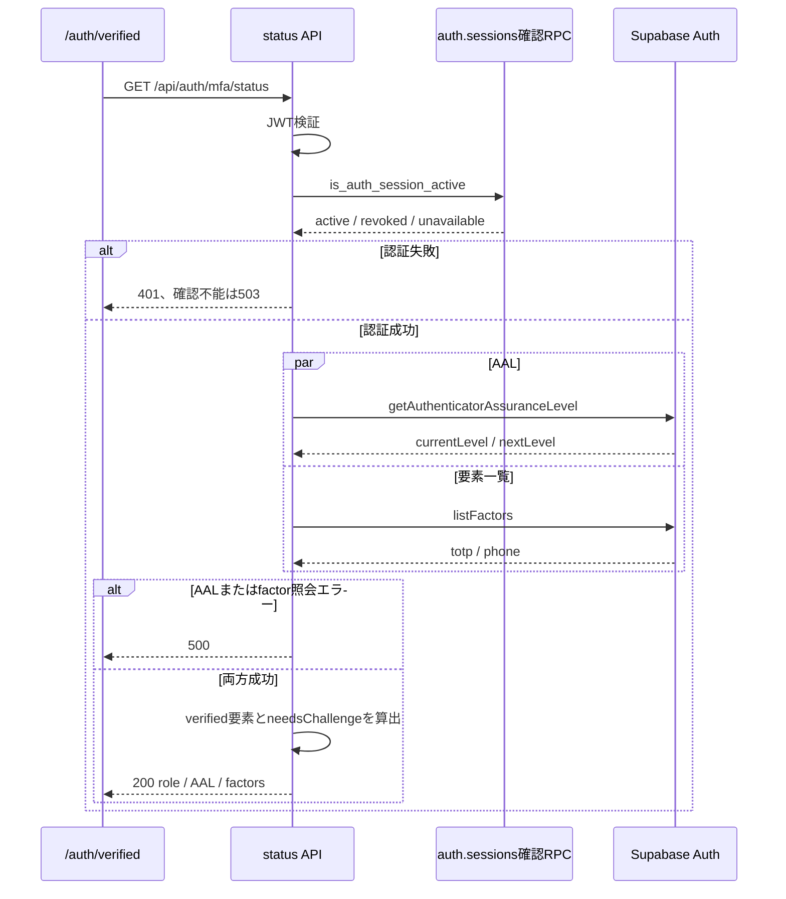
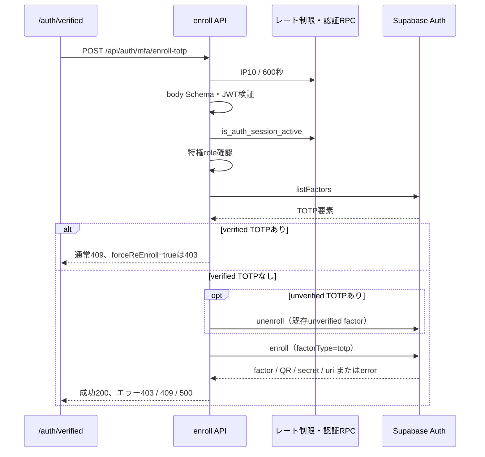
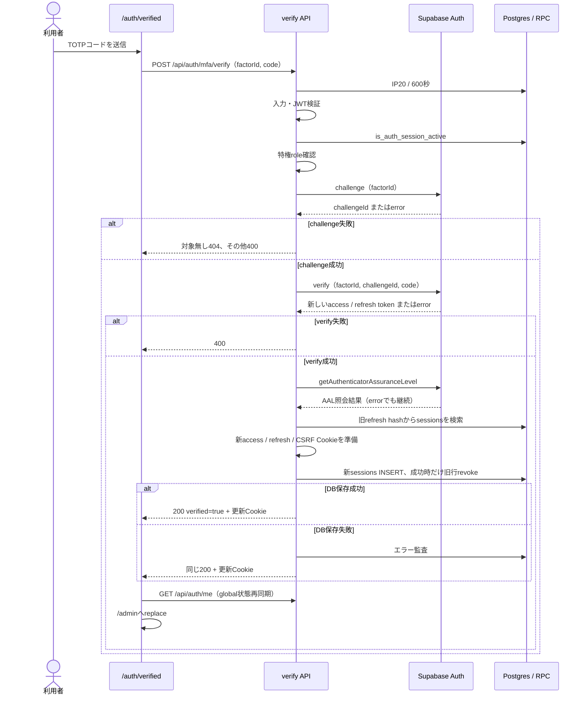
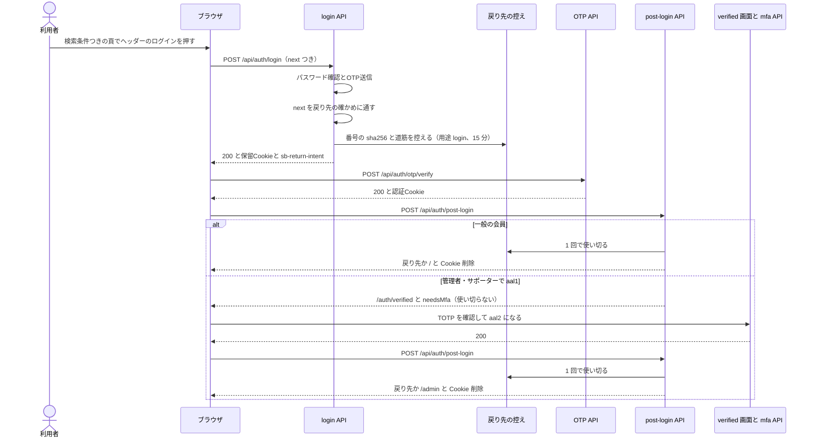

# ログイン・追加認証シーケンス

> 状態: 推定（パスワードとメールOTPの節は、2026-11-22 のパスキー段4の Task 28 で廃止した。TOTP の節は Task 30 で扱う） | 確認日: 2026-11-22 | 対象: 特権TOTP（パスワード、メールOTPは廃止）

## 概要

メールログインはパスワード確認後にメールOTPを送り、OTP検証後に認証Cookieとセッション記録を作る。管理者・サポーターのTOTPは、その認証済みセッションをAAL2へ昇格する別の操作である。開始契機ごとに7つの図へ分ける。図IDと分割の基準は[記載方針](README.md)を参照する。

## 範囲と根拠

対応する既存資料は[LOGINのページ別要求表](../pages/14_login.md)、[ADMINのページ別設計](../pages/16_admin.md)、[要求定義](../../02_Requirements/requirements.md)。ページ別資料の過去の実装判定は、本書の現行処理の根拠にはしない。

| 対象 | 実コード参照 |
| --- | --- |
| TOTP | [status API](../../../src/app/api/auth/mfa/status/route.ts)、[enroll API](../../../src/app/api/auth/mfa/enroll-totp/route.ts)、[verify API](../../../src/app/api/auth/mfa/verify/route.ts) |
| セッション、認証ガード | [初回保存](../../../src/features/auth/services/register.ts)、[更新保存](../../../src/features/auth/services/session.ts)、[認証検証](../../../src/lib/auth/authenticate.ts)、[Cookie属性](../../../src/lib/cookie.ts) |
| 呼び出し元 | [LoginContext](../../../src/contexts/LoginContext.tsx)、[TOTP画面](../../../src/app/auth/verified/page.tsx) |

状態変更APIは[proxy](../../../src/proxy.ts)のOrigin／Referer検査を先に通る。不正なOriginは403。[rate limiter](../../../src/features/auth/middleware/rateLimit.ts)は上限超過を429、カウンタDB障害を503とし、いずれもRetry-Afterを返す。OTPのaccount枠はhelperの503も429へ変換する例外があり、SQ-AUTH-LOGIN-OTPに記す。詳細なAPI認可は[セッション・API認可](auth-session.md)を参照する。

## 廃止: パスワード確認とOTP送信・メールOTPの検証・OTP再送・OTP待ちの取消（2026-11-22）

パスキー段4の Task 28 で、`POST /api/auth/login`・`/api/auth/otp/verify`・`/api/auth/login/resend`・`/api/auth/login/cancel` を消した（404。FR-AUTH-053-AC-01）。`SQ-AUTH-LOGIN-PASSWORD`・`SQ-AUTH-LOGIN-OTP`・`SQ-AUTH-LOGIN-RESEND`・`SQ-AUTH-LOGIN-CANCEL` の図は、コードが無いので残さない。お客さんのログインは、メールのコード・Google・パスキーだけ（[会員向けの画面の処理](auth-passkey-customer-screens.md)）。旧い保留の Cookie `sb-login-2fa-session` は読まない。

## SQ-AUTH-MFA-STATUS: 追加認証状態の取得

開始契機は`/auth/verified`からの状態照会。事前条件は認証CookieまたはBearer。終了結果はverified factorsとAALの200、または認証・照会エラーである。

`needsChallenge`は特権role、verified factorあり、nextLevel=aal2、currentLevel≠aal2のすべてを満たす場合。照会失敗は500。statusは一般userも照会でき、enroll／verifyのroleガードとは異なる。

## SQ-AUTH-MFA-ENROLL: TOTPの登録

開始契機はTOTPセットアップ。UIは未登録時に自動で一度開始する。事前条件は認証済みadmin／supporter。終了結果はfactorId・QR・secret・uriの200、または登録エラーである。

実際の順序はIP制限→client生成→body Schema→認証→role→listFactors。bodyは`forceReEnroll`を受理する。Schema不正400、認証失敗401／生存確認不能503、一般user403、一覧失敗500、enrollのinsufficient_aalは403、name conflictは409。unenrollの戻り値は検査せずenrollへ進む。外側例外は500。

## SQ-AUTH-MFA-VERIFY: TOTP検証とAAL2昇格

開始契機はTOTPコード送信。事前条件は認証済みadmin／supporter、UUID factorId、数字6〜8桁code。終了結果は検証成功200と更新Cookie、またはエラーである。

実際の前段順序はIP制限→入力→client→認証→role。入力不正400、認証失敗401／生存確認不能503、一般user403。challengeの対象無しは404、その他challenge失敗は400、verify失敗は400。AAL照会失敗はログを残して継続する。DB保存失敗でもSupabaseが発行した新tokenを配る。保存処理のCookie準備自体に例外が起きた場合は、同じ200でも準備済みCookieの範囲が異なる。管理APIの利用には別途DB ACLとJWT aal2が必要である。外側例外は500。

## SQ-AUTH-LOGIN-RETURN: 戻り先の控えと使い切り（2026-10-25、波 1-A）

開始契機は検索条件つきの公開頁や会員だけの頁からのログイン。事前条件は `/login?next=` に戻り先の確かめを通した道筋があること。終了結果は戻り先（無ければ `/`、管理者・サポーターは `/admin`）への移動。設計は [AUTH の構造設計](../../03_BasicDesign/areas/auth.md) の ARC-AUTH-010・API-AUTH-019、決定は `.superpowers/sdd/2026-10-25-security-gap-fixes/wave1a-decisions.md`。

- 控えを作るのはパスワードの確認とOTPの送信が成功した後だけ。誤りやボット判定では作らない
- 番号は `sb-return-intent`（HttpOnly）の Cookie だけを通り、URL・本文には出ない
- 使い切った戻り先は、役割と aal2 を渡してもう一度確かめる。外れた・使えない時は `/`（管理者・サポーターは `/admin`）
- 取消（cancel）とログアウトで Cookie を消す

## 関連テスト

今回、以下のテストは未実行。リンクは既存の検証観点を示す。

| 観点 | テスト |
| --- | --- |
| login・OTPと宛先・回数制限 | login、OTP |
| 再送・取消・署名期限 | resend、cancel、保留Cookie |
| MFA後のCookie・DB失敗 | [MFA verify](../../../tests/integration/api/auth/mfa-verify.test.ts) |
| 画面ガード・再送表示 | OTP専用画面、OTP保護、再送エラー |

## 未確認事項

Supabaseの実際のOTP有効期限、メールテンプレートと到達、実TOTPの登録・昇格、migration適用状況は未確認。Cookieの300秒を実環境のOTP設定の確認結果として扱わない。
