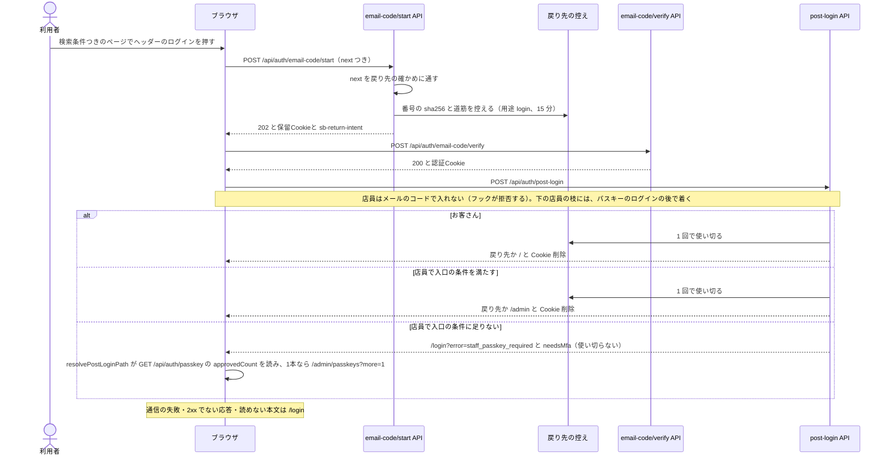

# ログイン・追加認証シーケンス

> 状態: 推定（パスワードとメールOTPの節は Task 28、TOTP の節は Task 30 で、2026-11-22 のパスキー段4で廃止した。残るのは戻り先の控えと使い切りだけ） | 確認日: 2026-11-22 | 対象: 戻り先の控えと使い切り（パスワード、メールOTP、TOTP は廃止）

## 概要

パスワードとメールOTP、TOTP の図は、段4で窓口ごと消したので残さない。残る図は戻り先の控えと使い切り（SQ-AUTH-LOGIN-RETURN）だけ。図IDと分割の基準は[記載方針](README.md)を参照する。

## 範囲と根拠

対応する既存資料は[LOGINのページ別要求表](../pages/14_login.md)、[ADMINのページ別設計](../pages/16_admin.md)、[要求定義](../../02_Requirements/requirements.md)。ページ別資料の過去の実装判定は、本書の現行処理の根拠にはしない。

| 対象 | 実コード参照 |
| --- | --- |
| セッション、認証ガード | [初回保存](../../../src/features/auth/services/register.ts)、[更新保存](../../../src/features/auth/services/session.ts)、[認証検証](../../../src/lib/auth/authenticate.ts)、[Cookie属性](../../../src/lib/cookie.ts) |
| 呼び出し元 | [LoginContext](../../../src/contexts/LoginContext.tsx) |

状態変更APIは[proxy](../../../src/proxy.ts)のOrigin／Referer検査を先に通る。不正なOriginは403。[rate limiter](../../../src/features/auth/middleware/rateLimit.ts)は上限超過を429、カウンタDB障害を503とし、いずれもRetry-Afterを返す。OTPのaccount枠はhelperの503も429へ変換する例外があり、SQ-AUTH-LOGIN-OTPに記す。詳細なAPI認可は[セッション・API認可](auth-session.md)を参照する。

## 廃止: パスワード確認とOTP送信・メールOTPの検証・OTP再送・OTP待ちの取消（2026-11-22）

パスキー段4の Task 28 で、`POST /api/auth/login`・`/api/auth/otp/verify`・`/api/auth/login/resend`・`/api/auth/login/cancel` を消した（404。FR-AUTH-053-AC-01）。`SQ-AUTH-LOGIN-PASSWORD`・`SQ-AUTH-LOGIN-OTP`・`SQ-AUTH-LOGIN-RESEND`・`SQ-AUTH-LOGIN-CANCEL` の図は、コードが無いので残さない。お客さんのログインは、メールのコード・Google・パスキーだけ（[会員向けの画面の処理](auth-passkey-customer-screens.md)）。旧い保留の Cookie `sb-login-2fa-session` は読まない。

## 廃止: 追加認証状態の取得・TOTPの登録・TOTP検証とAAL2昇格（2026-11-22）

パスキー段4の Task 30 で、`GET /api/auth/mfa/status`・`POST /api/auth/mfa/enroll-totp`・`POST /api/auth/mfa/verify` と、確認の画面 `/auth/verified` を消した（404。FR-AUTH-053-AC-03）。`SQ-AUTH-MFA-STATUS`・`SQ-AUTH-MFA-ENROLL`・`SQ-AUTH-MFA-VERIFY` の図は、コードが無いので残さない。店員の入口は、パスキー（認めた鍵2本）で決める（[店員のパスキーの入口](auth-staff-passkey-entry.md)）。ログインの後の行き先は `POST /api/auth/post-login` が返す（ARC-AUTH-015、ADR-0475）。

## SQ-AUTH-LOGIN-RETURN: 戻り先の控えと使い切り（2026-10-25、波 1-A）

開始契機は検索条件つきの公開頁や会員だけの頁からのログイン。事前条件は `/login?next=` に戻り先の確かめを通した道筋があること。終了結果は戻り先（無ければ `/`、管理者・サポーターは `/admin`）への移動。設計は [AUTH の構造設計](../../03_BasicDesign/areas/auth.md) の ARC-AUTH-010・API-AUTH-019、決定は `.superpowers/sdd/2026-10-25-security-gap-fixes/wave1a-decisions.md`。

- 控えを作るのはメールのコードの始めが成功した後だけ。誤りやボット判定では作らない
- 番号は `sb-return-intent`（HttpOnly）の Cookie だけを通り、URL・本文には出ない
- 使い切った戻り先は、役割と店員の入口の条件を渡してもう一度確かめる。外れた・使えない時は `/`（管理者・サポーターは `/admin`）
- 取消（cancel）とログアウトで Cookie を消す

## 関連テスト

今回、以下のテストは未実行。リンクは既存の検証観点を示す。

| 観点 | テスト |
| --- | --- |
| 行き先の窓口 | `tests/integration/api/auth/post-login.test.ts`（ARC-AUTH-015・API-AUTH-019） |
| 戻り先の使い切り | `tests/integration/api/auth/return-intent-flow.test.ts` |

## 未確認事項

Supabaseの実際のOTP有効期限、メールテンプレートと到達、migration適用状況は未確認。Cookieの300秒を実環境のOTP設定の確認結果として扱わない。
