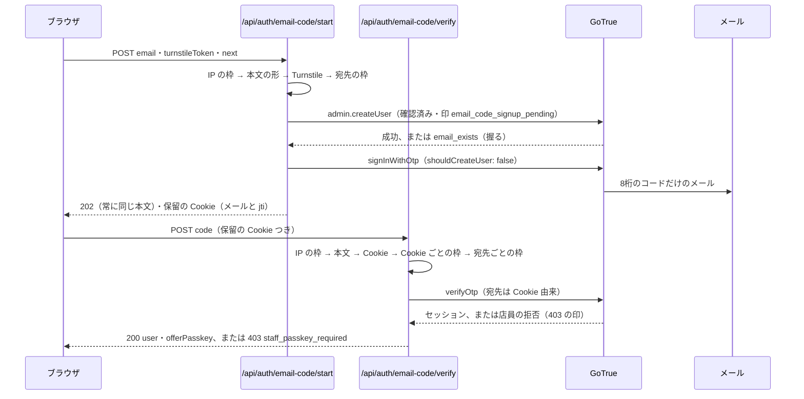

# お客さんのログイン（メールのコードの窓口と画面）

> 状態: 推定 | 確認日: 2026-11-18 | 対象: `src/app/api/auth/email-code/{start,verify,resend,cancel}/route.ts`、`src/features/auth/services/email-code-session.ts`、`src/features/auth/schemas/email-code.ts`、`src/lib/cookie.ts`（範囲の外。メールのコードの保留の Cookie の名前と属性だけを足した）

## 概要

段2で、お客さんがメールに届いたコードだけでログイン・新規登録できるようにする。この文書の最初の節（DD-AUTH-059）は、その土台になる4つの窓口と保留の Cookie の処理を書く。画面（`/login`・`/login/code` など）の処理は、以降のタスクがこの文書に足す。

## 範囲と根拠

| 項目 | 内容 |
| --- | --- |
| 対応する ID | SR-AUTH-021、FR-AUTH-023、SEC-AUTH-048、SEC-AUTH-049、THR-AUTH-049、API-AUTH-029、API-AUTH-030、API-AUTH-031、API-AUTH-032、DD-AUTH-059、ADR-0469、SEC-AUTH-050、DD-AUTH-060、SR-AUTH-022、FR-AUTH-025、DD-AUTH-061、FR-AUTH-026、DD-AUTH-062 |
| 対象のコード | `src/app/api/auth/email-code/start/route.ts`、`verify/route.ts`、`resend/route.ts`、`cancel/route.ts`、`src/features/auth/services/email-code-session.ts`、`src/features/auth/schemas/email-code.ts`、`src/lib/cookie.ts`（`emailCodeSessionCookieName`・`cookieOptionsForEmailCode`）、`src/features/auth/passkey/{webauthn-browser,passkey-client,device-name,post-login}.ts`、`src/features/auth/schemas/passkey.ts`（`dropNullFields`）、`src/lib/auth/passkey-gotrue.ts`（`server-only`） |
| 関連文書 | [設計](../../superpowers/specs/2026-11-07-passkey-auth-design.md)（6-1）、[段2の計画](../../superpowers/plans/2026-11-17-passkey-stage2-customers.md)、[パスキーの窓口](auth-passkey-server-endpoints.md) |
| 調べた時点 | 2026-11-17（手元の GoTrue で、作成→コードの送信→確定の組み合わせを実測した。手元の DB・Mailpit で E2E を流した） |

## 処理の詳細

### DD-AUTH-059 メールのコードの窓口4つと保留の Cookie の処理の順番

| 属性 | 値 |
| --- | --- |
| 上位 | API-AUTH-029、API-AUTH-030、API-AUTH-031、API-AUTH-032、SEC-AUTH-048、SEC-AUTH-049 |
| 根拠 | 手元の GoTrue は、未登録のアドレスに `signInWithOtp({ shouldCreateUser: true })` を呼ぶと確認メールの型（リンク型）で送る。この型は旧の会員登録も使うので、コードを足すと旧画面の確認メールが変わる。そこで窓口が先に、確認済み・パスワード無しでアカウントを作り（`admin.createUser`）、全員に同じく `signInWithOtp({ shouldCreateUser: false })` を呼ぶ。ログインのコードのメールの型だけが使われ、コードだけが届く。登録済みなら `createUser` が `email_exists` で断られるので握り、応答を同じにする |
| 状態 | 推定 |
| 確かめ方 | 単体テスト（`tests/unit/features/auth/email-code-session.test.ts`、`tests/unit/api/auth/email-code-*-route.test.ts`）、結合テスト（`tests/integration/api/auth/email-code-*.test.ts`）、E2E（`e2e/FR-LOGIN-055-email-code-api.spec.ts`） |
| 出どころ | `.superpowers/sdd/2026-11-17-passkey-stage2-customers/task-1-brief.md`、`docs/superpowers/specs/2026-11-07-passkey-auth-design.md`（6-1）、`docs/superpowers/plans/2026-11-17-passkey-stage2-customers.md`（Task 1。作り手の判断 3・4、調整役の判断 3） |

処理の順番と決め:

| 窓口 | 順番 | 失敗 |
| --- | --- | --- |
| 始め | IP の枠（50回/10分、`auth:email-code:send`）→ 本文の形（400）→ Turnstile（403 `Bot detection failed`）→ 宛先の枠（5回/10分、同じ名前）→ `createUser`（`email_exists` は握る、`email_address_invalid` は 400、それ以外は 500・監査 `supabase_create_user_failed`）→ `signInWithOtp`（captcha の拒否は 500、GoTrue の 429 は成功と同じ 202 に隠して監査 `email_code_send_throttled`・ログ、5xx は 503）→ 保留の Cookie と戻り先の控え | 上の表のとおり。成功は常に 202 |
| 確定 | IP の枠（30回/10分、`auth:email-code:verify`）→ 本文（400）→ 保留の Cookie（401）→ Cookie ごとの枠（`email:jti`、5回/10分）→ 宛先ごとの枠（20回/10分）→ `verifyOtp`（宛先は Cookie 由来）。使い切ったら Cookie を消して 429（消すのはブラウザの Cookie だけ。署名した値は期限まで使えるが、宛先ごとの枠が上を押さえる） | 店員の印つきの拒否は 403 `staff_passkey_required`（Cookie は消し、セッションを作らない）。コード違いは 401 |
| 再送 | 保留の Cookie（401）→ IP の枠（50回/10分）→ 宛先の枠（5回/10分、始めと同じ名前）→ `signInWithOtp` → Cookie を元の発行時刻と `jti` で付け直す（200） | GoTrue の 429 は成功と同じ 200 に隠して監査 `email_code_send_throttled`・ログ（保留の Cookie は誰でも任意のアドレス宛てに持てるため）、5xx・通信の失敗は 503、ほかの送信の失敗は 500。隠した時は `otp_resent` を書かない |
| 取りやめ | 保留の Cookie と戻り先の控えを消して 204。Cookie があった時だけ監査に残す | 無し |

成功した確定: セッションを保存（ゲストのカート・お気に入りの引き継ぎつき）→ 印 `email_code_signup_pending` を外す（失敗は監査の符号だけで続行）→ 注文の引き継ぎ（`linkGuestOrdersByEmail`）→ 200 `{ user: { id, email, role }, offerPasskey, message }`。`offerPasskey` は、`role` が `user` で、鍵の一覧が成功して0本の時だけ真（一覧の失敗・店員は偽。閉じる側）。

保留の Cookie（`sb-email-code-session`）: メールと乱数 `jti` と発行時刻を HMAC で署名する。`userId` を持たない（登録済みかどうかを Cookie から読ませない）。属性は旧の保留の Cookie と同じ（HttpOnly・SameSite=Strict・5分）。再送では発行時刻と `jti` を引き継ぎ、絶対の上限（30分）で打ち切る。署名の目的（`purpose`）が旧と違うので、旧い Cookie の値を新しい窓口に渡しても、その逆も読めない。

旧の会員登録（`signUp`）で作って確認していないアドレス: 始めは同じ 202 を返す（応答を変えない）。GoTrue は確認のメール（リンク型）を送るのでコードは届かない。`/login/code` の画面は、アカウントの状態にかかわらず、いつも「コードの無い確認のメールが届いた時は、そのメールのリンクを押してから、もう一度お試しください。」と案内する。サーバーで確認済みにはしない（パスワードを先に付けた他人が、そのアドレスでログインできてしまうため）。旧の登録は段4まで残る。本人がリンクを押した後は、先にパスワードを付けた他人の旧の登録が確認済みになる危険が、段2の前と同じく残る。

GoTrue の宛先ごとの送信の間隔の 429 を 202 に隠す理由: 直前に認証のメールを受けた既存のアドレスだけで起きるので、429 のまま返すと未登録と見分けがつく。代わりにプロジェクト全体の送信の上限でも「送った」と見えるが、監査とログに残り、画面の再送（60秒後）で戻れる。

テスト観点: 始めと再送の GoTrue の 429 が成功と同じ応答になる（成功の監査は書かない）、始めと再送が本物の鍵の作りで合計5通を共有する、始めの応答が未登録・登録済み（`email_exists`）・登録済みで未確認・店員で同じ（本文・状態・Cookie の名前と属性）、`email_address_invalid` が 400、Turnstile の失敗で作成・送信・宛先の枠が0回、始めと再送が同じ枠で合計5通まで、別の保留の Cookie の失敗が本人の枠を使わない、枠を使い切ると Cookie を消して 429、店員は 403 で Cookie を残さない、成功で印が外れる（外す失敗でもログインできる）、`offerPasskey` の4通り、旧い保留の Cookie が新しい窓口で 401。

### DD-AUTH-060 ブラウザの WebAuthn の部品と、1b の窓口を呼ぶ部品

| 属性 | 値 |
| --- | --- |
| 上位 | SEC-AUTH-050 |
| 根拠 | 画面（Task 4〜7）が薄くなるよう、ブラウザの WebAuthn の呼び出しと、1b の窓口を呼ぶ処理を、React を知らない関数に切り出す。実ブラウザの `toJSON()` は `authenticatorAttachment: null` を返しうるので、部品が落とし、窓口の形も `null` を受けて GoTrue へ渡す前に落とす（1b の持ち越し T2 M12）。`passkey-gotrue` に `server-only` を付け（T2 M3）、画面の部品が読まないことを試験で守る。登録の終わりの GoTrue の失敗（502）と形の失敗（400。`uv_required` を含む）は、画面では区別せず `retry` にそろえる（T7 M3。窓口の状態は変えない） |
| 状態 | 推定 |
| 確かめ方 | 単体テスト（`tests/unit/features/auth/passkey/*.test.ts`、`tests/unit/features/auth/schemas/passkey.test.ts`、`tests/unit/api/auth/passkey-{login,register}-finish-route.test.ts`）。1b の E2E（`e2e/FR-LOGIN-050`・`051`）が窓口の直の呼び出しで緑のまま |
| 出どころ | `.superpowers/sdd/2026-11-17-passkey-stage2-customers/task-2-brief.md`、`docs/superpowers/plans/2026-11-17-passkey-stage2-customers.md`（Task 2）、`.superpowers/sdd/2026-11-17-passkey-stage1b-server-endpoints/final-review.md`（持ち越し） |

処理の順番と決め:

| 部品 | 順番 | 結果 |
| --- | --- | --- |
| `requestAssertion`・`requestAttestation` | 対応の確かめ（`PublicKeyCredential` と `navigator.credentials`）→ 選択肢の `challenge`・`allowCredentials[].id`・`excludeCredentials[].id`・`user.id` を `ArrayBuffer` に直す（`parse*FromJSON` が在れば使い、無ければ自前の base64url）→ `credentials.get`・`create` → 応答を JSON にする（`toJSON()` が在れば使い、無ければ自前）→ `null` の項目を落とす | `NotAllowedError` は `cancelled`、`InvalidStateError` は `already_registered`、`NotSupportedError`・`SecurityError` は `unsupported`、それ以外は `failed`。対応が無ければ `unsupported`。何もログに出さない |
| `loginWithPasskey` | 始め（1b の `browser-start`）→ `assert` → `POST /api/auth/passkey/login/finish { challenge_id, credential, next }` | 始めの失敗はそのまま。終わりは 401 `passkey_login_failed` → `not_found`、400 `uv_required` → `uv_required`、403 `staff_passkey_required`・`passkey_not_approved` → `staff_blocked`、429 → `rate_limited`（`Retry-After` を秒で）、503・502・409 → `unavailable`、それ以外 → `failed` |
| `registerPasskey` | `POST register/start` → `create` → `POST register/finish` → `PATCH /api/auth/passkey/{id}`（失敗は握る） | 403 `registration_not_allowed` の `reauth_required` → `reauth_required`、401 → `unauthorized`、429 → `rate_limited`、502・400 → `retry`、503 → `unavailable`。名前の変更の失敗は `ok: true` で `nameApplied: false` |
| `listPasskeys`・`renamePasskey`・`deletePasskey` | `clientFetch`（CSRF は `clientFetch` が付ける）で `GET`・`PATCH`・`DELETE` | 401 → `unauthorized`、404 → `not_found`、429 → `rate_limited`、503 → `unavailable`、それ以外 → `failed`。応答の本文は、読まない道でも捨てる（no-store の読み残しで E2E の `networkidle` が来なくなるため）。お客さん専用で、店員の項目（`isStaff`・`approvedCount`・`approved`）は返さない（段3で足す） |
| `deviceNameFromUserAgent` | `iPhone`・`iPad`・`Android`・`Mac`・`Windows`・`Linux` を含む順に見る | 無ければ `この端末`。返す名前は固定で、どれも64字より短い |
| `resolvePostLoginPath` | `POST /api/auth/post-login` | 旧 `VerifyOtpClient` の同名の関数と同じ規則（401 は `/login`、失敗・読めない本文・`needsMfa` は `/auth/verified`、それ以外は `sanitizeReturnPath`） |
| `dropNullFields`（窓口側） | 応答の最上位の `null` の項目を落とす | GoTrue へ渡す前に、ログイン・登録の終わりの2本が使う |

テスト観点: `parse*FromJSON` が在る環境と無い環境の両方で、既知の base64url が正しい `ArrayBuffer` になる、`toJSON()` が `authenticatorAttachment: null` を返しても戻りに `null` が残らない、4つの `DOMException` の名前の対応、`PublicKeyCredential` が無い環境で `unsupported`、ログに `challenge` が出ない、始め・終わりの状態ごとの `reason`、登録の 403・401・502・400・503 の対応、名前の変更の失敗で `ok: true`・`nameApplied: false`、`null` の応答が窓口で 400 にならず GoTrue へ `null` なしで渡る、`src/features/auth/passkey/**` が `passkey-gotrue`・`passkey-start-config` を読まない。

### DD-AUTH-061 旧のログイン・会員登録の画面の `/login/password` への退避と、旧の流れの戻り先

| 属性 | 値 |
| --- | --- |
| 上位 | SCR-AUTH-001、FLOW-AUTH-001 |
| 根拠 | `/login` を新しい画面に作り替える前に、パスワードの旧の画面を `/login/password` へ動かし、中身を変えずに旧の画面を操作する試験の URL だけを付け替える。旧の流れが新しい画面に飛ばされて旧のフォームを探して落ちるのを防ぎ、段4で旧を丸ごと消せるようにする（調整役の判断 2・I-2） |
| 状態 | 推定 |
| 確かめ方 | 単体テスト（`tests/unit/app/login/login-page.test.tsx`、`tests/unit/contexts/providers-auth-page.test.tsx`、`tests/unit/components/auth-tabs.test.tsx`、`tests/unit/components/VerifyOtpClient.test.tsx`、`tests/unit/components/register-modal.test.tsx`、`tests/unit/app/login/login-verify-page.test.tsx`）、E2E（`e2e/FR-LOGIN-056-legacy-login-relocated.spec.ts`） |
| 出どころ | `.superpowers/sdd/2026-11-17-passkey-stage2-customers/task-3-brief.md`、`docs/superpowers/plans/2026-11-17-passkey-stage2-customers.md`（Task 3。調整役の判断 2・I-2） |

処理の順番と決め:

| 単位 | 動き |
| --- | --- |
| `src/app/login/password/page.tsx` | 旧の `/login` のページをそのまま移した。保留の旧い Cookie が有効なら `/login/verify` へ転送（問い合わせは読まない）→ `tab`・`email`・`next`（戻り先の確かめを通った道筋だけ）・`registered` を `AuthTabs` に渡す。metadata は題・説明・OG を旧と同じにし、`robots: { index: false, follow: false }` を足す |
| `src/components/AuthTabs.tsx` | タブの `path` を `/login/password` にする。タブを替えても `history.replaceState` で `/login/password` に置き換える |
| `src/contexts/Providers.tsx`（範囲の外） | `isAuthPage` に `/login/password`・`/login/code`・`/login/passkey` を足す。足さないと真ん中寄せの枠にならず `FR-LOGIN-016`・`017`・`023` が落ちる |
| `src/app/login/verify/page.tsx` | 保留の Cookie が無い・偽り・期限切れの時の転送先を `/login/password` にする |
| `src/app/login/verify/VerifyOtpClient.tsx` | 再送の401、取りやめ、`post-login` の401 で移る先を `/login/password` にする |
| `src/components/RegisterModal.tsx` | 戻る手段が無い時の「ログインページへ」のリンクを `/login/password` にする |
| `src/app/login/page.tsx` | この段では変えない（Task 5 で作り替える）。Task 3 の終わりでは `/login` と `/login/password` が同じ中身になる |
| 変えない行き先 | `src/app/api/auth/confirm/route.ts` の `/login`・`/login?registered=1`、パスワードの再設定・変更の後の `/login`、`GuestRegisterPrompt` の `/login?tab=register&email=…`。お客さんに見せる行き先は新しい `/login` が受ける |

テスト観点: `/login/password` が旧のページの分岐（保留の転送・タブ・メール・戻り先・案内）を持つ、`robots` が noindex・nofollow、`isAuthPage` が `/login/password`・`/login/code`・`/login/passkey` で真になり、近い別の住所（`/login/other`・`/login/password/extra`）では偽、`AuthTabs` の `replaceState` が `/login/password`、旧の流れの3つの戻り先が `/login/password`。E2E は旧の画面を操作する試験の `goto('/login')` を `/login/password` に付け替え、期待は変えない（`/login?next=…` へ送られることを確かめる試験は新しい `/login` に着くので替えない）。

### DD-AUTH-062 メールのコードの入力画面 `/login/code` の処理の順番

| 属性 | 値 |
| --- | --- |
| 上位 | SCR-AUTH-004、FLOW-AUTH-001、API-AUTH-030、API-AUTH-031、API-AUTH-032 |
| 根拠 | 旧の `/login/verify`（DD-AUTH-002）の動きを写し、窓口だけを `email-code/*` にする。旧の部品を共有に直さないのは、段4で旧を丸ごと消すため（作り手の判断 5）。成功の行き先は、確定の窓口の応答の `offerPasskey` だけで決める。一覧や検索の別の呼び出しをしないので、窓口が失敗側に倒れた時（`offerPasskey` が偽）は、静かに「勧めない」へ退く |
| 状態 | 推定 |
| 確かめ方 | 単体テスト（`tests/unit/features/auth/passkey/email-code-entry.test.tsx`、`tests/unit/app/login/code-page.test.tsx`）、E2E（`e2e/FR-LOGIN-058-email-code-screen.spec.ts`） |
| 出どころ | `.superpowers/sdd/2026-11-17-passkey-stage2-customers/task-4-brief.md`、`docs/superpowers/plans/2026-11-17-passkey-stage2-customers.md`（Task 4。作り手の判断 5） |

処理の順番と決め:

| 単位 | 動き |
| --- | --- |
| `src/app/login/code/page.tsx` | 保留の Cookie（`sb-email-code-session`）を `verifyEmailCodeSessionToken` で確かめる → 無い・偽り・期限切れは同じく `/login` へ転送（確かめない人に HTML を見せない）→ 有効なら保留のメールを部品へ渡す。`robots` は noindex・nofollow |
| `EmailCodeEntry`（開いた時） | 最初の欄にフォーカス。再送の待ちを今から60秒で始め、1秒ごとに経過の時刻から残りを引き直す。説明は `maskEmail` で伏せたメールと「8桁・5分以内」。いつも「コードの無い確認のメールが届いた時は、そのメールのリンクを押してから、もう一度お試しください。」を出す（アカウントの状態で変えない。FR-AUTH-023・DD-AUTH-059 と同じ案内） |
| 欄 | 数字だけ。打つと次の欄へ。貼り付けは、その欄から8桁まで割り振る。Backspace は空の欄なら前の欄を空にして戻る。矢印で移る |
| 「ログイン」 | 8桁そろうまで `disabled`。送ると `POST /api/auth/email-code/verify { code }`（応答の本文は必ず読む） |
| 確定の 200 | 移動が終わるまで入力・送信を止めたままにする（二度目の確定は保留が無く 401 になる）。`refreshAuthState()` → `offerPasskey` が真 かつ `isPasskeySupported()` が真なら `router.replace('/login/passkey')`。それ以外は `resolvePostLoginPath()`（DD-AUTH-060）の行き先へ `router.replace`（戻るで入力画面へ戻れない） |
| 確定の 401 | 本文の文が「セッションの有効期限」で始まれば保留の Cookie 切れ → 「時間がたちました。もう一度メールアドレスを入れてください。」を出し、入力を閉じ、「ログイン画面へ戻る」へフォーカスを移す（自動では戻さない。押すと `/login`）。それ以外はコードの誤り → 「確認コードが無効、または期限切れです。」（最初の欄へフォーカスを戻し、入力を続けられる） |
| 確定の 429 | 宛先・保留ごとの枠では窓口が保留の Cookie を閉じる。IP の枠の 429 では Cookie は残るが、画面は同じく閉じる → 「試行が集中しています。しばらくしてからやり直してください。」を出し、入力を閉じる（自動では戻さない。「ログイン画面へ戻る」で `/login`） |
| 確定の 403 `staff_passkey_required` | 「店員の方は、パスキーでログインしてください。」を出し、入力と再送を止め、「ログイン画面へ戻る」だけを置く（自動では戻さない） |
| 確定のそれ以外・通信の失敗 | 「確認できませんでした。時間をおいて、もう一度お試しください。」 |
| 「コードを再送する」 | 待ちが0になるまで `disabled`（残りは `formatResendCountdown`）。押すと `POST /api/auth/email-code/resend`（本文は捨てる）。200 は欄を空にし、待ちを60秒に戻し、「確認コードを再送しました。」を `status` で知らせ、最初の欄へ。401 は保留切れと同じ。429 は `Retry-After`（秒または日付。読めなければ60秒）を待ちにし、「しばらく再送できません。時間をおいて、もう一度お試しください。」。503 は「ただいま処理できません。時間をおいて、もう一度お試しください。」。それ以外は「確認コードを送れませんでした。時間をおいて、もう一度お試しください。」 |
| 「メールアドレスを入れ直す」 | `POST /api/auth/email-code/cancel`（本文は捨て、失敗は握る）→ `/login` へ置き換える。文字ボタンは高さ44px以上。`/login` は Task 5 まで旧の画面 |
| 共通 | エラーは `LiveMessage`（`alert`）、成功の知らせは `status`。送信中は `aria-busy` と `disabled`、二重に送らない |

テスト観点: 8桁そろうまで「ログイン」が `disabled`、貼り付けの割り振りと数字以外の除去、Backspace、確定の応答ごとの文言と行き先（401 の2種・429・403・200 で `offerPasskey` が真・偽・未対応のブラウザ・本文が読めない）、閉じた後に自動では戻らず、フォーカスが「ログイン画面へ戻る」へ移ること、成功の後に二重に送れないこと、`refreshAuthState` が移動より先に走ること、再送の待ち（`jest.useFakeTimers`）・成功・401・`Retry-After`・503・その他、取りやめが失敗でも `/login` へ戻り本文を捨てること、送信中の二重送信の防止。ページは Cookie 無し・偽りで `/login` へ転送、有効ならメールを渡す。E2E は `start` を `request` で呼んで Mailpit のコードを入れ、鍵を持つ会員が戻り先へ着くこと、間違ったコード、再送の待ち、取りやめ、Cookie 無し、390px の幅を確かめる（`offerPasskey` が真の着地は `/login/passkey` が出来る Task 6 の E2E）。
