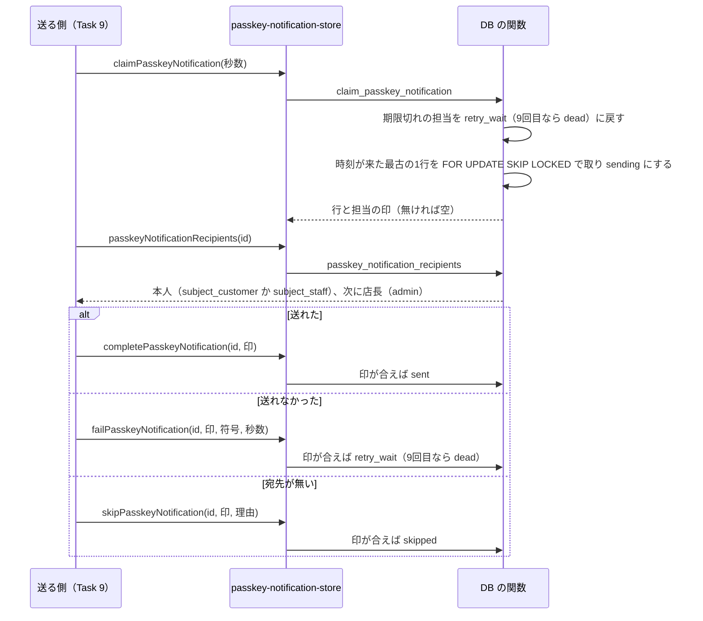

# パスキーの知らせを取り出して送るための DB の関数

> 状態: 推定 | 確認日: 2026-11-18 | 対象: `supabase/migrations/20261118044338_passkey_notification_sending.sql`、`src/lib/auth/passkey-notification-store.ts` | 親: [シーケンス設計の方針](README.md)

## 概要

段1a の引き金が `private.passkey_notification_outbox` に積んだ行（パスキーの足し・引き・鍵の差し替え）を、送る側（次のタスクの worker）が1行ずつ取り出して送り、結果を残すための DB の関数と、それを呼ぶ薄い部品。メールの文・定期処理への組み込みは、この文書の範囲の外（次のタスクで足す）。

## 範囲と根拠

| 項目 | 内容 |
| --- | --- |
| 対応する ID | SR-AUTH-025、FR-AUTH-030、DATA-AUTH-019、SEC-AUTH-051、THR-AUTH-050、DD-AUTH-066 |
| 対象のコード | 移行 `supabase/migrations/20261118044338_passkey_notification_sending.sql`、`src/lib/auth/passkey-notification-store.ts` |
| 関連文書 | [設計](../../superpowers/specs/2026-11-07-passkey-auth-design.md)（6-3）、[段2の計画](../../superpowers/plans/2026-11-17-passkey-stage2-customers.md)、[パスキーのアプリの窓口](auth-passkey-server-endpoints.md) |
| 調べた時点 | 2026-11-18（手元の DB で結合試験を流した） |

## 処理の詳細

### DD-AUTH-066 知らせの行の取り出し・済み・失敗・飛ばし・宛先の処理の順番

| 属性 | 値 |
| --- | --- |
| 上位 | DATA-AUTH-019、SEC-AUTH-051 |
| 根拠 | 送る側が複数でも、1行を二重に取らず、落ちた担当の行を取り戻し、送れない行を止められるようにする。注文のメールの送り箱と同じ「担当の印（lease）・失敗の回数・間隔を広げる再試行」の考えにして、宛先と状態の変更はすべて DB の関数の中で決める。呼び手（薄い部品）は誤り・例外・想定外の戻りを `{ ok: false }` にして、呼び手が何もせず次の回へ進める |
| 状態 | 推定 |
| 確かめ方 | 単体テスト（`tests/unit/lib/auth/passkey-notification-store.test.ts`）、結合テスト（`tests/integration/db/auth_passkey_notification_sending.integration.test.ts`）、E2E（`e2e/FR-LOGIN-061-passkey-notification-function-grants.spec.ts`） |
| 出どころ | `.superpowers/sdd/2026-11-17-passkey-stage2-customers/task-8-brief.md`、`docs/superpowers/plans/2026-11-17-passkey-stage2-customers.md`（Task 8。作り手の判断: 再試行は注文のメールと同じ考えで揺らぎなし、`dead` の点検は段3） |

- 追跡の単位: `src/lib/auth/passkey-notification-store.ts` の `claimPasskeyNotification` が IMPL-AUTH-330、`completePasskeyNotification` が IMPL-AUTH-331、`failPasskeyNotification` が IMPL-AUTH-332、`skipPasskeyNotification` が IMPL-AUTH-333、`passkeyNotificationRecipients` が IMPL-AUTH-334
- 取り出し: 担当の秒数は30〜900（外れは `22023`）。最古は `seq` の順。`FOR UPDATE SKIP LOCKED` なので、2つの送り手が同じ行を取らない。取り出した行は `attempts` が1増え、新しい担当の印と期限が付く。期限切れの戻しは、`fail` と同じ間隔（`60 × 2^(attempts-1)` 秒）の先を `next_attempt_at` にする（すぐ取り直すと、送り手が落ち続けた時に9回を数分で使い切って `dead` になるため。注文のメールの送り箱と同じ）。その呼び出しの中では取り直さない
- 失敗の間隔: 次の時刻 = 今 + 大きい方（指定の秒数〔負は0、1日で頭打ち〕、`60 × 2^(attempts-1)` 秒。`attempts` が8以上は128分で頭打ち）。揺らぎは付けない（宛先が少なく、同時の取り合いが無いため）。`attempts` が9以上なら `dead` で `finished_at` を付け、`next_attempt_at` は変えない
- 宛先: 本人を先に、店長を後に返す。店長は有効で期限内の役割があり、`auth.users` が消されておらず（`deleted_at` が空）、止められていない（`banned_until` が空か過去）人だけ。同じアドレスは大文字小文字を区別せず先の方を残すので、本人が店長でも `subject_staff` の文面が優先される。メールが空の行は返さない
- 部品: サービスの鍵のクライアント（`createServiceRoleClient`）から呼ぶ。引数の名前は関数と同じ `_id`・`_lease_token`・`_lease_seconds`・`_error_code`・`_retry_after_seconds`・`_reason`（`passkey-approval-rpc.ts` の `p_` とは違う）。誤りのログは関数の名前とコードだけ
- テスト観点: 最古だけ・未来の行・済み・`dead` を返さない、担当中の行を返さない、期限切れで戻り（間隔の先まで取れない）9回目で `dead`、秒数の範囲、2つの接続から同時に取っても同じ行を返さず待たされない（`FOR UPDATE SKIP LOCKED` を外すと落ちる）、指定の秒数の頭打ち、印が合う時だけ変わる、間隔（1分・2分・指定の秒数・128分の頭打ち・9回目の `dead`）、符号の形、宛先（お客さん・店員・本人が店長・本人を含めない・空を返さない・サポーター・期限切れ・無効・消された・止められた店長を含めない）、5つの関数の権限、引き金が積んだ行を取れること、部品の戻りの形の確かめと誤りの扱い

## 未確認事項

- 本番の DB に移行 G を当てる手順と順番は [DB 移行の運用](../../06_Operations/db-migrations.md)。段3まで当てない
- 送る側（メールの文・定期処理への組み込み・重複を防ぐ鍵）は次のタスク（Task 9）で作り、この文書に足す
