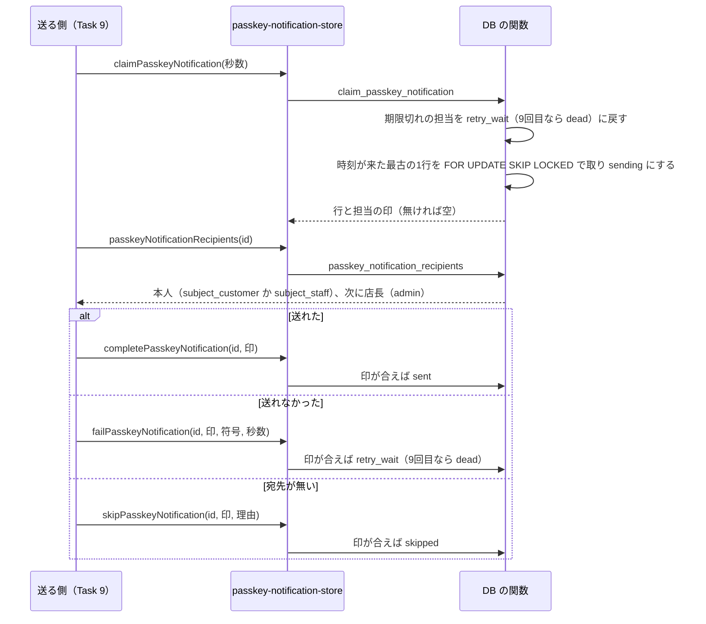
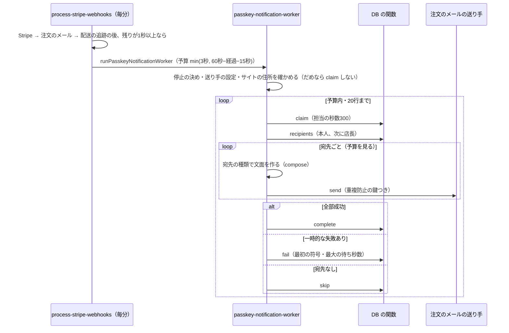

# パスキーの知らせを取り出して送るための DB の関数と、送る worker

> 状態: 推定 | 確認日: 2026-11-18 | 対象: `supabase/migrations/20261118044338_passkey_notification_sending.sql`、`src/lib/auth/passkey-notification-store.ts`、`passkey-notification-compose.ts`、`passkey-notification-worker.ts`、`src/lib/stripe/webhook-worker.ts` | 親: [シーケンス設計の方針](README.md)

## 概要

段1a の引き金が `private.passkey_notification_outbox` に積んだ行（パスキーの足し・引き・鍵の差し替え）を、送る側（次のタスクの worker）が1行ずつ取り出して送り、結果を残すための DB の関数と、それを呼ぶ薄い部品。メールの文・送る worker・定期処理への組み込みは DD-AUTH-067（下）。

## 範囲と根拠

| 項目 | 内容 |
| --- | --- |
| 対応する ID | SR-AUTH-025、FR-AUTH-030、FR-AUTH-031、DATA-AUTH-019、SEC-AUTH-051、THR-AUTH-050、DD-AUTH-066、DD-AUTH-067、ADR-0470 |
| 対象のコード | 移行 `supabase/migrations/20261118044338_passkey_notification_sending.sql`、`src/lib/auth/passkey-notification-store.ts`、`passkey-notification-compose.ts`、`passkey-notification-worker.ts`、`src/lib/stripe/webhook-worker.ts`、`src/app/api/cron/process-stripe-webhooks/route.ts` |
| 関連文書 | [設計](../../superpowers/specs/2026-11-07-passkey-auth-design.md)（6-3）、[段2の計画](../../superpowers/plans/2026-11-17-passkey-stage2-customers.md)、[パスキーのアプリの窓口](auth-passkey-server-endpoints.md) |
| 調べた時点 | 2026-11-18（手元の DB で結合試験を流した） |

## 処理の詳細

### DD-AUTH-066 知らせの行の取り出し・済み・失敗・飛ばし・宛先の処理の順番

| 属性 | 値 |
| --- | --- |
| 上位 | DATA-AUTH-019、SEC-AUTH-051 |
| 根拠 | 送る側が複数でも、1行を二重に取らず、落ちた担当の行を取り戻し、送れない行を止められるようにする。注文のメールの送り箱と同じ「担当の印（lease）・失敗の回数・間隔を広げる再試行」の考えにして、宛先と状態の変更はすべて DB の関数の中で決める。呼び手（薄い部品）は誤り・例外・想定外の戻りを `{ ok: false }` にして、呼び手が何もせず次の回へ進める。取り出す時に、鍵の今の名前（`auth.webauthn_credentials`。消した鍵は消した時に写した名前）を行の `friendly_name` に入れて返す。GoTrue は鍵を「Passkey」で足し、画面が後から名前を付けるため。足した行（`passkey_id` あり）は足してから30秒は取り出さず、名前の変更が先に入るのを待つ |
| 状態 | 推定 |
| 確かめ方 | 単体テスト（`tests/unit/lib/auth/passkey-notification-store.test.ts`）、結合テスト（`tests/integration/db/auth_passkey_notification_sending.integration.test.ts`）、E2E（`e2e/FR-LOGIN-061-passkey-notification-function-grants.spec.ts`） |
| 出どころ | `.superpowers/sdd/2026-11-17-passkey-stage2-customers/task-8-brief.md`、`docs/superpowers/plans/2026-11-17-passkey-stage2-customers.md`（Task 8。作り手の判断: 再試行は注文のメールと同じ考えで揺らぎなし、`dead` の点検は段3） |

- 追跡の単位: `src/lib/auth/passkey-notification-store.ts` の `claimPasskeyNotification` が IMPL-AUTH-330、`completePasskeyNotification` が IMPL-AUTH-331、`failPasskeyNotification` が IMPL-AUTH-332、`skipPasskeyNotification` が IMPL-AUTH-333、`passkeyNotificationRecipients` が IMPL-AUTH-334
- 取り出し: 担当の秒数は30〜900（外れは `22023`）。最古は `seq` の順。`FOR UPDATE SKIP LOCKED` なので、2つの送り手が同じ行を取らない。取り出した行は `attempts` が1増え、新しい担当の印と期限が付く。期限切れの戻しは、`fail` と同じ間隔（`60 × 2^(attempts-1)` 秒）の先を `next_attempt_at` にする（すぐ取り直すと、送り手が落ち続けた時に9回を数分で使い切って `dead` になるため。注文のメールの送り箱と同じ）。その呼び出しの中では取り直さない
- 失敗の間隔: 次の時刻 = 今 + 大きい方（指定の秒数〔負は0、1日で頭打ち〕、`60 × 2^(attempts-1)` 秒。`attempts` が8以上は128分で頭打ち）。揺らぎは付けない（宛先が少なく、同時の取り合いが無いため）。`attempts` が9以上なら `dead` で `finished_at` を付け、`next_attempt_at` は変えない
- 宛先: 本人を先に、店長を後に返す。店長は有効で期限内の役割があり、`auth.users` が消されておらず（`deleted_at` が空）、止められていない（`banned_until` が空か過去）人だけ。同じアドレスは大文字小文字を区別せず先の方を残すので、本人が店長でも `subject_staff` の文面が優先される。メールが空の行は返さない
- 部品: サービスの鍵のクライアント（`createServiceRoleClient`）から呼ぶ。引数の名前は関数と同じ `_id`・`_lease_token`・`_lease_seconds`・`_error_code`・`_retry_after_seconds`・`_reason`（`passkey-approval-rpc.ts` の `p_` とは違う）。誤りのログは関数の名前とコードだけ
- テスト観点: 最古だけ・未来の行・済み・`dead` を返さない、担当中の行を返さない、期限切れで戻り（間隔の先まで取れない）9回目で `dead`、秒数の範囲、2つの接続から同時に取っても同じ行を返さず待たされない（`FOR UPDATE SKIP LOCKED` を外すと落ちる）、指定の秒数の頭打ち、印が合う時だけ変わる、間隔（1分・2分・指定の秒数・128分の頭打ち・9回目の `dead`）、符号の形、宛先（お客さん・店員・本人が店長・本人を含めない・空を返さない・サポーター・期限切れ・無効・消された・止められた店長を含めない）、5つの関数の権限、引き金が積んだ行を取れること、部品の戻りの形の確かめと誤りの扱い

### DD-AUTH-067 知らせの文面を作り、行を取り出して宛先ごとに送り、毎分の定期処理につなぐ順番

| 属性 | 値 |
| --- | --- |
| 上位 | ARC-AUTH-011、DATA-AUTH-019、SEC-AUTH-051 |
| 根拠 | 行の取り出し・結果の記録（DD-AUTH-066）の上に、宛先ごとの文面・送り・失敗の分け方・予算を載せる。注文のメールの送り手と停止の決めを共用し、定期処理は既存の毎分の入口に1段足す（ADR-0470）。宛先の1つの恒久の失敗で行が9回回って `dead` にならないよう、恒久の失敗の宛先だけ飛ばす。知らせの名前は送る時の名前（取り出す時に読んだ鍵の今の名前）で、足した直後の30秒は取り出されない（DD-AUTH-066） |
| 状態 | 推定 |
| 確かめ方 | 単体テスト（`tests/unit/lib/auth/passkey-notification-compose.test.ts`・`passkey-notification-worker.test.ts`・`tests/unit/lib/stripe/webhook-worker.test.ts`）、結合テスト（`tests/integration/db/auth_passkey_notification_worker.integration.test.ts`）、E2E（`e2e/FR-LOGIN-062-passkey-notification-mail.spec.ts`） |
| 出どころ | `.superpowers/sdd/2026-11-17-passkey-stage2-customers/task-9-brief.md`、`docs/superpowers/plans/2026-11-17-passkey-stage2-customers.md`（Task 9） |

- 追跡の単位: `passkey-notification-compose.ts` の `sanitizePasskeyNameForMail` が IMPL-AUTH-335、`composePasskeyNotification` が IMPL-AUTH-336、`passkey-notification-worker.ts` の `passkeyNotificationIdempotencyKey` が IMPL-AUTH-337、`runPasskeyNotificationWorker` が IMPL-AUTH-338
- 文面: テキストだけ。本人のアドレスは店長の文面だけ。お問い合わせの住所はお客さんの文面だけ。名前は改行を空白に替え、制御文字・表示の向きを変える文字を除き、64字で切る。日時は `Asia/Tokyo`。宛名・署名は付けない（文頭の一文で店の名前を出す。理由: アカウントの守りの知らせ〔パスワードの変更の知らせ〕と同じ形。確定案はオーナーの確かめ待ち）
- 失敗の分け方: 送り手の失敗は `transient`（残りの宛先も試し、最後に `fail`）・`permanent`（その宛先だけ飛ばす）・`config`（注文のメールと同じ: その行を `fail`〔`_count_attempt` を偽にして回数を数えず、次の時刻は今＋900秒以上かつ共有の一時停止の次に試す時刻より後。DB が同じ取引で注文のメールと共有の送信の一時停止を書く〕にして、その回は `config` で止める）。`config` 以外の `fail` は9回目で DB が `dead` にする
- 一時停止の間（ADR-0470）: worker は次に試す時刻を見ず（注文のメールの取り出しが、時刻が来た回に先へ進めてしまうため。毎分ではない）、`paused` の間は1回に1行だけ取り出す。間隔は DB が決める: 止まっている間の取り出し（`claim_passkey_notification`）: 設定の失敗の符号（`quota_*`・`config_*`）を `last_error_code` に持つ行が `retry_wait` か取り出し中（`sending`）にあれば、`retry_wait` で時刻が来たその行だけを返す（来ていなければ、取り出し中の行しか無い間も、何も返さない。ほかの行が時刻でも返さない）。そういう行がまだ無ければ、通常の行を1つだけ返す（最初の試し）。数えない失敗の次の時刻は「今＋大きい方（900秒、指定の秒数）と、共有の一時停止の次に試す時刻（1日の上限なら UTC 0時）」。これで、止まっている間の試しは約15分に1回（注文のメールと同じ間隔。1日の上限ならUTC 0時まで）。止まっていなければ通常どおり。送れて `complete` が通れば DB が共有の一時停止を解く。読めなければ通常どおり動く。1通も送れず全宛先が恒久の失敗の行は、`complete` でなく `skip`（`all_recipients_permanent`）
- 予算: 既定は3秒・20行。呼び手が残り時間から決めた値を渡す。宛先を送る前にも予算を見る。越えたら、その行を `fail`（符号 `budget_exceeded`）にして止める。次の回で送る宛先は、Resend では同じ鍵なので2通目にならない（手元の送り手は鍵を使わないので、E2E では重なりうる）
- 定期処理: `runWebhookWorker({ requestUrl, passkeyNotifications: true })` の時だけ、配送の追跡の後・点検の前に呼ぶ。`webhook/stripe` の `after()` は呼ばない。投げても点検は続ける。注文のメールの worker と追跡の worker の挙動・予算は変えない
- 予算を見るのは送る前だけなので、送り1回の打ち切り（最大8秒）の分だけ越えうる。知らせの worker の心拍と `dead` の点検は段3
- 動かさない環境: 注文のメールと同じ `orderEmailWorkerDisabledReason`（Vercel の preview など、DB が手元でない開発）
- テスト観点: 9通りの文面を文字列で固定、本人のアドレスの出方、日本時間、名前の整え、設定が無ければ `claim` 0回、鍵が行・宛先ごとに固定で再試行でも同じ、恒久の失敗の宛先だけ飛ばす、一時的な失敗で残りも試す（符号は最初・待ちは最大）、9回目で `dead`、予算・20行・宛先を送る間の予算、`claim` の失敗、ログにアドレス・本文・名前が無い、定期処理が投げても点検が動く・35秒＋10秒を使い切ったら呼ばない・`after()` の道では呼ばない

## 未確認事項

- 本番の DB に移行 G を当てる手順と順番は [DB 移行の運用](../../06_Operations/db-migrations.md)。段3まで当てない
- 本番で毎分の定期処理が知らせを送り始めるのは、段3で移行 G を当て、この master をデプロイした後。それまで本番には何も出ない
- 注文のメールの宛名（「お客様」）と署名（店の名前）を、知らせの文面に付けるか（確定案は付けない。オーナーの確かめ待ち）
