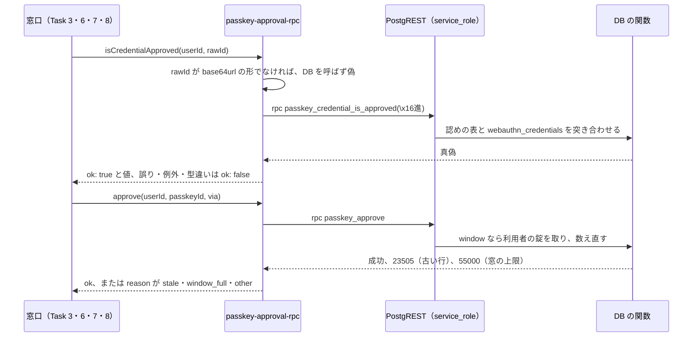

# パスキーのアプリの窓口（DB の関数と薄い部品）

> 状態: 推定 | 確認日: 2026-11-17 | 対象: `supabase/migrations/20261117123620_passkey_server_endpoint_fns.sql`、`src/lib/auth/passkey-approval-rpc.ts` | 親: [シーケンス設計の方針](README.md)

## 概要

段1b で足すアプリの窓口（`/api/auth/passkey/*`）が、店員か・届いた鍵が認めた鍵か・認めた鍵の一覧・鍵を認める、を DB で確かめる呼び方を、1か所にそろえる。窓口は DB の関数を直に呼ばず、薄い部品 `src/lib/auth/passkey-approval-rpc.ts` を使う。後のタスク（ログインの終わり・登録の始めと終わり・一覧・削除）が、この文書にそれぞれの順番を足す。

## 範囲と根拠

| 項目 | 内容 |
| --- | --- |
| 対応する ID | SR-AUTH-016、FR-AUTH-015、DATA-AUTH-018、SEC-AUTH-041、THR-AUTH-042 |
| 対象のコード | 移行 `supabase/migrations/20261117123620_passkey_server_endpoint_fns.sql`、`src/lib/auth/passkey-approval-rpc.ts` |
| 関連文書 | [設計](../../superpowers/specs/2026-11-07-passkey-auth-design.md)（5-5）、[段1b の計画](../../superpowers/plans/2026-11-17-passkey-stage1b-server-endpoints.md)、[店員のパスキーの入口](auth-staff-passkey-entry.md) |
| 調べた時点 | 2026-11-17（手元の DB で結合試験を流した） |

## 処理の詳細

### DD-AUTH-050 窓口が DB の関数を呼ぶ部品の順番と、`passkey_approve` の古い行・窓の同時の競りの扱い

| 属性 | 値 |
| --- | --- |
| 上位 | DATA-AUTH-018、SEC-AUTH-041 |
| 根拠 | 窓口ごとに DB の呼び方（引数の形・誤りの扱い）が違うと、閉じる側に倒し忘れる窓口が出る。サービスの鍵のクライアントで1か所から呼び、誤り・例外・想定外の型の戻りをすべて `{ ok: false }` にして、呼び手が 503 などの閉じる側に倒せるようにする。古い行は黙って通さず声を出して失敗させ、窓の同時の競りは利用者ごとの錠で塞ぐ（設計 5-5） |
| 状態 | 推定 |
| 確かめ方 | 単体テスト（`tests/unit/lib/auth/passkey-approval-rpc.test.ts`）、結合テスト（`tests/integration/db/auth_passkey_server_fns.integration.test.ts`）、E2E（`e2e/FR-LOGIN-047-passkey-server-function-grants.spec.ts`） |
| 出どころ | `.superpowers/sdd/2026-11-17-passkey-stage1b-server-endpoints/task-1-brief.md`、`docs/superpowers/specs/2026-11-07-passkey-auth-design.md`（5-5）、`docs/superpowers/plans/2026-11-17-passkey-stage1b-server-endpoints.md`（Task 1） |

- 部品が持つ関数: `isStaff`（`passkey_is_staff`）、`isCredentialApproved`（`passkey_credential_is_approved`）、`approvedIds`（`passkey_approved_ids`）、`approvedCount`（`passkey_approved_count`。1a）、`windowIsOpen`（`passkey_window_is_open`。1a）、`approve`（`passkey_approve`）。`revoke_auth_session` は既存の RPC なので、窓口が直に呼んでよい（`revoke-user-sessions.ts` と同じ形）
- 呼び方はサービスの鍵のクライアント（`createServiceRoleClient`）だけ。4つの関数は `anon`・`authenticated` が呼べない（DATA-AUTH-018）
- `isCredentialApproved` の base64url の確かめは `Buffer.from` に任せない（不正な文字を黙って捨てるため）。`^[A-Za-z0-9_-]+$` の形でなければ、長さが4で割って1余る（base64url にならない）ものも含めて、DB を呼ばず偽を返す。直した生の鍵の ID は `\x` で始まる16進の文字列で渡す
- 戻りの型の確かめ: 真偽の関数は真偽、`approvedCount` は0以上の整数、`approvedIds` は文字列の配列でなければ `{ ok: false }`（想定外の型を「認めた」に読み違えない）
- 異常: RPC の誤り・例外・クライアントを作れない時は `{ ok: false }`（`approve` は `reason: 'other'`）。ログには、関数の名前と SQLSTATE のコードだけを残し、誤りの本文・利用者の ID・鍵は残さない
- `passkey_approve` の作り直し（移行 F）: ① `window` の時だけ、関数の頭で `pg_advisory_xact_lock(hashtextextended(p_user_id::text, 0))` を取り、持ち主・重複の確かめの後、錠の中で `passkey_approved_count` を数え直して上限以上なら `55000`。② 同じ `passkey_id` で `credential_id` が違う行は `23505`（古い行。窓口が新しい `passkey_id` だけを認めるので、当たるのは引き金を迂回して鍵を書き換えた異常の時だけ）。同じ `credential_id` なら何もしない。③ 他人の鍵 `42501`・別の `passkey_id` で同じ `credential_id` の `23505` は変えない
- 古い行の直し方（運用）: 窓口が 500 と監査で気づく。正しい鍵なら、SQL で `private.approved_passkeys` の古い行を消してから認め直す。引き金を迂回した書き換えの原因は別に調べる
- テスト観点: 店員の判定がフックと同じ入力で同じ答え・認めた鍵だけが真（他人・別の ID・書き換わった認め・`null`・長さ0は偽）・一覧が鍵の削除で減る・古い行で `23505`・窓の上限で `55000` で `reauth`・`script` は通る・2つの接続の同時の認めがちょうど2本（20組）・権限と属性・部品が正しい RPC 名と引数で1回呼ぶ・形の合わない `rawId` で RPC 0回・誤り・例外・想定外の型で `{ ok: false }`

## 未確認事項

- 窓の同時の競りの試験は2つの接続を20組くり返す。錠を外した関数（錠の行を `pg_sleep(0.05)` に替えたもの）に差し替えて流すと、1組目で落ちることを手元で確かめた（2026-11-17。確かめた後は `db reset` で戻した）。CI では毎回は確かめない
- 本番の `auth.webauthn_credentials` に同じ列があるかは、移行 A と同じく本番へ当てる前に読んで確かめる
