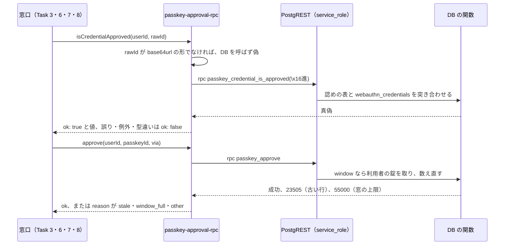
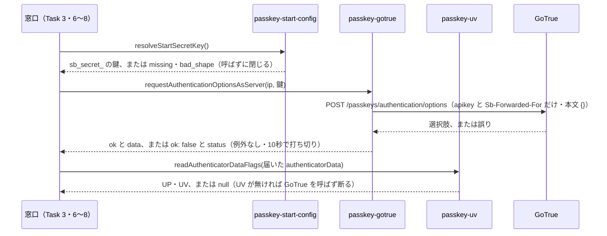

# パスキーのアプリの窓口（DB の関数と薄い部品）

> 状態: 推定 | 確認日: 2026-11-17 | 対象: `supabase/migrations/20261117123620_passkey_server_endpoint_fns.sql`、`src/lib/auth/passkey-approval-rpc.ts`、`passkey-start-mode.ts`・`passkey-start-config.ts`・`passkey-uv.ts`・`passkey-gotrue.ts`、`src/features/auth/schemas/passkey.ts`、`src/lib/build-env-guard.ts` | 親: [シーケンス設計の方針](README.md)

## 概要

段1b で足すアプリの窓口（`/api/auth/passkey/*`）が、店員か・届いた鍵が認めた鍵か・認めた鍵の一覧・鍵を認める、を DB で確かめる呼び方を、1か所にそろえる。窓口は DB の関数を直に呼ばず、薄い部品 `src/lib/auth/passkey-approval-rpc.ts` を使う。後のタスク（ログインの終わり・登録の始めと終わり・一覧・削除）が、この文書にそれぞれの順番を足す。

## 範囲と根拠

| 項目 | 内容 |
| --- | --- |
| 対応する ID | SR-AUTH-016、FR-AUTH-015、DATA-AUTH-018、SEC-AUTH-041、THR-AUTH-042、SEC-AUTH-042、THR-AUTH-043、ADR-0467 |
| 対象のコード | 移行 `supabase/migrations/20261117123620_passkey_server_endpoint_fns.sql`、`src/lib/auth/passkey-approval-rpc.ts` |
| 関連文書 | [設計](../../superpowers/specs/2026-11-07-passkey-auth-design.md)（5-5）、[段1b の計画](../../superpowers/plans/2026-11-17-passkey-stage1b-server-endpoints.md)、[店員のパスキーの入口](auth-staff-passkey-entry.md) |
| 調べた時点 | 2026-11-17（手元の DB で結合試験を流した） |

## 処理の詳細

### DD-AUTH-050 窓口が DB の関数を呼ぶ部品の順番と、`passkey_approve` の古い行・窓の同時の競りの扱い

| 属性 | 値 |
| --- | --- |
| 上位 | DATA-AUTH-018、SEC-AUTH-041 |
| 根拠 | 窓口ごとに DB の呼び方（引数の形・誤りの扱い）が違うと、閉じる側に倒し忘れる窓口が出る。サービスの鍵のクライアントで1か所から呼び、誤り・例外・想定外の型の戻りをすべて `{ ok: false }` にして、呼び手が 503 などの閉じる側に倒せるようにする。古い行は黙って通さず声を出して失敗させ、窓の同時の競りは利用者ごとの錠で塞ぐ（設計 5-5） |
| 状態 | 推定 |
| 確かめ方 | 単体テスト（`tests/unit/lib/auth/passkey-approval-rpc.test.ts`）、結合テスト（`tests/integration/db/auth_passkey_server_fns.integration.test.ts`）、E2E（`e2e/FR-LOGIN-047-passkey-server-function-grants.spec.ts`） |
| 出どころ | `.superpowers/sdd/2026-11-17-passkey-stage1b-server-endpoints/task-1-brief.md`、`docs/superpowers/specs/2026-11-07-passkey-auth-design.md`（5-5）、`docs/superpowers/plans/2026-11-17-passkey-stage1b-server-endpoints.md`（Task 1） |

- 追跡の単位: 6つの関数それぞれに `@impl` を付けた（`isCredentialApproved` は IMPL-AUTH-249、`isStaff` は 266、`approvedIds` は 267、`approvedCount` は 268、`windowIsOpen` は 269、`approve` は 270）。
- 部品が持つ関数: `isStaff`（`passkey_is_staff`）、`isCredentialApproved`（`passkey_credential_is_approved`）、`approvedIds`（`passkey_approved_ids`）、`approvedCount`（`passkey_approved_count`。1a）、`windowIsOpen`（`passkey_window_is_open`。1a）、`approve`（`passkey_approve`）。`revoke_auth_session` は既存の RPC なので、窓口が直に呼んでよい（`revoke-user-sessions.ts` と同じ形）
- 呼び方はサービスの鍵のクライアント（`createServiceRoleClient`）だけ。4つの関数は `anon`・`authenticated` が呼べない（DATA-AUTH-018）
- `isCredentialApproved` の base64url の確かめは `Buffer.from` に任せない（不正な文字を黙って捨てるため）。`^[A-Za-z0-9_-]+$` の形でなければ、長さが4で割って1余る（base64url にならない）ものも含めて、DB を呼ばず偽を返す。直した生の鍵の ID は `\x` で始まる16進の文字列で渡す
- 戻りの型の確かめ: 真偽の関数は真偽、`approvedCount` は0以上の整数、`approvedIds` は文字列の配列でなければ `{ ok: false }`（想定外の型を「認めた」に読み違えない）
- `passkey_is_staff` は DB の誤りを偽にしない（偽にすると、店員をお客さんと読み違えて認めの確かめを飛ばす）。誤りは投げ、部品が `{ ok: false }` にする。窓の上限は設定が引けず NULL の時も `55000`（閉じる側）
- 異常: RPC の誤り・例外・クライアントを作れない時は `{ ok: false }`（`approve` は `reason: 'other'`）。ログには、関数の名前と SQLSTATE のコードだけを残し、誤りの本文・利用者の ID・鍵は残さない
- `passkey_approve` の作り直し（移行 F）: ① `window` の時だけ、関数の頭で `pg_advisory_xact_lock(hashtextextended(p_user_id::text, 0))` を取り、持ち主・重複の確かめの後、錠の中で `passkey_approved_count` を数え直して上限以上なら `55000`。② 同じ `passkey_id` で `credential_id` が違う行は `23505`（古い行。窓口が新しい `passkey_id` だけを認めるので、当たるのは引き金を迂回して鍵を書き換えた異常の時だけ）。同じ `credential_id` なら何もしない。③ 他人の鍵 `42501`・別の `passkey_id` で同じ `credential_id` の `23505` は変えない
- 古い行の直し方（運用）: 窓口が 500 と監査で気づく。正しい鍵なら、SQL で `private.approved_passkeys` の古い行を消してから認め直す。引き金を迂回した書き換えの原因は別に調べる
- テスト観点: 店員の判定がフックと同じ入力で同じ答え・認めた鍵だけが真（他人・別の ID・書き換わった認め・`null`・長さ0は偽）・一覧が鍵の削除で減る・古い行で `23505`・窓の上限で `55000` で `reauth`・`script` は通る・2つの接続の同時の認めがちょうど2本（20組）・権限と属性・部品が正しい RPC 名と引数で1回呼ぶ・形の合わない `rawId` で RPC 0回・誤り・例外・想定外の型で `{ ok: false }`

### DD-AUTH-051 窓口が共有する部品（始めの設定・鍵と IP・UV の読み取り・GoTrue の呼び出し・入力の形・環境の見張り）

| 属性 | 値 |
| --- | --- |
| 上位 | SEC-AUTH-042 |
| 根拠 | 窓口（Task 3〜8）ごとに鍵の形・IP・UV の読み方・GoTrue の呼び方・入力の形を書くと食い違う。1か所にそろえ、閉じる側に倒す。supabase-js のパスキーの関数は更新トークンつきの session が要り、窓口は Cookie のアクセストークンしか持たないので、`fetch` で GoTrue を直に呼ぶ（ADR-0467） |
| 状態 | 推定 |
| 確かめ方 | 単体テスト（`tests/unit/lib/auth/passkey-start-mode.test.ts`、`passkey-start-config.test.ts`、`passkey-uv.test.ts`、`passkey-gotrue.test.ts`、`tests/unit/features/auth/schemas/passkey.test.ts`、`tests/unit/lib/build-env-guard.test.ts`） |
| 出どころ | `.superpowers/sdd/2026-11-17-passkey-stage1b-server-endpoints/task-2-brief.md`、`docs/superpowers/specs/2026-11-07-passkey-auth-design.md`（5-1・5-3）、`docs/superpowers/plans/2026-11-17-passkey-stage1b-server-endpoints.md`（Task 2） |

- 追跡の単位（関数ごと）: `passkey-start-mode.ts` の `resolvePasskeyStartMode` は IMPL-AUTH-250、`passkey-start-config.ts` の `isSbSecretKey`・`resolveStartSecretKey`・`resolvePasskeyStartDevIp` は 251〜253、`passkey-uv.ts` の `isBase64Url`・`readAuthenticatorDataFlags`・`readAttestationUserVerified` は 254〜256、`passkey-gotrue.ts` の6つの関数は 257〜262、`schemas/passkey.ts` は 263。`build-env-guard.ts` の見張りは IMPL-ABOUT-102 の `@remarks` に書いた
- 始めの設定: `NEXT_PUBLIC_PASSKEY_START_MODE` を前後の空白・大小を無視して読み、`browser` の時だけ `browser`（未設定・空・知らない値は `server`）。ブラウザの部品も読むので import を1つも持たない。値はビルドで埋め込まれるので、切り替えは再デプロイが要る
- 鍵: `SUPABASE_SECRET_KEY` を先に見て、無ければ `SUPABASE_SERVICE_ROLE_KEY`。先に値がある変数が `sb_secret_` の形でなければ `bad_shape`（後ろには倒さない）。`server-only` を付け、クライアントの束に入れない
- 開発用の IP: `PASSKEY_START_DEV_IP` は、IP の形・手元の Supabase の住所・`VERCEL` が `1` でない・`VERCEL_ENV` が空、の全部を満たす時だけ。IPv6（`::1`）も通す
- UV の読み取り: `authenticatorData` は base64url（形を正規表現で先に確かめる。`Buffer.from` に任せない）を戻し、37バイト未満は `null`、位置 32 の flags の `0x01`・`0x04`。`attestationObject` は自前の小さな CBOR の読み取り（map・配列・byte string・text string・整数・真偽・null。深さ8まで。不定長・8バイトの長さ・浮動小数・余りのバイト・残りより大きい項目数は `null`）で `authData` を取り出す。登録の側は「使えない鍵を数に入れない」ための参考で、守りの本体はログインの終わりの門（設計 5-3）
- GoTrue の呼び出し: すべて `{ ok: true; data } | { ok: false; status; message? }`。例外・ネットワークの誤り・打ち切りは `status: 0`、JSON でない成功は `ok: false`。`X-Supabase-Api-Version: 2024-01-01` を全部に付け、誤りの文は `msg`・`message` の順に読み、200字で切り、渡した鍵・トークンが入っていたら取り除く。始め (a) は `apikey` と `Sb-Forwarded-For` だけ（`Authorization` なし）、そのほかは `apikey`（anon）と `Authorization: Bearer`
- 入力の形（zod）: `id`・`rawId` は `^[A-Za-z0-9_-]+$` で完全に同じ値だけ（違えば `invalid_request`。SEC-AUTH-044）。ログインの終わり・登録の終わりは `response` の中身が別の形。名前は前後の空白を除いて1〜64字・制御文字なし
- 環境の見張り: `assertBuildEnv` が、`PASSKEY_START_DEV_IP` が空でなく、手元の Supabase の住所でない・未設定、または `VERCEL`・`VERCEL_ENV` が設定されていれば投げる（文は変数名だけ）。`next.config.ts` が `next build` と `next start` の両方で呼ぶので、本番では起動が止まる
- テスト観点: 設定の読み分け・鍵の形・開発用の IP の全条件・UV の有無と短さと壊れた入力・CBOR の切れ・余り・深さ・偽りの長さ・GoTrue に送ったヘッダー一覧と路と本文・打ち切り・誤りの文に鍵が入らない・`id` と `rawId` の食い違い・見張りが投げる／通る組

## 未確認事項

- 窓の同時の競りの試験は2つの接続を20組くり返す。錠を外した関数（錠の行を `pg_sleep(0.05)` に替えたもの）に差し替えて流すと、1組目で落ちることを手元で確かめた（2026-11-17。確かめた後は `db reset` で戻した）。CI では毎回は確かめない
- 本番の `auth.webauthn_credentials` に同じ列があるかは、移行 A と同じく本番へ当てる前に読んで確かめる
- 本番の `SUPABASE_SERVICE_ROLE_KEY` が `sb_secret_` か JWT の形かは読んでいない（設計 8-2）。JWT の形なら、本番に `SUPABASE_SECRET_KEY` を足すまで始め (a) は閉じる側に倒れる
