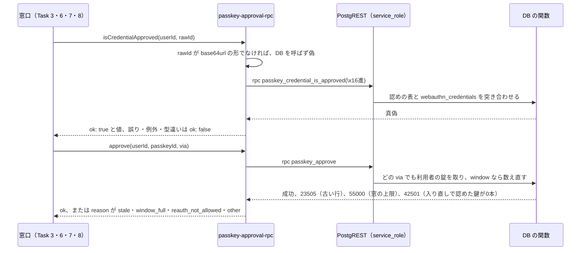
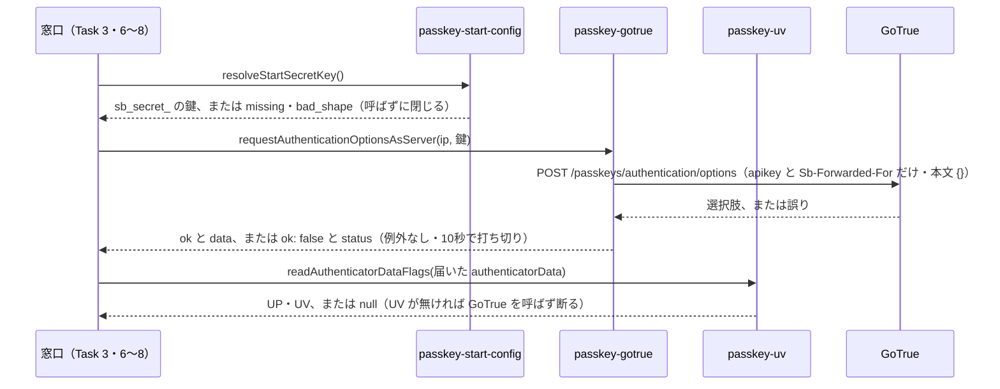
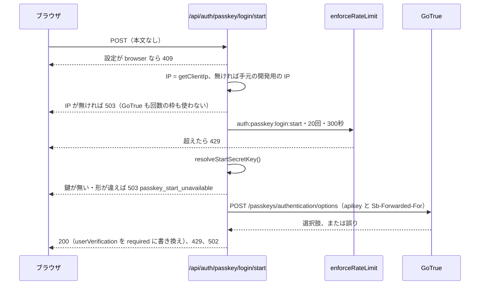
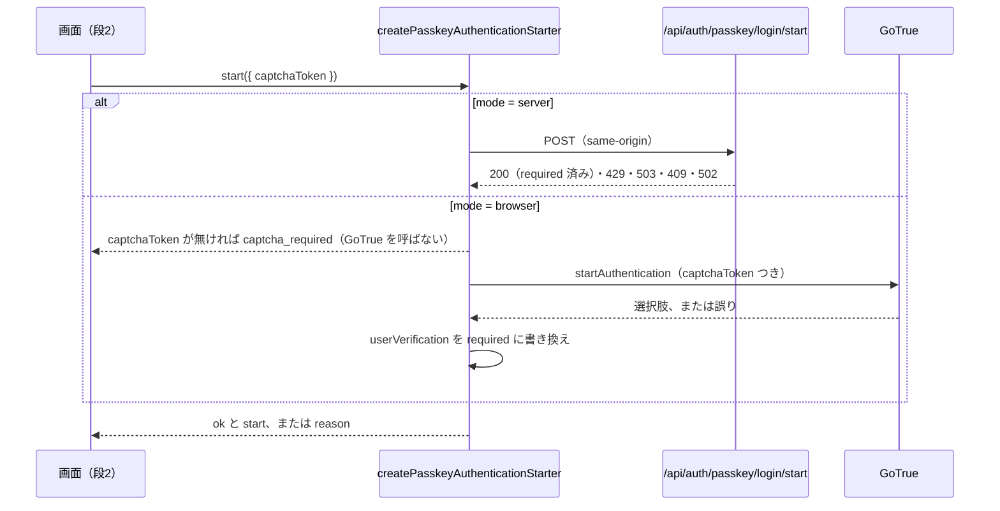
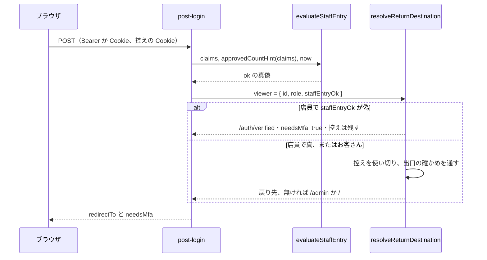
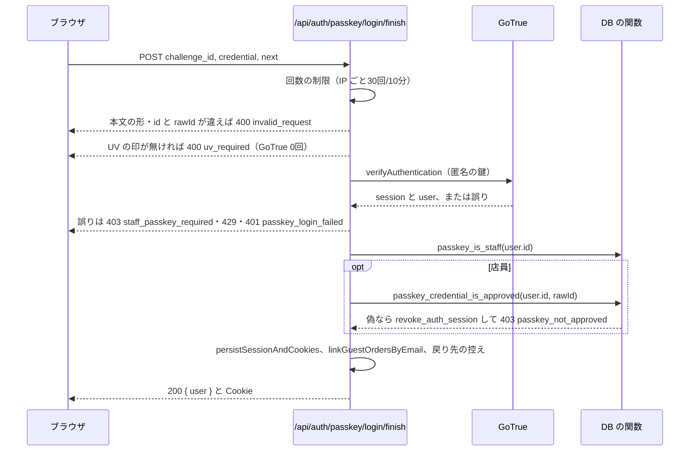
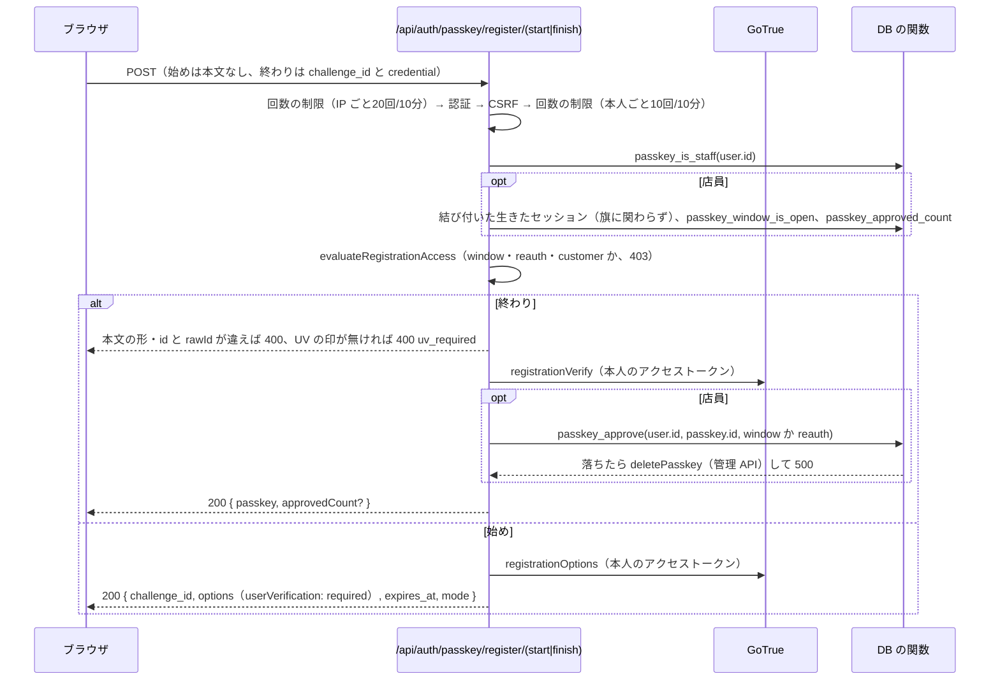
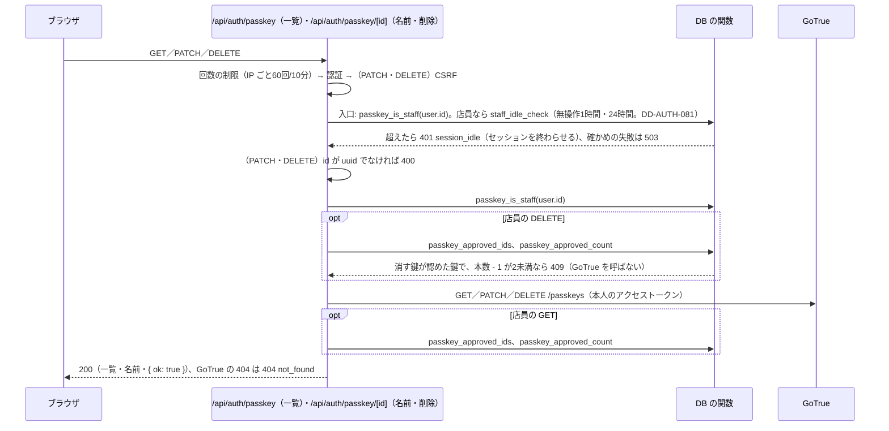
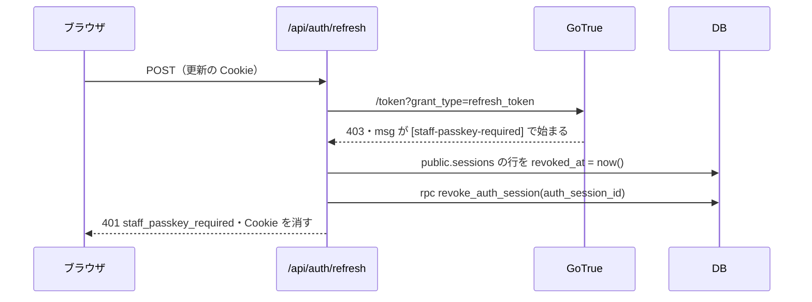
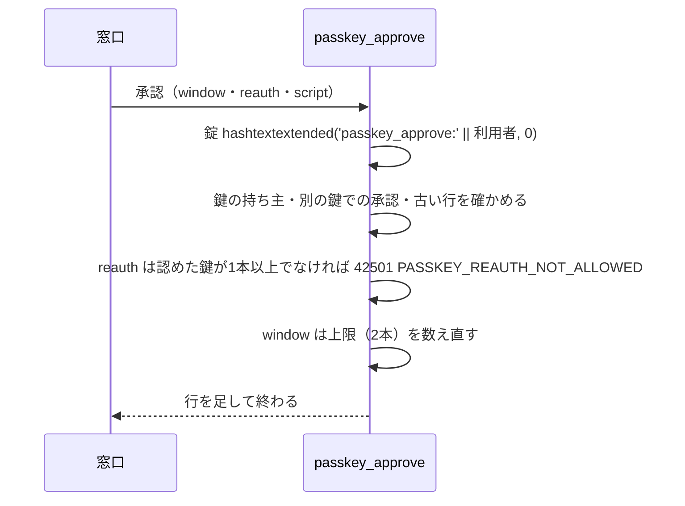

# パスキーのアプリの窓口（DB の関数と薄い部品）

> 状態: 推定 | 確認日: 2026-11-17 | 対象: `supabase/migrations/20261117123620_passkey_server_endpoint_fns.sql`、`src/lib/auth/passkey-approval-rpc.ts`、`passkey-start-mode.ts`・`passkey-start-config.ts`・`passkey-uv.ts`・`passkey-gotrue.ts`、`src/features/auth/schemas/passkey.ts`、`src/lib/build-env-guard.ts` | 親: [シーケンス設計の方針](README.md)

## 概要

段1b で足すアプリの窓口（`/api/auth/passkey/*`）が、店員か・届いた鍵が認めた鍵か・認めた鍵の一覧・鍵を認める、を DB で確かめる呼び方を、1か所にそろえる。窓口は DB の関数を直に呼ばず、薄い部品 `src/lib/auth/passkey-approval-rpc.ts` を使う。後のタスク（ログインの終わり・登録の始めと終わり・一覧・削除）が、この文書にそれぞれの順番を足す。

## 範囲と根拠

| 項目 | 内容 |
| --- | --- |
| 対応する ID | SR-AUTH-016、SR-AUTH-017、SR-AUTH-018、FR-AUTH-015、FR-AUTH-016、FR-AUTH-017、FR-AUTH-018、FR-AUTH-019、SR-AUTH-019、FR-AUTH-020、FR-AUTH-021、SR-AUTH-020、FR-AUTH-022、DD-AUTH-058、DD-AUTH-069、DD-AUTH-052、DD-AUTH-053、DD-AUTH-054、DD-AUTH-055、DD-AUTH-056、DD-AUTH-057、DATA-AUTH-018、SEC-AUTH-041、THR-AUTH-042、SEC-AUTH-042、THR-AUTH-043、SEC-AUTH-043、THR-AUTH-044、SEC-AUTH-044、THR-AUTH-045、SEC-AUTH-045、THR-AUTH-046、SEC-AUTH-046、THR-AUTH-047、SEC-AUTH-047、THR-AUTH-048、ADR-0466、ADR-0467、ADR-0468 |
| 対象のコード | 移行 `supabase/migrations/20261117123620_passkey_server_endpoint_fns.sql`、`src/lib/auth/passkey-approval-rpc.ts`、`src/app/api/auth/passkey/login/start/route.ts`、`src/app/api/auth/passkey/login/finish/route.ts`、`src/app/api/auth/passkey/register/start/route.ts`、`register/finish/route.ts`、`src/app/api/auth/passkey/route.ts`、`src/app/api/auth/passkey/[id]/route.ts`、`src/lib/auth/passkey-registration-guard.ts`、`passkey-recent-auth.ts`、`passkey-manage-guard.ts`、`src/features/auth/passkey/browser-start.ts` |
| 関連文書 | [設計](../../superpowers/specs/2026-11-07-passkey-auth-design.md)（5-5）、[段1b の計画](../../superpowers/plans/2026-11-17-passkey-stage1b-server-endpoints.md)、[店員のパスキーの入口](auth-staff-passkey-entry.md) |
| 調べた時点 | 2026-11-17（手元の DB で結合試験を流した） |

## 処理の詳細

### DD-AUTH-050 窓口が DB の関数を呼ぶ部品の順番と、`passkey_approve` の古い行・窓の同時の競りの扱い

| 属性 | 値 |
| --- | --- |
| 上位 | DATA-AUTH-018、SEC-AUTH-041 |
| 根拠 | 窓口ごとに DB の呼び方（引数の形・誤りの扱い）が違うと、閉じる側に倒し忘れる窓口が出る。サービスの鍵のクライアントで1か所から呼び、誤り・例外・想定外の型の戻りをすべて `{ ok: false }` にして、呼び手が 503 などの閉じる側に倒せるようにする。古い行は黙って通さず声を出して失敗させ、窓の同時の競りは利用者ごとの錠で塞ぐ（設計 5-5） |
| 状態 | 推定 |
| 確かめ方 | 単体テスト（`tests/unit/lib/auth/passkey-approval-rpc.test.ts`）、結合テスト（`tests/integration/db/auth_passkey_server_fns.integration.test.ts`）、E2E（`e2e/FR-LOGIN-047-passkey-server-function-grants.spec.ts`） |
| 出どころ | `.superpowers/sdd/2026-11-17-passkey-stage1b-server-endpoints/task-1-brief.md`、`docs/superpowers/specs/2026-11-07-passkey-auth-design.md`（5-5）、`docs/superpowers/plans/2026-11-17-passkey-stage1b-server-endpoints.md`（Task 1） |

- 追跡の単位: 6つの関数それぞれに `@impl` を付けた（`isCredentialApproved` は IMPL-AUTH-249、`isStaff` は 266、`approvedIds` は 267、`approvedCount` は 268、`windowIsOpen` は 269、`approve` は 270）。
- 部品が持つ関数: `isStaff`（`passkey_is_staff`）、`isCredentialApproved`（`passkey_credential_is_approved`）、`approvedIds`（`passkey_approved_ids`）、`approvedCount`（`passkey_approved_count`。1a）、`windowIsOpen`（`passkey_window_is_open`。1a）、`approve`（`passkey_approve`）。`revoke_auth_session` は既存の RPC なので、窓口が直に呼んでよい（`revoke-user-sessions.ts` と同じ形）
- 呼び方はサービスの鍵のクライアント（`createServiceRoleClient`）だけ。4つの関数は `anon`・`authenticated` が呼べない（DATA-AUTH-018）
- `isCredentialApproved` の base64url の確かめは `Buffer.from` に任せない（不正な文字を黙って捨てるため）。`^[A-Za-z0-9_-]+$` の形でなければ、長さが4で割って1余る（base64url にならない）ものも含めて、DB を呼ばず偽を返す。直した生の鍵の ID は `\x` で始まる16進の文字列で渡す
- 戻りの型の確かめ: 真偽の関数は真偽、`approvedCount` は0以上の整数、`approvedIds` は文字列の配列でなければ `{ ok: false }`（想定外の型を「認めた」に読み違えない）
- `passkey_is_staff` は DB の誤りを偽にしない（偽にすると、店員をお客さんと読み違えて認めの確かめを飛ばす）。誤りは投げ、部品が `{ ok: false }` にする。窓の上限は設定が引けず NULL の時も `55000`（閉じる側）
- 異常: RPC の誤り・例外・クライアントを作れない時は `{ ok: false }`（`approve` は `reason: 'other'`）。ログには、関数の名前と SQLSTATE のコードだけを残し、誤りの本文・利用者の ID・鍵は残さない
- `passkey_approve` の作り直し（移行 F）: ① どの `via` でも、関数の頭で `pg_advisory_xact_lock(hashtextextended('passkey_approve:' || p_user_id::text, 0))` を取り（SEC-AUTH-052）、持ち主・重複の確かめの後、`window` の時は錠の中で `passkey_approved_count` を数え直して上限以上なら `55000`。`reauth` は認めた鍵が0本なら `42501` の `PASSKEY_REAUTH_NOT_ALLOWED` で断る（0本の店員の最初の鍵は `window` だけ）。② 同じ `passkey_id` で `credential_id` が違う行は `23505`（古い行。窓口が新しい `passkey_id` だけを認めるので、当たるのは引き金を迂回して鍵を書き換えた異常の時だけ）。同じ `credential_id` なら何もしない。③ 他人の鍵 `42501`・別の `passkey_id` で同じ `credential_id` の `23505` は変えない
- 古い行の直し方（運用）: 窓口が 500 と監査で気づく。正しい鍵なら、SQL で `private.approved_passkeys` の古い行を消してから認め直す。引き金を迂回した書き換えの原因は別に調べる
- テスト観点: 店員の判定がフックと同じ入力で同じ答え・認めた鍵だけが真（他人・別の ID・書き換わった認め・`null`・長さ0は偽）・一覧が鍵の削除で減る・古い行で `23505`・窓の上限で `55000` で `reauth`・`script` は通る・2つの接続の同時の認めがちょうど2本（20組）・権限と属性・部品が正しい RPC 名と引数で1回呼ぶ・形の合わない `rawId` で RPC 0回・誤り・例外・想定外の型で `{ ok: false }`

### DD-AUTH-051 窓口が共有する部品（始めの設定・鍵と IP・UV の読み取り・GoTrue の呼び出し・入力の形・環境の見張り）

| 属性 | 値 |
| --- | --- |
| 上位 | SEC-AUTH-042 |
| 根拠 | 窓口（Task 3〜8）ごとに鍵の形・IP・UV の読み方・GoTrue の呼び方・入力の形を書くと食い違う。1か所にそろえ、閉じる側に倒す。supabase-js のパスキーの関数は更新トークンつきの session が要り、窓口は Cookie のアクセストークンしか持たないので、`fetch` で GoTrue を直に呼ぶ（ADR-0467） |
| 状態 | 推定 |
| 確かめ方 | 単体テスト（`tests/unit/lib/auth/passkey-start-mode.test.ts`、`passkey-start-config.test.ts`、`passkey-uv.test.ts`、`passkey-gotrue.test.ts`、`tests/unit/features/auth/schemas/passkey.test.ts`、`tests/unit/lib/build-env-guard.test.ts`） |
| 出どころ | `.superpowers/sdd/2026-11-17-passkey-stage1b-server-endpoints/task-2-brief.md`、`docs/superpowers/specs/2026-11-07-passkey-auth-design.md`（5-1・5-3）、`docs/superpowers/plans/2026-11-17-passkey-stage1b-server-endpoints.md`（Task 2） |

- 追跡の単位（関数ごと）: `passkey-start-mode.ts` の `resolvePasskeyStartMode` は IMPL-AUTH-250、`passkey-start-config.ts` の `isSbSecretKey`・`resolveStartSecretKey`・`resolvePasskeyStartDevIp` は 251〜253、`passkey-uv.ts` の `isBase64Url`・`readAuthenticatorDataFlags`・`readAttestationUserVerified` は 254〜256、`passkey-gotrue.ts` の6つの関数は 257〜262、`schemas/passkey.ts` は 263。`build-env-guard.ts` の見張りは IMPL-ABOUT-102 の `@remarks` に書いた
- 始めの設定: `NEXT_PUBLIC_PASSKEY_START_MODE` を前後の空白・大小を無視して読み、`browser` の時だけ `browser`（未設定・空・知らない値は `server`）。ブラウザの部品も読むので import を1つも持たない。値はビルドで埋め込まれるので、切り替えは再デプロイが要る
- 鍵: `SUPABASE_SECRET_KEY` を先に見て、無ければ `SUPABASE_SERVICE_ROLE_KEY`。先に値がある変数が `sb_secret_` の形でなければ `bad_shape`（後ろには倒さない）。`server-only` を付け、クライアントの束に入れない
- 開発用の IP: `PASSKEY_START_DEV_IP` は、IP の形・手元の Supabase の住所・`VERCEL` が `1` でない・`VERCEL_ENV` が空、の全部を満たす時だけ。IPv6（`::1`）も通す
- UV の読み取り: `authenticatorData` は base64url（形を正規表現で先に確かめる。`Buffer.from` に任せない）を戻し、37バイト未満は `null`、位置 32 の flags の `0x01`・`0x04`。`attestationObject` は自前の小さな CBOR の読み取り（map・配列・byte string・text string・整数・真偽・null。深さ8まで。不定長・8バイトの長さ・浮動小数・余りのバイト・残りより大きい項目数は `null`）で `authData` を取り出す。登録の側は「使えない鍵を数に入れない」ための参考で、守りの本体はログインの終わりの門（設計 5-3）
- GoTrue の呼び出し: すべて `{ ok: true; data } | { ok: false; status; message? }`。例外・ネットワークの誤り・打ち切りは `status: 0`、JSON でない成功は `ok: false`。`X-Supabase-Api-Version: 2024-01-01` を全部に付け、誤りの文は `msg`・`message` の順に読み、200字で切り、渡した鍵・トークンが入っていたら取り除く。始め (a) は `apikey` と `Sb-Forwarded-For` だけ（`Authorization` なし）、そのほかは `apikey`（anon）と `Authorization: Bearer`
- 入力の形（zod）: `id`・`rawId` は `^[A-Za-z0-9_-]+$` で完全に同じ値だけ（違えば `invalid_request`。SEC-AUTH-044）。ログインの終わり・登録の終わりは `response` の中身が別の形。名前は前後の空白を除いて1〜64字かつ UTF-8 で120バイト以内（日本語は40字まで。120バイトは通り、126バイトは GoTrue が 400 と実測）・制御文字なし
- 環境の見張り: `assertBuildEnv` が、`PASSKEY_START_DEV_IP` が空でなく、手元の Supabase の住所でない・未設定、または `VERCEL`・`VERCEL_ENV` が設定されていれば投げる（文は変数名だけ）。`next.config.ts` が `next build` と `next start` の両方で呼ぶので、本番では起動が止まる
- テスト観点: 設定の読み分け・鍵の形・開発用の IP の全条件・UV の有無と短さと壊れた入力・CBOR の切れ・余り・深さ・偽りの長さ・GoTrue に送ったヘッダー一覧と路と本文・打ち切り・誤りの文に鍵が入らない・`id` と `rawId` の食い違い・見張りが投げる／通る組

### DD-AUTH-052 ログインの始め (a)（`POST /api/auth/passkey/login/start`）の順番

| 属性 | 値 |
| --- | --- |
| 上位 | API-AUTH-022、SEC-AUTH-042 |
| 根拠 | 始めは GoTrue の回数の制限をお客さんごとに掛けるため、お客さんの IP を添えて GoTrue を呼ぶ。IP が取れない・鍵が `sb_secret_` でない・設定が (b) の要求は、添え書き無しで・古い鍵で GoTrue を呼ばず、順番に断る（ADR-0467） |
| 状態 | 推定 |
| 確かめ方 | 単体テスト（`tests/unit/api/auth/passkey-login-start-route.test.ts`）、E2E（`e2e/FR-LOGIN-048-passkey-login-start.spec.ts`） |
| 出どころ | `.superpowers/sdd/2026-11-17-passkey-stage1b-server-endpoints/task-3-brief.md`、`docs/superpowers/specs/2026-11-07-passkey-auth-design.md`（5-1）、`docs/superpowers/plans/2026-11-17-passkey-stage1b-server-endpoints.md`（Task 3） |

- 追跡の単位: `route.ts` の `POST` は IMPL-AUTH-271
- 回数の枠の IP: 共有の `enforceRateLimit` は IP を引数で受けず、中で `getClientIp` を呼ぶ（共有の関数は変えない）。本番と E2E では枠の IP と `Sb-Forwarded-For` の IP は同じ値。手元の開発用の IP の時だけ枠の IP が `null`（手元の共有の枠）になる。手元だけなので共有の枠でよい
- 回数の値: IP ごとに5分20回。GoTrue の制限が IP ごとに5分30回なので、その手前で止める。IP が取れない時は枠に入れず 503（`null` は「送り元が分からない全員が1つの枠」になり、1人で全員の始めを止められるため）
- GoTrue の応答: `challenge_id`（空でない文字列）・`options`（`challenge` が空でない文字列のオブジェクト）・`expires_at`（数）を確かめ、違えば 502 で閉じてから `userVerification` を `required` に書き換える。本文は GoTrue の項目名のまま `{ challenge_id, options, expires_at }`
- GoTrue の 429: 本文 `{ error: 'Too many requests' }`・429・`Retry-After` は 300。部品 `passkey-gotrue.ts` は応答の見出しを返さないので、GoTrue の値は使わず回数の枠の窓の長さと同じ300にそろえる
- 監査: action `auth.passkey.login.start`・outcome `failure`・detail は固定の符号（`client_ip_unavailable`・`secret_key_missing`・`secret_key_bad_shape`・`gotrue_rate_limited`・`gotrue_failed`・`gotrue_bad_response`・`unexpected_error`）だけ。成功は監査に残さない（始めは認証の前で行為者がいない）
- 手元の確かめの限り: 手元の GoTrue は `Sb-Forwarded-For` を数えない（手元の設定に添え書きを有効にする項目が無い）。手元では「ヘッダーを付けて送り、GoTrue が断らず 200 を返す」ことと、単体の試験が送ったヘッダーの値を確かめることまで。IP ごとに数えるか・本番で添え書きが効くかは本番の確認（設計 8-2 の1）に回す
- テスト観点: 設定 `browser` で409・IP 無しで503・`x-forwarded-for` だけで503・鍵の形が不正・鍵無しで503・回数の上限で429で GoTrue 0回・成功で GoTrue への要求が1回（`apikey` が鍵・`Sb-Forwarded-For` が IP・`Authorization` 無し）・`preferred` が `required` に変わる・偽の `x-forwarded-for` が使われない・開発用の IP は見出しが無い時だけ・GoTrue の429・500・ネットワークの誤り・形の違う200・監査に鍵と IP が残らない

### DD-AUTH-053 ログインの始め (b)（ブラウザから GoTrue を直に）の部品と (a)・(b) の切り替え

| 属性 | 値 |
| --- | --- |
| 上位 | SEC-AUTH-042 |
| 根拠 | 本番の `sb_secret_` が添え書きを免除するか分からないので、(a) と (b) をどちらも作り、設定で切り替える（設計 5-1・12-2 の5、ADR-0467）。画面を持たない関数にして、ブラウザの WebAuthn と画面は段2に回す |
| 状態 | 推定 |
| 確かめ方 | 単体テスト（`tests/unit/features/auth/passkey/browser-start.test.ts`、`tests/unit/middleware/proxy-csp.test.ts`）、E2E（`e2e/FR-LOGIN-049-passkey-start-mode-csp.spec.ts`） |
| 出どころ | `.superpowers/sdd/2026-11-17-passkey-stage1b-server-endpoints/task-4-brief.md`、`docs/superpowers/specs/2026-11-07-passkey-auth-design.md`（5-1・12-2） |

- 追跡の単位: `browser-start.ts` の `createPasskeyAuthenticationStarter` は IMPL-AUTH-272、`resolveBrowserStartMode` は IMPL-AUTH-280
- 戻り: `{ ok: true, start }` か `{ ok: false, reason, retryAfterSeconds? }`。`reason` は `rate_limited`・`unavailable`・`captcha_required`・`failed`。server の 429 は `Retry-After` を秒で `retryAfterSeconds` に、503・409・502 は `unavailable`、ほかの失敗とネットワークの誤りは `failed`。browser の GoTrue の 429 は `rate_limited`、captcha の誤り（`code` か `message` に captcha）は `captcha_required`、ほかは `failed`
- 成功の応答の使う項目（`challenge_id`・`options.challenge`・`expires_at`）の形を確かめ、違えば `failed`（閉じる）。`userVerification` は両方の道で `required` を返す
- 設定の読み方: ブラウザの束で Next.js が埋め込むのは `process.env.NEXT_PUBLIC_X` とそのまま書いた形だけ。`resolvePasskeyStartMode` の既定の引数 `process.env` は埋め込まれず空になり、ブラウザがいつも `server` になる（Task 3 のレビューの指摘）。そこで `resolveBrowserStartMode` が `process.env.NEXT_PUBLIC_PASSKEY_START_MODE` を直に書いて値だけ渡す。`passkey-start-mode.ts` は import を持たないまま。試験は、ソースにその形が有り、`process.env` 全体の参照が無いことを固定する
- import の制限: `browser-start.ts` が読むのは `passkey-start-mode.ts` だけ（`node:`・`server-only`・`passkey-start-config`・`passkey-gotrue` を読まない。ファイルの文字列で試験する）
- CSP は変えない: `connect-src` に自分の Supabase の origin 1つと Turnstile が入っており、`*.supabase.co` は無い。E2E は `/login` のページの中から手元の GoTrue へ `fetch` し、`securitypolicyviolation` が出ないことを確かめる
- (b) に切り替える時の本番の確認: 本番の GoTrue で captcha を有効にする。(a) で `sb_secret_` が captcha を免除されなかった時は、(a) の始めにも Turnstile のトークンが要る（別の計画）
- テスト観点: server で `fetchApp` が1回・429 の秒・503/409/502・ネットワークの誤り・壊れた本文・形の違う 200／browser で captchaToken 無しは GoTrue 0回・有りで1回・`preferred` が `required` に変わる・429・captcha の誤り・形の違う成功・投げられた誤り／設定の読み／import とソースの形

### DD-AUTH-054 ログインの後の行き先・戻り先を、パスキーの入口の条件で決める

| 属性 | 値 |
| --- | --- |
| 上位 | SEC-AUTH-043 |
| 根拠 | 管理の入口の条件が `aal2` からパスキーの3つの条件に替わった（DD-AUTH-047）ので、行き先・戻り先の判定も同じ条件にそろえる。判定はヒント（JWT）だけで行い、DB を数えない（`/api/auth/me` の `mfaVerified` と同じ。権限は管理の窓口と RLS が DB で数えて止める。ADR-0468） |
| 状態 | 推定 |
| 確かめ方 | 単体テスト（`tests/unit/features/auth/return-intent/return-intent-service.test.ts`・`return-path.test.ts`、`tests/unit/api/auth/post-login-route.test.ts`・`oauth-callback-route.test.ts`・`confirm-route.test.ts`）、結合テスト（`tests/integration/api/auth/return-intent-flow.test.ts`・`post-login.test.ts`・`oauth-callback.test.ts`）、E2E（`e2e/FR-LOGIN-054-passkey-post-login-destination.spec.ts`） |
| 出どころ | `.superpowers/sdd/2026-11-17-passkey-stage1b-server-endpoints/task-5-brief.md`、`docs/superpowers/specs/2026-11-07-passkey-auth-design.md`（5-2・6-2） |

- 追跡の単位: 新しい関数 `staffEntryOkFromClaims`（`src/features/auth/return-intent/staff-entry-hint.ts`）が IMPL-AUTH-273。`post-login` が呼び、トークンの claims から `staffEntryOk` を出す（1か所にして試験で固定する）。変えた `resolveReturnDestination`（IMPL-AUTH-216）・`resolveStoredDestination`（IMPL-AUTH-221）・`validateReturnPath`（IMPL-AUTH-206）は、元の `@design` のまま `@remarks` を `aal2` からパスキーの入口の条件に直した
- 呼び手の形: `ReturnViewer = { role; staffEntryOk: boolean }`（`aal` をやめた）。拒否の理由の名前 `admin_requires_privileged_aal2`、`needsMfa`、行き先 `/auth/verified` は 1b では変えない（意味だけパスキーの条件。段4で直す）
- `post-login`: `staffEntryOk = evaluateStaffEntry(claims, approvedCountHint(claims), Date.now() / 1000).ok`。`claims` はトークンからだけ読む。お客さんには使わない（`needsMfa` は店員だけ）
- `oauth/callback`・`confirm`: `staffEntryOk: false` を渡す。Google・メールのリンクでは店員は入れない（フックが拒否する）ので、来ても 2 段目の側に倒す。`oauth/callback` は、GoTrue の交換が `isStaffPasskeyRequiredError` の誤りで失敗した時、監査の `detail` を `staff_passkey_required` にし誤りの文を残さない（応答は 502 のまま。店員への文言は段3）
- 本番には段3まで出さない: 認めた鍵が1本の店員が着く先は今のページ（`/auth/verified`）で、「もう1本登録してください」の画面は段3が作る
- テスト観点: 店員（admin・supporter）× `staffEntryOk` の真偽の行き先・お客さんは真偽どちらでも `needsMfa: false`・`validateReturnPath('/admin')` が店員で真の時だけ通る・`post-login` が `amr` の欠け・空・文字列の時刻・未来・24時間超・`staff_passkeys_ok` の偽や文字列 `"true"` で偽・パスキーで入った2本の店員は `/admin`・`oauth/callback` の印つき 403 の監査の符号と 502・印の無い 403 は今まで通り

### DD-AUTH-055 ログインの終わり（`POST /api/auth/passkey/login/finish`）の順番

| 属性 | 値 |
| --- | --- |
| 上位 | API-AUTH-023、SEC-AUTH-044 |
| 根拠 | ブラウザは GoTrue の終わりを直に呼ばず、アプリの窓口が UV の印を GoTrue の前に確かめ、GoTrue の検証の後に店員の認めた鍵を確かめ、アプリのセッションを作る。認めていない鍵のセッションは残さない（ADR-0467） |
| 状態 | 推定 |
| 確かめ方 | 単体テスト（`tests/unit/api/auth/passkey-login-finish-route.test.ts`）、結合テスト（`tests/integration/api/auth/passkey-login-finish.test.ts`）、E2E（`e2e/FR-LOGIN-050-passkey-login-finish.spec.ts`） |
| 出どころ | `.superpowers/sdd/2026-11-17-passkey-stage1b-server-endpoints/task-6-brief.md`、`docs/superpowers/specs/2026-11-07-passkey-auth-design.md`（5-1・5-3・5-5） |

- 追跡の単位: `route.ts` の `POST` は IMPL-AUTH-274。試験の道具は、`scripts/e2e/passkey-staff.ts` の `addUnapprovedPasskey` が IMPL-AUTH-281、`startAuthenticationAsBrowser` が IMPL-AUTH-283、`e2e/passkey-app-api.ts` の `startLoginViaApp` が IMPL-AUTH-282、`finishLoginViaApp` が IMPL-AUTH-284、`loginViaApp` が IMPL-AUTH-285
- 順番の理由: UV の門は GoTrue の前（印の無い応答は GoTrue のセッションを作らせない）。店員の確かめは GoTrue の後（`user.id` が GoTrue の応答でしか分からない）。確かめの鍵は `rawId` を `bytea` に直した値（GoTrue が署名を確かめる鍵と同じ。`id` と `rawId` は zod で一致を求める）
- 失敗の本文: GoTrue の失敗は、印つきの 403 と 429 を除き 401 `passkey_login_failed` の同じ本文。GoTrue の文・本文を返さない。UV の欠けだけ別の符号 `uv_required`（ブラウザが `required` を無視した異常で、利用者の誤りの調べにならない）
- 認めていない鍵の店員: `readAuthSessionId`（アクセストークンの `session_id`）で `revoke_auth_session` を1回呼んでから 403。判定の DB が落ちた時も、セッションを終わらせて 503。終わらせる RPC が失敗しても断りは変えない
- 保存: `persistSessionAndCookies`（`otp/verify` と同じ）が失敗したら 500。成功したら `linkGuestOrdersByEmail`（メールがある時）。`next` は `issueReturnIntent({ rawNext, purpose: 'login' })` で控え、不正なら clear でログインは成功する
- 監査: action `auth.passkey.login.finish`。固定の符号（`invalid_request`・`uv_required`・`staff_passkey_required`・`gotrue_rate_limited`・`gotrue_failed`・`gotrue_bad_response`・`staff_check_unavailable`・`approval_check_unavailable`・`passkey_not_approved`・`session_persist_failed`・`passkey_login`・`unexpected_error`）と行為者の ID だけ。トークン・鍵・認証器の応答・`challenge_id`・メールを残さない
- テスト観点: 本文の不正と `id`・`rawId` の食い違いで GoTrue 0回・UV の無い・短い・壊れた応答で GoTrue 0回・GoTrue の誤りの本文が理由で変わらない・印つきの 403・429・形の違う成功・お客さんは認めの表を引かない・店員で認めた鍵は200・認めていない鍵は403で終わらせ1回・保存0回・店員判定と認めの確かめの RPC の失敗は503・`next` の不正・監査にトークンとメールが残らない

### DD-AUTH-056 登録の始め・終わり（`POST /api/auth/passkey/register/start`・`finish`）の順番と、認めの補償の削除

| 属性 | 値 |
| --- | --- |
| 上位 | API-AUTH-024、API-AUTH-025、SEC-AUTH-045 |
| 根拠 | 店員のパスキーの登録は管理の入口を開ける鍵を足す操作なので、始めと終わりで条件を毎回やり直し、店員の鍵は GoTrue の検証の後に認めの表へ書く。認めが落ちたら GoTrue に作られた鍵を消す（ADR-0467） |
| 状態 | 推定 |
| 確かめ方 | 単体テスト（`tests/unit/lib/auth/passkey-recent-auth.test.ts`、`tests/unit/api/auth/passkey-register-start-route.test.ts`、`passkey-register-finish-route.test.ts`）、結合テスト（`tests/integration/api/auth/passkey-register-start.test.ts`、`passkey-register-finish.test.ts`）、E2E（`e2e/FR-LOGIN-051-passkey-registration.spec.ts`） |
| 出どころ | `.superpowers/sdd/2026-11-17-passkey-stage1b-server-endpoints/task-7-brief.md`、`docs/superpowers/specs/2026-11-07-passkey-auth-design.md`（5-5・6-1・6-2・10）、`docs/superpowers/plans/2026-11-17-passkey-stage1b-server-endpoints.md`（Task 7） |

- 追跡の単位: `passkey-recent-auth.ts` の `evaluateRegistrationAccess` が IMPL-AUTH-275、`register/start/route.ts` の `POST` が IMPL-AUTH-276、`register/finish/route.ts` の `POST` が IMPL-AUTH-277、`passkey-registration-guard.ts` の `guardPasskeyRegistration` が IMPL-AUTH-286、`registrationJson` が IMPL-AUTH-289。試験の道具は、`e2e/passkey-app-api.ts` の `startRegisterViaApp` が IMPL-AUTH-287、`finishRegisterViaApp` が IMPL-AUTH-288（`e2e/admin-session-test-utils.ts` の `createWindowSessionActor` は追跡の範囲外）
- 登録の条件（`evaluateRegistrationAccess`）: 店員は、認めた鍵が整数で1本以上あり、`amr` の `passkey` の最新の時刻が `-60 <= now - ts <= 300` なら `reauth`（認めた鍵が0本・数が不明の店員は、5分以内に入り直しても `reauth` にならず、窓だけが道。設計 6-2。窓口は本数を `passkey_approved_count` で数え、数えられなければ 503）。そうでなく、窓が開いていて認めた鍵が整数で2本未満なら `window`。どちらでもなければ、`passkey` の印がある（古い）店員と、窓が開いていても認めた鍵が2本以上（数が整数でない時を含む）の店員は `reauth_required`、`passkey` が無く窓も閉じた店員は `window_closed`。お客さんは `passkey` か `otp` の最新が `-60 <= now - ts <= 600` なら `customer`、外れたら `reauth_required`（`oauth` は含めない）。`amr` が配列でない・時刻が整数でない要素は無いものとして扱う
- 店員のセッション: `authenticateRequest` は旗が切れていると結び付きを求めないので、店員は `checkAuthSessionLiveness(session_id, true)` を別に呼び、`active` でなければ 401（確かめられなければ 503）。窓・本数の RPC が失敗したら 503
- 認めの補償: `passkey_approve` が落ちたら（`23505` の古い行・`55000` の窓の上限の競り負け・そのほか）、サービスの鍵の管理 API `auth.admin.passkey.deletePasskey({ userId, passkeyId })` で今作られた鍵を消し、500 `passkey_approve_failed`。消すのも失敗したら監査に `passkey_approve_failed:compensation_failed`（鍵は認めの表に無いので数に入らない）。鍵の追加・削除は DB の引き金が outbox に積み、「足した」「消した」の2通の知らせが店員と店長に届く。補償ではアプリの Cookie の更新は行わない
- 窓の競り: 窓口の再確認と認めの間は別の取引。同時の2つの終わりは、`passkey_approve('window')` が利用者ごとの錠の中で数え直して、2本を超える方を `55000` で落とす（SEC-AUTH-041）。競り負けた方は GoTrue に鍵ができた後に落ち、補償の削除で消える（鍵が一瞬だけ在る）
- 窓は閉じず、セッションも終わらせない（段3）。窓の長さ30分が上限
- 監査: action `auth.passkey.register.start`・`finish`。固定の符号（`staff_check_unavailable`・`session_check_unavailable`・`app_session_required`・`window_check_unavailable`・`registration_not_allowed:window_closed`・`registration_not_allowed:reauth_required`・`invalid_request`・`uv_required`・`gotrue_failed`・`gotrue_bad_response`・`passkey_approve_failed`・`passkey_approve_failed:compensation_failed`・`register_start:<mode>`・`register_finish:<mode>`・`unexpected_error`）と行為者の ID だけ。トークン・鍵・認証器の応答・`challenge_id`・メールを残さない
- テスト観点: 店員×窓×認めた鍵の本数（0・1・2・NaN・小数）×入り直しの時刻（新しい・300秒・301秒・未来61秒・欠け・文字列・小数）・お客さん×`passkey`・`otp`・`oauth`×599・601秒・順番どおりの断り（IP の回数→認証→CSRF→本人の回数→店員の確かめ）・旗を切った状態でも結び付かない店員は 401 で GoTrue 0回・終わりで窓が閉じていたら GoTrue の検証0回・窓の中でも認めた鍵が2本なら始め・終わりとも 403・`id` と `rawId` の食い違いと UV の無い応答は検証0回・`approve` が落ちたら補償の削除が1回で 500（`window_full` も同じ）・補償も落ちたら監査の符号・お客さんは `passkey_approve` を呼ばない・GoTrue の応答に `authenticatorSelection` が無くても `required` が入る

### DD-AUTH-057 一覧・名前の変更・削除（`GET /api/auth/passkey`、`PATCH`・`DELETE /api/auth/passkey/{id}`）の順番と、店員の削除の止め

| 属性 | 値 |
| --- | --- |
| 上位 | API-AUTH-026、API-AUTH-027、API-AUTH-028、SEC-AUTH-046 |
| 根拠 | ログインした本人の鍵を GoTrue の `/passkeys` で一覧・改名・削除する。店員は、認めた鍵を2本未満にする削除をサーバーでも止める（ADR-0467） |
| 状態 | 推定 |
| 確かめ方 | 単体テスト（`tests/unit/api/auth/passkey-manage-routes.test.ts`、`tests/unit/features/auth/schemas/passkey.test.ts`）、結合テスト（`tests/integration/api/auth/passkey-manage.test.ts`）、E2E（`e2e/FR-LOGIN-052-passkey-manage.spec.ts`） |
| 出どころ | `.superpowers/sdd/2026-11-17-passkey-stage1b-server-endpoints/task-8-brief.md`、`docs/superpowers/specs/2026-11-07-passkey-auth-design.md`（5-4・5-5・6-2）、`docs/superpowers/plans/2026-11-17-passkey-stage1b-server-endpoints.md`（Task 8） |

- 追跡の単位: `src/app/api/auth/passkey/route.ts` の `GET` が IMPL-AUTH-278、`[id]/route.ts` の `PATCH` が IMPL-AUTH-290、`DELETE` が IMPL-AUTH-291、`passkey-manage-guard.ts` の `guardPasskeyManage` が IMPL-AUTH-292、`manageJson` が IMPL-AUTH-293、`manageDeny` が IMPL-AUTH-294
- 順番: 回数の制限（IP ごと60回/10分。枠は `auth:passkey:list`・`rename`・`delete` に分ける。一覧の読みで削除の枠を使い切らないため）→ 認証（401・503）→ CSRF（`PATCH`・`DELETE` だけ。403）→ 店員なら無操作1時間・24時間の確かめ（超えたら 401 `session_idle` でセッションを終わらせ、確かめの失敗は 503。DD-AUTH-081。お客さんには当てない）→ `id` の形（400。uuid の形を確かめたら小文字にそろえ、下限の確かめ・GoTrue の呼び出しにはこの値だけを使う。大文字の `id` で認めた鍵の一覧〔小文字〕との突き合わせをすり抜けさせないため）→（`PATCH`）本文の形（400）→ 店員かの確かめ（DB が使えなければ 503）→（店員の `DELETE`）DB の関数 `passkey_delete_with_floor` で下限を守って消す（DD-AUTH-082。409 `staff_min_keys`・404 `not_found`〔`PASSKEY_NOT_FOUND`〕・読めなければ 503。GoTrue は呼ばない）／（お客さんの `DELETE`・`PATCH`）GoTrue。この窓口は店員のセッションの結び付き（`checkAuthSessionLiveness`）を別に確かめない（旗に従う `authenticateRequest` のまま。登録の窓口とは違い、鍵を足さず、同じ通行証で GoTrue を直に呼べるのでアプリの確かめは守りを増やさないため。登録は ADR-0463 のとおり確かめを残す）
- 一覧の写し: GoTrue の応答は配列で、各項目は `id`（文字列）と `created_at`（文字列）が必須。形が違えば 502。`id`・`friendly_name`・`created_at`・`last_used_at` だけを写し、無い名前・時刻は `null`。店員は `approved`（認めた鍵の `passkey_id` の一覧に含まれるか）と、本数 `approvedCount` を付ける
- 名前: `PasskeyRenameSchema`（前後の空白を除いて1〜64字かつ UTF-8 で120バイト以内（日本語は40字まで。実測 2026-11-18: 120バイトは通り、126バイトは GoTrue が 400。121〜125バイトは測っていない。Task 7 の直しで足した）。長さはコードポイント。C0・C1 の制御文字と表示の向きを変える文字は不可）。GoTrue の成功の本文は `id`・`friendly_name` が文字列でなければ 502
- GoTrue の失敗の直し: 404 は 404 `not_found`（他人の鍵と存在しない鍵を区別しない）、401 は 401、400・422 は 400 `invalid_request`、ほかは 502
- 削除の止め: 店員の削除は DB の関数 `passkey_delete_with_floor`（DD-AUTH-082）だけで行い、下限（消す鍵が認めた鍵で、残りの認めた本数が2未満）は DB の中で守る（409 `staff_min_keys`）。認めていない鍵は止めない。お客さんは認めの表を引かず、GoTrue の削除のまま
- 認めの行: 鍵が消えると 1a の引き金（`auth.webauthn_credentials` の削除）が `private.approved_passkeys` の行を消し、知らせの予定を積む。アプリは何もしない
- 残る隙: 段1b では、確かめと GoTrue の削除が別の取引で、同時に2つの削除が来ると2本を下回りえたが、店員の削除は DB の関数（利用者ごとの錠の中）に替わり、この競りは店員の窓口では無くなった（DD-AUTH-082）。店員が自分の通行証で GoTrue を直に叩く道は残る（DD-AUTH-082 の既知の残り）
- 監査: action `auth.passkey.list`・`rename`・`delete`。固定の符号（`staff_check_unavailable`・`approval_check_unavailable`・`invalid_request`・`staff_min_keys`・`staff_delete_unavailable`・`not_found`・`gotrue_unauthorized`・`gotrue_rejected`・`gotrue_failed`・`gotrue_bad_response`・`list`・`rename`・`delete`・`unexpected_error`）と行為者の ID だけ。トークン・鍵・名前・メールを残さない
- テスト観点: 順番どおりの断り（IP の回数→認証→CSRF）・一覧が GoTrue の応答の公開鍵・`credential_id` を出さない・お客さんに `approved`・`approvedCount` が無い・`id` が uuid でなければ GoTrue 0回・名前の境界（空・空白だけ・64字・65字・制御文字・C1・表示の向きを変える文字・絵文字）・店員の削除（認めた2本で認めた鍵は409・3本なら200・認めていない鍵は2本のままでも200・DB が読めなければ503）・お客さんは最後の1本を消せる・他人の鍵（GoTrue の 404）は存在しない鍵と同じ 404・GoTrue の失敗は 502・監査にトークンが残らない

### DD-AUTH-058 更新の拒否（`POST /api/auth/refresh`）で、印つきの403だけセッションを終わらせる順番

| 属性 | 値 |
| --- | --- |
| 上位 | API-AUTH-014、SEC-AUTH-047 |
| 根拠 | フックの拒否の後に Cookie だけを消すと、セッションが生きたまま残る。印つきの拒否だけ、行の失効と GoTrue のセッションの削除で終わらせる（ADR-0466） |
| 状態 | 推定 |
| 確かめ方 | 単体テスト（`tests/unit/api/auth/refresh-route.test.ts`）、E2E（`e2e/FR-LOGIN-053-passkey-refresh-rejection.spec.ts`） |
| 出どころ | `.superpowers/sdd/2026-11-17-passkey-stage1b-server-endpoints/task-9-brief.md`、`docs/superpowers/specs/2026-11-07-passkey-auth-design.md`（5-2）、`docs/superpowers/plans/2026-11-17-passkey-stage1b-server-endpoints.md`（Task 9） |

- 追跡の単位: `src/lib/auth/staff-passkey-session-end.ts` の `endRejectedStaffSession` が IMPL-AUTH-279（窓口 `src/app/api/auth/refresh/route.ts` は IMPL-AUTH-201 のまま。判定 `toGoTrueError` は窓口の内部）
- 判定: 状態が 403 で、本文の `msg`（無ければ `message`）が `isStaffPasskeyRequiredError`（1a）を満たす時だけ。本文が JSON でなければ印は無い扱い
- 終わらせる順番: 前の行（`session.id`）を `revoked_at` にする（`persistNewSession` は呼ばず、新しい行は作らない）→ その行の `auth_session_id` があれば `revoke_auth_session`。片方が落ちても両方を試す。行が無い（旗が無効で引きが空）時は対象が分からないので失敗として扱う
- 応答: どの場合も3つの認証 Cookie を消して 401 `{ error: 'Staff passkey required', code: 'staff_passkey_required' }`。終わらせる処理が落ちても同じ（閉じる側）。画面は `/login` に送る（文言は段3）
- 監査: action `refresh`。終わらせた時は `outcome: failure`・`detail: staff_passkey_required_session_ended`、落ちた時は `outcome: error`・`detail: staff_passkey_required_end_failed`。`metadata` は status だけ
- 変えない物: 印の無い403・401・5xx・ネットワークの誤りの動き（Cookie を消して 401 `Failed to refresh token`。行は終わらせない）、旗 `AUTH_REQUIRE_APP_SESSION`、お客さんの更新
- テスト観点: 印つきの403で行・RPC・Cookie・監査 /（`message` の項目名でも）/ 印の無い403・印が頭に無い403・403でない失敗・401・500・JSON でない本文・ネットワークの誤りで行も RPC も呼ばれない / 行の失効・RPC・サービス用クライアントの失敗で Cookie を消して 401 / `auth_session_id` の無い行は RPC を呼ばない / 行が無い時は `end_failed` / E2E で窓の中は200・窓を閉じた後は401と行・`auth.sessions` の消去と、前のトークンの `/api/auth/me` が false

### DD-AUTH-069 `passkey_approve` の錠の鍵の名前空間と、入り直しの承認の本数の確かめ

| 属性 | 値 |
| --- | --- |
| 上位 | SEC-AUTH-052 |
| 根拠 | 3つの枝が同じ錠を最初に取れば、鍵の削除との競りで承認の行が残らない。名前空間の接頭辞は、ほかの機能が `hashtextextended(uuid::text, 0)` で錠を取る時に混ざらないため。`reauth` の本数の確かめは、窓を通らない最初の鍵を防ぐため |
| 状態 | 推定 |
| 確かめ方 | 単体テスト（`tests/unit/lib/auth/passkey-approval-rpc.test.ts`。`approveFailureReason` と `approve` が `reauth_not_allowed` を返す）、結合テスト（`tests/integration/db/auth_passkey_server_fns.integration.test.ts` の SEC-AUTH-052） |
| 出どころ | `.superpowers/sdd/2026-11-18-passkey-stage3-staff/task-1-brief.md` |

## 未確認事項

- 窓の同時の競りの試験は2つの接続を20組くり返す。錠を外した関数（錠の行を `pg_sleep(0.05)` に替えたもの）に差し替えて流すと、1組目で落ちることを手元で確かめた（2026-11-17。確かめた後は `db reset` で戻した）。CI では毎回は確かめない
- 本番の `auth.webauthn_credentials` に同じ列があるかは、移行 A と同じく本番へ当てる前に読んで確かめる
- 本番の `SUPABASE_SERVICE_ROLE_KEY` が `sb_secret_` か JWT の形かは読んでいない（設計 8-2）。JWT の形なら、本番に `SUPABASE_SECRET_KEY` を足すまで始め (a) は閉じる側に倒れる
- 印の判定（403・`msg` の頭が印）が、本番の GoTrue でも同じ形かは本番では読んでいない（設計 8-2 の9。手元の GoTrue v2.196.0 では E2E で確かめた）
