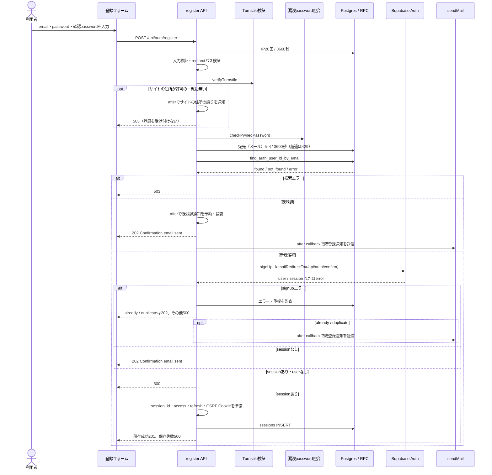
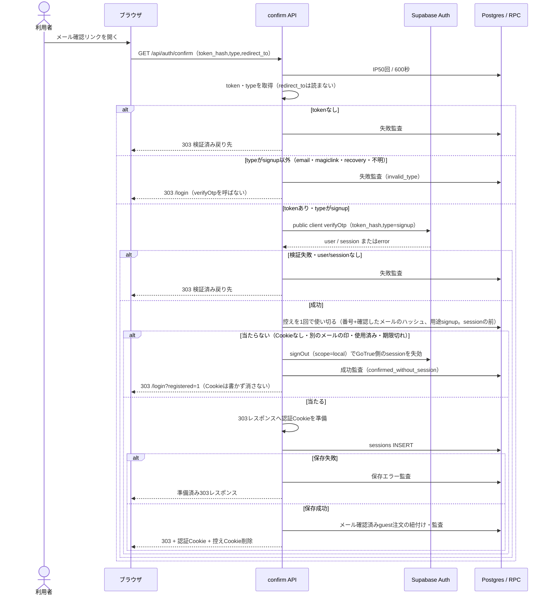
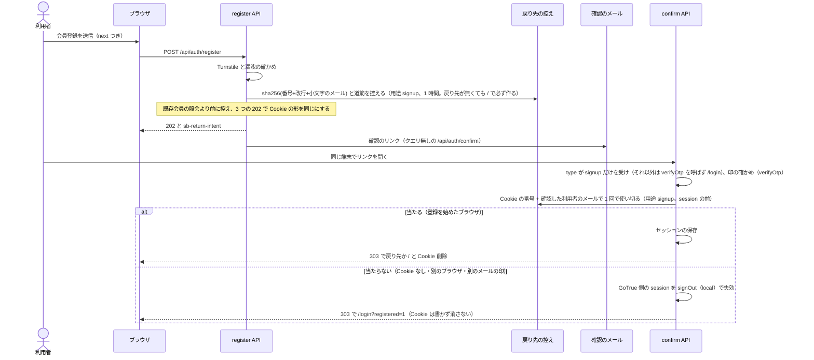

# 会員登録・確認シーケンス

> 状態: 推定（2026-10-04 にソースと照合し、2026-10-24 に一部を直した。ユーザーの確認は未） | 確認日: 2026-10-26 | 対象: 公開登録、メール確認

## 概要

公開登録は通常202で確認メールの受付を返し、既登録の場合も同じ応答を返す。メールリンクの確認はpublic clientでtoken_hashを検証し、登録を始めたブラウザ（控えのCookieの番号と確認した利用者のメールを一緒にハッシュした印が登録の控えに当たる）の時だけ、認証Cookieを準備してからlocal sessionsを保存する。別のブラウザではメールの確認だけ済ませ、sessionを作らず`/login?registered=1`へ送る（SEC-AUTH-007、ADR-0413）。管理者ヘッダによる作成の枝は 2026-10-26 に削除した（管理者ヘッダを付けても公開登録として扱う）。[記載方針](README.md)を参照する。

## 範囲と根拠

既存要件は[LOGINのページ別要求表](../pages/14_login.md)と[要求定義](../../02_Requirements/requirements.md)を参照する。

| 対象 | 実コード参照 |
| --- | --- |
| 登録受付 | [register API](../../../src/app/api/auth/register/route.ts)、[Schema](../../../src/features/auth/schemas/register.ts) |
| メール確認 | [confirm API](../../../src/app/api/auth/confirm/route.ts)、[戻り先の控えの解決](../../../src/features/auth/return-intent/return-intent-service.ts)、[origin helper](../../../src/lib/redirect.ts) |
| ユーザー検索 | [検索サービス](../../../src/features/auth/services/auth-admin-user.ts)、[migration](../../../supabase/migrations/20260901102912_remote_schema.sql) |
| CookieとDB保存 | [初回保存](../../../src/features/auth/services/register.ts)、[Cookie](../../../src/lib/cookie.ts)、[ゲスト注文引継ぎ](../../../src/lib/orders/link-guest-orders.ts) |
| UI・監査 | [RegisterModal](../../../src/components/RegisterModal.tsx)、[LoginContext](../../../src/contexts/LoginContext.tsx)、[audit helper](../../../src/lib/audit.ts) |

POSTは[proxy](../../../src/proxy.ts)のOrigin検査を先に通る。register／confirmのレート制限は[共通helper](../../../src/features/auth/middleware/rateLimit.ts)で、429またはDB障害503とRetry-Afterを返す。

## SQ-AUTH-REGISTER-PUBLIC: 公開登録受付

開始契機は`/login`の会員登録フォーム送信。事前条件はemail・passwordと、設定時のTurnstile token。終了結果は202の受付、session付きsignupの201（本文は`{ user: { id, email } }`だけ）、またはエラーである。管理者ヘッダ（`x-admin-token`・Bearer）は読まない。

登録UIは成功応答でメール送信案内を表示する。[RegisterModal](../../../src/components/RegisterModal.tsx)は16文字以上と確認password一致を確かめ、[共通Schema](../../../src/features/auth/schemas/common.ts)は16〜128文字を要求する。

公開signUpは[createClient](../../../src/lib/supabase/server.ts)をRequestなしで呼び、SSR clientのCookie adapterはnext/headersのCookie storeへ書く。インストール済み[SSR client](../../../node_modules/@supabase/ssr/dist/module/createServerClient.js)はPKCEとpersistSession=trueを設定し、[signUp](../../../node_modules/@supabase/auth-js/dist/module/GoTrueClient.js)はPKCE code verifierを作り、sessionが返った場合はSIGNED_INを通知する。[SSR storage](../../../node_modules/@supabase/ssr/dist/module/cookies.js)からadapterへ届くSDK Cookie書込みは、上図の独自201レスポンスへのCookie準備と別の経路である。独自保存失敗時に新しい500を返しても、Cookie storeへ行ったSDK Cookie書込みを取消す処理はない。実際のCookie名・分割・ブラウザへの反映は今回runtimeで確認していない。

| 分岐 | 応答・処理 |
| --- | --- |
| 入力不正／Turnstile失敗／漏洩password | 400／403／400で止まる。宛先の枠はこの後に数えるので、止まった要求は数えない |
| 宛先（メール）の枠の超過 | 429。控えの作成・既存会員の照会・signUp・メール送信へ進まない（照会の後だと429の有無で登録済みかが分かる）。枠の呼び出しが投げた時は記録して進む |
| 漏洩照合サービス利用不可 | 監査して登録処理を続ける |
| サイトの住所（Origin）が許可の一覧に無い | afterで管理側へ通知して503。漏洩照合・重複確認・signUpへ進まない（[register](../../../src/app/api/auth/register/route.ts) の Origin の許可の一覧を確かめる分岐） |
| signupでalready／duplicate | 既登録通知を予約して202。他のsignupエラーは500 |
| signupがsessionを返しuserなし | 500 |
| 初回保存失敗 | 新しい500レスポンスを返す。準備した201を返さない。SSR adapterのCookie store書込みとは別であり、SDK Cookieの取消を保証しない |
| 外側例外 | JSON解析を含む予期しない例外は500 |
| afterのメール送信失敗 | ログのみ。返した202は変えない |

session付きsignupの経路は、コードコメントではSupabaseのConfirm email OFF時と説明される。実際の設定は今回未確認で、公開登録が常に202とは断定しない。

## SQ-AUTH-REGISTER-CONFIRM: 確認リンクの検証

開始契機はメール確認先へのGET。事前条件はtoken_hash（またはtoken）と任意のtype／redirect_to。終了結果は、結び付いた成功では検証済み戻り先への303、結び付かない成功（別のブラウザ・別のメールの印）では`/login?registered=1`への303、失敗では固定の`/login`への303。typeがsignup以外の時はverifyOtpを呼ばず（印を消費せず）固定の`/login`へ303で終わる。結び付いた成功と失敗のHTTP redirectは区別せず、監査とCookieの有無に違いがある。

typeはsignupだけを受理する（未指定・空はsignup）。email／magiclink／recovery／不明値（大文字違いを含む）はverifyOtpを呼ばず、セッションも戻り先の控えも触らずに`/login`へ303で送る。失敗と例外の監査のdetailはSupabaseや例外の文を残さず、固定の符号（verify_failed／missing_session_or_user／unexpected／invalid_type）にする。303はno-store／no-referrerを設定する。結び付けの成否はsessionを作る前に決める（控えの使い切りはsession保存の前。保存に失敗すると戻り先だけが使用済みになり、行き先は`/`・控えのCookieは削除・verifyOtpのsessionはsignOut(local)で失効する）。結び付かない時と保存失敗の時のsignOutは、失敗が`{ error }`で返っても投げられても握り、ログにはコードだけを残す。保存失敗でも準備済みレスポンスを返すため、Cookie準備が進んだ範囲とDB保存は一致しない場合がある。予期しない例外も同じ戻り先への303で終わる。

ゲスト注文は確認済みemail・user_id NULLの行だけを紐付ける。紐付いた注文がある場合は、最新注文の配送先・氏名からprofilesの未設定住所・表示名も補完する。既存値は上書きしない。profile保存失敗でも注文の紐付けを戻さず、いずれのhelper失敗も認証を止めない。注文の紐付け失敗は次回OTPログインで再試行される。

管理者・サポーターが結び付いた確認で`/auth/verified`へ着いた後は、[追加認証画面の入口と出口](auth-login-mfa.md#追加認証画面の入口と出口)に従い、未認証表示、一般userの/account、特権roleのTOTP／管理画面へ分かれる。

## SQ-AUTH-REGISTER-RETURN: 戻り先の控えと確認リンクでの使い切り（2026-10-25、波 1-A。2026-10-26、波 1-B で登録したメールへの結び付けを追加）

開始契機は会員登録の送信。終了結果は、同じ端末で確認のリンクを開いた時の戻り先（無ければ `/`）。別の端末や別のメールの印では、sessionを作らず`/login?registered=1`。設計は [AUTH の構造設計](../../03_BasicDesign/areas/auth.md) の FLOW-AUTH-003・API-AUTH-005・API-AUTH-006、決定は `.superpowers/sdd/2026-10-25-security-gap-fixes/wave1a-decisions.md`。

- 確認のリンクに `redirect_to` を付けない。失敗は固定の `/login` へ 303
- 別のブラウザでリンクを開いた時は、メールの確認だけ済ませ、戻り先もセッションも使わず `/login?registered=1` へ送る。そこで「会員登録が完了しました。ログインしてください。」（案）を出す（SEC-AUTH-007、ADR-0413）
- 被害者の登録の途中（Cookie が有効）に、攻撃者のメールの確認リンクを同じブラウザで開いても、番号は合ってもメールが違うので外れ、セッションを作らない。このとき Cookie は消さない（被害者の控えを壊させない）

## 関連テスト

今回、以下は未実行。

| 観点 | テスト |
| --- | --- |
| 登録応答・管理者ヘッダが効かないこと・宛先の枠 | [register](../../../tests/integration/api/auth/register.test.ts) |
| 既登録の応答統一 | [register enumeration](../../../tests/integration/api/auth/register-enumeration.test.ts) |
| 確認token・redirect・保存失敗・結び付け（別のブラウザ・別のメールの印） | [confirm](../../../tests/integration/api/auth/confirm.test.ts) |
| 控えの往復（登録→同じ Cookie で確認→戻り先、別のメール・Cookie なしは外れる） | [return-intent-flow](../../../tests/integration/api/auth/return-intent-flow.test.ts) |
| Cookie属性 | [cookie flags](../../../tests/integration/api/auth/cookieFlags.test.ts) |

## 未確認事項

Supabase Confirm emailの実設定、確認メールテンプレート（`token_hash`と`type=signup`を`/api/auth/confirm`へ渡しているか。開店前に本番のダッシュボードで確かめる）・tokenの有効期限・到達、migrationの適用は未確認。Supabase内部のuser作成SQLとメール送信順序は、本書のSDK呼出しから推測していない。
