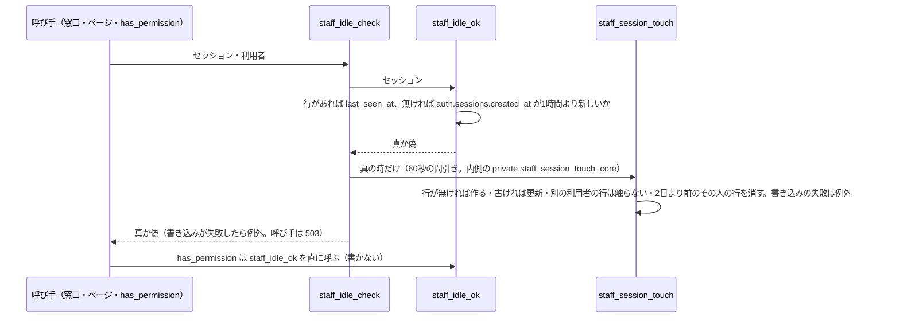

# 店員の無操作1時間の DB の関数

> 状態: 推定 | 確認日: 2026-11-18（段3a Task 8） | 対象: `supabase/migrations/20261117001500_passkey_staff_entry_conditions_fn.sql`、`supabase/migrations/20261117013000_passkey_staff_entry_conditions.sql`

## 概要

店員の無操作1時間（設計 5-2 の条件）を、DB の表 `private.staff_session_activity` と関数4本で測り、`has_permission` の4つ目の条件にする。管理 API・`/api/auth/me`・店員のパスキーの窓口・ログインの終わりが呼ぶ配線は Task 8（DD-AUTH-081）。招待の窓口・ページの入口は Task 9。

## 範囲と根拠

| 項目 | 内容 |
| --- | --- |
| 対応する ID | SR-AUTH-028、FR-AUTH-044、DATA-AUTH-021、ARC-AUTH-013、SEC-AUTH-055、THR-AUTH-054、DD-AUTH-074、DD-AUTH-081、ADR-0472 |
| 対象のコード | `src/lib/auth/staff-passkey-idle-rpc.ts`、`src/lib/auth/staff-passkey-idle.ts`、`src/lib/auth/passkey-auth-session-end.ts`、`src/lib/auth/passkey-manage-guard.ts`、`src/lib/auth/admin-rbac.ts`（呼ぶだけ）、`src/app/api/auth/me/route.ts`、`src/app/api/auth/passkey/login/finish/route.ts`、`src/app/admin/page.tsx`、`src/app/login/page.tsx`、移行 `supabase/migrations/20261117001500_passkey_staff_entry_conditions_fn.sql`（表・関数）、`supabase/migrations/20261117013000_passkey_staff_entry_conditions.sql`（`has_permission` の4つ目の条件） |
| 関連文書 | [設計](../../superpowers/specs/2026-11-07-passkey-auth-design.md)（5-2）、[段3の計画](../../superpowers/plans/2026-11-18-passkey-stage3-staff.md) |
| 調べた時点 | 2026-11-18（手元の DB で結合試験を流した） |

## 処理の詳細

### DD-AUTH-074 無操作の確かめ・時刻の更新・見るだけの確かめ

| 属性 | 値 |
| --- | --- |
| 上位 | DATA-AUTH-021、ARC-AUTH-013、SEC-AUTH-055 |
| 根拠 | 確かめは `private.staff_idle_ok` の1つ。更新は確かめが通った時だけ・60秒の間引きで1回の呼びにまとめる。見るだけの呼びは書かない。行が無い時は `auth.sessions.created_at` に落とす（`refreshed_at` は見ない）。時刻の書き込みが失敗したら `staff_idle_check` は例外を投げ、真を返さない（失敗は閉じる） |
| 状態 | 推定 |
| 確かめ方 | 単体テスト（`tests/unit/lib/auth/staff-passkey-idle-rpc.test.ts`。呼ぶ関数と引数、誤りは閉じる側）、結合テスト（`tests/integration/db/auth_passkey_staff_idle.integration.test.ts`、`tests/integration/db/auth_has_permission_passkey.integration.test.ts`） |
| 出どころ | `.superpowers/sdd/2026-11-18-passkey-stage3-staff/task-3-brief.md`、`docs/superpowers/plans/2026-11-18-passkey-stage3-staff.md`（Task 3） |

- `staff_idle_peek` と `staff_idle_check` は、誤りを握らない `private.staff_idle_ok_strict` を呼ぶ（DB の誤りは例外になり、アプリは 503）。誤りを偽にする `staff_idle_ok` は `has_permission`・RLS だけが使う。`staff_idle_peek` は見るだけ。`/api/auth/me` が使い、画面を開き直すだけでは無操作が延びない
- 移行 E の `has_permission` の順: uid → amr（条件1・2）→ ACL → 認めた鍵の本数 → **無操作（`staff_idle_ok`）** → `app_session_is_live`。`session_id` は形を確かめた後に `uuid` にし、悪ければ `NULL` で偽（例外にしない）
- 移行 E の前の確かめ: `private.staff_idle_ok(uuid)` が無ければ `PASSKEY_MIGRATION_PRECHECK_FAILED`（`passkey_entry_idle_fn`）で止まる
- 呼び手の薄い部品 `src/lib/auth/staff-passkey-idle-rpc.ts`: `staffIdleCheck`（IMPL-AUTH-350。`staff_idle_check`）・`staffIdlePeek`（IMPL-AUTH-351。`staff_idle_peek`）・`staffSessionTouch`（IMPL-AUTH-352。`staff_session_touch`）。`createServiceRoleClient` で RPC を1回呼び、真偽だけを返す。DB の誤り・例外・真偽でない値は `{ ok: false }`（閉じる側。呼び手が `/login` か 401 に倒す）。窓口・ページへの配線は Task 8・9

### DD-AUTH-081 無操作の確かめを管理 API・`/api/auth/me`・ログインの終わり・管理画面に配線する

| 属性 | 値 |
| --- | --- |
| 上位 | SEC-AUTH-055 |
| 根拠 | 無操作の確かめを DB の `staff_idle_check`・`staff_idle_peek` に1本化し（DD-AUTH-074）、アプリの入口が同じ結果の表（ok・idle・error）で扱う。管理画面が呼ぶ API は全部 `authorizeAdminPermissions` を通るので、通った時に時刻が進み、使っている間は無操作にならない。画面側は時刻を進めない確かめ（peek）で、開き直すだけでは無操作が延びない |
| 状態 | 推定 |
| 確かめ方 | 単体テスト（`tests/unit/lib/auth/staff-passkey-idle.test.ts`、`tests/unit/lib/auth/admin-rbac.test.ts`、`tests/unit/api/auth/me-route.test.ts`、`tests/unit/api/auth/passkey-login-finish-route.test.ts`、`tests/unit/lib/client-fetch.test.ts`、`tests/unit/lib/auth/passkey-manage-guard-idle.test.ts`、`tests/unit/api/auth/passkey-manage-routes.test.ts`）、E2E（FR-AUTH-044-AC-01〜04・06。`e2e/FR-LOGIN-067-staff-idle-timeout.spec.ts`） |
| 出どころ | `.superpowers/sdd/2026-11-18-passkey-stage3-staff/task-8-brief.md`、`docs/superpowers/plans/2026-11-18-passkey-stage3-staff.md`（Task 8） |

- `checkStaffIdle(deps, sessionId, userId, mode = 'touch')`（IMPL-AUTH-379）: `touch` は `staffIdleCheck`、`peek` は `staffIdlePeek`。RPC の失敗は `error`、真は `ok`、偽は `idle`。本番の呼びは `staffIdleDeps`（IMPL-AUTH-380）
- `authorizeAdminPermissions`（呼ぶだけ。`@impl` は足さない）: 権限・認めた鍵・入口の条件を通った後に `touch`。`idle` は 401 `{ error: 'session_idle' }` で `endAuthSessionById`（IMPL-AUTH-381。`revoke_auth_session`。24時間まで残る更新の道を閉じる）。`error` は 503・`Retry-After: 30` で、ログアウトも 401 もしない（書き込みの失敗・DB の一時の不調が永久の拒否にならない）。お客さんは権限の確かめで止まるので、ここに来ない
- `GET /api/auth/me`: 役割が admin・supporter の時だけ `peek`。`idle` は GoTrue のセッションを終わらせて（`endAuthSessionById`）`{ authenticated: false, reason: 'idle' }`（200）、`error` は今の unavailable と同じ形 `{ authenticated: false, reason: 'unavailable' }`（503・`Retry-After: 30`。画面は 503 で今の状態を保つので、一時の不調でログアウトに落ちない）
- `POST /api/auth/passkey/login/finish`: 店員のログインの成功で `staffSessionTouch` を1回呼ぶ。書き込みの失敗はログインを断らない（行が無くても作られてから1時間は通り、次の窓口の確かめが書く）
- 開いたままの管理画面: API が 401 `session_idle` を返すと、`clientFetch` は更新を試さず `auth:session-idle` を出し、`LoginContext` が `authReason = 'idle'` にする。期限切れの通行証で更新が通った後の再送が 401 `session_idle` でも同じ通知を出す（開いたままの画面の普通の経路）。後続の失効の通知（`auth:session-expired`）は、先に付いた理由 `idle` を消さない。管理画面 `/admin` は `authReason` が `idle` なら `/login?reason=idle` へ送る。ログインの画面は「しばらく操作がなかったため、ログアウトしました。もう一度ログインしてください。」を出す

**店員の一覧・名前・削除の入口（`/api/auth/passkey/*`。IMPL-AUTH-382 `denyIdleStaff`）**。同じ確かめを通す。お客さんには当てない。確かめの失敗は、すべての呼び元で閉じる側（503「しばらくしてからお試しください。」）にそろえ、`/login` へは送らない（回る道になる）。

- 入口 `guardPasskeyManage` は、回数の制限 → 認証 → CSRF の後に `isStaff`。判定できなければ 503。店員なら `session_id` を読み、パスキーのログインの印があって24時間を過ぎていれば `idle` 扱い、それ以外は `staff_idle_check`（時刻を進める）
- `idle` は 401 `{ error: 'session_idle' }` で `endAuthSessionById`。`error` は 503 `{ error: 'passkey_manage_unavailable', message: 'しばらくしてからお試しください。' }`
- パスキーのログインの印が無い店員（招待の窓の中のセッション）には24時間の確かめを当てない（無操作の確かめだけ）。1本だけの店員が来る `/admin/passkeys?more=1` も、この確かめを通る
- Task 9 が店員の削除の道を変える。この入口の確かめは、その変更と独立に保つ
