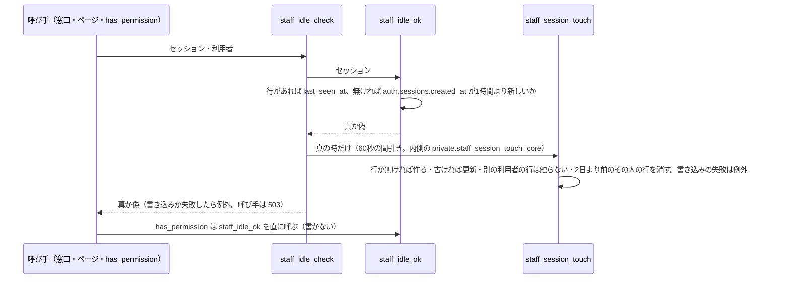

# 店員の無操作1時間の DB の関数

> 状態: 推定 | 確認日: 2026-11-18 | 対象: `supabase/migrations/20261117001500_passkey_staff_entry_conditions_fn.sql`、`supabase/migrations/20261117013000_passkey_staff_entry_conditions.sql`

## 概要

店員の無操作1時間（設計 5-2 の条件）を、DB の表 `private.staff_session_activity` と関数4本で測り、`has_permission` の4つ目の条件にする。窓口・ページが呼ぶ配線は Task 8・9。

## 範囲と根拠

| 項目 | 内容 |
| --- | --- |
| 対応する ID | SR-AUTH-028、FR-AUTH-044、DATA-AUTH-021、ARC-AUTH-013、SEC-AUTH-055、THR-AUTH-054、DD-AUTH-074、ADR-0472 |
| 対象のコード | `src/lib/auth/staff-passkey-idle-rpc.ts`、移行 `supabase/migrations/20261117001500_passkey_staff_entry_conditions_fn.sql`（表・関数）、`supabase/migrations/20261117013000_passkey_staff_entry_conditions.sql`（`has_permission` の4つ目の条件） |
| 関連文書 | [設計](../../superpowers/specs/2026-11-07-passkey-auth-design.md)（5-2）、[段3の計画](../../superpowers/plans/2026-11-18-passkey-stage3-staff.md) |
| 調べた時点 | 2026-11-18（手元の DB で結合試験を流した） |

## 処理の詳細

### DD-AUTH-074 無操作の確かめ・時刻の更新・見るだけの確かめ

| 属性 | 値 |
| --- | --- |
| 上位 | DATA-AUTH-021、ARC-AUTH-013、SEC-AUTH-055 |
| 根拠 | 確かめは `private.staff_idle_ok` の1つ。更新は確かめが通った時だけ・60秒の間引きで1回の呼びにまとめる。見るだけの呼びは書かない。行が無い時は `auth.sessions.created_at` に落とす（`refreshed_at` は見ない）。時刻の書き込みが失敗したら `staff_idle_check` は例外を投げ、真を返さない（失敗は閉じる） |
| 状態 | 推定 |
| 確かめ方 | 単体テスト（`tests/unit/lib/auth/staff-passkey-idle-rpc.test.ts`。呼ぶ関数と引数、誤りは閉じる側）、結合テスト（`tests/integration/db/auth_passkey_staff_idle.integration.test.ts`、`tests/integration/db/auth_has_permission_passkey.integration.test.ts`） |
| 出どころ | `.superpowers/sdd/2026-11-18-passkey-stage3-staff/task-3-brief.md`、`docs/superpowers/plans/2026-11-18-passkey-stage3-staff.md`（Task 3） |

- `staff_idle_peek` は `staff_idle_ok` だけを呼ぶ。`/api/auth/me` が使い、画面を開き直すだけでは無操作が延びない
- 移行 E の `has_permission` の順: uid → amr（条件1・2）→ ACL → 認めた鍵の本数 → **無操作（`staff_idle_ok`）** → `app_session_is_live`。`session_id` は形を確かめた後に `uuid` にし、悪ければ `NULL` で偽（例外にしない）
- 移行 E の前の確かめ: `private.staff_idle_ok(uuid)` が無ければ `PASSKEY_MIGRATION_PRECHECK_FAILED`（`passkey_entry_idle_fn`）で止まる
- 呼び手の薄い部品 `src/lib/auth/staff-passkey-idle-rpc.ts`: `staffIdleCheck`（IMPL-AUTH-350。`staff_idle_check`）・`staffIdlePeek`（IMPL-AUTH-351。`staff_idle_peek`）・`staffSessionTouch`（IMPL-AUTH-352。`staff_session_touch`）。`createServiceRoleClient` で RPC を1回呼び、真偽だけを返す。DB の誤り・例外・真偽でない値は `{ ok: false }`（閉じる側。呼び手が `/login` か 401 に倒す）。窓口・ページへの配線は Task 8・9
