# 店員の招待・結び・有効化・取り消し・降格・最後の手段・削除の下限の DB の関数

> 状態: 推定 | 確認日: 2026-11-20 | 対象: `supabase/migrations/20261118130000_passkey_staff_invites.sql`、`src/lib/auth/staff-passkey-invite-errors.ts`、`src/features/auth/staff/invite-token.ts`、`invite-mail.ts`、`staff-invite-store.ts`

## 概要

店長が出す店員の招待（表 `private.staff_invites`）を、発行・消費・結び・有効化・取り消し・開いているかの確かめにする DB の関数と、その例外の文を呼び手の理由にする薄い部品。後半（移行 H の後半）は、役割の変更を招待に寄せる作り直し・降格・ダッシュボード専用の最後の手段・鍵の削除の下限。呼ぶ窓口は Task 4 以降。

## 範囲と根拠

| 項目 | 内容 |
| --- | --- |
| 対応する ID | SR-AUTH-026、FR-AUTH-050、FR-AUTH-051、SEC-AUTH-059、THR-AUTH-056、DD-AUTH-085、DD-AUTH-091、FR-AUTH-034、FR-AUTH-035、FR-AUTH-037、DATA-AUTH-020、ARC-AUTH-012、SEC-AUTH-053、SEC-AUTH-054、THR-AUTH-052、DD-AUTH-070、DD-AUTH-071、DD-AUTH-072、DD-AUTH-073、DD-AUTH-075、DD-AUTH-076、DD-AUTH-077、DD-AUTH-078、FR-AUTH-041、SCR-AUTH-013、API-AUTH-037、FR-AUTH-038、FR-AUTH-039、FR-AUTH-040、API-AUTH-033、API-AUTH-034、API-AUTH-035、API-AUTH-036、SEC-AUTH-056、THR-AUTH-055、FR-AUTH-042、SEC-AUTH-057、THR-AUTH-053、DD-AUTH-079、FR-AUTH-043、SCR-AUTH-014、API-AUTH-038、DD-AUTH-080、ADR-0471 |
| 対象のコード | 移行 `supabase/migrations/20261118130000_passkey_staff_invites.sql`、`src/lib/auth/staff-passkey-invite-errors.ts`、`src/features/auth/staff/invite-token.ts`・`invite-mail.ts`・`staff-invite-store.ts`・`staff-invite-send.ts`・`staff-invite-http.ts`、`src/app/api/admin/staff/**/route.ts`、`src/app/staff/register/page.tsx`、`src/features/auth/staff/components/StaffRegisterScreen.tsx`・`staff-register-client.ts`・`staff-register-access.ts`、`src/app/api/auth/staff/register/complete/route.ts`、`src/app/api/auth/staff/invite/start/route.ts`、`src/features/auth/staff/staff-invite-session.ts`、`src/lib/auth/passkey-auth-session-end.ts`、`src/app/staff/invite/page.tsx`、`src/features/auth/staff/components/StaffInviteScreen.tsx` |
| 関連文書 | [設計](../../superpowers/specs/2026-11-07-passkey-auth-design.md)（5-4・6-2・8-1）、[段3の計画](../../superpowers/plans/2026-11-18-passkey-stage3-staff.md) |
| 調べた時点 | 2026-11-20（手元の DB で結合試験を流した） |

## 処理の詳細

### DD-AUTH-070 招待の発行の順番と、発行の失敗の理由

| 属性 | 値 |
| --- | --- |
| 上位 | DATA-AUTH-020、SEC-AUTH-053 |
| 根拠 | 錠を全体 → 利用者の順で取り、発行者を錠の後に確かめれば、行き止まりにならず、降格直後の店長の発行も通らない。外す物と新しい招待を1つの取引にすれば、途中で止まっても何も変わらない |
| 状態 | 推定 |
| 確かめ方 | 単体テスト（`tests/unit/lib/auth/staff-passkey-invite-errors.test.ts`。理由の写しと錠の順の文字列）、結合テスト（`tests/integration/db/auth_passkey_staff_invites.integration.test.ts`）、E2E（`e2e/FR-LOGIN-075-staff-invite-function-grants.spec.ts`） |
| 出どころ | `.superpowers/sdd/2026-11-18-passkey-stage3-staff/task-2-brief.md`、`docs/superpowers/plans/2026-11-18-passkey-stage3-staff.md`（Task 2） |

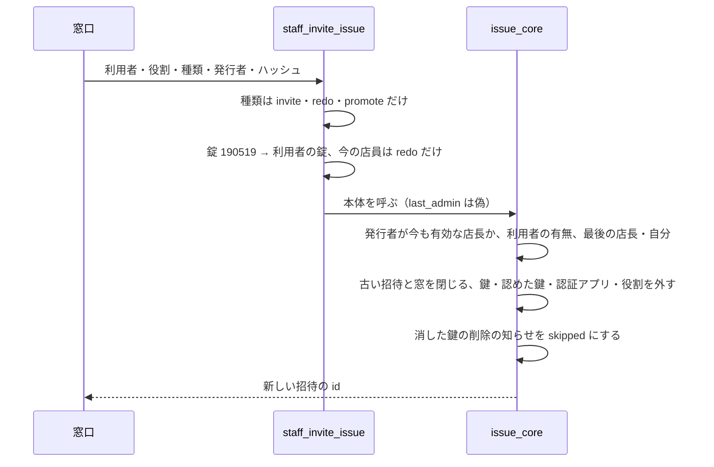

- 理由の写し: `staffInviteIssueFailureReason`（IMPL-AUTH-340）が `STAFF_INVITE_KIND_FORBIDDEN`・`STAFF_ALREADY_STAFF`・`STAFF_NOT_STAFF`（`not_staff`）・`LAST_ADMIN_REQUIRED`・`SELF_ROLE_CHANGE_FORBIDDEN`・`ROLE_PERMISSION_FORBIDDEN`・`USER_NOT_FOUND` を理由にし、知らない文は `failed`

### DD-AUTH-071 消費・結び・有効化の順番と、有効化の門

| 属性 | 値 |
| --- | --- |
| 上位 | ARC-AUTH-012、SEC-AUTH-053 |
| 根拠 | 消費で窓を開けず、結びで `session_id` を知ってから開けば、先に窓を開けてフックに結ばせる形を作らずに済む。有効化の門を DB の1か所にすれば、窓口が門を飛ばせない |
| 状態 | 推定 |
| 確かめ方 | 単体テスト（`tests/unit/lib/auth/staff-passkey-invite-errors.test.ts`）、結合テスト（`tests/integration/db/auth_passkey_staff_invites.integration.test.ts`） |
| 出どころ | `.superpowers/sdd/2026-11-18-passkey-stage3-staff/task-2-brief.md`、`docs/superpowers/plans/2026-11-18-passkey-stage3-staff.md`（Task 2） |

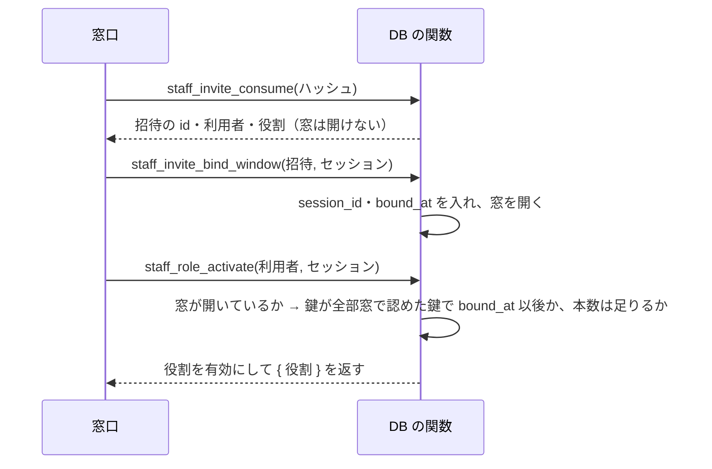

- 理由の写し: `staffInviteActivateFailureReason`（IMPL-AUTH-341）が `STAFF_ACTIVATE_INVITE_INVALID`・`STAFF_INVITE_INVALID`・`STAFF_INVITE_ALREADY_BOUND`・`STAFF_ACTIVATE_NO_WINDOW`・`STAFF_ACTIVATE_KEYS_SHORT`・`STAFF_ACTIVATE_KEYS_NOT_WINDOW` を理由にする

### DD-AUTH-072 招待の取り消しの確かめと、失敗の理由

| 属性 | 値 |
| --- | --- |
| 上位 | SEC-AUTH-053 |
| 根拠 | 取り消しも発行と同じ順で錠を取り、操作者を錠の後に確かめる。鍵・役割は変えない（途中の人の鍵を消さない） |
| 状態 | 推定 |
| 確かめ方 | 単体テスト（`tests/unit/lib/auth/staff-passkey-invite-errors.test.ts`）、結合テスト（`tests/integration/db/auth_passkey_staff_invites.integration.test.ts`） |
| 出どころ | `.superpowers/sdd/2026-11-18-passkey-stage3-staff/task-2-brief.md`、`docs/superpowers/plans/2026-11-18-passkey-stage3-staff.md`（Task 2） |

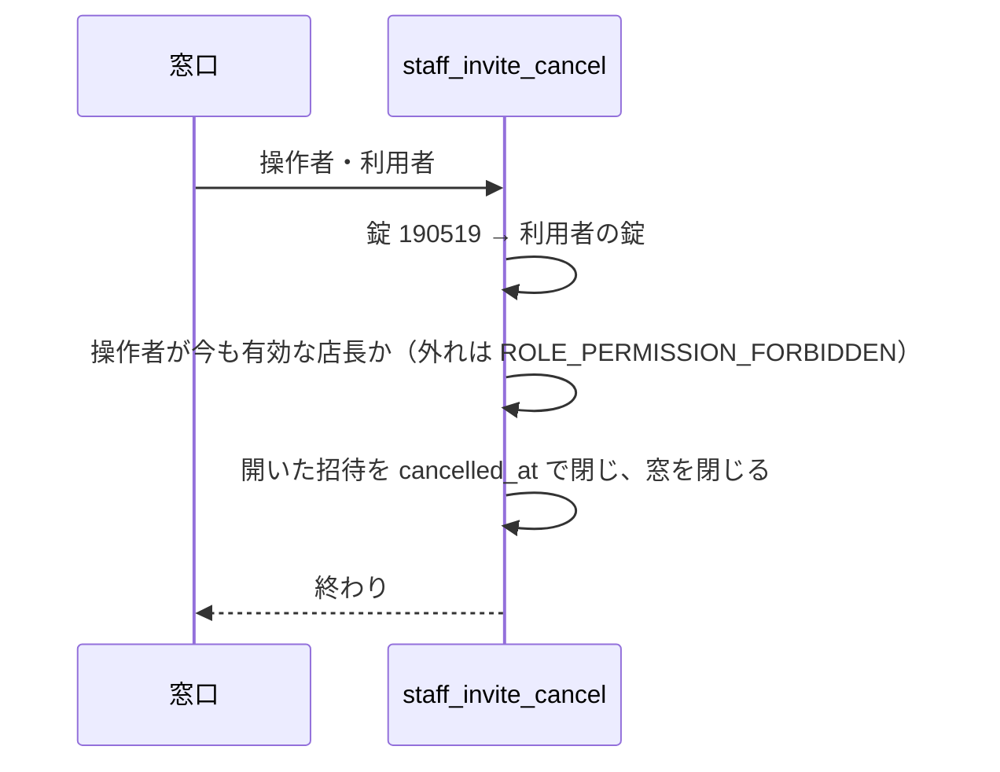

- 理由の写し: `staffInviteCancelFailureReason`（IMPL-AUTH-342）が `ROLE_PERMISSION_FORBIDDEN` だけ `forbidden`、それ以外は `failed`

### DD-AUTH-073 役割の変更の拒否・降格・最後の手段・鍵の削除の下限

| 属性 | 値 |
| --- | --- |
| 上位 | SEC-AUTH-054 |
| 根拠 | 役割を直に書く道を DB が断れば、窓口が増えても店員になるのは招待だけになる。降格は発行と同じ順で錠を取り、操作者を錠の後に確かめる。最後の手段はダッシュボードの SQL からだけ呼べるようにし、アプリの鍵では呼べない。鍵の数えと削除を同じ利用者の錠の中に置けば、同時の削除でも下限を割らない |
| 状態 | 推定 |
| 確かめ方 | 結合テスト（`tests/integration/db/auth_passkey_staff_roles.integration.test.ts`、`tests/integration/db/role_permissions.integration.test.ts`）、単体テスト（`tests/unit/lib/auth/staff-passkey-invite-errors.test.ts`。理由の写しと錠の順の文字列） |
| 出どころ | `.superpowers/sdd/2026-11-18-passkey-stage3-staff/task-2b-brief.md`、`docs/superpowers/plans/2026-11-18-passkey-stage3-staff.md`（Task 2b） |

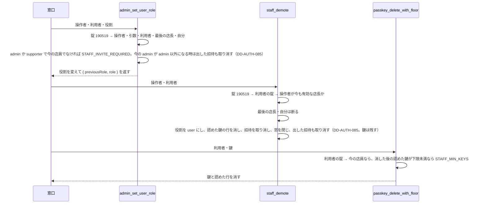

- 最後の手段（`private.staff_invite_issue_manual`）: ダッシュボードの SQL 専用。`postgres` だけが `execute` を持ち、アドレスで利用者を引き（無ければ `STAFF_MANUAL_USER_NOT_FOUND`）、`staff_invite_issue_core` を種類 `last_resort`・最後の店長の保護なしで呼び、生の合言葉（43字）を返す。表には UTF-8 の SHA-256 だけ。期限は既定1時間。監査（`audit_logs`、`staff.last_resort.issue`）に1行、詳細は対象の id だけ。TS には `last_resort` の型を作らない
- 理由の写し: `staffDemoteFailureReason`（IMPL-AUTH-347）が `LAST_ADMIN_REQUIRED`・`SELF_ROLE_CHANGE_FORBIDDEN`・`ROLE_PERMISSION_FORBIDDEN`・`USER_NOT_FOUND` を理由にする。`staffRoleChangeNeedsInvite`（IMPL-AUTH-348）は `STAFF_INVITE_REQUIRED` だけ真にして窓口を招待の道に落とす。`passkeyDeleteFloorFailureReason`（IMPL-AUTH-349）が `STAFF_MIN_KEYS`・`PASSKEY_NOT_FOUND` を理由にする。知らない文はどれも `failed`

### DD-AUTH-085 店長が店長でなくなる3つの道は、その店長が出した招待を同じ取引で取り消す

| 属性 | 値 |
| --- | --- |
| 上位 | SEC-AUTH-059 |
| 根拠 | 取り消しの中身を私用の関数 `private.staff_cancel_invites_issued_by` に1回だけ書き、降格・役割の変更・やり直しの3か所から呼ぶ。呼ぶのは錠 190519 を持った後（降格と core は利用者の錠も持つが、`admin_set_user_role` は 190519 だけ）。役割の変更と core は、`user_roles` を外す前に「今、有効で期限内の `admin` か」を読む。降格は条件なしで、役割を外した後に取り消す（降格した人は出した招待を残さない）。新しい錠を取らず、有効化・取り消し・降格・発行はどれも 190519 を先に取るので直列になる |
| 状態 | 推定 |
| 確かめ方 | 結合テスト（`tests/integration/db/auth_passkey_staff_roles.integration.test.ts`、`auth_passkey_staff_invites.integration.test.ts`）、E2E（`e2e/FR-LOGIN-073-staff-demote-cancels-issued-invites.spec.ts`） |
| 出どころ | `.superpowers/sdd/2026-11-19-passkey-stage3b-staff-ops/task-13-brief.md`、`docs/superpowers/plans/2026-11-19-passkey-stage3b-staff-ops.md`（Task 13） |

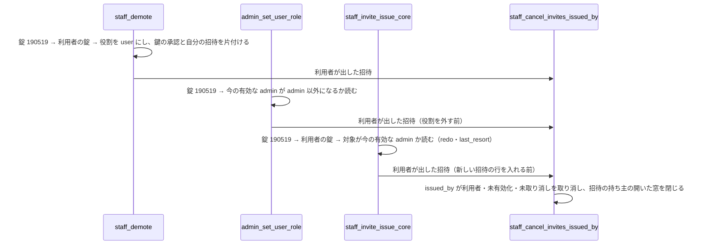

- 取り消す物: `issued_by = p_user_id` で `cancelled_at IS NULL AND activated_at IS NULL` の招待（使用済みも含む。`invite`・`promote`・`redo` を分けない）。有効化済み・ほかの店長・`last_resort`（`issued_by` が空）は変えない
- 呼ばない時: 店長からほかの店長・サポーターから店長・お客さんへの発行（`invite`・`promote`）。`staff_demote` が `LAST_ADMIN_REQUIRED` などで失敗した時は取引ごと戻るので何も取り消されない
- 招待ごとの監査は書かず、招待の持ち主のログインも終わらせない（まだ店員でなく窓が閉じる。取り消す側の `cancelled: false` の道は DD-AUTH-091）
- `admin_set_user_role` の置き換え前の `md5(prosrc)` の確かめ（`0cb9f532…`）は変えない。同じ段でこの道を足したので、移行 H の ROLLBACK と末尾の ACL の確かめにこの関数を足した

### DD-AUTH-075 招待の合言葉・メール・DB を呼ぶ薄い部品

| 属性 | 値 |
| --- | --- |
| 上位 | SEC-AUTH-053 |
| 根拠 | 合言葉をメールのリンクの `#` の断片にだけ置き、表にはその文字列の UTF-8 の SHA-256 だけを渡せば、ログ・Referer・DB のどこにも平文が残らない。DB の関数の例外を理由に写して本文を返さなければ、内部の文が画面に出ない。文面は店員が読むので、挨拶・署名・店名の頭を付けず、削除の知らせを送らない代わりにメールの冒頭で知らせる |
| 状態 | 推定 |
| 確かめ方 | 単体テスト（`tests/unit/features/auth/staff/invite-token.test.ts`・`invite-mail.test.ts`・`staff-invite-store.test.ts`。固定の合言葉のハッシュは DB の結合試験と同じ値） |
| 出どころ | `.superpowers/sdd/2026-11-18-passkey-stage3-staff/task-4-brief.md`、`docs/superpowers/plans/2026-11-18-passkey-stage3-staff.md`（Task 4） |

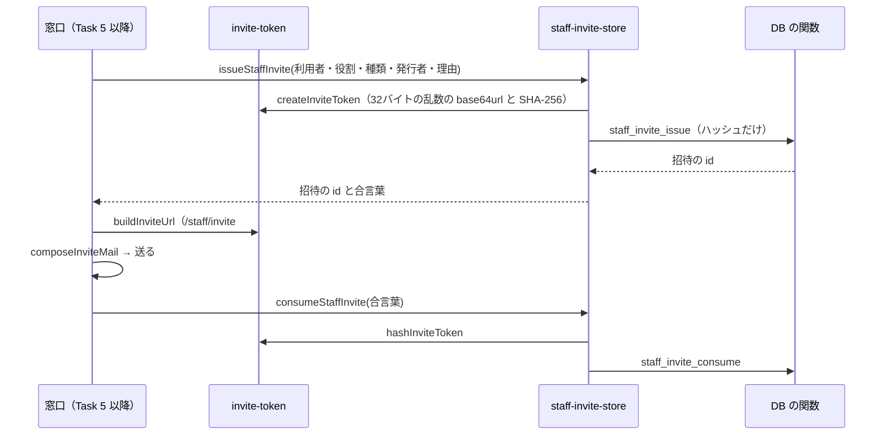

- 合言葉: `createInviteToken`（IMPL-AUTH-353）は43字の base64url と、その文字列の UTF-8 の SHA-256（生の32バイトにはかけない）を返す。`hashInviteToken`（IMPL-AUTH-354）は届いた合言葉から同じ値を求める。`buildInviteUrl`（IMPL-AUTH-355）は `/staff/invite#<合言葉>` を作り、`?token=` は作らない
- メール: `composeInviteMail`（IMPL-AUTH-356）は件名「店員のアカウントの登録のご案内」、役割・リンク・期限・「ご自身で心当たりがない場合は、何もしないでください。」を入れる。`redo`・`promote`、およびパスキーを持っていた人への `invite`（`passkeysDeleted`）は、冒頭に「これまでのパスキーはすべて削除されました。」を入れる。HTML は差し込む文字を escape する
- DB を呼ぶ部品 `staff-invite-store.ts`（サーバーだけ）: `issueStaffInvite`（IMPL-AUTH-357）・`consumeStaffInvite`（IMPL-AUTH-397）・`bindStaffInviteWindow`（IMPL-AUTH-398）・`activateStaffRole`（IMPL-AUTH-399）・`cancelStaffInvite`（IMPL-AUTH-400。設計は段3b Task 13 から DD-AUTH-091）・`demoteStaff`（IMPL-AUTH-401。設計は同じく DD-AUTH-085）・`hasOpenStaffInvite`（IMPL-AUTH-402）。戻りは `{ ok: true; value } | { ok: false; reason }`。理由は DD-AUTH-070〜073 の写し（`staff-passkey-invite-errors.ts`）を使い、知らない文・例外・形の違う戻りは `failed`（消費は `invalid`、`hasOpenStaffInvite` は偽）。ログには RPC の名前とコードだけを出し、例外の本文・合言葉・引数は出さない。`last_resort` の型は作らない（アプリから呼べない）
- IMPL の番号: 計画の予約 353〜357 の5つに収まらないので、`consumeStaffInvite` 以降の6つは予約の外の 397〜402 を使った

### DD-AUTH-076 招待の発行・古いログインの終了・メールの送りの共通の流れと、店長の窓口の入口の確かめ

| 属性 | 値 |
| --- | --- |
| 上位 | SEC-AUTH-056、API-AUTH-033、API-AUTH-034 |
| 根拠 | 招待・上げる・やり直しは、発行 → 古いログインの終了 → メールの順が同じなので、共通の流れ（`issueAndSendStaffInvite`）に1つにする。リンクの元をその流れの中でサイトの設定の住所に固定すれば、窓口ごとの書き忘れで偽の Host が通らない。鍵を消す発行の前にメールの設定を確かめれば、送れないまま鍵を消さない。入口の確かめ（権限 → CSRF → 回数）と監査も1つにして、窓口の順番がそろう |
| 状態 | 推定 |
| 確かめ方 | 単体テスト（`tests/unit/features/auth/staff/staff-invite-send.test.ts`・`staff-invite-http.test.ts`、`tests/unit/api/admin/staff/invites-route.test.ts`・`redo-route.test.ts`） |
| 出どころ | `.superpowers/sdd/2026-11-18-passkey-stage3-staff/task-5-brief.md`、`docs/superpowers/plans/2026-11-18-passkey-stage3-staff.md`（Task 5） |

補足（2026-11-20 段3b Task 19）: 窓口は、メールの設定（サイトの住所・送り手。`isStaffInviteMailReady`）を `createUser` より前に確かめ、壊れていれば 503 でアカウントを作らず、監査に `mail_config_invalid` を残す。

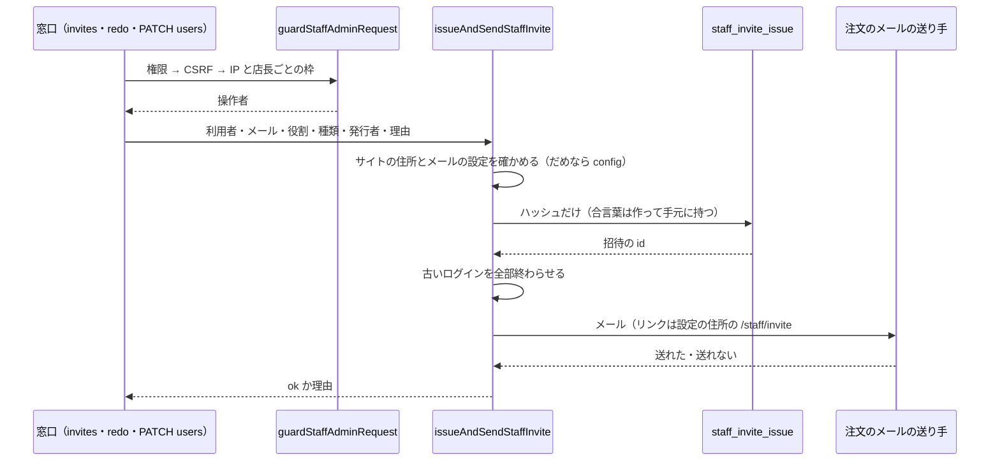

- 流れ（IMPL-AUTH-358）: 設定が使えなければ `config`、発行の失敗は DB の理由（`already_staff`・`last_admin`・`self`・`forbidden`・`not_found`・`failed`）、ログインの終了の失敗は `revoke_failed`、メールの失敗は `mail_failed`。期限は発行の時刻の24時間後を `YYYY年M月D日 H:mm（日本時間）` にする。`redo`・`promote`、および鍵を持っていた人への `invite` は、メールの冒頭で削除を知らせる。冪等の鍵は `staff-invite/<招待の id>`
- 応答（IMPL-AUTH-359）: 理由を状態と短い文にする（`already_staff` 409・`not_staff` 409・`mail_failed` 502・`config` 503・`revoke_failed` 500 ほか）。`no-store`
- 入口（IMPL-AUTH-360）: `authorizeAdminPermission('admin.users.manage')` → `requireCsrfOrDeny` → IP の枠 → 店長ごとの枠。どの拒否も `no-store`
- 監査（IMPL-AUTH-361）: `admin.staff.*` を1行書く。書けなくても操作は止めない。詳細は固定の文と理由の長さだけ
- 招待の窓口（IMPL-AUTH-362）: 本文を確かめ、アカウントを引き（無ければパスワード無しで作る）、既存の鍵の有無を管理 API で読んで流れに渡す。応答は `{ success: true }` だけ
- やり直しの窓口（IMPL-AUTH-363）: 確認の語・理由・自分自身を確かめ、今の役割を発行の前に読む。役割が無ければ `not_staff`（DB の発行を呼ばない）
- `PATCH /api/admin/users`（AUTH の範囲外なので `@impl` は無い）: `STAFF_INVITE_REQUIRED` を受けたら同じ流れ（種類 `promote`）に落とす

### DD-AUTH-077 降格と招待の取り消しの窓口

| 属性 | 値 |
| --- | --- |
| 上位 | SEC-AUTH-056、API-AUTH-035、API-AUTH-036 |
| 根拠 | 降格を `admin_set_user_role` の `user` への変更で行うと、開いている招待が残って降格後に合言葉で窓が開く。招待も取り消す `staff_demote` だけを使い、その後にログインを全部終わらせれば、降格した人のログインが残らない。招待の取り消しも同じく、取り消しの後に招待のセッションを終わらせる |
| 状態 | 推定 |
| 確かめ方 | 単体テスト（`tests/unit/api/admin/staff/demote-route.test.ts`・`invite-cancel-route.test.ts`） |
| 出どころ | `.superpowers/sdd/2026-11-18-passkey-stage3-staff/task-5-brief.md`、`docs/superpowers/plans/2026-11-18-passkey-stage3-staff.md`（Task 5） |

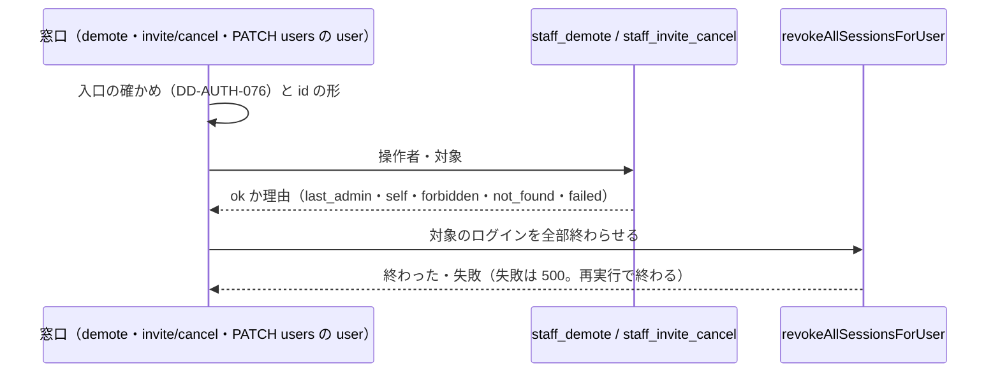

- 降格の窓口（IMPL-AUTH-364）: `demoteStaff`（IMPL-AUTH-401）→ ログインの終了。降格した店長が出した招待も同じ取引で取り消される（DD-AUTH-085）。理由の写しは `staffInviteReasonResponse`（403・404・409・500）
- 取り消しの窓口（IMPL-AUTH-365）: `cancelStaffInvite`（IMPL-AUTH-400）→ 取り消した時だけ（`cancelled: true`）ログインの終了。取り消す物が無い時は 200 `cancelled: false` でログインを終わらせない（DD-AUTH-091）
- `PATCH /api/admin/users` の `user`: 同じ `demoteStaff` で行い、応答の本文と符号は従来（`LAST_ADMIN_REQUIRED` 409・`SELF_ROLE_CHANGE_FORBIDDEN` 403）のまま。`GET /api/admin/users` の `approvedPasskeys`（`passkey_approved_count`。店員だけ）と `invitePending`（`hasOpenStaffInvite`。店員でない人だけ。20件ずつ並行に呼ぶ）は、数えられなければ 0・偽（閉じる側）。どちらも AUTH の範囲外なので `@impl` は無く、単体テストは `tests/unit/api/admin/users-route.test.ts`

### DD-AUTH-091 招待の取り消しは取り消したかを返し、取り消す物が無ければログインを終わらせない

| 属性 | 値 |
| --- | --- |
| 上位 | SEC-AUTH-059 |
| 根拠 | 降格などで先に取り消された招待に「取り消す」を押すと、何も取り消していないのにログインを終わらせて「取り消しました」と出ていた。`staff_invite_cancel` が `boolean` を返し、窓口は `false` の時に何も終わらせず、画面は知らせなしで一覧を読み直す。権限は今までどおり錠の後に確かめる |
| 状態 | 推定 |
| 確かめ方 | 結合テスト（`tests/integration/db/auth_passkey_staff_invites.integration.test.ts`）、単体テスト（`tests/unit/api/admin/staff/invite-cancel-route.test.ts`、`staff-invite-store.test.ts`、`staff-user-actions.test.ts`、`user-section-staff.test.tsx`） |
| 出どころ | `.superpowers/sdd/2026-11-19-passkey-stage3b-staff-ops/task-13-brief.md`、`docs/superpowers/plans/2026-11-19-passkey-stage3b-staff-ops.md`（Task 13） |

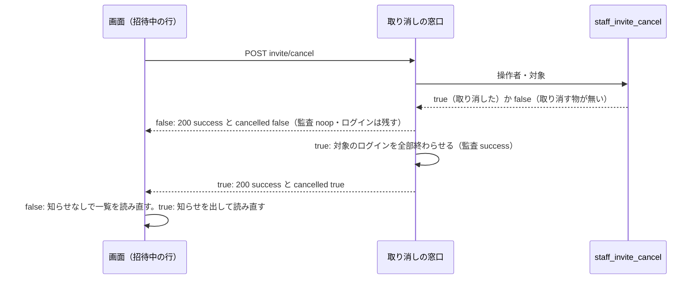

- DB: `cancelled_at` を埋める行が1つでもあれば `true`（窓も閉じる）。無ければ `false`（窓は触らない）
- ストア（`cancelStaffInvite`）は `{ cancelled: boolean }` を返し、`true` 以外（戻りが空・偽）は `false` にする。窓口の監査の `outcome` に `noop` を足した
- 画面: `postStaffAction` が成功の本文の `cancelled`（真偽の時だけ）を返し、`StaffRoleActions` が `false` の時に `onDone(null)` を呼ぶ。`UserSection` の読み直しの道は、知らせが `null` なら知らせを出さずに一覧だけ読み直す

### DD-AUTH-078 招待のリンクの受け口は、役割の無いセッションを作ってから窓に結ぶ

| 属性 | 値 |
| --- | --- |
| 上位 | SEC-AUTH-053、API-AUTH-037、SCR-AUTH-013 |
| 根拠 | 案 B。先に窓を開けてフックに結ばせる形は作らず、お客さんの扱いのままセッションを作ってから、分かった `session_id` に窓を結ぶ。合言葉は `#` にあるので、画面を開いただけでは何も送らず、先読みで使い切られない。消費した後の失敗は招待を使用済みのままにして、同じ合言葉の繰り返しで窓が開いたまま残る道を作らない |
| 状態 | 推定 |
| 確かめ方 | 単体テスト（`tests/unit/app/staff/invite-page.test.tsx`、`tests/unit/api/auth/staff-invite-start.test.ts`）、E2E（`e2e/FR-LOGIN-064-staff-invite-link.spec.ts`） |
| 出どころ | `.superpowers/sdd/2026-11-18-passkey-stage3-staff/task-6-brief.md`、`docs/superpowers/plans/2026-11-18-passkey-stage3-staff.md`（Task 6） |

補足（2026-11-20 段3b Task 19）: 失敗の後に作ったセッションを終わらせるのに失敗した時は、監査に `session_revoke_failed` を足す（合言葉は残さない）。画面の `redirectTo` は `new URL(to, location.origin).origin === location.origin` の時だけ使う（`/	/evil`・`//evil.com`・`https://evil.com` は既定の `/staff/register`）。

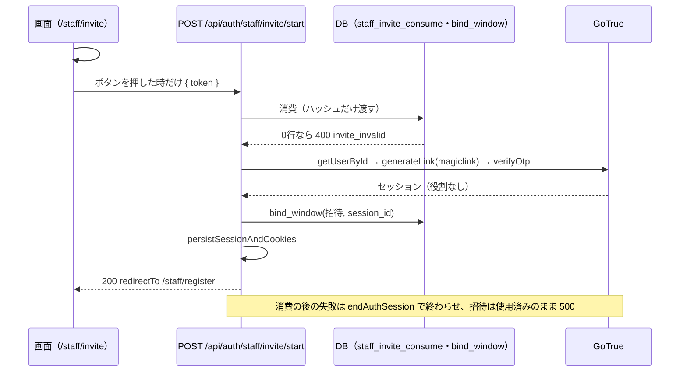

- 画面（IMPL-AUTH-367・368）: `src/app/staff/invite/page.tsx`（検索に載せない）、`StaffInviteScreen`（`#` を読んで消す。素の `fetch` で1回だけ POST。400 は使えない文、500 と通信の失敗は「店長に、もう一度招待を出してもらってください。」でボタンを消す、429 と 503 は待つ文でボタンは残す。`redirectTo` は `/` で始まり `//` と `/\` で始まらない時だけ使う）
- 窓口（IMPL-AUTH-369）: 回数（IP 20回/10分 → ハッシュごと 5回/10分）、`consumeStaffInvite`（IMPL-AUTH-397）、`createInviteSession`（IMPL-AUTH-370）、`bindStaffInviteWindow`（IMPL-AUTH-398）、`persistSessionAndCookies`。Origin は共有の proxy
- `endAuthSession`（IMPL-AUTH-366）は `revoke_auth_session` で GoTrue のセッションを終わらせる。パスキーのログインの終わりから外へ出し、Task 7 も使う
- 回数の枠のハッシュごとの数え方は、既存の `enforceRateLimit` の `subject`。`subject` を渡した枠は IP を NULL にして数えるので（`20260913132105_fix_rate_limit_counters_subject_counting.sql`）、**IP を問わずハッシュごとに全体で5回/10分**（IP との組ではない）。IP を替えても枠は共有され、256 ビットの合言葉は当たらない。副作用として、合言葉を知る誰かが10分に5回送ると、本物の招待の人も一時的に 429 になる（画面は待つ文でボタンを残す）

### DD-AUTH-079 登録の窓口は、役割の無い招待の窓の人を window として扱う

| 属性 | 値 |
| --- | --- |
| 上位 | SEC-AUTH-057 |
| 根拠 | 案 B の招待の人は役割が無く、窓口が「お客さん」と見なすと鍵を認めず、最後の有効化が `KEYS_SHORT` で落ちる。窓が開いていれば招待の行は有効（発行・取り消し・有効化・降格のどれも窓を閉じる）が、窓口は `staff_invite_open` も見て、窓が閉じた人をお客さんの道に落とさない |
| 状態 | 推定 |
| 確かめ方 | 単体テスト（`tests/unit/lib/auth/passkey-recent-auth.test.ts`、`tests/unit/lib/auth/passkey-registration-guard.test.ts`、`tests/unit/api/auth/passkey-register-invite-window.test.ts`）、E2E（`e2e/FR-LOGIN-065-staff-register-window.spec.ts`） |
| 出どころ | `.superpowers/sdd/2026-11-18-passkey-stage3-staff/task-6b-brief.md`、`docs/superpowers/plans/2026-11-18-passkey-stage3-staff.md`（Task 6b） |

- 店員でない人は `hasOpenInvite`（IMPL-AUTH-371。`staff_invite_open`。期限を含む）と、このセッションの `windowIsOpen` を並べて呼ぶ（どちらかが読めなければ 503）。両方偽なら今までのお客さんの道（本数・生存は引かない）。どちらかが真なら（招待の期限が過ぎても窓は最長30分開くので、窓が開いていれば招待は有効と見なす） `checkAuthSessionLiveness(session_id, true)` → `windowIsOpen`・`approvedCount` を店員と同じ順で確かめる
- `evaluateRegistrationAccess` は `inviteWindowOpen`（窓が開いている）・`inviteOpen`（招待が有効）を受け取る。窓が開いて2本未満なら `window`、2本以上なら `reauth_required`、窓が閉じて招待だけ有効なら `window_closed`
- `register/finish` は `guard.isStaff` が偽でも `guard.mode === 'window'` なら `passkey_approve(…, 'window')` を呼ぶ
- 追跡（`@design` は1単位に1つの決まりなので、次の単位は `@design DD-AUTH-056` のまま、この DD の道を実装している）: `guardPasskeyRegistration`（IMPL-AUTH-286）、`evaluateRegistrationAccess`（IMPL-AUTH-275）、`register/start` の `POST`（IMPL-AUTH-276）、`register/finish` の `POST`（IMPL-AUTH-277）。この DD から単位へは `npm run trace` では辿れず、ここの一覧で辿る

### DD-AUTH-080 2本の登録は、窓口の返事で窓の内外を決め、そろったら役割を有効にして全ログインを終わらせる

| 属性 | 値 |
| --- | --- |
| 上位 | SEC-AUTH-053、API-AUTH-038、SCR-AUTH-014 |
| 根拠 | 窓の内か外かを画面で数えると、サーバーの判断とずれる（再読み込み・別の端末）。窓口の返事（`window_closed`・`reauth_required`）に従い、本数はページを開く時にサーバーが渡す。有効になった後に招待のセッション（otp の magiclink）を残さず、店員の入口をパスキーのログインだけにする |
| 状態 | 推定 |
| 確かめ方 | 単体テスト（`tests/unit/features/auth/staff/staff-register-screen.test.tsx`、`staff-register-client.test.ts`、`staff-register-access.test.ts`、`tests/unit/app/staff/register-page.test.tsx`、`tests/unit/api/auth/staff-register-complete.test.ts`）、E2E（`e2e/FR-LOGIN-066-staff-register-two-keys.spec.ts`） |
| 出どころ | `.superpowers/sdd/2026-11-18-passkey-stage3-staff/task-7-brief.md`、`docs/superpowers/plans/2026-11-18-passkey-stage3-staff.md`（Task 7） |

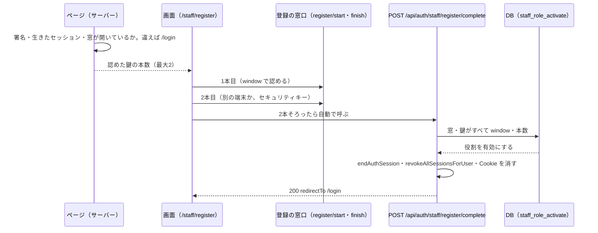

- ページ（IMPL-AUTH-374）: `readStaffRegisterAccess`（IMPL-AUTH-378。署名済みトークン → `checkAuthSessionLiveness(session_id, true)` → `passkey_window_is_open`・`passkey_approved_count`。閉じている・結びが無いは `{ ok: false }` で `/login`、DB が読めない時は `{ ok: false, unavailable: true }` で `/login` へ送らず「しばらくしてからお試しください。」を出す）。検索に載せない
- 画面（IMPL-AUTH-375）: 1本目 → おすすめの文 → 2本目の2段。窓口が `window_closed`・401 と答えたら時間切れの文だけ、`reauth_required` は完了へ進む。1本だけで「登録を完了する」を押すと窓口が 409 `keys_short` を返し、文は「あと1本、登録してください。」。完了後は文と「ログインへ」（自動では進まない）
- 呼び（IMPL-AUTH-377）: `completeStaffRegistration`（本文なしの POST。409 `keys_short`・`keys_not_window`、403・401 は `window_closed`、429、503、そのほかは `failed`）
- 窓口（IMPL-AUTH-376）: 枠（IP・本人）→ 認証 → CSRF → 生きたセッション → `activateStaffRole`（IMPL-AUTH-399）→ `endAuthSession`（IMPL-AUTH-366）＋`revokeAllSessionsForUser` → Cookie を消す。ログインの終了だけが落ちた時は、役割が有効なので 200 にして監査に error を残す（招待のセッションの終了も失敗していたら `session_revocation_failed_invite_alive`）
- 招待の登録の中の鍵は、招待の窓の中のセッション（役割が無い）で `register/start`・`finish` を呼び、`passkey_approve(…, 'window')` で認められる（DD-AUTH-079）。招待は認証アプリの要素を消すので、aal2 は要らない
