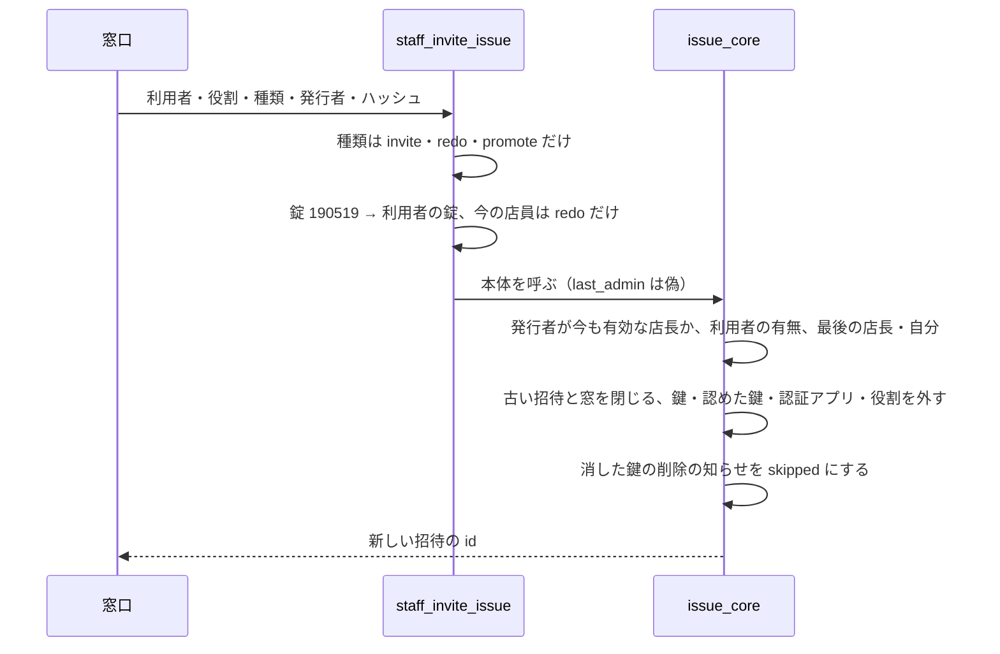
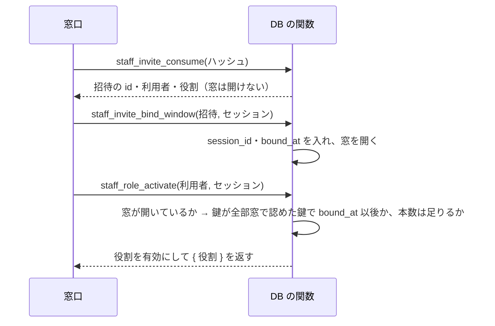
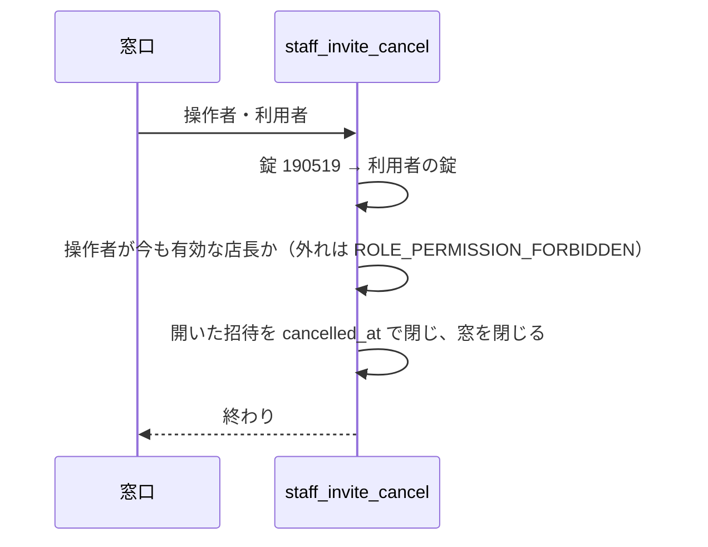

# 店員の招待・結び・有効化・取り消しの DB の関数

> 状態: 推定 | 確認日: 2026-11-18 | 対象: `supabase/migrations/20261118130000_passkey_staff_invites.sql`、`src/lib/auth/staff-passkey-invite-errors.ts`

## 概要

店長が出す店員の招待（表 `private.staff_invites`）を、発行・消費・結び・有効化・取り消し・開いているかの確かめにする DB の関数と、その例外の文を呼び手の理由にする薄い部品。呼ぶ窓口は Task 4 以降。

## 範囲と根拠

| 項目 | 内容 |
| --- | --- |
| 対応する ID | SR-AUTH-026、FR-AUTH-034、FR-AUTH-035、DATA-AUTH-020、ARC-AUTH-012、SEC-AUTH-053、THR-AUTH-052、DD-AUTH-070、DD-AUTH-071、DD-AUTH-072、ADR-0471 |
| 対象のコード | 移行 `supabase/migrations/20261118130000_passkey_staff_invites.sql`、`src/lib/auth/staff-passkey-invite-errors.ts` |
| 関連文書 | [設計](../../superpowers/specs/2026-11-07-passkey-auth-design.md)（5-4・6-2・8-1）、[段3の計画](../../superpowers/plans/2026-11-18-passkey-stage3-staff.md) |
| 調べた時点 | 2026-11-18（手元の DB で結合試験を流した） |

## 処理の詳細

### DD-AUTH-070 招待の発行の順番と、発行の失敗の理由

| 属性 | 値 |
| --- | --- |
| 上位 | DATA-AUTH-020、SEC-AUTH-053 |
| 根拠 | 錠を全体 → 利用者の順で取り、発行者を錠の後に確かめれば、行き止まりにならず、降格直後の店長の発行も通らない。外す物と新しい招待を1つの取引にすれば、途中で止まっても何も変わらない |
| 状態 | 推定 |
| 確かめ方 | 単体テスト（`tests/unit/lib/auth/staff-passkey-invite-errors.test.ts`。理由の写しと錠の順の文字列）、結合テスト（`tests/integration/db/auth_passkey_staff_invites.integration.test.ts`）、E2E（`e2e/FR-LOGIN-075-staff-invite-function-grants.spec.ts`） |
| 出どころ | `.superpowers/sdd/2026-11-18-passkey-stage3-staff/task-2-brief.md`、`docs/superpowers/plans/2026-11-18-passkey-stage3-staff.md`（Task 2） |

- 理由の写し: `staffInviteIssueFailureReason`（IMPL-AUTH-340）が `STAFF_INVITE_KIND_FORBIDDEN`・`STAFF_ALREADY_STAFF`・`LAST_ADMIN_REQUIRED`・`SELF_ROLE_CHANGE_FORBIDDEN`・`ROLE_PERMISSION_FORBIDDEN`・`USER_NOT_FOUND` を理由にし、知らない文は `failed`

### DD-AUTH-071 消費・結び・有効化の順番と、有効化の門

| 属性 | 値 |
| --- | --- |
| 上位 | ARC-AUTH-012、SEC-AUTH-053 |
| 根拠 | 消費で窓を開けず、結びで `session_id` を知ってから開けば、先に窓を開けてフックに結ばせる形を作らずに済む。有効化の門を DB の1か所にすれば、窓口が門を飛ばせない |
| 状態 | 推定 |
| 確かめ方 | 単体テスト（`tests/unit/lib/auth/staff-passkey-invite-errors.test.ts`）、結合テスト（`tests/integration/db/auth_passkey_staff_invites.integration.test.ts`） |
| 出どころ | `.superpowers/sdd/2026-11-18-passkey-stage3-staff/task-2-brief.md`、`docs/superpowers/plans/2026-11-18-passkey-stage3-staff.md`（Task 2） |

- 理由の写し: `staffInviteActivateFailureReason`（IMPL-AUTH-341）が `STAFF_ACTIVATE_INVITE_INVALID`・`STAFF_INVITE_INVALID`・`STAFF_INVITE_ALREADY_BOUND`・`STAFF_ACTIVATE_NO_WINDOW`・`STAFF_ACTIVATE_KEYS_SHORT`・`STAFF_ACTIVATE_KEYS_NOT_WINDOW` を理由にする

### DD-AUTH-072 招待の取り消しの確かめと、失敗の理由

| 属性 | 値 |
| --- | --- |
| 上位 | SEC-AUTH-053 |
| 根拠 | 取り消しも発行と同じ順で錠を取り、操作者を錠の後に確かめる。鍵・役割は変えない（途中の人の鍵を消さない） |
| 状態 | 推定 |
| 確かめ方 | 単体テスト（`tests/unit/lib/auth/staff-passkey-invite-errors.test.ts`）、結合テスト（`tests/integration/db/auth_passkey_staff_invites.integration.test.ts`） |
| 出どころ | `.superpowers/sdd/2026-11-18-passkey-stage3-staff/task-2-brief.md`、`docs/superpowers/plans/2026-11-18-passkey-stage3-staff.md`（Task 2） |

- 理由の写し: `staffInviteCancelFailureReason`（IMPL-AUTH-342）が `ROLE_PERMISSION_FORBIDDEN` だけ `forbidden`、それ以外は `failed`
