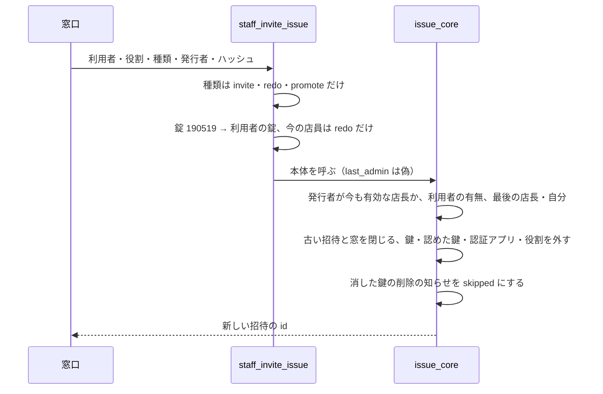
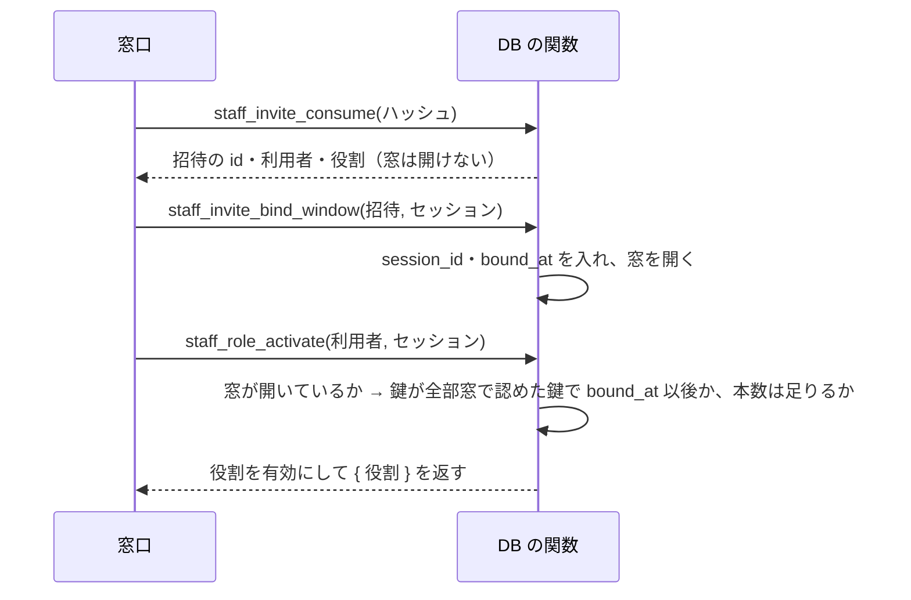
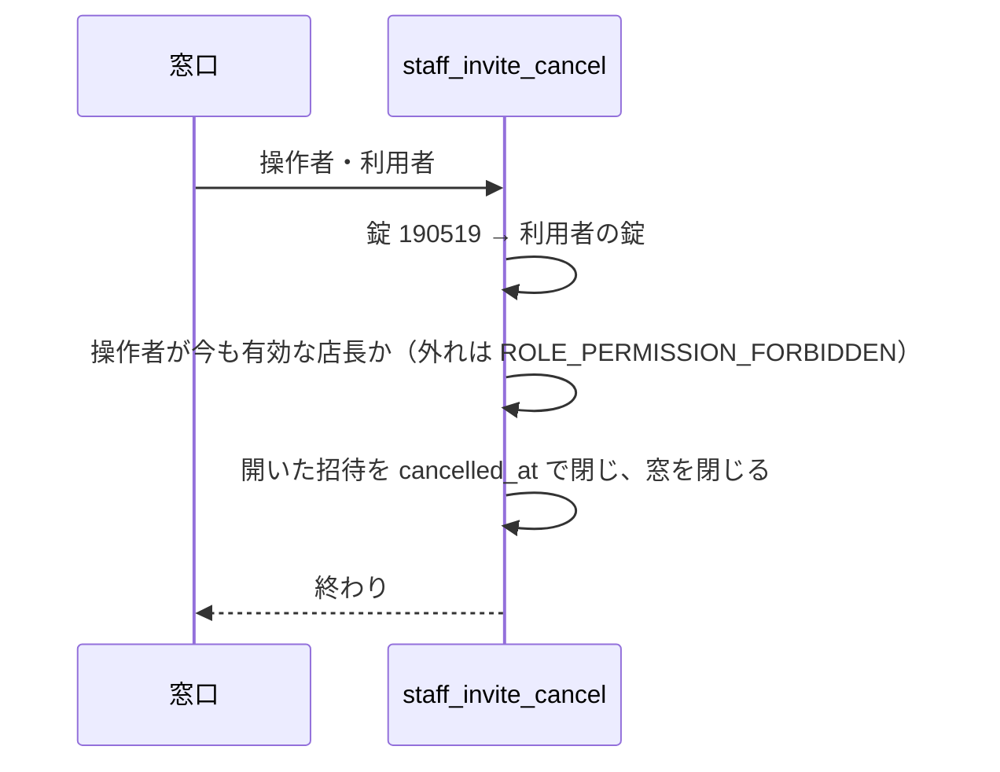
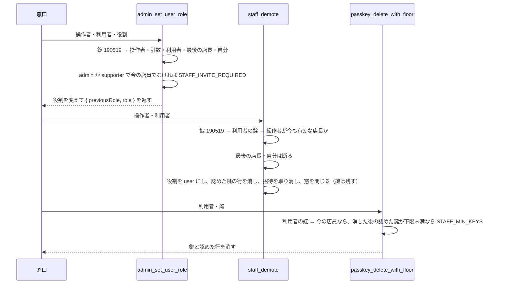
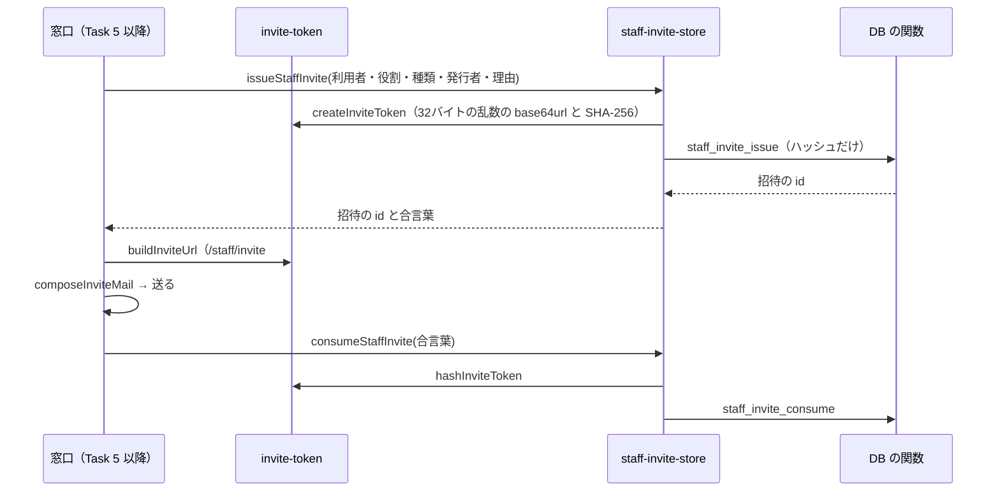

# 店員の招待・結び・有効化・取り消し・降格・最後の手段・削除の下限の DB の関数

> 状態: 推定 | 確認日: 2026-11-18 | 対象: `supabase/migrations/20261118130000_passkey_staff_invites.sql`、`src/lib/auth/staff-passkey-invite-errors.ts`、`src/features/auth/staff/invite-token.ts`、`invite-mail.ts`、`staff-invite-store.ts`

## 概要

店長が出す店員の招待（表 `private.staff_invites`）を、発行・消費・結び・有効化・取り消し・開いているかの確かめにする DB の関数と、その例外の文を呼び手の理由にする薄い部品。後半（移行 H の後半）は、役割の変更を招待に寄せる作り直し・降格・ダッシュボード専用の最後の手段・鍵の削除の下限。呼ぶ窓口は Task 4 以降。

## 範囲と根拠

| 項目 | 内容 |
| --- | --- |
| 対応する ID | SR-AUTH-026、FR-AUTH-034、FR-AUTH-035、FR-AUTH-037、DATA-AUTH-020、ARC-AUTH-012、SEC-AUTH-053、SEC-AUTH-054、THR-AUTH-052、DD-AUTH-070、DD-AUTH-071、DD-AUTH-072、DD-AUTH-073、DD-AUTH-075、ADR-0471 |
| 対象のコード | 移行 `supabase/migrations/20261118130000_passkey_staff_invites.sql`、`src/lib/auth/staff-passkey-invite-errors.ts`、`src/features/auth/staff/invite-token.ts`・`invite-mail.ts`・`staff-invite-store.ts` |
| 関連文書 | [設計](../../superpowers/specs/2026-11-07-passkey-auth-design.md)（5-4・6-2・8-1）、[段3の計画](../../superpowers/plans/2026-11-18-passkey-stage3-staff.md) |
| 調べた時点 | 2026-11-18（手元の DB で結合試験を流した） |

## 処理の詳細

### DD-AUTH-070 招待の発行の順番と、発行の失敗の理由

| 属性 | 値 |
| --- | --- |
| 上位 | DATA-AUTH-020、SEC-AUTH-053 |
| 根拠 | 錠を全体 → 利用者の順で取り、発行者を錠の後に確かめれば、行き止まりにならず、降格直後の店長の発行も通らない。外す物と新しい招待を1つの取引にすれば、途中で止まっても何も変わらない |
| 状態 | 推定 |
| 確かめ方 | 単体テスト（`tests/unit/lib/auth/staff-passkey-invite-errors.test.ts`。理由の写しと錠の順の文字列）、結合テスト（`tests/integration/db/auth_passkey_staff_invites.integration.test.ts`）、E2E（`e2e/FR-LOGIN-075-staff-invite-function-grants.spec.ts`） |
| 出どころ | `.superpowers/sdd/2026-11-18-passkey-stage3-staff/task-2-brief.md`、`docs/superpowers/plans/2026-11-18-passkey-stage3-staff.md`（Task 2） |

- 理由の写し: `staffInviteIssueFailureReason`（IMPL-AUTH-340）が `STAFF_INVITE_KIND_FORBIDDEN`・`STAFF_ALREADY_STAFF`・`LAST_ADMIN_REQUIRED`・`SELF_ROLE_CHANGE_FORBIDDEN`・`ROLE_PERMISSION_FORBIDDEN`・`USER_NOT_FOUND` を理由にし、知らない文は `failed`

### DD-AUTH-071 消費・結び・有効化の順番と、有効化の門

| 属性 | 値 |
| --- | --- |
| 上位 | ARC-AUTH-012、SEC-AUTH-053 |
| 根拠 | 消費で窓を開けず、結びで `session_id` を知ってから開けば、先に窓を開けてフックに結ばせる形を作らずに済む。有効化の門を DB の1か所にすれば、窓口が門を飛ばせない |
| 状態 | 推定 |
| 確かめ方 | 単体テスト（`tests/unit/lib/auth/staff-passkey-invite-errors.test.ts`）、結合テスト（`tests/integration/db/auth_passkey_staff_invites.integration.test.ts`） |
| 出どころ | `.superpowers/sdd/2026-11-18-passkey-stage3-staff/task-2-brief.md`、`docs/superpowers/plans/2026-11-18-passkey-stage3-staff.md`（Task 2） |

- 理由の写し: `staffInviteActivateFailureReason`（IMPL-AUTH-341）が `STAFF_ACTIVATE_INVITE_INVALID`・`STAFF_INVITE_INVALID`・`STAFF_INVITE_ALREADY_BOUND`・`STAFF_ACTIVATE_NO_WINDOW`・`STAFF_ACTIVATE_KEYS_SHORT`・`STAFF_ACTIVATE_KEYS_NOT_WINDOW` を理由にする

### DD-AUTH-072 招待の取り消しの確かめと、失敗の理由

| 属性 | 値 |
| --- | --- |
| 上位 | SEC-AUTH-053 |
| 根拠 | 取り消しも発行と同じ順で錠を取り、操作者を錠の後に確かめる。鍵・役割は変えない（途中の人の鍵を消さない） |
| 状態 | 推定 |
| 確かめ方 | 単体テスト（`tests/unit/lib/auth/staff-passkey-invite-errors.test.ts`）、結合テスト（`tests/integration/db/auth_passkey_staff_invites.integration.test.ts`） |
| 出どころ | `.superpowers/sdd/2026-11-18-passkey-stage3-staff/task-2-brief.md`、`docs/superpowers/plans/2026-11-18-passkey-stage3-staff.md`（Task 2） |

- 理由の写し: `staffInviteCancelFailureReason`（IMPL-AUTH-342）が `ROLE_PERMISSION_FORBIDDEN` だけ `forbidden`、それ以外は `failed`

### DD-AUTH-073 役割の変更の拒否・降格・最後の手段・鍵の削除の下限

| 属性 | 値 |
| --- | --- |
| 上位 | SEC-AUTH-054 |
| 根拠 | 役割を直に書く道を DB が断れば、窓口が増えても店員になるのは招待だけになる。降格は発行と同じ順で錠を取り、操作者を錠の後に確かめる。最後の手段はダッシュボードの SQL からだけ呼べるようにし、アプリの鍵では呼べない。鍵の数えと削除を同じ利用者の錠の中に置けば、同時の削除でも下限を割らない |
| 状態 | 推定 |
| 確かめ方 | 結合テスト（`tests/integration/db/auth_passkey_staff_roles.integration.test.ts`、`tests/integration/db/role_permissions.integration.test.ts`）、単体テスト（`tests/unit/lib/auth/staff-passkey-invite-errors.test.ts`。理由の写しと錠の順の文字列） |
| 出どころ | `.superpowers/sdd/2026-11-18-passkey-stage3-staff/task-2b-brief.md`、`docs/superpowers/plans/2026-11-18-passkey-stage3-staff.md`（Task 2b） |

- 最後の手段（`private.staff_invite_issue_manual`）: ダッシュボードの SQL 専用。`postgres` だけが `execute` を持ち、アドレスで利用者を引き（無ければ `STAFF_MANUAL_USER_NOT_FOUND`）、`staff_invite_issue_core` を種類 `last_resort`・最後の店長の保護なしで呼び、生の合言葉（43字）を返す。表には UTF-8 の SHA-256 だけ。期限は既定1時間。監査（`audit_logs`、`staff.last_resort.issue`）に1行、詳細は対象の id だけ。TS には `last_resort` の型を作らない
- 理由の写し: `staffDemoteFailureReason`（IMPL-AUTH-347）が `LAST_ADMIN_REQUIRED`・`SELF_ROLE_CHANGE_FORBIDDEN`・`ROLE_PERMISSION_FORBIDDEN`・`USER_NOT_FOUND` を理由にする。`staffRoleChangeNeedsInvite`（IMPL-AUTH-348）は `STAFF_INVITE_REQUIRED` だけ真にして窓口を招待の道に落とす。`passkeyDeleteFloorFailureReason`（IMPL-AUTH-349）が `STAFF_MIN_KEYS`・`PASSKEY_NOT_FOUND` を理由にする。知らない文はどれも `failed`

### DD-AUTH-075 招待の合言葉・メール・DB を呼ぶ薄い部品

| 属性 | 値 |
| --- | --- |
| 上位 | SEC-AUTH-053 |
| 根拠 | 合言葉をメールのリンクの `#` の断片にだけ置き、表にはその文字列の UTF-8 の SHA-256 だけを渡せば、ログ・Referer・DB のどこにも平文が残らない。DB の関数の例外を理由に写して本文を返さなければ、内部の文が画面に出ない。文面は店員が読むので、挨拶・署名・店名の頭を付けず、削除の知らせを送らない代わりにメールの冒頭で知らせる |
| 状態 | 推定 |
| 確かめ方 | 単体テスト（`tests/unit/features/auth/staff/invite-token.test.ts`・`invite-mail.test.ts`・`staff-invite-store.test.ts`。固定の合言葉のハッシュは DB の結合試験と同じ値） |
| 出どころ | `.superpowers/sdd/2026-11-18-passkey-stage3-staff/task-4-brief.md`、`docs/superpowers/plans/2026-11-18-passkey-stage3-staff.md`（Task 4） |

- 合言葉: `createInviteToken`（IMPL-AUTH-353）は43字の base64url と、その文字列の UTF-8 の SHA-256（生の32バイトにはかけない）を返す。`hashInviteToken`（IMPL-AUTH-354）は届いた合言葉から同じ値を求める。`buildInviteUrl`（IMPL-AUTH-355）は `/staff/invite#<合言葉>` を作り、`?token=` は作らない
- メール: `composeInviteMail`（IMPL-AUTH-356）は件名「店員のアカウントの登録のご案内」、役割・リンク・期限・「ご自身で心当たりがない場合は、何もしないでください。」を入れる。`redo`・`promote`、およびパスキーを持っていた人への `invite`（`passkeysDeleted`）は、冒頭に「これまでのパスキーはすべて削除されました。」を入れる。HTML は差し込む文字を escape する
- DB を呼ぶ部品 `staff-invite-store.ts`（サーバーだけ）: `issueStaffInvite`（IMPL-AUTH-357）・`consumeStaffInvite`（IMPL-AUTH-397）・`bindStaffInviteWindow`（IMPL-AUTH-398）・`activateStaffRole`（IMPL-AUTH-399）・`cancelStaffInvite`（IMPL-AUTH-400）・`demoteStaff`（IMPL-AUTH-401）・`hasOpenStaffInvite`（IMPL-AUTH-402）。戻りは `{ ok: true; value } | { ok: false; reason }`。理由は DD-AUTH-070〜073 の写し（`staff-passkey-invite-errors.ts`）を使い、知らない文・例外・形の違う戻りは `failed`（消費は `invalid`、`hasOpenStaffInvite` は偽）。ログには RPC の名前とコードだけを出し、例外の本文・合言葉・引数は出さない。`last_resort` の型は作らない（アプリから呼べない）
- IMPL の番号: 計画の予約 353〜357 の5つに収まらないので、`consumeStaffInvite` 以降の6つは予約の外の 397〜402 を使った
