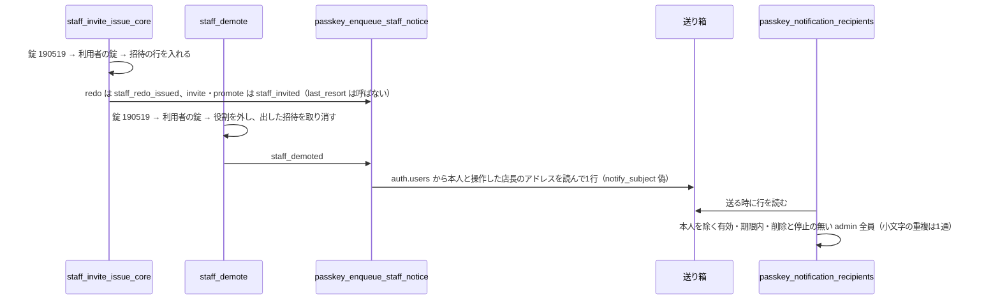

# 店長への知らせ（やり直し・招待・降格）を操作と同じ取引で積む DB の関数

> 状態: 推定 | 確認日: 2026-11-20 | 対象: `supabase/migrations/20261118130000_passkey_staff_invites.sql`、`supabase/migrations/20261118044338_passkey_notification_sending.sql`、`src/lib/auth/passkey-notification-store.ts`

## 概要

店長が店員を招待した・やり直した・降格した時に、送り箱へ知らせの行を積む私用の関数と、その宛先を決める DB の関数。送る処理（worker・文面）は Task 15 以降。

## 範囲と根拠

| 項目 | 内容 |
| --- | --- |
| 対応する ID | SR-AUTH-029、FR-AUTH-047、SEC-AUTH-058、THR-AUTH-057、DD-AUTH-086、DATA-AUTH-022、ADR-0473 |
| 対象のコード | 移行 `supabase/migrations/20261118130000_passkey_staff_invites.sql`（`private.passkey_enqueue_staff_notice`・`staff_invite_issue_core`・`staff_demote`）、`supabase/migrations/20261118044338_passkey_notification_sending.sql`（`claim_passkey_notification`・`passkey_notification_recipients`）、`src/lib/auth/passkey-notification-store.ts`（`claimPasskeyNotification`。IMPL-AUTH-330 が `actor_email` を写す。@design は DD-AUTH-086 にした。DD-AUTH-066 の残り4単位は変えない） |
| 関連文書 | [設計](../../superpowers/specs/2026-11-07-passkey-auth-design.md)、[段3b の計画](../../superpowers/plans/2026-11-19-passkey-stage3b-staff-ops.md)、[店員の招待の DB の関数](auth-staff-invite.md) |
| 調べた時点 | 2026-11-20（手元の DB で結合試験を流した） |

## 処理の詳細

### DD-AUTH-086 知らせの行は私用の関数1つで、操作と同じ取引の中で積む

| 属性 | 値 |
| --- | --- |
| 上位 | SEC-AUTH-058、DATA-AUTH-022 |
| 根拠 | 行の値（本人・操作した店長のアドレス・`subject_is_staff`・`notify_subject`）を1か所で作れば、呼ぶ側が値を間違えない。アドレスは `auth.users` から読むので、役割の行を先に外した降格でも読める。呼ぶのは錠を取った後の同じ取引なので、後の失敗で行も戻る |
| 状態 | 推定 |
| 確かめ方 | 単体テスト（`tests/unit/lib/auth/passkey-notification-store.test.ts`。`actor_email` の写し）、結合テスト（`tests/integration/db/auth_passkey_staff_manager_notices.integration.test.ts`。DATA-AUTH-022） |
| 出どころ | `.superpowers/sdd/2026-11-19-passkey-stage3b-staff-ops/task-14-brief.md`、`docs/superpowers/plans/2026-11-19-passkey-stage3b-staff-ops.md`（Task 14） |

- `private.passkey_enqueue_staff_notice(p_kind, p_user_id, p_actor_id)`: 持ち主 `postgres`・`SECURITY DEFINER`・`search_path` 空・だれにも `execute` なし。`p_kind` が3種類以外か `p_user_id` が NULL なら 22023 `STAFF_NOTICE_ARGUMENT_INVALID`
- `subject_is_staff` は `staff_invited` だけ偽。`notify_subject` は常に偽。`passkey_id`・`friendly_name` は NULL
- `staff_invite_issue_core` は招待の行を入れた後に呼ぶ。後の失敗（`LAST_ADMIN_REQUIRED`・`SELF_ROLE_CHANGE_FORBIDDEN` ほか）は呼ぶ前に起きる。`staff_demote` は最後に呼ぶ
- 既存の `passkey_removed` の行は、やり直しで消した鍵の分が `skipped`（`last_error_code` が `staff_invite_issue`）になる。この挙動は変えない
- `claim_passkey_notification` の戻りの末尾に `actor_email` を足し、アプリの `claimPasskeyNotification` が `actorEmail`（文字列か null。ほかなら取り出しを失敗にする）に写す。送る処理（種類の追加・文面）は Task 15。宛先の関数は新しい3種類で `notify_subject` を無視し、本人（行の `user_id`）を除く
