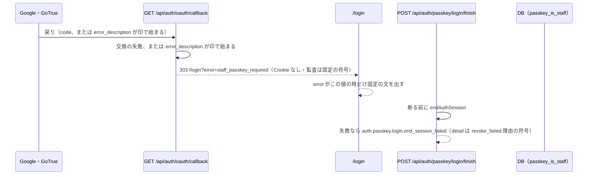

# 店員が別の道で入ろうとした時の画面・1b の M-2

> 状態: 推定 | 確認日: 2026-11-19（段3a Task 10） | 対象: `src/app/api/auth/oauth/callback/route.ts`、`src/app/login/page.tsx`、`src/features/auth/passkey/components/LoginChoices.tsx`、`src/features/auth/passkey/components/EmailCodeEntry.tsx`、`src/features/auth/passkey/staff-passkey-message.ts`（固定の1文。IMPL-AUTH-389）、`src/app/api/auth/passkey/login/finish/route.ts`

## 概要

店員（admin・supporter の有効で期限内の役割がある利用者）は、パスキーでだけ入れる（フックが Google・メールのコード・パスワードを断る。SEC-AUTH-037）。断られた店員に、画面が同じ1文を出す。あわせて、パスキーのログインの終わりで GoTrue のセッションを終わらせるのに失敗した時の監査を残す（1b の M-2）。

## 範囲と根拠

| 項目 | 内容 |
| --- | --- |
| 対応する ID | SR-AUTH-027、FR-AUTH-046、SEC-AUTH-037、DD-AUTH-083 |
| 対象のコード | 上の「対象」のとおり。呼ぶ部品は既存の `isStaffPasskeyRequiredError`（`staff-passkey-reject.ts`）・`isStaff`（`passkey-approval-rpc.ts`）・`endAuthSession`（`passkey-auth-session-end.ts`） |
| 関連文書 | [設計](../../superpowers/specs/2026-11-07-passkey-auth-design.md)（6-2）、[段3の計画](../../superpowers/plans/2026-11-18-passkey-stage3-staff.md)（Task 10）、[店員のパスキーの入口](auth-staff-passkey-entry.md) |
| 調べた時点 | 2026-11-19（手元の本番ビルドの E2E で確かめた。Google の実機は段3b） |

## 処理の詳細

### DD-AUTH-083 店員が Google・メールのコードで入ろうとした時の文（古いパスワードは文なしの 401）、セッション終了の失敗の監査

| 属性 | 値 |
| --- | --- |
| 上位 | SEC-AUTH-037 |
| 根拠 | フックの拒否だけでは、店員は理由の分からない失敗を見る。文は「店員の方は、パスキーでログインしてください。」の1つに固定する（設計 6-2 の文から「方」を足した。オーナーの確認待ち）。メールのコードの始めの窓口は変えない（登録済みかを漏らさない）。TOTP の登録の窓口は、パスキー段4の Task 30 で消した（404。FR-AUTH-053-AC-03。ADR-0475）。セッション終了の失敗は、拒否したのに GoTrue のセッションが残りうる状態なので、応答は変えず監査にだけ残す |
| 状態 | 推定 |
| 確かめ方 | 単体テスト（`tests/unit/api/auth/oauth-callback-staff.test.ts`、`tests/unit/features/auth/passkey/login-screen-staff-error.test.tsx`、`tests/unit/api/auth/passkey-login-finish-end-session-audit.test.ts`、既存の `oauth-callback-route.test.ts`）、E2E（FR-AUTH-046-AC-04。`e2e/FR-LOGIN-069-staff-other-paths-rejected.spec.ts`。`e2e/FR-LOGIN-031-supabase-direct-bypass.spec.ts` の 401 は変えない） |
| 出どころ | `.superpowers/sdd/2026-11-18-passkey-stage3-staff/task-10-brief.md`、`docs/superpowers/plans/2026-11-18-passkey-stage3-staff.md`（Task 10） |

- 戻りの窓口: 交換が失敗し `isStaffPasskeyRequiredError` が真、または戻りの URL の `error_description` が印で始まる時は、監査（`detail: staff_passkey_required`・誤りの文は残さない）を残して `/login?error=staff_passkey_required` へ 303（`Cache-Control: no-store`）。保存・Cookie・戻り先の控えの使い切りはしない。印の無い誤りは今までどおり（`code` が無ければ 400、交換の失敗は 502）
- 監査の見分け（2026-11-20 段3b Task 19）: 戻りの URL の `error_description` で見分けた拒否は `detail: staff_passkey_required_url`（URL は偽装できるので、本物と区別する）、交換の失敗で見分けた拒否は `detail: staff_passkey_required`。どちらも `/login` へは同じ行き先
- `/login`: `error` が文字列で `staff_passkey_required` の時だけ固定の文を `LoginChoices` の `errorMessage`（`role="alert"`）へ渡す。ほかの値・配列は出さない。メールのコードの確定の画面（`EmailCodeEntry`）は、確定の 403 `staff_passkey_required` で同じ文を出す（既存）
- 古いパスワード（`/api/auth/login`）: GoTrue のフックが断り、窓口は 401 で確認コードの段へ進まない（変えない。店員かどうかの案内は出さない）
- TOTP の登録: 窓口ごと消した（段4の Task 30）。以前の 410 `totp_retired` の断りは要らない
- セッション終了の監査: ログインの終わりの4か所（形の違う応答・店員の判定の DB の失敗・認めた鍵の判定の DB の失敗・認めていない鍵）で `endAuthSession` が偽を返した時に、`auth.passkey.login.end_session_failed`・`error`・`detail: revoke_failed:<断りの理由の符号>`・`actor_id`（分かる時）を残す。トークン・`session_id`・メールは残さない。断りの応答（403・503・401）は変えない。成功時のログイン（店員の無操作の時刻を1回書く。書けなくても断らない。DD-AUTH-081）は変えない
- 追跡（`@design` は1単位に1つの決まりなので、次の単位は元の DD のまま、この DD の動きも持つ）: `GET /api/auth/oauth/callback`（IMPL-AUTH-166）、`POST /api/auth/passkey/login/finish`（IMPL-AUTH-274）、`/login` のページ（IMPL-AUTH-324）、`LoginChoices`（IMPL-AUTH-325）。この DD から単位へは `npm run trace` では辿れず、ここの一覧で辿る
- テスト観点: 印つきの403（交換・戻りの URL）、印の無い誤りの不変、`error` の値の絞り込み、監査の中身にトークン・`session_id`・メールが無いこと
