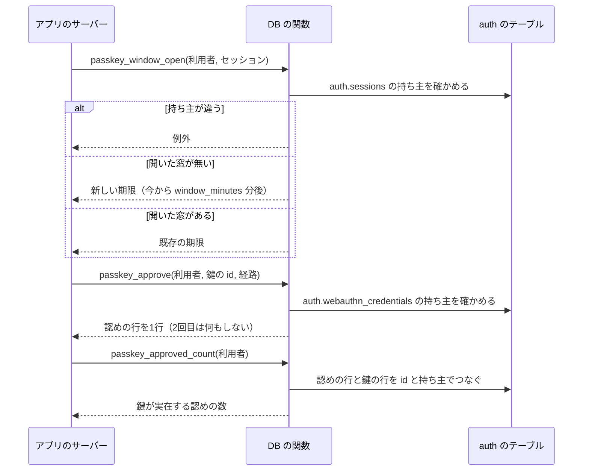

# 店員のパスキーの入口（設定・登録の窓・認めたパスキー）

> 状態: 推定 | 確認日: 2026-11-16 | 対象: `supabase/migrations/20261116215034_passkey_foundation_tables.sql`、`src/lib/auth/staff-passkey-defaults.ts` | 親: [シーケンス設計の方針](README.md)

## 概要

店員（店長・サポーター）のパスキーの入口を支える DB の土台の処理を書く。設定の1行、登録の窓の開閉、アプリが認めたパスキーの控えと数え方。フック（Task 5）・引き金（Task 6）・管理の入口の判定（Task 8・9）がこの上に乗る。このファイルは Task 4 の分で、後のタスクが足す。

## 範囲と根拠

| 項目 | 内容 |
| --- | --- |
| 対応する ID | FR-AUTH-007、SEC-AUTH-036、DATA-AUTH-011、DATA-AUTH-012、ADR-0464 |
| 対象のコード | 移行 `supabase/migrations/20261116215034_passkey_foundation_tables.sql`、`src/lib/auth/staff-passkey-defaults.ts` |
| 関連文書 | [設計](../../superpowers/specs/2026-11-07-passkey-auth-design.md)（5-2・5-5・6-2） |
| 調べた時点 | 2026-11-16（手元の DB で結合試験を流した） |

## 処理の詳細

### DD-AUTH-043 店員のパスキーの設定・登録の窓・認めたパスキーの処理

| 属性 | 値 |
| --- | --- |
| 上位 | DATA-AUTH-011、DATA-AUTH-012、SEC-AUTH-036 |
| 根拠 | 店員の入口の判断に使う値と控えを DB の1か所に置き、窓は `(user_id, session_id)` に結び、認めたパスキーは鍵が実在する分だけ数える（ADR-0464）。後のフック・管理の入口がこの処理に頼る。あわせて、段1a の前提（`supabase-js` の版の固定、`db push` を流す CI の停止）の試験もここにつなぐ |
| 状態 | 推定 |
| 確かめ方 | 単体テスト（設定の初めの値と移行の一致、`supabase-js` の固定、CI の引き金）、DB 結合テスト（DATA-AUTH-011・012） |
| 出どころ | `docs/superpowers/specs/2026-11-07-passkey-auth-design.md`（5-2・5-5・6-2）、`docs/superpowers/plans/2026-11-16-passkey-stage1a-foundation.md`（Task 1〜4） |

- 入力と出力: 窓の開閉・認め・数えは、すべて `service_role` で呼ぶ。引数は利用者の id・セッションの id・鍵の id・経路（`window`・`reauth`・`script`）
- 正常: 窓は同じ `session_id` で何度呼んでも開いた行は1つで、期限は初めの呼び出しの時刻から30分。認めは2回呼んでも1行。数えは認めの行のうち鍵が実在し持ち主が同じ分
- 異常: 他人のセッションの窓・他人の鍵や無い鍵の認めは例外（SQLSTATE `42501`）。期限切れの窓は `passkey_window_is_open` で偽。閉じた窓も偽
- 状態と永続化: 設定は `private.passkey_staff_config` の1行。窓は `private.passkey_registration_windows`、認めは `private.approved_passkeys`、知らせの予定は `private.passkey_notification_outbox`。表は全部 `private` で、`anon`・`authenticated` に権限が無い
- 設定の初めの値: TS の `defaultStaffPasskeySettings()` と移行の既定値は同じ。単体テストが一致を確かめる
- 認可: `public.passkey_*` は `service_role` だけが呼べる。`private.passkey_staff_settings()` は会員の JWT から呼べない
- テスト観点: 設定の既定値、権限（`anon`・`authenticated` に無い）、他人の鍵・他人のセッションの拒否、窓の1行と期限、閉じる・期限切れ・持ち主違いで偽、鍵が消えた認め・他人の鍵を指す認めを数えない

## 未確認事項

- 本番の `auth.webauthn_credentials` に同じ列があるか（パスキーを有効にする前は表が無い可能性がある）
