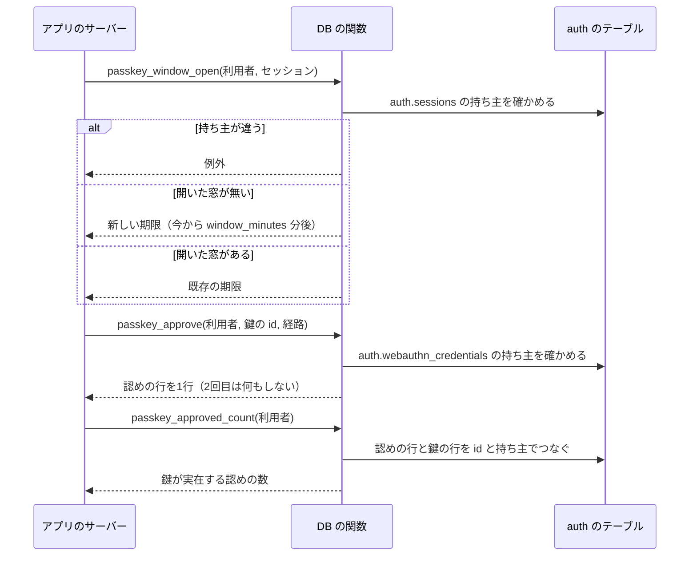
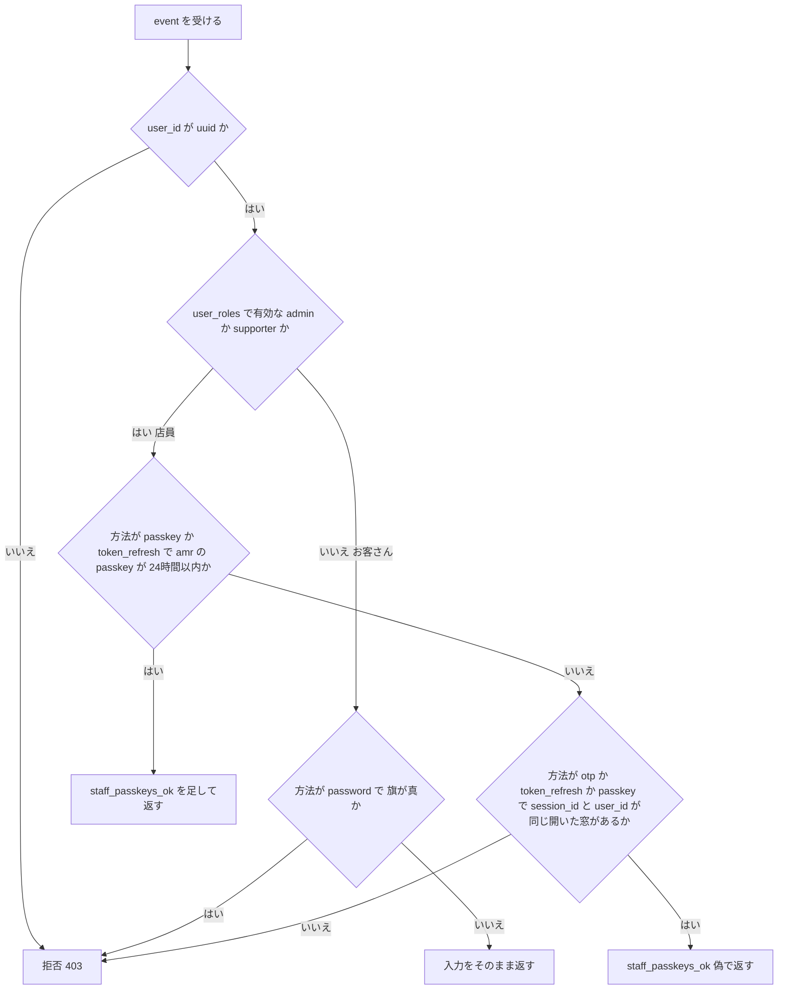
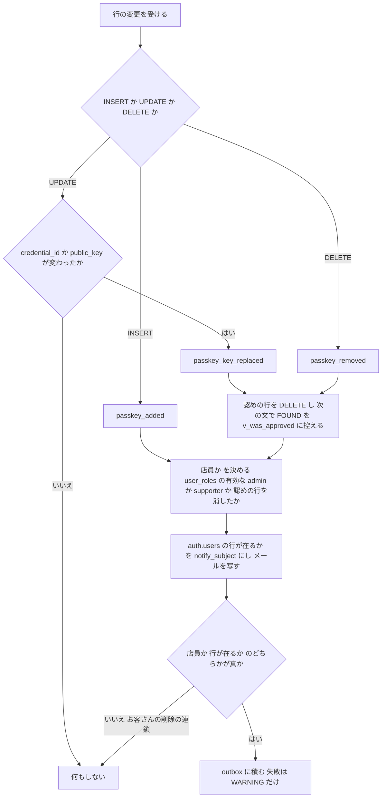

# 店員のパスキーの入口（設定・登録の窓・認めたパスキー）

> 状態: 推定 | 確認日: 2026-11-16 | 対象: `supabase/migrations/20261116215034_passkey_foundation_tables.sql`、`supabase/migrations/20261116230000_passkey_access_token_hook.sql`、`supabase/migrations/20261116232141_passkey_credential_events.sql`、`src/lib/auth/staff-passkey-defaults.ts`、`src/lib/auth/staff-passkey-reject.ts`、`src/lib/auth/staff-passkey-credential-events.ts` | 親: [シーケンス設計の方針](README.md)

## 概要

店員（店長・サポーター）のパスキーの入口を支える DB の土台の処理を書く。設定の1行、登録の窓の開閉、アプリが認めたパスキーの控えと数え方。フック（Task 5）・引き金（Task 6）・管理の入口の判定（Task 8・9）がこの上に乗る。このファイルは Task 4（DD-AUTH-043）と Task 5（DD-AUTH-044。フックの関数）の分で、後のタスクが足す。

## 範囲と根拠

| 項目 | 内容 |
| --- | --- |
| 対応する ID | FR-AUTH-007、FR-AUTH-008、SEC-AUTH-036、SEC-AUTH-037、DATA-AUTH-011、DATA-AUTH-012、DATA-AUTH-013、SR-AUTH-012、FR-AUTH-009、SEC-AUTH-038、DATA-AUTH-014、ADR-0464、ADR-0465 |
| 対象のコード | 移行 `supabase/migrations/20261116215034_passkey_foundation_tables.sql`・`20261116230000_passkey_access_token_hook.sql`・`20261116232141_passkey_credential_events.sql`、`src/lib/auth/staff-passkey-defaults.ts`・`staff-passkey-reject.ts`・`staff-passkey-credential-events.ts` |
| 関連文書 | [設計](../../superpowers/specs/2026-11-07-passkey-auth-design.md)（5-2・5-5・6-2） |
| 調べた時点 | 2026-11-16（手元の DB で結合試験を流した） |

## 処理の詳細

### DD-AUTH-043 店員のパスキーの設定・登録の窓・認めたパスキーの処理

| 属性 | 値 |
| --- | --- |
| 上位 | DATA-AUTH-011、DATA-AUTH-012、SEC-AUTH-036 |
| 根拠 | 店員の入口の判断に使う値と控えを DB の1か所に置き、窓は `(user_id, session_id)` に結び、認めたパスキーは鍵が実在する分だけ数える（ADR-0464）。後のフック・管理の入口がこの処理に頼る。あわせて、段1a の前提（`supabase-js` の版の固定、`db push` を流す CI の停止）の試験もここにつなぐ |
| 状態 | 推定 |
| 確かめ方 | 単体テスト（設定の初めの値と移行の一致、`supabase-js` の固定、CI の引き金）、DB 結合テスト（DATA-AUTH-011・012） |
| 出どころ | `docs/superpowers/specs/2026-11-07-passkey-auth-design.md`（5-2・5-5・6-2）、`docs/superpowers/plans/2026-11-16-passkey-stage1a-foundation.md`（Task 1〜4） |

- 入力と出力: 窓の開閉・認め・数えは、すべて `service_role` で呼ぶ。引数は利用者の id・セッションの id・鍵の id・経路（`window`・`reauth`・`script`）
- 正常: 窓は同じ `session_id` で何度呼んでも開いた行は1つで、期限は初めの呼び出しの時刻から30分。認めは2回呼んでも1行。数えは認めの行のうち鍵が実在し持ち主が同じ分
- 異常: 他人のセッションの窓・他人の鍵や無い鍵の認めは例外（SQLSTATE `42501`）。期限切れの窓は `passkey_window_is_open` で偽。閉じた窓も偽
- 状態と永続化: 設定は `private.passkey_staff_config` の1行。窓は `private.passkey_registration_windows`、認めは `private.approved_passkeys`、知らせの予定は `private.passkey_notification_outbox`。表は全部 `private` で、`anon`・`authenticated` に権限が無い
- 設定の初めの値: TS の `defaultStaffPasskeySettings()` と移行の既定値は同じ。単体テストが一致を確かめる
- 認可: `public.passkey_*` は `service_role` だけが呼べる。`private.passkey_staff_settings()` は会員の JWT から呼べない
- テスト観点: 設定の既定値、権限（`anon`・`authenticated` に無い）、他人の鍵・他人のセッションの拒否、窓の1行と期限、閉じる・期限切れ・持ち主違いで偽、鍵が消えた認め・他人の鍵を指す認めを数えない

### DD-AUTH-044 Custom Access Token フックの関数と、拒否の印の判定

| 属性 | 値 |
| --- | --- |
| 上位 | DATA-AUTH-013、SEC-AUTH-037 |
| 根拠 | トークンを出す時に毎回走る判断を DB の関数1つにして、店員の締め付けを GoTrue の直叩きまで効かせる。壊れた入力で例外を投げず、店員は判らなければ拒否する。拒否の文の頭の印は、アプリが言い回しに頼らず見分けるため、DB とアプリで同じ文字列にする（ADR-0464） |
| 状態 | 推定 |
| 確かめ方 | 単体テスト（印と判定、印が移行の文と同じこと）、DB 結合テスト（DATA-AUTH-013。`supabase_auth_admin` の権限で呼ぶ） |
| 出どころ | `docs/superpowers/specs/2026-11-07-passkey-auth-design.md`（5-2）、`docs/superpowers/specs/2026-11-16-passkey-local-trial-results.md`（T1・T2）、`docs/superpowers/plans/2026-11-16-passkey-stage1a-foundation.md`（Task 5） |

- 入力と出力: 入力は GoTrue の `event`（`user_id`・`authentication_method`・`claims`）。出力は、通す時は `event`（`claims.staff_passkeys_ok` を足す場合がある）、店員の拒否は `{"error":{"http_code":403,"message":"[staff-passkey-required] ..."}}`、お客さんの `password` の拒否（旗が真の時）は別の印 `[customer-password-disabled]` の403
- 24時間の比べ: `amr` が配列で、`method` が `passkey` の要素の `timestamp` が JSON の数で `^[0-9]+$`（文字列・小数・負・欠落・null は無効）。`今の秒（切り捨て）- timestamp` が `0` 以上 `staff_max_session_seconds` 以下で通す。ちょうど86400は通し、86401と未来の時刻は拒否
- `staff_passkeys_ok`: `public.passkey_approved_count(user)` が `min_approved_passkeys` 以上か。ヒントで、判定には使わない。数える関数が例外を出した時は、偽にして新しいパスキーの店員はそのまま通す（ヒントの失敗でログインを止めない）（管理の入口は API・RLS でその場で数える）
- 窓: 案 B。窓の表は読むだけで書かない。窓で通すのは方法が `otp`・`token_refresh`・`passkey` の時だけ（招待の入口と、その更新）。`oauth`・`password`・未知の方法は窓があっても拒否
- 異常: 関数全体を `EXCEPTION WHEN OTHERS` で囲む。お客さんと判った後の失敗は入力をそのまま返す。店員の失敗、`user_id` が無い・不正、店員かどうか調べられなかった失敗は拒否する（店員を素通しにしない）。設定の行が無い時は、パスキーで入る店員は拒否（24時間の上限が決まらない）、お客さんは素通し。窓で通す枝は設定を読まないので、開いた窓の店員は設定の行が無くても通る（窓の枝に設定の行を要るようにはしない。窓の枝は管理の入口を通れないので、簡単さを優先した）
- 認可: `supabase_auth_admin` だけが呼べる。表の `select` は渡さず、関数が持ち主 `postgres` の権限で読む
- お客さんの拒否の印: `[customer-password-disabled]`。店員の印と分け、`isStaffPasskeyRequiredError` は真にしない（お客さんを「店員はパスキーで」の画面に送らないため）
- アプリの側: `isStaffPasskeyRequiredError(error)` は `status === 403` かつ `message` が `STAFF_PASSKEY_REQUIRED_MARKER`（`[staff-passkey-required]`）で始まる時だけ真。GoTrue は拒否を HTTP 403・`code: unknown` で返す（手元の試し T2）
- テスト観点: 24時間の境目（86400・86401・未来）、`timestamp` の型、`amr` の形、方法の種類、窓（開いた・閉じた・期限切れ・別のセッション・別の利用者）、お客さんの素通しと旗、壊れた入力（`claims`・`amr`・`user_id`・`event` の形）、権限

### DD-AUTH-045 パスキーの足し・消しの引き金の順番と、店員の判断

| 属性 | 値 |
| --- | --- |
| 上位 | DATA-AUTH-014、SEC-AUTH-038 |
| 根拠 | 認めの控えの削除を先に、例外の囲みの外で行い、outbox への書き込みだけを囲みに入れる。囲みの中に削除を入れると、書き込みの失敗で削除が取り消され、消えた鍵の認めが残る。削除を先にしても店員と分かるように、削除の結果（`FOUND`）を次の文で控える（ADR-0465） |
| 状態 | 推定 |
| 確かめ方 | 単体テスト（移行の文の順番）、DB 結合テスト（DATA-AUTH-014） |
| 出どころ | `.superpowers/sdd/2026-11-16-passkey-stage1a-foundation/task-6-brief.md`、`docs/superpowers/specs/2026-11-07-passkey-auth-design.md`（5-4・8-2）、`docs/superpowers/plans/2026-11-16-passkey-stage1a-foundation.md`（Task 6、Review Focus 4・5） |

- アプリの側: `isPasskeyOutboxKind(value)`（IMPL-AUTH-242）は、outbox の `kind` が3つの種類（`passkey_added`・`passkey_removed`・`passkey_key_replaced`）のどれかの時だけ真。送る側（段2・3）が未知の種類を送らないため
- 入力と出力: 行の変更。戻り値は無し（`AFTER`）。更新は `credential_id`・`public_key` が変わった時だけ
- 順番: ① 認めの行を `DELETE FROM private.approved_passkeys WHERE passkey_id = OLD.id`（`RETURNING` は付けない）で消し、その次の文で `v_was_approved := FOUND`（間に別の文を挟まない）。② その後、店員の判断・`auth.users` の確認・outbox への書き込みを `BEGIN ... EXCEPTION WHEN OTHERS THEN RAISE WARNING ... END` の中で行う
- 店員: `user_roles` で有効（`active`・期限切れでない）な admin・supporter（フックと同じ規則）、または今回認めの行を消した
- 異常: outbox への書き込みが落ちても、鍵とユーザーの削除は成功し、認めの行の削除は取り消されない。`RAISE WARNING` だけ残る
- 連鎖: ユーザーごと店員を削除する時、`user_roles` が先に消えても、認めた鍵なら店員と分かる。認めた鍵が無い店員で `user_roles` が先に消えた時は店長への知らせが出ない（SEC-AUTH-038 で受け入れる）
- 認可: `execute` はだれにも渡さない。引き金の起動はテーブルの権限に左右されない
- テスト観点: 足し・消し・差し替え・名前や回数だけの更新、お客さんの削除の連鎖、店員の削除（`user_roles` が先か同時か）、outbox の失敗（制約）、`DISABLE TRIGGER` 時の数え方、権限

## 未確認事項

- 本番で `auth.webauthn_credentials` に引き金を作れるか、GoTrue の更新で引き金が消えないか（設計 8-2 の3）。本番へ当てる前に `has_table_privilege('postgres', 'auth.webauthn_credentials', 'TRIGGER')` を読む
- 本番の `auth.webauthn_credentials` に同じ列があるか（パスキーを有効にする前は表が無い可能性がある）
- 本物の Google のログイン（`amr` が `oauth`）でフックが走る形は未確認。店員は「パスキー（と窓）以外は全部拒否」なので、形が違っても店員は通らない
- 有効にした後にフックが壊れた時の外し方（設定で止める）は Task 9 と運用の文書で決める
