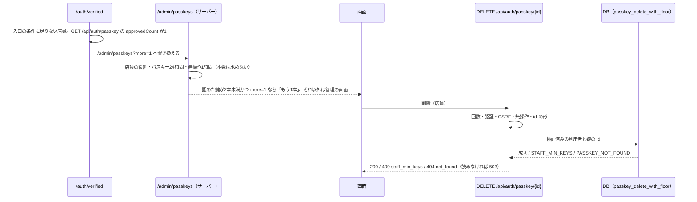

# 店員のパスキー管理・削除の下限・「もう1本」の画面

> 状態: 推定 | 確認日: 2026-11-20（段3b Task 18） | 対象: `src/lib/auth/staff-passkey-page-guard.ts`、`src/lib/auth/staff-passkey-delete.ts`、`src/app/api/auth/passkey/[id]/route.ts`、`src/app/admin/passkeys/page.tsx`、`src/features/auth/staff/components/StaffPasskeyManager.tsx`、`StaffOneMoreKey.tsx`、`src/features/auth/staff/staff-passkey-status.ts`、`src/app/auth/verified/page.tsx`、`src/components/AdminSideNav.tsx`（呼ぶだけ）、移行 `supabase/migrations/20261118130000_passkey_staff_invites.sql`（`passkey_delete_with_floor`）

## 概要

店員のパスキー管理の画面 `/admin/passkeys` と、認めた鍵が1本の店員の「もう1本」の画面。削除の下限は DB の関数 `passkey_delete_with_floor` に一本化し、画面・窓口・DB が同じ数え方で止める。認めた鍵が1本の店員は、`/auth/verified` から `/admin/passkeys?more=1` へ送り、そこから `/auth/verified` へは戻さない。

## 範囲と根拠

| 項目 | 内容 |
| --- | --- |
| 対応する ID | SR-AUTH-027、FR-AUTH-045、FR-AUTH-046、SCR-AUTH-015、SEC-AUTH-055、THR-AUTH-054、DATA-AUTH-020、DD-AUTH-082 |
| 対象のコード | 上の「対象」のとおり |
| 関連文書 | [設計](../../superpowers/specs/2026-11-07-passkey-auth-design.md)（5・6）、[段3の計画](../../superpowers/plans/2026-11-18-passkey-stage3-staff.md)、[招待・DB の関数](auth-staff-invite.md)、[無操作の確かめ](auth-staff-idle.md) |
| 調べた時点 | 2026-11-19（手元の DB・本番ビルドの E2E で確かめた） |

## 処理の詳細

### DD-AUTH-082 店員のパスキー管理は、入口は本数を求めず、削除は DB の下限だけを通し、1本の店員をもう1本の画面へ送って戻さない

| 属性 | 値 |
| --- | --- |
| 上位 | SEC-AUTH-055、SCR-AUTH-015 |
| 根拠 | 入口で認めた鍵の本数を求めると、1本の店員はここに入れず、もう1本を足せない（足すための画面が足りない人を弾く）。窓口の削除が GoTrue の削除を通ると、数えと削除の間に別の削除が入れる。数えと削除を DB の1つの取引（利用者ごとの錠）にし、店員の削除はそれだけを通す。`/auth/verified` が送り、送った先が `/auth/verified` へ戻すと回り続けるので、行き先の入口は戻さない |
| 状態 | 推定 |
| 確かめ方 | 単体テスト（`tests/unit/lib/auth/staff-passkey-page-guard.test.ts`、`staff-passkey-delete.test.ts`、`tests/unit/api/auth/passkey-delete-staff-floor.test.ts`、`passkey-manage-routes.test.ts`、`tests/unit/app/auth/verified-page.test.tsx`、`tests/unit/app/staff/passkeys-page.test.tsx`、`tests/unit/features/auth/staff/staff-passkey-manager.test.tsx`、`staff-one-more-key.test.tsx`）、結合テスト（`tests/integration/ui/auth-staff-passkey-manage-screen.test.tsx`、`tests/integration/db/auth_passkey_staff_roles.integration.test.ts`、`tests/integration/api/auth/passkey-manage.test.ts`）、E2E（`e2e/FR-LOGIN-068-staff-passkey-manage.spec.ts`） |
| 出どころ | `.superpowers/sdd/2026-11-18-passkey-stage3-staff/task-9-brief.md`、`docs/superpowers/plans/2026-11-18-passkey-stage3-staff.md`（Task 9） |

- 入口 `requireStaffPasskeyPage`（IMPL-AUTH-383）: 署名済みトークン → 生きたセッション → `passkey_is_staff` → `evaluateStaffEntry`（パスキーの印と24時間。本数は下限そのものを渡して見ない）→ `checkStaffIdle(…, 'peek')`（時刻を進めない）→ `passkey_approved_count`。外れは `/login`（`reason=idle`・`staff_required`）。無操作・24時間の超過は GoTrue のセッションも終わらせる。DB が読めない・`error` は `unavailable`（送らず終わらせない）
- ページ（IMPL-AUTH-384）: `?more=1` かつ認めた鍵2本未満なら「もう1本」、それ以外は管理の画面。`unavailable` は「しばらくしてからお試しください。」。検索に載せない
- 管理の画面（IMPL-AUTH-385）: 一覧は `loadStaffPasskeys`（IMPL-AUTH-388。`approved`・`approvedCount` を読む）。認めた鍵を消すと `approvedCount - 1 < 2` になる行は削除を無効にする。窓口が断ったら失敗の文を出して一覧を引き直す。追加の `reauth_required` は「パスキーでログインし直す」に読み替える
- 削除の失敗の文（段3b Task 18、FR-AUTH-052）: 窓口の 409 `staff_min_keys`（`passkey-client` の失敗の理由 `min_keys`）だけが「削除できませんでした。認めた鍵は2本以上が必要です。」。500・投げた fetch・本文が違う 409（理由 `failed`）は「削除できませんでした。もう一度お試しください。」。失敗の応答の本文は必ず読み切る。お客さんの画面（`AccountPasskeys`）は、どの失敗も今までの1つの文のまま
- 「もう1本」の画面（IMPL-AUTH-386）: 登録が通ったら `refreshSessionOnce` → `refreshAuthState` → `/admin`。更新できなければ移らず入り直しをすすめる
- 削除の部品 `deleteStaffPasskey`（IMPL-AUTH-387）: `passkey_delete_with_floor(p_user_id, p_passkey_id)` を1回呼ぶ。`STAFF_MIN_KEYS` → `min_keys`、`PASSKEY_NOT_FOUND` → `not_found`、それ以外・例外 → `failed`（呼び手が 503）
- DB の関数（移行 H。本番未適用のため同じファイルで直した）: 利用者ごとの錠 → 鍵の存在（`FOR UPDATE`）→ 店員なら、**消す鍵が認めた鍵で、残りの認めた本数が `min_approved_passkeys` 未満になる時だけ** `STAFF_MIN_KEYS`（P0001）。認めていない鍵は、認めた鍵が下限未満でも消せる（疑わしい鍵を外せる）。お客さんは何本でも消せる
- 窓口 `DELETE`: 店員は GoTrue の削除を呼ばず、DB の関数だけ。お客さんは今までどおり GoTrue。409 の符号は `staff_min_keys`（旧 `staff_min_passkeys` を改めた）
- 既知の残り: 店員が自分の通行証で GoTrue の `DELETE /user/passkeys/{id}` を直に叩く道は、アプリの窓口を通らないので下限を守れない（GoTrue 側の削除を止める仕組みは未整備）。この場合でも、鍵が2本未満になれば管理 API・RLS は認めた鍵の本数で断る（入口の条件）。段3b か段4で、削除を止める引き金を検討する
