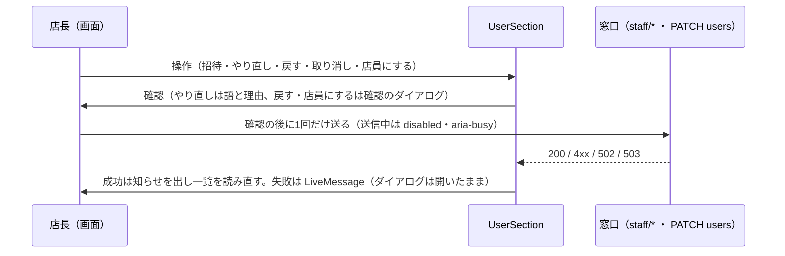

# 管理画面「ユーザー」の店員の操作（招待・やり直し・お客さんに戻す・招待の取り消し・店員にする）

> 状態: 推定 | 確認日: 2026-11-19（段3a Task 11） | 対象: `src/features/auth/staff/components/InviteStaffDialog.tsx`、`RedoStaffDialog.tsx`、`StaffRoleActions.tsx`、`src/features/auth/staff/staff-user-actions.ts`、`src/components/UserSection.tsx`（差し込むだけ。AUTH の IMPL は付けない）

## 概要

店長が管理画面の「ユーザー」タブから、店員の招待・パスキーのやり直し・お客さんに戻す・招待の取り消し・「店員にする」を行う画面の処理。窓口は `POST /api/admin/staff/invites`・`[id]/redo`・`[id]/demote`・`[id]/invite/cancel` と `PATCH /api/admin/users`（API-AUTH-033〜036）。

## 範囲と根拠

| 項目 | 内容 |
| --- | --- |
| 対応する ID | FR-AUTH-040、SCR-AUTH-016、SEC-AUTH-056、DD-AUTH-084 |
| 対象のコード | 上の「対象」のとおり |
| 関連文書 | [段3の計画](../../superpowers/plans/2026-11-18-passkey-stage3-staff.md)（Task 11・付録）、[招待・DB の関数](auth-staff-invite.md)、[管理画面の詳細設計](../pages/16_admin.md) |
| 調べた時点 | 2026-11-19（手元の DB・本番ビルドの E2E で確かめた） |

## 処理の詳細

### DD-AUTH-084 管理画面の店員の操作は、確認を挟んで窓口を1回だけ呼び、失敗は窓口の符号から決めた文を `LiveMessage` に出す

| 属性 | 値 |
| --- | --- |
| 上位 | SEC-AUTH-056、SCR-AUTH-016 |
| 根拠 | やり直しは取り返しがつかないので、確認の語と理由（10〜500字）を画面の側でも揃えるまで送らせない（窓口と同じ守り）。送信中は送るボタンを `disabled`・`aria-busy` にして二重に送らせない。店員にする（昇格）は招待のメールを出すだけで役割はすぐには変わらないので、画面も役割を先に書き換えない。失敗の文は窓口の本文でなく符号と状態から決め、503 は一時的な障害なのでログアウトにせず再試行を案内する |
| 状態 | 推定 |
| 確かめ方 | 単体テスト（`tests/unit/features/auth/staff/user-section-staff.test.tsx`、`staff-user-actions.test.ts`、`tests/unit/components/UserSection.test.tsx`）、結合テスト（`tests/integration/ui/auth-admin-users-staff-screen.test.tsx`）、E2E（`e2e/FR-LOGIN-070-admin-users-staff-screen.spec.ts`、`e2e/FR-ADMIN-108-select-fields.spec.ts`） |
| 出どころ | `.superpowers/sdd/2026-11-18-passkey-stage3-staff/task-11-brief.md`、`docs/superpowers/plans/2026-11-18-passkey-stage3-staff.md`（Task 11） |

- 送りの部品 `postStaffAction`（IMPL-AUTH-396）: `clientFetch` で POST し、成功か `{ ok:false, message }` を返す（投げない）。`staffInviteFailureMessage`: 502・`mail_failed` は「メールを送れませんでした。もう一度、招待を出してください。」、`already_staff` は一覧の「パスキーを全部消してやり直す」の案内、503 は「ただいま処理できません。しばらくしてからお試しください。」。無操作の 401 `session_idle` は `clientFetch` が `/login?reason=idle` へ送る
- 招待（IMPL-AUTH-393）: メール・役割（サポーター・店長）。メールが空のあいだは送れない
- やり直し（IMPL-AUTH-394）: 確認の語が「やり直し」と等しく、理由（前後の空白を除く）が10〜500字のあいだだけ送れる
- 1行の操作（IMPL-AUTH-395）: 店員の行は認めた鍵の本数・やり直し・お客さんに戻す（確認を挟む）。自分の行・最後の店長の行は押せず理由の文を出す。役割が無く開いた招待がある人は「招待中」と「招待を取り消す」
- 一覧（`UserSection`、差し込むだけ）: 自分の id は `/api/auth/me` で読み、最後の店長は一覧の店長が1人の時の行。お客さんの行で Admin・Support を選ぶと「店員にする」の確認を出し、確認後に PATCH。役割は書き換えず、成功したら一覧を読み直す（`silent`）
- 既知の残り: 一覧は `GET /api/admin/users` の最初の200人まで（既存の制限）。自分の id が読めない時は自分の行のボタンは押せるが、窓口が 403 `self` で断る

