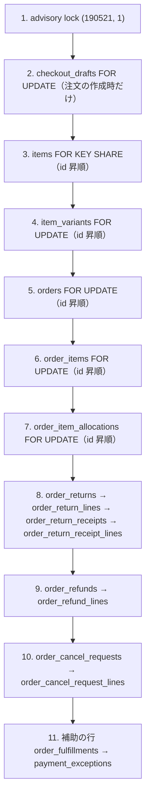
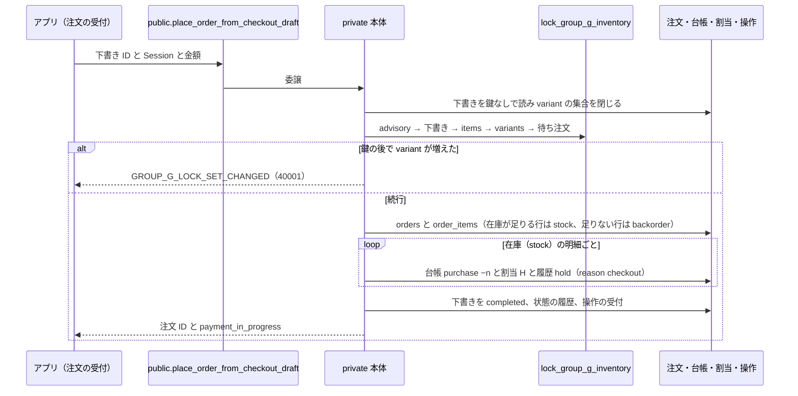
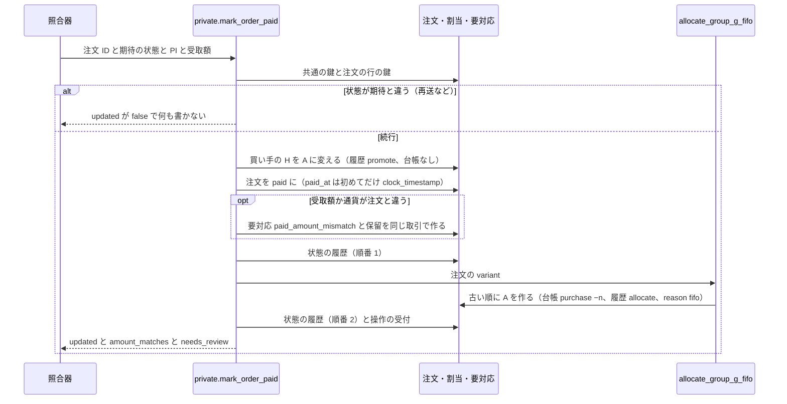
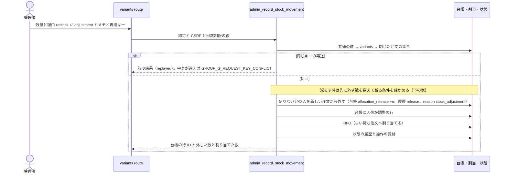

# 在庫の割当と共通の鍵の流れ（G-1）

> 状態: 現行のソース（グループ G-1。2026-10-24 に本番へ適用済み） | 確認日: 2026-10-24 | 対象: 注文の受付・入金・入荷・解放・返金・返品・配送の反映で在庫を動かす処理の順序と、全入口に共通の鍵の順

## 概要

G-1 は、在庫を動かす全ての入口が、共通の在庫の鍵（advisory `(190521, 1)`）を最初に取り、行の鍵を固定の順に取ってから、在庫の台帳・割当・状態の履歴・操作の受付を**同じ取引**で書くように揃えた。未入金の仮確保 H は買い手本人の入金で入金済みの割当 A に変わり、古い待ち注文へは渡さない（案A）。未確保の分だけが FIFO（注文日の古い順）で割り当てられる。

| 項目 | 内容 |
| --- | --- |
| 割当の種類 | H（`payment_hold`）は注文の受付で作る仮確保、A（`paid`）は入金済みの割当。手元の在庫は `F + A + H`（F は空き在庫 `item_variants.stock_quantity`） |
| 割当の作り方 | 受付で H（台帳 `purchase` −n）。入金で同じ注文の H が A に変わる（台帳なし）。未確保の分は FIFO が A を作る（台帳 `purchase`、交換の品は `exchange`、−n） |
| FIFO の順 | `orders.created_at` → `orders.id` → `order_items.id` の昇順。一部だけでも割り当てる。H を持つ行・金額確認や交換手数料待ちで止めた行・variant が空の行は対象外 |
| 解放 | 未入金の H は期限切れ・取消・要対応の解決で外す（台帳 `cancel` +n）。A は返金で外す（`refund` +n）。在庫を減らす操作で足りない分は A を新しい注文から外す（`allocation_release` +n） |
| 発送で使う | G-1 では書かない。旧の発送・仕上がりの関数は処理せず拒否し、`consume`・`restore`・`transfer` は制約と履歴の型だけを用意した（書くのは G-3・G-4） |
| 再送 | 操作の受付 `private.group_g_operations` に `(operation, request_key)` と入力の指紋を残す。同じ再送は前の結果、中身が違えば断る |

## 範囲と根拠

| 項目 | 内容 |
| --- | --- |
| 対応要件 | FREQ-520（品物の12状態）・521（F/A/H の保存則と割当台帳）・522（FIFO と全体の鍵）・523（入替の基盤）・524（清掃と旧入口の停止）・535（初回入金日時）・540（権限と迂回の拒否）・541（既存契約の維持）。[要件](../../02_Requirements/requirements.md) |
| 設計 | [グループ G 設計書](../../superpowers/specs/2026-10-23-group-g-design.md)の6〜8章、[G-1 実装計画](../../superpowers/plans/2026-10-24-group-g1-allocation.md)の全体ロック順 |
| データ | [ER 図](../../03_BasicDesign/data/er.md)の「在庫の割当と品物の状態の履歴」、状態は [在庫の割当の状態](../states/inventory-allocation.md) |
| 実装 | 移行 `supabase/migrations/20261023211425_group_g1_allocation.sql`（本番へ適用した後は版の付いたファイル名に直る）、[割当の型](../../../src/lib/inventory/allocation-types.ts)、[在庫の窓口の store](../../../src/lib/inventory/allocation-store.ts) |
| 関連 | [購入・決済照合](checkout-payment.md)、[注文管理](order-administration.md)、[決済の要対応](../states/payment-exception.md)、[注文・決済の状態](../states/order-payment.md) |
| 調査時点 | 2026-10-24 のソース。本番の適用状況・実データでの競合は未確認（末尾） |

## 共通の鍵と行の鍵の順

全ての更新の入口は、読み取りだけで対象の variant と注文の集合を閉じてから、`private.lock_group_g_inventory(variant の集合, 注文の集合, 下書き ID)` で次の順に鍵を取る。後ろの行を取ってから前へ戻らない。取る行が無い段は省く。

| 規則 | 内容 |
| --- | --- |
| advisory が先 | 行の鍵より前に取る。公開の入口の本体は、設定値にかかわらず必ず取る（取引ローカルの `app.group_g_operation_id` は操作の番号の受け渡しだけで、認可や「鍵を取った」判定には使わない） |
| 対象を閉じる | 読み取りだけで variant と注文の集合を決め、広がらなくなるまで繰り返す。注文は「まだ変わり得るもの」だけが対象になる（未入金・割当の残りか待ち数量がある入金済み・開いた返品／返金／申し込みを持つ発送済み・対象 variant の残りの割当を持つ注文）。鍵を取った後に集合が変わった時は `GROUP_G_LOCK_SET_CHANGED`（40001）で断り、呼び直させる |
| 内部の核 | FIFO・台帳のトリガー・解放などの核は、鍵を取り直さず呼び手が取った行だけで動く。advisory を持っていなければ `GROUP_G_INVENTORY_LOCK_REQUIRED`（55000）で断る（`pg_locks` を見る）。入れ子から公開の入口や鍵の関数を呼ばない |
| FIFO | `SKIP LOCKED` で古い注文を飛ばさない。鍵を取った後に状態・残数を確かめ直す |
| 外部の I/O | メール・追跡・ファイル・Stripe の呼び出しを鍵を持ったまま行わない。メールの予定の行（outbox）を同じ取引で書き、送信は取引の外 |
| 配送の追跡の設定（例外） | `record_delivery_read_result` は advisory の直後・`orders` の前に `shop_settings FOR SHARE` を取る。変えていない `admin_set_delivery_tracking` が「設定 → 注文」の順なので、注文の後に設定を待つと行き違いの deadlock になるため。配送は variant を触らないので `items`・`item_variants` は取らない |
| 注文の関連付け | `link_guest_orders`（ゲストの注文を会員へ付ける）は advisory を取り、対象の注文を id 昇順に `FOR UPDATE` し、各行の持ち主が空かを id 順に確かめ直す |
| 変えていない経路 | `claim_delivery_tracking` などの配送の worker の関数と `request_order_email_resend` などは variant・割当の行を取らず、在庫の鍵を保持中でも待たない。ユーザー（profile）の削除が `orders.user_id` を空にする参照動作だけは、G-1 の注文の鍵と稀に deadlock し得る（PostgreSQL が片方を 40P01 で中止し、その取引は全部戻る）。別枠として許容する |

## 注文の受付と入金（H と A）

### 受付（H を作る）

事前条件: 決済の下書きがあり、Stripe の Checkout Session が作られている。結果: 注文（`payment_in_progress`）と、在庫の明細ごとの H。入金までは A を作らない。

### 入金（H を A に変え、FIFO を回す）

事前条件: 照合器が Stripe の入金を確認し、期待する注文の状態を渡す。結果: 注文が `paid`、`paid_at` が初めて入った時刻、買い手の H が A、残りの未確保が FIFO で割り当てられる。

| 論点 | 扱い |
| --- | --- |
| 案A | 買い手の H は金額が違っても A に変える。空きへ戻さず、古い待ち注文にも渡さない。古い待ち注文は次の入荷を FIFO で先に受け取る |
| `paid_at` | 実入金を DB に初めて記録した時刻。`COALESCE(paid_at, clock_timestamp())` で一度だけ書き、再送・CAS 不一致・返金・交換手数料の入金／免除では変えない。トリガーも変更を断る |
| 金額・通貨の違い | 要対応（理由 `paid_amount_mismatch`）と保留（操作の受付の `payment_review_hold` の行）を A への切替と同じ取引で作る。保留がある間、その注文の行は FIFO の対象外。金額が合う時だけ入金のお知らせメールをその場で予定し、違う時は店の確認を先にする |
| variant が空の明細 | FIFO の対象外。入金済みなら受注生産中のまま、名称・色・サイズから推測して割当を作らない。注文は要確認の印（`stock_not_reserved`）が付く |
| 再送 | 操作の番号は Stripe のイベント ID（あれば）か注文と PI から決まり、同じ再送は何も増やさない |

## 入荷・棚卸（在庫の窓口）

管理者が `POST /api/admin/items/[id]/variants` で在庫を増減する。経路は既存どおり認可（`admin.items.manage`）→ CSRF → 回数制限 → 入力の検証 → `admin_record_stock_movement` → 監査。`GET` は `admin.items.read` のまま。

減らす操作（`delta` が負）で、外す A の数は `max(減らす数 − F, 0)`。

| 条件 | 結果 |
| --- | --- |
| 減らす数が空き F と、鍵を取った注文の A の合計を超える | `GROUP_G_STOCK_INSUFFICIENT`（23514）。何も書かない |
| 外す数があるのに確認の数が無い、または数えた外す数と違う | `GROUP_G_STOCK_RELEASE_CONFIRMATION_REQUIRED`（55000）。外す数を `releasedQuantity` で返し、画面が確認を取って同じ本文を送り直す |
| 外す数があるのにメモ（理由）が空 | `GROUP_G_STOCK_RELEASE_REASON_REQUIRED`（22023） |

画面（[`ItemStockSection.tsx`](../../../src/app/admin/item/ItemStockSection.tsx)）は、確認の往復の間は同じ本文と同じ再送キーを送り直し、数量・理由・メモのどれかを変えたら本文とキーを捨てる。外された注文は受注生産中に戻り、お客様へは通知しない。経路は[在庫の窓口](../../../src/app/api/admin/items/%5Bid%5D/variants/route.ts)。

## 解放（未入金の期限切れ・取消・要対応の解決）

| 入口（private 本体） | 外す対象 | 台帳と履歴 | その後 |
| --- | --- | --- | --- |
| `release_stock_for_unpaid_order` | その注文の H の全部（注文を failed・abandoned・cancelled へ） | 台帳 `cancel` +n。履歴 `release`、reason は `stripe_checkout_expired`・`stripe_voucher_expired`・`admin_cancel` など固定の値（知らない値は `status_change`） | 外した variant を FIFO。状態の履歴は順番 1（解放）と 2（FIFO）に分ける |
| `admin_cancel_failed_order` | 失敗した注文に残る H | 同上（reason `admin_cancel_failed_order`） | FIFO |
| `resolve_payment_exception`・`resolve_payment_exception_by_system` | 要対応の解決。注文を取り消す時はその注文の H。いずれも、その要対応の保留（`payment_review_hold`）に `payment_review_release` の行を足して閉じる | 取り消す時は同上（reason `resolve_payment_exception`） | 保留を閉じた注文の variant と外した variant を FIFO。他の止める理由が残る行は対象外のまま |
| `mark_order_awaiting_payment` | なし（入金待ちへ。H は残る） | なし | なし |

未入金の取消は、台帳に追跡されない旧の行には触れず、G-1 で作った H だけを外す。

## 返金・取消申請・返品・交換

| 入口 | 在庫への作用 |
| --- | --- |
| 返金の開始・結果（`begin_order_refund_core`・`apply_order_refund_state`・`record_group_g_refund_result`） | 発送前の行の割当 A を新しい順に外す（台帳 `refund` +n、履歴 `release`、reason `refund_restock`／`refund_release`）。戻さない扱いは台帳に `adjustment` −n を足して手元から落とす。戻す分は FIFO。返金の失敗・エラーで覆いが外れた数は、他の注文から A を取らず、元の注文日で待ち直す。発送後の行は在庫を動かさない |
| キャンセルの申し込みの審査（`admin_decline_cancel_request`・`admin_close_cancel_request`・`admin_resolve_cancel_request`） | 審査中は元の割当を保留する。お断りで未割当の数量が FIFO に再参加する。承認の数量解除後も FIFO |
| 返品の受け取り・検品・手数料・返金（`admin_receive_return`・`admin_inspect_return`・`admin_record_return_fee_payment`・`admin_refund_return`・`admin_release_return_exchange`） | 戻した在庫と、交換の品の確保は FIFO を通す。交換の品は元の注文日で並び、交換だからといって順番を飛ばさない。交換手数料の支払い待ちは自動の割当と発送の対象外で、入金・免除・「支払いを待たずに送る」の承認で保留が解けてから参加する。これらの手数料操作は `paid_at` を変えない |

返品・申し込みの作成・取消などの入口も、同じ鍵を取り、状態の履歴を原因と同じ取引で足す。

## 旧の発送・仕上がりの停止

G-1 の移行は、旧の発送4関数（`admin_create_fulfillment`・`admin_cancel_fulfillment`・`admin_update_fulfillment_tracking`・`admin_mark_fulfillment_delivered`）を `LEGACY_FULFILLMENT_DISABLED`、仕上がりの手動記録2関数（`admin_record_completion`・`admin_cancel_completion`）を `MANUAL_COMPLETION_DISABLED`（どちらも SQLSTATE 55000）で、引数の検証や鍵より前に拒否する定義に置き換える。HTTP の窓口（6パス・7メソッド）は認可・CSRF・回数制限の後に 410 を返し、処理しない。管理画面から発送・発送の取消・伝票番号の訂正・手動の配達済み・仕上がりの入口を外し、固定の停止文を表示する。G-3 の発送票が公開されるまで、これらの管理操作は使えない。

配送の追跡の結果の反映（`record_delivery_read_result`）は動かし続ける。再送のキーを発送・追跡の版・出来事で決める（配達済みなら `md5('delivery:' || 発送 || ':' || 版 || ':delivered')`）ので、版の違う再送は別の操作として記録し、同じ版の再送は何も増やさない。

## 関連テスト

| 観点 | テスト |
| --- | --- |
| 鍵の順・別接続の待ち | [group_g1_concurrency](../../../tests/integration/db/group_g1_concurrency.integration.test.ts)、[group_g1_link_guest_orders](../../../tests/integration/db/group_g1_link_guest_orders.integration.test.ts)、[group_g1_legacy_disabled](../../../tests/integration/db/group_g1_legacy_disabled.integration.test.ts)（止めた関数は鍵も行も待たない） |
| 書き手の閉じた一覧 | [group_g1_writer_inventory](../../../tests/integration/db/group_g1_writer_inventory.integration.test.ts) |
| 受付・入金・保留・FIFO | [group_g1_checkout](../../../tests/integration/db/group_g1_checkout.integration.test.ts)、[group_g1_payment](../../../tests/integration/db/group_g1_payment.integration.test.ts)、[group_g1_payment_review](../../../tests/integration/db/group_g1_payment_review.integration.test.ts)、[group_g1_fifo](../../../tests/integration/db/group_g1_fifo.integration.test.ts) |
| 在庫の窓口・読み出し | [group_g1_stock_api](../../../tests/integration/db/group_g1_stock_api.integration.test.ts)、[group_g1_inventory_reads](../../../tests/integration/db/group_g1_inventory_reads.integration.test.ts) |
| 返金・申し込み・返品・交換・配送 | [group_g1_refund_cancel](../../../tests/integration/db/group_g1_refund_cancel.integration.test.ts)、[group_g1_cancel_request](../../../tests/integration/db/group_g1_cancel_request.integration.test.ts)、[group_g1_return_requests](../../../tests/integration/db/group_g1_return_requests.integration.test.ts)、[group_g1_return_exchange](../../../tests/integration/db/group_g1_return_exchange.integration.test.ts)、[group_g1_exchange_fee](../../../tests/integration/db/group_g1_exchange_fee.integration.test.ts)、[group_g1_delivery](../../../tests/integration/db/group_g1_delivery.integration.test.ts) |

対象の一覧と要件の対応は[テスト仕様](../../05_Quality/tests/test-spec.md)。ここへのリンクは検証観点の参照であり、今回の実行成功の証跡ではない。

## 未確認事項

- 2026-10-24 に本番へ適用した。適用後の定義の指紋・権限・件数の照合は、適用の記録（[DB マイグレーション運用](../../06_Operations/db-migrations.md)）にある。
- 本番で同時に動く入荷・入金・返金の競合は、手元の別接続の試験だけで確かめた。本番での実測はしていない。
- 取消済みの注文に後から入金が記録されても、発送しておらず割当も残っていない品物は「取消」のまま投影する（最終レビューの指摘 I1 を G-1 の移行の中で直した。`private.group_g_item_state_ranges`）。FIFO は影響を受けない。
- 発送による消費（`consume`）・消費の戻し（`restore`）・割当の入替（`transfer`）を書く関数は、まだ無い（G-3・G-4）。
